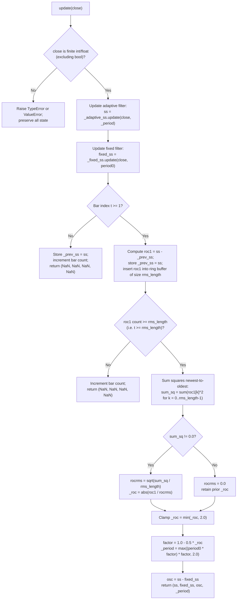
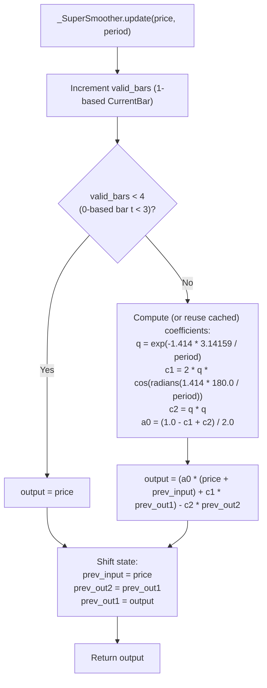

# Adaptive SuperSmoother

**Master Reference Documentation for Cross-Language Implementation**

- **Author:** John F. Ehlers
- **Primary Sources:**
  - John F. Ehlers, “Improved Filter Performance: Adaptive SuperSmoother,” *Technical Analysis of Stocks & Commodities* (TASC), Vol. 44, No. 9, September 2026.
  - John F. Ehlers, “Adaptive SuperSmoother,” MESA Software technical paper ([Adaptive SuperSmoother.pdf](https://www.mesasoftware.com/papers/Adaptive%20SuperSmoother.pdf)).
  - *Traders' Tips — September 2026*, *Technical Analysis of Stocks & Commodities*, Vol. 44, No. 9, September 2026 (TradeStation EasyLanguage, RealTest, The Zorro Project, WealthLab, TradingView Pine Script, Python, thinkorswim, NeuroShell Trader, NinjaTrader).
- **Foundational Book Chapters:**
  - John F. Ehlers, *Cybernetic Analysis for Stocks and Futures: Cutting-Edge DSP Technology to Improve Your Trading*, Wiley, 2004, Chapter 13: “Super Smoother Filter.”
  - John F. Ehlers, *Cycle Analytics for Traders: Advanced Technical Trading Concepts*, Wiley, 2013, Chapter 1: “Unified Filter Theory” and Chapter 3: “Smoothing Filters on Steroids.”

---

## 1. Basic Principles and Physical Analogies

### 1.1 Why Traditional Adaptive Moving Averages Fall Short

Most classical adaptive moving averages—including Kaufman's Adaptive Moving Average (KAMA), Chande's Variable Index Dynamic Average (VIDYA), Arnaud Legoux Moving Average (ALMA), the One Euro Filter, the Alpha-Beta Filter, and scalar forms of the Kalman Filter—are constructed around a first-order **Exponential Moving Average (EMA)** core. They achieve adaptivity by measuring market volatility, efficiency, or rate of change and mapping that measurement onto the EMA smoothing factor $\alpha$.

Ehlers demonstrates that the underlying problem with all EMA-based adaptive filters is that **the first-order EMA is an inherently weak low-pass filter**. In EasyLanguage notation, an EMA is written as:

$$\mathrm{Out}_t = \alpha \cdot \mathrm{In}_t + (1 - \alpha) \cdot \mathrm{Out}_{t-1}$$

where $\mathrm{Out}_{t-1}$ (written `Out[1]` in EasyLanguage) is the filter output one bar ago. Rearranging terms to place the output on the left-hand side yields:

$$\mathrm{Out}_t - (1 - \alpha) \cdot \mathrm{Out}_{t-1} = \alpha \cdot \mathrm{In}_t$$

Using the $z$-transform, where $z^{-1}$ represents a one-bar unit delay ($\mathrm{Out}_{t-1} \leftrightarrow z^{-1}\mathrm{Out}(z)$), the transfer response $H_{\mathrm{EMA}}(z)$ (the ratio of output to input in the $z$-domain) is:

$$H_{\mathrm{EMA}}(z) = \frac{\mathrm{Out}(z)}{\mathrm{In}(z)} = \frac{\alpha}{1 - (1 - \alpha) z^{-1}}$$

For discrete data sampled once per bar, the highest representable frequency is the **Nyquist frequency** ($f = 0.5\text{ cycles/bar}$, corresponding to a $2$-bar cycle period), where $z = e^{j\pi} = -1$ and therefore $z^{-1} = -1$. Evaluating the EMA transfer response at the Nyquist frequency gives the maximum possible high-frequency attenuation of the filter:

$$H_{\mathrm{EMA}}(-1) = \frac{\alpha}{2 - \alpha}$$

In Ehlers' filter theory, the EMA smoothing constant $\alpha$ is related to the filter's critical (cutoff) period $\mathrm{Period}$ by:

$$\alpha = \frac{2\pi}{4\pi + \mathrm{Period}}$$

As a concrete example from the article, if the critical period is $\mathrm{Period} = 12$ bars:

$$\alpha = \frac{2\pi}{4\pi + 12} \approx 0.25576 \approx 0.25$$

Substituting $\alpha \approx 0.25$ into the Nyquist gain expression gives:

$$H_{\mathrm{EMA}}(-1) \approx \frac{0.25}{2 - 0.25} = \frac{1}{7} \approx 0.14286 \quad\Longrightarrow\quad 20 \log_{10}(0.14286) \approx -16.90\text{ dB} \approx -17\text{ dB}$$

Passing $14.3\%$ of Nyquist-frequency bar-to-bar sawtooth noise makes the first-order EMA a poor smoothing element, no matter how cleverly its $\alpha$ is adapted.

### 1.2 Why the SuperSmoother Replaces the EMA

Ehlers' **SuperSmoother** replaces the first-order EMA with a second-order infinite impulse response (IIR) digital filter derived from a two-pole analog Butterworth low-pass filter, augmented with a two-bar simple average in the numerator:

1. **Second-Order Denominator (Two Complex-Conjugate Poles):** Whereas the EMA has a first-order polynomial in $z^{-1}$ in its denominator ($6\text{ dB/octave}$ roll-off above cutoff), the SuperSmoother has a second-order polynomial in $z^{-1}$ ($12\text{ dB/octave}$ roll-off above cutoff) with damping ratio $\zeta = 1/\sqrt{2} \approx 0.7071$ (`1.414 / 2`) for a maximally flat passband.
2. **Transmission Zero at the Nyquist Frequency:** Because the numerator averages the current and prior input samples, $\frac{1 + z^{-1}}{2}$, the transfer function vanishes identically at $z^{-1} = -1$:
   $$H_{\mathrm{SS}}(-1) = 0 \quad (-\infty\text{ dB attenuation at the Nyquist frequency})$$
   Two-bar aliasing noise is completely rejected at the cost of only $0.5$ bars of additional lag compared to an all-pole modified Butterworth filter, and with no perceptibly greater computational lag than an EMA of the same critical period.

### 1.3 Physical Analogy of Closed-Loop Adaptive Period Tuning

Instead of adapting an EMA's $\alpha$, the **Adaptive SuperSmoother** directly tunes the critical period $P_t$ of the SuperSmoother in a **closed-loop feedback system**:

- **Physical / Control-Systems Analogy:** Consider a critically damped second-order mechanical suspension or phase-locked resonator with an adjustable natural frequency $\omega_c \propto 1/P_t$. A velocity sensor measures the instantaneous output slope ($\mathrm{ROC}_1 = \mathrm{SS}_t - \mathrm{SS}_{t-1}$). An automatic gain control (AGC) circuit normalizes this velocity by its rolling Root Mean Square ($\mathrm{RMS}$) over $R = 81$ bars—which equals the standard deviation $\sigma$ of the slope because the slope of a cyclic series has a nominal zero mean.
- **Nonlinear Stiffening Law:** Expressing the absolute slope in standard deviations as $\mathrm{ROC}_t = \min\!\left(|\mathrm{ROC}_1| / \mathrm{ROCRMS},\; 2\right)$, the filter updates its critical period for the next bar via a quadratic contraction law:
  $$P_t = \max\!\left(2,\; P_0 \left(1 - \frac{1}{2}\mathrm{ROC}_t\right)^2\right)$$
  - **During fast directional thrusts ($\mathrm{ROC}_t \to 2\sigma$):** The factor $(1 - 0.5\,\mathrm{ROC}_t)^2 \to 0$, and the floor clamps $P_t$ at the Nyquist limit of $2$ bars. The resonator stiffens immediately, tracking rapid price movement with minimal phase lag.
  - **At cyclical peaks, valleys, and quiet consolidations ($\mathrm{ROC}_t \to 0$):** As the slope passes through zero at a turning point, $(1 - 0.5\,\mathrm{ROC}_t)^2 \to 1$ and $P_t \to P_0$. The filter smoothly relaxes back to its nominal critical period $P_0$, providing heavy two-pole smoothing right as the market turns.
- **The Adaptive SuperSmoother Oscillator ($\mathrm{Osc}_t = \mathrm{SS}_t - \mathrm{SS}_{\mathrm{fixed},t}$):** Subtracting the fixed-period SuperSmoother (tuned permanently to $P_0$) from the closed-loop adaptive SuperSmoother cancels the baseline trend component and isolates the differential phase/amplitude response. Because the adaptive filter decelerates and reverses right at zero slope ($P_t \to P_0$) while accelerating along trends ($P_t \to 2$), the oscillator's extrema align closely with cyclic price turning points, and its sign ($\mathrm{Osc}_t > 0$ for long, $\mathrm{Osc}_t < 0$ for short) defines the preferred directional posture.

---

## 2. Theoretical Background from Ehlers' Books

Agents porting or validating this indicator do not have access to Ehlers' textbooks. This section reproduces the complete mathematical derivations from the relevant chapters.

### 2.1 Unified Filter Theory (*Cycle Analytics for Traders*, Chapter 1)

In discrete-time digital signal processing (DSP) with one sample per bar, $z^{-1}$ denotes a one-bar delay. A four-element Simple Moving Average (SMA) has the transfer function (Equation 1-1):

$$H(z) = \frac{1}{4} + \frac{1}{4} z^{-1} + \frac{1}{4} z^{-2} + \frac{1}{4} z^{-3} \tag{1-1}$$

A general nonrecursive or **Finite Impulse Response (FIR)** filter of degree $N$ has the polynomial transfer function (Equation 1-2):

$$H(z) = b_0 + b_1 z^{-1} + b_2 z^{-2} + \cdots + b_N z^{-N} \tag{1-2}$$

For any symmetric FIR filter with $N + 1$ coefficients ($M = N + 1$ taps), the group delay (lag) is constant across all frequencies and equals:

$$\mathrm{Lag}_{\mathrm{FIR}} = \frac{N}{2} = \frac{M - 1}{2}\text{ bars}$$

Furthermore, any symmetric FIR filter with an even number of elements (odd polynomial degree $N$) has a root at $z^{-1} = -1$, creating a transmission zero at the Nyquist frequency ($f = 0.5\text{ cycles/bar}$).

To achieve a sharper transition between passband and stopband without the large lag of high-order FIR filters, feedback terms are introduced in the denominator, producing a recursive or **Infinite Impulse Response (IIR)** filter with rational transfer function (Equation 1-3):

$$H(z) = \frac{Y(z)}{X(z)} = \frac{b_0 + b_1 z^{-1} + b_2 z^{-2} + \cdots + b_N z^{-N}}{a_0 + a_1 z^{-1} + a_2 z^{-2} + \cdots + a_N z^{-N}} \tag{1-3}$$

Cross-multiplying and transforming back to the time domain gives the general recurrence relation (Equation 1-4):

$$y_t = \frac{\sum_{i=0}^{N} b_i x_{t-i} - \sum_{i=1}^{N} a_i y_{t-i}}{a_0} \tag{1-4}$$

### 2.2 Regularized and Butterworth Digital Filters (*Cybernetic Analysis for Stocks and Futures*, Chapter 13)

In Chapter 13 of *Cybernetic Analysis for Stocks and Futures* (2004), Ehlers contrasts the first-order EMA transfer function (Equation 13.8):

$$H(z) = \frac{\alpha}{1 - (1 - \alpha) z^{-1}} \tag{13.8}$$

with Chris Satchwell's second-order Regularized EMA filter (Equation 13.9):

$$H(z) = \frac{\frac{1}{1 + \lambda}}{1 - \frac{1 - \alpha + 2\lambda}{1 + \lambda} z^{-1} + \frac{\lambda}{1 + \lambda} z^{-2}} \tag{13.9}$$

An $N$-th order polynomial in the denominator factors into $N$ roots, producing $N$ **poles** in the transfer response. Each pole adds $6\text{ dB/octave}$ ($20\text{ dB/decade}$) of asymptotic stopband attenuation slope.

Analog **Butterworth filters** are maximally flat low-pass filters because the first $2N - 1$ derivatives of their squared magnitude response:

$$|H(j\Omega)|^2 = \frac{1}{1 + (\Omega / \Omega_c)^{2N}}$$

are zero at zero frequency ($\Omega = 0$), and their half-power ($-3\text{ dB}$) point occurs at the cutoff frequency $\Omega_c$ (cutoff period $P = 1 / f_c$). Ehlers' digital approximations express the two-pole and three-pole Butterworth filters directly in terms of the cutoff period $P$:

- **Two-Pole Digital Butterworth Filter (Equation 13.10):**
  $$\begin{aligned}
  a &= \exp\!\left(-\frac{1.414 \cdot 3.14159}{P}\right) \\
  b &= 2 a \cos_{\mathrm{deg}}\!\left(\frac{1.414 \cdot 180}{P}\right) \\
  \mathrm{Butter}_t &= \frac{1 - b + a^2}{4}\left(\mathrm{Price}_t + 2\,\mathrm{Price}_{t-1} + \mathrm{Price}_{t-2}\right) + b\,\mathrm{Butter}_{t-1} - a^2\,\mathrm{Butter}_{t-2}
  \end{aligned} \tag{13.10}$$

- **Three-Pole Digital Butterworth Filter (Equation 13.11):**
  $$\begin{aligned}
  a &= \exp\!\left(-\frac{3.14159}{P}\right) \\
  b &= 2 a \cos_{\mathrm{deg}}\!\left(\frac{1.738 \cdot 180}{P}\right), \qquad c = a^2 \\
  \mathrm{Butter}_t &= \frac{(1 - b + c)(1 - c)}{8}\left(\mathrm{Price}_t + 3\,\mathrm{Price}_{t-1} + 3\,\mathrm{Price}_{t-2} + \mathrm{Price}_{t-3}\right) \\
  &\quad + (b + c)\,\mathrm{Butter}_{t-1} - (c + b c)\,\mathrm{Butter}_{t-2} + c^2\,\mathrm{Butter}_{t-3}
  \end{aligned} \tag{13.11}$$

In generic second-order form (Equation 13.12):

$$H(z) = \frac{A_0 + A_1 z^{-1} + A_2 z^{-2}}{1 + B_1 z^{-1} + B_2 z^{-2}} \tag{13.12}$$

Ehlers observed that the $[1\;\;2\;\;1]$ and $[1\;\;3\;\;3\;\;1]$ binomial FIR numerators in Equations (13.10) and (13.11) primarily add phase lag ($1.0$ bar and $1.5$ bars, respectively).

### 2.3 Modified Butterworth and the 2013 SuperSmoother (*Cycle Analytics for Traders*, Chapter 3)

In Chapter 3 of *Cycle Analytics for Traders* (2013), Ehlers refines this progression in three steps:

1. **Two-Pole Modified Butterworth Filter (Equation 3-1, all-pole IIR):**
   $$\begin{aligned}
   a &= \exp\!\left(-\frac{1.414 \cdot 3.14159}{P}\right), \qquad b = 2 a \cos_{\mathrm{deg}}\!\left(\frac{1.414 \cdot 1.25 \cdot 180}{P}\right) \\
   c_2 &= b, \qquad c_3 = -a^2, \qquad c_1 = 1 - c_2 - c_3 \\
   \mathrm{Output}_t &= c_1\,\mathrm{Input}_t + c_2\,\mathrm{Output}_{t-1} + c_3\,\mathrm{Output}_{t-2}
   \end{aligned} \tag{3-1}$$
2. **Three-Pole Modified Butterworth Filter (Equation 3-2, all-pole IIR):**
   $$\begin{aligned}
   a &= \exp\!\left(-\frac{3.14159}{P}\right), \qquad b = 2 a \cos_{\mathrm{deg}}\!\left(\frac{1.738 \cdot 180}{P}\right), \qquad c = a^2 \\
   d_2 &= b + c, \qquad d_3 = -(c + b c), \qquad d_4 = c^2, \qquad d_1 = 1 - d_2 - d_3 - d_4 \\
   \mathrm{Output}_t &= d_1\,\mathrm{Input}_t + d_2\,\mathrm{Output}_{t-1} + d_3\,\mathrm{Output}_{t-2} + d_4\,\mathrm{Output}_{t-3}
   \end{aligned} \tag{3-2}$$
3. **The Two-Pole SuperSmoother Filter (Equation 3-3):**
   By restoring a two-element moving average $\frac{1 + z^{-1}}{2}$ in the numerator of the two-pole filter (at a delay cost of only $0.5$ bars), Ehlers introduces an exact zero of transmission at the Nyquist frequency ($z = -1$):
   $$\begin{aligned}
   a &= \exp\!\left(-\frac{1.414 \cdot 3.14159}{P}\right) \\
   b &= 2 a \cos_{\mathrm{deg}}\!\left(\frac{1.414 \cdot 180}{P}\right) \\
   c_2 &= b, \qquad c_3 = -a^2, \qquad c_1 = 1 - c_2 - c_3 \\
   \mathrm{Output}_t &= c_1 \frac{\mathrm{Input}_t + \mathrm{Input}_{t-1}}{2} + c_2\,\mathrm{Output}_{t-1} + c_3\,\mathrm{Output}_{t-2}
   \end{aligned} \tag{3-3}$$

#### Aliasing Noise vs. Systemic Noise

Ehlers distinguishes two noise regimes in sampled market data:

- **Aliasing (quantization/sampling) noise:** Caused by sampling continuous market activity once per bar. A 2-bar cycle has only 2 samples per cycle; a 4-bar cycle has 4; an 8-bar cycle has 8. Aliasing noise decreases at a rate of **$6\text{ dB/octave}$** as cycle period doubles. At cycle periods of 8 bars or longer (two octaves below Nyquist), aliasing noise is at least $12\text{ dB}$ below its Nyquist level.
- **Systemic market noise:** Random trade execution noise, typically about $10\text{ dB}$ below the cyclic signal amplitude.
- Because aliasing noise rises at $6\text{ dB/octave}$ toward Nyquist while the two-pole SuperSmoother attenuates frequencies above cutoff at **$12\text{ dB/octave}$** and has an exact zero ($-\infty\text{ dB}$) at Nyquist, the SuperSmoother eliminates aliasing noise without the lag penalty of a 3-pole filter or SMA.

---

## 3. Complete Indicator Equations and Numerical Contract

### 3.1 Authoritative EasyLanguage Source (Code Listings 1–3)

The following three listings are transcribed verbatim from Ehlers' September 2026 article and MESA paper:

#### Code Listing 1: Adaptive SuperSmoother Indicator
```easylanguage
{
Adaptive SuperSmoother
(C) 2025 John F. Ehlers
}
Inputs:
Period0(20);

Vars:
SS(0),
Period(20),
ROC1(0),
ROCRMS(0),
ROC(0);

SS = $SuperSmoother(Close, Period);
ROC1 = SS - SS[1];
ROCRMS = $RMS(ROC1, 81);
If ROCRMS <> 0 Then ROC = AbsValue(ROC1 / ROCRMS);
If ROC > 2 Then ROC = 2;
Period = Period0*(1 - .5*ROC)*(1 - .5*ROC);
If Period < 2 Then Period = 2;
Plot1($SuperSmoother(Close, Period0));
Plot2(SS);
```

#### Code Listing 2: `$SuperSmoother` Function
```easylanguage
{
$SuperSmoother Function
(C) 2025 John F. Ehlers
}
Inputs:
Price(numericseries),
Period(numericsimple);

Vars:
a0(0),
Q(0),
c1(0),
c2(0);

Q = expvalue(-1.414*3.14159 / Period);
c1 = 2*Q*Cosine(1.414*180 / Period);
c2 = Q*Q;
a0 = (1 - c1 + c2) / 2;

If CurrentBar >= 4 Then
    $SuperSmoother = a0*(Price + Price[1]) + c1*$SuperSmoother[1] - c2*$SuperSmoother[2];
If Currentbar < 4 Then $SuperSmoother = Price;
```

#### Code Listing 3: `$RMS` Function
```easylanguage
{
$RMS Function
(C) 2025 John F. Ehlers
}
Inputs:
Price(numericseries),
Length(numericsimple);

Vars:
SumSq(0),
count(0);

SumSq = 0;
for count = 0 to Length - 1 Begin
    SumSq = SumSq + Price[count]*Price[count];
End;
If SumSq <> 0 Then $RMS = SquareRoot(SumSq / Length);
```

### 3.2 Exact Mathematical Equations & IEEE-754 Evaluation Order

Let $p_t = \mathrm{Close}_t$ be the input close price at 0-based bar index $t = 0, 1, 2, \dots$ (corresponding to 1-based EasyLanguage `CurrentBar` $k = t + 1 = 1, 2, 3, \dots$). Let $P_0 = \text{period0}$ be the nominal base period and $R = \text{rms\_length}$ be the RMS lookback window length.

#### Step 1: SuperSmoother Coefficients for Any Period $P > 0$

In Code Listing 2, Ehlers writes $a_0 = c_1^{\text{(book)}} / 2$, $c_1 = c_2^{\text{(book)}}$, and $c_2 = -c_3^{\text{(book)}}$ compared to Equation (3-3). For any positive period $P$:

$$Q(P) = \exp\!\left(-\frac{1.414 \cdot 3.14159}{P}\right)$$

$$\theta_{\mathrm{deg}}(P) = \frac{1.414 \cdot 180.0}{P}, \qquad \theta_{\mathrm{rad}}(P) = \theta_{\mathrm{deg}}(P) \cdot \frac{\pi}{180.0}$$

$$c_1(P) = \begin{cases} 0.0, & Q(P) = 0.0 \text{ (binary64 underflow guard)} \\ 2.0 \cdot Q(P) \cdot \cos\!\left(\theta_{\mathrm{rad}}(P)\right), & Q(P) \neq 0.0 \end{cases}$$

$$c_2(P) = Q(P) \cdot Q(P), \qquad a_0(P) = \frac{(1.0 - c_1(P)) + c_2(P)}{2.0}$$

**Critical Porting Rules for Coefficients:**
- Do **not** replace `1.414` with $\sqrt{2}$ (`1.4142135623730951`).
- Do **not** replace `3.14159` in the exponential argument with full-precision $\pi$ (`3.141592653589793`).
- EasyLanguage's `Cosine(...)` accepts **degrees**. Evaluate the degree expression `1.414 * 180.0 / P` first, then convert degrees to radians using standard-library full-precision $\pi$ (`math.radians(1.414 * 180.0 / P)`).

#### Step 2: Two Independent SuperSmoother States

Code Listing 1 invokes `$SuperSmoother` at two distinct call sites, each maintaining its own persistent two-bar output history:

1. **Adaptive SuperSmoother ($\mathrm{SS}_t$):** Driven by the state variable $P_{t-1}$ (the tuned `Period` computed at the end of bar $t - 1$, with initial value $P_{-1} = P_0$):
   $$\mathrm{SS}_t = \begin{cases} p_t, & t \in \{0, 1, 2\} \quad (\text{CurrentBar} < 4) \\[4pt] \left(a_0(P_{t-1}) \cdot (p_t + p_{t-1}) + c_1(P_{t-1}) \cdot \mathrm{SS}_{t-1}\right) - c_2(P_{t-1}) \cdot \mathrm{SS}_{t-2}, & t \ge 3 \quad (\text{CurrentBar} \ge 4) \end{cases}$$

2. **Fixed-Period SuperSmoother ($\mathrm{SS}_{\mathrm{fixed},t}$):** Driven by the constant base period $P_0$ (whose coefficients $a_0(P_0), c_1(P_0), c_2(P_0)$ are invariant across bars):
   $$\mathrm{SS}_{\mathrm{fixed},t} = \begin{cases} p_t, & t \in \{0, 1, 2\} \quad (\text{CurrentBar} < 4) \\[4pt] \left(a_0(P_0) \cdot (p_t + p_{t-1}) + c_1(P_0) \cdot \mathrm{SS}_{\mathrm{fixed},t-1}\right) - c_2(P_0) \cdot \mathrm{SS}_{\mathrm{fixed},t-2}, & t \ge 3 \quad (\text{CurrentBar} \ge 4) \end{cases}$$

 The $z$-domain transfer function of the fixed-period filter is:

$$H_{P_0}(z) = \frac{a_0(P_0)\left(1 + z^{-1}\right)}{1 - c_1(P_0) z^{-1} + c_2(P_0) z^{-2}}$$

which satisfies $H_{P_0}(1) = \frac{2\,a_0(P_0)}{1 - c_1(P_0) + c_2(P_0)} = 1$ (unity DC gain, zero steady-state tracking error on constant price) and $H_{P_0}(-1) = 0$ (complete Nyquist rejection).

#### Step 3: One-Bar Rate of Change ($\mathrm{ROC1}_t$) and Full-Window RMS Warmup

For every bar $t \ge 1$, two consecutive values of the adaptive filter ($\mathrm{SS}_t$ and $\mathrm{SS}_{t-1}$) exist, yielding the one-bar difference:

$$\mathrm{ROC1}_t = \mathrm{SS}_t - \mathrm{SS}_{t-1}, \qquad t \ge 1$$

Why is no $\mathrm{ROC1}_0$ formed on bar $t = 0$? In TradeStation EasyLanguage, `MaxBarsBack` pre-loads historical bars before `CurrentBar = 1` begins. In a standalone streaming implementation with no hidden pre-history, subtracting a default zero initial value on bar $t = 0$ ($\mathrm{SS}_0 - 0 = p_0$) would inject a synthetic price-level spike $p_0^2$ into the squared-sum window for the first $R$ bars. Instead, $\mathrm{ROC1}_t$ is defined starting at $t = 1$.

Consequently:
- After bar $t$, exactly $t$ valid differences ($\mathrm{ROC1}_1, \dots, \mathrm{ROC1}_t$) have been observed.
- A complete $R$-bar window of $\mathrm{ROC1}$ values first exists at **0-based bar index $t = R$** (after $R + 1$ input closes).
- **During warmup ($0 \le t < R$):**
  - Both internal SuperSmoothers ($\mathrm{SS}_t$ and $\mathrm{SS}_{\mathrm{fixed},t}$) update on each bar using $P_{t-1} = P_0$ (so their internal states are identical up through bar $t = R$).
  - The retained variables remain at their initial values: $\mathrm{ROC}_t = 0.0$ and $P_t = P_0$.
  - The public output returned by `update(close)` is `(NaN, NaN, NaN, NaN)`.

#### Step 4: Primed RMS Scaling, Retained `ROC`, and Closed-Loop Period Update ($t \ge R$)

On every primed bar $t \ge R$, accumulate the sum of squares in newest-to-oldest order (`count = 0` to `R - 1`), matching Code Listing 3:

$$\mathrm{SumSq}_t = \sum_{\mathrm{count}=0}^{R - 1} \left(\mathrm{ROC1}_{t - \mathrm{count}}\right) \cdot \left(\mathrm{ROC1}_{t - \mathrm{count}}\right)$$

$$\mathrm{ROCRMS}_t = \begin{cases} \sqrt{\mathrm{SumSq}_t / R}, & \mathrm{SumSq}_t \neq 0.0 \\ 0.0, & \mathrm{SumSq}_t = 0.0 \end{cases}$$

Next, update the retained series variable $\mathrm{ROC}$ (initialized to $\mathrm{ROC}_{\mathrm{init}} = 0.0$). Notice that Code Listing 1 writes:

```easylanguage
If ROCRMS <> 0 Then ROC = AbsValue(ROC1 / ROCRMS);
If ROC > 2 Then ROC = 2;
```

There is no `Else ROC = 0`: in EasyLanguage, `Vars: ROC(0)` is a retained series variable. If $\mathrm{ROCRMS}_t = 0.0$ after a prior non-zero move has aged out into a completely flat window, $\mathrm{ROC}$ retains its previous bar's value:

$$\mathrm{ROC}^{\mathrm{raw}}_t = \begin{cases} |\mathrm{ROC1}_t / \mathrm{ROCRMS}_t|, & \mathrm{ROCRMS}_t \neq 0.0 \\ \mathrm{ROC}_{t-1}, & \mathrm{ROCRMS}_t = 0.0 \end{cases}$$

$$\mathrm{ROC}_t = \min\!\left(\mathrm{ROC}^{\mathrm{raw}}_t,\; 2.0\right)$$

Then compute the tuned critical period $P_t$ (which will be used to filter $\mathrm{SS}_{t+1}$ on the **next** bar) preserving EasyLanguage's left-to-right multiplication order `Period0 * (1 - 0.5 * ROC) * (1 - 0.5 * ROC)`:

$$f_t = 1.0 - 0.5 \cdot \mathrm{ROC}_t$$

$$P^{\mathrm{raw}}_t = \left(P_0 \cdot f_t\right) \cdot f_t$$

$$P_t = \max\!\left(P^{\mathrm{raw}}_t,\; 2.0\right)$$

Finally, compute the Adaptive SuperSmoother Oscillator:

$$\mathrm{Osc}_t = \mathrm{SS}_t - \mathrm{SS}_{\mathrm{fixed},t}$$

and return the four-field tuple $(\mathrm{SS}_t,\; \mathrm{SS}_{\mathrm{fixed},t},\; \mathrm{Osc}_t,\; P_t)$.

### 3.3 Summary of Standalone Startup and Warmup Behavior

| 0-Based Bar Index $t$ | Closes Seen | `ROC1` Count | Internal State Updates | Public Output `(ss, fixed_ss, osc, period)` |
|---|---|---|---|---|
| $t = 0$ | $1$ | $0$ | $\mathrm{SS}_0 = p_0$, $\mathrm{SS}_{\mathrm{fixed},0} = p_0$, $P_0^{\mathrm{state}} = P_0$ | `(NaN, NaN, NaN, NaN)` |
| $t = 1, 2$ (`CurrentBar < 4`) | $2, 3$ | $1, 2$ | $\mathrm{SS}_t = p_t$, $\mathrm{SS}_{\mathrm{fixed},t} = p_t$, $\mathrm{ROC1}_t = p_t - p_{t-1}$; if $t < R$, $P_t^{\mathrm{state}} = P_0$ | `(NaN, NaN, NaN, NaN)` if $t < R$ |
| $3 \le t < R$ (`CurrentBar >= 4`) | $t + 1$ | $t$ | Both filters recurse with period $P_0$; $\mathrm{ROC1}_t = \mathrm{SS}_t - \mathrm{SS}_{t-1}$; $P_t^{\mathrm{state}} = P_0$ | `(NaN, NaN, NaN, NaN)` |
| $t = R$ (First Primed Bar) | $R + 1$ | $R$ | $\mathrm{SS}_R$ uses $P_{R-1} = P_0 \implies \mathrm{SS}_R = \mathrm{SS}_{\mathrm{fixed},R}$ and $\mathrm{Osc}_R = 0.0$; first tuned $P_R$ computed | $(\mathrm{SS}_R,\; \mathrm{SS}_{\mathrm{fixed},R},\; 0.0,\; P_R)$ |
| $t \ge R + 1$ | $t + 1$ | $\ge R$ | $\mathrm{SS}_t$ uses $P_{t-1}$ from bar $t - 1$; $\mathrm{SS}_t$ and $\mathrm{SS}_{\mathrm{fixed},t}$ diverge whenever $P_{t-1} \neq P_0$ | $(\mathrm{SS}_t,\; \mathrm{SS}_{\mathrm{fixed},t},\; \mathrm{Osc}_t,\; P_t)$ |

**Important Structural Invariants for Port Verification:**
1. **First Primed Bar Identity ($t = R$):** Because $P_{t-1} = P_0$ for all $t \le R$, on the first primed bar $t = R$ the adaptive filter $\mathrm{SS}_R$ and fixed filter $\mathrm{SS}_{\mathrm{fixed},R}$ have used identical periods on every bar since $t = 0$. Therefore, at $t = R$, $\mathrm{SS}_R == \mathrm{SS}_{\mathrm{fixed},R}$ and $\mathrm{Osc}_R == 0.0$ to full machine precision, while $P_R$ already reflects the newly tuned period for bar $R + 1$.
2. **Nyquist Floor Identity ($P_0 = 2$):** When $P_0 = 2$, since $\mathrm{ROC}_t \in [0, 2]$, $(1 - 0.5\,\mathrm{ROC}_t)^2 \in [0, 1]$, so $P_0 (1 - 0.5\,\mathrm{ROC}_t)^2 \le 2.0$. Clamping at the lower bound $P_t = \max(P^{\mathrm{raw}}_t, 2.0)$ forces $P_t = 2.0$ on every bar. Thus, for $P_0 = 2$, $\mathrm{SS}_t == \mathrm{SS}_{\mathrm{fixed},t}$, $\mathrm{Osc}_t == 0.0$, and $P_t == 2.0$ for all $t \ge R$.

---

## 4. Configuration Parameters and Output Specification

### 4.1 Configuration Parameters

| Parameter | Shortcut | Type | Valid Range | Default | Description |
|---|---|---|---|---:|---|
| `period0` | `P` | `int \| float` (excluding `bool`) | Finite $> 0.0$ (practical $\ge 2.0$, typical $4 \dots 60$) | `20` | Nominal (unadapted) critical period $P_0$ of both the fixed SuperSmoother and the adaptive SuperSmoother at zero slope ($\mathrm{ROC} = 0$). |
| `rms_length` | `R` | `int` (excluding `bool`) | Integer $\ge 1$ (practical $2 \dots 250$, article default $81$) | `81` | Number of one-bar adaptive SuperSmoother differences ($\mathrm{ROC1}_t = \mathrm{SS}_t - \mathrm{SS}_{t-1}$) in the rolling Root Mean Square ($\mathrm{RMS}$) window. Also determines `warmup_bars`. |

**Parameter Notes:**
- Ehlers chooses `rms_length = 81` because 81 bars corresponds to 3 trading days of the U.S. equity day session on 15-minute bars ($27 \times 3 = 81$) or approximately 4 months of daily bars. He notes in the article that *"the length over which the RMS is taken is not particularly critical."*
- While `period0 < 2.0` is accepted mathematically by the constructor for diagnostic completeness (just as in `the-reversion-index`), any `period0 <= 2.0` will be clamped to `2.0` once adaptive period tuning begins at bar $t = R$.

### 4.2 Output Fields (`AdaptiveSuperSmootherResult`)

| Field | Array Suffix | Type | Description |
|---|---|---|---|
| `ss` | `_SS` | `float` | Closed-loop Adaptive SuperSmoother value (`Plot2(SS)` in Code Listing 1). `NaN` for $t < R$. |
| `fixed_ss` | `_FIXED` | `float` | Fixed-period SuperSmoother value with period `period0` (`Plot1($SuperSmoother(Close, Period0))` in Code Listing 1). `NaN` for $t < R$. |
| `osc` | `_OSC` | `float` | Adaptive SuperSmoother Oscillator (`ss - fixed_ss`), plotted in the lower subgraph of Figure 1 in the article. Positive values favor long positions; negative values favor short positions. `NaN` for $t < R$. |
| `period` | `_PERIOD` | `float` | Newly tuned adaptive critical period $P_t \in [2.0, \max(2.0, P_0)]$ computed on bar $t$ and applied to `ss` on bar $t + 1$. `NaN` for $t < R$. |

---

## 5. Algorithmic Calculation Flow (Mermaid Flowcharts)

### 5.1 Streaming Update Pipeline (`AdaptiveSuperSmoother.update`)



### 5.2 Internal SuperSmoother Step (`_SuperSmoother.update`)



---

## 6. Comparison of Source and Traders' Tips Implementations

The September 2026 issue of *Technical Analysis of Stocks & Commodities* includes nine Traders' Tips contributions alongside Ehlers' article. Reviewing them reveals important implementation differences that ports must not confuse with the authoritative algorithm:

| Implementation | Feedback Architecture | `SuperSmoother` Constants & Seed | `RMS` Warmup & Scaling | Notes |
|---|---|---|---|---|
| **Ehlers Article / MESA & TradeStation** (EasyLanguage) | **Closed-loop feedback:** `SS` uses prior bar's `Period`; `ROC1 = SS - SS[1]` is taken from the adaptive `SS` itself. | `1.414`, `3.14159` in `exp`, `Cosine(1.414*180/Period)` in degrees; `CurrentBar < 4` (3 bars) seeds `SS = Price`. | 81-bar loop `SumSq / 81`; `ROC` retained if `ROCRMS == 0`; `Period = Period0*(1-.5*ROC)*(1-.5*ROC)` floored at `2`. | **Tier-1 numerical authority.** |
| **RealTest** (Marsten Parker) | **Closed-loop feedback:** `SSadapt` references `SSadapt[1] - SSadapt[2]` inside `EhlersSS` period argument. | Built-in `EhlersSS`. | `nonan(..., 0)` holds `Period = Period0` during the 81-bar RMS warmup window. Plots `SSfixed`, `SSadapt`, `Osc`, and `adPeriod[1]`. | Matches our standalone RMS warmup convention (`Period = Period0` until full RMS window). |
| **The Zorro Project** (Petra Volkova, C) | **Closed-loop feedback:** `static var Period = 20; var SS = Smooth(Data, Period); var ROC1 = SS - ref(SS, 1);` | Zorro built-in `Smooth`. | `sqrt(SumSq(series(ROC1), 81) / 81)` with `LookBack = 100`. | Direct 1:1 C translation of Ehlers' EasyLanguage. |
| **WealthLab** (Robert Sucher, C#) | Uses `WealthLab.TASC.SuperSmootherAdaptive` and `SuperSmoother`. | Library indicator; optimizer sweeps `Period` over `4..40` step `2` (default `20`). | Library default `81`. Creates `osc = ssa - ss`. | Confirms practical parameter sweep range `4..40`. |
| **TradingView Pine Script** (PineCoders) | **Two-stage feedforward approximation:** computes `roc1` from a *fixed-period* `superSmoother(source, period)` and feeds `aPeriod` into a second `superSmoother(source, aPeriod)`. | Uses `math.pi` in both `exp` and `cos`; `bar_index >= 4` (4 seed bars instead of 3 because Pine `bar_index` is 0-based); truncates `aPeriod` with `int(...)`! | `ta.sma(roc1 * roc1, rmsLength)` (returns `na` until `rmsLength` bars). Exposes `perInput = 20` (min 2) and `rmsInput = 81` (min 2). | Diverges from Ehlers due to feedforward `roc1`, `int(aPeriod)` truncation, 4-bar seed, and `math.pi`. |
| **Python Traders' Tip** (Rajeev Jain) | **Mixed two-pass:** Pass 1 computes `roc1` from *fixed* `supersmoother(close, period0)` over an expanding RMS slice `roc1[max(0, i-rms_length+1):i+1]`; Pass 2 applies `period_series[i-1]` recursively to `ss_adaptive`. | Uses `np.pi` in both `exp` and `cos`; seeds only 2 bars (`out[0]`, `out[1]`) instead of 3 (`CurrentBar < 4`). | Expanding window (`np.mean(window**2)`) from index `1` instead of fixed `rms_length` divisor. | Diverges from Ehlers due to fixed-SS `roc1` in pass 1, 2-bar seed, expanding RMS, and `np.pi`. |

This master reference implementation follows **Ehlers' closed-loop EasyLanguage equations and exact numerical literals**, combined with the clean standalone full-window RMS warmup (`t < rms_length` returns `NaN`, holding `Period = Period0` during warmup so no synthetic bar-0 price jump pollutes the 81-bar RMS sum).

---

## 7. Confirmed Parameter Grid and Multi-Language Test Data

### 7.1 Parameter Grid (16 Combinations × 4 Outputs = 64 Arrays per Language)

All five test data files (`test_testdata.py`, `testdata_test.go`, `testdata.ts`, `testdata.rs`, `testdata.zig`) contain the 252-bar `INPUT_CLOSE` (`testInput` / `test_input`) series along with 64 expected output arrays generated from the following 16 confirmed `(period0, rms_length)` combinations:

| # | `period0` (`P`) | `rms_length` (`R`) | Tag | First Primed Index | What It Tests |
|---:|---:|---:|---|---:|---|
| 1 | `20` | `81` | `P20_R81` | `81` | TASC article and MESA code defaults |
| 2 | `10` | `81` | `P10_R81` | `81` | Ehlers' standard 10-bar aliasing-noise period |
| 3 | `12` | `81` | `P12_R81` | `81` | Article's 12-bar critical period benchmark |
| 4 | `4` | `81` | `P4_R81` | `81` | WealthLab optimizer minimum period |
| 5 | `2` | `81` | `P2_R81` | `81` | Nyquist floor period (Period >= 2 lower clamp boundary) |
| 6 | `30` | `81` | `P30_R81` | `81` | Medium-long base period |
| 7 | `40` | `81` | `P40_R81` | `81` | WealthLab optimizer maximum period |
| 8 | `60` | `81` | `P60_R81` | `81` | Long trend-smoothing base period |
| 9 | `20` | `2` | `P20_R2` | `2` | Minimum RMS window (Pine Script lower bound, frequent 2-sigma capping) |
| 10 | `20` | `10` | `P20_R10` | `10` | Short 10-bar RMS window |
| 11 | `20` | `20` | `P20_R20` | `20` | Equal base period and RMS window |
| 12 | `20` | `50` | `P20_R50` | `50` | Intermediate 50-bar RMS window |
| 13 | `20` | `120` | `P20_R120` | `120` | Long 120-bar RMS window |
| 14 | `14` | `20` | `P14_R20` | `20` | Short-medium period with 20-bar RMS window |
| 15 | `12.5` | `81` | `P12_5_R81` | `81` | Non-integer base period exercising _ decimal formatting |
| 16 | `20` | `251` | `P20_R251` | `251` | Full-dataset RMS window boundary on 252 closes |

### 7.2 Cross-Language Naming and Formatting Conventions

For each parameter tag `<TAG>` (e.g., `P20_R81` or `P12_5_R81`) and output suffix `<OUT>` $\in \{\text{`SS`}, \text{`FIXED`}, \text{`OSC`}, \text{`PERIOD`}\}$:

| Language | File | Package / Module | Identifier Format | NaN Token |
|---|---|---|---|---|
| **Python** | `test_testdata.py` | top-level module | `EXPECTED_<TAG>_<OUT> = [...]` | `NaN` (`NaN = math.nan`) |
| **Go** | `testdata_test.go` | `package adaptivesupersmoother` | `var expected<TAG>_<OUT> = []float64{...}` | `math.NaN()` |
| **TypeScript** | `testdata.ts` | ES module exports | `export const expected<TAG>_<OUT>: number[] = [...];` | `NaN` |
| **Rust** | `testdata.rs` | `pub mod testdata` | `pub fn expected_<tag>_<out>() -> Vec<f64>` | `f64::NAN` |
| **Zig** | `testdata.zig` | top-level module | `pub fn expected<TAG>_<OUT>() [252]f64` | `nan` (`math.nan(f64)`) |

Every array is preceded by two comment lines:
1. `# <What it tests> (<output name>)` (or `// ...` in Go, TS, Rust, Zig)
2. `# period0=<period0>, rms_length=<rms_length>`

All finite floating-point numbers are formatted with 15 digits after the decimal point (`%.15f`).

---

## 8. Porting Notes and Gotchas

1. **Exact Constants in `_SuperSmoother`:**
   Use `-1.414 * 3.14159 / period` inside `exp(...)` and `math.radians(1.414 * 180.0 / period)` inside `cos(...)`. Substituting `math.sqrt(2)` or `math.pi` in `exp` changes the 5th–6th significant decimal digit and will fail 15-digit reference comparisons.
2. **Closed-Loop Timing (One-Bar Period Delay):**
   On bar $t$, `ss` is filtered using `self._period` from bar $t - 1$. Only **after** `ss` and `roc1 = ss - prev_ss` are computed on bar $t$ is `self._period` updated for bar $t + 1$. Updating `self._period` before filtering `ss` would violate causality (since `roc1` depends on `ss`).
3. **3-Bar SuperSmoother Passthrough (`CurrentBar < 4`):**
   EasyLanguage's `CurrentBar` is 1-based, so `CurrentBar < 4` means bars $1, 2, 3$ (0-based indices $t = 0, 1, 2$). Both `_adaptive_ss` and `_fixed_ss` pass `close` through unchanged on indices $0, 1, 2$ and begin recursive IIR evaluation at index $t = 3$ (`CurrentBar = 4`). Note that even when `rms_length = 2` (Case 9: `P20_R2`), bar $t = 2$ is already RMS-primed while still on the 3rd passthrough bar of the SuperSmoother (`ss = close[2]`), and bar $t = 3$ is the first recursive IIR bar using the newly tuned `period` from bar $t = 2$!
4. **Nonnegative Ring Buffer Indexing:**
   When traversing the `rms_length` ring buffer newest-to-oldest (`count = 0 .. rms_length - 1`), always add `capacity` before subtracting (`(newest + capacity - count) % capacity`). This prevents negative modulo bugs in Go/Rust/C and unsigned integer underflow panics in Zig/Rust.
5. **Retained `ROC` Variable:**
   If `sum_sq == 0.0` (and therefore `rocrms == 0.0`), do **not** reset `_roc` to `0.0`; retain the previous value of `_roc`, matching EasyLanguage's `If ROCRMS <> 0 Then ROC = AbsValue(ROC1 / ROCRMS);`.

---

## 9. References and BibTeX

1. **John F. Ehlers**, “Improved Filter Performance: Adaptive SuperSmoother,” *Technical Analysis of Stocks & Commodities*, Vol. 44, No. 9, September 2026.
2. **John F. Ehlers**, “Adaptive SuperSmoother,” MESA Software technical paper, 2025/2026, [https://www.mesasoftware.com/papers/Adaptive%20SuperSmoother.pdf](https://www.mesasoftware.com/papers/Adaptive%20SuperSmoother.pdf).
3. **Traders' Tips**, “Traders' Tips — September 2026: Adaptive SuperSmoother,” *Technical Analysis of Stocks & Commodities*, Vol. 44, No. 9, September 2026, [https://www.traders.com/Documentation/FEEDbk_docs/2026/09/TradersTips.html](https://www.traders.com/Documentation/FEEDbk_docs/2026/09/TradersTips.html).
4. **John F. Ehlers**, *Cybernetic Analysis for Stocks and Futures: Cutting-Edge DSP Technology to Improve Your Trading*, John Wiley & Sons, Hoboken, NJ, 2004, ISBN 978-0-471-46307-8, Chapter 13 (“Super Smoother Filter,” pp. 193–205).
5. **John F. Ehlers**, *Cycle Analytics for Traders: Advanced Technical Trading Concepts*, John Wiley & Sons, Hoboken, NJ, 2013, ISBN 978-1-118-72860-4, Chapter 1 (“Unified Filter Theory,” pp. 1–12) and Chapter 3 (“Smoothing Filters on Steroids,” pp. 23–35).
6. **John F. Ehlers**, *Cybernetic Trading Indicators*, Amazon, 2025.

```bibtex
@article{ehlers2026adaptive_supersmoother_tasc,
  author  = {John F. Ehlers},
  title   = {Improved Filter Performance: Adaptive SuperSmoother},
  journal = {Technical Analysis of Stocks \& Commodities},
  volume  = {44},
  number  = {9},
  year    = {2026},
  month   = sep
}

@misc{ehlers_adaptive_super_smoother,
  author       = {John F. Ehlers},
  title        = {Adaptive SuperSmoother},
  year         = {2026},
  howpublished = {MESA Software Technical Paper},
  url          = {https://www.mesasoftware.com/papers/Adaptive%20SuperSmoother.pdf}
}

@article{tasc2026_09_traders_tips,
  author  = {{Technical Analysis, Inc.}},
  title   = {Traders' Tips --- September 2026: Adaptive SuperSmoother},
  journal = {Technical Analysis of Stocks \& Commodities},
  volume  = {44},
  number  = {9},
  year    = {2026},
  month   = sep,
  url     = {https://www.traders.com/Documentation/FEEDbk_docs/2026/09/TradersTips.html}
}

@book{ehlers2004cybernetic,
  author    = {John F. Ehlers},
  title     = {Cybernetic Analysis for Stocks and Futures: Cutting-Edge DSP Technology to Improve Your Trading},
  publisher = {John Wiley \& Sons},
  address   = {Hoboken, NJ},
  year      = {2004},
  isbn      = {978-0-471-46307-8},
  chapter   = {13}
}

@book{ehlers2013cycle,
  author    = {John F. Ehlers},
  title     = {Cycle Analytics for Traders: Advanced Technical Trading Concepts},
  publisher = {John Wiley \& Sons},
  address   = {Hoboken, NJ},
  year      = {2013},
  isbn      = {978-1-118-72860-4},
  chapter   = {1, 3}
}

@book{ehlers2025cybernetic_indicators,
  author    = {John F. Ehlers},
  title     = {Cybernetic Trading Indicators},
  publisher = {Amazon},
  year      = {2025}
}
```
