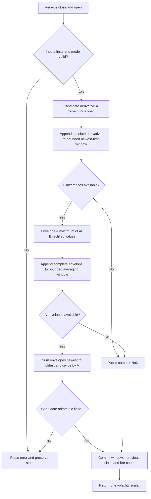

# AM Detector — Amplitude Modulation Envelope Detector

This folder is the independent Python research master for the **AM Detector** in John F. Ehlers' May 2021 article *A Technical Description of Market Data for Traders*. It contains `am-detector.py`, a standalone `AMDetector` streaming class returning one scalar volatility estimate, full mathematical documentation, meaningful verification, and five language fixtures with input and expected data. AM uses no truncated transcendental constants; its envelope and averaging operations are exact formulas evaluated in binary64.

The article fixes an envelope length of 4 and an SMA length of 8. The master makes those two window constants configurable as a documented research extension. The default reproduces the article's mathematics. The user confirmed all 16 reference combinations on 2026-10-19. Reference data uses `INPUT_CLOSE` paired with `INPUT_OPEN`, as confirmed by the user.

## Market model, spectrum and physical analogies

The May article describes market prices as a nonstationary random process: their statistical behavior changes over time. Its physical analogy is a drunkard's walk, where successive random steps create a path. The paper names diffusion and telegrapher equations as continuous descriptions of such random walks, but does not supply a solvable price boundary-value model or use a PDE in these indicators. They perform direct sampled-data calculations.

The spectrum analogy is colored light: a waveform consists of components at different frequencies, just as white light combines colors. Ehlers calls the tendency for longer cycles to have greater amplitude **spectral dilation**. His working hypothesis is that amplitude is proportional to cycle period. Thus doubling period doubles amplitude, which is $20\log_{10}2\approx6.0206$ dB per octave. The article illustrates this with a 5:1 change between daily and weekly time scales and an assumed corresponding 5:1 amplitude scale.

This is the author's approximate empirical market hypothesis, not a universal theorem about prices. Conventional pink-noise power spectral density is proportional to $1/f$, whereas amplitude proportional to period corresponds to an amplitude scale proportional to $1/f$ and a squared-amplitude scale proportional to $1/f^2$. One must distinguish amplitude, spectral power and empirical cycle estimates when interpreting the paper's term “pink noise.” The code makes no spectral estimate and requires neither hypothesis to execute.

MESA (maximum entropy spectral analysis) is used in the paper to display an SPY spectral heatmap over May 2019–November 2020, with cycle periods approximately 12–54 bars. The author observes a frequent roughly 20-bar component and rapidly changing periods resembling an audio chirp. That observation motivates modeling locally dominant components as a narrow-band process. It does not fix a globally constant market cycle or add a MESA stage to either implementation.

The article's complete modulation model is

$$
S(t)=A(t)\sin\bigl(\omega t+\Theta(t)\bigr).
$$

Here $A(t)$ is time-varying amplitude, $\omega$ is a fixed carrier angular frequency, and $\Theta(t)$ is time-varying phase. The amplitude term is analogous to AM radio's changing carrier envelope. The changing phase is analogous to FM radio; instantaneous angular frequency is, by differentiation,

$$
\omega_{\mathrm{inst}}(t)=\omega+\frac{d\Theta(t)}{dt}.
$$

This latter equation is an explanation of the phase/frequency relation stated in the paper. Neither indicator explicitly estimates $\Theta(t)$ or reports frequency in cycles per bar. AM aims to recover an envelope related to bar volatility; FM aims to provide a price-timing waveform after reducing amplitude dependence.

## Differencing, whitening and input bars

The article starts its explanation with one-bar differencing, analogous to a derivative in calculus. For closes $p_t$, the difference $d_t=p_t-p_{t-1}$ has transfer response

$$
H_D(z)=1-z^{-1}.
$$

The source's small-departure explanation is

$$
\mathrm{Output}=(1+e)-1=e.
$$

More precisely, at sampled angular frequency $\Omega$,

$$
H_D(e^{i\Omega})=1-e^{-i\Omega}
=2i\sin(\Omega/2)e^{-i\Omega/2},
$$

$$
|H_D(e^{i\Omega})|=2|\sin(\Omega/2)|\approx|\Omega|
\quad\text{near DC}.
$$

It has a zero at DC, magnitude increasing about 6 dB per octave of frequency near DC, and phase $\pi/2-\Omega/2$ for $0<\Omega<\pi$. Its half-bar linear delay is combined with the differentiator's quadrature phase. Under the author's amplitude-proportional-to-period hypothesis, differencing approximately flattens the low-frequency amplitude slope. The exact response is not flat at every frequency, and prices need not satisfy that hypothesis.

The executable source instead uses

$$
d_t=p_t-o_t,
$$

where $o_t$ is the same completed bar's **open**. The identity

$$
p_t-p_{t-1}=(p_t-o_t)+(o_t-p_{t-1})
$$

shows that Close−Open removes the opening gap from the close-to-close movement. It is useful intraday and whenever gaps should be excluded, but it is not generally equal to Close−Close[1]. The close/open pair is not a fixed linear filter of closes alone, so the differencer transfer function applies exactly to the close-only alternative and approximately to the paper's interpretation of the paired bar signal.

**Reference input choice confirmed by the user:** all reference cases pair the 252 `INPUT_CLOSE` values with the existing 252 `INPUT_OPEN` values. `update(close, open_value)` therefore reproduces the article's exact bar-difference definition. Both prototypes also offer `input_mode="close_difference"` for `update(close)`; its first close is unavailable because no preceding close exists. Input mode is fixed at construction and cannot be switched midstream. Reference arrays use `close_open` exclusively.

## Relationship of the two indicators

The AM Detector takes $|d_t|$, holds recent peaks with a sliding maximum, and averages those peak estimates. This is analogous to rectifying an AM carrier and using a peak detector followed by smoothing. Rectification discards sign; the short maximum window reduces dependence on the carrier's instantaneous phase. A finite maximum is an envelope estimate, not an analytic-signal/Hilbert envelope or a calibrated standard deviation.

The FM Demodulator multiplies $d_t$ by 10, limits it to ±1, and applies a two-pole SuperSmoother. This resembles a radio receiver's amplitude limiter followed by integration/smoothing. The limiter removes magnitude differences only when its input is saturated; changes smaller than 0.1 price units remain proportional to their amplitude. It is a clipped ramp, not an unconditional sign function.

The paper says AM corresponds to volatility and FM contains timing information, and compares their plots to price swings. These are interpretations of the depicted data. AM measures body movement without gaps or wicks; FM does not recover a physical instantaneous-frequency value. Neither is a prediction, probability, volatility in return units, or complete trading system.


## Complete AM calculation

Let $E$ be `envelope_length` and $A$ be `average_length`. Let completed-bar movement be $d_t=p_t-o_t$. Full-wave rectification gives

$$
r_t=|d_t|.
$$

Estimate the local envelope as the largest recent rectified movement:

$$
e_t=\max_{0\leq k<E}r_{t-k}.
$$

Average the last $A$ complete envelope estimates:

$$
v_t=\frac1A\sum_{j=0}^{A-1}e_{t-j}.
$$

Defaults are $E=4,A=8$. Combining the two windows gives

$$
v_t=\frac1A\sum_{j=0}^{A-1}
\max_{0\leq k<E}|p_{t-j-k}-o_{t-j-k}|.
$$

Thus one complete output uses $E+A-1$ derivative observations, spanning current lag zero through lag $E+A-2$. Rectification and maximum are nonlinear; the SMA is linear in envelope values. Overall AM has no single linear transfer function. The final SMA alone has response

$$
H_A(z)=\frac1A\sum_{j=0}^{A-1}z^{-j},
$$

with group delay $(A-1)/2$ bars on its envelope input where its linear-phase response is defined. The preceding peak detector adds stateful peak hold, so this is not a complete delay description of the AM indicator.

The complete source listing is

```text
Vars: Deriv(0), Envel(0), Volatil(0);
Deriv = Close - Open;
Envel = Highest(AbsValue(Deriv), 4);
Volatil = Average(Envel, 8);
Plot1(Volatil);
Plot2(0);
```

The plotted zero line is not a second output. No high−low comparison series from the article's chart is returned. The scalar output is in **price units**, always nonnegative for finite accepted arithmetic. It excludes opening gaps and intrabar wicks; it is neither true range/ATR nor return volatility.

## Parameters, startup and numeric behavior

| Parameter | Default | Valid range | Meaning |
| --- | --- | --- | --- |
| `envelope_length` | 4 | Integer $E\geq1$ | Number of absolute differences in the sliding maximum. |
| `average_length` | 8 | Integer $A\geq1$ | Number of complete envelope estimates in the SMA. |
| `input_mode` | `close_open` | `close_open` or `close_difference` | Paired source bar differences or one-close differences. Fixed per instance. |

Window lengths reject booleans and floating values such as 4.0. There is no fixed-array maximum; lists grow only as observations arrive. Change configuration by creating a new instance. Inputs must be finite floats; any nonfinite candidate arithmetic is rejected before state changes. Negative finite prices are mathematically allowed. `reset()` retains configuration but clears both windows, previous close and output.

The master requires **complete** windows, without partial averages or invented zeros. In paired mode the first complete envelope occurs at index $E-1$. Only complete envelopes enter the averaging window, whose first full output is at

$$
t_{\mathrm{first}}=E+A-2.
$$

`warmup_bars` equals that index and the NaN-prefix length. The default has NaNs at indices 0–9 and first numeric output at index 10, after 11 close/open pairs. For $E=A=1$, output is available on the first bar and equals $|Close-Open|$.

In close-only mode the first close merely establishes history. The first derivative occurs at close index 1, and first AM at $E+A-1$. It has one extra NaN compared with the corresponding derivative-bar stream. `is_primed` means output availability, including a valid zero. `output` is NaN before the first complete result and after reset; inspecting it consumes nothing.

The source's `Highest` and `Average` are platform built-ins with unspecified standalone prehistory and internal summation rounding. This master defines strict observed-window availability and sums envelopes newest to oldest with ordinary binary64 addition. Platforms using partial startup windows or rolling sums can differ before priming or in final rounding digits. Default numeric outputs reproduce the mathematical source under the stated input/window contract; bitwise equality to a particular hidden library reduction is not promised.

## Analytic checks and finite memory

- A constant derivative $d$ gives $v_t=|d|$ once primed, including zero.
- Reversing every derivative sign leaves all AM results unchanged.
- With no averaging ($A=1$), output is the recent absolute maximum.
- With no peak hold ($E=1$), output is the SMA of absolute differences.
- A single isolated derivative spike influences $E$ consecutive envelopes, then the SMA retains those envelopes; its last possible influence is lag $E+A-2$.
- Two streams with the same most recent $E+A-1$ close/open differences have the same current AM output. The paired mode has finite memory even if earlier prices differ.

For defaults and a spike of magnitude 8 surrounded by zeros after priming, the eleven influenced AM values are $1,2,3,4,4,4,4,4,3,2,1$, then zero. This exercises both the peak-hold duration and SMA alignment independently of market data.

## Algorithm flow and storage



The close-only path first establishes a preceding close before the difference stage. The two persistent lists hold at most $E$ rectified movements and $A$ complete envelopes. Work and memory are $O(E+A)$ per update. No NumPy, pandas, sorting, deques, third-party rolling functions or indicator dependencies are needed. A port can use bounded arrays or ring buffers while preserving exact lag meanings and sum order.

## SuperSmoother background from the cited book

*Cycle Analytics for Traders*, chapter 3, develops the SuperSmoother from a modified two-pole Butterworth filter. A Butterworth design is maximally flat near zero frequency. Removing extra numerator terms reduces lag; adding a two-element moving average creates a zero at Nyquist at the cost of half a bar of additional delay. Recursive filters have frequency-dependent delay, so stronger attenuation does not imply zero lag.

The complete relevant book equation (3-3), printed with abbreviated constants and a degree-based cosine, is

$$
\begin{aligned}
a&=\exp(-1.414\cdot3.14159/P),\\
b&=2a\cos_{\mathrm{degrees}}(1.414\cdot180/P),\\
c_2&=b,\\
c_3&=-a^2,\\
c_1&=1-c_2-c_3,\\
y_t&=c_1(u_t+u_{t-1})/2+c_2y_{t-1}+c_3y_{t-2}.
\end{aligned}
$$

The user's full-precision requirement replaces 1.414 by $\sqrt2$ and 3.14159 by $\pi$, while converting cosine to radians. With

$$
q=\frac{\sqrt2\,\pi}{P},\qquad a=e^{-q},
$$

the coefficients used in the master are

$$
c_2=2a\cos(q),\qquad c_3=-a^2,\qquad c_1=1-c_2-c_3.
$$

The zero-state transfer response derived from the recurrence is

$$
H_{SS}(z)=\frac{c_1(1+z^{-1})/2}{1-c_2z^{-1}-c_3z^{-2}}.
$$

It has a zero at $z=-1$ (Nyquist) and unit DC gain because $c_1=1-c_2-c_3$. Its poles are

$$
p_\pm=a e^{\pm iq},
$$

so their magnitude $a<1$ ensures stability for finite positive $P$. Very large $P$ can round the coefficients to unresolved boundaries in binary64; the class rejects those configurations. The critical period is a design parameter associated with lowpass smoothing; it is not a requirement to collect $P$ prices before producing output.

The book discusses a two-pole attenuation slope of roughly 12 dB per octave, sampled-data aliasing, Nyquist at 0.5 cycles per bar, and a practical period around 10 for attenuating short-period noise. Differencing and limiting do not cure aliasing or remove all kinds of noise. The FM master uses the article's period 30 by default and applies this filter to the limited derivative. AM uses an ordinary finite SMA and does not apply the SuperSmoother.

The book's chapter 7 describes spectral dilation and roofing filters. A roofing filter adds explicit highpass and lowpass stages to constrain cycle content. No roofing, spectral estimator, three-pole filter, or adaptive-cycle stage appears in these May AM/FM algorithms. The relevant common spectrum discussion and complete SuperSmoother recurrence are included here; distinct book indicators are not additional stages of these masters.


## Source comparisons and precision

Article, Mesa and TradeStation agree on `Close-Open`, four-bar `Highest(AbsValue(...))` and eight-bar `Average`. AIQ, Optuma, NeuroShell and NinjaTrader implement the same composed formulas. NinjaTrader's built-in MAX/SMA can output partial startup windows, and eSignal gates plotting at eight bars even though a full two-stage observed window needs eleven; their engine prehistory must be matched when comparing charts. Zorro exposes the SMA length as a parameter while retaining a four-bar maximum, supporting the averaging research extension. The configurable envelope length is this master's explicit generalization.

Full-precision `sqrt(2)` and `pi` are relevant to the sibling FM Demodulator; AM uses only integer window lengths, absolute values, maxima and an arithmetic mean. It does not add SuperSmoother constants or stages to satisfy the precision instruction.

## Confirmed reference combinations

The following **16 pairs**, confirmed by the user on 2026-10-19, have generated 16 arrays per language, each with 252 values. All use the confirmed paired close/open input contract. The source default is included; other pairs exercise documented window extensions and exact full-record boundaries.

| # | Envelope E | Average A | What it tests |
| --- | --- | --- | --- |
| 1 | 4 | 8 | Article and Mesa defaults: four-bar envelope and eight-bar SMA. |
| 2 | 1 | 1 | Minimum windows: output is the absolute bar difference immediately. |
| 3 | 1 | 8 | No peak hold; average the last eight absolute differences. |
| 4 | 4 | 1 | No averaging; expose the four-bar peak-hold envelope. |
| 5 | 2 | 4 | Short envelope and short smoothing with staged full-window priming. |
| 6 | 4 | 4 | Default envelope with faster four-value averaging. |
| 7 | 4 | 16 | Default envelope with slower sixteen-value averaging. |
| 8 | 4 | 32 | Default envelope with extended averaging memory. |
| 9 | 8 | 8 | Longer peak hold with the default averaging window. |
| 10 | 8 | 16 | Long peak hold combined with slower averaging. |
| 11 | 16 | 8 | Extended envelope retains volatility peaks for sixteen bars. |
| 12 | 16 | 16 | Matched long envelope and averaging windows. |
| 13 | 32 | 32 | Long matched windows with a sixty-two-bar NaN prefix. |
| 14 | 4 | 249 | Composite record boundary: only the final output is available. |
| 15 | 4 | 250 | Composite window exceeds the record; every output is NaN. |
| 16 | 252 | 1 | Full-record maximum: one output on the final observation. |

Names use `EXPECTED_E{envelope_length}_A{average_length}`, for example `EXPECTED_E4_A8`. The comment before each array is the exact **What it tests** text above; the next comment states `envelope_length=..., average_length=..., input_mode=close_open`.

## Usage and expected-data generation

From this directory:

```sh
python3 am-detector.py
python3 -m unittest -v test_am_detector.py
```

The no-argument `__main__` embeds the exact 252 `INPUT_CLOSE` and `INPUT_OPEN` values and demonstrates a default instance, output formatting and reset. The streaming usage is `indicator.update(close, open_value)` in default mode. For a one-close stream, construct with `input_mode="close_difference"` and call `indicator.update(close)`; do not fabricate an opening price.

Regenerate all confirmed reference arrays:

```sh
python3 am-detector.py --generate-reference-data
```

This generation flag computes every confirmed case, appends Python arrays first, reopens the actual written `test_testdata.py` through AST parsing and verifies expected names, 252-value lengths, exact availability prefixes, finite numeric outputs and 15-digit serialization. It then translates **those written Python values** to the other four files with identical comments. Reruns replace only marked generated blocks, preserve original inputs and prevent duplicate arrays. Input mode is recorded in comments rather than treated as an additional reference combination.

Formatting uses **15 significant decimal digits** (`.15g`); `.0` is appended to integral float literals when needed for Rust. All streaming arithmetic and internal state remain unrounded binary64. NaNs are compared by classification. A mixed absolute/relative output tolerance such as $10^{-12}+10^{-12}|expected|$ covers decimal export and ordinary math-library differences for this price-scale data.

| Language | Name form | Missing value |
| --- | --- | --- |
| Python | `EXPECTED_E4_A8 = [...]` | `math.nan` |
| Go | `var expectedE4_A8 = []float64{...}` | `math.NaN()` |
| TypeScript | `export const expectedE4_A8: number[] = [...]` | `NaN` |
| Rust | `pub fn expected_e4_a8() -> Vec<f64>` | `f64::NAN` |
| Zig | `pub fn expectedE4_A8() [252]f64` | `nan` |

Go's package is `amdetector` and imports `math`. A blank reference to `math.NaN` keeps that requested import valid even when a selected input contract yields no missing values. Zig's header contains `const math = @import("std").math;` and `const nan = math.nan(f64);`. Rust expected functions remain inside the copied `#[cfg(test)] pub mod testdata`, alongside its input functions. These spellings use valid native syntax.


## Verification

All **11 Python checks passed on 2026-10-19**, with no skipped checks. They compare the article's extracted formula structure and an independently composed full-window formula for all confirmed cases, plus constant/spike results, finite support, sign invariance, staged priming, record boundaries, close-only alignment, gap removal, reset, causality, input integrity and transactional rejection. The expected-data check verifies all 16 arrays of 252 values in every language, their two preceding comments, names, NaN positions and exact serialized values.

The generated Python fixture was imported successfully. Go, Rust and Zig fixtures were compiled and exercised with temporary native test harnesses; TypeScript fixtures were imported and exercised with Node 24's built-in type stripping. Each harness loaded all four original input arrays and every expected array, verified their lengths, and matched a byte-level fingerprint against the written Python values. No language implementations of the indicator were introduced at this preparation stage.

For reproducibility, the native checks process arrays in the order `INPUT_CLOSE`, `INPUT_HIGH`, `INPUT_LOW`, `INPUT_OPEN`, then expected arrays in table order. Their 64-bit FNV-1a fingerprint is `c406295247fca94a`, over big-endian binary64 values with every NaN canonicalized to `0x7ff8000000000000`. Across the expected arrays there are 986 unavailable values. Both the all-NaN `(4,250)` case and final-value-only cases were verified explicitly.

Running `python3 am-detector.py --generate-reference-data` again leaves all five fixture files **byte-for-byte unchanged**, as checked by SHA-256 before and after regeneration. The no-argument example completes with default final volatility `1.6775`, first numeric index 10 and `is_primed=False` after reset. Cross-language value equality refers to loading the exported fixtures; source-formula agreement is established separately by the independent Python checks described above.

## Sources and BibTeX

Direct sources are [the May 2021 TASC article](../../tasc/2021-05-a-technical-description-of-market-data-for-traders/content.md), [the Mesa AMFM paper](../../tasc/2021-05-a-technical-description-of-market-data-for-traders/mesa/content.md), and [May Traders' Tips](../../tasc/2021-05-a-technical-description-of-market-data-for-traders/tips/tips.md), including [TradeStation AM-FM.els](../../tasc/2021-05-a-technical-description-of-market-data-for-traders/tips/AM-FM.els). Related mathematics is in [Cycle Analytics, chapter 3](../../2013-cycle-analytics-for-traders/ch3.md) and [chapter 7](../../2013-cycle-analytics-for-traders/ch7.md). Input closes and opens originate in [the parent Python fixture](../test_testdata.py).

Other supplied platform examples establish the differences described above. References below include the direct sources, the paper's cited explanatory links and further reading. Those further-reading articles are not separate numeric authorities for the May implementation.

```bibtex
@article{ehlers_technical_market_data_2021,
  author = {Ehlers, John F.},
  title = {A Technical Description of Market Data for Traders},
  journal = {Technical Analysis of Stocks \& Commodities},
  volume = {39}, number = {5}, pages = {8--14},
  month = may, year = {2021},
  url = {https://technical.traders.com/archive/article.asp?file=\V39\C05\238EHLE.pdf}
}

@misc{ehlers_mesa_amfm_2021,
  author = {Ehlers, John F.},
  title = {A Technical Description of Market Data for Traders},
  howpublished = {MESA Software paper}, year = {2021},
  url = {https://www.mesasoftware.com/papers/AMFM.pdf}
}

@misc{traders_tips_2021_05,
  author = {{Technical Analysis of Stocks \& Commodities}},
  title = {Traders' Tips: A Technical Description of Market Data for Traders},
  month = may, year = {2021},
  url = {https://www.traders.com/Documentation/FEEDbk_docs/2021/05/TradersTips.html},
  note = {Platform implementations in TradeStation, NinjaTrader, eSignal, Zorro,
          AIQ, Optuma, NeuroShell, Excel, and Wealth-Lab}
}

@book{ehlers_cycle_analytics_2013,
  author = {Ehlers, John F.},
  title = {Cycle Analytics for Traders: Advanced Technical Trading Concepts},
  publisher = {Wiley}, series = {Wiley Trading}, year = {2013},
  isbn = {9781118728604},
  note = {Chapter 3: SuperSmoother; chapter 7: spectral dilation}
}

@misc{ehlers_cycles_tutorial,
  author = {Ehlers, John F.}, title = {Cycles Tutorial},
  howpublished = {MESA Software website},
  url = {http://www.mesasoftware.com/ehlers_cycles_tutorial.htm},
  note = {Random-walk background cited by the May article; no PDE stage implemented}
}

@misc{stationary_nonstationary_background,
  author = {{Investopedia}}, title = {Stationary and Nonstationary Processes},
  url = {https://www.investopedia.com/articles/trading/07/stationary.asp},
  note = {Explanatory link cited by the Mesa paper}
}

@misc{pink_noise_background,
  author = {{Wikipedia contributors}}, title = {Pink Noise},
  url = {https://en.wikipedia.org/wiki/Pink_noise},
  note = {Spectrum background linked by the Mesa paper}
}

@article{ehlers_measuring_market_cycles_2016,
  author = {Ehlers, John F.}, title = {Measuring Market Cycles},
  journal = {Technical Analysis of Stocks \& Commodities},
  volume = {34}, month = sep, year = {2016}
}

@article{ehlers_aliasing_2016,
  author = {Ehlers, John F.}, title = {Aliasing},
  journal = {Technical Analysis of Stocks \& Commodities},
  volume = {34}, month = jan, year = {2016}
}

@article{ehlers_whiter_is_brighter_2015,
  author = {Ehlers, John F.}, title = {Whiter Is Brighter},
  journal = {Technical Analysis of Stocks \& Commodities},
  volume = {33}, month = jan, year = {2015}
}

@article{ehlers_predictive_successful_indicators_2014,
  author = {Ehlers, John F.}, title = {Predictive and Successful Indicators},
  journal = {Technical Analysis of Stocks \& Commodities},
  volume = {32}, month = jan, year = {2014}
}
```
