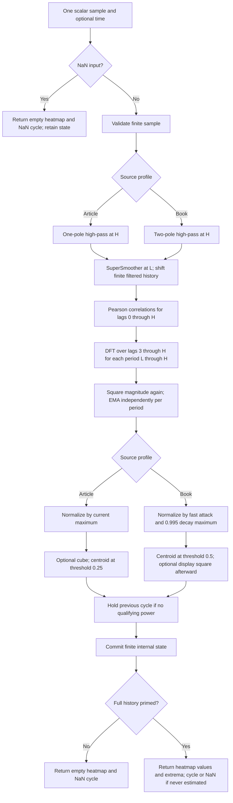

# Autocorrelation periodogram with dominant cycle

This folder is a working, standard-library-only Python research master for John
F. Ehlers' **Autocorrelation Periodogram**. Its default implements the
EasyLanguage sidebar of *Measuring Market Cycles*, TASC September 2016. An
explicit `source="book"` variant implements the intended calculation in
*Cycle Analytics for Traders* (2013), Chapter 8, Listing 8-3, with a corrected
complete-turn Fourier angle. Each update returns **both a structured spectral
heatmap column and a real-valued dominant-cycle period in bars**.

The master is [auto-correlation-periodogram.py](auto-correlation-periodogram.py).
The prior [investigation](investigation.md) records comparisons with the article,
book, Trader's Tips, and the copied zpano implementations. This document is
self-contained: a conversion agent does not need those original files to
understand the equations, source choices, startup, outputs, or fixtures.

## Physical ideas and theoretical background

### Cycles in noisy observations

Prices can be considered a sampled signal composed of changing cyclic
components, trends, and noise. A useful conceptual model is

$$
x_t = T_t + \sum_k A_k(t)\cos\!\left(\phi_k(t)\right)+\epsilon_t,
\qquad
\phi_k(t)-\phi_k(t-1)\approx\frac{2\pi}{p_k(t)}.
$$

This decomposition explains the method; the master does not fit these separate
terms. The periods, phases, amplitudes, and noise can all change with time.
Ehlers describes market cycles as ephemeral. A measurement window must be long
enough to average noise and short enough to follow a changing signal.

One cycle contains 360 degrees, or $2\pi$ radians. If the observed phase change
between successive bars were reliably $\Delta\phi$ degrees, a period estimate
would be

$$
p = \frac{360}{\Delta\phi}.
$$

The article gives $360/20=18$ bars as an example. Its objection to direct
bar-to-bar phase estimators is their sensitivity to noise. This indicator instead
examines similarity over many delay lags, then analyzes periodicity across those
lags. It does not use a phase accumulator, homodyne discriminator, maximum
entropy spectral analysis (MESA), or a raw-price Fourier transform.

Chapter 8 draws an analogy to noisy radar echoes. A fluctuating radar target
can have random variations with memory, so its successive observations remain
partially related. A simple illustrative synthetic-price model is

$$
z_t=\alpha\bigl(45+U_t\bigr)+(1-\alpha)z_{t-1},
$$

where $U_t$ is a uniform random number over a width of 10 and the book example
uses $\alpha=0.05$. This is an EMA of random inputs, not an input generator used
by this master. The historical analogy motivates correlating a current market
sequence with delayed observations of itself.

The book also describes long-memory autocorrelation through the power law

$$
\operatorname{Autocorrelation}(\ell)=C\ell^{-\alpha},
$$

where $C$ is a constant and $\alpha$ has nominal value one. This is a background
model for nonzero lags, not a universal theorem about market prices, not a
formula evaluated at zero lag, and not the estimator implemented here.

### Spectral dilation and normalized correlation

The article calls the growth of market swing amplitude with cycle period
**spectral dilation**. Similar-looking daily and weekly charts suggest a fractal
scaling model: a longer period tends to have a larger swing. An approximate
doubling of amplitude per octave corresponds to

$$
20\log_{10}(2)=6.020599913279624\ldots\ \mathrm{dB}.
$$

Chapter 7 uses a $1/F^\alpha$ spectral model to discuss this effect. Here $F$
means frequency; it is unrelated to the filtered series $f_t$ defined below.
An unnormalized raw-price transform can overemphasize large slow components.

Pearson correlation divides covariance by both sample standard deviations.
Consequently its result lies mathematically between $-1$ and $+1$ when the
variance denominator is positive, regardless of a common amplitude scale.
For a stationary sine wave averaged over a complete period,

$$
x_t=A\cos(\omega t+\phi),\qquad
\rho(\ell)=\cos(\omega\ell),\qquad \omega=\frac{2\pi}{p}.
$$

At lag zero or one full period the correlation is $+1$; at half a period it is
$-1$. The book loosely describes this as a sine-like variation across lag.
Its zero-lag/full-period maxima correspond specifically to cosine in this
idealized complete-period average. Changing $A$ changes covariance and variance
together, leaving normalized correlation unchanged. This is the mechanism
Ehlers uses to reduce amplitude scaling bias while retaining periodicity.

The default estimator uses only **three samples per Pearson window**, not a
complete sine period. Thus the exact cosine formula is an explanatory limit,
not an identity for every default output. Mixed cycles, finite windows, phase,
and changing amplitudes can still influence the estimate. Pearson normalization
does not prove that all forms of fractal bias are removed.

### Roofing filters and noise

A roofing filter combines a high-pass filter and a low-pass SuperSmoother. It
reduces slow trend contamination and rapid fluctuations before correlation.
Period and frequency are reciprocals: the high-pass filter passes relatively
shorter periods, while the low-pass filter passes relatively longer periods.
Their cutoffs are approximate transitions rather than a rectangular pass band.

The book uses a two-pole high-pass filter and a 10-bar SuperSmoother. Chapter 7
explains that a one-pole high-pass attenuates slow components at about 6 dB per
octave, which can merely equalize their amplitude growth; adding a second pole
increases slow-component rejection. The 2016 article deliberately uses the
specified one-pole recurrence and an 8-bar SuperSmoother. The default master
preserves the article rather than substituting the book's filter.

Chapter 3 derives the two-pole SuperSmoother from a modified digital Butterworth
filter, retaining recursive poles and adding a two-sample average in the input
path. The average contributes half a bar of phase delay and introduces a zero
at the Nyquist frequency. Two samples per cycle is the Nyquist limit; no
distinct cycle shorter than this is measurable without aliasing. The master
requires integer candidate periods strictly greater than two.

The book discusses practical cutoffs near 8–10 bars because two- and four-bar
cycles leave very little time to observe a turn and execute a trade. The
SuperSmoother has about 12 dB per octave stop-band attenuation, helping suppress
high-frequency sampled noise. Its recursive phase delay varies with frequency;
this indicator does not produce a zero-delay or predictive estimate.

### Fourier analysis of the lag sequence

The next stage correlates the raw autocorrelation coefficients with sinusoidal
basis functions across **lag**, for every candidate period. The cosine and sine
projections form two quadrature components. Their squared sum captures both
phases, using the elementary identity from Chapter 8:

$$
A^2=A^2\sin^2(u)+A^2\cos^2(u).
$$

A Fourier transform of autocovariance is related to a power spectrum under the
Wiener–Khinchin framework. This implementation is Ehlers' finite-lag,
short-window Pearson construction, with additional spectral squaring and
smoothing; it is not a textbook unbiased autocovariance spectral estimator.
There is no Hann window, detrending regression, FFT normalization, or extra
period-dependent compensation factor in either implemented profile.

Ehlers emphasizes fast response, reduced spectral dilation bias, and dense
period sampling without a long raw-price Fourier window. Candidate periods
are evaluated individually; this is a direct Fourier projection rather than an
FFT requiring uniform frequency bins. Dense integer period bins provide a fine
display grid, but finite observations still limit the ability to separate
nearby cycles. In period units the frequency spacing is nonuniform:

$$
\frac{1}{p}-\frac{1}{p+1}=\frac{1}{p(p+1)}.
$$

### Normalization and the center of gravity

The article compares each smoothed bin with the largest smoothed bin on the
current bar. The book uses fast-attack, slow-decay automatic gain control (AGC):
a new high power is accepted immediately, but an older normalization maximum
decays only slowly. This is analogous to a radio receiver adjusting gain after
a strong transmission. It allows the current spectrum to become dim when its
power falls relative to a recent maximum.

The dominant cycle uses a center of gravity, analogous to balancing masses
along a beam. The period is position and power is mass. Only bins above the
source-specific threshold contribute. Dividing total weighted position by
total mass gives a fractional period. It does **not** select the single largest
bin, fit phase, or round to an integer.

## Profiles and configuration

| Parameter | Type and valid range | Default | Meaning |
| --- | --- | --- | --- |
| `source` | `"article"` or `"book"` | `"article"` | Chooses all source-specific filter, normalization, threshold, enhancement-order rules |
| `min_period` | Integer at least 3; less than `max_period`; `None` selects profile default | Article 8; book 10 | Shortest spectrum bin and SuperSmoother cutoff, in bars |
| `max_period` | Integer at least 5; greater than `min_period` | 48 | Longest spectrum bin, high-pass cutoff, and largest Pearson/DFT lag |
| `averaging_length` | Integer 0 or at least 2 | 3 | 0 means $M=\ell$; positive means the same $M$ for every lag |
| `enhance_resolution` | Boolean | `False` | Article cubes power before centroid; book squares display after centroid |

Booleans and integral floats are rejected for integer parameters. Length one
is rejected because one observation cannot have positive sample variance.
The profile defaults produce exactly 41 article bins or 39 book bins. Changing
the period bounds generalizes the cutoff and lag ranges as in the copied zpano
implementation; those custom ranges are research configurations, not a claim
that the article printed those settings.

Coefficient calculations must remain finite and strictly stable in binary64;
extreme periods that round poles to one or gains to zero are rejected. There
is no arbitrary 48- or 70-element cap. Large periods require correspondingly
large buffers and quadratic work.

The following are fixed source settings, not additional parameter axes:

| Setting | Article | Corrected book |
| --- | --- | --- |
| High-pass order | 1 | 2 |
| First Fourier lag | 3 | 3 |
| Power EMA new/old weights | 0.2 / 0.8 | 0.2 / 0.8 |
| Squaring before EMA | Fourier magnitude to the fourth power | Same |
| AGC denominator decay | Current maximum only | 0.995 |
| Centroid inclusion threshold | 0.25 | 0.5 |
| Enhancement exponent/order | 3, before centroid | 2, after centroid |
| Minimum subtraction | None | None |

Use `math.pi`, `math.sqrt(2.0)`, and `1.0/math.sqrt(2.0)` at full precision.
The EMA weights, thresholds, and `0.995` are algorithm settings and remain as
written. In particular, `0.995` is not replaced with `sqrt(0.991)`: the master
follows Listing 8-3's chosen coefficient. Output text is rounded to **15
significant decimal digits** only after the entire stream has been calculated.

## Complete calculation equations

Let $t$ denote the zero-based index of an **accepted finite sample**, $x_t$ its
price, $L$ the minimum/cutoff period, $H$ the maximum/cutoff period, and $f_t$
the filtered series. All sine and cosine arguments below are **radians**.

### 1. Profile-specific high-pass filtering

The article's full-precision recurrence is

$$
\theta_A=\frac{2\pi}{H},\qquad
b_A=\frac{1-\sin\theta_A}{\cos\theta_A},\qquad
h_t=\frac{1+b_A}{2}(x_t-x_{t-1})+b_Ah_{t-1}.
$$

The book's full-precision recurrence is

$$
\theta_B=\frac{2\pi}{\sqrt{2}H},\qquad
\alpha_B=\frac{\cos\theta_B+\sin\theta_B-1}{\cos\theta_B},
$$

$$
h_t=(1-\alpha_B/2)^2(x_t-2x_{t-1}+x_{t-2})
    +2(1-\alpha_B)h_{t-1}-(1-\alpha_B)^2h_{t-2}.
$$

The article coefficient $b_A$ is a recursive pole, whereas the book's
$\alpha_B$ is used through $1-\alpha_B$. They are not interchangeable.

### 2. SuperSmoother, book Equation 3-3

$$
a=\exp\!\left(-\frac{\sqrt{2}\pi}{L}\right),\qquad
c_2=2a\cos\!\left(\frac{\sqrt{2}\pi}{L}\right),\qquad
c_3=-a^2,\qquad c_1=1-c_2-c_3,
$$

$$
f_t=c_1\frac{h_t+h_{t-1}}{2}+c_2f_{t-1}+c_3f_{t-2}.
$$

The transfer functions, useful when assessing a port, are

$$
G_A(z)=\frac{(1+b_A)(1-z^{-1})/2}{1-b_Az^{-1}},
$$

$$
G_B(z)=\frac{(1-\alpha_B/2)^2(1-2z^{-1}+z^{-2})}
{1-2(1-\alpha_B)z^{-1}+(1-\alpha_B)^2z^{-2}},
$$

$$
G_{SS}(z)=\frac{c_1(1+z^{-1})/2}{1-c_2z^{-1}-c_3z^{-2}}.
$$

The roofing response is the applicable $G_A$ or $G_B$ multiplied by $G_{SS}$.
At $z=-1$, the SuperSmoother numerator is zero. At $z=1$, the high-pass
numerator is zero. Recursive startup is specified separately below.

### 3. Pearson correlation for each lag

For $\ell=0,1,\ldots,H$, choose

$$
M_\ell=\begin{cases}
\texttt{averaging\_length},&\texttt{averaging\_length}>0,\\
\ell,&\texttt{averaging\_length}=0.
\end{cases}
$$

The paired windows run backward from their endpoints:

$$
X_j=f_{t-j},\qquad Y_j=f_{t-\ell-j},\qquad j=0,\ldots,M_\ell-1.
$$

Compute all five sums afresh, in increasing $j$ order:

$$
S_x=\sum_jX_j,\quad S_y=\sum_jY_j,\quad
S_{xx}=\sum_jX_j^2,\quad S_{yy}=\sum_jY_j^2,\quad S_{xy}=\sum_jX_jY_j.
$$

$$
V=(M_\ell S_{xx}-S_x^2)(M_\ell S_{yy}-S_y^2),\qquad
\rho_t(\ell)=\frac{M_\ell S_{xy}-S_xS_y}{\sqrt V}\quad\text{if }V>0.
$$

If $V\leq0$, retain $\rho_{t-1}(\ell)$, initialized to zero. This is the
literal conditional assignment of **both periodogram source listings**. It
differs from resetting undefined correlation to zero in the copied estimator.
There is no epsilon or clamp. Floating arithmetic can produce small deviations
from mathematical $[-1,1]$ bounds, particularly for near-constant windows.

With lag-dependent averaging, $M_0=0$ and $M_1=1$ leave correlations zero at
those lags; neither lag enters the Fourier transform. Compute raw correlation,
not $(\rho+1)/2$. That rescaling belongs only to the separate autocorrelation
indicator in Listing 8-2.

### 4. Fourier projection and fourth-power smoothing

For integer $p=L,\ldots,H$, independently compute

$$
C_t(p)=\sum_{n=3}^H\rho_t(n)\cos\!\left(\frac{2\pi n}{p}\right),\qquad
S_t(p)=\sum_{n=3}^H\rho_t(n)\sin\!\left(\frac{2\pi n}{p}\right),
$$

$$
Q_t(p)=C_t(p)^2+S_t(p)^2,
$$

$$
R_t(p)=0.2\,Q_t(p)^2+0.8\,R_{t-1}(p).
$$

`SqSum` in the EasyLanguage listings corresponds to $Q$, already squared
magnitude. The **second squaring** $Q^2$ is intentional source behavior and
must not be removed as an apparent redundancy. EMA smooths over time for each
period independently, never across adjacent period bins. All $R_{-1}(p)=0$.

### 5. Power normalization

Let $R_t^{\max}=\max_{p=L}^H R_t(p)$. Then

$$
A_t=\begin{cases}
R_t^{\max},&\text{article},\\
\max(0.995 A_{t-1},R_t^{\max}),&\text{book}.
\end{cases}
\qquad A_{-1}=0,
$$

$$
P_t(p)=\begin{cases}R_t(p)/A_t,&A_t>0,\\0,&A_t=0.\end{cases}
$$

The zero-denominator branch is an explicit master convention preventing the
sources' unconditional division by zero. No minimum is subtracted. In the
article, any positive finite spectrum has maximum normalized power one. In the
book, the maximum can be less than one after a prior stronger signal.

### 6. Enhancement and dominant-cycle centroid

For the article, use centroid and display weights

$$
W_t(p)=\begin{cases}P_t(p)^3,&\text{enhancement enabled},\\P_t(p),&\text{otherwise},\end{cases}
\qquad \operatorname{Peak}_t=\max_p W_t(p).
$$

The contributing set is

$$
\mathcal S_A(t)=\{p:\operatorname{Peak}_t\geq0.25\ \text{and}\ W_t(p)\geq0.25\}.
$$

For the book, centroid weights remain $W_t(p)=P_t(p)$ and

$$
\mathcal S_B(t)=\{p:P_t(p)\geq0.5\}.
$$

For the appropriate contributing set, calculate

$$
\operatorname{Sp}_t=\sum_{p\in\mathcal S(t)}W_t(p),\qquad
\operatorname{Spx}_t=\sum_{p\in\mathcal S(t)}p W_t(p).
$$

The persistent internal cycle, initialized $D_{-1}=0$, is

$$
D_t=\begin{cases}
\operatorname{Spx}_t/\operatorname{Sp}_t,&\text{article and }\operatorname{Sp}_t\geq0.25,\\
D_{t-1},&\text{article and }\operatorname{Sp}_t<0.25,\\
\operatorname{Spx}_t/\operatorname{Sp}_t,&\text{book and }\operatorname{Sp}_t>0,\\
D_{t-1},&\text{book and }\operatorname{Sp}_t=0.
\end{cases}
$$

The article separately tests nonzero `Sp` before division; selecting any bin
with weight at least 0.25 makes the valid-division condition above equivalent.
Once a valid centroid has existed, its held value stays valid even if present
spectral power is weak. The master tracks this with a `has_dominant` flag and
exposes NaN rather than the internal initialization zero before the first
centroid. A held value is a source rule, not proof that a current cycle exists.

Article heatmap values are $W_t(p)$. Book heatmap values are

$$
Z_t(p)=\begin{cases}P_t(p)^2,&\text{enhancement enabled},\\P_t(p),&\text{otherwise}.\end{cases}
$$

Book display enhancement cannot affect its dominant cycle. Article enhancement
changes threshold membership and weighting, so it can change its dominant
cycle. Do not merge these stages into a common display-only exponent.

### 7. Heatmap and optional colors

The numeric heatmap stores values shortest to longest, with

$$
\texttt{values}[i]=Z_t(L+i),\quad i=0,\ldots,H-L,
\qquad z_{\min}=\min_i\texttt{values}[i],\quad z_{\max}=\max_i\texttt{values}[i].
$$

For article mode $Z_t=W_t$. The period axis has first $L$, last $H$, resolution
one; it is inclusive at both ends. Time follows the caller's chronology.

Both sources use the following continuous black–red–yellow color mapping:

$$
(\operatorname{Red},\operatorname{Green},\operatorname{Blue})=
\begin{cases}
(510z,0,0),&0\leq z\leq0.5,\\
(255,255(2z-1),0),&0.5<z\leq1.
\end{cases}
$$

Thus zero is black, 0.5 red, and one yellow. The article describes a display
over about a 20-decibel range, but its code does not calculate logarithmic
decibels; the master retains its normalized numeric values. RGB rounding and
rendering belong to a chart layer, not the numerical reference.

## Startup, missing inputs, and numerical contract

The supplied sources are fragments from chart environments with implicit
historical-series initialization. The master defines the following standalone
rules, consistent with the investigation's direct comparisons:

1. Initialize absent raw prices, high-pass outputs, filtered history,
   correlations, per-bin EMA powers, AGC maximum, and internal dominant cycle
   to zero. Run filters and the remaining source calculations from the first
   accepted finite input. No forced first-bar filter guard is added.
2. Continue all internal calculations during public warm-up. Public NaNs never
   enter the finite recursive histories. Correlation and gain-control startup
   effects remain part of the reference.
3. Allocate $B=H+M$ filtered slots for fixed averaging length $M$, or $B=2H$
   for lag-dependent averaging. The oldest requested index is $B-1$. The first
   accepted sample occupies newest slot zero; the first public column appears
   after **$B$ accepted samples**, at zero-based input index **$B-1$** when
   there are no missing inputs. All prior columns are empty with NaN extrema
   and NaN dominant cycle. `warmup_bars` equals $B-1$.
4. A `NaN` input returns an empty column with NaN extrema/cycle and does not
   increment `samples_seen`, shift history, decay AGC, or change the last
   accepted `output`/`state`. The next finite value is adjacent in the accepted
   sample stream. Infinity or overflowing intermediate arithmetic raises
   `ValueError` without changing state.
5. `is_primed` means the history has filled. It does not guarantee a nonzero
   spectrum or a current cycle. After priming, an all-zero finite input stream
   produces a zero-filled heatmap and a NaN dominant cycle until a centroid has
   existed. A held earlier centroid can be returned on a later weak spectrum.
6. A positive constant price has a startup transient because absent raw prices
   were seeded with zero. Do not replace absent prices with the first observed
   value or assert that a constant nonzero stream must immediately have zero
   spectral power. The book AGC may remember the transient for a long time.
7. `reset()` restores all initial state and permits an identical replay.
   Returned heatmap lists are independent snapshots. Modifying them cannot
   affect later recursive calculations.

For default $H=48,M=3$, $B=51$: the first 50 rows are NaN-masked and row 50 is
the first heatmap. With default maximum and $M=\ell$, $B=96$: the first 95
rows are masked. The article's informal "48-bar block" description omits the
extra samples needed by its delayed Pearson windows. This master's full-history
priming is explicit and reproducible; it is not a filter-settling guarantee.

All arithmetic uses ordinary IEEE binary64, sequential newest-to-oldest Pearson
sums, increasing Fourier lags, and increasing candidate periods. The implementation
does not use NumPy, pandas, complex-number helpers, compensated sums, mean-centered
Pearson reformulations, a rolling covariance formula, or a fused recurrence.
Such substitutions may change low bits or near-threshold membership. Library
trigonometric implementations can differ slightly across languages; comparison
should allow a small binary64 tolerance rather than exact decimal identity.
Python-generated decimal fixture literals match exactly across all five files.
The independent degree-based source test uses relative/absolute tolerance
$2\times10^{-10}$; a port may begin with that tolerance while validating
threshold decisions separately.

## Algorithmic flow



The per-sample work is approximately $O(HM_{\max}+(H-L+1)(H-2))$. The bounded
filtered history is $H+M_{\max}$ elements; correlations need $H+1$ elements and
smoothed power needs $H-L+1$. The master precomputes the Fourier sine/cosine
tables, using $2(H-L+1)(H-2)$ additional numbers. A port can compute these angles
on demand if memory is more important than speed, while retaining summation
order and full-precision angles.

## Usage and outputs

The following assumes the hyphenated master is loaded through Python `runpy`:

```python
from pathlib import Path
import runpy

master = runpy.run_path(str(Path("auto-correlation-periodogram.py")))
Indicator = master["AutoCorrelationPeriodogram"]
prices = runpy.run_path("test_testdata.py")["INPUT_CLOSE"]

indicator = Indicator()  # Article: 8..48, M=3, enhancement off.
for close in prices:
    result = indicator.update(close)
    if not result.heatmap.is_empty():
        print(result.dominant_cycle, result.heatmap.values)

book = Indicator(source="book")  # Corrected book: 10..48, M=3.
```

`PeriodogramOutput` is a named tuple with fields `heatmap` and `dominant_cycle`.
The heatmap preserves the copied output structure's field names: `time`,
`parameter_first`, `parameter_last`, `parameter_resolution`, `value_min`,
`value_max`, and `values`. `time` may be `None`. No bar/quote/trade framework is
needed, and every scalar is used directly; there is no hidden median-price
conversion. The data generation uses the required **252 INPUT_CLOSE** values,
not the copied implementations' median-price fixtures.

Read-only `parameters`, `state`, `samples_seen`, `is_primed`, `warmup_bars`, and
`output` expose resolved configuration and diagnostic information. `state`
contains high-pass and filtered values, raw correlations, smoothed power,
normalization maximum, and the finite internal cycle, including startup.

The dominant cycle can tune other indicators. Ehlers recommends approximately
half the measured period for RSI and stochastic lookbacks, and a full period
for CCI. The strategy's integer rounding belongs to that consuming indicator;
the periodogram output remains fractional. A multi-peak spectrum can place
its centroid between peaks. A current-normalized article heatmap always has
a bright peak when its power is positive and does not independently establish
cycle reliability. Trends and abrupt price moves can distort cycle estimates
until those observations leave the effective history.

## Source differences and corrections

| Issue | Master decision and evidence |
| --- | --- |
| Book Listing 8-3 has `370*N/Period` | Use $2\pi n/p$: Chapter 11 repeatedly uses 360 degrees and the article agrees; original PDF unavailable, so publication versus transcription error is uncertain |
| Chapter 8 AGC prose says 0.991, Listing 8-3 code says 0.995 | Use the Listing 8-3 code's 0.995; Chapter 11 contains both conventions |
| Article and book use different filters, bounds, normalization, thresholds | Preserve distinct explicit profiles rather than mix defaults |
| Article sidebar calculates dominant cycle but plots only spectrum | Expose its existing internal dominant cycle as the requested second output |
| Book optional square is commented out | Default off; boolean enables the described display-only operation |
| Source normalization divides by zero when no power exists | Emit zero numeric heatmap after priming; cycle remains unavailable or held |
| Printed 1.414, 0.707, 3.14159 | Replace with full-precision $\sqrt2$, $1/\sqrt2$, $\pi$ as requested |
| Chart environment history and public availability are implicit | Use documented zero prehistory, calculate throughout startup, and mask until a full Pearson history exists |
| Copied periodogram uses minimum subtraction and lacks cycle output | Do not subtract the minimum; compute/expose the source centroid |
| Copied periodogram treats averaging zero as default three | Implement zero as lag-dependent mode, following both sources |

Both copied indicators were audited against book Chapter 8. The separate
autocorrelation indicator substantially follows Listing 8-2. The copied
periodogram follows a modified Listing 8-3, uses corrected Fourier angles,
and lacks its dominant-cycle calculation. Its fixtures use `(high+low)/2`.
The copied framework files remain unchanged; this folder is a standalone master.

The vendor Trader's Tips implementations are not a mutually consistent
numerical oracle. The TradeStation EasyLanguage strategy repeats the article
calculation and then rounds for CCI. AmiBroker changes spectral squaring;
NinjaTrader rounds filters and intermediate calculations; Wealth-Lab and
eSignal contain indexing/recurrence/angle differences; Updata mixes book
conventions and integer angle expressions. The independent tests translate
the chosen source equations directly with documented full-precision corrections.
No TradeStation runtime comparison is claimed.

## Confirmed reference data and port conventions

All combinations were confirmed by the user. The reference matrix contains
**64 cases**: source `{article, book}` × period range `{8..24, 8..48, 10..48,
16..64}` × averaging length `{0, 3, 5, 10}` × enhancement `{False, True}`.
This includes both native source defaults, shorter and longer histories,
fixed and lag-dependent correlations, and both enhancement-order rules.

The five shared input files were copied into this folder. Each case appends four
expected arrays with 252 time rows:

- `DC`: dominant-cycle period, one scalar per input.
- `HEATMAP`: time-major matrix `[252][H-L+1]`, every period bin per input.
- `MIN` and `MAX`: returned heatmap extrema, one scalar per input.

This yields **256 expected arrays per language**. Matrix rows are stored in
increasing time order, columns in increasing period order. Runtime empty columns
become fixed-width rows filled with NaNs. After history priming, matrix rows
and extrema are finite for the confirmed close dataset. A cycle that has never
been estimated remains NaN; other source hold states preserve the previous
finite cycle. Every array has the case's "What it tests" comment followed by
the complete parameter comment, with matching text in all languages.

Parameter suffixes are `V0_L8_H48_A3_E0`, for example. `V` identifies source
(`0=article`, `1=corrected book`), `L/H` are inclusive period bounds, `A` is
averaging length, and `E` is enhancement (`0/1`). An output suffix follows,
such as `EXPECTED_V0_L8_H48_A3_E0_DC`. There are no floating parameter axes;
if added later, decimal points in parameter names should become underscores.

| Language | Declaration example | NaN spelling |
| --- | --- | --- |
| Python | `EXPECTED_V0_L8_H48_A3_E0_DC = [...]` | `NaN`, defined as `math.nan` |
| Go | `var expectedV0_L8_H48_A3_E0_DC = []float64{...}` | `math.NaN()` |
| TypeScript | `export const expectedV0_L8_H48_A3_E0_DC: number[] = [...]` | `NaN` |
| Rust | `pub fn expected_v0_l8_h48_a3_e0_dc() -> Vec<f64>` | `f64::NAN` |
| Zig | `pub fn expectedV0_L8_H48_A3_E0_DC() [252]f64` | `nan = math.nan(f64)` |

Heatmap containers use Python/TS nested arrays, Go `[][]float64`, Rust
`Vec<Vec<f64>>`, and Zig `[252][H-L+1]f64`. Go's package is
`autocorrelationperiodogram`, obtained by removing folder punctuation. The
copied Rust input functions retain their existing `#[cfg(test)]` module;
expected functions are appended at file scope. Rust fixture validation uses
`rustc --test` so both input and expected data are available.

From this folder, run

```sh
python3 auto-correlation-periodogram.py
python3 auto-correlation-periodogram.py --generate-reference-data
python3 -m unittest test_auto_correlation_periodogram.py
```

The generator embeds the original 252 closes in `__main__`, verifies them
against the copied Python fixture, computes all cases with unrounded state,
serializes at 15 significant digits, then **reopens and checks Python data**.
Only those reopened literals are translated to the other languages. A marked
generated section makes regeneration deterministic without duplicating arrays
or changing the original OHLC input arrays.

Independent tests check every case against a complete-record, degree-based
source transcription. They also check enhancement placement, book hold behavior,
zero power, retained undefined correlations, a deterministic sine signal,
NaN skips, rejection without state changes, reset replay, buffer bounds,
fixture rounding/masks/dimensions, and exact cross-language literal/comment
parity. Additional compile/run checks instantiate generated arrays in Go,
TypeScript, Rust, and Zig, so unused function bodies cannot hide syntax errors.

### The 64-case matrix

The table below is generated from the exact `REFERENCE_CASES` used by the master.
All cases use fixed source EMA, threshold, and normalization settings.

| Case | V | L | H | A | E | What it tests |
| --- | --- | --- | --- | --- | --- | --- |
| 1 | 0 | 8 | 24 | 0 | 0 | Article: one-pole HP/current maximum/0.25 centroid; 8-24 period range; lag-dependent Pearson windows; unenhanced spectrum. |
| 2 | 0 | 8 | 24 | 0 | 1 | Article: one-pole HP/current maximum/0.25 centroid; 8-24 period range; lag-dependent Pearson windows; article cube before centroid. |
| 3 | 0 | 8 | 24 | 3 | 0 | Article: one-pole HP/current maximum/0.25 centroid; 8-24 period range; 3-sample Pearson windows; unenhanced spectrum. |
| 4 | 0 | 8 | 24 | 3 | 1 | Article: one-pole HP/current maximum/0.25 centroid; 8-24 period range; 3-sample Pearson windows; article cube before centroid. |
| 5 | 0 | 8 | 24 | 5 | 0 | Article: one-pole HP/current maximum/0.25 centroid; 8-24 period range; 5-sample Pearson windows; unenhanced spectrum. |
| 6 | 0 | 8 | 24 | 5 | 1 | Article: one-pole HP/current maximum/0.25 centroid; 8-24 period range; 5-sample Pearson windows; article cube before centroid. |
| 7 | 0 | 8 | 24 | 10 | 0 | Article: one-pole HP/current maximum/0.25 centroid; 8-24 period range; 10-sample Pearson windows; unenhanced spectrum. |
| 8 | 0 | 8 | 24 | 10 | 1 | Article: one-pole HP/current maximum/0.25 centroid; 8-24 period range; 10-sample Pearson windows; article cube before centroid. |
| 9 | 0 | 8 | 48 | 0 | 0 | Article: one-pole HP/current maximum/0.25 centroid; 8-48 period range; lag-dependent Pearson windows; unenhanced spectrum. |
| 10 | 0 | 8 | 48 | 0 | 1 | Article: one-pole HP/current maximum/0.25 centroid; 8-48 period range; lag-dependent Pearson windows; article cube before centroid. |
| 11 | 0 | 8 | 48 | 3 | 0 | Article: one-pole HP/current maximum/0.25 centroid; 8-48 period range; 3-sample Pearson windows; unenhanced spectrum. |
| 12 | 0 | 8 | 48 | 3 | 1 | Article: one-pole HP/current maximum/0.25 centroid; 8-48 period range; 3-sample Pearson windows; article cube before centroid. |
| 13 | 0 | 8 | 48 | 5 | 0 | Article: one-pole HP/current maximum/0.25 centroid; 8-48 period range; 5-sample Pearson windows; unenhanced spectrum. |
| 14 | 0 | 8 | 48 | 5 | 1 | Article: one-pole HP/current maximum/0.25 centroid; 8-48 period range; 5-sample Pearson windows; article cube before centroid. |
| 15 | 0 | 8 | 48 | 10 | 0 | Article: one-pole HP/current maximum/0.25 centroid; 8-48 period range; 10-sample Pearson windows; unenhanced spectrum. |
| 16 | 0 | 8 | 48 | 10 | 1 | Article: one-pole HP/current maximum/0.25 centroid; 8-48 period range; 10-sample Pearson windows; article cube before centroid. |
| 17 | 0 | 10 | 48 | 0 | 0 | Article: one-pole HP/current maximum/0.25 centroid; 10-48 period range; lag-dependent Pearson windows; unenhanced spectrum. |
| 18 | 0 | 10 | 48 | 0 | 1 | Article: one-pole HP/current maximum/0.25 centroid; 10-48 period range; lag-dependent Pearson windows; article cube before centroid. |
| 19 | 0 | 10 | 48 | 3 | 0 | Article: one-pole HP/current maximum/0.25 centroid; 10-48 period range; 3-sample Pearson windows; unenhanced spectrum. |
| 20 | 0 | 10 | 48 | 3 | 1 | Article: one-pole HP/current maximum/0.25 centroid; 10-48 period range; 3-sample Pearson windows; article cube before centroid. |
| 21 | 0 | 10 | 48 | 5 | 0 | Article: one-pole HP/current maximum/0.25 centroid; 10-48 period range; 5-sample Pearson windows; unenhanced spectrum. |
| 22 | 0 | 10 | 48 | 5 | 1 | Article: one-pole HP/current maximum/0.25 centroid; 10-48 period range; 5-sample Pearson windows; article cube before centroid. |
| 23 | 0 | 10 | 48 | 10 | 0 | Article: one-pole HP/current maximum/0.25 centroid; 10-48 period range; 10-sample Pearson windows; unenhanced spectrum. |
| 24 | 0 | 10 | 48 | 10 | 1 | Article: one-pole HP/current maximum/0.25 centroid; 10-48 period range; 10-sample Pearson windows; article cube before centroid. |
| 25 | 0 | 16 | 64 | 0 | 0 | Article: one-pole HP/current maximum/0.25 centroid; 16-64 period range; lag-dependent Pearson windows; unenhanced spectrum. |
| 26 | 0 | 16 | 64 | 0 | 1 | Article: one-pole HP/current maximum/0.25 centroid; 16-64 period range; lag-dependent Pearson windows; article cube before centroid. |
| 27 | 0 | 16 | 64 | 3 | 0 | Article: one-pole HP/current maximum/0.25 centroid; 16-64 period range; 3-sample Pearson windows; unenhanced spectrum. |
| 28 | 0 | 16 | 64 | 3 | 1 | Article: one-pole HP/current maximum/0.25 centroid; 16-64 period range; 3-sample Pearson windows; article cube before centroid. |
| 29 | 0 | 16 | 64 | 5 | 0 | Article: one-pole HP/current maximum/0.25 centroid; 16-64 period range; 5-sample Pearson windows; unenhanced spectrum. |
| 30 | 0 | 16 | 64 | 5 | 1 | Article: one-pole HP/current maximum/0.25 centroid; 16-64 period range; 5-sample Pearson windows; article cube before centroid. |
| 31 | 0 | 16 | 64 | 10 | 0 | Article: one-pole HP/current maximum/0.25 centroid; 16-64 period range; 10-sample Pearson windows; unenhanced spectrum. |
| 32 | 0 | 16 | 64 | 10 | 1 | Article: one-pole HP/current maximum/0.25 centroid; 16-64 period range; 10-sample Pearson windows; article cube before centroid. |
| 33 | 1 | 8 | 24 | 0 | 0 | Corrected book: two-pole HP/0.995 AGC/0.5 centroid; 8-24 period range; lag-dependent Pearson windows; unenhanced spectrum. |
| 34 | 1 | 8 | 24 | 0 | 1 | Corrected book: two-pole HP/0.995 AGC/0.5 centroid; 8-24 period range; lag-dependent Pearson windows; book display square after centroid. |
| 35 | 1 | 8 | 24 | 3 | 0 | Corrected book: two-pole HP/0.995 AGC/0.5 centroid; 8-24 period range; 3-sample Pearson windows; unenhanced spectrum. |
| 36 | 1 | 8 | 24 | 3 | 1 | Corrected book: two-pole HP/0.995 AGC/0.5 centroid; 8-24 period range; 3-sample Pearson windows; book display square after centroid. |
| 37 | 1 | 8 | 24 | 5 | 0 | Corrected book: two-pole HP/0.995 AGC/0.5 centroid; 8-24 period range; 5-sample Pearson windows; unenhanced spectrum. |
| 38 | 1 | 8 | 24 | 5 | 1 | Corrected book: two-pole HP/0.995 AGC/0.5 centroid; 8-24 period range; 5-sample Pearson windows; book display square after centroid. |
| 39 | 1 | 8 | 24 | 10 | 0 | Corrected book: two-pole HP/0.995 AGC/0.5 centroid; 8-24 period range; 10-sample Pearson windows; unenhanced spectrum. |
| 40 | 1 | 8 | 24 | 10 | 1 | Corrected book: two-pole HP/0.995 AGC/0.5 centroid; 8-24 period range; 10-sample Pearson windows; book display square after centroid. |
| 41 | 1 | 8 | 48 | 0 | 0 | Corrected book: two-pole HP/0.995 AGC/0.5 centroid; 8-48 period range; lag-dependent Pearson windows; unenhanced spectrum. |
| 42 | 1 | 8 | 48 | 0 | 1 | Corrected book: two-pole HP/0.995 AGC/0.5 centroid; 8-48 period range; lag-dependent Pearson windows; book display square after centroid. |
| 43 | 1 | 8 | 48 | 3 | 0 | Corrected book: two-pole HP/0.995 AGC/0.5 centroid; 8-48 period range; 3-sample Pearson windows; unenhanced spectrum. |
| 44 | 1 | 8 | 48 | 3 | 1 | Corrected book: two-pole HP/0.995 AGC/0.5 centroid; 8-48 period range; 3-sample Pearson windows; book display square after centroid. |
| 45 | 1 | 8 | 48 | 5 | 0 | Corrected book: two-pole HP/0.995 AGC/0.5 centroid; 8-48 period range; 5-sample Pearson windows; unenhanced spectrum. |
| 46 | 1 | 8 | 48 | 5 | 1 | Corrected book: two-pole HP/0.995 AGC/0.5 centroid; 8-48 period range; 5-sample Pearson windows; book display square after centroid. |
| 47 | 1 | 8 | 48 | 10 | 0 | Corrected book: two-pole HP/0.995 AGC/0.5 centroid; 8-48 period range; 10-sample Pearson windows; unenhanced spectrum. |
| 48 | 1 | 8 | 48 | 10 | 1 | Corrected book: two-pole HP/0.995 AGC/0.5 centroid; 8-48 period range; 10-sample Pearson windows; book display square after centroid. |
| 49 | 1 | 10 | 48 | 0 | 0 | Corrected book: two-pole HP/0.995 AGC/0.5 centroid; 10-48 period range; lag-dependent Pearson windows; unenhanced spectrum. |
| 50 | 1 | 10 | 48 | 0 | 1 | Corrected book: two-pole HP/0.995 AGC/0.5 centroid; 10-48 period range; lag-dependent Pearson windows; book display square after centroid. |
| 51 | 1 | 10 | 48 | 3 | 0 | Corrected book: two-pole HP/0.995 AGC/0.5 centroid; 10-48 period range; 3-sample Pearson windows; unenhanced spectrum. |
| 52 | 1 | 10 | 48 | 3 | 1 | Corrected book: two-pole HP/0.995 AGC/0.5 centroid; 10-48 period range; 3-sample Pearson windows; book display square after centroid. |
| 53 | 1 | 10 | 48 | 5 | 0 | Corrected book: two-pole HP/0.995 AGC/0.5 centroid; 10-48 period range; 5-sample Pearson windows; unenhanced spectrum. |
| 54 | 1 | 10 | 48 | 5 | 1 | Corrected book: two-pole HP/0.995 AGC/0.5 centroid; 10-48 period range; 5-sample Pearson windows; book display square after centroid. |
| 55 | 1 | 10 | 48 | 10 | 0 | Corrected book: two-pole HP/0.995 AGC/0.5 centroid; 10-48 period range; 10-sample Pearson windows; unenhanced spectrum. |
| 56 | 1 | 10 | 48 | 10 | 1 | Corrected book: two-pole HP/0.995 AGC/0.5 centroid; 10-48 period range; 10-sample Pearson windows; book display square after centroid. |
| 57 | 1 | 16 | 64 | 0 | 0 | Corrected book: two-pole HP/0.995 AGC/0.5 centroid; 16-64 period range; lag-dependent Pearson windows; unenhanced spectrum. |
| 58 | 1 | 16 | 64 | 0 | 1 | Corrected book: two-pole HP/0.995 AGC/0.5 centroid; 16-64 period range; lag-dependent Pearson windows; book display square after centroid. |
| 59 | 1 | 16 | 64 | 3 | 0 | Corrected book: two-pole HP/0.995 AGC/0.5 centroid; 16-64 period range; 3-sample Pearson windows; unenhanced spectrum. |
| 60 | 1 | 16 | 64 | 3 | 1 | Corrected book: two-pole HP/0.995 AGC/0.5 centroid; 16-64 period range; 3-sample Pearson windows; book display square after centroid. |
| 61 | 1 | 16 | 64 | 5 | 0 | Corrected book: two-pole HP/0.995 AGC/0.5 centroid; 16-64 period range; 5-sample Pearson windows; unenhanced spectrum. |
| 62 | 1 | 16 | 64 | 5 | 1 | Corrected book: two-pole HP/0.995 AGC/0.5 centroid; 16-64 period range; 5-sample Pearson windows; book display square after centroid. |
| 63 | 1 | 16 | 64 | 10 | 0 | Corrected book: two-pole HP/0.995 AGC/0.5 centroid; 16-64 period range; 10-sample Pearson windows; unenhanced spectrum. |
| 64 | 1 | 16 | 64 | 10 | 1 | Corrected book: two-pole HP/0.995 AGC/0.5 centroid; 16-64 period range; 10-sample Pearson windows; book display square after centroid. |

## Sources and BibTeX

- John F. Ehlers, *Measuring Market Cycles*, Technical Analysis of Stocks &
  Commodities, volume 34, September 2016, pp. 11–16.
  [Local article](../../tasc/2016-09-measuring-market-cycles/content.md),
  [published article](https://technical.traders.com/archive/article.asp?file=\V34\C09\280EHLE.pdf).
- John F. Ehlers, *Cycle Analytics for Traders: Advanced Technical Trading
  Concepts*, Wiley, 2013. [Local contents](../../2013-cycle-analytics-for-traders/toc.md).
  Chapter 3, Equation 3-3: SuperSmoother; Chapter 7: spectral dilation and
  roofing filters; Chapter 8, Listings 8-2 and 8-3: autocorrelation and
  periodogram; Chapter 9: related Fourier/AGC discussion; Chapter 11: repeated
  dominant-cycle estimators supporting the 360-degree correction.
- *Traders' Tips: September 2016*, Technical Analysis of Stocks & Commodities.
  [Local collected tips](../../tasc/2016-09-measuring-market-cycles/tips/tips.md),
  [published tips](https://www.traders.com/Documentation/FEEDbk_docs/2016/09/TradersTips.html).
- Supplied zpano excerpts:
  [periodogram](../../../../external/zpano/py/indicators/john_ehlers/auto_correlation_periodogram/auto_correlation_periodogram.py),
  [autocorrelation indicator](../../../../external/zpano/py/indicators/john_ehlers/auto_correlation_indicator/auto_correlation_indicator.py),
  [heatmap](../../../../external/zpano/py/indicators/core/outputs/heatmap.py).
  These provide implementation comparisons and output-structure guidance,
  not the numerical oracle for this master.

```bibtex
@article{ehlers_measuring_cycles_2016,
  author  = {Ehlers, John F.},
  title   = {Measuring Market Cycles},
  journal = {Technical Analysis of Stocks \& Commodities},
  volume  = {34},
  number  = {9},
  pages   = {11--16},
  year    = {2016},
  month   = sep,
  url     = {https://technical.traders.com/archive/article.asp?file=\V34\C09\280EHLE.pdf}
}

@book{ehlers2013cycle,
  author    = {Ehlers, John F.},
  title     = {Cycle Analytics for Traders: Advanced Technical Trading Concepts},
  publisher = {Wiley},
  year      = {2013},
  series    = {Wiley Trading},
  isbn      = {9781118728604},
  note      = {Chapters 3, 7, 8, 9, and 11; Equation 3-3; Listings 8-2 and 8-3}
}

@misc{traders_tips_2016_09,
  author = {{Technical Analysis of Stocks \& Commodities}},
  title  = {Traders' Tips: Measuring Market Cycles},
  year   = {2016},
  month  = sep,
  url    = {https://www.traders.com/Documentation/FEEDbk_docs/2016/09/TradersTips.html}
}

@misc{zpano_supplied_autocorrelation_excerpts,
  author       = {{zpano project}},
  title        = {Python Autocorrelation Indicator, Autocorrelation Periodogram, and Heatmap Output Excerpts},
  howpublished = {User-supplied source excerpts in external/zpano/py/indicators},
  note         = {Inspected as implementation and output-contract references; no external publication metadata supplied}
}
```
