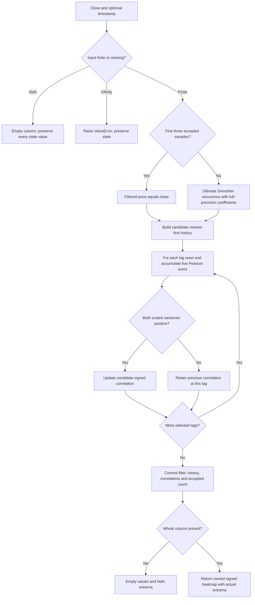

# Autocorrelation Heatmap: research prototype master reference

This master implements John F. Ehlers' February 2025 **Autocorrelation Indicator**, a signed Pearson-correlation map of smoothed prices against their lagged history. It returns one heatmap column per close. The name `autocorrelation-heatmap` describes the output and distinguishes it from an autocorrelation **periodogram spectrum**, which adds a Fourier transform and spectral power processing. This implementation contains neither a Fourier transform nor a dominant-cycle estimator.

The master is self-contained and uses Python's standard library. Its numerical authority is the supplied TASC article and matching MESA/TradeStation autocorrelation loop. The complete mathematical background, calculation equations, source differences, initialization and fixture conventions are carried here so a conversion agent does not need the original articles.

## Drunkard's walk, diffusion and waves

The article imagines a person stepping forward while randomly staggering left or right. The horizontal direction represents time and the vertical direction represents a price departure. Ehlers distinguishes a random disturbance to position from a random decision about the next step's direction, or momentum. He associates the first with trends and diffusion and the second with cycles and waves. These are motivating market models; the heatmap measures correlation directly and does not solve a partial differential equation or estimate the probability of a successful trade.

In the articles' discrete notation, $Z^{-1}$ is one sample of delay. The first printed random-walk equation is

$$X=B+XZ^{-1}+\varepsilon,$$

or, at sample $t$,

$$X_t=B+X_{t-1}+\varepsilon_t.$$

$B$ is constant drift and $\varepsilon_t$ is the random disturbance. The smoke-plume analogy describes drift as the plume's tilt and randomness as particles wandering around its average direction. After $n$ steps,

$$X_n=X_0+nB+\sum_{t=1}^{n}\varepsilon_t.$$

For independent zero-mean disturbances with variance $\sigma^2$, the mean position is $X_0+nB$ and variance is $n\sigma^2$. These last two statements follow from the recurrence and explain the diffusion analogy; the article does not prove that market disturbances satisfy these assumptions.

The article's second discrete equation is

$$X=B+\frac{XZ^{-2}+\varepsilon_1+\varepsilon_2}{2},$$

with its spreadsheet interpretation

$$X_t=B+\frac{X_{t-2}+\varepsilon_{t-1}+\varepsilon_t}{2}.$$

Ehlers relates this to the wave equation, whose second derivative in time is proportional to its second derivative in position. A meandering river is his physical analogy. The discrete example attenuates a two-bar-old level by one-half; a constant drift does not accumulate into the unbounded linear slope of the first example. With disturbances set to zero its stationary level is $X=2B$. This recurrence is the supplied illustrative equation, not a conventional finite-difference discretization of the wave PDE. A positional random walk and a momentum-driven random walk require assumptions that are not specified as an executable market model here.

For orientation, the familiar continuous equations behind the analogies are

$$\frac{\partial p}{\partial t}=-v\frac{\partial p}{\partial x}
 +D\frac{\partial^2p}{\partial x^2},\qquad
\frac{\partial^2u}{\partial t^2}=c^2\frac{\partial^2u}{\partial x^2}.$$

The first is drift-diffusion for a probability density $p$; the second is a wave equation for a field $u$. These displayed canonical PDEs are explanatory additions; the supplied articles describe them in words. They are not computed by the indicator. A $z$ transform is a sampled-data counterpart to the continuous Laplace-transform reasoning mentioned in the article; evaluating it on $z=e^{j\omega}$ yields a frequency response.

The spreadsheet illustration generates $\varepsilon=2(\mathrm{RAND}()-0.5)$, between $-1$ and $+1$, repeats the first 20 random values over a 100-value record, and uses $B=0.1$. Its two calculation columns are `0.1 + C2 + A3` and `0.1 + (D1 + A2 + A3)/2`. **Repeating a block explicitly introduces periodic dependence.** These figures illustrate how a correlated disturbance appears under the two recurrences; they are not simulations of independent random increments throughout the record. The master uses the shared actual `INPUT_CLOSE` dataset, not this illustrative random simulation.

## Pink spectrum and memory

The articles state that market data has a pink spectrum: power spectral density is proportional to wavelength, or inversely proportional to frequency,

$$S(f)\propto\frac1{|f|},\qquad f=\frac1P.$$

The displayed proportionality restates the article's prose mathematically. A random process with such a spectrum can have temporal dependence or memory. For a stationary process, covariance and spectral density are Fourier counterparts; a schematic continuous-frequency relation is

$$R(\tau)=\int S(f)e^{j2\pi f\tau}\,df.$$

This last relation supplies context, not an extra computation or a claimed measured spectrum. Actual finite price records need not be stationary, and a pink-spectrum premise is not tested by this master. The indicator correlates two finite, individually centered segments of **smoothed price levels**. It does not turn prices into returns, remove a highpass trend, estimate spectral density, or infer causal dependence.

## What the lag map shows

Choose the latest $L$ filtered samples, then compare them with a segment of the same length shifted back by lag $k$. Positive correlation is displayed green in the source, negative correlation red and approximately zero yellow. Lag is the vertical coordinate; successive columns advance in time.

For a perfect sinusoid with period $P$ and an integer number of complete cycles in the comparison window, the ideal Pearson lag pattern is

$$\rho(k)=\cos\left(\frac{2\pi k}{P}\right).$$

For $P=20$, lag zero is perfectly correlated, lag 10 perfectly anticorrelated and lag 20 perfectly correlated again. The pattern repeats every 20 lag bars. The article calls this visual raster a *periodogram*, but it is a lag-domain correlation display rather than a frequency-domain power periodogram. Figures 2 and 3 both use a **20-bar sine wave**; the TASC Figure 3 caption incorrectly calls it a “2-bar sine wave.” Two bars refers to the comparison window in that figure. The MESA caption makes that distinction correctly.

With only two pairs, provided neither segment is constant, Pearson correlation reduces algebraically to

$$\rho(k)=\operatorname{sign}\bigl[(f_t-f_{t-1})(f_{t-k}-f_{t-k-1})\bigr].$$

Thus it is normally $+1$ or $-1$: it compares local directions, not the magnitude of the price changes. Turning points flip the sign of one difference and create prominent bands in the lag map. This identity is explanatory; the implementation preserves the source's five raw-moment sums even at $L=2$. Replacing them with a sign function would change behavior at floating-point cancellation and at zero variance.

Ehlers reads repeated vertical lag patterns as cycles, coordinated short-window sign reversals as turning points, and an expanding positive-correlation triangle near the lag baseline as a trend. Figure 4 uses a 20-bar window and Figure 5 a two-bar window on approximately one year of daily emini S&P data. These are visual interpretations, not automatic trading signals produced by the class. Lag zero does not establish predictability; self-correlation is expected for any nonconstant window.

## Complete calculation equations

### Ultimate Smoother preprocessing

The article specifies `Filt = $UltimateSmoother(Close, 20)`, independently of `Length`. Let $x_t$ be close, $P$ the smoothing period in bars and $f_t$ the filtered price. With full-precision constants, define

$$\theta=\frac{\sqrt2\pi}{P},\quad a_1=e^{-\theta},\quad
c_2=2a_1\cos\theta,\quad c_3=-a_1^2,\quad
c_1=\frac{1+c_2-c_3}{4}.$$

The first three accepted samples pass through: $f_t=x_t$ for $t=1,2,3$. From the fourth accepted sample onward,

$$f_t=(1-c_1)x_t+(2c_1-c_2)x_{t-1}-(c_1+c_3)x_{t-2}
       +c_2f_{t-1}+c_3f_{t-2}.$$

This is exactly the supplied Ultimate Smoother function, replacing `1.414` with $\sqrt2$ and `3.14159` with $\pi$. EasyLanguage `Cosine(1.414*180/Period)` takes degrees; the equivalent radian argument is $\sqrt2\pi/P$. The value $c_3$ is negative. Do not change the final term to subtract $c_3f_{t-2}$.

For theoretical interpretation, its response is

$$H_U(z)=\frac{(1-c_1)+(2c_1-c_2)z^{-1}-(c_1+c_3)z^{-2}}
 {1-c_2z^{-1}-c_3z^{-2}}.$$

It can also be written as one minus the second-order highpass response

$$H_U(z)=1-\frac{c_1(1-z^{-1})^2}{1-c_2z^{-1}-c_3z^{-2}}.$$

At DC the highpass term vanishes, so $H_U(1)=1$; the low-frequency price level is retained. The highpass poles have radius $a_1<1$. Subtracting the highpass avoids the time lag of a conventional lowpass over useful frequencies, but does not make every frequency completely lag-free or eliminate overshoot. The article recommends SuperSmoother or Hann filtering for stronger smoothing at the expense of lag; they are alternatives, not part of the executed default.

### Pearson correlation at each lag

For lag $k=0,\ldots,H$, where $H$ is `max_lag`, let

$$X_j=f_{t-j},\qquad Y_j=f_{t-k-j},\qquad j=0,\ldots,L-1.$$

Reset the five sums to zero for **each lag**, then accumulate from newest pair to oldest pair:

$$S_x=\sum_{j=0}^{L-1}X_j,\qquad S_y=\sum_{j=0}^{L-1}Y_j,$$

$$S_{xx}=\sum_{j=0}^{L-1}X_j^2,\qquad
S_{xy}=\sum_{j=0}^{L-1}X_jY_j,\qquad S_{yy}=\sum_{j=0}^{L-1}Y_j^2.$$

Define the scaled centered sums of squares

$$V_x=LS_{xx}-S_x^2,\qquad V_y=LS_{yy}-S_y^2.$$

If both are positive, update

$$r_t(k)=\frac{LS_{xy}-S_xS_y}{\sqrt{V_xV_y}}.$$

Otherwise the source's `If` has no `Else`: **retain the previous value at that lag**,

$$r_t(k)=r_{t-1}(k)\quad\text{when }V_x\le0\text{ or }V_y\le0.$$

Initially $r_0(k)=0$. The source stores $r(k)$ at `Corr[k+1]`; `Corr[0]` is unused. This master stores $r(k)$ at list index $k$, so `values[k]` is lag $k$, with no hidden one-bar shift.

For nonzero variance, the equation equals the centered Pearson expression

$$r_t(k)=\frac{\sum_j(X_j-\bar X)(Y_j-\bar Y)}
 {\sqrt{\sum_j(X_j-\bar X)^2\sum_j(Y_j-\bar Y)^2}},\qquad
\bar X=S_x/L,\quad\bar Y=S_y/L.$$

The $L$ or $L-1$ sample/population scaling cancels from the ratio. In exact arithmetic $r\in[-1,1]$ and $r(0)=1$ when the window varies. The implementation uses the **raw-moment** source equation and summation order, not the centered reformulation, rolling-moment shortcuts or a special lag-zero assignment. Subtraction of nearly equal raw moments can cause numerical cancellation at flat or large price levels. The source's nonpositive-variance retention branch remains observable. Tiny floating-point excursions beyond $[-1,1]$ are not clipped; clipping would change the reference arrays.

Consequently a degenerate window is not an unavailable/NaN result after history priming: it holds its last numerical correlation. A zero-valued stream from reset retains all zeros. A nonzero constant stream may inherit correlations calculated against zero prehistory before all real history has arrived. Do not replace undefined correlations with NaN, reset them to zero on each update, or infer a valid cycle from retained values.

### Source coloring and numeric output

The article's red/green/blue conversion is

$$\mathrm{red}(r)=\begin{cases}255(1-r),&r\ge0,\\255,&r<0,\end{cases}$$

$$\mathrm{green}(r)=\begin{cases}255,&r\ge0,\\255(1+r),&r<0,\end{cases}\qquad
\mathrm{blue}(r)=0.$$

Positive one is green, zero is yellow and negative one is red. The master returns signed correlation numbers and leaves color selection and integer RGB quantization to the renderer. There is **no** absolute value, squaring, power smoothing, logarithm, automatic gain control, division by the largest bin or subtraction of the minimum bin. If a target renderer requires values in $[0,1]$, $(r+1)/2$ is a display adapter and must not replace the master's stored signed values or fixtures.

## Parameters and streaming API

| Parameter | Default | Valid range | Purpose |
|---|---:|---|---|
| `length` | 20 | Integer at least 2 | Number of aligned pairs in each Pearson comparison |
| `smoothing_period` | 20.0 | Finite real at least 1.0 | Ultimate Smoother critical period; fractional values are supported |
| `max_lag` | 99 | Integer 0..99 inclusive | Largest lag returned; minimum lag is always zero |

Boolean values are rejected as parameters. The articles expose only `Length`; smoothing period 20 and computed maximum lag 99 are fixed in their listings. The two extra master parameters explicitly generalize those fixed values. Their defaults reproduce the article's equations. The smoothing period is a coefficient setting, not an averaging-window length; it must not automatically follow `length`. Short Pearson windows emphasize direction changes; longer ones provide graded correlation and incorporate more waveform history. `length=1` cannot have positive variance and is rejected. There is no arbitrary numerical upper limit on length, but storage and calculation cost grow with it.

`AutocorrelationHeatmap(...).update(close, time=None)` returns a `Heatmap` named tuple. Fields follow the requested zpano structure:

| Field | Meaning |
|---|---|
| `time` | Optional caller-supplied `datetime`, otherwise None; excluded from DSP |
| `parameter_first` | 0.0, the first lag in bars |
| `parameter_last` | `float(max_lag)`, inclusive |
| `parameter_resolution` | 1.0 bar |
| `value_min` | Actual smallest signed correlation in this column |
| `value_max` | Actual largest signed correlation in this column |
| `values` | Fresh owned list of `max_lag+1` signed values, ascending lag |

`Heatmap.is_empty()` reports whether values are absent. Empty columns retain axis metadata, have `values=[]` and have NaN extrema. Each returned list is independent: caller changes cannot modify subsequent retained correlation state. `state` returns immutable diagnostics containing accepted sample count, last filtered price and the correlation tuple. `primed`, `warmup_bars` and read-only configuration properties are provided. `reset()` returns all state to its initial values and retains configuration.

## Origin, priming and missing samples

The master defines one-based `CurrentBar=t`, with its first input at $t=1$. Raw and filtered prehistory is zero. First-three-price pass-through fills the Ultimate Smoother's two input and two output delays before recurrence starts. Internal correlation calculations run from the first accepted sample; insufficient older history reads zero. This preserves the persistent `Corr` semantics during startup.

For a public column, require real observations for every selected lag: the oldest sample is $f_{t-H-L+1}$. The first available column is at

$$t_{\mathrm{prime}}=\max(4,L+H).$$

The added minimum of four ensures at least one recursive smoother calculation. Leading empty columns number $t_{\mathrm{prime}}-1$. Defaults $L=20,H=99$ yield the first valid column at sample 119 and 118 leading empty columns. This is a deliberate **whole-column** history rule; there is no mixture of primed short-lag bins and NaN long-lag bins. Priming does not require nonzero variance or prove reliability.

The article does not specify a standalone public NaN rule, and native chart engines can begin evaluation after their own MaxBarsBack history. Source reproduction therefore means the documented origin, initialization, recurrence and raw sums with full-precision constants. A native engine using printed rounded constants or another chart origin need not be bit-identical.

NaN input returns an empty column and leaves all state, including accepted count, untouched. It does not represent an elapsed bar in the lag axis. Infinity raises `ValueError` before changes. Nonfinite filtering, raw moments, variance product or Pearson results raise `ValueError`; the update computes candidate state and commits only after all lags succeed. No epsilon regularization or replacement statistic is introduced. A skipped/rejected sample does not consume history. There is no future read, backfilling of earlier results or same-timestamp replacement behavior; every successful update is one new accepted observation.

Calculation uses $O(L(H+1))$ work per update and $O(L+H)$ history plus $O(H+1)$ retained correlations. The straightforward five-sum loops are intentional for faithful conversion. Standard floating-point arithmetic, arrays, exponential, cosine and square root are all that Rust, Go, Zig or TypeScript need.



## Source audit and display repairs

The TASC and MESA articles and supplied TradeStation indicator share the same Pearson loop, fixed `UltimateSmoother(Close,20)`, persistent zero-initialized `Corr`, and conditional update with no else branch. They compute lags **0 through 99** into `Corr[1]` through `Corr[100]`.

Their drawing loop starts at lag **1**, although it contains a lag-zero plot branch, and the explicit plot branches finish at lag 98. Thus lag zero's plot is unreachable and lag 99 is computed without a matching explicit plot. The master returns all computed bins 0..99 with their correct coordinates. This restores the zero-lag baseline described by the article and makes every calculated value available. It changes rendering availability, not any Pearson value. It does not duplicate the unused `Corr[0]` or invent a lag 100.

The TradeStation tips supply a file named `TradeStation_SuperSmoother.els`, while the indicator calls **UltimateSmoother**. The article and MESA provide the correct Ultimate Smoother function; this master uses it. Merely substituting the supplied SuperSmoother helper would change the filter.

The other supplied platform versions have material differences and are not combined into an unnamed source variant:

- Wealth-Lab couples smoother period to length and defers correlation calculations until `bar=length+100`. It retains old values on zero variance but renders the one-based array slots on a shifted raster index.
- TradingView defaults to length 100, couples filter period to length, passes through four bars because `bar_index>=4` is zero-based, keeps rounded 1.414, creates a new zero correlation array each bar, and reverses the red/green mapping. Its slicing also limits the selected range. It is not the default numerical or color authority.
- NinjaTrader couples filtering to length, clamps unavailable historical indices to the oldest available bar and writes zero when its computed denominator is not positive. Those startup and degenerate-window rules differ from persistent source retention.
- Zorro uses its `SmoothUltimate` library with length and correlates pointers offset by an additional `Length`. Its chart and lookback configuration introduces other alignment choices. Its separate Ultimate Smoother snippet uses 1.414 and its own series initialization.

The articles mention Hann and SuperSmoother alternatives without prescribing new production parameters or reference variants for this indicator. The prototype intentionally implements the specified Ultimate Smoother path with explicit independent cutoff, rather than multiplying the fixture grid by unrequested filter families.

## Confirmed reference configurations: 12 cases

The following twelve targeted combinations are below the 64-case cap. Fixed max lag 99 is retained for the main cases; compact ranges test history bounds and axis handling. Every case consumes the same 252 shared closes.

| Length | Smoothing period | Max lag | What it tests |
|---:|---:|---:|---|
| 20 | 20.0 | 99 | Article default and Figure 4: monthly window, all computed lags. |
| 2 | 20.0 | 99 | Figure 5: two-point reversal map with independent twenty-bar smoothing. |
| 3 | 20.0 | 99 | Small increase from two pairs: temper abrupt correlation reversals. |
| 5 | 20.0 | 99 | Short multi-pair window: compare sign saturation with graded correlation. |
| 40 | 20.0 | 99 | Longer correlation window: retain two monthly cycles per comparison. |
| 100 | 20.0 | 99 | Long history boundary: late whole-column priming within the 252 closes. |
| 20 | 10.0 | 99 | Faster Ultimate Smoother: separate cutoff changes from correlation length. |
| 20 | 10.5 | 99 | Fractional cutoff: preserve real-valued coefficient calculation. |
| 20 | 40.0 | 99 | Slower Ultimate Smoother: sustained filter memory with fixed Pearson length. |
| 20 | 20.0 | 32 | Compact lag range: earlier priming and exact common-bin agreement. |
| 2 | 20.0 | 32 | Compact reversal map: short history and two-point correlation edge cases. |
| 20 | 20.0 | 0 | Zero-lag-only boundary: self-correlation and single-bin heatmap structure. |

The user confirmed this grid and the folder name on 2026-10-21; `REFERENCE_CASES_CONFIRMED=True` records that authorization. Each case exports `HEATMAP`, `MIN` and `MAX`, giving 36 arrays per language. The output component suffix distinguishes matrices from scalar extrema without counting them as additional parameter combinations.

## Five-language fixture and generation contract

All five shared input templates are copied into this folder. The master `__main__` embeds the exact 252 `INPUT_CLOSE` values, runs a default usage example, and provides `--generate-reference-data`. Shared `INPUT_HIGH`, `INPUT_LOW` and `INPUT_OPEN` arrays remain in the copied files but are not consumed by this indicator.

Python is the authoritative expected dataset. The generator appends a marked expected-data section, reopens it with an AST numeric-literal parser, verifies 252 rows, matrix dimensions, NaN masks and exact 15-significant-digit serialization, and translates those **reopened literals** to all four other languages. Reruns replace only that marked section; input arrays remain intact. Recursive calculations retain binary64 precision. Only serialized output uses `format(value, '.15g')`.

Names use `L` for Pearson length, `P` for smoothing period and `H` for maximum lag. For example `EXPECTED_L20_P10_5_H99_HEATMAP` has period 10.5; decimal points become underscores and integral periods stay compact. Each array is preceded by the exact “What it tests” comment from the table and then a full parameter-name/value comment.

`HEATMAP` has **time-major** shape `[252][H+1]`; each row is in ascending lag order. Runtime empty columns are serialized as full NaN rows for fixed-size test fixtures. `MIN` and `MAX` contain 252 values with matching NaN masks. Axis metadata is constant `(0.0, float(H), 1.0)` and is documented rather than duplicated 252 times.

The language representations are:

| Language | Names and data forms | NaN syntax |
|---|---|---|
| Python | `EXPECTED_L20_P10_5_H99_HEATMAP = [...]`, nested lists for heatmaps | `NaN`, defined as `math.nan` |
| Go | Package `autocorrelationheatmap`, `var expectedL20_P10_5_H99_HEATMAP = [][]float64{...}` | `math.NaN()` with `import "math"` |
| TypeScript | `export const expectedL20_P10_5_H99_HEATMAP: number[][] = [...]` | `NaN` |
| Rust | `pub fn expected_l20_p10_5_h99_heatmap() -> Vec<Vec<f64>>` | `f64::NAN` |
| Zig | `pub fn expectedL20_P10_5_H99_HEATMAP() [252][100]f64`, returning `.{...}` | `nan`, using the shared `std.math` declaration |

Scalar extrema use each language's corresponding single-dimensional form. The valid language spellings above resolve the typos in the procedure's examples. Compare NaNs by classification, not equality. Other language math libraries can introduce small floating-point differences; use sensible tolerances for computed ports, especially for two-point raw-moment correlations. Do not force their computed values to the 15-digit fixtures during recursion.

Regenerate the confirmed fixtures with:

```sh
python3 autocorrelation-heatmap.py --generate-reference-data
```

## References and BibTeX

Primary materials actually read for this implementation:

1. John F. Ehlers, “Drunkard's Walk: Theory And Measurement By Autocorrelation,” *Technical Analysis of STOCKS & COMMODITIES*, vol. 43, February 2025, pp. 8–15. [Article URL](https://technical.traders.com/archive/article.asp?file=%5CV43%5CC02%5C910EHLE.pdf). Supplied `../../tasc/2025-02-drunkards-walk-theory-and-measurement-by-autocorrelation/content.md`, both EasyLanguage sidebars and all mathematical prose.
2. John F. Ehlers, “Drunkard's Walk,” [MESA PDF](https://www.mesasoftware.com/papers/Drunkard%27s%20Walk.pdf). Supplied `mesa/content.md`, including Listings 1 and 2. The local BibTeX assigns year 2026; its listings say copyright 2024 and match February 2025. Treat the manuscript as undated rather than asserting a separately verified 2026 publication.
3. [Traders' Tips, February 2025](https://www.traders.com/Documentation/FEEDbk_docs/2025/02/TradersTips.html). Supplied `tips/tips.md`, TradeStation, Wealth-Lab, TradingView, NinjaTrader and Zorro files. Platform differences are audited above.
4. Local output interface `external/zpano/py/indicators/core/outputs/heatmap.py` and autocorrelation-periodogram package. Only the heatmap field structure, axis convention and empty-column shape are adopted; their spectral algorithm and normalization are not imported.

The articles' further reading includes Ehlers' “The Ultimate Smoother” (April 2024), “Windowing” (September 2021), *Cybernetic Analysis for Stocks and Futures* (2004), and *Cycle Analytics for Traders* (2013). No book chapter text was supplied in this indicator's input folder. They are bibliographic context, not a claim that additional undisclosed chapter equations were implemented. All equations in the supplied articles and all equations necessary to reproduce their executable correlation and smoothing code are included above. Additional canonical equations are identified as explanatory derivations.

```bibtex
@article{ehlers2025drunkards,
  author = {Ehlers, John F.},
  title = {Drunkard's Walk: Theory and Measurement by Autocorrelation},
  journal = {Technical Analysis of Stocks \& Commodities},
  volume = {43}, number = {2}, pages = {8--15},
  year = {2025}, month = feb,
  url = {https://technical.traders.com/archive/article.asp?file=%5CV43%5CC02%5C910EHLE.pdf}
}
@misc{ehlersMesaDrunkardsWalk,
  author = {Ehlers, John F.}, title = {Drunkard's Walk},
  howpublished = {MESA Software manuscript},
  url = {https://www.mesasoftware.com/papers/Drunkard%27s%20Walk.pdf},
  note = {Undated PDF; supplied listings copyright 2024; local transcription cites 2026}
}
@misc{traderstips2025feb,
  title = {Traders' Tips: February 2025},
  publisher = {Technical Analysis, Inc.}, year = {2025}, month = feb,
  url = {https://www.traders.com/Documentation/FEEDbk_docs/2025/02/TradersTips.html},
  note = {Autocorrelation implementations for TradeStation, Wealth-Lab, NeuroShell, TradingView, NinjaTrader and Zorro}
}
@article{ehlers2024ultimate,
  author = {Ehlers, John F.}, title = {The Ultimate Smoother},
  journal = {Technical Analysis of Stocks \& Commodities},
  volume = {42}, number = {4}, pages = {8--15}, year = {2024}, month = apr
}
@article{ehlers2021windowing,
  author = {Ehlers, John F.}, title = {Windowing},
  journal = {Technical Analysis of Stocks \& Commodities},
  volume = {39}, number = {9}, pages = {8--14}, year = {2021}, month = sep
}
@book{ehlers2004cybernetic,
  author = {Ehlers, John F.}, title = {Cybernetic Analysis for Stocks and Futures},
  publisher = {John Wiley \& Sons}, year = {2004}
}
@book{ehlers2013cycle,
  author = {Ehlers, John F.}, title = {Cycle Analytics for Traders},
  publisher = {John Wiley \& Sons}, year = {2013}
}
@misc{zpanoHeatmapInterface,
  title = {zpano Python heatmap output and autocorrelation periodogram},
  howpublished = {Local repository: external/zpano/py/indicators},
  note = {Output structure only; not the numerical autocorrelation authority}
}
```

## Completed validation

The user confirmed `autocorrelation-heatmap` and all 12 configurations on 2026-10-21. All five fixture files now contain 36 expected arrays: twelve signed heatmap matrices plus their twelve minimum and twelve maximum series. Each array has 252 time rows; matrices have `max_lag+1` ascending lag bins. The default has 118 leading NaN rows and 134 available rows.

Seven local unittest cases passed. They compare all configurations against an independent full-history translation of the TASC/MESA smoothing and one-based Pearson loops, compare saved fixtures exactly with 15-significant-digit serialization, verify sinusoidal correlation against the analytical cosine pattern, and exercise two-point correlation, degenerate-variance retention, parameter boundaries, priming, reset, rejected/missing samples, metadata, owned snapshots and common-lag consistency across different ranges.

A separate fixture audit matched every numeric literal, NaN and both comment lines in all four translated languages to the Python arrays. It also verified all 252 input closes and regenerated a scratch copy of all five files without any byte changes. Go fixture compilation, Rust metadata compilation, TypeScript syntax checks and Zig tests passed. The Zig wrapper invoked every input and expected-data function so its lazy compiler checked every array body and its dimensions.

To rerun the calculation and saved-fixture checks from this folder:

```sh
python3 -m unittest discover -s . -p 'test_autocorrelation_heatmap.py' -v
```

The standalone fixture compilation/syntax commands used were:

```sh
go test testdata_test.go
rustc --cfg test --crate-type lib --emit metadata testdata.rs -o /tmp/autocorrelation-heatmap.rmeta
node --experimental-strip-types --check testdata.ts
```

The Zig 0.16 validation used a scratch test wrapper that calls every public fixture function and verifies its outer length equals 252. These checks validate the reference data, not implementations of the indicators in the other languages; those conversions belong in the next repository. Native chart-platform engines were not run. Numerical source equivalence is established for the explicit standalone origin, startup, retained-correlation rule, signed lag indexing and full-precision constants documented above.
