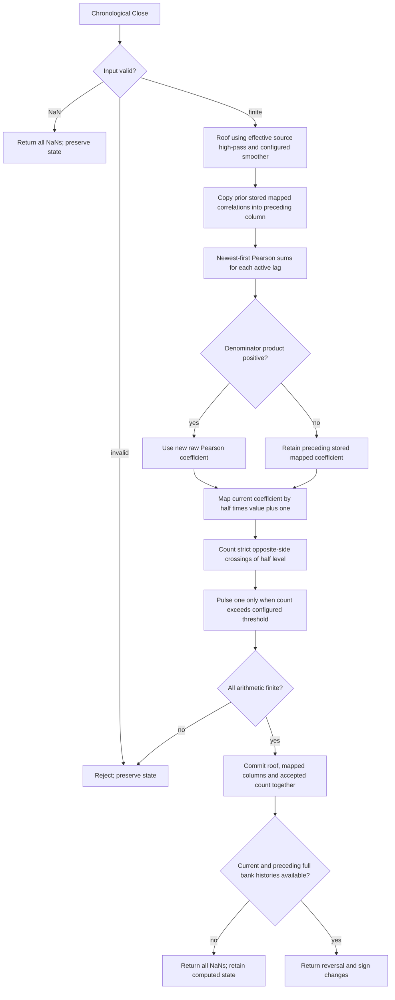

# Autocorrelation Reversals — Chapter 8 research prototype master

## Numerical authority and scope

This is a **research prototype master reference** for conversion to Python, Go, TypeScript, Rust and Zig. The numerical authority is this indicator's own listing in John F. Ehlers' *Cycle Analytics for Traders: Advanced Technical Trading Concepts* (Wiley, 2013). The implementation is chronological and uses only standard Python arithmetic, lists, tuples and `math`. Every folder is self-contained: no numerical runtime imports from another master, zpano, NumPy or pandas. The relevant original book prose and complete indicator listing are retained in the appendix, while the full mathematical specification is stated above it so a conversion agent does not need access to the book files.

Full-precision mathematical constants replace printed approximations: `math.pi`, `math.sqrt(2.0)` and its reciprocal correspond to `3.14159`, `1.414` and `.707` in the applicable formulas. The source's degrees are converted to radians. Decimal design constants such as .5 and the plotting levels .3/.7 are not reinterpreted as approximations to mathematical constants. All feedback and calculations use unrounded binary64. Only exported reference literals use **15 significant digits**. The original truncated-constant code may differ slightly; recurrence signs, arithmetic ordering, window bounds and guard behavior remain the chosen source authority.

The user confirmed **36 combinations**, twelve per folder, on 2026-10-22. Modified RSI and Even Better Sinewave each export a scalar VALUE array per case. Autocorrelation Reversals exports the plotted REVERSAL plus the source's SIGN_CHANGES count as an explicit diagnostic. Family total: **48 expected component arrays per language**, all with 252 rows. The Reversals master has an explicit source mode for the unused printed HPLength input; the default preserves the original listing.

## Streaming API and finite-record initialization

Call `update(close, time=None)` once per chronological scalar Close. Scalar indicators return a float; Reversals returns a named tuple. Time is metadata-compatible but does not enter the numerical calculation. `parameters` is immutable; `samples_seen` counts accepted observations; `warmup_bars` is the number of leading unavailable public rows; `is_primed` indicates that required history exists; `output` is the last accepted public output; `state` exposes immutable diagnostic values. `reset()` restores zero state while retaining configuration and coefficients.

Absent raw prices, filtered histories, correlation storage and declared recursive variables are explicitly zero. Every stage runs from the first accepted bar, even while public output is NaN. Zero prehistory and standalone CurrentBar=1 define this finite-record reference. Do not seed with the first Close, delay the recurrence until full history, use public NaNs as feedback, or replay earlier windows after future data arrives. A positive constant Close has a startup transient because absent closes were zero; a zero-only stream is a different experiment. A trading platform with preceding price history must use matched initialization and accepted bars to reproduce this reference.

NaN input denotes an omitted observation: return all-NaN output and preserve histories, accepted count and the previous `output`. Infinity, bool, nonnumeric input and arithmetic overflow raise `ValueError` before state mutation. All downstream candidates are checked before committing upstream filtering, so a rejected value cannot advance one stage without the other. Missing observations do not age lookbacks. Parameter booleans are rejected; periods that lose stable numerical coefficient resolution are also rejected.

Public NaNs mark **input availability, not convergence** of recursive feedback. Coefficient periods may exceed the 252-bar record without requiring a full-period waiting window. The exact history rule is stated separately for each indicator. Recursive early values still affect later output; no generic burn-in is silently inserted. Storage is bounded by configured windows rather than by total observation count. Previously returned values and immutable state snapshots do not change after another update.

## Sampled-data and spectral-dilation background

One Close per bar is a sampled signal. Nyquist is one-half cycle per bar, the highest representable frequency. A low-pass attenuates rapid changes, a high-pass rejects a static component and attenuates slow changes, and their cascade acts as a broad pass band. Zeros describe rejected components; poles describe damping and recursive memory. These are engineering characteristics of the filter, not a physical model or prediction of market prices.

Chapter 7 motivates stronger detrending through **spectral dilation**, where longer market cycles in the book's model have larger amplitude, approximately 6 dB per octave. A single high-pass's approximately 6 dB/octave low-frequency attenuation can then equalize rather than eliminate slow components. Two high-pass poles give approximately 12 dB/octave attenuation and better suppress that slow content. Modified RSI and Reversals use that two-pole roof. Chapter 12 deliberately uses a **one-pole** high-pass to retain more trend contribution after equalization; changing it to the common two-pole Roofing Filter would change the indicator's purpose and numbers.

The SuperSmoother reduces fast aliasing/noise contributions and has a feedforward zero at Nyquist. Its poles resemble a damped rotation in a physical instrument, but no market oscillation is assumed to obey a mechanical equation. The frequency and lag claims in the book are contextual motivation; the masters do not validate a trading strategy or calibrate forecast probabilities.

## Two-pole Roofing Filter: complete equations

Let $x_t$ be Close, $H$ be `highpass_period` (or the explicitly selected effective period), and $L$ be `smoothing_period`. The two-pole high-pass is

$$\theta_H=\frac{2\pi}{\sqrt2H},\quad
\alpha_H=\frac{\cos\theta_H+\sin\theta_H-1}{\cos\theta_H},\quad q=1-\alpha_H,$$

$$h_t=(1-\alpha_H/2)^2(x_t-2x_{t-1}+x_{t-2})+2q h_{t-1}-q^2h_{t-2}.$$

Chapter 3 Equation 3-3 gives the following SuperSmoother:

$$a=e^{-\sqrt2\pi/L},\quad
c_2=2a\cos(\sqrt2\pi/L),\quad c_3=-a^2,\quad c_1=1-c_2-c_3,$$

$$f_t=\frac{c_1}{2}(h_t+h_{t-1})+c_2f_{t-1}+c_3f_{t-2}.$$

The fixed-coefficient transfer functions are

$$H_{HP}(z)=\frac{(1-\alpha_H/2)^2(1-z^{-1})^2}
{1-2qz^{-1}+q^2z^{-2}},\quad
H_{SS}(z)=\frac{(c_1/2)(1+z^{-1})}{1-c_2z^{-1}-c_3z^{-2}},\quad
H_{Roof}(z)=H_{HP}(z)H_{SS}(z).$$

The high-pass has a double DC zero, and the smoother has a Nyquist zero. The roof is not an ideal brick-wall band and cannot enforce exactly zero mean in every finite window. The printed `.707` means $1/\sqrt2$; the SuperSmoother uses $\sqrt2$ itself. Keep those different roles. The recurrence **adds** $c_2$ and negative $c_3$ products, while subtracting positive $q^2h_{t-2}$. The modified-Butterworth equations elsewhere in Chapter 3 are separate filters and are not used.

Each stage keeps two historical outputs. Both raw prehistory closes and all filter output histories are zero. The first accepted Close $x_0$ already creates $h_0=(1-\alpha_H/2)^2x_0$ and $f_0=c_1h_0/2$; these are not overwritten by startup NaNs. Parameterized cutoffs are coefficient periods, including fractions, and do not become finite SMA lengths.

## Autocorrelation principle and physical analogy

Chapter 8 motivates autocorrelation through noisy radar returns with memory: an exponentially filtered random input can have short- or longer-term dependence even when new innovations are random. A simple memory equation is

$$z_t=\eta u_t+(1-\eta)z_{t-1}.$$

The book also gives the contextual long-memory form

$$\operatorname{Autocorrelation}(\ell)=C\ell^{-\alpha},\qquad\ell>0.$$

This is not a formula evaluated by the master or a universal law for financial prices. For an ideal sine $f_t=A\sin(2\pi t/P+\phi)$ under an appropriate full-cycle average,

$$r(\ell)=\cos(2\pi\ell/P).$$

Correlation is positive at zero/full-cycle lag and negative at half-cycle lag, independent of amplitude. Short sliding Pearson windows on market data differ from that ideal cosine. Chapter 8 notes that many lag correlations can reverse sign together around a price turning point after filtering delay. Reversals measures those simultaneous sign changes, not a dominant-cycle period or calibrated reversal probability.

## Complete Pearson bank equations and persistent mapped state

Active lags are inclusive integers $\ell=L_0,\ldots,L_1$, source defaults 3..48. There are **46**, not 48, active default lag bins. Use $M_\ell=A$ when `averaging_length=A>0`, or $M_\ell=\ell$ when $A=0$. With newest-first sample pairs

$$X_j=f_{t-j},\qquad Y_j=f_{t-\ell-j},\qquad j=0,\ldots,M_\ell-1,$$

form the five source sums

$$S_x=\sum_jX_j,\quad S_y=\sum_jY_j,\quad
S_{xx}=\sum_jX_j^2,\quad S_{xy}=\sum_jX_jY_j,\quad S_{yy}=\sum_jY_j^2,$$

$$V_\ell=(M_\ell S_{xx}-S_x^2)(M_\ell S_{yy}-S_y^2).$$

When $V_\ell>0$, the ordinary Pearson candidate is

$$r_t(\ell)=\frac{M_\ell S_{xy}-S_xS_y}{\sqrt{V_\ell}}.$$

Preserve raw-sum arithmetic order and the source denominator product test. Do not replace with centered sums, add a variance epsilon, clamp Pearson values, or recompute them with compensated summation. All valid candidates must remain finite.

The crucial source detail is that **the stored array is mapped**, and a denominator failure retains that mapped value before mapping it again. Let $c_{t-1}(\ell)$ be stored `Corr[Lag,1]` before the update. The preceding column is first copied:

$$c^{prev}_t(\ell)=c_{t-1}(\ell).$$

Then the current stored value is

$$c_t(\ell)=\begin{cases}
\frac12(r_t(\ell)+1),&V_\ell>0,\\
\frac12(c_{t-1}(\ell)+1),&V_\ell\le0.
\end{cases}$$

The second branch is literal code behavior, not a standard Pearson definition. The array begins at zero. Flat or one-sample windows repeatedly follow

$$c_t=\frac12(c_{t-1}+1),\qquad
c_n=1-2^{-n}\quad\text{after }n\text{ such updates from zero},$$

until floating-point rounding reaches one. Thus they produce .5, .75, .875, and so on; do not retain a separate raw correlation in this source mode. The already prepared roofed autocorrelation heatmap has the same mapped-state quirk, but a different plotted output. Reversals only computes the active source lag range, so hidden lags zero through two are not included.

## Strict sign-change count and decision

For each active lag, count a crossing only if the old and new mapped values are **strictly on opposite sides of .5**:

$$b_t(\ell)=\begin{cases}1,&
(c_t>.5\text{ and }c^{prev}_t<.5)\text{ or }(c_t<.5\text{ and }c^{prev}_t>.5),\\
0,&\text{otherwise}.
\end{cases}$$

$$K_t=\sum_{\ell=L_0}^{L_1}b_t(\ell),\qquad
R_t=\begin{cases}1,&K_t>T,\\0,&K_t\le T,\end{cases}$$

where $T$=`sign_change_threshold`, printed default 24. Exactly 24 crossings produces **zero**, and 25 produces one. Touching .5 at either end counts neither crossing. Do not use an inclusive threshold, a generic platform `Crosses Over` operation, or a sum of absolute/signed correlation differences. Despite the source variable `SumDeltas` and its prose description, the listing accumulates an integer **count** of sign changes.

The fraction $K_t/46$ is not itself plotted, and the threshold 24 is not automatically recomputed from a changed lag-bank width. The master exposes threshold explicitly for alternate banks, so the compact case 3..24 uses its explicitly proposed threshold 12. A threshold at or above the active bin count disables all reversal events and is supported. Signal is a bar pulse (0/1), not a latched trade position; consecutive bars can both produce one.

## Source HPLength discrepancy and configuration

Listing 8-4 declares `HPLength(48)` but calculates its high-pass coefficient using the literal **48**. The text says HPLength offers flexibility, but the code does not use it. The master makes the distinction explicit:

- `source="book"` (default) uses effective high-pass period 48 even when `highpass_period` is changed. This preserves the printed listing exactly.
- `source="configured-highpass"` replaces that literal with the supplied `highpass_period`; this is a documented research correction, not claimed as printed source behavior.

The modes differ only in that coefficient. Both keep mapped-correlation retention, strict crossings, source sum ordering and all other defaults. `effective_highpass_period` exposes the actually used period. The copied parameter/comment metadata retains the user-supplied value, even when the printed source leaves it unused. Chapter 11's periodogram uses raw correlation retention and should not be reused as a replacement engine here.

| Parameter | Default | Valid range and role |
| --- | --- | --- |
| `min_lag` | 3 | Integer $\ge3$, first active lag. |
| `max_lag` | 48 | Integer $\ge\texttt{min_lag}$, last active lag. A single-lag bank is supported. |
| `averaging_length` | 3 | Integer $\ge0$; zero gives lag-dependent windows, one is deliberately supported as a degenerate source boundary. |
| `highpass_period` | 48.0 | Finite real $\ge5$; used in configured-highpass mode and retained as declared but inactive input in book mode. Active coefficients must be numerically resolvable. |
| `smoothing_period` | 10.0 | Finite real $\ge2$, resolvable stable input SuperSmoother; supports fractions. |
| `sign_change_threshold` | 24 | Integer $\ge0$; decision is strictly `count > threshold`. |
| `source` | `"book"` | Either `"book"` or `"configured-highpass"`, explicitly selecting the printed or corrected HPLength behavior. |

The source exposes HPLength, LPLength and AvgLength; active lag bounds and the threshold are hardcoded at 3..48 and 24. Exposing those controls is an explicit research generalization. No Fourier transform, spectrum, cycle centroid, output smoothing, confidence score or heatmap is part of this master. Hence no heatmap conversion structure is necessary for this scalar event/count pair.

`update` returns `ReversalOutput(reversal, sign_changes)`. Both fields are floats to represent NaN, though finite values are integral. `state` exposes high-pass, roofed value, current and preceding mapped-correlation tuples in ascending active-lag order, integer count and internal pulse. No correction changes the source default signal.

## Full current and preceding-bank history

The oldest current Pearson input index is $L_1+M_{L_1}-1$, so the full current bank requires

$$N_{corr}=L_1+(A\text{ if }A>0\text{ else }L_1).$$

The event compares that bank with the preceding bar's bank. Public output therefore starts after **one additional observation**:

$$\texttt{warmup\_bars}=N_{corr},\qquad\text{first public bar}=N_{corr}+1.$$

At defaults $N_{corr}=51$, the first 51 public rows are NaN and bar 52 is finite. With $A=0$, the prefix is 96. The approved $A=203$ case has 251 leading NaNs followed by one finite row at the final close. Every internal mapped correlation and event still updates from bar one; do not first fill raw history and then begin counting with reset columns.

The chapter describes roughly three bars' delay at its default short average. Public warmup for an isolated record is different from response delay after state exists, and a larger averaging window changes both delay and event behavior. None of these counts proves that a price reversal is reliable.

## Calculation flow



For $B=L_1-L_0+1$ bins, update work is $O(BA)$ with fixed averaging or $O(\sum_{\ell=L_0}^{L_1}\ell)$ with lag-dependent averaging, plus $O(B)$ crossing work. Storage is bounded by $O(L_1+A+B)$ or $O(L_1+B)$ respectively. The master uses ordinary arrays and loops, with no numerical-package correlation routine or Fourier cache.

## Confirmed reference combinations

All twelve cases were confirmed within the 36-case family plan. Each exported component has 252 rows.

| Case | Parameters | What it tests |
| --- | --- | --- |
| 1 | `min_lag=3, max_lag=48, averaging_length=3, highpass_period=48.0, smoothing_period=10.0, sign_change_threshold=24, source=book` | Published defaults, strict half-level crossings and more-than-24 decision. |
| 2 | `min_lag=3, max_lag=48, averaging_length=0, highpass_period=48.0, smoothing_period=10.0, sign_change_threshold=24, source=book` | Lag-dependent Pearson windows and longer history. |
| 3 | `min_lag=3, max_lag=48, averaging_length=1, highpass_period=48.0, smoothing_period=10.0, sign_change_threshold=24, source=book` | Degenerate Pearson windows and repeated mapping of retained stored correlations. |
| 4 | `min_lag=3, max_lag=48, averaging_length=2, highpass_period=48.0, smoothing_period=10.0, sign_change_threshold=24, source=book` | Two-sample Pearson windows and rapid correlation sign changes. |
| 5 | `min_lag=3, max_lag=48, averaging_length=5, highpass_period=48.0, smoothing_period=10.0, sign_change_threshold=24, source=book` | Longer fixed Pearson average. |
| 6 | `min_lag=3, max_lag=48, averaging_length=100, highpass_period=48.0, smoothing_period=10.0, sign_change_threshold=24, source=book` | Long fixed correlation history and fewer rapid decisions. |
| 7 | `min_lag=3, max_lag=48, averaging_length=3, highpass_period=48.0, smoothing_period=10.5, sign_change_threshold=24, source=book` | Fractional input SuperSmoother cutoff. |
| 8 | `min_lag=3, max_lag=48, averaging_length=3, highpass_period=48.0, smoothing_period=20.0, sign_change_threshold=24, source=book` | 20-bar smoothing example discussed in Chapter 8. |
| 9 | `min_lag=3, max_lag=48, averaging_length=3, highpass_period=80.0, smoothing_period=10.0, sign_change_threshold=24, source=book` | Printed unused HPLength input: book mode still calculates with 48 bars. |
| 10 | `min_lag=3, max_lag=48, averaging_length=3, highpass_period=80.0, smoothing_period=10.0, sign_change_threshold=24, source=configured-highpass` | Explicit research correction that honors the configured high-pass period. |
| 11 | `min_lag=3, max_lag=24, averaging_length=3, highpass_period=48.0, smoothing_period=10.0, sign_change_threshold=12, source=book` | Compact lag bank and explicitly configured strict threshold. |
| 12 | `min_lag=3, max_lag=48, averaging_length=203, highpass_period=48.0, smoothing_period=10.0, sign_change_threshold=24, source=book` | 252-observation boundary including the previous full correlation bank. |

## Files, fixtures and porting

`autocorrelation-reversals.py` is the numerical master and contains a separately marked fixture generator. `description.md` is the complete conversion specification. `test_autocorrelation_reversals.py` contains the independent full-history source oracle plus streaming and source-specific checks. `verify_reference_data.py` parses the generated fixtures in all five languages to check exact rounded values, dimensions, metadata, NaN masks and unchanged OHLC inputs.

The copied `test_testdata.py`, `testdata_test.go`, `testdata.ts`, `testdata.rs` and `testdata.zig` retain the original **four 252-element OHLC arrays**, although these calculations consume only Close. The exact Close array is also embedded inside the master's `__main__`. This folder has **24 expected component arrays per language**. Family total: 48 arrays or 12,096 values per language, representing 36 parameter combinations.

Names use parameter shortcuts `L`, `HP`, `LP` for Modified RSI; `L0`, `L1`, `A`, `HP`, `LP`, `T`, `SRC` for Reversals; and `D`, `LP` for Even Better Sinewave. Decimal points become underscores; source-mode hyphens likewise become underscores. Example: `EXPECTED_L03_L148_A3_HP48_LP10_T24_SRCbook_REVERSAL`. The configured-highpass mode has `SRCconfigured_highpass`, distinct from `SRCbook`. Component suffixes identify VALUE, REVERSAL or SIGN_CHANGES. Go/TypeScript/Zig start names with `expected`, Rust uses `expected_` and lowercase tokens. Each array has the same description comment and parameter/input comment in all languages.

Run from this folder:

```sh
python3 autocorrelation-reversals.py
python3 autocorrelation-reversals.py --generate-reference-data
python3 verify_reference_data.py
python3 -m unittest discover -s . -p 'test_autocorrelation_reversals.py'
```

The generator writes marked Python expected arrays, reopens them to verify every rounded value and NaN, then translates those authoritative decimals to the foreign fixtures. NaNs use Python `NaN = math.nan`, Go `math.NaN()`, TypeScript `NaN`, Rust `f64::NAN` and Zig `nan` with the supplied standard math declarations. Go package names strip folder hyphens/underscores. Regeneration replaces only the marked expected sections; input arrays are preserved.

The requested hyphenated master filename can be loaded for streaming use without an external package:

```python
import importlib.util
from pathlib import Path

path = Path(__file__).resolve().parent / "autocorrelation-reversals.py"
spec = importlib.util.spec_from_file_location("book_master", path)
module = importlib.util.module_from_spec(spec)
spec.loader.exec_module(module)
indicator = module.AutocorrelationReversals()
for close in [91.5, 94.815, 94.375, 95.095, 93.78]:
    print(indicator.update(close))
```

Compare NaN placement exactly. Ordinary finite values can be compared with combined absolute/relative tolerance (for example $10^{-10}$ on this record), because binary64 library math may vary in the last bits across languages. Reversal pulses/counts should be checked exactly for this reference record; their decisions can change near a strict threshold if floating-point correlation signs change. Preserve source summation order, seed behavior and mappings rather than adding stabilizing corrections silently. All conversion calculations remain unrounded; 15-digit precision is serialization only.

## Validation record

Completed on 2026-10-22:

- **10 Python tests passed** in this folder, covering all twelve approved combinations against the independent full-history listing oracle and additional streaming/source boundary cases. Family total: 30 tests.
- `verify_reference_data.py` passed: **24 arrays and 6,048 values per language**, including exact 15-significant-digit numbers, NaN placement, names, two metadata comments and preserved original OHLC arrays across all five languages.
- All five fixture files regenerate **byte-for-byte identically**. Family total: fifteen fixture files.
- Go, Rust and Zig compiled and ran fixture harnesses checking every array's length, exact NaN prefix and final finite value when present. Node loaded TypeScript with type stripping and passed the same checks; no separate TypeScript compiler was used.
- All Python files parse successfully, all new files pass trailing-whitespace checks, and documentation source links resolve.

The oracle compares finite internal calculations with combined absolute/relative tolerance $2\times10^{-10}$; Reversals decisions and sign-change counts are compared exactly. The fixture verifier checks the exact exported rounded values. Tests also cover reset, immutable snapshots/configuration, skipped NaNs, rejected infinity/nonnumeric values and arithmetic overflow without partial commit, source-specific zero seeds, priming boundaries, scale behavior and the indicator's particular guard or normalization equations.

The independent oracle recalculates coefficients and keeps full chronological histories, while the streaming master uses cached coefficients and bounded buffers. Both use full-precision mathematics and this document's zero-prehistory/public-history conventions. This validates agreement with an independent source transcription; TradeStation itself was not executed. Foreign fixture compiler/runtime checks do not imply that foreign-language indicator ports have already been created.

## Sources and BibTeX

The numerical authority is **Chapter 8, Listing 8-4**, in Ehlers' 2013 book. Shared relevant theory uses Chapter 3 Equation 3-3 and Chapter 7's spectral-dilation/roofing discussion. [Book and bibliographic record](../../2013-cycle-analytics-for-traders/toc.md), [Chapter 8 source](../../2013-cycle-analytics-for-traders/ch8.md), [Chapter 3 SuperSmoother](../../2013-cycle-analytics-for-traders/ch3.md), [Chapter 7 roofing](../../2013-cycle-analytics-for-traders/ch7.md).

```bibtex
@Book{ehlers2013cycle,
  author = {Ehlers, John F.},
  title = {Cycle Analytics for Traders: Advanced Technical Trading Concepts},
  publisher = {Wiley},
  year = {2013},
  series = {Wiley Trading},
  isbn = {9781118728604}
}
```

## Original source appendix

The relevant autocorrelation background and complete Reversals section/Listing 8-4 are retained. Unrelated synthetic-price, heatmap and Fourier-periodogram listings are not part of the calculation. Printed approximations and source narrative are retained for review; the full-precision formulas and explicit source distinctions above define the reference implementation. Figure assets are omitted but captions remain. Historical effectiveness claims in the book are not new validation results.

### Chapter 8: Autocorrelation

*“The correlations often repeat,” said Tom periodically.*

This is an important chapter for algorithmic traders because the autocorrelation process yields a number of unique and useful indicators. Autocorrelation is a simple concept. The most recent data stream of a ticker symbol is correlated with a data stream of that same ticker symbol delayed by a parameter called lag. This computation is important to traders because unconventional processing leads to ascertaining the periodicity of the price data without the distortion of Spectral Dilation. Autocorrelation also leads to some particularly insightful turning point signals.

### Background

Peter Swerling is best known for the class of statistically “fluctuating target” scattering models he developed in the early 1950s to characterize the performance of pulsed radar systems, referred to as Swerling targets. He noted that the return radar echoes were noisy because of semirandom reflections from different parts of the aircraft because of the changing aspect of aircraft relative to the radar transmitter. There were different kinds of fluctuations due to target shape and size, radar wavelength, and so on. Some fluctuations would occur pulse to pulse, and others would vary more slowly, such as from scan to scan of the antenna. In fact, his early work led to the design of modern stealthy aircraft. The noisy radar echoes were successfully modeled as a constant plus a random number with memory. In terms recognized by traders, the echoes were modeled as an exponential moving average (EMA) passes numbers. The time constant of the EMA was different for the various models, and more complex models included several EMAs. The Swerling model is entirely consistent with the 1/F α spectral model that uses random inputs with long-term memory.

Since there has been a mountain of opinion regarding the randomness of the market, it is reasonable to apply a Swerling-like model toward the generation of synthetic data. Code Listing 8-1 shows the EasyLanguage code for generating such synthetic data, and Figure 8.1 shows a presentation in the subgraph below real market data. The result is subjective, but appears to be a ­reasonable approximation to real market movement. There is no relationship between the real prices in the top subgraph and the synthetic prices in the lower subgraph. Since random numbers are used, the display will change ­every time the indicator is computed. Therefore, Figure 8.1 is simply one example of synthetic prices. I probably could have made the simulation look a little more realistic if I had taken more care randomizing the daily price ranges.


[Source figure omitted; its caption is retained.]

**Figure 8.1** *Random Numbers with Memory Produce Reasonable Synthetic Prices*

Since synthetic prices created by taking an EMA of random numbers are a reasonable approximation to real market prices, the prices can be viewed as random numbers with memory. A logical extension is that we can gain insight into market activity by correlating current prices with prices in the recent history to take advantage of the memory part of the model. At least that was my premise.

### Autocorrelation

If we correlate a waveform composed of perfectly random numbers by itself, the correlation will be perfect. However, if we lag one of the data streams by just one bar, the correlation will be dramatically reduced. In a long memory process with normally distributed random numbers the autocorrelation follows the power law:

$$Autocorrelation(Lag) = C * Lag^{−\alpha}$$

where $C$ is a constant and $\alpha$ has a nominal value of unity.

One of the underlying principles of technical analysis is that market data do not follow this power law of an efficient market, and we therefore can extract information from the partial correlation of the autocorrelation function.

For example, assume the data being examined is a perfect sine wave whose period is $20$ bars. The autocorrelation with zero lag, averaged over one full period of the sine wave, is unity. That is, the correlation is perfect. Introducing a lag of one bar in the autocorrelation process causes the average correlation to be decreased slightly. Introducing another bar of lag further decreases the average correlation, and so on. That is, until a lag of $10$ bars is reached. In this case, the positive alternation of the sine wave is correlated with the negative alternation of the lagged waveform and the negative alternation of the sine wave is correlated with the positive alternation of the lagged waveform, with the result that perfect anticorrelation has been reached. Continued lag increases causes the average correlation to increase until a lag of 20 bars is reached. When the lag is equal to the period of the sine wave waveform, the correlation is again perfect. In this theoretical example, the correlation values as a function of lag vary exactly as a sine wave.

Market data are considerably messier than purely random numbers or perfect sine waves but contain features of both. However, the characteristics that are uncovered by autocorrelation offer unique trading perspectives. Since the process is relatively complicated, describing how the computer code in Code Listing 8-2 works is the best path toward understanding.


### Autocorrelation Reversals

One of the distinctive characteristics of Figures 8.3 and 8.4 is that the autocorrelation shifts from green to red or from red to green at all values of lag at the cyclic reversals of the price. Therefore, all we need do to determine these reversals is to sum the bar-to-bar differences of the autocorrelation function across all values of lag. When the sum is large a turning point has been identified. The EasyLanguage code to compute these turning points is shown in Code Listing 8-4. The indicated reversals are very sensitive to the smoothing of the price data. Therefore, the `LPLength` is made available as an indicator input to decrease or increase the number of indicated reversals as desired.

The `AvgLength` parameter is also made available as an indicator because this averaging also impacts the number of indicated reversals. Care should be taken when increasing the value of this input because the lag of the in- dicator increases in direct proportion to the increase of the value of the `AvgLength`. Typical delay of the indicator will be about three bars when the `AvgLength` parameter is set to a value of $3$. The `HPLength` parameter is also made available as an input for complete flexibility of the indicator. However, changing its value has a relatively minor impact on the indicated reversals.

**Code Listing 8-4. EasyLanguage Code to Compute Autocorrelation Reversals**

```easylanguage
{
  Autocorrelation Reversals
  © 2013   John F. Ehlers
}
Inputs:
  HPLength(48),
  LPLength(10),
  AvgLength(3);

Vars:
  alpha1(0),
  HP(0),
  a1(0),
  b1(0),
  c1(0),
  c2(0),
  c3(0),
  Filt(0),
  M(0),
  N(0),
  X(0),
  Y(0),
  Lag(0),
  count(0),
  Sx(0),
  Sy(0),
  Sxx(0),
  Syy(0),
  Sxy(0),
  SumDeltas(0),
  Reversal(0);

Arrays:
  Corr[48, 2](0);

//Highpass filter cyclic components whose periods are shorter than 48 bars
alpha1 = (Cosine(.707*360 / 48) + Sine (.707*360 / 48) - 1) / Cosine(.707*360 / 48);

HP = (1 - alpha1 / 2)*(1 - alpha1 / 2)*(Close - 2*Close[1] + Close[2]) + 2*(1 - alpha1)*HP[1] - (1 - alpha1)*(1 - alpha1)*HP[2];

//Smooth with a Super Smoother Filter from equation 3-3
a1 = expvalue(-1.414*3.14159 / LPLength);
b1 = 2*a1*Cosine(1.414*180 / LPLength);
c2 = b1;
c3 = -a1*a1;
c1 = 1 - c2 - c3;
Filt = c1*(HP + HP[1]) / 2 + c2*Filt[1] + c3*Filt[2];

//Pearson correlation for each value of lag
For Lag = 3 to 48 Begin
  Corr[Lag, 2] = Corr[Lag, 1];

  //Set the averaging length as M
  M = AvgLength;
  If AvgLength = 0 Then M = Lag;

  //Initialize correlation sums
  Sx = 0;
  Sy = 0;
  Sxx = 0;
  Syy = 0;
  Sxy = 0;

  //Advance samples of both data streams and sum Pearson components
  For count = 0 to M - 1 Begin
    X = Filt[count];
    Y = Filt[Lag + count];
    Sx = Sx + X;
    Sy = Sy + Y;
    Sxx = Sxx + X*X;
    Sxy = Sxy + X*Y;
    Syy = Syy + Y*Y;
  End;

  //Compute correlation for each value of lag
  If (M*Sxx - Sx*Sx)*(M*Syy - Sy*Sy) > 0 Then Corr[Lag, 1] = (M*Sxy - Sx*Sy)/SquareRoot((M*Sxx - Sx*Sx)*(M*Syy - Sy*Sy));

  //Scale each correlation to range between 0 and 1
  Corr[Lag, 1] = .5*(Corr[Lag, 1] + 1);
End;

SumDeltas = 0;

For Lag = 3 to 48 Begin
  If (Corr[Lag, 1] > .5 and Corr[Lag, 2] < .5) Or (Corr[Lag, 1] < .5 and Corr[Lag, 2] > .5) Then SumDeltas = SumDeltas + 1;
End;

Reversal = 0;
If SumDeltas > 24 Then Reversal = 1;

Plot1(Reversal);
```

The autocorrelation reversals indicator is shown in Figure 8.6 using two different values of the `LPLength` input. The reversals in the first subgraph are computed using an `LPLength` of $20$, and would be suitable for trading systems holding positions in the range from $10$ bars to $20$ bars. The reversals in the bottom subgraph are computed using an `LPLength` of $10$, and would be more suitable for more active trading systems holding positions from a few days to a week.

[Source figure omitted; its caption is retained.]

**Figure 8.6** *The Number of Indicated Reversals Is Decreased by Increasing the Value of the LPLength Parameter*

