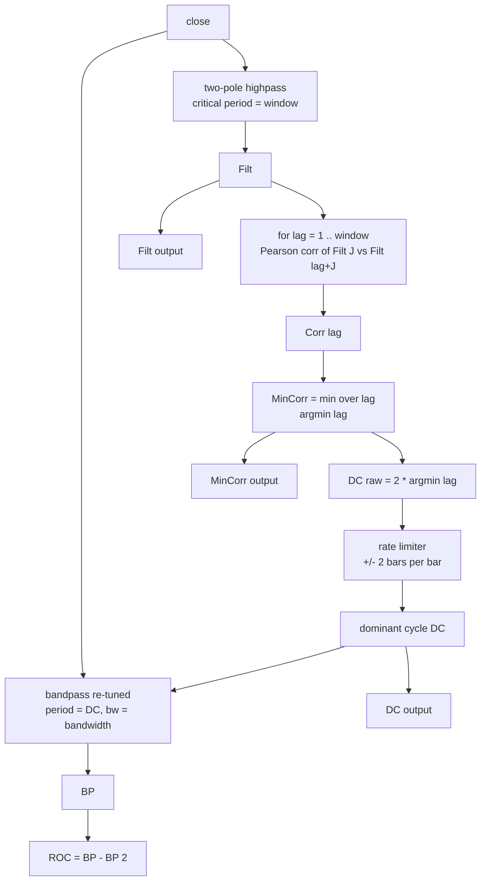

# The AutoTune Filter — A Rolling Autocorrelation Function

Master reference documentation for the research prototype implementation in
[`autotune-filter.py`](./autotune-filter.py).

- **Article:** John F. Ehlers, *The AutoTune Filter: A Rolling Autocorrelation Function*,
  *Technical Analysis of STOCKS & COMMODITIES*, Vol. 44, May 2026, pp. 9–15, 31
  (section: Digital Signal Processing)
- **Re-print:** [MESA Software paper archive](https://www.mesasoftware.com/papers/The%20AutoTune%20Filter.pdf)
- **Traders' Tips companion:** [Traders' Tips, May 2026](https://www.traders.com/Documentation/FEEDbk_docs/2026/05/TradersTips.html)
  (TradeStation/EasyLanguage, NinjaTrader C#, TradingView Pine Script v6, Zorro C,
  Python, RealTest, Wealth-Lab)

---

## 1. What the indicator is, and why it exists

The AutoTune filter is a **bandpass filter whose centre frequency is re-tuned on every bar**
from a real-time measurement of the market's *dominant cycle*.

The measurement itself is done with a **rolling autocorrelation function** of a
highpass-filtered copy of the price series. This is the "bridge" the article talks about:
it lets a time-domain trading rule be built from a frequency-domain quantity.

### 1.1 The physical / statistical picture

**Randomness smoothed into "structure".** Prices are modelled by Ehlers as an
Ornstein–Uhlenbeck (OU) process: a random walk pulled back toward an equilibrium by
"friction". In practice an OU price series is just white noise passed through an
exponential moving average. Generate uniform noise on $[0,100]$, smooth it, and you get a
wavy series oscillating around a mean of 50 that looks remarkably like a price chart.
Human beings (and pattern-seeking algorithms) then read names into the wiggles:
trends, waves, flags, pennants, support and resistance.

**Fixed filters break when the cycle moves.** A bandpass filter tuned once to, say, a
20-bar cycle produces a phase shift that is *constant* while the market keeps that cycle.
When the dominant cycle migrates, the transfer response rotates — sometimes by a full
180° — and every signal derived from the filter silently inverts. Adaptive moving
averages and Kalman filters do not solve this: they are *reactive* (they react to what
already happened) and their tuning knobs are volatility-derived, not structure-derived.

**The autocorrelation function measures structure, and it is cheap.** For a series $x$:

$$
r(k) \;=\; \frac{\displaystyle\sum_{i} (x_i-\bar{x})(x_{i+k}-\bar{x})}
{\displaystyle\sqrt{\sum_{i}(x_i-\bar{x})^2 \;\sum_{i}(x_{i+k}-\bar{x})^2}}
$$

- $k=1$: $r\approx +1$ — consecutive bars barely differ.
- $k=2,3$: $r$ collapses rapidly — this is *why* even MESA can only forecast a few bars.
- $k \approx T/2$: $r$ reaches its **minimum** — one wave's peaks line up with the other's
  valleys (anticorrelation). For a pure sine this minimum is exactly $-1$ at lag $T/2$.
- $k = T$: $r$ returns to $+1$. This alternating pattern is the periodogram of the series.

**Dominant cycle.** Ehlers' term for the period at which the autocorrelation bottoms out.
Price data is not a pure tone, so the minimum never reaches $-1$ (Figure 2 of the article),
and it wanders from bar to bar — but the *existence* of a minimisable value is the proof
that a cycle is present.

$$
T_{\text{DC}} \;=\; 2 \cdot \underset{k}{\arg\min}\; r(k)
$$

**Pink noise ⇒ cycle length scales with window.** Market spectra are approximately
$1/f$ (pink). With a pink spectrum the *amplitude* of a component is proportional to its
wavelength, so the biggest swing inside a $W$-bar window is the longest wavelength that
still fits — roughly of order $W$. The autocorrelation window is therefore also a
"which cycle do I want to trade" dial, not just a smoothing length.

**Physical analogy.** The autocorrelation of a noisy sinusoid is a *damped* cosine in the
lag $k$, $r(k)\approx A\cos(\omega k)\cdot e^{-\text{(noise)}}$. AutoTune is therefore a
very crude, very cheap **frequency estimator**: it looks for the first negative lobe of
that damped cosine and reads the period off it. The highpass filter ahead of it is a
*pre-whitening / detrending* stage — it removes the trend so that the autocorrelation is
not dominated by a slowly drifting mean (a non-zero mean makes $r$ spuriously high at
every lag, hiding the minimum).

---

## 2. Signal flow



---

## 3. Configuration parameters

| Name | Type | Default | Valid range | Meaning |
|------|------|---------|-------------|---------|
| `window` | int | `20` | 2 … 100 (practical 6 … 60) | Length of the rolling autocorrelation **and** the critical period of the highpass filter. Also selects which dominant cycle (wavelength) you trade. |
| `bandwidth` | float | `0.25` | `0 < bw < 0.5` | Bandwidth of the tuned bandpass, expressed as a **fraction of the tuned centre period** (25 % in the article). Sets the filter Q. |

Notes and constraints:

- `bandwidth` must stay below `0.5`. The bandpass needs
  $G_1=\cos(\text{bw}\cdot 2\pi/P)>0$; at $P=2$ (the smallest possible dominant cycle,
  reached during the initial ramp) $G_1=0$ exactly when $\text{bw}=0.5$, which makes $S_1$
  blow up. Ports should guard against $G_1\le 0$ and emit NaN rather than infinity.
- $P=2\cdot\text{window}$ is the largest dominant cycle the lag search can ever return,
  so a wide `window` also implies a low-frequency bias.
- The article's optimised pro-forma parameters are `window = 19, bandwidth = 0.2,
  threshold = -0.3`; the pro-forma listing's defaults are `window = 26, bandwidth = 0.22,
  threshold = -0.22`.

---

## 4. Mathematical description

Notation: $P_t$ = close on bar $t$, indices counted from $0$, $W$ = `window`,
$B$ = `bandwidth`.

### 4.1 Two-pole highpass filter (`Filt`)

Coefficients (EasyLanguage `Cosine` takes degrees, so `1.414*180/Period` degrees is
`1.414*pi/Period` radians):

$$
Q  = e^{-\frac{1.414\,\pi}{W}},\qquad
c_1 = 2\,Q\,\cos\!\left(\frac{1.414\,\pi}{W}\right),\qquad
c_2 = Q^2,\qquad
a_0 = \frac{1+c_1+c_2}{4}
$$

Recursion (switched on only from bar 4 onwards; zero before that):

$$
\text{Filt}_t =
\begin{cases}
0, & t < 4 \\[2mm]
a_0\,(P_t - 2 P_{t-1} + P_{t-2}) + c_1\,\text{Filt}_{t-1} - c_2\,\text{Filt}_{t-2}, & t \ge 4
\end{cases}
$$

In the $z$-domain this is

$$
\frac{H(z)}{P(z)} = \frac{a_0\,(1-z^{-1})^2}{1 - c_1 z^{-1} + c_2 z^{-2}}
$$

The **double zero at $z=1$** annihilates trend and any component longer than the critical
period, and makes the remaining oscillation swing symmetrically about zero. That nominal
zero mean is the reason step 1 of Ehlers' recipe exists: it removes trend bias from the
autocorrelation.

### 4.2 Rolling autocorrelation

For every lag $k = 1 \dots W$ (with $j = 0$ being the current bar and $j = W-1$ the bar
$W-1$ bars ago):

$$
\begin{aligned}
S_x  &= \sum_{j=0}^{W-1} \text{Filt}_{t-j} \\
S_y  &= \sum_{j=0}^{W-1} \text{Filt}_{t-j-k} \\
S_{xx}&= \sum_{j=0}^{W-1} \text{Filt}_{t-j}^{\,2} \\
S_{yy}&= \sum_{j=0}^{W-1} \text{Filt}_{t-j-k}^{\,2} \\
S_{xy}&= \sum_{j=0}^{W-1} \text{Filt}_{t-j}\,\text{Filt}_{t-j-k}
\end{aligned}
$$

$$
\text{Corr}[k] =
\frac{W S_{xy} - S_x S_y}
{\sqrt{(W S_{xx} - S_x^2)\,(W S_{yy} - S_y^2)}}
$$

evaluated only when **both** variance-like terms are strictly positive
($\text{otherwise Corr}[k]$ is left at $0$). This is the textbook Pearson coefficient
written with power sums instead of means — no second pass, no pre-saved window sums.

### 4.3 Minimum correlation and dominant cycle

$$
\text{MinCorr}_t = \min_{k=1..W} \text{Corr}[k], \qquad
k^*_t = \min \operatorname*{arg\,min}_{k} \text{Corr}[k], \qquad
DC^{\text{raw}}_t = 2\,k^*_t
$$

The strict `<` comparison means that **ties are broken toward the shortest lag**, i.e. the
rule is "the shortest lag of the autocorrelation with the most negative correlation".
Initialise $\text{MinCorr}=1$; if no correlation beats it, `DC` simply keeps its previous
series value.

### 4.4 Rate limiter (why it exists)

A raw $\arg\min$ over $W$ lags is a jumpy estimator — it can flip between lag 3 and lag 11
on consecutive bars, which would make the bandpass period flip-flop and produce garbage.
Ehlers limits the drift:

$$
DC_t = \operatorname{clamp}\!\left(DC^{\text{raw}}_t,\; DC_{t-1}-2,\; DC_{t-1}+2\right)
$$

with $DC_{-1}=0$. Consequence, which ports **must** reproduce: on the first primed bar
$t_0 = 2W-1$ the raw value (say 8) is clamped to $0+2=2$, and thereafter the period can
only walk up or down 2 bars per bar. On the 252-bar test data this produces a visible
"ramp-up" of `DC` from 2 in the first few bars after warm-up. (The NinjaTrader port skips
the limiter while `DC[1] == 0`, which differs from the article by those few bars.)

### 4.5 Bandpass filter tuned to the dominant cycle

$$
\begin{aligned}
L_1 &= \cos\!\left(\frac{2\pi}{DC_t}\right) \\
G_1 &= \cos\!\left(\frac{2\pi B}{DC_t}\right) \\
S_1 &= \frac{1}{G_1} - \sqrt{\frac{1}{G_1^2} - 1} \\
BP_t &= \tfrac{1}{2}(1-S_1)(P_t - P_{t-2}) + L_1(1+S_1)\,BP_{t-1} - S_1\,BP_{t-2}
\end{aligned}
$$

with $BP_t = 0$ for $t < 3$. This is a two-pole constant-$Q$ bandpass: the numerator's
double difference removes DC and low frequencies, the denominator's conjugate-ish pole
pair sets the centre frequency at $2\pi/DC_t$ and the width from $G_1$. Note that the
coefficients are **recomputed on every bar** because $DC_t$ changes on every bar — this is
what "auto-tuning" means and why the resulting phase relationship between price peaks and
`BP` peaks stays stable.

### 4.6 Two-bar rate of change (pro-forma only)

$$
\text{ROC}_t = BP_t - BP_{t-2}
$$

A *two*-bar difference is used rather than a one-bar difference because its transfer
function has a transmission zero at a two-bar period, which smooths the response.

---

## 5. Algorithmic flow (per bar `t`)

```mermaid
flowchart TD
    START([update close_t]) --> HP{"t >= 4?"}
    HP -- no --> HP0[Filt = 0] --> CORR
    HP -- yes --> HPR[Filt = a0*(P_t - 2P_t-1 + P_t-2) + c1*Filt_t-1 - c2*Filt_t-2] --> CORR

    CORR{"t >= 2*window - 1?"} -- no --> OUT0[min_corr = NaN, DC = NaN, BP = NaN]
    CORR -- yes --> LOOPS[for k = 1..window: power sums -> Corr k<br/>skip when W*Sxx-Sx^2 <= 0 or W*Syy-Sy^2 <= 0] --> MIN[MinCorr = min Corr k<br/>k* = shortest argmin] --> CLAMP[DC = clamp(2*k*, DCprev-2, DCprev+2)] --> BPF

    BPF{"DC > 0 and t >= 3?"} -- no --> BP0[BP = 0 (history stays 0)]
    BPF -- yes --> BPC[BP = 0.5*(1-S1)*(P_t - P_t-2) + L1*(1+S1)*BP_t-1 - S1*BP_t-2] --> ROC

    BP0 --> ROC
    ROC[ROC = BP_t - BP_t-2] --> OUT([return Filt, MinCorr, DC, BP, ROC])
    OUT0 --> OUT
```

**Warm-up.** The lag-$W$ autocorrelation touches `Filt[2W-1]`, so the first bar on which
`MinCorr`, `DC`, `BP` and `ROC` exist is $t_0 = 2W-1$. `Filt` exists from bar 4. Before
those points the master implementation reports **NaN** (rather than EasyLanguage's
structural zeros) so that a port can assert the warm-up boundary exactly. The bandpass
*history* is fed zeros during warm-up, which is what `If CurrentBar < 3 Then BP = 0` means,
so the first primed bandpass value is a genuine filter value and not a NaN-propagated one.

---

## 6. Using the four outputs (the pro-forma strategy)

The article's always-in-the-market pro forma adds only three rules on top of the
indicator (this part is *not* part of the reference indicator implementation, but the
`ROC` output exists for it):

$$
\begin{aligned}
&\text{ROC crosses over } 0 \;\land\; \text{MinCorr} < \text{Thresh} &&\Rightarrow \text{Buy next bar on open} \\
&\text{ROC crosses under } 0 \;\land\; \text{MinCorr} < \text{Thresh} \;\land\; \text{Filt} > 0 &&\Rightarrow \text{Sell short next bar on open}
\end{aligned}
$$

- `MinCorr < Thresh` is a *cycle-strength* filter: trade only when the anticorrelation is
  deep enough that a cycle really is present.
- `Filt > 0` on the short side compensates for the upside bias of the data.
- Crossing is detected on bar $t$ against bar $t-1$: `ROC[t-1] <= 0 < ROC[t]` (and the
  mirrored condition). Orders are filled at the **next** bar's open, so a port must not
  use bar $t$'s close for the fill.
- Threshold is negative (e.g. `-0.3`): a *more negative* minimum means a *better* cycle.

---

## 7. Reference test data

Files in this folder (all containing the same 252-bar `INPUT_CLOSE`/`testInput` series
plus 60 expected arrays each):

| File | Array form | NaN literal |
|------|-----------|-------------|
| `test_testdata.py` | `EXPECTED_<TAG>_<OUT> = [...]` | `NaN` (module defines `NaN = float("nan")`) |
| `testdata_test.go` | `var expected<TAG>_<OUT> = []float64{...}` | `math.NaN()` |
| `testdata.ts` | `export const expected<TAG>_<OUT>: number[] = [...]` | `NaN` |
| `testdata.rs` | `pub fn expected_<tag>_<out>() -> Vec<f64>` | `f64::NAN` |
| `testdata.zig` | `pub fn expected<TAG>_<OUT>() [252]f64` | `nan` |

`<TAG>` = `W<window>_B<bw>` with the decimal point replaced by `_`, e.g. `W19_B0_20`.
`<OUT>` ∈ `FILT`, `MINCORR`, `DC`, `BP`, `ROC`.

**Parameter grid: 12 combinations × 5 outputs = 60 arrays.**

| window | bandwidth | Where it comes from |
|--------|-----------|---------------------|
| 10 | 0.20 / 0.22 / 0.25 | short-window / high-frequency regime; also exercises the `DC` ramp-up from 0 |
| 19 | 0.20 / 0.22 / 0.25 | article's optimised pro-forma `window = 19, BW = 0.2` |
| 20 | 0.20 / 0.22 / 0.25 | article / MESA / Zorro / Pine default `Window = 20, BW = 0.25` |
| 26 | 0.20 / 0.22 / 0.25 | pro-forma listing defaults `Window = 26, BW = 0.22` |

Regenerate everything with:

```bash
python3 autotune-filter.py --emit py    # also: go | ts | rs | zig
```

Sanity anchors that hold for every grid point and that ports should check first:

| quantity | value |
|----------|-------|
| first non-NaN `FILT` index | `4` |
| first non-NaN `MINCORR`/`DC`/`BP`/`ROC` index | `2*window - 1` (19 / 37 / 39 / 51) |
| `DC` at the first primed bar | `2.0` (rate limiter pulling from 0) |
| `DC` maximum possible | `2*window` |

---

## 8. Porting notes / gotchas

1. **Trigonometry in degrees vs radians.** EasyLanguage's `Cosine()` takes degrees. The
   master implementation uses radians throughout: `cos(1.414*pi/W)`, `cos(2*pi/Period)`,
   `cos(bw*2*pi/Period)`. Mixing them up is the single most likely port bug.
2. **The highpass sign convention.** Ehlers writes `+c1*HP[1] - c2*HP[2]`, i.e. the
   *positive* `c1` and the *negated* `c2`. Do not "fix" it into a canonical biquad; the
   gain is `a0 = (1 + c1 + c2)/4` with those exact signs.
3. **`ExpValue` is `exp()`**, i.e. `e^x`, not a base-10 logarithm.
4. **Highpass warm-up is 4 bars, not 2.** The article, MESA, the TradeStation `.els`, the
   Pine port and the NinjaTrader port all switch on at `CurrentBar >= 4`. The Python
   Trader's-Tips listing starts at index 2 and therefore produces slightly different
   values; this master follows the article.
5. **`DC` is a persistent series variable**, compared against `DC[1]` (previous bar), and
   initialised to 0. Do not clamp against "the DC computed 5 bars ago", and do not
   initialise it to `window` (the Zorro listing does — another small deviation).
6. **Strict `<` in the argmin loop** — shortest lag wins ties.
7. **`Corr[]` is stale/zero when the denominators are non-positive.** On real data with a
   primed highpass this never happens; if it does, store `0.0` (as the Zorro, NinjaTrader
   and this master do) rather than leaving the previous bar's value.
8. **Warm-up outputs are NaN, not 0.** The bandpass *internal history* is 0 during warm-up,
   but the *reported* value is NaN until the first primed bar.
9. **Operation order matters** for bit-exact reproduction: the power sums accumulate in
   `j = 0 … window-1` order (`j=0` = most recent bar), and the correlation numerator is
   `W*Sxy - Sx*Sy`.
10. **`G1` guard**: reject `G1 <= 0` (or `Period <= 0`) rather than computing a division by
    zero. Ports should return NaN there.
11. The Pine port shipped with the article has a typo in the correlation numerator
    (`W*Syy - Sy*Sy` instead of `W*Sxy - Sx*Sy`); do not copy it.

---

## 9. References

1. J. F. Ehlers, *The AutoTune Filter: A Rolling Autocorrelation Function*,
   Technical Analysis of STOCKS & COMMODITIES, Vol. 44, No. 5, May 2026, pp. 9–15, 31.
2. J. F. Ehlers, *The AutoTune Filter*, MESA Software paper archive, 2026.
3. J. F. Ehlers, "Drunkard's Walk: Theory and Measurement by Autocorrelation",
   Technical Analysis of STOCKS & COMMODITIES, Vol. 43, February 2025.
4. J. F. Ehlers, *Cybernetic Trading Indicators*, 2025 (Ch. 20 on autocorrelation).
5. J. F. Ehlers, *Cybernetic Analysis for Stocks and Futures*, Wiley, 2004.
6. J. F. Ehlers, *Cycle Analytics for Traders*, Wiley, 2013.
7. Traders' Tips: May 2026 — implementations in TradeStation, NinjaTrader, TradingView,
   Zorro, RealTest, Wealth-Lab and Python.

### BibTeX

```bibtex
@article{ehlers_2026_autotune_filter,
  author       = {John F. Ehlers},
  title        = {The AutoTune Filter: A Rolling Autocorrelation Function},
  journal      = {Technical Analysis of STOCKS \& COMMODITIES},
  volume       = {44},
  number       = {5},
  pages        = {9--15, 31},
  month        = {May},
  year         = {2026},
  url          = {https://technical.traders.com/archive/article.asp?file=\\V44\\C05\\118EHLE.pdf},
  urldate      = {2026-05-01},
  note         = {Digital Signal Processing}
}

@misc{ehlers_2026_autotune_filter_mesa,
  author       = {John F. Ehlers},
  title        = {The AutoTune Filter},
  year         = {2026},
  howpublished = {online},
  url          = {https://www.mesasoftware.com/papers/The%20AutoTune%20Filter.pdf}
}

@article{ehlers_2025_drunkards_walk,
  author       = {John F. Ehlers},
  title        = {Drunkard's Walk: Theory and Measurement by Autocorrelation},
  journal      = {Technical Analysis of STOCKS \& COMMODITIES},
  volume       = {43},
  month        = {February},
  year         = {2025}
}

@book{ehlers_2025_cybernetic_trading_indicators,
  author    = {John F. Ehlers},
  title     = {Cybernetic Trading Indicators},
  publisher = {Amazon},
  year      = {2025}
}

@book{ehlers_2004_cybernetic_analysis,
  author    = {John F. Ehlers},
  title     = {Cybernetic Analysis for Stocks and Futures},
  publisher = {John Wiley \& Sons},
  year      = {2004}
}

@book{ehlers_2013_cycle_analytics,
  author    = {John F. Ehlers},
  title     = {Cycle Analytics for Traders},
  publisher = {John Wiley \& Sons},
  year      = {2013}
}

@misc{traders_tips_2026_05,
  author       = {{Technical Analysis of STOCKS \& COMMODITIES}},
  title        = {Traders' Tips: May 2026 -- The AutoTune Filter},
  year         = {2026},
  howpublished = {online},
  url          = {https://www.traders.com/Documentation/FEEDbk_docs/2026/05/TradersTips.html}
}
```

---

## 10. Master implementation API

The master file is `autotune-filter.py` (the hyphen matches the folder name; load it
with `importlib` or rename it to `autotune_filter.py` if you prefer a plain
`import`):

```python
import importlib.util
spec = importlib.util.spec_from_file_location("at", "autotune-filter.py")
at = importlib.util.module_from_spec(spec); spec.loader.exec_module(at)

ind = at.AutoTune(window=20, bandwidth=0.25)
r = ind.update(107.87)      # one close in, one AutoTuneResult out
# r.filt, r.min_corr, r.dominant_cycle, r.bandpass, r.roc   (NaN while unprimed)
```

- Standard library only (`math`), no numpy/pandas — ports need no vectorised primitives.
- Strictly streaming: state is O(window) and there is no look-ahead.
- `ind.warmup_bars` returns `2*window - 1`.