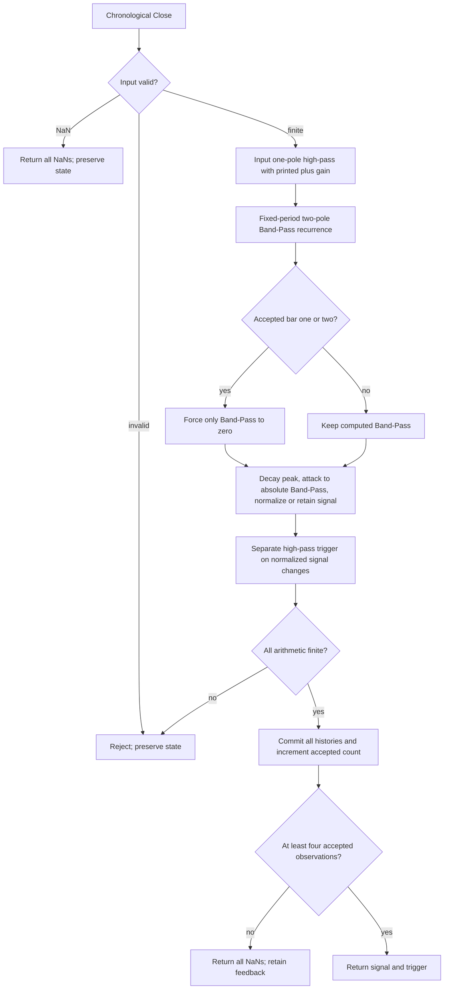

# Band-Pass Indicator — Chapter 5 research prototype master

## Numerical authority and conversion scope

This is a self-contained **research prototype master reference**, based on the indicator's own listing in John F. Ehlers' *Cycle Analytics for Traders: Advanced Technical Trading Concepts* (Wiley, 2013). The Python calculation is chronological, standard-library only, and independent of other masters, zpano, NumPy and pandas. Each folder includes its complete numerical source, original source appendix, reference inputs and expected outputs for Python, Go, TypeScript, Rust and Zig. A conversion agent does not need the source book to implement the mathematics described here.

Mathematical constants have full precision: `math.pi`, `math.sqrt(2.0)` and its reciprocal replace printed `3.14159`, `1.414` and `.707` where they mean those constants. Python sine/cosine use radians; $360/P$ degrees becomes $2\pi/P$ radians. Design constants such as .25, .5, 1.5 and .991 retain their printed values. State calculations use unrounded binary64. Only the final exported literals use **15 significant digits**. Results therefore differ slightly from the original listing's truncated mathematical constants; source arithmetic ordering, signs, recurrences and guard conditions remain authoritative.

Each master is deliberately distinct from later similarly named Ehlers indicators. The Decycler is a one-pole low-pass, the Decycler Oscillator subtracts two two-pole high-pass outputs, Band-Pass uses a fixed-period resonator and its own leading trigger, and Hurst measures finite-window ranges. None is a substitute for the already prepared Chapter 11 adaptive family or spectrum filter banks.

## Stream API, state and startup

Call `update(close, time=None)` once per chronological Close. Time is accepted for interface consistency but has no numerical role. `parameters` is an immutable named tuple; `samples_seen` counts accepted observations; `warmup_bars` is the deterministic number of leading unavailable outputs; `is_primed` indicates that the required input history exists; `output` is the last accepted public result. `state` returns immutable diagnostic values, including internal results computed before public priming. `reset()` clears all histories while retaining the configuration and coefficients.

**Zero prehistory is part of this finite-record reference.** Absent Close values and declared source variables are zero. The first finite Close is accepted as standalone CurrentBar=1. Every recurrence and window calculation runs from that bar, even while public values are NaN. Do not seed histories with the first actual price, defer recurrence until priming, use public NaNs in feedback, or restart after a skipped observation. Commercial platforms may supply earlier history; matching this master requires the same initial conditions and accepted bars.

NaN represents a missing input: return an all-NaN result and preserve histories, accepted count and the previous `output`. Infinity, bool, nonnumeric input and arithmetic overflow raise `ValueError` before state mutation. All candidate downstream values are checked before commit, so a rejected update cannot leave one stage ahead of another. A missing or rejected value neither inserts a zero nor ages a finite lookback.

Public startup NaNs mark **input-history availability**, not convergence of an infinite-impulse-response filter. Coefficient periods do not specify a mandatory waiting window. A recursive filter with a period longer than 252 can still produce a valid finite-record output well before 252 bars; it may retain a large initialization transient. Changing a configured period requires a new instance rather than mutating an established stream. Future inputs never revise previously returned results.

## Shared sampled-data filter background

One Close per bar is a sampled signal. The Nyquist frequency is one-half cycle per bar, or a two-bar period. Low-pass filters retain slower changes and attenuate faster oscillations; high-pass filters remove a static term and attenuate slow changes. A band-pass combines those effects around a selected cycle period. Zeros determine exact rejected components, while poles determine recursive memory, damping and phase. A transfer function describes fixed coefficients with zero initial conditions, not a prediction of future prices.

The book's practical motivation is reduced delay without excessive aliasing noise. A first-order filter generally has weaker stop-band attenuation than a two-pole filter. For an analog-style interpretation, the recursive pole stores part of yesterday's displacement, much as a damped physical system retains energy. Cancellation is analogous to removing the rapidly varying part of a measured waveform. The resonator analogy for Band-Pass explains why sharper selectivity prolongs ringing. These are engineering explanations of the algorithm, not physical equations for market behavior.

The book discusses **spectral dilation**: market swing amplitude often grows with cycle period, approximately 6 dB per octave in its model. A single high-pass stage can then equalize rather than eliminate long-period content. This motivates two high-pass poles in the Decycler Oscillator and an additional high-pass before the Band-Pass resonator. The cited empirical approximations do not establish that every price record follows that spectral law.

## Fixed-period resonator and complete filter equations

**The requested Band-Pass Indicator is in Chapter 5, Listing 5-1.** Chapter 6 defines the Hurst coefficient. Listing 5-2 is a separate zero-crossing cycle-period measurer and is outside this master. The already prepared Chapter 11 Adaptive Band-Pass uses different input filtering and a different trigger.

Let $P$ be `period` and $B$ be fractional `bandwidth`, defaults 20 and .3. For a high-pass angle $\theta$, define

$$a(\theta)=\frac{\cos\theta+\sin\theta-1}{\cos\theta}.$$

The source front high-pass reduces slow spectral dilation:

$$a_H=a(2\pi\cdot0.25B/P),\qquad
h_t=(1+a_H/2)(x_t-x_{t-1})+(1-a_H)h_{t-1}.$$

**The printed gain is $1+a_H/2$.** Although common textbook single-pole high-pass code uses $1-a_H/2$, this master keeps the plus sign in both of Listing 5-1's high-pass filters. Substituting a familiar helper that uses the other sign would change the source calculation, particularly the trigger.

The fixed two-pole Band-Pass coefficients are

$$\beta=\cos(2\pi/P),\qquad
\gamma=\frac1{\cos(2\pi B/P)},\qquad
\alpha=\gamma-\sqrt{\gamma^2-1}.$$

Equation 5-2 becomes

$$v_t=\frac{1-\alpha}{2}(h_t-h_{t-2})+
\beta(1+\alpha)v_{t-1}-\alpha v_{t-2}.$$

Override $v_t=0$ at accepted CurrentBar one and two, exactly as the source does. Only Band-Pass is zeroed; raw Close and input high-pass history still advance.

For fixed parameters, the prefilter and unnormalized resonator transfer functions are

$$H_{HP}(z)=\frac{(1+a_H/2)(1-z^{-1})}{1-(1-a_H)z^{-1}},\quad
H_{BP}(z)=\frac{0.5(1-\alpha)(1-z^{-2})}
{1-\beta(1+\alpha)z^{-1}+\alpha z^{-2}}.$$

The Band-Pass itself has zeros at DC and Nyquist. Its two poles form a damped resonator that passes a band around the chosen center period. The extra front high-pass gives stronger rejection of the slow price components that a narrow Band-Pass alone may leave due to spectral dilation. This is distinct from the two-pole high-pass plus SuperSmoother Roofing Filter used by Chapter 11.

For source completeness, the supplied Chapter 5 text first prints Equation 5-1 as

$$H(z)=\frac{1-\sigma z^{-1}}{(1-\gamma z^{-1})(1-\gamma z^{-2})},$$

and subsequently gives the actually implemented two-pole form

$$H(z)=\frac{0.5(1-\sigma)(1-z^{-2})}
{1-\lambda(1+\sigma)z^{-1}+\sigma z^{-2}}.$$

These are not equivalent as printed. The second form and Listing 5-1 are authoritative, with $\sigma=\alpha$ and $\lambda=\beta$. The first expression is included to identify the book's inconsistency, not as an additional filter stage. The source's earlier explanatory coefficient names are likewise resolved by the complete listing.

## Quality factor, phase and transient response

Chapter 5 introduces quality factor using both selectivity and physical energy:

$$Q\simeq\frac{f_0}{\Delta f}\simeq\frac1B,\qquad
Q=2\pi\frac{\text{energy stored}}{\text{energy dissipated per cycle}}.$$

Its illustrative 30 percent band has $Q\simeq3.33$, also written $20/(23-17)=3.33$. A lower bandwidth raises selectivity but increases ringing after an impulse and delays the response to a newly arriving oscillation. A bell is a physical example of high Q. A wider band reacts faster and passes more neighboring frequencies. These are explanatory approximations; the master uses the actual discrete-time coefficients above and exports no Q value.

A fixed resonator in steady state has zero relative phase at its center frequency. An input period longer than the tuned center produces phase lead; a shorter input period produces phase lag. Chapter 5's running prose reverses the labels in one comparison, while its captions and later key points give the shorter-tuning/lead relationship. The phase follows the transfer function; exact lead angles depend on detuning and bandwidth. The front high-pass also contributes phase, and the nonlinear envelope AGC is not part of a single linear transfer function. Neither curve guarantees a future price turning point.

## Envelope AGC and the actual plotted trigger

The fast-attack, slow-decay envelope is

$$E_t=\max(0.991E_{t-1},|v_t|),\qquad
s_t=\begin{cases}v_t/E_t,&E_t\ne0,\\s_{t-1},&E_t=0.\end{cases}$$

This is the listing's exact zero-peak guard. The initial signal and peak are zero. For finite values, $s_t\in[-1,1]$ because the maximum is updated before division. No rolling maximum, spectral power normalization, adaptive cycle estimate or extra output smoothing is introduced.

Chapter 5 derives .991 from an intended decay variation over a 10..48-bar range. Its full progression is

$$\text{envelope decay over half a cycle}=K^{P/2},\quad
\text{Ratio}=\frac{K^{24}}{K^5}=K^{19},$$

$$-1.5=20\log_{10}(\text{Ratio}),\quad
\text{Ratio}=10^{-1.5/20}=10^{-0.075}\simeq0.8414,$$

$$K=(10^{-0.075})^{1/19}=10^{-0.075/19}\simeq0.99095\simeq0.991.$$

The printed intermediate `10^{-0.75}` is an arithmetic typo; the stated .841 is consistent with $10^{-0.075}$. The source labels the envelope decay as “Gain”; actual division by a decaying envelope increases gain with its reciprocal. **Keep .991 as the published design constant** rather than recomputing the slightly different unrounded derived value.

The source trigger is another one-pole high-pass on the **normalized signal**:

$$a_T=a(2\pi\cdot1.5B/P),\qquad
u_t=(1+a_T/2)(s_t-s_{t-1})+(1-a_T)u_{t-1}.$$

This is `Plot6(Trigger)`. It is **not** .9 times the preceding signal, which belongs to Chapter 11. It is neither peak normalized nor clipped and can exceed $[-1,1]$. Its lead comes from filtering signal changes; Chapter 5 contrasts this smoother leading function with a bare derivative that can be too erratic. Both signal and trigger are returned in `BandPassOutput(signal, trigger)`; the zero plotted reference is omitted as a constant display line.

## Parameters and history requirement

| Parameter | Default | Valid range and role |
| --- | --- | --- |
| `period` | 20.0 | Finite real $\ge6$; fixed center coefficient period in bars. Fractional values are supported. |
| `bandwidth` | 0.3 | Finite real $0<B<P/6$ with all filter poles numerically resolvable and stable. |

The trigger has the largest angular multiplier (1.5). The stated bandwidth restriction keeps that high-pass angle below $\pi/2$ and the two-pole Band-Pass branch real/stable. It is a conservative supported parameter domain, not an arbitrary rounding rule. Very small bandwidths that collapse gamma to one or high-pass alpha to zero, and large periods with indistinguishable unit poles, are rejected. bool parameters are rejected. Although bandwidth is often below one in practical use, the mathematical validation is the explicit bound and coefficient stability; no hidden clipping to .7 is used.

`state` exposes `high_pass`, `band_pass`, `peak`, `signal` and `trigger`. `warmup_bars=3`: at bar four, the source's current-minus-two-prior input high-pass difference and the trigger's prior signal both have actual input history. Bars one through three have all-NaN public tuples, while feedback evolves and the source first-two-zero override is applied. This does not wait one full resonator period; long-period cases retain the same three-bar NaN prefix.

## Calculation flow



Calculation and storage are $O(1)$ per accepted update. Coefficients are fixed at construction and scalar histories are bounded. The five-language fixtures export both plotted curves separately, not a spectrum heatmap.

## Confirmed reference combinations

All twelve cases were confirmed as part of the 48-case family plan on 2026-10-22. Each exported component has 252 values.

| Case | Parameters | What it tests |
| --- | --- | --- |
| 1 | `period=20.0, bandwidth=0.3` | Published resonator, peak decay and high-pass trigger defaults. |
| 2 | `period=10.0, bandwidth=0.3` | Short center period. |
| 3 | `period=40.0, bandwidth=0.3` | Longer center period. |
| 4 | `period=60.0, bandwidth=0.3` | Slow center period and phase response. |
| 5 | `period=20.0, bandwidth=0.1` | Narrow pass band and prolonged ringing. |
| 6 | `period=20.0, bandwidth=0.7` | Broad pass band and stronger leading trigger. |
| 7 | `period=20.5, bandwidth=0.3` | Fractional center period without integer rounding. |
| 8 | `period=10.0, bandwidth=0.7` | Short, broad resonator with faster response. |
| 9 | `period=6.0, bandwidth=0.3` | Fast supported center period. |
| 10 | `period=6.0, bandwidth=0.7` | Fast, broad resonator and trigger stability. |
| 11 | `period=100.0, bandwidth=0.3` | Long recursive resonator history. |
| 12 | `period=252.0, bandwidth=0.3` | Center period equal to record length; finite startup. |

## Files, reference generation and porting

`band-pass-indicator.py` contains the complete numerical calculation and marked-off fixture tooling. `description.md` is the standalone conversion specification. `test_band_pass_indicator.py` contains an independent full-history transcription of the listing and streaming/analytic checks. `verify_reference_data.py` parses all five fixture languages and compares metadata, values and NaN masks to the Python master.

The five fixtures retain the original **four 252-element OHLC arrays**, although this indicator consumes only Close. The exact Close input is also embedded inside the master's `__main__`. There are **24 expected arrays per language** in this folder: twelve parameter cases, with two components for Band-Pass and one VALUE component for each other master. Family total is 48 cases and 60 component arrays per language.

Names use shortcuts `C` (cutoff), `HP1`/`HP2` (the independent high-pass periods), `P`/`B` (center period/bandwidth), and `L`/`LP` (range length/smoothing period). Decimal points in parameter values become underscores. Example names are `EXPECTED_C60_VALUE`, `EXPECTED_HP130_HP260_VALUE`, `EXPECTED_P20_B0_3_SIGNAL`, and `EXPECTED_L30_LP20_VALUE`. Foreign names retain parameter separators: Go, TypeScript and Zig start with `expected`, while Rust uses `expected_` and lower-case tokens. Each array has the same two description/parameter comment lines in every language.

The generator writes Python first, reopens the exported literals, verifies the rounded numbers and NaNs, then translates those authoritative decimals to Go, TypeScript, Rust and Zig. NaN forms are Python `NaN = math.nan`, Go `math.NaN()`, TypeScript `NaN`, Rust `f64::NAN`, and Zig `nan` with the supplied standard math declarations. Go packages strip hyphens/underscores from the folder name. Rerunning replaces only marked expected-data sections and leaves copied input sections intact.

Run from this folder:

```sh
python3 band-pass-indicator.py
python3 band-pass-indicator.py --generate-reference-data
python3 verify_reference_data.py
python3 -m unittest discover -s . -p 'test_band_pass_indicator.py'
```

The master filename follows the folder name. To load it directly for streaming use:

```python
import importlib.util
from pathlib import Path

path = Path(__file__).resolve().parent / "band-pass-indicator.py"
spec = importlib.util.spec_from_file_location("book_master", path)
module = importlib.util.module_from_spec(spec)
spec.loader.exec_module(module)
indicator = module.BandPassIndicator()
for close in [91.5, 94.815, 94.375, 95.095]:
    print(indicator.update(close))
```

A port needs only ordinary binary64 math, fixed histories and loops. Compare NaN placement exactly and finite values with combined absolute/relative tolerance, for example $10^{-10}$ on this shared record; libm results can vary in the last bits across languages. Internal values are unrounded. Preserving newest-first window bounds, arithmetic signs, initialization and branch ordering is more important than reproducing export formatting inside the indicator.

## Validation record

Completed on 2026-10-22:

- **8 Python tests passed** in this folder, including all twelve parameter cases against the independent listing oracle. Family total: 32 passing tests.
- `verify_reference_data.py` passed: **24 arrays and 6,048 values per language**, exact 15-significant-digit values, metadata comments, component names, NaN masks and preserved OHLC inputs across all five languages. Family total: 60 arrays / 15,120 values per language.
- All five generated fixture files regenerate **byte-for-byte identically**. Family total: twenty fixture files.
- Go, Rust and Zig compiled and ran fixture harnesses checking every exported array's length, exact NaN prefix and finite final value when present. Node loaded TypeScript with type stripping and passed the same checks; a separate TypeScript compiler was not used.
- Python sources and fixtures parse successfully, all new files pass the trailing-whitespace check, and source-document links resolve.

Source-oracle comparisons use combined absolute and relative tolerance $10^{-11}$; the fixture verifier checks the exact rounded exported values. Tests also cover invalid input/overflow without partial state commit, reset, immutable configuration, analytic or listing-specific behavior, scale behavior and exact public history boundaries.

The independent oracle recomputes coefficients and keeps full chronological variable histories; the numerical master uses bounded histories and cached coefficients. The oracle uses the same documented full-precision constants and zero-prehistory convention. Agreement with that source transcription does not imply that TradeStation itself was executed, nor that foreign-language indicator implementations have already been created. Compiler/runtime checks validate fixture source forms; the fixture parser checks every exported numeric value and comment.

## Sources and BibTeX

Numerical authority: Ehlers, *Cycle Analytics for Traders*, **Chapter 5, Listing 5-1**. Relevant theory is reproduced above and the original local source is included below. Chapter 3 Equation 3-3 supplies Hurst's final SuperSmoother; Chapter 7's spectral-dilation discussion supports the filter background. No external library implementation is imported or treated as a numerical authority.

- [Book and bibliographic record](../../2013-cycle-analytics-for-traders/toc.md).
- [Chapter 5 source](../../2013-cycle-analytics-for-traders/ch5.md), [Chapter 3 SuperSmoother](../../2013-cycle-analytics-for-traders/ch3.md), [Chapter 7 spectral dilation](../../2013-cycle-analytics-for-traders/ch7.md).

```bibtex
@Book{ehlers2013cycle,
  author = {Ehlers, John F.},
  title = {Cycle Analytics for Traders: Advanced Technical Trading Concepts},
  publisher = {Wiley},
  year = {2013},
  series = {Wiley Trading},
  isbn = {9781118728604}
}
```

## Original source appendix

The supplied Chapter 5 text and complete requested listing are reproduced below for conversion agents who will not have access to the source files. Printed constants, equations and code comments are retained; inaccuracies are identified and resolved by the mathematical/source-authority discussion above. Figure assets are omitted, and malformed caption emphasis is repaired. The chapter text stops before the separate Listing 5-2 zero-crossing measurer.

### Chapter 5: Band-Pass Filters

*“A little of the data narrowly passed,” said Tom broadly.*

Perhaps the least appreciated and most underutilized filter in ­technical analysis is the band-pass filter. The band-pass filter simultaneously ­diminishes the amplitude at low frequencies, qualifying it as a detrender, and diminishes the amplitude at high frequencies, qualifying it as a data ­smoother. It passes only those frequency components from input to output in which the trader is interested. The filtering produced by a band-pass filter is superior because the rejection in the stop bands is related to its bandwidth. The degree of rejection of undesired frequency components is called selectivity. The band-stop filter is the dual of the band-pass filter. It rejects a band of frequency components as a notch at the output and passes all other frequency components virtually unattenuated. Since the bandwidth of the deep rejection in the notch is relatively narrow and since the spectrum of market cycles is relatively broad due to systemic noise, the band-stop filter has little application in trading.

### Band-Pass Filter

A band-pass filter can be generated by cascading a low-pass filter and a ­high-pass filter. However, this approach results in really poor filtering ­unless a large number of data samples are used to increase the degree of the ­polynomials. However, digital signal processing (DSP) enables us to map the entire $0$ to $0.5$ cycles per bar range of a simple high-pass filter into the lower half-bandwidth of the pass band and to also map the entire $0$ to $0.5$ cycles per bar range of an exponential moving average (EMA) low-pass filter into the upper half-bandwidth of the pass band. When we do this, the transfer response of a simple pass-band filter is described by Equation 5-1. The band-pass filter was also described in Table 1.1.

$$H(z) = \frac{1 - \sigma z^{-1}}{(1 - \gamma z^{-1})(1 - \gamma z^{-2})}$$
(5-1)

Where

$$\gamma = \cos(360 / \text{Period})$$

and

$$\delta = \text{bandwidth as a fraction of Period}$$

$$\lambda = \cos(360 / \text{Period})$$

$$H(z) = \frac{0.5(1 - \sigma)(1 - z^{-2})}{1 - \lambda(1 + \sigma)z^{-1} + \sigma z^{-2}}$$

Since the degree of the polynomial in the denominator of the transfer response is two, this is a two-pole band-pass filter. In programming language, where the delay of N bars is denoted by “$[N]$”, the equation for a two-pole band-pass filter becomes

$$\text{Output} = 0.5 (1 - \sigma)(\text{Input} - \text{Input}[2]) + \lambda (1 + \sigma) \cdot \text{Output}[1] - \sigma \cdot \text{Output}[2]$$

(5-2)

The frequency response of a two-pole band-pass filter centered at a $10$-bar cycle period, and having a pass band that is $30$ percent of the center frequency at the half power points ($−3$ dB) is shown in Figure 5.1. Note that this filter has zeros in the transfer response both at zero frequency and at the Nyquist frequency. The relatively sharp roll-off in the reject bands occurs because the computational frequencies of the filter have been scaled to the half-bandwidth of the filter.

Another example of the frequency response of a band-pass filter is shown in Figure 5.2, where the input data is a chirped frequency sine wave whose period is continuously swept from a 10-bar cycle period to a $60$-bar cycle period. The theoretical closing prices swing $+/− 5$ from a central value of $60$. In this case, the band-pass filter is tuned to a $20$-bar cycle period. In Figure 5.2, it is clear that signals whose periods are both less than and greater than a $20$-bar cycle are attenuated.

Readers can easily make their own chirped frequency sine wave data source in Excel. Make the first column be a counter from $1$ to $1,000$. The equation for a phase rate of change per sample so the cycle period varies from $10$ to $60$ as a counter varies from $100$ to $1,000$ is approximately $Phase = 0.1 − 0.000075 * Counter$. Therefore, in cell B1 type “= 60 + 5 * Sin(6.28318 * (0.1 − 0.000075 * a1))” and then copy cell B1 into cells B2 through B1000. Column B can be the opening price. You can make the data look a little more realistic by making column C the high price as one greater than price in column B, making column D as the low price be one lower than the price in column B, and letting column E be the closing price and have the same value of the price in column B. For those platforms sensitive to dates in price data, export a real data file having about five years of data in CSV format to capture the dates. Then, copy columns B, C, D, and E into the clipboard and then Edit  .  .  . Paste Special  .  .  .  Values into the Open, High, Low, and Close columns, overwriting the values in those columns with the chirped sine wave values. Finally, save the data file so you can import it into your trading platform.

[Source figure omitted; its caption is retained.]

**Figure 5.1** *Frequency Response of a Two-Pole Band-Pass Filter Tuned to a 10-Bar Cycle Period and Having 30 Percent Bandwith*

[Source figure omitted; its caption is retained.]

**Figure 5.2** *Frequency Response of a Band-Pass Filter Tuned to a 20-Bar Cycle Period*

One of the amazing characteristics of a band-pass filter is that if the center period of the filter is tuned to a static sine wave whose period is the same as the center period of the filter, then there is absolutely no lag in the output. Figure 5.3 shows the output of a 20-bar band-pass filter having a $30$ percent bandwidth compared to the $20$-bar input data. However, if the band-pass filter is tuned to its previous half-power period of $17$ bars per cycle, the $20$-bar data cycle is longer than the tuned frequency of the filter. As a result, the output response has a $65$-degree lag, as shown in Figure 5.4. However, if the band-pass filter is tuned to its other previous half-power period of $23$ bars per cycle, the $20$-bar data cycle is shorter than the tuned frequency of the filter. As a result, the output response has a $65$-degree lead, as shown in Figure 5.5. The phase shift across the bandwidth of the band-pass filter is unavoidable. The phase shift is doubled each time the number of poles is doubled in the transfer response. Therefore, it is important to use the simplest filter possible in trading to minimize phase shift distortion.

[Source figure omitted; its caption is retained.]

**Figure 5.3** *A Band-Pass Filter Precisely Tuned Has No Lag*

[Source figure omitted; its caption is retained.]

**Figure 5.4** *65-Degree Lag Results from the Band-Pass Filter’s Being Tuned 15 Percent Too Long*

[Source figure omitted; its caption is retained.]

**Figure 5.5** *65-Degree Lead Results from the Band-Pass Filter’s Being Tuned 15 Percent Too Short*

### Band-Pass Filter Q

The quality factor, or Q, of a band-pass filter is one of its important ­characteristics. There are several interrelated definitions of $Q$. Perhaps the simplest is based on selectivity of the filter as the ratio of its center ­frequency to its percentage bandwidth at the half-power points. In our example of a $30$ percent bandwidth filter, the $Q$ would be $3.33$. Stated another way, $Q = 20 / (23 − 17) = 20 / 6 = 3.33$.

However, $Q$ can also be defined in terms of energy quantities. From the relationships in resonant electronic circuits the definition becomes

$$Q = 2\pi \cdot \frac{\text{Energy Stored}}{\text{Energy Dissipated per Cycle}}$$

(5-3)

For example, a band-pass filter having a $Q = 3.33$ would have the energy stored in the filter but only about half the energy dissipated per cycle. Such a filter would have its ringing quickly quenched. Such a filter would also quickly adapt to new and different cycle components at its input. However, a high-Q filter would ring out a long time in response to an impulse input. A bell is an example of such a high-Q filter. High-Q filters have high selectivity in the frequency domain, but their ringing obscures the cyclic information in the data input. Therefore, the Q of band-pass filters used in trading should be as low as possible and still obtain the desired filtering.

Figure 5.6 shows the input data as three complete cycles of a sine wave having a $20$-bar cycle period. The subgraph shows the output response of a band-pass filter tuned to a $20$-bar period and having a $Q = 3.33$. The output swing exceeds the half-power amplitude within one full cycle period after the data are applied to the input. Further, the output swing is damped below the half-power amplitude within a half cycle after the data input is removed. However, a relatively high-Q filter will be slow to rise in response to new data and will continue to ring after the data is removed, as shown in ­Figure 5.7.

[Source figure omitted; its caption is retained.]

**Figure 5.6** *Transient Response of a Band-Pass Filter Having a Q = 3.33*

[Source figure omitted; its caption is retained.]

**Figure 5.7** *Transient Response of a Band-Pass Filter Having a Q = 10*

Band-pass filters can be more responsive in the time domain by having a lower $Q$ (wider percentage bandwidth). For example, Figure 5.8 shows the response of a band-pass filter having a $Q = 2$. This filter quickly responds to new data and just as quickly has the output fall off after the input data are removed.

Using a band-pass filter having a $30$ percent pass band is a relatively good compromise between selectivity and transient responsiveness for most trading applications.

[Source figure omitted; its caption is retained.]

**Figure 5.8** *Transient Response of a Band-Pass Filter Having a Q = 2*

### Automatic Gain Control (AGC)

A band-pass filter described by Equations 5-1 and 5-2 will accurately ­display the amplitude of the cyclic swings in the input data. Consequently, the amplitude of these swings will vary among stock ticker signals because the ­prices range from penny stocks to well over $100 per share. A penny stock just cannot have as large a swing as a blue-chip stock because the basis is much smaller. Traders are used to indicators being normalized to a range like $0$ to $100$ so that the indicator scales the same regardless of the price amplitude swings. The purpose of the AGC is to provide a consistent indicator appearance independently from the range of the price swings. The process of the AGC divides the current price by the absolute value of the recent maximum swing so that the normalized waveform has a maximum of $1$ or a minimum of $−1$. I have never seen the AGC concept applied to technical indicators, which is a shame because it can be applied universally.

The specific kind of AGC is called a fast attack−slow decay AGC. The normalizing factor is allowed to decay a small amount before being compared to the next sample of the signal so the normalizing is not done on the largest swing throughout history. If the next sample of the signal is larger than the normalizing factor, then the normalizing factor is immediately assigned the value of the next sample. However, if the next sample of the signal is smaller than the normalizing factor, then the normalizing factor is allowed to decay another small amount and then is compared to the third sample, and so on. The amount of decay is exponential if the normalizing factor is not reset. If the decay factor is $K$ for the first sample, then it is $K * K = K^2$ for the next sample, and is $K * K * K = K^3$ for the third sample, and so on.

Figure 5.9 depicts the AGC action, where the absolute value of the sine wave signal is shown by the solid line. The normalizing factor, shown by the dashed line, decays exponentially with each sample. When the signal exceeds the normalizing factor, the normalizing factor is assigned the new value of the signal so that when the input signal is divided by the normalizing factor the AGC algorithm output normalized the input value to be 1. The process is repeated for each new sample of data. When changes are made in the time domain, there are always implications made in the frequency domain. Considering theoretical sine wave signals, the effective gain of the AGC is the decay factor to the exponent of the half period of the sine wave as

$$\text{Gain} = K^{(\text{Period} / 2)}$$

[Source figure omitted; its caption is retained.]

**Figure 5.9** *The AGC Normalizing Factor Decays Exponentially and Is Rapidly Reset to the Absolute Value of the Cyclic Swing*

About the shortest cycle period useful for trading is a $10$-bar cycle, and cycle periods longer than 48 bars can often be considered trends. Therefore, we are concerned with the gain slope over the range from a 10-bar period to a $48$-bar period. The gain ratio over this range can be expressed as

$$\text{Ratio} = \frac{K^{24}}{K^5} = K^{(24-5)} = K^{19}$$

Since we must accept some gain slope across the cycle periods of interest, an arbitrary but reasonable selection is $1.5$ dB. The numerical value of the ratio is computed as:

$$\begin{aligned}
-1.5 &= 20 \cdot \log_{10}(\text{Ratio}) \\
10^{(-1.5/20)} &= 10^{-0.75} = \text{Ratio} \\
\text{Ratio} &= 0.841
\end{aligned}$$

Knowing the desired gain ratio across the band, we can compute the decay factor as:

$$\begin{aligned}
K^{19} &= 0.841 \\
K &= 0.841^{(1/19)} \\
K &= 0.991
\end{aligned}$$

I will use this value for the AGC decay factor throughout the remainder of the book unless the AGC is used for amplitude compensation as a function of the cycle period.

### Spectral Dilation Removal

The effect of Spectral Dilation will be fully described in Chapter 7. In a nutshell, the amplitude of the market data spectrum is not flat, and traders must be sensitive to that fact when employing filters.

The band-pass filter attenuation increases $6$ dB per octave of the half bandwidth, starting at the upper and lower cutoff frequencies. This relatively low rate of attenuation is insufficient to remove the effects of Spectral Dilation on the long cycle period side of the filter. Therefore, a high-pass filter should be connected in series with the band-pass filter to ensure that the Spectral Dilation distortions are not allowed to reach the output.

The critical frequency of the high-pass filter is set to be one octave below the lower edge of the band-pass filter to minimize the interaction of the two filters within the pass band. Since the lower edge of the band-pass filter is at $0.5 * Bandwidth$ relative to the center frequency of the filter, the critical frequency of the high-pass filter is set to be $0.25 * Bandwidth$ relative to the center frequency of the band-pass filter. That makes the high-pass critical frequency a full octave of the half-bandwidth below the center frequency.

### Band-Pass Filter

The EasyLanguage code to implement the band-pass filter is given in Code Listing 5-1. After declaring variables, the band-pass filter calculation is preceded by a high-pass filter whose cutoff frequency is one half-bandwidth octave below the lower-frequency critical frequency of the band-pass filter to avoid interference with the action of the band-pass filter while still removing the effects of Spectral Dilation.

**Code Listing 5-1. EasyLanguage Code for the Band-Pass Indicator**

```easylanguage
{
  BandPass Filter
  © 2013 John F. Ehlers
}
Inputs:
  Period(20),
  Bandwidth(.3);
Vars:
  alpha2(0),
  HP(0),
  gamma1(0),
  alpha1(0),
  beta1(0),
  BP(0),
  Peak(0),
  Signal(0),
  Trigger(0);

alpha2 = (Cosine(.25*Bandwidth*360 / Period) + Sine(.25*Bandwidth*360 / Period) - 1) / Cosine(.25*Bandwidth*360 / Period);

HP = (1 + alpha2 / 2)*(Close - Close[1]) + (1- alpha2)*HP[1];
beta1 = Cosine(360 / Period);
gamma1 = 1 / Cosine(360*Bandwidth / Period);
alpha1 = gamma1 - SquareRoot(gamma1*gamma1 - 1);
BP = .5*(1 - alpha1)*(HP - HP[2]) + beta1*(1 + alpha1)*BP[1] - alpha1*BP[2];

If Currentbar = 1 or CurrentBar = 2 Then BP = 0;

Peak = .991*Peak[1];
If AbsValue(BP) > Peak Then Peak = AbsValue(BP);
If Peak <> 0 Then Signal = BP / Peak;

Plot1(Signal);
Plot2(0);

alpha2 = (Cosine(1.5*Bandwidth*360 / Period) + Sine(1.5*Bandwidth*360 / Period) - 1) / Cosine(1.5*Bandwidth*360 / Period);

Trigger = (1 + alpha2 / 2)*(Signal - Signal[1]) + (1- alpha2)*Trigger[1];

Plot6(Trigger);
```

An example of the indicator plotted over roughly a year on daily data of Dollar General (symbol DG) is shown in Figure 5.10. Note the band-pass filter correctly identifies the peaks and valleys in the data. However, the band-pass filter is dead wrong when the prices go into a trend as in March 2012 and June and July 2012. As a discretionary indicator, one can say the band-pass filter is working well when the filter output looks similar to a sine wave. However, watch out when the filter output contains erratic signals.

[Source figure omitted; its caption is retained.]

**Figure 5.10** *Band-Pass Indicator for DG Pinpoints Peaks and Valleya*

An interesting addition to the band-pass filter is the second high-pass filter serially connected to the output of the band-pass filter. In this case, the high-pass filter is tuned to the high-frequency side critical frequency of the band-pass filter. Doing this creates a leading waveform resembling the band-pass filter output, but still has a phase lead characteristic. If a leading waveform is attempted by taking the rate change of the band-pass filter output, the resulting waveform would be too erratic to be of use as a trading indicator. As seen in Figure 5.11, the leading trigger crosses the band-pass filter output at the exact peaks and valleys of the waveform except when the data are trending.

