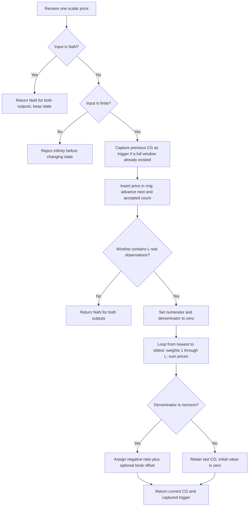

# Center of Gravity Oscillator

This folder contains a self-contained, streaming research prototype master
for John F. Ehlers' **Center of Gravity (CG) Oscillator**. The default follows
the May 2002 *Technical Analysis of STOCKS & COMMODITIES* article and the Mesa
paper. Set `centered=True` to reproduce the zero-centered version in Chapter
5 of *Cybernetic Analysis for Stocks and Futures* (2004). Both versions return
the oscillator and its one-observation delayed trigger. The formulas, source
listings, indexing, initialization, numerical conventions and differences from
the supplied implementation are included here for use without the originals.

The user confirmed all 24 parameter combinations below on 2026-10-26.
All five fixture files contain the copied input data and 48 generated
252-entry expected arrays, covering both outputs for each combination.

## Physical analogy and the connection to filters

A center of gravity is a balance point: place a ruler on a finger at its
midpoint and it balances; put a paper clip on one end and the balance point
moves toward that end. For this indicator, prices play the role of masses at
equally spaced positions in a finite observation window. The newest price
occupies position 1, its predecessor position 2, and the oldest position
`length`. A higher recent price pulls the balance point toward position 1.
Higher older prices pull it toward the far end of the window. Prices are
weights here; the calculation does not use trading volume.

Ehlers developed the idea while investigating adaptive finite impulse response
(FIR) filters. An ordinary simple moving average (SMA) uses equal coefficients,
so its coefficient balance point lies in the center. A weighted moving average
(WMA) gives recent prices larger coefficients. Its triangular coefficient
shape has its balance point approximately one-third of the way from the
heaviest end, reducing lag relative to an equally long SMA. For **discrete**
windows of exactly $L$ samples, with age $i=0$ for the newest sample, these
low-frequency lags are

$$\tau_{\mathrm{SMA}}=\frac{L-1}{2},\qquad
\tau_{\mathrm{WMA}}=
\frac{\sum_{i=0}^{L-1}i(L-i)}{\sum_{i=0}^{L-1}(L-i)}
=\frac{L-1}{3}.$$

These exact discrete expressions supplement the sources' geometric triangle
analogy. They describe a fixed linear filter's low-frequency delay, rather
than an assertion that this nonlinear oscillator has a constant group delay.

### Complete mathematical description from the sources

The article, Mesa paper and book present the general Ehlers filter as

$$\text{Ehlers Filter}=
\frac{\sum_{i=0}^{N}c_i\cdot\text{Price}_i}
     {\sum_{i=0}^{N}c_i}.\tag{5.1}$$

The denominator normalizes the coefficients so that the result retains the
original price scale. Equal $c_i$ give an SMA; descending coefficients toward
older prices give a WMA. Ehlers considers adaptive $c_i$ obtained from momentum,
signal-to-noise ratio, volatility, Stochastics and RSI. He also describes an
edge-detection-inspired coefficient as a sum of squared differences between a
price and previous prices. In notation consistent with that description, one
possible finite-history form is

$$c_i=\sum_{j\in J_i}(\text{Price}_i-\text{Price}_j)^2,$$

where $J_i$ identifies the previous prices being compared. This last equation
expresses the sources' prose; they do not specify $J_i$ in these CG documents.
It is background about adaptive filters, **not** a coefficient calculation
performed by the CG oscillator.

The shared mathematical expression for the balance point is

$$\mathrm{CG}_{\mathrm{balance}}=
\frac{\sum_{i=0}^{N}(x_i+1)\cdot\text{Price}_i}
     {\sum_{i=0}^{N}\text{Price}_i}.\tag{5.2}$$

Here $x_i$ is the position count starting at zero for the newest price. Adding
1 gives that price a nonzero weight. Shifting every coordinate by 1 shifts
the balance point by 1; it does not otherwise change its motion. Equation
(5.2), as printed in all three sources, describes the **positive balance
point**. Their oscillator code negates it. The book additionally adds a
constant to center the oscillator. The tags (5.1) and (5.2) are the book's
equation numbers; the same expressions in the articles have no such tags.

The printed upper limit $N$ is inclusive, giving $N+1$ terms. The executable
source uses `count = 0 to Length - 1`, giving exactly $L=\text{Length}$ terms.
Consequently, $N=L-1$ when translating these equations. There is no extra
sample in the price window.

### Equations actually implemented

Let $P_t$ be the current accepted scalar price, $L$ the length, and $i$ its
age in accepted observations. The source's numerator and denominator are

$$A_t=\sum_{i=0}^{L-1}(i+1)P_{t-i},\qquad
D_t=\sum_{i=0}^{L-1}P_{t-i}.$$

For a nonzero denominator, the article and Mesa oscillator is

$$G_t^{\mathrm{article}}=-\frac{A_t}{D_t}.$$

The book's Figure 5.1 and Figure 5.2 use

$$G_t^{\mathrm{book}}=-\frac{A_t}{D_t}+\frac{L+1}{2}.$$

The master unifies these formulas with $C=0$ for the article and $C=1$ for the
book:

$$G_t=-\frac{A_t}{D_t}+C\frac{L+1}{2}\quad(D_t\ne0).$$

The trigger in both versions is the preceding available oscillator:

$$T_t=G_{t-1}.$$

The source has a conditional assignment, not an unconditional division:

$$G_t=G_{t-1}\quad(D_t=0),\qquad G_{\mathrm{initial}}=0.$$

If the first complete window has $D_t=0$, its returned value is therefore
0. The preceding plot is still unavailable and returns NaN. In centered mode,
the offset is added only in the nonzero-denominator branch. The identity
$G_t^{\mathrm{book}}=G_t^{\mathrm{article}}+(L+1)/2$ holds for calculated
nonzero-denominator windows and subsequent holds after such calculations;
it does not hold for the initial zero-denominator fallback in both modes.

For positive prices, the balance point is a convex weighted average of the
positions 1 through $L$, so

$$-L\le G_t^{\mathrm{article}}\le-1,\qquad
-\frac{L-1}{2}\le G_t^{\mathrm{book}}\le\frac{L-1}{2}.$$

For a nonzero constant price $p$, the positive balance point is $(L+1)/2$.
The article returns $-(L+1)/2$, the book returns 0, and for $L=1$ these are
-1 and 0 respectively. Negative or mixed-sign scalar inputs are accepted,
but the positive-mass interpretation and these bounds then need not apply.
An exactly zero sum can occur even when individual prices are nonzero.

## Why it responds to price changes

Negating the balance point makes its motion agree with recent price changes:
a rise concentrated near the present pulls the balance point toward position
1 and increases the oscillator. A fall tends to decrease it. A constant
offset changes the baseline but leaves differences between the oscillator and
its trigger, crossover times, and the shapes of nondegenerate swings intact.

The centered expression can also be written exactly as

$$G_t^{\mathrm{book}}=
-\frac{\sum_{i=0}^{L-1}\left(i-\frac{L-1}{2}\right)P_{t-i}}
       {\sum_{i=0}^{L-1}P_{t-i}}.$$

The numerator is a signed first moment around the window's midpoint. Recent
and old prices contribute with opposite signs. The sums average information
across a finite window; there is no separately applied EMA, median filter,
Super Smoother, Hilbert transform, or adaptive cycle estimator.

For a linear segment $P_{t-i}=P_t-bi$, let $\mu_t=D_t/L\ne0$. Summing the
arithmetic progression gives

$$G_t^{\mathrm{book}}=\frac{b(L^2-1)}{12\mu_t}.$$

It measures slope relative to the mean price. Multiplying every price by a
common nonzero factor leaves a nondegenerate CG value unchanged. Adding a
constant to every price changes the denominator and thus the swing amplitude.
This is a nonlinear ratio of two finite-window sums, not a linear FIR output
in units of price, even though FIR filter research motivated its design.

Ehlers describes the oscillator as smoothed, essentially zero lag, and able
to identify turning points early. The one-observation trigger makes
$G_t-T_t$ the backward difference of CG. A crossover corresponds to a sign
change in that difference and therefore a local turn of CG. These statements
describe the sources' interpretation and illustrated charts; the equations
do not guarantee zero delay relative to every possible price turning point.

The sources recommend $L$ near half the dominant cycle period, so the window
captures roughly one directional half-cycle. Longer windows reduce sensitivity
and take more observations to initialize. Shorter windows retain more rapid
fluctuations and can create more crossovers. The book notes that the relative
amplitudes of cyclic swings resemble those of its Chapter 4 Cyber Cycle.

The sources explain that a whole-cycle window can balance opposing price
swings and suppress CG motion. This is a qualitative design explanation:
a full-cycle window does not mathematically annihilate every sinusoid's
*position-weighted* numerator. For a sinusoid whose ordinary sum over $L$
samples is zero, $\sum_i(i+1)\sin(\omega(t-i))$ can still be nonzero. Do not
add a special full-cycle cancellation rule to the implementation.

## Source listings and discrepancies

The May 2002 article and Mesa paper use the following core listing:

```text
Inputs: Price((H+L)/2), Length(10);
Vars: count(0), Num(0), Denom(0), CG(0);
Num = 0;
Denom = 0;
For count = 0 to Length - 1 begin
    Num = Num + (1 + count) * Price[count];
    Denom = Denom + Price[count];
End;
If Denom <> 0 then CG = -Num/Denom;
Plot1(CG, "CG");
Plot2(CG[1], "CG1");
```

The book's EasyLanguage listing, Figure 5.1, replaces the assignment with

```text
If Denom <> 0 then CG = -Num/Denom + (Length + 1) / 2;
```

The book's eSignal Formula Script, Figure 5.2, computes the same centered
formula. It initializes price and CG arrays to 70 zeros, writes the current
median price at index 0, shifts on `BARSTATE_NEWBAR`, skips initialization on
`BARSTATE_ALLBARS`, and returns `[aCGArray[0], aCGArray[1]]`. Its zero-padded
startup can produce values before a complete real-price window. The 70-slot
arrays are a platform implementation detail, not an inherent 70-bar limit or
another configuration parameter for this mathematical indicator. The master
accepts one completed observation per update and masks absent history with
NaN as requested; it does not emulate intrabar bar-state callbacks.

The article and Mesa explanatory prose accidentally repeat “numerator” when
describing the plain sum of prices. That sum is the denominator, as their code
and both mathematical equations establish. The book prose about centering is
resolved by its code: the offset is $(L+1)/2$, **not** $L/2+1$.

### Trader's Tips provenance

The article's metadata links to **August 2002** Trader's Tips. The locally
copied `tips/tips.md` is the **May 2002** page. Although its added header names
CG, its body and separate `CG_Pairs_*` / `CG_Fib_*` files concern “Daytrading
Stock Pairs” and “Projected Fibonacci Targets.” They contain no CG oscillator
reference implementation. Their filenames do not establish CG provenance.
Accordingly, this master is verified against the article/Mesa and book
listings. The linked August page is not included locally and was not used as
an additional numeric reference.

### Comparison with the supplied zpano implementation

The supplied source is
`external/zpano/py/indicators/john_ehlers/center_of_gravity_oscillator/`.
It relies on framework imports absent from this copied context. Its numeric
core can still be inspected and evaluated separately.

Let $R_t$ be its positive ratio. It stores the window **oldest first** and
assigns weight 1 to the oldest and weight $L$ to the newest:

$$R_t=\frac{\sum_{i=0}^{L-1}(L-i)P_{t-i}}{D_t}.$$

For $D_t\ne0$,

$$\sum_{i=0}^{L-1}(L-i)P_{t-i}
=(L+1)D_t-A_t,$$

and hence

$$R_t=(L+1)-\frac{A_t}{D_t}
=G_t^{\mathrm{article}}+(L+1)
=G_t^{\mathrm{book}}+\frac{L+1}{2}.$$

Reversing the weights and omitting the minus sign therefore compensate in
*direction*, leaving an offset. It is not simply an inverted version of the
published oscillator. At $L=10$, subtract 11 from the supplied ratio to get
the article value or subtract 5.5 to get the book value, apart from differences
in rounding, degenerate windows and output availability.

| Detail | Article / Mesa | Book | Supplied zpano code | Master |
| --- | --- | --- | --- | --- |
| Newest-to-oldest weights | $1,2,\ldots,L$ | Same | $L,L-1,\ldots,1$ | Article/book order |
| Sign and baseline | $-A/D$ | $-A/D+(L+1)/2$ | Positive reversed-weight ratio | Both published baselines |
| Default length | 10 | 10 in code; 8 in chart | 10 | 10 |
| First publicly returned value | Host history governs | Host history / EFS zero padding | Observation $L+1$ | Observation $L$ |
| First publicly returned trigger | Host history governs | Host history / EFS zero padding | Observation $L+1$ | Observation $L+1$ |
| Denominator | Recomputed newest first | Recomputed newest first | Maintained by rolling additions | Recomputed newest first |
| Zero denominator | Retain previous CG, initially 0 | Same | Return 0 when $|D|\le\texttt{sys.float_info.min}$ | Retain previous CG |
| NaN input | Not specified | Not specified | Skip without changing state | Same explicit skip policy |
| Scalar update result | Two plots | Two plots | Returns CG only; entity wrappers return two values | Named tuple with two fields |
| Default bar component | Median $(H+L)/2$ | Median | Factory selects median; params docstring says close | Scalar supplied by caller |

During the supplied code's first $L$ observations it computes a hidden first
ratio and stores it as `_value_previous`, but returns NaN. On observation
$L+1$ it returns a new ratio and exposes that hidden first ratio as trigger.
This explains the extra unavailable value in its fixtures; it is not evidence
that the CG formula itself needs $L+1$ prices. Its explicit tests encode that
startup choice.

The supplied fixtures use the **median** price, not the shared close array.
Their 252 scalar inputs equal `(INPUT_HIGH + INPUT_LOW)/2` from the shared
fixture. Evaluating the oldest-first positive formula against their reported
CG values at length 10 gives a maximum absolute discrepancy of about
$6.22\times10^{-15}$. This confirms the offset analysis independently of the
missing framework. Reference arrays for this new master use `INPUT_CLOSE`,
as requested; compare both implementations on the same price component.

The supplied `params.py` documentation says the default bar component is
ClosePrice, while `_new_cog` selects `BarComponent.MEDIAN` and its metadata
test expects `cog(10, hl/2)`. The new scalar API avoids this ambiguity.

## Configuration and output contract

| Parameter | Python name | Default | Valid values | Meaning |
| --- | --- | --- | --- | --- |
| Observation length | `length` / `L` | 10 | Integer $L\ge1$; bool and fractions rejected | Number of prices in the window |
| Book centering | `centered` / `C` | `False` / 0 | Python bool; fixture names encode 0 or 1 | Add $(L+1)/2$ when true |
| Scalar input | `price` in `update` | Caller supplied | Finite real value, or NaN to skip | Source defaults to median; fixtures use close |

There is no upper mathematical limit on $L$; storage and runtime are $O(L)$.
Length 1 is valid but has no useful oscillation on nonzero prices. The class
does not automatically select half a dominant cycle. The delay is fixed at
one accepted observation and is not a tunable parameter. Configuration is
read-only after construction; `reset()` restarts the same configuration.

`update(price)` returns `CenterOfGravityOutput(value, trigger)`, a named tuple.
`is_primed` reports whether a complete price window exists; `is_trigger_primed`
reports whether a predecessor from a complete window exists. Availability is
per output: the first $L-1$ value entries and first $L$ trigger entries are
NaN. At length 252 on this record there is exactly one value and no available
trigger. A NaN call returns NaN for both fields without moving the window,
counter, last CG or priming flags. The next finite call continues from the
last accepted observation. Infinity raises `ValueError` before changing state.

The source listings assume chart history supplied by their host. They do not
define a portable priming API. Complete-window masking is the explicit master
convention required for the generated NaNs; it preserves source arithmetic
once all inputs referenced by a calculation exist.

## Calculation flow and state

Store a fixed ring of $L$ prices, an insertion index `next`, a finite-sample
counter capped at $L+1$, and persistent `last_value`, initially 0. The newest
price after insertion is at `(next - 1) mod L`. For each lag, access
`(next - 1 - lag) mod L`. In languages with signed remainder rules, ensure
the index is nonnegative: `(next + L - 1 - lag) % L` works for these ranges.



Do not substitute rolling sums, compensated summation, oldest-first traversal,
or a recurrence for the master loop when seeking the same reference rounding.
Those can be useful optimizations, but the published code recomputes both sums
in newest-first order. Ports should use ordinary binary64 arithmetic with no
fast-math reassociation or fused multiply-add substitution if agreement in the
last bits matters. Inputs should have magnitudes for which the finite-window
sums are representable in binary64; the standard prices easily satisfy this.

The constants 1 and 2, and the half-integer centering offset, are exact. Neither
the article nor this book chapter uses $\pi$, $\sqrt2$, 1.414 or 3.14159.
No truncated transcendental constants or unrelated filters are introduced.

## Confirmed reference parameter matrix

The confirmed matrix is the Cartesian product of the following 12 lengths with
`centered=False` and `centered=True`: **24 combinations**, producing two
252-entry arrays each, or **48 arrays per language**. Default length 10 and
the book chart's length 8 are both covered, along with short odd/even windows
and nearly or entirely unavailable output near the record boundary.

Each emitted array's first comment is exactly the **What it tests** entry below.
The second comment identifies `length`, `centered` and the output field.

| Length | Centered | What it tests |
| --- | --- | --- |
| 1 | False | Article convention. Minimum window; constant value for nonzero prices and trigger startup. |
| 1 | True | Book convention. Minimum window; constant value for nonzero prices and trigger startup. |
| 2 | False | Article convention. Smallest moving balance point and earliest nonconstant crossover. |
| 2 | True | Book convention. Smallest moving balance point and earliest nonconstant crossover. |
| 3 | False | Article convention. Short odd window; integer centering offset. |
| 3 | True | Book convention. Short odd window; integer centering offset. |
| 5 | False | Article convention. Short smoothed window and rapid response to price changes. |
| 5 | True | Book convention. Short smoothed window and rapid response to price changes. |
| 8 | False | Article convention. Eight-bar window used in the book example. |
| 8 | True | Book convention. Eight-bar window used in the book example. |
| 10 | False | Article convention. Default ten-bar window in the article and book listings. |
| 10 | True | Book convention. Default ten-bar window in the article and book listings. |
| 14 | False | Article convention. Intermediate window between the default and twenty bars. |
| 14 | True | Book convention. Intermediate window between the default and twenty bars. |
| 20 | False | Article convention. Longer window corresponding to half a forty-bar cycle. |
| 20 | True | Book convention. Longer window corresponding to half a forty-bar cycle. |
| 32 | False | Article convention. Moderate smoothing and delayed warmup. |
| 32 | True | Book convention. Moderate smoothing and delayed warmup. |
| 64 | False | Article convention. Long smoothing window over the shared price history. |
| 64 | True | Book convention. Long smoothing window over the shared price history. |
| 126 | False | Article convention. Half-record window and substantial warmup. |
| 126 | True | Book convention. Half-record window and substantial warmup. |
| 252 | False | Article convention. Full-record window; one value and no primed trigger. |
| 252 | True | Book convention. Full-record window; one value and no primed trigger. |

The user confirmed this full matrix before expected output generation.
`REFERENCE_CASES_CONFIRMED = True` records that confirmation for regeneration.

### Fixture naming, precision and regeneration

`L` is length; `C` is centered, encoded as 0/1. `CG` denotes the value and `TR`
the trigger. For example, length 10 in book mode gives:

| Language | Value | Trigger |
| --- | --- | --- |
| Python | `EXPECTED_L10_C1_CG` | `EXPECTED_L10_C1_TR` |
| Go | `expectedL10_C1_CG` | `expectedL10_C1_TR` |
| TypeScript | `expectedL10_C1_CG` | `expectedL10_C1_TR` |
| Rust | `expected_l10_c1_cg()` | `expected_l10_c1_tr()` |
| Zig | `expectedL10_C1_CG()` | `expectedL10_C1_TR()` |

`CG` and `TR` distinguish output fields, not extra parameters. There are no
floating-point parameters in this indicator; if names were extended to such
parameters, decimal points would be encoded as underscores.

Internal arithmetic uses unrounded binary64 values. Serialized finite outputs
use **15 significant decimal digits**, Python's `.15g` format. Integer-valued
results include `.0` so they are valid `f64` literals. NaNs are `NaN` with a
`NaN = math.nan` alias in Python, `math.NaN()` in Go, `NaN` in TypeScript,
`f64::NAN` in Rust and `nan` in Zig. The correct Rust spelling has two colons.

The Go package is `centerofgravityoscillator`; expected arrays are `[]float64`
variables and require `import "math"`. TypeScript uses the valid declaration
`export const name: number[] = [...]`. Rust functions return `Vec<f64>` inside
the copied `#[cfg(test)] pub mod testdata`. Zig functions return `[252]f64`,
using `return .{...};`, with these declarations retained at the top:

```zig
const math = @import("std").math;
const nan = math.nan(f64);
```

Regenerate the confirmed reference data from this folder:

```bash
python3 center-of-gravity-oscillator.py --generate-reference-data
python3 -m unittest discover -s . -p 'test_center_of_gravity_oscillator.py'
```

The generator uses the embedded 252 `INPUT_CLOSE` values, checks that they
still equal the copied Python inputs, writes Python expected arrays first,
reads them back, verifies their lengths and precision, and transcribes them
with the same two comments into the four other languages. The four input
series are preserved. Generated sections have explicit markers so rerunning
replaces only the expected data rather than duplicating arrays or replacing
manually maintained inputs. Full-precision runtime results should be compared
to these serialized values with a small tolerance, for example absolute
$10^{-12}$ plus relative $5\times10^{-14}$, and NaNs compared by classification.

The positive close-price record does not test a zero denominator, skipped NaN,
infinity rejection or reset. The accompanying focused Python tests cover
those cases separately; adding lengths cannot make them appear in this input.

### Verification completed

All 14 focused Python tests pass. They compare every confirmed combination
with the published calculation loop and an independent exact-decimal rational
oracle, check startup and the exceptional cases above, and compare all target
arrays and comments exactly with the persisted Python data. Each language has
48 expected arrays of 252 entries; all four original input series are preserved.
Regeneration has been checked for byte-for-byte reproducibility.

Native checks also evaluated all 48 expected arrays in Go, TypeScript, Rust
and Zig, verifying their lengths and per-output NaN masks. The Zig check calls
every generated function, so its lazy function analysis is exercised. These
are fixture compilation/evaluation checks, not separate native indicator
implementations. Temporary native check harnesses were kept outside this
master folder.

## References

1. John F. Ehlers, “The Center Of Gravity Oscillator,” *Technical Analysis of
   STOCKS & COMMODITIES*, 20(5), May 2002, pp. 20–24.
   [Article PDF](https://technical.traders.com/archive/article.asp?file=\V20\C05\088CENT.pdf).
   Local transcription: `../../tasc/2002-05-the-center-of-gravity-oscillator/content.md`.
2. John F. Ehlers, “The CG Oscillator,” Mesa Software paper.
   [PDF](https://www.mesasoftware.com/papers/TheCGOscillator.pdf).
   Local transcription: `../../tasc/2002-05-the-center-of-gravity-oscillator/mesa/content.md`.
   The local bibliography assigns 2002; the transcribed body has no date.
3. John F. Ehlers, *Cybernetic Analysis for Stocks and Futures: Cutting-Edge
   DSP Technology to Improve Your Trading*, John Wiley & Sons, 2004,
   Chapter 5, “The CG Oscillator,” equations (5.1)–(5.2), Figures 5.1–5.3.
   Local chapter: `../../2004-cybernetic-analysis-for-stocks-and-futures/ch5.md`.
   Figure 5.2 credits Chris D. Kryza, Divergence Software, Inc., June 27, 2003.
4. “Traders' Tips,” May 2002, STOCKS & COMMODITIES.
   [Page](https://www.traders.com/Documentation/FEEDbk_docs/2002/05/TradersTips/TradersTips.html).
   Inspected for provenance; copied body is about stock pairs and Fibonacci
   targets and supplies no CG numeric reference.
5. “Traders' Tips,” August 2002, STOCKS & COMMODITIES.
   [Page](https://www.traders.com/Documentation/FEEDbk_docs/2002/08/TradersTips/TradersTips.html).
   Link cited in the article's local metadata; no local August content inspected.
6. John F. Ehlers, “Nonlinear Ehlers Filters,” *Technical Analysis of STOCKS &
   COMMODITIES*, 19(4), April 2001. The Mesa paper cites page 25. Background
   reference cited by the CG sources for adaptive FIR filters.
7. John F. Ehlers, *Rocket Science for Traders: Digital Signal Processing
   Applications*, John Wiley & Sons, 2001, Chapter 10, cited by the Mesa paper.
   Background reference rather than an additional CG code source.
8. Supplied zpano Python implementation and fixtures, paths listed above.
   Inspected numeric core and fixtures; no publication date or author metadata
   is available in these copied files.

### BibTeX

```bibtex
@article{ehlers_center_of_gravity_2002,
  author = {John F. Ehlers},
  title = {The Center Of Gravity Oscillator},
  journal = {Technical Analysis of STOCKS \& COMMODITIES},
  volume = {20},
  number = {5},
  pages = {20--24},
  year = {2002},
  month = may,
  url = {https://technical.traders.com/archive/article.asp?file=\V20\C05\088CENT.pdf}
}

@misc{ehlers_cg_mesa,
  author = {John F. Ehlers},
  title = {The CG Oscillator},
  howpublished = {MESA Software paper},
  url = {https://www.mesasoftware.com/papers/TheCGOscillator.pdf},
  note = {Local bibliography assigns 2002; date not stated in transcribed body}
}

@incollection{ehlers_cybernetic_cg_2004,
  author = {John F. Ehlers},
  title = {The CG Oscillator},
  booktitle = {Cybernetic Analysis for Stocks and Futures: Cutting-Edge DSP Technology to Improve Your Trading},
  publisher = {John Wiley \& Sons},
  year = {2004},
  chapter = {5},
  note = {Equations 5.1--5.2 and Figures 5.1--5.3; EFS listing by Chris D. Kryza}
}

@misc{traders_tips_may_2002_inspected,
  author = {{Technical Analysis of STOCKS \& COMMODITIES}},
  title = {Traders' Tips, May 2002},
  year = {2002},
  month = may,
  url = {https://www.traders.com/Documentation/FEEDbk_docs/2002/05/TradersTips/TradersTips.html},
  note = {Locally copied body concerns stock pairs and projected Fibonacci targets}
}

@misc{traders_tips_august_2002_link,
  author = {{Technical Analysis of STOCKS \& COMMODITIES}},
  title = {Traders' Tips, August 2002},
  year = {2002},
  month = aug,
  url = {https://www.traders.com/Documentation/FEEDbk_docs/2002/08/TradersTips/TradersTips.html},
  note = {Linked by local article metadata; not used as a numerical reference}
}

@article{ehlers_nonlinear_filters_2001,
  author = {John F. Ehlers},
  title = {Nonlinear Ehlers Filters},
  journal = {Technical Analysis of STOCKS \& COMMODITIES},
  volume = {19},
  number = {4},
  year = {2001},
  month = apr,
  note = {Mesa CG paper cites page 25}
}

@book{ehlers_rocket_science_2001,
  author = {John F. Ehlers},
  title = {Rocket Science for Traders: Digital Signal Processing Applications},
  publisher = {John Wiley \& Sons},
  year = {2001},
  note = {Chapter 10 cited by the Mesa CG paper}
}

@misc{zpano_cg_supplied_source,
  title = {Supplied zpano Center of Gravity Oscillator Python Implementation},
  howpublished = {Local source code and reference fixtures},
  note = {external/zpano/py/indicators/john_ehlers/center_of_gravity_oscillator/; publication metadata unavailable}
}
```
