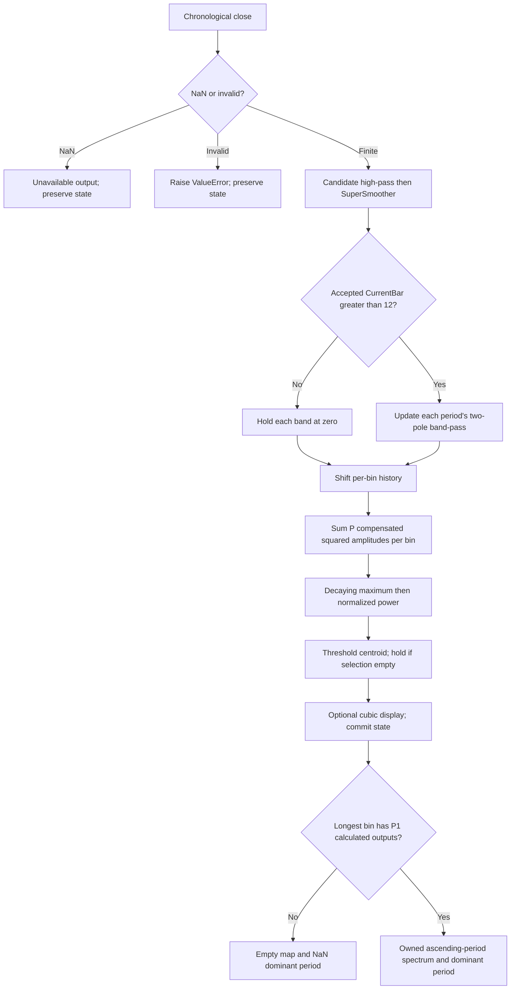

# Comb Band-Pass Spectrum: research prototype master reference

Master: [comb-band-pass-spectrum.py](comb-band-pass-spectrum.py), class `CombBandPassSpectrum`. Returns a spectrum heatmap and the power-weighted dominant period per accepted close.

## Scope and numerical authority

This is a self-contained **research prototype master reference** for conversion to Python, Go, TypeScript, Rust and Zig. Only the Python standard library is required. The streaming class takes one chronological finalized Close per `update(close, time=None)`. No future samples, full price array, chart-platform state, NumPy, pandas or zpano runtime imports are used. The numerical helper code is above the fixture-tooling comment in the executable. The original 252 `INPUT_CLOSE` observations are embedded in `__main__` and also preserved in the five copied fixture files.

John F. Ehlers, *Cycle Analytics for Traders: Advanced Technical Trading Concepts* (Wiley, 2013), is the algorithm authority. The corresponding zpano implementation informs the API and comparison notes; differences are described rather than silently substituted. Source fragments are reproduced later in this document because a conversion agent may have this folder alone.

Mathematical constants use full binary64 precision: $\pi=\texttt{math.pi}$, $\sqrt2=\texttt{math.sqrt(2.0)}$, and $1/\sqrt2$ replace printed `3.14159`, `1.414`, and `.707`. Degree-based trig functions in EasyLanguage become radians in Python. Decimal design settings such as $0.995$, $0.5$, $0.3$ and the optional cubic display remain as specified; they are not truncated versions of mathematical constants. Unrounded state uses binary64, and only serialized expected data is rounded to **15 significant decimal digits**. Full-precision coefficients necessarily give slightly different values from code that retains the rounded constants. This master preserves the recurrence and operation order rather than promising bitwise identity with those rounded implementations.

## Physical principles and shared Roofing Filter

A high-pass circuit removes slow offsets and long-period variations; a low-pass circuit removes rapid noise. Cascading these two circuits retains a middle band of periods. In market terms the goal is to examine oscillatory movement without a price level or trend dominating the result. The source calls the tendency of longer price swings to have larger amplitudes **spectral dilation**. Its approximate scaling is $A(P)\propto P$, or $A(f)\propto1/f$, corresponding to about $20\log_{10}2=6.02$ dB amplitude growth per doubling of period. This is a motivating empirical model, not a universal law for all market records.

A one-pole high-pass provides approximately 6 dB/octave attenuation toward low frequencies and may mainly equalize that amplitude growth. The book uses two poles to provide additional rejection. A two-pole SuperSmoother then reduces short-period noise. It behaves like a damped resonator, whose retained state decays while rotating in phase; averaging its feedforward input over two adjacent samples creates an exact Nyquist zero. Sampling limits still apply: the Nyquist frequency is $1/2$ cycle per bar. The book commonly selects a shortest useful period near 10 bars.

Let $x_t$ be Close at accepted observation $t$, $H$ the high-pass coefficient period, $L$ the SuperSmoother coefficient period, and $h_t,f_t$ the high-pass and roofed outputs. All periods are measured in bars. Define

$$\theta_H=\frac{2\pi}{\sqrt2H},\qquad
\alpha_H=\frac{\cos\theta_H+\sin\theta_H-1}{\cos\theta_H},\qquad q=1-\alpha_H.$$

The two-pole high-pass is

$$h_t=(1-\alpha_H/2)^2(x_t-2x_{t-1}+x_{t-2})+2q h_{t-1}-q^2h_{t-2}.$$

Its transfer function is

$$H_{HP}(z)=\frac{(1-\alpha_H/2)^2(1-z^{-1})^2}{1-2qz^{-1}+q^2z^{-2}}.$$

Equation 3-3's SuperSmoother coefficients and recurrence are

$$a=e^{-\sqrt2\pi/L},\quad b=2a\cos(\sqrt2\pi/L),\quad
c_2=b,\quad c_3=-a^2,\quad c_1=1-c_2-c_3,$$

$$f_t=\frac{c_1}{2}(h_t+h_{t-1})+c_2f_{t-1}+c_3f_{t-2}.$$

$$H_{SS}(z)=\frac{(c_1/2)(1+z^{-1})}{1-c_2z^{-1}-c_3z^{-2}},\qquad
H_{Roof}(z)=H_{HP}(z)H_{SS}(z).$$

The negative $c_3$ is **added** in the recurrence; the positive $q^2$ term is **subtracted**. Do not change these signs when translating. Fractional cutoff periods change coefficients and are never rounded into rolling-window lengths. `highpass_period` and `smoothing_period` are independent of the displayed axis and of any observation window. A compact or single-bin map therefore keeps the original roof unless explicitly configured otherwise. No mandatory $H>L$ restriction is imposed: unusual bands are permitted within the stability limits, but may attenuate most of the input.

## Streaming, startup and heatmap contract

The returned `Heatmap` has fields closely matching `external/zpano/py/indicators/core/outputs/heatmap.py`:

| Field | Meaning |
| --- | --- |
| `time` | Optional timestamp supplied by the caller; it does not affect arithmetic. |
| `parameter_first`, `parameter_last` | Inclusive first and last displayed lag or period. |
| `parameter_resolution` | 1.0; bins ascend in integer increments. |
| `value_min`, `value_max` | Actual min/max of this outgoing numerical column. |
| `values` | Fresh list of bin values; its storage is never reused by the indicator. |

A public unavailable column has `values=[]` and NaN extrema. Fixture generation expands that empty column to the chosen bin width filled with NaNs. The complete bank is primed together; partial bins are not published. An empty runtime column and a NaN fixture row represent the same unavailable result.

`parameters` is an immutable named tuple. `samples_seen` counts accepted finite observations. `warmup_bars` counts leading unavailable observations and equals the zero-based index of the first full-history output. `is_primed` describes history availability, not convergence of the recursive transient. `state` returns an immutable diagnostic snapshot. `output` retains the last accepted output; `reset()` restores all initial state while keeping configuration.

All price, filter and array prehistory is explicitly zero. The roof evolves from the **first actual close**, and downstream internal calculations also evolve during masked startup. Do not postpone filter, AGC or centroid state until public priming. A positive constant input causes a finite startup transient because the two absent closes are zero. This follows the existing book-periodogram master's finite-record convention and makes the initial condition reproducible. A commercial chart may instead evaluate many earlier prices; matching that platform requires matching its prehistory. Startup NaNs never enter recursive state.

A NaN input is an omitted observation: return an unavailable public result and preserve all state, including the last accepted output and counter. The next finite sample follows the preceding finite sample. Infinity, booleans and invalid parameters raise `ValueError`; candidate arithmetic is checked before commit, so arithmetic overflow also preserves state. All sums visit the most recent sample first. No variance epsilon, stable-centered replacement, compensated summation, min subtraction or hidden price rescaling is introduced; those can change this numerical reference.

## Reference data and conversion workflow

The user confirmed **all 36 combinations across these three folders on 2026-10-22**, twelve per folder. The original four OHLC input arrays are preserved in every language file, although this indicator consumes only `INPUT_CLOSE`. Each expected array contains 252 chronological rows or scalar values. A matrix has one column per displayed bin. Min/max are computed from the values actually displayed, including optional contrast.

Run the demo with `python3 comb-band-pass-spectrum.py`. Run `python3 comb-band-pass-spectrum.py --generate-reference-data` to replace only the marked generated sections of all five fixture files. Run `python3 verify_reference_data.py` to verify every name, two parameter comments, dimension, decimal and NaN mask against the master. Generation reopens Python expected arrays before translating them, so the Python decimal data is the authority for all four other languages. Repeated generation is idempotent and leaves original input arrays intact.

Python names start `EXPECTED_`; Go/TypeScript/Zig use `expected` with uppercase parameter shortcuts; Rust uses `expected_` with lowercase shortcuts. Shortcuts are `L0/L1` for lag bounds, `P0/P1` for period bounds, `A` for averaging length, `W` for DFT window, `HP/LP` for roof cutoffs, `B` for bandwidth, `SDC` for compensation, and `E` for enhancement. Booleans encode as `1/0`; decimal points encode as underscores. Component suffixes identify `HEATMAP`, `MIN`, `MAX` and, for spectra, `DOMINANT_CYCLE`.

Valid language syntax takes precedence over typos in illustrative templates: Go uses `math.NaN()`, Rust uses `f64::NAN`, TypeScript uses `NaN`, and Zig uses `const math = @import("std").math; const nan = math.nan(f64);`. Heatmaps use `number[][]`, `[][]float64`, `Vec<Vec<f64>>`, or `[252][bins]f64`. Scalar arrays use the corresponding one-dimensional types. Go package names strip hyphens/underscores from this folder name. Input fixtures compile before generation; the generator adds Go's math import when expected NaNs are emitted.

Compare NaN placement exactly and finite outputs with both absolute and relative tolerances (for example $10^{-11}$ for this bounded reference record). Libraries' sine, cosine, exponential and square root can differ in their last bits; literal precision does not imply portable bitwise equality. Do not clamp spectrum or Pearson values to conceal a disagreement. Unit tests compare the streaming calculations with a separate direct transcription of the source recurrences and include behavior that a fixture round trip alone cannot prove.

## Spectrum normalization, dominant cycle and colors

Both spectrum algorithms return `SpectrumOutput(heatmap, dominant_cycle)`. A bank of period-dependent measurements resembles a row of resonators, each tuned to a different pitch. Their relative responses show where oscillatory content is concentrated. The vertical axis is **period in bars**, not frequency; it is therefore nonlinear in frequency. Closely spaced period samples are not independent Fourier frequency bins.

Let $Q_t(P)$ be unnormalized power at period $P$. The source's fast-attack, slow-decay maximum is

$$G_t=\max\left(0.995G_{t-1},\ \max_{P=P_0}^{P_1}Q_t(P)\right),\qquad G_{-1}=0.$$

$$p_t(P)=\begin{cases}Q_t(P)/G_t,&G_t>0,\\0,&G_t=0.\end{cases}$$

The zero branch defines the all-zero initialized spectrum without division by zero. For a decaying signal, $G_t$ can exceed the current maximum, so **the largest displayed bin need not equal one**. The denominator may remember pre-priming power; this is intentional. Do not normalize each column independently or subtract its minimum.

Use the source-selected powers $p_t(P)\ge1/2$:

$$S_t=\sum_{P:p_t(P)\ge1/2}p_t(P),\qquad
S_{x,t}=\sum_{P:p_t(P)\ge1/2}Pp_t(P),$$

$$D_t=\begin{cases}S_{x,t}/S_t,&S_t\ne0,\\D_{t-1},&S_t=0.\end{cases}$$

The internal $D_{-1}=0$ is retained until a nonempty centroid first exists. Public `dominant_cycle` is NaN while the bank is unprimed or no centroid has ever existed, then holds the last estimate through empty selections. `is_primed` can therefore be true for a zero input while the dominant cycle is NaN. Once identified, an estimate always remains inside the configured period bounds, but may be stale. It is a real-valued power-weighted period, not the brightest-bin index, a rounded integer or a trade prediction.

The optional display block cubes normalized power **after** centroid extraction:

$$v_t(P)=p_t(P)^3\quad\text{if enhanced, otherwise }v_t(P)=p_t(P).$$

This changes HEATMAP/MIN/MAX, never raw power, AGC or DOMINANT_CYCLE. No additional time smoothing of powers or dominant cycle is inserted. The original spectrum palette uses black/red/yellow rather than the autocorrelation stoplight colors:

$$(R,G,B)=\begin{cases}(510v,0,0),&v<1/2,\\(255,255(2v-1),0),&v\ge1/2.\end{cases}$$

The numerical master returns intensities, leaving RGB values and interpolation to rendering. The source comment “Convert to Decibels” accompanies a ratio computation, **not a logarithm**; the exported spectrum is linear normalized power. It is neither calibrated power spectral density nor a decibel measurement.

The book discusses a 0.991 amplitude-envelope design in Chapter 5 and uses 0.995 in these power-spectrum listings. Its prose motivates 0.995 as a rounded square root of 0.991; this master follows the **executable 0.995** setting rather than recomputing that relationship. Preserve design constants separately from full-precision $\pi$ and $\sqrt2$.

## Band-pass bank mathematics

This chapter's “comb” is a **bank of overlapping band-pass filters**; it is not the common DSP comb built by adding a delayed signal to itself. The physical analogy is a row of damped resonators with different pitches, all driven by the same roofed signal. Narrow bandwidth yields more frequency selectivity but longer ringing and slower response to changing cycles. Broad bandwidth responds faster while overlapping more strongly with neighboring period bins.

For each integer trial period $P$, and fractional bandwidth $B$, compute

$$\beta_P=\cos(2\pi/P),\quad \gamma_P=\frac1{\cos(2\pi B/P)},\quad
\alpha_P=\gamma_P-\sqrt{\gamma_P^2-1}.$$

Chapter 5's operational two-pole band-pass transfer function is

$$H_{BP,P}(z)=\frac{0.5(1-\alpha_P)(1-z^{-2})}{1-\beta_P(1+\alpha_P)z^{-1}+\alpha_Pz^{-2}}.$$

It has zeros at DC and Nyquist. Its damped oscillatory response is selected by $P$ and $B$; the stable principal secant branch requires $0<2\pi B/P<\pi/2$. Chapter 5 also gives the resonator analogy

$$Q=2\pi\frac{\text{Energy Stored}}{\text{Energy Dissipated per Cycle}}.$$

Larger selectivity corresponds to a narrower pass band and greater retained energy. This qualitative filter-bank analogy does not claim an independent physical oscillator exists at each market period.

With $b_t(P)$ the band's output, the executable recurrence is

$$b_t(P)=\frac{1-\alpha_P}{2}(f_t-f_{t-2})
+\beta_P(1+\alpha_P)b_{t-1}(P)-\alpha_Pb_{t-2}(P),\quad\texttt{CurrentBar}>12.$$

For accepted bars 1 through 12, $b_t(P)=0$ by the source startup gate. The roof still evolves during those twelve bars. Each bin's unnormalized power is summed over **that bin's period**, not one common maximum-length window:

$$Q_t(P)=\sum_{m=0}^{P-1}\left(\frac{b_{t-m}(P)}{k_P}\right)^2,\qquad
k_P=\begin{cases}P,&\text{compensation enabled},\\1,&\text{disabled}.\end{cases}$$

Compensation divides amplitude by $P$ before squaring, hence the squared-power scale is $1/P^2$. Since the number of terms also varies with $P$, for a steady equal-amplitude band output the uncompensated sum grows approximately as $P$ and the compensated sum falls approximately as $1/P$. Do not replace this with an RMS or a sum over `max_period`. Then apply the shared maximum normalization, centroid threshold and optional cubic display described above.

## Configuration, startup and complexity

| Parameter | Default | Valid range and meaning |
| --- | --- | --- |
| `min_period` | 10 | Integer $\ge3$; first trial period. |
| `max_period` | 48 | Integer $\ge\texttt{min_period}$; last trial period. |
| `bandwidth` | 0.3 | Finite real $0<B<\texttt{min_period}/4$ and numerically resolvable stable poles. |
| `highpass_period` | 48.0 | Finite real $\ge5$, independent stable high-pass cutoff. |
| `smoothing_period` | 10.0 | Finite real $\ge2$, independent stable SuperSmoother cutoff. |
| `spectral_dilation_compensation` | True | Boolean; amplitude division by the period before energy summation. |
| `enhance_resolution` | False | Boolean; outgoing spectrum is cubed after centroid extraction. |

The twelve-bar source gate is fixed; changing period bounds or smoothing does not retune it. Each bin keeps $P$ newest-first BP outputs; the entire bank becomes public after its longest bin has `max_period` actually calculated outputs:

$$\texttt{first public bar}=12+P_1,\qquad\texttt{warmup_bars}=11+P_1.$$

Defaults therefore publish first at bar 60, index 59. In the 240-period boundary case the first fully populated bank is on bar 252, the final supplied close. The source's gated zeros are retained as internal initial conditions, but the public full-history contract waits for calculated outputs instead of treating gated zeros as observations. This differs from zpano's earlier priming. Internal BP power, maximum and centroid evolve beginning at bar 13; their pre-priming history is preserved.

Time and state are $O(\sum_{P=P_0}^{P_1}P)$ for shifting and summing each bin's history, plus $O(P_1-P_0+1)$ coefficients. The source allocates a full 48-by-48 matrix. The master stores only each bin's needed $P$ samples, including at least two recurrence states since $P\ge3$. A circular-buffer port may reduce shift work but must still sum logically newest to oldest for reference rounding.

## Algorithm flow



## Missing declarations and source reconstruction

The supplied listing 10-1 does **not compile unchanged**: it references `Bandwidth`, `SpectralDilationCompensation`, `ShortestPeriod` and `LongestPeriod` without declaring them. The master explicitly reconstructs `Bandwidth=0.3`, compensation enabled and period bounds 10/48. The bandwidth choice is supported by Chapter 5's published band-pass default and the existing zpano parameters; it is not claimed to appear as a declaration in listing 10-1. The coded roofing cutoffs remain independently configurable defaults 48/10. `delta1` is an unused source variable; the recurrence assigns its pole coefficient to `alpha1`. It has no effect on output.

The source first shifts its matrix indices 48 down to 2, then assigns current BP to index 1 and uses indices 2 and 3 as previous outputs. Python's current index is zero, previous indices are one and two **after shifting** (or zero and one in the prior row before shifting). Confusing these indices causes a one-bar delay. The power loop 1..P becomes zero-based 0..P-1. Every bin's power is reset before summing, so previous normalized power is not recycled as raw energy.

zpano's `comb_band_pass_spectrum` supports the same main filter bank and energy formulas, but starts its bank at bar one, defaults to floating min/max normalization, retains rounded roof constants and does not expose the book centroid. It also couples the roof cutoffs to displayed period bounds. This master preserves the bar-13 gate, full-precision constants, independent roof controls, fixed maximum-only normalization and centroid. Enabling zpano's `fixed_normalization` is insufficient to reproduce startup and coefficients.

Chapter 5's earlier printed equation 5-1 conflicts with the operational transfer function and does not define all coefficients coherently. The formula reproduced above is the transfer function matching recurrence 5-2 and listing 10-1. The contradictory printed form is retained only in the source appendix below; it is not implemented. The book prefers the autocorrelation periodogram for spectral estimates, so this comb remains valuable as an alternative reference and comparative research instrument.

## Confirmed reference combinations

| Case | Parameters | What it tests |
| --- | --- | --- |
| 1 | `min_period=10, max_period=48, highpass_period=48.0, smoothing_period=10.0, spectral_dilation_compensation=True, enhance_resolution=False, bandwidth=0.3` | Reconstructed published defaults, delayed bank startup, and dominant period. |
| 2 | `min_period=10, max_period=48, highpass_period=48.0, smoothing_period=10.0, spectral_dilation_compensation=False, enhance_resolution=False, bandwidth=0.3` | Uncompensated band-pass amplitudes before squared-power accumulation. |
| 3 | `min_period=10, max_period=48, highpass_period=48.0, smoothing_period=10.0, spectral_dilation_compensation=True, enhance_resolution=True, bandwidth=0.3` | Cubic display contrast after the unchanged dominant-period calculation. |
| 4 | `min_period=10, max_period=48, highpass_period=48.0, smoothing_period=10.0, spectral_dilation_compensation=False, enhance_resolution=True, bandwidth=0.3` | Uncompensated comb spectrum with cubic display contrast. |
| 5 | `min_period=10, max_period=48, highpass_period=48.0, smoothing_period=10.0, spectral_dilation_compensation=True, enhance_resolution=False, bandwidth=0.1` | Narrower resonators and longer transients. |
| 6 | `min_period=10, max_period=48, highpass_period=48.0, smoothing_period=10.0, spectral_dilation_compensation=True, enhance_resolution=False, bandwidth=0.7` | Broader overlapping resonators. |
| 7 | `min_period=10, max_period=48, highpass_period=48.0, smoothing_period=10.5, spectral_dilation_compensation=True, enhance_resolution=False, bandwidth=0.3` | Fractional SuperSmoother cutoff. |
| 8 | `min_period=10, max_period=48, highpass_period=80.0, smoothing_period=20.0, spectral_dilation_compensation=True, enhance_resolution=False, bandwidth=0.3` | Slower independent roofing band. |
| 9 | `min_period=6, max_period=24, highpass_period=24.0, smoothing_period=6.0, spectral_dilation_compensation=True, enhance_resolution=False, bandwidth=0.3` | Compact shorter-cycle bank. |
| 10 | `min_period=20, max_period=20, highpass_period=48.0, smoothing_period=10.0, spectral_dilation_compensation=True, enhance_resolution=False, bandwidth=0.3` | Single-period bank with a twenty-sample power window. |
| 11 | `min_period=24, max_period=60, highpass_period=60.0, smoothing_period=12.0, spectral_dilation_compensation=True, enhance_resolution=False, bandwidth=0.3` | Shifted longer-cycle bank. |
| 12 | `min_period=10, max_period=240, highpass_period=240.0, smoothing_period=10.0, spectral_dilation_compensation=True, enhance_resolution=False, bandwidth=0.3` | Record-length boundary: twelve gated bars plus 240 genuine band-pass outputs. |

All cases export HEATMAP/MIN/MAX plus DOMINANT_CYCLE. Expected-data completion and test counts are recorded in the validation note at the end.

## References

- John F. Ehlers, [Cycle Analytics for Traders (2013)](../../2013-cycle-analytics-for-traders/toc.md), especially [Chapter 3](../../2013-cycle-analytics-for-traders/ch3.md), [Chapter 5](../../2013-cycle-analytics-for-traders/ch5.md), [Chapter 7](../../2013-cycle-analytics-for-traders/ch7.md), and [Chapter 10](../../2013-cycle-analytics-for-traders/ch10.md).
- Local zpano comparison: `external/zpano/py/indicators/john_ehlers/comb_band_pass_spectrum/comb_band_pass_spectrum.py` and its `params.py`. Shared output structure: `external/zpano/py/indicators/core/outputs/heatmap.py`.

```bibtex
@book{ehlers2013cycle,
  author = {Ehlers, John F.},
  title = {Cycle Analytics for Traders: Advanced Technical Trading Concepts},
  publisher = {Wiley},
  year = {2013},
  series = {Wiley Trading},
  isbn = {9781118728604}
}
@misc{zpanoResearchImplementation,
  author = {{zpano contributors}},
  title = {Python John Ehlers indicators and Heatmap output contract},
  howpublished = {Local repository snapshot, external/zpano/py/indicators},
  note = {Inspected 2026-10-22; API comparison source, not the numerical authority}
}
```

## Source appendix: supplied mathematical description and listing

The following supplied-source material retains printed constants and transcription anomalies for comparison. The equations, source decisions and precision policy above define the working implementation. Image links are replaced by captions so this folder needs no external image assets.

# Chapter 10: Comb Filter Spectral Estimates

*“You can take that to the bank,” said Tom repeatedly.*

Band-pass filters were described in Chapter 5. The concept of this chapter is to arrange a bank of these filters, each tuned to a different cycle period and overlapping, and applying the same data to the input of these filters. The band-pass filters can be pictured as teeth in a comb, only the teeth overlap. With this comb structure the relative amplitudes of the signals at the output of the filters would constitute an estimate of the spectral content of the input data. The measurement resolution and, correspondingly, the transient response of the measurement is by control of the bandwidth of each filter. It is just that easy. This is the most conceptually pure and easy to understand of all the spectral estimate approaches.

## Spectral Dilation

Before beginning, it is imperative to again address the issue of Spectral Dilation of market data cycle amplitudes. This is a characteristic intrinsic to the nature of market data. Compensation for Spectral Dilation is mandatory when making cycle period measurements over a relatively large range and is therefore included in this spectral estimation approach. Spectral Dilation of market cycles was discussed more fully in Chapter 7.

## Computing a Comb Filter Spectral Estimate

Since the concept of computing a spectral estimate based measuring the output powers of a bank of overlapping band-pass filters is so straightforward, the best way of describing the process is with reference to the ­EasyLanguage code in Code Listing 10-1.

**Code Listing 10-1. EasyLanguage Code to Compute a Comb Filter Spectral Estimate**

```easylanguage
{
  Comb BandPass Spectrum
  © 2013   John F. Ehlers
}
Vars:
  alpha1(0),
  HP(0),
  a1(0),
  b1(0),
  c1(0),
  c2(0),
  c3(0),
  Filt(0),
  Comp(0),
  beta1(0),
  gamma1(0),
  delta1(0),
  N(0),
  M(0),
  Period(0),
  Sp(0),
  Spx(0),
  MaxPwr(0),
  DominantCycle(0),
  Color1(0),
  Color2(0),
  Color3(0);

Arrays:
  BP[48,48](0),
  Pwr[48](0);

//Highpass filter cyclic components whose periods are shorter than 48 bars
alpha1 = (Cosine(.707*360 / 48) + Sine (.707*360 / 48) - 1) / Cosine(.707*360 / 48);

HP = (1 - alpha1 / 2)*(1 - alpha1 / 2)*(Close - 2*Close[1] + Close[2]) + 2*(1 - alpha1)*HP[1] - (1 - alpha1)*(1 - alpha1)*HP[2];

//Smooth with a Super Smoother Filter from equation 3-3
a1 = expvalue(-1.414*3.14159 / 10);
b1 = 2*a1*Cosine(1.414*180 / 10);
c2 = b1;
c3 = -a1*a1;
c1 = 1 - c2 - c3;
Filt = c1*(HP + HP[1]) / 2 + c2*Filt[1] + c3*Filt[2];

For N = 10 to 48 Begin
  For M = 48 DownTo 2 Begin
    BP[N, M] = BP[N, M - 1];
  End;
End;

If CurrentBar > 12 Then Begin
  For N = 10 to 48 Begin
    Comp = N;
    If SpectralDilationCompensation = False Then Comp = 1;
    beta1 = Cosine(360 / N);
    gamma1 = 1 / Cosine(360*Bandwidth / N);
    alpha1 = gamma1 - SquareRoot(gamma1*gamma1 - 1);
    BP[N, 1] = .5*(1 - alpha1)*(Filt - Filt[2]) + beta1* (1 + alpha1)*BP[N, 2] - alpha1*BP[N, 3];
    Pwr[N] = 0;

    For M = 1 to N Begin
      Pwr[N] = Pwr[N] + (BP[N, M] / Comp)*(BP[N, M] / Comp);
    End;
  End;
End;

//Find Maximum Power Level for Normalization
MaxPwr = .995*MaxPwr;
For Period = ShortestPeriod to 48 Begin
  If Pwr[Period] > MaxPwr Then MaxPwr = Pwr[Period];
End;

//Normalize Power Levels and Convert to Decibels
For Period = 10 to 48 Begin
  If MaxPwr > 0 Then Pwr[Period] = Pwr[Period] / MaxPwr;
End;

//Compute the dominant cycle using the CG of the spectrum
Spx = 0;
Sp = 0;
For Period = ShortestPeriod to LongestPeriod Begin
  If Pwr[Period] >= .5 Then Begin
    Spx = Spx + Period*Pwr[Period];
    Sp = Sp + Pwr[Period];
  End;
End;

If Sp <> 0 Then DominantCycle = Spx / Sp;
Plot2(DominantCycle, “DC”, RGB(0, 0, 255), 0, 2);

{
//Increase Display Resolution by raising the Pwr to a higher mathematical power
For Period = 10 to 48 Begin
  Pwr[Period] = Power(Pwr[Period], 3);
End;
}

For N = 10 to 48 Begin
  Color3 = 0;
  If Pwr[N] > .5 Then Begin
    Color1 = 255;
    Color2 = 255*(2*Pwr[N] - 1);
  End
  Else Begin
    Color1 = 2*255*Pwr[N];
    Color2 = 0;
  End;

  If N = 10 Then Plot10(N, “S10”, RGB(Color1, Color2, Color3),0,5);
  If N = 11 Then Plot11(N, “S11”, RGB(Color1, Color2, Color3),0,5);
  If N = 12 Then Plot12(N, “S12”, RGB(Color1, Color2, Color3),0,5);
  If N = 13 Then Plot13(N, “S13”, RGB(Color1, Color2, Color3),0,5);
  If N = 14 Then Plot14(N, “S14”, RGB(Color1, Color2, Color3),0,5);
  If N = 15 Then Plot15(N, “S15”, RGB(Color1, Color2, Color3),0,5);
  If N = 16 Then Plot16(N, “S16”, RGB(Color1, Color2, Color3),0,5);
  If N = 17 Then Plot17(N, “S17”, RGB(Color1, Color2, Color3),0,5);
  If N = 18 Then Plot18(N, “S18”, RGB(Color1, Color2, Color3),0,5);
  If N = 19 Then Plot19(N, “S19”, RGB(Color1, Color2, Color3),0,5);
  If N = 20 Then Plot20(N, “S20”, RGB(Color1, Color2, Color3),0,5);
  If N = 21 Then Plot21(N, “S21”, RGB(Color1, Color2, Color3),0,5);
  If N = 22 Then Plot22(N, “S22”, RGB(Color1, Color2, Color3),0,5);
  If N = 23 Then Plot23(N, “S23”, RGB(Color1, Color2, Color3),0,5);
  If N = 24 Then Plot24(N, “S24”, RGB(Color1, Color2, Color3),0,5);
  If N = 25 Then Plot25(N, “S25”, RGB(Color1, Color2, Color3),0,5);
  If N = 26 Then Plot26(N, “S26”, RGB(Color1, Color2, Color3),0,5);
  If N = 27 Then Plot27(N, “S27”, RGB(Color1, Color2, Color3),0,5);
  If N = 28 Then Plot28(N, “S28”, RGB(Color1, Color2, Color3),0,5);
  If N = 29 Then Plot29(N, “S29”, RGB(Color1, Color2, Color3),0,5);
  If N = 30 Then Plot30(N, “S30”, RGB(Color1, Color2, Color3),0,5);
  If N = 31 Then Plot31(N, “S31”, RGB(Color1, Color2, Color3),0,5);
  If N = 32 Then Plot32(N, “S32”, RGB(Color1, Color2, Color3),0,5);
  If N = 33 Then Plot33(N, “S33”, RGB(Color1, Color2, Color3),0,5);
  If N = 34 Then Plot34(N, “S34”, RGB(Color1, Color2, Color3),0,5);
  If N = 35 Then Plot35(N, “S35”, RGB(Color1, Color2, Color3),0,5);
  If N = 36 Then Plot36(N, “S36”, RGB(Color1, Color2, Color3),0,5);
  If N = 37 Then Plot37(N, “S37”, RGB(Color1, Color2, Color3),0,5);
  If N = 38 Then Plot38(N, “S38”, RGB(Color1, Color2, Color3),0,5);
  If N = 39 Then Plot39(N, “S39”, RGB(Color1, Color2, Color3),0,5);
  If N = 40 Then Plot40(N, “S40”, RGB(Color1, Color2, Color3),0,5);
  If N = 41 Then Plot41(N, “S41”, RGB(Color1, Color2, Color3),0,5);
  If N = 42 Then Plot42(N, “S42”, RGB(Color1, Color2, Color3),0,5);
  If N = 43 Then Plot43(N, “S43”, RGB(Color1, Color2, Color3),0,5);
  If N = 44 Then Plot44(N, “S44”, RGB(Color1, Color2, Color3),0,5);
  If N = 45 Then Plot45(N, “S45”, RGB(Color1, Color2, Color3),0,5);
  If N = 46 Then Plot46(N, “S46”, RGB(Color1, Color2, Color3),0,5);
  If N = 47 Then Plot47(N, “S47”, RGB(Color1, Color2, Color3),0,5);
  If N = 48 Then Plot48(N, “S48”, RGB(Color1, Color2, Color3),0,5);
End;
```

The arrays and plotting routines have been sized to accommodate the range of band-pass filter periods from $10$ to $48$ bars. After the data have been preconditioned by the combination of the two-pole high-pass and SuperSmoother filters to allow only the cyclic components of interest to be analyzed, the band-pass filters for each of the channels is filled with historical values to allow computation and averaging later in the code.

Since the entire EasyLanguage code is implemented from top to bottom with each new bar of data, the next block of code selects each band-pass channel and computes the current filtered value at the output of each channel. The wave amplitude of each channel is divided by its center period to compensate for the AGC frequency roll-off that comes later, squared to compute the power output of the channel, and averaged over the length of the channel period.

In the next block of code a fast attack−slow decay automatic gain control (AGC) is used to normalize the spectral components and to minimize the variance of the spectral power over time. The AGC concept was introduced in Chapter 5; however, in this case, we are scaling on the basis of power rather than on wave amplitude. Therefore, the correct decay factor is the square root of $0.991$, or $0.995$. If the current power is greater than the variable `MaxPwr`, then the variable `MaxPwr` is immediately set to the value of the current power. However, if the current power is less than `MaxPwr`, then the `MaxPwr` is allowed to decay to $0.995$ of its previous value.

Of course, any action in the time domain has implications in the frequency domain. In this case, the fast attack−slow decay AGC has the effect of an exponential decay in the time domain. Its effect in the frequency domain is the same as an exponential moving average (EMA). Therefore, the frequency roll-off of this de facto filter must be compensated for during the spectrum computation. The AGC frequency response slope is approximately $6 dB$ per octave across the frequency band of interest, and therefore dividing each channel band-pass wave amplitude by the respective channel period provided a $6 dB$ per octave compensation for the AGC action. For reference, an octave is a 2:1 frequency or period ratio. A factor of $2$ in the wave amplitude is a factor of $4$ in the power ratio, and a factor of 4 in power corresponds to $6 dB$.

The dominant cycle is extracted from the spectral estimate in the next block of code using a center of gravity (CG) algorithm. The CG algorithm measures the average center of two-dimensional objects. It is computed by summing the $Y$ values and independently summing the $X * Y$ values. Dividing the latter by the former yields the average position along the $X$ axis where all the $Y$ values reside. In the case of computing the dominant cycle, the $Y$ values are power and the $X$ values are the periods. Thus, the algorithm computes the average period at which the powers are centered. That is the dominant cycle. The dominant cycle is a value that varies with time and can be used to automatically tune other indicators such as the band-pass filter, commodity channel index (CCI), relative strength index (RSI), Stochastic, and so on.

The spectrum values vary between $0$ and $1$ after being normalized. These values are converted to colors. When the spectrum is greater than $0.5$, the colors combine red and green, with yellow being the result when spectrum = $1$, and red being the result when the spectrum = $0.5$. When the spectrum is less than $0.5$, the red saturation is decreased, with the result that the color is black when spectrum = $0$. Since the maximum value of the spectrum is unity, I have included an optional block of code (which has been commented out by the curly brackets) that provides additional visual resolution by raising the spectral components to a higher power. The selection of the power to be used is arbitrary.

An example of the spectral estimate computed by the array of band-pass filters using a pass-band value of $0.3$ is shown in Figure 10.1. This estimate is compared with the autocorrelation periodogram and DFT methods in ­Figure 10.2. The three techniques provide a consistent estimate of the spectral content of the data. In my opinion, the autocorrelation periodogram is the superior approach because the measurement has less latency, has a wider range of amplitude swings, does not require historical averaging, and does not require Spectrum Dilation compensation. For these reasons I will be using the autocorrelation periodogram approach to compute the dominant cycle in the remainder of this book.

*Source figure caption: Figure 10.1: Comb Filter Spectral Estimate for DG.*

**Figure 10.1** *Comb Filter Spectral Estimate for DG*

*Source figure caption: Figure 10.2: Comparison of the Comb Filter, DFT, and Autocorrelation.*

**Figure 10.2** *Comparison of the Comb Filter, DFT, and Autocorrelation*

## Key Points to Remember

1. Market data spectra can be estimated by applying the data to a bank of band-pass filters, each tuned to a different center period with overlapping pass bands. The relative output power of the filters provides an estimate of the cyclic content of the data.
2. Compensation for Spectral Dilation should be included in the computations for a comb filter estimate of the spectrum.
3. The autocorrelation periodogram is the preferred method of obtaining spectral estimates of market data.

### Source equation 3-3: SuperSmoother

The equations for the SuperSmoother filter are:

$$\begin{aligned}
a &= e^{-1.414 \cdot 3.14159 / \text{Period}} \\
b &= 2 a \cos(1.414 \cdot 180 / \text{Period}) \\
c_2 &= b \\
c_3 &= -a \cdot a \\
c_1 &= 1 - c_2 - c_3 \\
\text{Output} &= c_1 \cdot (\text{Input} + \text{Input}[1]) / 2 + c_2 \cdot \text{Output}[1] + c_3 \cdot \text{Output}[2]
\end{aligned}$$

(3-3)


### Source Chapter 7: why two high-pass poles are required

The explanation for the lack of a zero mean is that the input data has a spectral power density proportional to $1/F^ \alpha$, and therefore increases amplitude at the rate of $6 dB$ per octave, more or less. The high-pass filter has a rejection slope that increases attenuation directly proportional to F$ *{0.5}$, or rolls off at the rate of $6 dB$ per octave. This response is similar to the frequency response shown in Figure 1.2. As a result, the only effect of the high-pass filter is to basically to equalize the fractal amplitude growth of all longer periods in the data. Therefore, the filter output still contains all of these frequency components. The only way we can reduce the effect of these lower-frequency components is to introduce another high-pass filter, adding an additional $6 dB$ per octave roll-off, so that the net effect of the filter is as originally surmised. I have added `Filt2` to the code in Code ­Listing 7-2, and the effect is shown as the solid line in Figure 7.2. The original roofing filter response is shown with the crosshatched markers. Note that in ad- dition to establishing a nominally zero mean, removal of the longer-cycle components caused by spectral dilation removes lag from the roofing filter output.

Since the roofing filter consists of the serial connection of a one-pole high-pass filter, a SuperSmoother, and another one-pole high-pass filter, it is clear the better formulation of the roofing filter would be the serial connection of a two-pole high-pass filter and the SuperSmoother.

**Code Listing 7-2. EasyLanguage Code for a Zero Mean Roofing Filter**


### Source Chapter 5: AGC design and decay equations

## Automatic Gain Control (AGC)

A band-pass filter described by Equations 5-1 and 5-2 will accurately ­display the amplitude of the cyclic swings in the input data. Consequently, the amplitude of these swings will vary among stock ticker signals because the ­prices range from penny stocks to well over $100 per share. A penny stock just cannot have as large a swing as a blue-chip stock because the basis is much smaller. Traders are used to indicators being normalized to a range like $0$ to $100$ so that the indicator scales the same regardless of the price amplitude swings. The purpose of the AGC is to provide a consistent indicator appearance independently from the range of the price swings. The process of the AGC divides the current price by the absolute value of the recent maximum swing so that the normalized waveform has a maximum of $1$ or a minimum of $−1$. I have never seen the AGC concept applied to technical indicators, which is a shame because it can be applied universally.

The specific kind of AGC is called a fast attack−slow decay AGC. The normalizing factor is allowed to decay a small amount before being compared to the next sample of the signal so the normalizing is not done on the largest swing throughout history. If the next sample of the signal is larger than the normalizing factor, then the normalizing factor is immediately assigned the value of the next sample. However, if the next sample of the signal is smaller than the normalizing factor, then the normalizing factor is allowed to decay another small amount and then is compared to the third sample, and so on. The amount of decay is exponential if the normalizing factor is not reset. If the decay factor is $K$ for the first sample, then it is $K * K = K^2$ for the next sample, and is $K * K * K = K^3$ for the third sample, and so on.

Figure 5.9 depicts the AGC action, where the absolute value of the sine wave signal is shown by the solid line. The normalizing factor, shown by the dashed line, decays exponentially with each sample. When the signal exceeds the normalizing factor, the normalizing factor is assigned the new value of the signal so that when the input signal is divided by the normalizing factor the AGC algorithm output normalized the input value to be 1. The process is repeated for each new sample of data. When changes are made in the time domain, there are always implications made in the frequency domain. Considering theoretical sine wave signals, the effective gain of the AGC is the decay factor to the exponent of the half period of the sine wave as

$$\text{Gain} = K^{(\text{Period} / 2)}$$

*Source figure caption: Figure 5.9: The AGC Normalizing Factor Decays Exponentially and Is.*

**Figure 5.9** *The AGC Normalizing Factor Decays Exponentially and Is Rapidly Reset to the Absolute Value of the Cyclic Swing*

About the shortest cycle period useful for trading is a $10$-bar cycle, and cycle periods longer than 48 bars can often be considered trends. Therefore, we are concerned with the gain slope over the range from a 10-bar period to a $48$-bar period. The gain ratio over this range can be expressed as

$$\text{Ratio} = \frac{K^{24}}{K^5} = K^{(24-5)} = K^{19}$$

Since we must accept some gain slope across the cycle periods of interest, an arbitrary but reasonable selection is $1.5$ dB. The numerical value of the ratio is computed as:

$$\begin{aligned}
-1.5 &= 20 \cdot \log_{10}(\text{Ratio}) \\
10^{(-1.5/20)} &= 10^{-0.75} = \text{Ratio} \\
\text{Ratio} &= 0.841
\end{aligned}$$

Knowing the desired gain ratio across the band, we can compute the decay factor as:

$$\begin{aligned}
K^{19} &= 0.841 \\
K &= 0.841^{(1/19)} \\
K &= 0.991
\end{aligned}$$

I will use this value for the AGC decay factor throughout the remainder of the book unless the AGC is used for amplitude compensation as a function of the cycle period.


### Source Chapter 5: printed and operational band-pass transfer functions

## Band-Pass Filter

A band-pass filter can be generated by cascading a low-pass filter and a ­high-pass filter. However, this approach results in really poor filtering ­unless a large number of data samples are used to increase the degree of the ­polynomials. However, digital signal processing (DSP) enables us to map the entire $0$ to $0.5$ cycles per bar range of a simple high-pass filter into the lower half-bandwidth of the pass band and to also map the entire $0$ to $0.5$ cycles per bar range of an exponential moving average (EMA) low-pass filter into the upper half-bandwidth of the pass band. When we do this, the transfer response of a simple pass-band filter is described by Equation 5-1. The band-pass filter was also described in Table 1.1.

$$H(z) = \frac{1 - \sigma z^{-1}}{(1 - \gamma z^{-1})(1 - \gamma z^{-2})}$$
(5-1)

Where

$$\gamma = \cos(360 / \text{Period})$$

and

$$\delta = \text{bandwidth as a fraction of Period}$$

$$\lambda = \cos(360 / \text{Period})$$

$$H(z) = \frac{0.5(1 - \sigma)(1 - z^{-2})}{1 - \lambda(1 + \sigma)z^{-1} + \sigma z^{-2}}$$

Since the degree of the polynomial in the denominator of the transfer response is two, this is a two-pole band-pass filter. In programming language, where the delay of N bars is denoted by “$[N]$”, the equation for a two-pole band-pass filter becomes

$$\text{Output} = 0.5 (1 - \sigma)(\text{Input} - \text{Input}[2]) + \lambda (1 + \sigma) \cdot \text{Output}[1] - \sigma \cdot \text{Output}[2]$$

(5-2)


## Validation and completed fixture status

All twelve confirmed cases are generated and verified. Each of the five language files contains **48 expected arrays** with **160,272 scalar values** including matrix entries. Original OHLC inputs are unchanged. All 252 rows, row widths, names, two comments, 15-significant-digit literals and NaN masks agree across Python, Go, TypeScript, Rust and Zig.

Nine Python behavior tests per folder pass (27 across the three folders). The source-transcription test independently checks every observation of every confirmed case, including internal roof state. Additional checks exercise source startup gates, full-history boundaries, omitted observations, rejected infinity/overflow, reset, owned snapshots, zero/degenerate signals, single bins, sinusoidal response, and display contrast versus the centroid.

Go 1.27.1 and Rust 1.98.1 compiled and executed checks loading every expected array; Zig 0.16.0 compiled and tested every fixture function; Node 24.15.0 loaded all TypeScript arrays with type stripping and checked their shapes. The TypeScript check is a runtime/module parse check, not a tsc static-type check. Both the literal verifier and language checks preserve generated NaN values. Repeated generation was byte-for-byte idempotent in every fixture file.

Run the Python tests with `python3 -m unittest discover -s . -p test_comb_band_pass_spectrum.py` from this folder. Run `python3 verify_reference_data.py` for all five fixture languages. Foreign compiler harnesses were temporary validation tooling; all master code, documentation, inputs and expected data needed for conversion remain in this folder.

