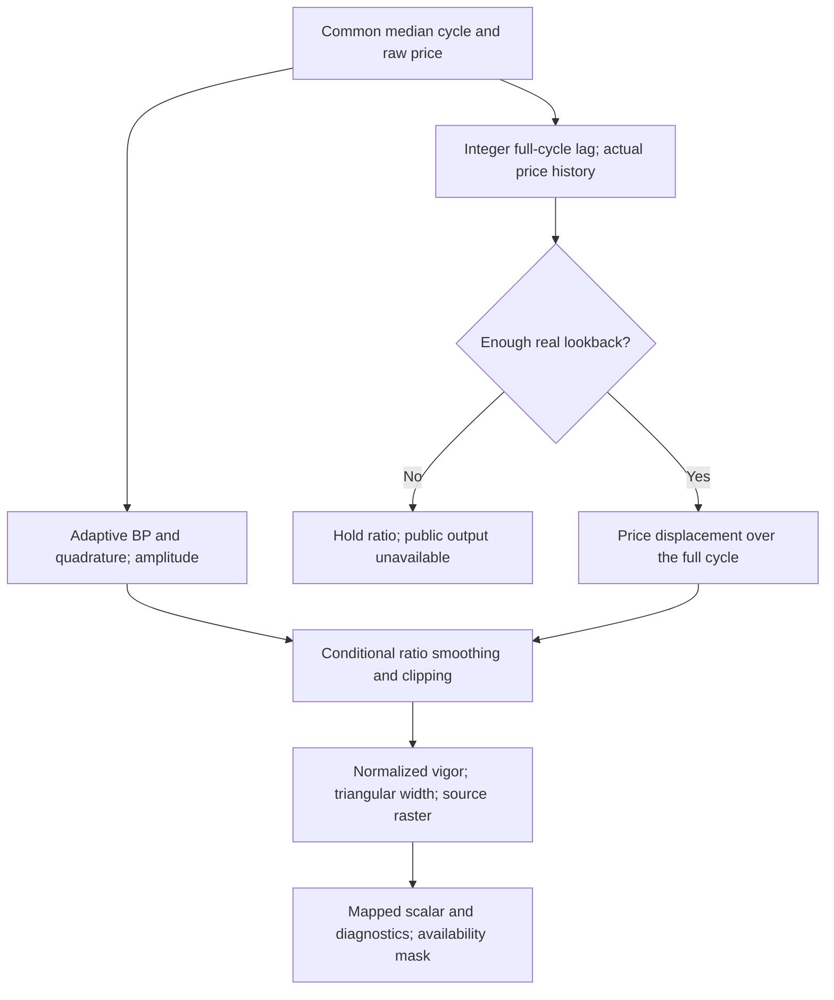
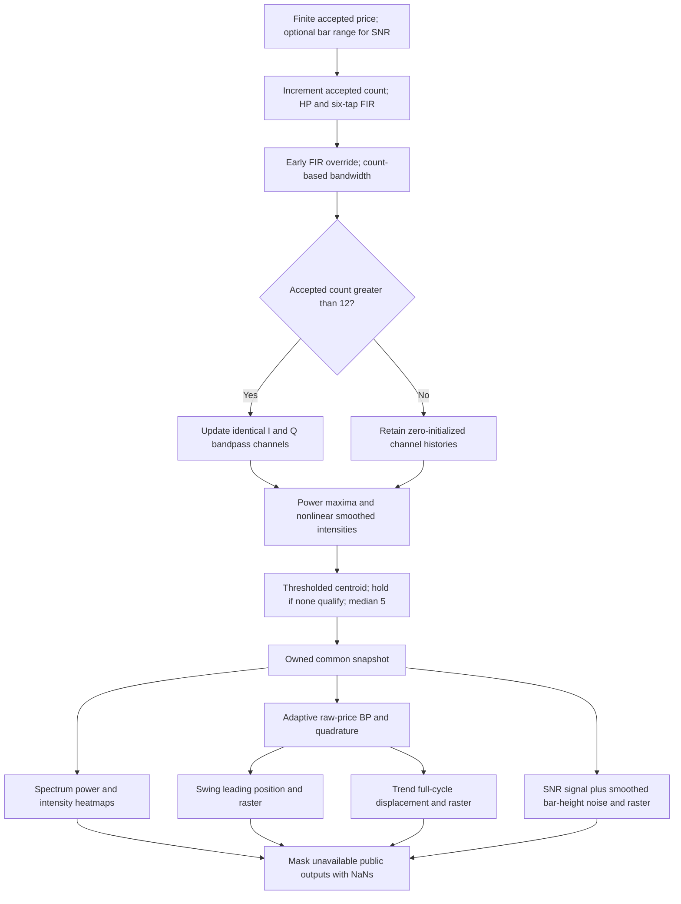

# Corona Trend Vigor: streaming research master

`CoronaTrendVigor.update(price,time=None)` returns mapped Trend Vigor and an
owned heatmap, plus normalized vigor, current/median dominant cycle, adaptive
bandpass/quadrature/amplitude, price displacement, unsmoothed ratio, actual
lookback, width, and a current-spectrum-estimate flag.

The physical premise is that one full-cycle price subtraction removes the
cycle's oscillation, exposing directional displacement. For a linear trend
plus a stationary sine,

$$x_t=mt+A\sin(2\pi t/D+\phi),\qquad x_t-x_{t-D}=mD.$$

This is displacement over the period, not per-bar slope: no extra division by
$D$ occurs. Normalizing it by cycle amplitude measures directional movement
relative to the swing. A changing period or integer approximation leaves some
cyclic residual; do not promise perfect cancellation on general price data.

The article says full cycle, but the readable C# uses `int(D-1)` and subtracts
an absolute bar index, while the damaged other ports omit the decisive
expressions. The copied port introduces another buffer offset. The master
makes the interpretation explicit:

$$L_t=\max(1,\lfloor\widetilde D_t\rfloor+o),\qquad
\mathrm{Trend}_t=x_t-x_{t-L_t},\qquad o=0\ \mathrm{by\ default}.$$

An optional `lookback_offset=-1` selects the supplied port's `floor(D-1)`
lookback without reproducing its absolute-index bug. The confirmed fixtures
use0. After appending current price the required array position is `[-1-L]`.
There must be at least$L+1$ real prices; no zero-filled missing price history
is used. This can delay public availability beyond common sample13.

Use cycle amplitude $\mathcal A_t=\sqrt{B_t^2+q_t^2}$ from the adaptive raw-price
filter. If displacement is nonzero and amplitude positive, update

$$r_t=\mathrm{Trend}_t/\mathcal A_t,\qquad
v_t=\operatorname{clip}_{[-10,10]}(0.33r_t+0.67v_{t-1}).$$

If the source condition fails, retain $v_{t-1}$; do not reset to zero on every
bar. Initialize$v_0=0$. When amplitude is zero the diagnostic `raw_ratio` is
NaN, while the retained mapped scalar is finite once lookback history is ready.
For zero displacement and positive amplitude the raw ratio is0 and the
persistent smoothed ratio is held, following the conditional source assignment.

$$u_t=0.05(v_t+10),\quad
\mathrm{Vigor}_t=\mathrm{display\_min}
 +(\mathrm{display\_max}-\mathrm{display\_min})u_t.$$

With default bounds−10..10, the mapped scalar equals$v_t$. The article
suggests caution with trend trading between−2..2. Its code aura has different
bounds: normalized.3.. .7 corresponds to scalar−4..4. Preserve both meanings
rather than calling the aura a precisely calibrated trade threshold.

The central width follows the readable triangular source expression:

$$w_t=\begin{cases}
 u_t-0.3&0.3\le u_t<0.5,\\
 0.7-u_t&0.5\le u_t\le0.7,\\
 0.01&\mathrm{otherwise}.
\end{cases}$$

Substitute.01 at an exactly zero width to guard the.3/.7 boundaries. Other
positive small widths remain unchanged. This differs from copied widths
$u-.29$ and$.71-u$. The Trend raster follows its own.8/.2 history weighting
and.85 exponent; it is suppressed outside normalized.3.. .7.

| Parameter | Default | Range and meaning |
| --- | --- | --- |
| `high_pass_cutoff`, `min_period`, `max_period` |30,6,30| Common integer/stability rules below. |
| `raster_length` |50| Integer≥2, source cells1..R. |
| `display_min`, `display_max` |−10,10| Finite increasing scalar bounds. |
| `max_raster_value` |20| Finite>6, common selector remains6. |
| `lookback_offset` |0| Integer0 or−1; default full-cycle floor versus explicit port-style floor-minus-one. |

Output fields are `heatmap`, `trend_vigor`, `normalized_vigor`,
`dominant_cycle`, `dominant_cycle_median`, `band_pass`, `quadrature`,
`cycle_amplitude`, `trend_displacement`, `raw_ratio`, `lookback`, `width`,
`has_cycle_estimate`. Before both sample13 and enough real lookback history,
all scalar fields are NaN and heatmaps empty. Availability is checked each
bar: a growing measured period can temporarily require more history. Once
history covers `max_period+1` bars this extra condition always holds.

The default raster samples−9.6..10 at0.4spacing. The scalar still covers−10..10.
All recurrence decisions use normalized vigor; changing display bounds does
not change the underlying normalized filter state.



From this folder:

```sh
python3 corona-trend-vigor.py
python3 corona-trend-vigor.py --generate-reference-data
```

```python
import math
import runpy
CoronaTrendVigor = runpy.run_path('corona-trend-vigor.py')['CoronaTrendVigor']
indicator = CoronaTrendVigor()
for i in range(100):
    result = indicator.update(100 + 0.1 * i + 2 * math.sin(2 * math.pi * i / 20))
print(result.trend_vigor, result.lookback, result.trend_displacement)
```

## Confirmed cases for this master

| Parameters | First available sample | Cells | What it tests |
| --- | --- | --- | --- |
| `high_pass_cutoff=30, min_period=6, max_period=30, raster_length=50` | 30 | 50 | Original Corona period range and half-bar spectral channels. Article detrending. Original raster density. |
| `high_pass_cutoff=30, min_period=6, max_period=30, raster_length=25` | 30 | 25 | Original Corona period range and half-bar spectral channels. Article detrending. Coarser raster with consistent source coordinates. |
| `high_pass_cutoff=30, min_period=6, max_period=20, raster_length=50` | 14 | 50 | Reduced upper bound and faster-cycle selection. Article detrending. Original raster density. |
| `high_pass_cutoff=30, min_period=6, max_period=20, raster_length=25` | 14 | 25 | Reduced upper bound and faster-cycle selection. Article detrending. Coarser raster with consistent source coordinates. |
| `high_pass_cutoff=30, min_period=10, max_period=30, raster_length=50` | 19 | 50 | Suppression of short-cycle candidates. Article detrending. Original raster density. |
| `high_pass_cutoff=30, min_period=10, max_period=30, raster_length=25` | 19 | 25 | Suppression of short-cycle candidates. Article detrending. Coarser raster with consistent source coordinates. |
| `high_pass_cutoff=30, min_period=10, max_period=48, raster_length=50` | 19 | 50 | Extended cycle search beyond the original30-bar range. Article detrending. Original raster density. |
| `high_pass_cutoff=30, min_period=10, max_period=48, raster_length=25` | 19 | 25 | Extended cycle search beyond the original30-bar range. Article detrending. Coarser raster with consistent source coordinates. |
| `high_pass_cutoff=48, min_period=6, max_period=30, raster_length=50` | 18 | 50 | Original Corona period range and half-bar spectral channels. Changed detrending independent of bank bounds. Original raster density. |
| `high_pass_cutoff=48, min_period=6, max_period=30, raster_length=25` | 18 | 25 | Original Corona period range and half-bar spectral channels. Changed detrending independent of bank bounds. Coarser raster with consistent source coordinates. |
| `high_pass_cutoff=48, min_period=6, max_period=20, raster_length=50` | 14 | 50 | Reduced upper bound and faster-cycle selection. Changed detrending independent of bank bounds. Original raster density. |
| `high_pass_cutoff=48, min_period=6, max_period=20, raster_length=25` | 14 | 25 | Reduced upper bound and faster-cycle selection. Changed detrending independent of bank bounds. Coarser raster with consistent source coordinates. |
| `high_pass_cutoff=48, min_period=10, max_period=30, raster_length=50` | 19 | 50 | Suppression of short-cycle candidates. Changed detrending independent of bank bounds. Original raster density. |
| `high_pass_cutoff=48, min_period=10, max_period=30, raster_length=25` | 19 | 25 | Suppression of short-cycle candidates. Changed detrending independent of bank bounds. Coarser raster with consistent source coordinates. |
| `high_pass_cutoff=48, min_period=10, max_period=48, raster_length=50` | 19 | 50 | Extended cycle search beyond the original30-bar range. Changed detrending independent of bank bounds. Original raster density. |
| `high_pass_cutoff=48, min_period=10, max_period=48, raster_length=25` | 19 | 25 | Extended cycle search beyond the original30-bar range. Changed detrending independent of bank bounds. Coarser raster with consistent source coordinates. |

## Local source links

- [Corona Charts article](../../tasc/2008-11-corona-charts/content.md).
- [November Traders' Tips](../../tasc/2008-11-corona-charts/tips/tips.md),
  [Wealth-Lab](../../tasc/2008-11-corona-charts/tips/Corona_wealthlab.cs),
  [AmiBroker](../../tasc/2008-11-corona-charts/tips/Corona_amibroker.afl),
  [TraderStudio](../../tasc/2008-11-corona-charts/tips/Corona_traderstudio.txt),
  [eSignal](../../tasc/2008-11-corona-charts/tips/Corona_esignal.efs).
- [Measuring Cycle Periods predecessor](../../tasc/2008-03-measuring-cycle-periods/content.md).
- [Later Corona Swing listing](<../../tasc/2012-04-setting-strategies-with-swami-charts/tips/code/Corona Chart Swing Position.eqi>).
- [Book contents](../../2013-cycle-analytics-for-traders/toc.md),
  [Chapter5](../../2013-cycle-analytics-for-traders/ch5.md),
  [Chapter7](../../2013-cycle-analytics-for-traders/ch7.md),
  [Chapter10](../../2013-cycle-analytics-for-traders/ch10.md),
  [Chapter11](../../2013-cycle-analytics-for-traders/ch11.md),
  [Chapter16](../../2013-cycle-analytics-for-traders/ch16.md).
- [Investigation](../corona/investigation.md), [validation](../corona/validation.md),
  [shared Python](../corona/corona.py), [fixture manifest](reference_manifest.json).

The following common theory, equations, state conventions, and BibTeX are
included in full so this document is usable independently during conversion.


The sibling `corona/` directory contains the common `Corona` estimator used by the four masters
in the sibling folders `corona-spectrum`, `corona-swing-position`,
`corona-trend-vigor`, and `corona-signal-to-noise-ratio`. Their numerical contract
is the 2008 Corona family reconstructed from the supplied sources, with the
specific corrections and standalone conventions below. The user confirmed
64 parameter cases after the investigation: 16 for each indicator.

The code is standard-library Python with bounded streaming state. No NumPy,
Pandas, TA-Lib, charting package, or original framework is required. The leaf
descriptions repeat the relevant shared theory so a converter needs no article
or book files. The numerical reference is binary64; expected data are serialized
to 15 significant decimal digits.

## Sources and what the book contributes

John F. Ehlers' November 2008 TASC article *Corona Charts*, volume 26, issue 11,
pages 18–24, defines Spectrum, Swing Position, Trend Vigor, and cycle
Signal-to-Noise Ratio. All four begin with a dominant-cycle estimate. The local
article contains explanatory prose and figures but omits its advertised
EasyLanguage sidebars/ELD. Exact reproduction of that unavailable executable
cannot be certified.

The complete March 2008 *Measuring Cycle Periods* EasyLanguage listing describes
the predecessor channelized receiver. A largely readable Corona Swing listing
supplied with April 2012 Traders' Tips provides the complete later common
estimator and Swing formulas. November 2008 Wealth-Lab, AmiBroker, TraderStudio,
and eSignal ports supply additional evidence, with important differences and
transcription errors detailed in `../corona/investigation.md`.

The supplied 17 chapters of *Cycle Analytics for Traders* (2013) contain none of
the four named Corona algorithms. Relevant material is:

- Chapter 5: two-pole bandpass transfer functions, phase, selectivity, ringing,
  quality factor, and automatic gain control.
- Chapter 7: spectral dilation and roofing-filter principles.
- Chapter 10: a different comb-filter spectrum with power compensation and AGC.
- Chapter 11: adaptive indicators driven by an autocorrelation periodogram.
- Chapter 16: SwamiCharts, which display an indicator over multiple lookbacks.

Book Chapter 10 is related theory, not a second source mode for these masters.
Replacing Corona's estimator with it changes the signal driving all wrappers.

## Physical model and limitations

A channelized radio receiver contains overlapping resonators, each tuned to a
different frequency. Passing the same input through every resonator shows where
its energy is concentrated. A bank of digital bandpass filters performs the
same task for market data. Corona defaults to periods 6..30 bars: shorter cycles
are excluded to reduce sampling/aliasing problems and longer cycles are treated
as trend segments. Half-bar spacing yields 49 channels, not 25.

A bandpass filter suppresses low-frequency trend components and high-frequency
noise simultaneously. At its tuned frequency it has approximately zero phase
lag for a settled stationary sinusoid. This does not imply prediction: mismatch,
changing cycles, transient initialization, and finite-difference quadrature
all change the phase. All outputs here are causal and use only accepted present
and past samples.

Selectivity competes with response speed. A narrow resonator isolates nearby
cycles but rings after an impulse, like a bell; its output may describe its own
ringing rather than a current market cycle. A broader filter responds more
quickly. The source begins with broad bandwidth and gradually narrows it.
Opening gaps and abrupt regime changes can excite long transients.

For an ideal sine wave, calculus and Pythagoras give

$$\frac{d\sin(\omega t)}{dt}=\omega\cos(\omega t),\qquad
A^2\sin^2(\omega t)+A^2\cos^2(\omega t)=A^2.$$

Multiplying its derivative by $1/\omega=P/(2\pi)$ yields a quadrature component
with the same amplitude. Corona approximates the derivative using a backward
difference. Its amplitude is useful but is not an exact analytic-signal/Hilbert
envelope. A finite difference also introduces frequency-dependent amplitude
and phase errors. Identical filters on the in-phase and quadrature paths
preserve their common additional filter delay.

Spectrum's colored concentration illustrates the distribution of cycle energy.
The other three Corona rasters spread a scalar across a vertical ordinate using
heuristics and prior raster values. These intensities are not probabilities or
calibrated confidence intervals. A finite held cycle period does not prove that
cycles are currently tradable; consult the signal/noise and selection diagnostics.

## Complete common calculation

Let $t=1,2,\ldots$ count accepted finite prices $x_t$. Missing NaN bars do not
increment $t$. $H$ is the highpass cutoff, $P_{\min},P_{\max}$ are integer
channel limits, $T$ the intensity-selection threshold, and $C$ the maximum
raster intensity (defaults30,6,30,6,20 respectively).

### Price history, highpass and FIR

$$a_H=\frac{1-\sin(2\pi/H)}{\cos(2\pi/H)},\qquad
h_t=\frac{1+a_H}{2}(x_t-x_{t-1})+a_Hh_{t-1},$$

$$s_t=\frac{h_t+2h_{t-1}+3h_{t-2}+3h_{t-3}+2h_{t-4}+h_{t-5}}{12}.$$

The standalone first price seeds $x_0=x_1$ rather than zero, so $h_1=0$.
Earlier highpass history is zero. Following the later readable listing,
$s_t=x_t-x_{t-1}$ for $t<7$, and $s_1=0$. The FIR ring is oldest-first
in code; its symmetrical weights are 1,2,3,3,2,1. Do not replace it with a
SuperSmoother: that belongs to the book's later algorithm.

### Overlapping channel filters

For $n=2P_{\min},\ldots,2P_{\max}$, channel period $P_n=n/2$:

$$\delta_t=\max(0.1,0.5-0.015t),\quad
b_n=\cos(2\pi/P_n),\quad
g_{n,t}=\sec(4\pi\delta_t/P_n),\quad
a_{n,t}=g_{n,t}-\sqrt{g_{n,t}^2-1}.$$

$$I_{n,t}=s_t,\qquad Q_{n,t}=\frac{P_n}{2\pi}(s_t-s_{t-1}),$$

$$R_{n,t}=\frac{1-a_{n,t}}{2}(I_{n,t}-I_{n,t-2})
 +b_n(1+a_{n,t})R_{n,t-1}-a_{n,t}R_{n,t-2},$$

$$J_{n,t}=\frac{1-a_{n,t}}{2}(Q_{n,t}-Q_{n,t-2})
 +b_n(1+a_{n,t})J_{n,t-1}-a_{n,t}J_{n,t-2},$$

$$A_{n,t}^2=R_{n,t}^2+J_{n,t}^2,\qquad M_t=\max_n A_{n,t}^2.$$

The numerator uses **two-bar differences**. In EasyLanguage arrays retain
values but do not create bar-indexed history; `OldI` and `OlderI` must be
shifted explicitly. Code names distinguish one-old and two-old states. Evaluate
with old states, then shift them. Both paths begin at zero and update only for
$t>12$: the first nonzero bank computation is accepted sample 13. The 12-bar
gate stays fixed when period limits are generalized, because it is a literal
source gate. The bandwidth schedule also counts the pre-bank samples.

The March predecessor differs: periods8..50 at integer steps, HP40,
bandwidth floor .15, bank gate after bar6, unsmoothed transformed DB,
centroid threshold 3, and median 10. It provides the derivative/filter theory,
not the numeric defaults for these Corona masters.

### Normalization, nonlinear intensity, and centroid

The later listing first reads the shortest channel power, substitutes.01 if
that specific power is zero, and then scans the bank for larger values. Thus

$$K_t=\max\left(M_t,\begin{cases}0.01&A_{\min,t}^2=0,\\
A_{\min,t}^2&A_{\min,t}^2>0.\end{cases}\right),\qquad
\rho_{n,t}=A_{n,t}^2/K_t.$$

This is not a permanent.01 floor: when the shortest-channel power is positive,
even a bank maximum less than.01 is used normally. `maximum_power` exposes
the actual maximum $M_t$; `normalization_power` exposes $K_t$.

For positive channel power, compute the source's sharpened display transform:

$$d^*_{n,t}=10\log_{10}\left(\frac{1-0.99\rho_{n,t}}{0.01}\right),\qquad
d_{n,t}=\min(C,0.33d^*_{n,t}+0.67d_{n,t-1}).$$

When power is zero, the source conditional assignment retains its previous
DB. Both terms of the smoothing then contain the previous DB, so it is held.
Initialize DB at zero. Consequently a completely constant input can have
all-zero intensities despite zero power. This behavior is preserved for source
agreement and paired with `has_cycle_estimate=0`; do not interpret a hot-looking
zero-power spectrum as measured cyclic energy.

Before smoothing, strongest relative power 1 maps approximately 0 intensity and
relative power 0 maps 20. This nonlinear quantity is not the conventional physical
attenuation $-10\log_{10}\rho$. Threshold6 would require approximately.970
relative power before smoothing. Selection after smoothing additionally depends
on past channel state. Low intensity is hotter, opposite to a conventional
normalized-power heatmap.

Let $\mathcal S_t=\{n:d_{n,t}\le T\}$ and $w_{n,t}=C-d_{n,t}$. Then

$$D_t=\begin{cases}
\dfrac{\sum_{n\in\mathcal S_t}P_nw_{n,t}}{\sum_{n\in\mathcal S_t}w_{n,t}}
 &\sum w_{n,t}>0,\\ D_{t-1}&\text{otherwise},\end{cases}$$

$$\widetilde D_t=\max(P_{\min},\operatorname{median}(D_t,D_{t-1},D_{t-2},D_{t-3},D_{t-4})).$$

Initialize $D_0=0$ and its five historical slots at zero. The all-zero startup
DBs select all channels, giving their mean period before the bank starts.
The median remains finite; no infinity sentinels enter adaptive filter math.
The centroid is real-valued, not a peak-channel index or integer period.
`selected_bins` is the current selected-channel count.
`has_cycle_estimate` is 1 when $M_t>0$ and the selected set is nonempty, 0 otherwise.
Retain a previous centroid if none qualify; do not reset it to the shortest period.

### Adaptive price bandpass shared by Swing and Trend

Tune a second bandpass to $\widetilde D_t$ with fixed $\delta_2=0.1$:

$$\omega_t=2\pi/\widetilde D_t,\quad b_t=\cos\omega_t,\quad
g_t=\sec(2\omega_t\delta_2),\quad a_t=g_t-\sqrt{g_t^2-1},$$

$$B_t=\frac{1-a_t}{2}(x_t-x_{t-2})+b_t(1+a_t)B_{t-1}-a_tB_{t-2},$$

$$q_t=(B_t-B_{t-1})/\omega_t,\qquad
\mathcal A_t=\sqrt{B_t^2+q_t^2},\qquad
\ell_t=\tfrac12 B_t+\tfrac{\sqrt3}{2}q_t.$$

Unlike the estimator, this adaptive bandpass receives raw price. The phase
rotation follows $\sin(\theta+\pi/3)=\tfrac12\sin\theta+\tfrac{\sqrt3}{2}\cos\theta$.
Use current $B_t$, then shift historical states. Replace .866 by $\sqrt3/2$.
Before sample 3 there is insufficient standalone Price[2], so $B,q,\mathcal A,\ell$
are zero and actual prices are retained. From sample 3 the filter advances on
every accepted bar, including public warm-up. Earlier $B$ histories are zero.
This boundary convention avoids a fictitious subtraction from zero price.

## Related book mathematics, without changing the algorithm

Book Chapter 5's useful two-pole transfer equation is

$$H(z)=\frac{0.5(1-a)(1-z^{-2})}{1-b(1+a)z^{-1}+az^{-2}},$$

which yields the recurrences above. Its local transcription also contains a
conflicting preliminary transfer expression and incomplete symbols; the
explicit recurrence is consistent with the readable listings. The quality
factor measures selectivity and stored energy:

$$Q_{\mathrm{quality}}=f_0/\mathrm{bandwidth},\qquad
Q_{\mathrm{quality}}=2\pi\frac{\mathrm{energy\ stored}}{\mathrm{energy\ dissipated\ per\ cycle}}.$$

A30% bandwidth gives $Q\approx3.33$ and relatively quick damping; high-Q
filters ring longer. Here quadrature $q_t$ and quality factor $Q_{\mathrm{quality}}$
are distinct concepts.

The book's fast-attack, slow-decay amplitude AGC uses

$$\mathrm{Peak}_t=\max(|B_t|,k\mathrm{Peak}_{t-1}),\qquad
\mathrm{Signal}_t=B_t/\mathrm{Peak}_t,\qquad
\mathrm{Gain}(P)=k^{P/2}.$$

The ratio across periods10..48 is $k^{24}/k^5=k^{19}$. Selecting1.5dB
variation gives $k^{19}=10^{-1.5/20}$ and $k\approx0.991$. The local book prose
mistypes the intermediate exponent as−.75; it is−.075. Corona does not use
this persistent AGC. The comb spectrum's code uses.995 decay on a power
normalizer, giving another time-dependent estimate.

Chapter 7 explains spectral dilation: market-cycle amplitudes tend to grow with
period, roughly6dB per octave. A one-pole highpass rolls off6dB per octave;
at long periods it may merely cancel that growth rather than reject components.
The book uses two highpass poles followed by a SuperSmoother for a more
selective roofing filter. Its SuperSmoother coefficients, at period $L$, are

$$a=\exp(-\sqrt2\pi/L),\quad c_2=2a\cos(\sqrt2\pi/L),\quad
c_3=-a^2,\quad c_1=1-c_2-c_3,$$

$$f_t=c_1(h_t+h_{t-1})/2+c_2f_{t-1}+c_3f_{t-2}.$$

For its two-pole highpass cutoff$H$, with $\theta=2\pi/(\sqrt2H)$,
$\alpha=(\cos\theta+\sin\theta-1)/\cos\theta$:

$$h_t=(1-\alpha/2)^2(x_t-2x_{t-1}+x_{t-2})
 +2(1-\alpha)h_{t-1}-(1-\alpha)^2h_{t-2}.$$

Chapter 10 uses that roofing filter at HP48/SuperSmoother10, integer channels
10..48, and one bandpass signal per channel. With compensation enabled its
listing sums $\mathrm{Power}_P=\sum_{m=0}^{P-1}(B_{P,t-m}/P)^2$, rather than
Corona's instantaneous I/Q power. The listing calls it averaging in prose but
does not add another division by $P$. It normalizes by
$\max(0.995\mathrm{previous\ maximum},\mathrm{current\ maximum})$ and
computes a power-weighted centroid over normalized power ≥.5, without median5.
Its source parameter declarations are incomplete locally. These equations
explain how the approaches differ; none is inserted into the Corona master.
Full-precision $\pi$, $\sqrt2$, $1/\sqrt2$, and $\sqrt3/2$ replace mathematical
approximations. Design values.33,.67,.99,.015,.1,3.5, and raster exponents
remain literal design choices.

## Heatmap and common raster contract

`Heatmap` is a named tuple retaining your seven fields:
`time`, `parameter_first`, `parameter_last`, `parameter_resolution`,
`value_min`, `value_max`, `values`. Time is optional caller metadata and does
not change calculations. Each list owns its data. Spectrum sampling includes
both endpoint periods, with step .5. Rasters preserve source logical indices
$j=1,\ldots,R$, stored at Python index$j-1$.

For scalar display bounds$a,b$, raster coordinates are

$$y_j=a+(b-a)j/R,\quad
\mathrm{first}=a+(b-a)/R,\quad\mathrm{last}=b,\quad
\mathrm{resolution}=(b-a)/R.$$

Thus 50 Swing cells sample−4.8..5,50 Trend cells−9.6..10, and50 SNR cells
1.2..11. The scalar line still covers the complete display bounds. This
preserves the source raster positions and supplies accurate geometry instead
of advertising an unevaluated lower endpoint. Resolution is **units per bin**,
matching the prepared ACP master; the copied Corona wrappers used its reciprocal.

For normalized position$u$, source marker
$m=\lfloor Ru+0.5\rfloor$ uses explicit half-up rounding. At$u=1$, marker$R$
is included; at$u=0$, marker0 is outside the source1..R domain. For nonzero
width $w$, cell distance is

$$d_j=|Cu-Cj/R|/w.$$

Use floating-point division. At marker, each raster halves its old intensity.
Elsewhere its recurrence is

| Indicator | Away from marker | Additional condition |
| --- | --- | --- |
| Swing | $0.5(d_j^{0.95}+0.5\mathrm{old}_j)$ | Suppress to$C$ if recent position span>.8 or the lead window is flat. |
| Trend | $0.8(d_j^{0.85}+0.2\mathrm{old}_j)$ | Suppress to$C$ outside normalized vigor.3.. .7. |
| SNR | $0.5(d_j^{0.8}+\mathrm{old}_j)$ | On the upper side,$j>m$, apply only if$d_j>1$; otherwise$C$. Suppress to$C$ above normalized position.5. |

Clamp to0..$C$. If$w=0$, nonmarker cells are$C$ without division. Start old
raster intensities at zero and advance during public warm-up. No integer RGB
quantization is applied. Swing uses the later readable listing without C#'s
extra upper-distance cutoff. Trend uses C#'s triangular width, with a.01
substitution **only at zero width**, not the copied shifted triangle or a
general minimum-width floor.

## Streaming API, availability, and invalid data

`Corona(high_pass_cutoff=30, min_period=6, max_period=30,
decibels_threshold=6, max_raster_value=20)` exposes `update(price,time=None)`
and `reset()`. The returned `CoronaSnapshot` has immutable tuples for all
channel arrays, complete highpass/FIR diagnostics, accepted-bar count, price,
time, period estimates, selected count, and power maxima. Its internal period
values stay finite during warm-up. Leaf named outputs mask unavailable values
with NaNs; runtime heatmaps are empty with NaN extrema during warm-up.

Every leaf supports `update` with its own engine and `update_from_snapshot`
for a shared engine. A consumer must receive every accepted snapshot exactly
once, in order from sample1, with equal estimator parameters. Duplicate or
out-of-order snapshots raise `ValueError`. For a four-indicator composite,
update the common estimator once per bar, then pass its snapshot to all four
consumers. Do not call each leaf's standalone `update` on one shared engine.
Swing and Trend use the same adaptive-bandpass primitive; their separate
instances maintain identical BP states when settings/inputs match.

Spectrum, Swing, and SNR first expose outputs on accepted sample 13. Trend also
needs at least$L+1$ actual prices for its current lookback$L$; its availability
can therefore vary by configuration and current cycle. `is_primed()` on Trend
reports the most recent accepted bar's availability, not an irreversible latch.
Every unavailable Trend output is NaN, even if its internal BP is running.
Exact first fixture availability is recorded for every case in the manifest.

NaN price skips the entire standalone bar and returns empty/NaN output. Infinity
is rejected before the estimator mutates. The common engine calculates into
temporary state and commits only after checked finite computations succeed,
so detected overflow does not partially advance it. Use reasonably scaled
prices: leaf recurrences assume representable finite intermediates. If a leaf
calculation raises after its engine accepted an extreme finite value, recreate
that leaf before continuing; wrapper updates are not general transactions.

For SNR, a valid price additionally requires either both finite High/Low with
High≥Low or one finite nonnegative `bar_range`. A NaN in the range input skips
the complete standalone bar before estimator mutation. Do not silently assign
zero range for scalar prices. In shared mode validate all required bar data
before advancing the engine: an already accepted snapshot with missing range
raises instead of desynchronizing SNR history. Close need not lie within supplied
High/Low; only the bar-height convention is used by this algorithm.

Flags/counts are floats in leaf outputs so fixtures use a single portable
NaN-capable numeric representation:0/1 flags, integral float selected count
and lookback. Runtime snapshot flags retain boolean types. True physical SNR
can be−infinity,+infinity,or NaN for degenerate amplitudes; its finite display
and `ratio_is_finite` describe that state explicitly.

## Configuration and complexity

| Common parameter | Default | Valid range and meaning |
| --- | --- | --- |
| `high_pass_cutoff` |30| Integer≥5 with computed pole strictly between0 and1. Independent of bank limits. |
| `min_period` |6| Integer≥6, article's aliasing floor; minimum included period. |
| `max_period` |30| Integer greater than `min_period`; maximum included period. |
| `decibels_threshold` |6| Finite0≤threshold<$C$; Spectrum exposes this selector. Other leaves keep6. |
| `max_raster_value` |20| Finite>$T$ in the engine; intensity ceiling and centroid-weight reference. Generalizing this also changes raster distance scaling. |
| Channel step |.5| Fixed, not configurable. |
| Source bank gate |13| Fixed one-based accepted sample, not a configurable warm-up guess. |
| Median window |5| Fixed. |

All period/raster/window values reject booleans and noninteger values. No
zero/negative-means-default shortcut is used. `Raster` validates length≥2,
finite display bounds with maximum>minimum, and finite positive intensity.
There is no arbitrary hard upper bound on periods, but work and state grow
linearly with channel count $2(P_{\max}-P_{\min})+1$; large configurations
consume proportionally more resources. Default/generalized periods do not
change the meaning of one sample as one bar.

The estimator uses$O(K)$ arithmetic and storage for$K$ channels, plus6HP/5DC
slots. Each Swing/Trend adaptive BP has2prices/2BP values; Swing keeps51lead
and21position values; Trend keeps at most$P_{\max}+1$ prices. Rasters have
$R$ cells. Simple rolling minima/maxima scan short fixed windows; a converter
can keep that algorithm without implementing specialized numeric collections.

## Calculation flow



## Confirmed fixtures and regeneration

The confirmed 64 cases are the product of HP cutoffs30/48 and period ranges
6..30,6..20,10..30,10..48, with two variants per indicator: Spectrum threshold
6/3; Swing/Trend/SNR raster length50/25. Other defaults above are fixed.
Each leaf contains the five copied input files and generated expected arrays
for all its scalar outputs, heatmap cells, heatmap extrema, and Spectrum
channel power/relative-power diagnostics.

Prices always use the 252 original `INPUT_CLOSE` values. SNR additionally uses
the corresponding `INPUT_HIGH`/`INPUT_LOW`. The copied external fixtures used
median prices and synthetic ranges and are not reused as these expected values.
Unprimed fixed-size heatmap fixture rows contain NaN in every cell; runtime
heatmaps remain empty. Do not omit those rows or renumber time indices.

For example `EXPECTED_H30_PMIN6_PMAX30_DB6_DOMINANT_CYCLE` is a 252-element
Python list; `EXPECTED_H30_PMIN6_PMAX30_R50_HEATMAP` is 252 rows by 50 cells.
An output suffix disambiguates the several outputs per parameter case. Every
array has exactly two preceding comments: what it tests and full parameters.
Finite literals use 15 significant digits. Integer-like values are written
as floating literals. Fixtures contain no infinities on this input dataset.

| Language | Expected naming and container | NaN |
| --- | --- | --- |
| Python | `EXPECTED_H30_..._OUTPUT = [...]` | `math.nan` |
| Go | `var expectedH30_..._OUTPUT = []float64{...}`; matrices `[][]float64` | `math.NaN()`; this is the standard-library spelling, rather than the prompt's `math.Nan()` |
| TypeScript | `export const expectedH30_..._OUTPUT: number[] = [...]`; matrices `number[][]` | `NaN` |
| Rust | `pub fn expected_h30_..._output() -> Vec<f64>`; matrices `Vec<Vec<f64>>` | `f64::NAN` |
| Zig | `pub fn expectedH30_..._OUTPUT() [252]f64`; matrices `[252][R]f64`, returned with `return .{...};` | `nan` from `std.math.nan(f64)` |

Go packages are `coronaspectrum`, `coronaswingposition`, `coronatrendvigor`,
and `coronasignaltonoiseratio`. Rust original inputs remain in their original
`#[cfg(test)] pub mod testdata`; appended expected functions are in
`#[cfg(test)] pub mod expected_data`. TypeScript uses valid typed array
declarations, preserving the existing inputs. There is no requirement for a
converter to reproduce the Python path-loading scaffold.

From the repository root:

```sh
python3 inputs/john-ehlers/prepared-for-conversion/corona/generate_reference.py
python3 inputs/john-ehlers/prepared-for-conversion/corona/verify_reference.py
python3 -m unittest discover -s inputs/john-ehlers/prepared-for-conversion/corona -v
python3 inputs/john-ehlers/prepared-for-conversion/corona/corona.py
```

Each leaf's `__main__` reads its local input file, runs 252 streaming updates,
and prints the last named output. Adding `--generate-reference-data` regenerates
only that leaf's confirmed 16 cases. Repeating generation replaces the marked
generated section and preserves input data without duplicate declarations.
Python expected arrays are written, parsed, and checked against calculations
before their exact rounded literals are translated into the other languages.
`reference_manifest.json` records parameter cases, all output names, geometry,
first available sample, array count, and SHA256 hashes of all five fixture files.

Verification reads every exported literal, checks 252 rows and matrix widths,
identical comments, all input prefixes, all warm-up rows, and parsed Python
agreement with freshly computed outputs. Use relative and absolute tolerances
5e−12 for binary64 ports, treating NaNs/infinities explicitly; a tight tolerance
does not mean exact bit identity between different libm implementations.
The supplemental compiler checks and research tests are in `../corona/validation.md`.

## Conversion checklist

Preserve floating-point division, operation ordering, two-old state reads,
source DB conditional holds, and median indexing. Compute old/new variables
separately before shifts. Do not add EMA normalizations, change.9 to.8 in SNR,
change raster exponents, quantize old raster state, or replace the source
half-bar grid merely because a language offers a different helper.
Use full-precision standard-library constants. Evaluate exactly one bar at a
time; optional time is metadata. Use independent output arrays/slices when
returning snapshots. Match the prescribed half-up marker rule rather than
language-default `round`. Compare every scalar and every heatmap cell, not
only final values or column extrema.

## References and BibTeX

The local source list and detailed side-by-side audit are in `../corona/investigation.md`.
Its links resolve to the article, vendor code, predecessor, later Swing listing,
book chapters, and the severed external implementation. The following entries
identify every primary/documentary source used in the masters.

```bibtex
@article{ehlers2008corona,
  author={Ehlers, John F.}, title={Corona Charts},
  journal={Technical Analysis of Stocks \& Commodities},
  volume={26}, number={11}, pages={18--24}, year={2008}, month=nov,
  url={https://technical.traders.com/archive/article.asp?file=\V26\C11\200EHLE.pdf}
}
@article{ehlers2008measuring,
  author={Ehlers, John F.}, title={Measuring Cycle Periods},
  journal={Technical Analysis of Stocks \& Commodities},
  volume={26}, number={3}, pages={16--22}, year={2008}, month=mar,
  url={https://technical.traders.com/archive/article.asp?file=\V26\C03\043EHLR.pdf}
}
@misc{traderstips2008corona,
  author={{Technical Analysis, Inc.}}, title={Traders' Tips: Corona Charts},
  year={2008}, month=nov,
  url={https://www.traders.com/Documentation/FEEDbk_docs/2008/11/TradersTips/TradersTips.html},
  note={Local Wealth-Lab, TraderStudio, eSignal, and AmiBroker code examined}
}
@misc{traderstips2008spectrum,
  author={{Technical Analysis, Inc.}}, title={Traders' Tips: Measuring Cycle Periods},
  year={2008}, month=mar,
  url={http://traders.com/Documentation/FEEDbk_docs/2008/03/TradersTips/TradersTips.html}
}
@misc{tradesignal2012coronaswing,
  author={{Tradesignal}}, title={Corona Chart Swing Position},
  year={2012}, month=apr,
  url={https://www.traders.com/Documentation/FEEDbk_docs/2012/04/TradersTips.html},
  note={Local EasyLanguage-style EQI listing; later corroborating source}
}
@book{ehlers2013cycle,
  author={Ehlers, John F.},
  title={Cycle Analytics for Traders: Advanced Technical Trading Concepts},
  publisher={Wiley}, year={2013}, series={Wiley Trading}, isbn={9781118728604},
  note={Chapters 5,7,10,11,16 explain related theory; no four named Corona listings}
}
@misc{zpanoCoronaSnapshot,
  author={{zpano}}, title={Copied Python Corona Estimator and Indicators},
  note={Local external/zpano/py/indicators/john_ehlers snapshot; detached framework;
  numerical differences recorded in the investigation}
}
```
