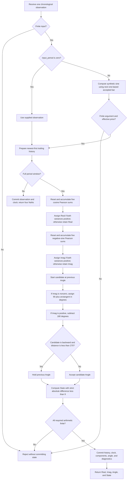

# Correlation Angle: research prototype master reference

This folder provides the standalone conversion reference for John F. Ehlers' **Correlation Angle Indicator and Market State Variable**, from “Correlation As A Cycle Indicator,” *Technical Analysis of Stocks & Commodities*, June 2020, volume 38, issue 6, pages 9–15. The supplied Mesa paper gives the same calculation. [correlation-angle.py](correlation-angle.py) implements it using Python's standard library and returns all four useful series:

```python
indicator = CorrelationAngle(period=20, input_period=0)
result = indicator.update(close)
# result.real, result.imag, result.angle, result.state
```

Keep one instance for a chronological stream. This example uses actual prices. The article's defaults, preserved by the constructor, are `period=20, input_period=20`: **the default replaces supplied prices with a synthetic sinusoid**. Set `input_period=0` for actual closes.

All 16 reference configurations were confirmed. Each of the five language fixtures contains four copied input arrays and **64 expected output arrays**, each with 252 entries. Those arrays cover Real, Imag, Angle, and State for every configuration. Values have 15 significant decimal digits, with NaN until a complete window exists.

This document contains the complete computational mathematics and original numerical listing, the relevant background from the book, explicit initialization and precision rules, and source differences. A port does not need access to the source articles to implement the indicator.

## 1. Basic principles and physical analogy

The May 2020 Correlation Trend Indicator correlates prices with an increasing straight line. The June article changes the reference shape to a full cosine cycle. A trailing window of prices is compared with a known periodic shape, rather than differentiated or extrapolated. Pearson correlation removes each vector's mean and divides by its magnitude, so the measurement describes shape and phase independently of price units and positive amplitude scaling.

Think of the centered price window and the centered reference window as vectors. Their correlation is the cosine of their geometric angle: aligned vectors give +1, opposed vectors give -1, and perpendicular vectors give zero. This geometric angle between whole windows is distinct from the temporal **cycle phase** obtained later from the two correlations.

One reference is a cosine; the other is a negative sine at the same period. These references are orthogonal over a complete, meaningfully sampled integer cycle. They act like two perpendicular measurement axes. A rotating arrow, or **phasor**, can be described by its projections onto those axes. Combining both projections identifies the location within the cycle; one projection alone cannot distinguish both sides of a peak or valley.

The negative-sine reference is motivated by the derivative identity $d\cos\theta/d\theta=-\sin\theta$. For a sinusoid matched to the selected window, the second correlation leads the first by 90°. It therefore supplies a rate-of-change-like turning-point signal without taking a noisy difference of the output. It is normalized and dimensionless; it is not a derivative measured in price per bar.

The article then treats a failure of continued forward phase movement as evidence of a trend. Smaller backward phase steps are held at the preceding angle. A held angle, or an angle moving by less than 9° per bar, produces a directional trend state. This is a market-model heuristic: a noisy mixture can have regressing phase even though time advances. A fixed-window phase estimate is not a physical clock or a proof of a market trend.

The algorithm uses the prices directly. It contains no roofing filter, high-pass preprocessing, SuperSmoother, detrending by a fitted line, adaptive period estimator, future samples, or chart displacement. Mean subtraction inside Pearson correlation removes a constant level; it does not remove a slope. That slope-induced failure of the cycle model is precisely what the state logic tries to detect.

## 2. Configuration and streaming contract

| Setting | Default | Meaning and valid domain |
|---|---:|---|
| `period` ($N$) | 20 | Positive integer, excluding booleans. Window size and assumed cosine/sine cycle period, in bars. |
| `input_period` ($Q$) | 20.0 | Finite nonnegative numeric value, excluding booleans. Zero selects supplied prices; positive selects a theoretical sinusoid with this period in accepted bars. Fractional periods are supported. |
| `update(value)` | Required | One finite float-convertible observation. Negative and zero prices are accepted. The observation is validated even when synthetic mode replaces its value. |
| Backward-step boundary | 270° | Fixed source constant; not a parameter. A backward displayed jump of at least 270° is allowed as a wrap. |
| State threshold | 9° | Fixed source constant, with strict `<9`; not a parameter. |
| Stored Real, Imag, Angle on reset | 0.0 | Source variable initialization. These seeds are distinct from public availability NaNs. |
| Leading unavailable outputs | $N-1$ | All four fields are NaN until the $N$th accepted observation. |

There is no mathematical fixed upper bound on `period`; memory, O($N$) update work, and finite binary64 calculations impose practical limits. A window larger than the input record is valid and remains unprimed throughout that record. At least three samples per cycle are needed for meaningful quadrature. Periods 1 and 2 are accepted to preserve the source's nominal domain, but are degenerate or affected by tiny trigonometric residues. The source's 270° guard also has limitations at periods 3 and 4, explained below.

For synthetic mode, positive $Q$ is mathematically permitted, including fractions, but sampling limits still apply. A waveform with fewer than two samples per cycle aliases; at exactly two samples per cycle, sine sampling can collapse depending on phase. Very small positive periods can overflow the synthetic argument; the update is rejected. No synthetic wavelength is inferred from the supplied closing prices.

`period` and `input_period` are read-only properties. Construct a new instance to change them. `reset()` restarts the observation history, accepted-bar clock, stored components, angle, and diagnostics. `warmup_bars` is $N-1$; `is_primed` means a complete window exists, not that its price variance is positive or that phase has settled. `last_output` exposes the most recent returned tuple. `diagnostics` exposes the effective price, both five-sum calculations, pre-guard candidate angle, and whether the guard held it.

`update` returns `CorrelationAngleOutput`, a named tuple of four floats. Finite State is exactly -1.0, 0.0, or +1.0; using a float permits the common NaN availability rule. Invalid input or nonfinite intermediate arithmetic raises an exception without advancing history, the synthetic clock, or stored outputs. Recovery can continue with another valid input or with `reset()`.

## 3. Complete calculation equations

The June article presents the mathematics through its executable listing rather than numbered equations. The equations here transcribe every assignment affecting the four outputs. Trigonometric arguments in EasyLanguage are degrees; the master uses full-precision Python radians.

### 3.1 Effective observation and lag convention

Let $t=0,1,\ldots$ denote accepted observations in chronological order. Let $c_t$ be the supplied close. The effective price is:

$$
p_t=\begin{cases}
c_t,&Q=0,\\
\sin\left(\dfrac{2\pi(t+1)}{Q}\right),&Q>0.
\end{cases}
$$

Thus the first accepted synthetic bar has `CurrentBar=1`. There is no synthetic prehistory. A rejected update does not increment $t$.

For a complete window, lag $k=0$ is the newest price and lag $N-1$ is the oldest:

$$
x_k=p_{t-k},\qquad
\omega_0=\frac{2\pi}{N},\qquad
y_k^{(R)}=\cos(\omega_0 k),\qquad
y_k^{(I)}=-\sin(\omega_0 k),\qquad k=0,\ldots,N-1.
$$

The original loop runs `count=1..Length`, with lag `count-1`. There are exactly $N$ samples; do not include a duplicated endpoint at $k=N$. The negative sine sign and newest-to-oldest indexing together determine the phase convention.

### 3.2 Two Pearson correlations

For each reference $y_k$, independently reset the following five sums to zero and accumulate in ascending lag order:

$$
\begin{aligned}
S_x&=\sum_{k=0}^{N-1}x_k,&
S_y&=\sum_{k=0}^{N-1}y_k,\\
S_{xx}&=\sum_{k=0}^{N-1}x_k^2,&
S_{xy}&=\sum_{k=0}^{N-1}x_ky_k,&
S_{yy}&=\sum_{k=0}^{N-1}y_k^2.
\end{aligned}
$$

Define:

$$
U=N S_{xy}-S_xS_y,\qquad
A=N S_{xx}-S_x^2,\qquad
B=N S_{yy}-S_y^2.
$$

The assigned correlation for either component is:

$$
\rho_t(y)=\begin{cases}
\dfrac{U}{\sqrt{AB}},&A>0\ \text{and}\ B>0,\\[6pt]
\rho_{t-1}^{\mathrm{stored}}(y),&\text{otherwise}.
\end{cases}
\qquad
R_t=\rho_t(y^{(R)}),\quad I_t=\rho_t(y^{(I)}).
$$

The code contains no `Else`. Each component retains its own prior value if either variance factor is nonpositive. Both start at zero. A zero-variance window is mathematically undefined for Pearson correlation, but the source's operational output is the retained value. Full-window availability is still considered primed.

These are **Pearson product-moment correlations of unranked data**. No sorting or Spearman rank transformation is performed. Do not remove the $S_xS_y$ terms because theoretical template means are zero: the computed finite-precision means are generally tiny, nonzero quantities.

### 3.3 Arctangent and quadrant assignments

Let $a_{t-1}$ be the preceding stored angle, zero before the first complete window. Start the current candidate at that angle, then perform the independent source assignments:

$$
\widetilde a_t=\begin{cases}
90+\dfrac{180}{\pi}\arctan\left(\dfrac{R_t}{I_t}\right),&I_t\ne0,\\[6pt]
a_{t-1},&I_t=0,
\end{cases}
\qquad
b_t=\begin{cases}
\widetilde a_t-180,&I_t>0,\\
\widetilde a_t,&I_t\le0.
\end{cases}
$$

Angles are in degrees. The arctangent itself spans -90° to +90°; the second assignment resolves the two quadrants in which Imag is positive. For nonzero Imag, the unguarded candidate lies in approximately [-180°, +180°]. At **exactly zero Imag**, Angle retains the preceding value even when Real is nonzero. Do not replace these assignments with `atan2`, an epsilon-zero comparison, or a generic phase-unwrapping routine.

### 3.4 Backward phase guard

Apply the literal 270° test to the candidate:

$$
H_t=(a_{t-1}-b_t<270)\ \land\ (b_t<a_{t-1}),\qquad
a_t=\begin{cases}
a_{t-1},&H_t,\\
b_t,&\text{otherwise}.
\end{cases}
$$

A displayed backward step smaller than 270° is held. A displayed backward step of **exactly 270° or more** is allowed. The latter is presumed to be the wrap from a high positive angle to a negative angle, rather than regression. Equality is significant: neither comparison uses `<=`.

### 3.5 Market state

After the guard, use the absolute difference of the two **displayed** angles:

$$
d_t=|a_t-a_{t-1}|,\qquad
s_t=\begin{cases}
-1,&d_t<9\ \land\ a_t<0,\\
+1,&d_t<9\ \land\ a_t\ge0,\\
0,&\text{otherwise}.
\end{cases}
$$

State is reset to zero each bar before the two independent conditional assignments. This is not the circular difference modulo 360°. A wrap bar usually has a large displayed difference and therefore State zero, even when its actual cyclic advance is small.

The phase increment of a constant-period sinusoid is:

$$
\Delta a=\frac{360}{T}\quad\text{degrees per bar},\qquad
\Delta a(20)=18,\qquad \Delta a(40)=9.
$$

The prose says cycles of 40 bars or longer should be treated as trends. The **code** uses strict `<9`, so an exactly 9° step is cycle state. In ideal continuous arithmetic, steps less than 9° correspond to periods strictly longer than 40 bars. Roundoff at that boundary, detuning, held candidates, and wrap bars affect actual State; it is not a direct dominant-period estimator.

## 4. Mathematical background and interpretation

### 4.1 Centered geometry and normalization

With $\bar x=S_x/N$ and $\bar y=S_y/N$, the mathematical Pearson coefficient is also:

$$
\rho(x,y)=
\frac{\sum_k(x_k-\bar x)(y_k-\bar y)}
{\sqrt{\sum_k(x_k-\bar x)^2\sum_k(y_k-\bar y)^2}}.
$$

The equivalence follows from:

$$
U=N\sum_k(x_k-\bar x)(y_k-\bar y),\qquad
A=N\sum_k(x_k-\bar x)^2,\qquad
B=N\sum_k(y_k-\bar y)^2.
$$

Positive scaling and constant shifts of price leave a valid coefficient unchanged in exact arithmetic. A negative scale reverses its sign. The ideal coefficient lies in [-1,+1] by the Cauchy–Schwarz inequality. The master follows the raw-sums code and does not clip floating-point excursions beyond that range.

For integer $N>2$, the exact trigonometric identities are:

$$
\sum_k\cos(\omega_0k)=\sum_k\sin(\omega_0k)=0,\qquad
\sum_k\cos(\omega_0k)\sin(\omega_0k)=0,
$$

$$
\sum_k\cos^2(\omega_0k)=\sum_k\sin^2(\omega_0k)=\frac N2.
$$

Consequently the two normalized components are orthogonal projection coordinates of the unit centered price vector. In exact arithmetic, for a nonflat window:

$$
R_t^2+I_t^2\le1.
$$

Equality holds when all centered window energy is in this sine/cosine pair. The quantity is useful for theoretical checks but is not an extra source output or a filtering condition. A small projection radius makes phase sensitive to tiny disturbances; the source does not suppress such angles.

### 4.2 Matched sinusoid: why the component has no phase lag

Suppose a pure input has the same period as the reference:

$$
p_t=A_0+B_0\sin\phi_t,\qquad
\phi_{t-k}=\phi_t-\omega_0k,\qquad B_0>0.
$$

Expand its trailing samples:

$$
\sin(\phi_t-\omega_0k)
=\sin\phi_t\cos(\omega_0k)-\cos\phi_t\sin(\omega_0k).
$$

Using the orthogonality identities in a complete window yields:

$$
R_t=\sin\phi_t,\qquad I_t=\cos\phi_t,\qquad
R_t^2+I_t^2=1.
$$

Real is in phase with the normalized input; Imag is its +90° component. For $\phi_t$ advancing at $\omega_0$ per bar:

$$
\frac{dR}{dt}=\omega_0\cos\phi_t=\omega_0I_t.
$$

Thus an Imag crossing from negative to positive identifies a Real valley, and a crossing from positive to negative identifies a Real peak, for this ideal waveform. This statement does not imply universal zero lag on changing cycles, trends, or noise. The complete $N$-sample trailing window is still required, and normalization and the phase guard are nonlinear operations.

For nonzero Imag, the source candidate corresponds to:

$$
b_t=\operatorname{wrap}_{[-180,180]}\left(\frac{180}{\pi}\phi_t-90\right),
$$

subject to endpoint and zero-Imag conventions. Angle zero is a cycle peak; angles near ±180° are a valley. A negative cyclic angle describes the rising half-cycle, and a positive cyclic angle describes the falling half-cycle. These are the article's proposed long/short cycle interpretations. In the trend model, the directional interpretation is reversed: a held negative angle gives downtrend State -1; a held nonnegative angle gives uptrend State +1.

### 4.3 Phasor and Fourier conventions

The unnormalized template projections form a Fourier coefficient at one frequency:

$$
Z_t(\omega_0)=\sum_{k=0}^{N-1}p_{t-k}e^{-i\omega_0k}
=\sum_kp_{t-k}\cos(\omega_0k)
-i\sum_kp_{t-k}\sin(\omega_0k).
$$

Its real and imaginary projections have the same signs as the two source numerators when template means vanish. Pearson adds mean removal and price-energy normalization; this is not a full spectrum calculation. No FFT is needed.

With the conventional coordinate ordering $(R,I)$, the ideal point $(\sin\phi,\cos\phi)$ rotates clockwise as $\phi$ increases. The article illustrates a counterclockwise conceptual phasor; its implemented ratio and offsets choose the opposite sign of the ordinary complex argument:

$$
\arg(R+iI)=\frac\pi2-\phi\pmod{2\pi},\qquad
b=\phi\frac{180}{\pi}-90\pmod{360}.
$$

This coordinate distinction explains why substituting a conventional `atan2(Imag, Real)` reverses the displayed progression. The literal arctangent assignments remain the porting definition.

### 4.4 Detuning and finite-window leakage

Real market cycles change and coexist with trend and noise, so a fixed assumed period is often imperfect. The source tests assumed period 20 against synthetic periods 21, 30, and 15. It reports a leading phase error of less than 45° for the 30-bar example and a lagging error of less than 45° for the 15-bar example. These are results for those deterministic examples, not error bounds on arbitrary market data.

The mechanism can be seen from the finite exponential sum:

$$
D_N(\delta)=\sum_{k=0}^{N-1}e^{-i\delta k}
=e^{-i\delta(N-1)/2}\frac{\sin(N\delta/2)}{\sin(\delta/2)},
$$

with the appropriate limiting sum at removable singularities, including $D_N(0)=N$. For $p_{t-k}=\sin(\phi_t-\omega k)$, the two unnormalized projections are:

$$
\sum_kp_{t-k}\cos(\omega_0k)
=\frac12\operatorname{Im}\left[e^{i\phi_t}
\{D_N(\omega-\omega_0)+D_N(\omega+\omega_0)\}\right],
$$

$$
-\sum_kp_{t-k}\sin(\omega_0k)
=\frac12\operatorname{Re}\left[e^{i\phi_t}
\{D_N(\omega-\omega_0)-D_N(\omega+\omega_0)\}\right].
$$

These derived identities explain changing phase and projection amplitude under detuning. The actual source additionally subtracts the finite-window means and normalizes each correlation. They are explanatory equations, not replacements for the source loops.

The Mesa text claims a 10-bar input within a 20-bar reference window gives a perfect harmonic result. In exact arithmetic, that input is the **second harmonic** and is orthogonal to the first-harmonic templates: both correlations are zero. Tiny numerical leakage can feed a seemingly structured but poorly determined phase. The master preserves the loops and documents this discrepancy; it does not manufacture a perfect phase for a zero projection.

### 4.5 Relationship to the 2013 book

*Cycle Analytics for Traders* predates this June 2020 indicator. Chapter 8 supplies the relevant correlation background. It models prices as random fluctuations with memory, drawing an analogy with Swerling radar-target models: returns vary randomly but depend on recent history. Correlation compares two waveforms; autocorrelation compares a waveform with a delayed copy of itself. The book describes a long-memory power-law model:

$$
\operatorname{Autocorrelation}(\operatorname{Lag})
=C\,\operatorname{Lag}^{-\alpha},
$$

for positive lag, with $C$ constant and nominal $\alpha$ near one. This is contextual modeling, not an equation used by Correlation Angle.

The Pearson equation in Chapter 8's listings is:

$$
\operatorname{Corr}[\ell]
=\frac{M S_{xy}-S_xS_y}
{\sqrt{(M S_{xx}-S_x^2)(M S_{yy}-S_y^2)}}.
$$

There, $x_k=\operatorname{Filt}[k]$ and $y_k=\operatorname{Filt}[\ell+k]$ over $M$ observations. Some listings guard the **product** of the variance factors as positive. This June master instead uses the article's stronger requirement that **both** factors be positive independently. Chapter 8 also rescales certain heatmap correlations with $\tfrac12(\operatorname{Corr}+1)$; this master retains the signed [-1,+1] components.

For a pure sine wave, full-cycle autocorrelation has the mathematical result:

$$
\rho(\ell)=\cos\left(\frac{2\pi\ell}{T}\right).
$$

It is +1 at zero/full-period lag and -1 at half-period lag. The book's prose calls the lag dependence a sine wave; its described extrema imply the cosine convention above. Correlation Angle uses a known cosine and negative sine instead of a delayed copy of prices, so its `period` is assumed rather than measured by a lag sweep.

Chapter 8's separate indicators filter prices and construct an autocorrelation spectrum; those filters and spectrum equations are not part of Correlation Angle. The relevant Pearson mathematics is reproduced here without introducing their unrelated preprocessing into this master.

### 4.6 Limits of the model

A linear slope produces a fixed centered ramp in each window, so its correlations and candidate phase can be approximately constant. This illustrates why stalled phase can identify a trend within the author's model. A zero seed can initially hold a negative candidate at zero even for a declining ramp; initial State is therefore not guaranteed to have the slope's direction. Noise and mixtures can also stall phase.

A pure matched cycle advances by $360/N$ degrees. Its displayed wrap is a backward jump of $360-360/N$. At $N=3$ that jump is 240°, which the literal guard holds. At $N=4$ it is exactly 270°, where floating-point errors may change the decision. For $N>4$, ordinary ideal wraps exceed 270°. Meaningful quadrature at three samples does not guarantee that this specific phase guard operates correctly for such a short cycle.

The source claims a 6 dB signal-to-noise benefit from combining two orthogonal, described as independent, components. Orthogonal reference vectors do not by themselves guarantee independent output noise or a universal 6 dB gain. The claim requires a particular signal/noise model; no noise estimator or 6 dB scaling is implemented.

## 5. Original EasyLanguage numerical definition

The article and Mesa paper contain the following numerical calculation. Plot statements select display series and do not change the calculation. The Mesa copyright date differs; the mathematics is the same.

```easylanguage
{ Correlation Angle Indicator
  (C) 2013-2020 John F. Ehlers }
Inputs:
  Period(20),
  InputPeriod(20); // Uses price data if InputPeriod is set to 0
Vars:
  Length(20), Price(0),
  Sx(0), Sy(0), Sxx(0), Sxy(0), Syy(0), count(0), X(0), Y(0),
  Real(0), Imag(0), Angle(0), State(0);

Length = Period;
Price = Close;
If InputPeriod <> 0 Then Price = Sine(360 * CurrentBar / InputPeriod);

Sx = 0;
Sy = 0;
Sxx = 0;
Sxy = 0;
Syy = 0;
For count = 1 to Length Begin
  X = Price[count - 1];
  Y = Cosine(360 * (count - 1) / Period);
  Sx = Sx + X;
  Sy = Sy + Y;
  Sxx = Sxx + X * X;
  Sxy = Sxy + X * Y;
  Syy = Syy + Y * Y;
End;
If (Length * Sxx - Sx * Sx > 0) and (Length * Syy - Sy * Sy > 0) Then
  Real = (Length * Sxy - Sx * Sy) / SquareRoot((Length * Sxx - Sx * Sx) * (Length * Syy - Sy * Sy));

Sx = 0;
Sy = 0;
Sxx = 0;
Sxy = 0;
Syy = 0;
For count = 1 to Length Begin
  X = Price[count - 1];
  Y = -Sine(360 * (count - 1) / Period);
  Sx = Sx + X;
  Sy = Sy + Y;
  Sxx = Sxx + X * X;
  Sxy = Sxy + X * Y;
  Syy = Syy + Y * Y;
End;
If (Length * Sxx - Sx * Sx > 0) and (Length * Syy - Sy * Sy > 0) Then
  Imag = (Length * Sxy - Sx * Sy) / SquareRoot((Length * Sxx - Sx * Sx) * (Length * Syy - Sy * Sy));

If Imag <> 0 Then Angle = 90 + Arctangent(Real / Imag);
If Imag > 0 Then Angle = Angle - 180;
If Angle[1] - Angle < 270 and Angle < Angle[1] Then Angle = Angle[1];

// Plot1(Real);
Plot4(0);
// Plot3(Imag);
Plot2(Angle);
// If InputPeriod <> 0 Then Plot6(Price);

State = 0;
If AbsValue(Angle - Angle[1]) < 9 and Angle < 0 Then State = -1;
If AbsValue(Angle - Angle[1]) < 9 and Angle >= 0 Then State = 1;
// Plot10(State);
```

## 6. Initialization, arithmetic, and conversion rules

### 6.1 Availability and platform startup

The published listing assumes chart history and does not explicitly specify a finite-record NaN policy. This research master makes it explicit: ingest all effective observations from the first accepted bar, require a complete trailing window, and return an all-NaN tuple for the first $N-1$ updates. Before priming, do not calculate correlations or phase. The stored components and previous angle stay zero. There is no zero-padded history and no hidden extra warmup.

The first finite output appears at zero-based index $N-1$, using the current observation and preceding $N-1$ observations. The phase guard compares its candidate with the zero angle seed. A negative candidate with a backward distance below 270° is held at zero, producing initial State +1. Default matched synthetic data has its first available output at index 19: Real approximately -3.10862446895044e-16, Imag approximately 1, Angle 0, State +1.

When porting to a chart engine, align the effective history, synthetic bar numbering, and prior stored angle with this convention. A chart engine's automatic MaxBarsBack, longer preloaded record, or zero-filled series can produce different initial values. This master matches the source's numerical assignments under the stated finite-record initialization; it is not a claim of identical startup for every platform.

### 6.2 Floating-point association

Use binary64 and full-precision pi (`math.pi` in Python). Square root of two is not required. The exact template argument association is:

```python
argument = 2.0 * math.pi * lag / period
cosine = math.cos(argument)
negative_sine = -math.sin(argument)
synthetic_argument = 2.0 * math.pi * current_bar / input_period
degrees = (180.0 / math.pi) * math.atan(real / imag)
```

Do not use rounded 6.28, 1.57, 3.14159, or 1.414 constants. Do not rearrange `2*pi*lag/period` into `2*pi*(lag/period)` if reproducing last-digit arithmetic matters. Precomputing each fixed template coefficient once is equivalent to reevaluating the same expression each bar with the same library.

Maintain separate source loops for Real and Imag; reset all five sums each time. Sum newest to oldest. Avoid rolling raw moments, centered or compensated sums, closed-form template sums, fused arithmetic substitutions, snapping tiny near-axis values to zero, correlation clipping, adjustable thresholds, and generalized unwrap logic in the reference port. Such variants can be useful separate implementations, but they change this numerical master.

Raw variance $N S_{xx}-S_x^2$ suffers cancellation when prices have a large level relative to their changes. On these fixtures, the maximum observed centered-correlation discrepancy is about 2.18e-10 for a nearly flat period-3 window, and at most 4.18e-13 for periods 14, 20, 60, and 252. The period-3 squared projection radius exceeds its ideal limit by approximately 5.04e-10. The source arithmetic is retained; the mathematical checks allow this measured roundoff. Larger offsets can produce more substantial cancellation or nonpositive variance, causing the source to retain a component.

The master rejects nonfinite sums, nonfinite/resolution-lost positive variance products, and nonfinite angle calculations before committing the update. Ordinary source fixtures do not trigger these protections. It retains the article's component hold for finite nonpositive variance factors.

Small trigonometric-library differences can be amplified when Imag is near zero, the projection radius is tiny, the backward distance is near 270°, or the angle increment is near 9°. Finite State should be compared exactly; trace intermediate components, candidate angle, and guard decisions if a port differs. Fifteen-digit serialization does not make every last binary64 bit of a recalculated indicator universally portable across math libraries.

## 7. Algorithmic flow



The two sums are calculated against a temporary history. Arithmetic validation occurs during those calculations as well as at the final angle check; every failure follows the same no-commit path. Space and work per update are both O($N$). No complete output history is retained by the runtime class.

## 8. Source comparison and chosen authority

| Source | Relevant behavior | Master decision |
|---|---|---|
| June article | Defaults `(20,20)`; complete source equations above; fixed 9° and 270°. | Primary numerical authority, with explicit finite-record startup and requested full-precision pi. |
| Mesa paper | Same core listing and defaults; extra harmonic claim and older copyright date. | Same calculation; document the harmonic limitation. |
| TradeStation Trader's Tip | Same core math; defaults `(14,0)`; plots State rather than Angle. | Independent source-formula check; `(14,0)` is a confirmed reference case. |
| NinjaTrader files | Use 6.28 in trig and 1.57 in phase offset. Gate on `CurrentBar < Period` before filling effective-price history; series values may be unpopulated at startup. Default synthetic selection also differs. | Helpful architecture examples, not the numerical oracle. Use full pi and collect actual effective history from the first accepted bar. |
| eSignal | Full `Math.PI`; its synthetic expression uses `sin(2*pi*Close/InputPeriod)` instead of bar count. Resets current Angle to zero on new bars, stores Angle_1 separately; zero-Imag and null-history behavior differ. | Use the article's bar-clock sinusoid and retained-angle semantics. |
| Zorro | Full PI; template is evaluated as `2*pi*(lag/Length)`. Invalid correlation returns zero. Current angle series is zero-seeded each bar; threshold is exposed as an extension. | Preserve source association, independent retained components/angle, and fixed 9°. |
| Excel Trader's Tip | Offers a selectable classification threshold. | Keep the article threshold, without introducing another parameter. |
| Wealth-Lab / Quantacula | Call platform indicator classes whose core arithmetic is absent from supplied snippets. | References to usage, not independent numerical oracles. |

The complete article, Mesa, and TradeStation expressions are evaluated independently in [test_correlation_angle.py](test_correlation_angle.py). Their trig calls are adapted to the same full-precision radian operation order, with this master's one-based clock and complete-window policy. All 16 cases and all four output series match exactly in this Python environment. Proprietary chart platforms were not executed.

## 9. Confirmed reference cases

Parameter shortcuts are `P` for `period` and `IP` for `input_period`. Each row produces four output arrays. A decimal point becomes an underscore in the name; for example `(20,20.5)` gives `P20_IP20_5`.

| period | input_period | What it tests |
|---:|---:|---|
| 20 | 20 | Article default: matched twenty-bar synthetic sinusoid. |
| 14 | 0 | TradeStation default and article real-price fourteen-bar example. |
| 20 | 0 | Price-driven twenty-bar cycle, angle holds, and market states. |
| 10 | 0 | Fast price-driven ten-bar assumed cycle. |
| 40 | 0 | Forty-bar price cycle at the fixed nine-degree trend threshold. |
| 60 | 0 | Slow price cycle and long-window phase behavior. |
| 3 | 0 | Shortest meaningful sampled quadrature window. |
| 4 | 0 | Four-bar quadrature with near-axis trigonometric values. |
| 5 | 0 | Short odd cycle and nonsymmetric lag sampling. |
| 252 | 0 | Full-record price window with exactly one primed output. |
| 253 | 0 | Price window exceeds the record; all 252 outputs remain NaN. |
| 20 | 21 | Article near-match synthetic detuning from twenty to twenty-one bars. |
| 20 | 30 | Article stress test: actual cycle fifty percent longer than assumed. |
| 20 | 15 | Article stress test: actual cycle twenty-five percent shorter than assumed. |
| 20 | 40 | Slow synthetic cycle near the trend-versus-cycle boundary. |
| 20 | 20.5 | Fractional synthetic period and decimal parameter-name encoding. |

`period=40, input_period=0` selects a 40-bar template on actual prices; it does not assert that those prices contain a pure 40-bar sinusoid. The strict 9° boundary is additionally tested directly. The synthetic rows use all 252 closes as validated update calls and a clock, but their effective values come from the article's theoretical sine expression.

### 9.1 Fixture layout and names

| File | Example expected name | NaN representation |
|---|---|---|
| [test_testdata.py](test_testdata.py) | `EXPECTED_P20_IP20_REAL` | `math.nan` |
| [testdata_test.go](testdata_test.go) | `expectedP20_IP20_REAL` | `math.NaN()` with `import "math"` |
| [testdata.ts](testdata.ts) | `expectedP20_IP20_REAL` | `NaN` |
| [testdata.rs](testdata.rs) | `expected_p20_ip20_real()` | `f64::NAN` |
| [testdata.zig](testdata.zig) | `expectedP20_IP20_REAL()` | `nan`, declared with `math.nan(f64)` |

Use the same suffixes with `IMAG`, `ANGLE`, and `STATE`; Rust uses lowercase field suffixes. Go's package is `correlationangle`, stripping the folder's punctuation. TypeScript exports `number[]` constants; Rust functions return `Vec<f64>` inside the copied `#[cfg(test)] pub mod testdata`; Zig functions return `[252]f64` with a `return .{ ... };` statement. These are compilable native forms of the requested data layout.

The arrays are grouped by configuration and field. Immediately before every expected declaration, the first comment is exactly its row's “What it tests” text, and the second comment states `period` and `input_period`. The four original input arrays, INPUT_CLOSE, INPUT_HIGH, INPUT_LOW, and INPUT_OPEN, retain their values and ordering; only closes enter the reference calculations.

The maximum allowed number of parameter combinations is 64. This master uses 16 combinations; the 64 output arrays arise from four outputs for each combination.

### 9.2 Reproduce and verify

From this folder:

```sh
python3 correlation-angle.py
python3 correlation-angle.py --generate-reference-data
python3 -m unittest -v test_correlation_angle
```

The default command demonstrates both synthetic and price-driven streaming usage on the 252 closes embedded in `__main__`. Generation checks those embedded closes against the copied Python fixture, computes the confirmed configurations with the streaming class, and writes Python expected arrays with `.15g` formatting. This means **15 significant digits**, rather than a fixed 15 decimal places.

Generation then reopens and verifies the actual Python file: exact names, 252 values per array, the NaN prefixes, finite available values, decimal serialization, and preserved input arrays. Only afterward are the verified Python decimal values translated into native Go, TypeScript, Rust, and Zig literals. Begin/end markers make the expected sections idempotent: rerunning replaces the generated sections without duplicating arrays. The copied Rust module's closing brace is preserved.

## 10. Validation and evidence

The standard-library test suite covers:

- All 16 configurations and four outputs against independently extracted expressions from the article, Mesa, and TradeStation.
- Matched shifted/scaled sinusoids, centered Pearson calculations, template orthogonality, projection energy, and second-harmonic rejection.
- All arctangent quadrants, exact zero Imag, backward holds, exactly 270° and its neighbors, strict 9° and its neighbors, and raw wrap differences.
- Zero and subsequently flat windows, component retention, affine trends, and degenerate periods 1 and 2.
- Complete-window priming, period 252/253, one-based synthetic clock, causality, reset, invalid inputs, and arithmetic rejection without advancing state.
- Copied/embedded inputs, all expected array values and comment pairs in every language, 15-digit serialization, and repeatable generation in a temporary directory.

The suite has 13 tests and passes. Independent native fixture harnesses additionally load all **68 arrays / 17,136 values** in Go, TypeScript, Rust, and Zig and compare finite binary64 bit patterns and NaN positions with the parsed Python literals. These are compilation/execution checks of the exported **data**; the only streaming indicator implementation in this folder is the requested Python master.

The native fixture comparison is exact because it checks each language's parsing of the same generated decimal text. A future translated indicator may need a small numerical tolerance for transcendental-library differences, as described in Section 6; that is a separate calculation check.

## 11. References and BibTeX

1. John F. Ehlers, “Correlation As A Cycle Indicator,” *Technical Analysis of Stocks & Commodities* 38(6), June 2020, pp. 9–15. [Article archive](https://technical.traders.com/archive/article.asp?file=%5CV38%5CC06%5C066EHLE.pdf). Primary source for the four outputs and fixed thresholds.
2. John F. Ehlers, “Correlation as a Cycle Indicator,” [Mesa Software paper](https://www.mesasoftware.com/papers/CORRELATION%20AS%20A%20CYCLE%20INDICATOR.pdf). Same core equations and extended deterministic discussion. The supplied copy is associated with the June 2020 article; its listing carries a 2013–2019 copyright.
3. *Technical Analysis of Stocks & Commodities*, [June 2020 Trader's Tips](https://www.traders.com/Documentation/FEEDbk_docs/2020/06/TradersTips.html). Source of the TradeStation, NinjaTrader, eSignal, Zorro, Excel, Wealth-Lab, and Quantacula comparisons above.
4. John F. Ehlers, “Correlation As A Trend Indicator,” *Technical Analysis of Stocks & Commodities* 38(5), May 2020, pp. 24–27. [Article archive](https://technical.traders.com/archive/article.asp?file=%5CV38%5CC05%5C270EHLE.pdf). Preceding straight-line correlation concept, not an extra stage of this indicator.
5. John F. Ehlers, *Cycle Analytics for Traders: Advanced Technical Trading Concepts*, Wiley, 2013, ISBN 9781118728604. Chapter 8 supplies correlation/autocorrelation and random-memory background. The later Correlation Angle algorithm is defined by the 2020 article.

```bibtex
@article{ehlers2020correlationcycle,
  author  = {Ehlers, John F.},
  title   = {Correlation As A Cycle Indicator},
  journal = {Technical Analysis of Stocks \& Commodities},
  volume  = {38},
  number  = {6},
  pages   = {9--15},
  year    = {2020},
  month   = jun,
  url     = {https://technical.traders.com/archive/article.asp?file=%5CV38%5CC06%5C066EHLE.pdf}
}

@misc{ehlers2020correlationcycle_mesa,
  author       = {Ehlers, John F.},
  title        = {Correlation as a Cycle Indicator},
  year         = {2020},
  howpublished = {Mesa Software technical paper},
  note         = {Companion to the June 2020 article; supplied listing copyright 2013--2019},
  url          = {https://www.mesasoftware.com/papers/CORRELATION%20AS%20A%20CYCLE%20INDICATOR.pdf}
}

@misc{traders2020correlationcycle_tips,
  author = {{Technical Analysis of Stocks \& Commodities}},
  title  = {Traders' Tips: Correlation As A Cycle Indicator},
  year   = {2020},
  month  = jun,
  url    = {https://www.traders.com/Documentation/FEEDbk_docs/2020/06/TradersTips.html}
}

@article{ehlers2020correlationtrend,
  author  = {Ehlers, John F.},
  title   = {Correlation As A Trend Indicator},
  journal = {Technical Analysis of Stocks \& Commodities},
  volume  = {38},
  number  = {5},
  pages   = {24--27},
  year    = {2020},
  month   = may,
  url     = {https://technical.traders.com/archive/article.asp?file=%5CV38%5CC05%5C270EHLE.pdf}
}

@book{ehlers2013cycleanalytics,
  author    = {Ehlers, John F.},
  title     = {Cycle Analytics for Traders: Advanced Technical Trading Concepts},
  publisher = {John Wiley \& Sons},
  year      = {2013},
  isbn      = {9781118728604},
  note      = {Chapter 8: Autocorrelation}
}
```
