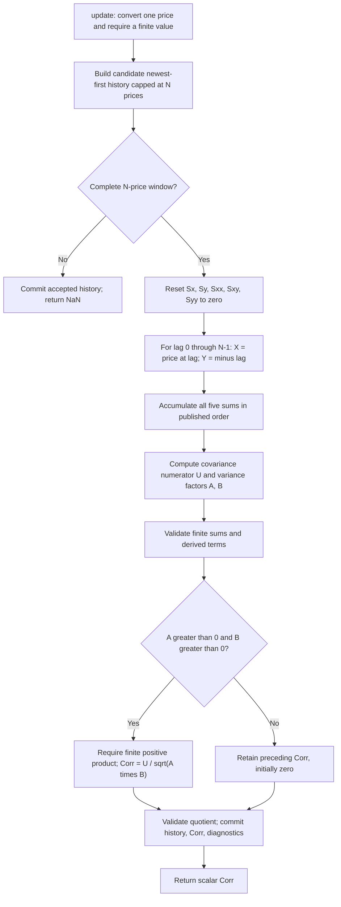

# Correlation Trend Indicator: research prototype master reference

This folder is the standalone conversion reference for John F. Ehlers' **Correlation Trend Indicator (CTI)**, described in “Correlation As A Trend Indicator,” *Technical Analysis of Stocks & Commodities*, May 2020, and in the supplied Mesa Software paper. The streaming master is [correlation-trend.py](correlation-trend.py); it uses only Python's standard library. Its public calculation is:

```python
value = CorrelationTrend(length=20).update(close)
```

Use one persistent instance for a sequence of bars. Each call consumes one chronological price and returns one scalar correlation. The example above illustrates the call signature; a newly created length-20 instance returns NaN until it has collected its first complete window.

The article and Mesa paper describe the indicator as “Spearman correlation,” but their executable code computes **Pearson product-moment correlation of unranked prices with time**. This master follows the published code. Sorting/ranking prices would change the calculation and expected data.

The user confirmed all **12 proposed lengths**. Each of the five language fixtures contains the copied input arrays plus 12 expected arrays with 252 outputs per array. Expected values use 15 significant digits and native NaN literals during priming. The full set of implemented equations, source differences, theory, initialization, and conversion instructions appears below so agents do not need the original articles or book.

## 1. Basic principle and interpretation

An ideal persistent uptrend follows a straight line with positive chronological slope. Correlating prices against an increasing time coordinate measures how closely a trailing price window resembles that line. A perfectly linear rise has correlation $+1$, a perfectly linear decline has correlation $-1$, and a price shape with zero linear covariance has correlation zero.

The physical/geometric analogy is alignment: after subtracting their means, the prices and time ramp become two vectors. Pearson correlation is the cosine of the angle between those centered vectors. Vectors aligned in the same direction give $+1$; vectors pointing in opposite directions give $-1$; perpendicular vectors give zero. Mean subtraction removes price level, and division by vector lengths removes units and scale.

The indicator measures the **direction and linearity of price shape across the selected window**. It does not measure the monetary slope or speed of the move. A small perfectly linear rise and a large perfectly linear rise both give $+1$. The denominator adjusts the covariance by the amount of price variation present, yielding a dimensionless oscillator that can be compared across securities.

A value near zero need not mean the market is flat. It can arise from a symmetric reversal, noisy prices, a cycle spanning the window, or multiple opposing moves. Conversely, a portion of a cycle can look like a trend when the window sees only its rising or falling segment. Perfectly constant prices have zero price variance, making mathematical Pearson correlation undefined; the published code handles that case by retaining its previously assigned value, initialized to zero.

There is no prefilter, moving average of the output, RMS normalization, rank transformation, projection into the future, or chart offset in CTI. Only a trailing correlation window is required. The plotted zero line in the article is a visual reference, not a second changing output.

## 2. Parameters and source conventions

| Setting | Default | Contract |
|---|---:|---|
| `length` ($N$) | 20 | Positive integer, excluding booleans. At least 2 is needed for nondegenerate time variance. |
| `update(value)` input | No default | One finite float-convertible price. Zero and negative values are accepted. |
| Held correlation on reset | 0 | Matches the source declaration `Corr(0)`. |
| Price history before the record | Absent | Do not pad with zeros or synthesize previous prices. |
| Output before a complete window | NaN | Exactly $N-1$ leading NaNs for a record long enough to prime. |

Length 1 is accepted to preserve the source's parameter domain and guard behavior. Its single time coordinate has zero variance, so the source never assigns a new correlation; the master returns zero from the first accepted input onward. It is a useful API boundary test rather than a meaningful trend measurement.

The original article default is 20 bars. It illustrates 10 bars for faster onset/failure recognition and 40 bars for a smoother response. For quarter-year holding horizons the article discusses approximately 40–60 bars. These are explanatory examples, not dynamically changing settings.

There is no mathematical fixed upper bound on a positive integer length. Available record size, memory, update cost, and finite binary64 arithmetic impose practical limits. A length exceeding the stream size is allowed; outputs remain NaN until $N$ prices arrive. Construct a fresh instance when changing length; the current instance's configuration is read-only.

The TradeStation indicator adds `TriggerLevel=0.5` as a constant plotted reference, while its strategy uses `FastLength=20`, `SlowLength=40`, `BuyThreshold=0.5`, and `SellThreshold=0`. These belong to that plotting/strategy example, not the CTI calculation. They are not exposed as master parameters or used to multiply the reference-case count.

No coefficient needs pi or square root of two in this indicator. The user's earlier precision preference is preserved: no rounded mathematical constants from unrelated filters are introduced. The only transcendental operation in the actual CTI is Python's `math.sqrt`.

## 3. Complete article and Mesa equations

Let $t$ be the zero-based chronological index of the present price $p_t$. Let $k$ be lag, increasing backward from present to past:

$$
k=0,\ldots,N-1,\qquad
x_k=p_{t-k},\qquad y_k=-k.
$$

The negative sign in $y_k$ is essential. Newest-to-oldest indexing runs backward in time, so $-k$ describes **increasing chronological time**. Equivalently, if $j=0$ is the oldest observation and $j=N-1$ is the newest, then $y_j=j-(N-1)$. Pearson correlation is invariant to a coordinate offset, so correlating chronological prices with $j$ gives the same mathematical answer.

The five source sums are:

$$
\begin{aligned}
S_x &= \sum_{k=0}^{N-1}x_k,\\
S_y &= \sum_{k=0}^{N-1}y_k,\\
S_{xx} &= \sum_{k=0}^{N-1}x_k^2,\\
S_{xy} &= \sum_{k=0}^{N-1}x_ky_k,\\
S_{yy} &= \sum_{k=0}^{N-1}y_k^2.
\end{aligned}
$$

Define the raw covariance numerator and variance factors:

$$
U=N S_{xy}-S_xS_y,\qquad
A=N S_{xx}-S_x^2,\qquad
B=N S_{yy}-S_y^2.
$$

The source's conditional assignment is:

$$
c_t=
\begin{cases}
\dfrac{U}{\sqrt{AB}},& A>0\ \text{and}\ B>0,\\[6pt]
c_{t-1}^{\mathrm{stored}},&\text{otherwise}.
\end{cases}
$$

The persistent initial correlation is $c^{\mathrm{stored}}=0$. The public output is NaN until a complete window exists; those availability NaNs never replace the stored value.

The source resets all five sums to zero **on every bar**, then performs the loop in ascending lag order. The exact arithmetic sequence used for the master is:

```python
sx = sy = sxx = sxy = syy = 0.0
for count in range(length):
    x = history[count]           # newest at index zero
    y = -float(count)            # increasing chronological time
    sx = sx + x
    sy = sy + y
    sxx = sxx + x * x
    sxy = sxy + x * y
    syy = syy + y * y

price_variance = length * sxx - sx * sx
time_variance = length * syy - sy * sy
numerator = length * sxy - sx * sy
if price_variance > 0.0 and time_variance > 0.0:
    corr = numerator / math.sqrt(price_variance * time_variance)
# No Else assignment: retain the preceding stored corr.
```

For reference compatibility, do not replace those sums with rolling updates, compensated sums, centered moments, or closed-form time sums. The equivalents below are for understanding and independent validation. They can differ in the last digits because their floating-point association differs.

### 3.1 Full original EasyLanguage calculation

Both the article and Mesa paper give this numerical definition:

```easylanguage
{
  Correlation Trend Indicator
  (c) 2013-2019 John F. Ehlers
}
Inputs:
  Length(20);
Vars:
  Sx(0), Sy(0), Sxx(0), Sxy(0), Syy(0),
  count(0), X(0), Y(0), Corr(0);

Sx = 0;
Sy = 0;
Sxx = 0;
Sxy = 0;
Syy = 0;

For count = 0 to Length - 1 Begin
  X = Close[count];
  Y = -count;
  Sx = Sx + X;
  Sy = Sy + Y;
  Sxx = Sxx + X*X;
  Sxy = Sxy + X*Y;
  Syy = Syy + Y*Y;
End;

If (Length*Sxx - Sx*Sx > 0)
  and (Length*Syy - Sy*Sy > 0)
Then Corr = (Length*Sxy - Sx*Sy) /
  SquareRoot((Length*Sxx - Sx*Sx) * (Length*Syy - Sy*Sy));

Plot1(Corr);
Plot2(0);
```

The copyright range is 2013–2019; the TASC publication date is May 2020.

## 4. Mathematical explanation and independent derivations

The following identities are derived directly from the source sums. They explain the calculation and support meaningful analytical checks; the master preserves the source's raw-sum loop.

### 4.1 Centered Pearson correlation and geometric analogy

Let $\bar x=S_x/N$ and $\bar y=S_y/N$. The centered inner products are:

$$
V_x=\sum_{k=0}^{N-1}(x_k-\bar x)^2,\qquad
V_y=\sum_{k=0}^{N-1}(y_k-\bar y)^2,
$$

$$
C_{xy}=\sum_{k=0}^{N-1}(x_k-\bar x)(y_k-\bar y).
$$

Then:

$$
A=NV_x,\qquad B=NV_y,\qquad U=NC_{xy},
$$

so the source ratio simplifies mathematically to:

$$
c_t=\frac{C_{xy}}{\sqrt{V_xV_y}}.
$$

Population and sample variance/covariance divisors cancel in this ratio. Do not introduce an extra factor of $N$, $N-1$, or an RMS EMA.

For centered vectors $\mathbf{x}'$ and $\mathbf{y}'$:

$$
c_t=
\frac{\mathbf{x}'\cdot\mathbf{y}'}
     {\|\mathbf{x}'\|\|\mathbf{y}'\|}
=\cos\phi.
$$

Cauchy–Schwarz gives $-1\le c_t\le1$ in exact arithmetic when both vector lengths are nonzero. The original code does not clamp the result. The master likewise leaves small numerical excursions outside that ideal interval intact.

### 4.2 Time-ramp sums and closed form

Because $y_k=-k$:

$$
S_y=-\frac{N(N-1)}2,\qquad
S_{yy}=\frac{N(N-1)(2N-1)}6,\qquad
\bar y=-\frac{N-1}2.
$$

The centered time variance and source factor are:

$$
V_y=\frac{N(N^2-1)}{12},
\qquad
B=NV_y=\frac{N^2(N^2-1)}{12}.
$$

Thus $B>0$ for $N\ge2$, and $B=0$ at $N=1$. The centered ramp weight is:

$$
q_k=y_k-\bar y=\frac{N-1}{2}-k.
$$

Since $\sum_k q_k=0$:

$$
C_{xy}=\sum_{k=0}^{N-1}q_kp_{t-k}.
$$

These weights are positive on the newer side, negative on the older side, and antisymmetric around the window midpoint. They measure linear tilt while canceling a constant price level.

### 4.3 Regression slope and goodness of fit

The ordinary least-squares slope of prices against chronological time is:

$$
\hat b_t=\frac{C_{xy}}{V_y}.
$$

Consequently:

$$
c_t=\hat b_t\sqrt{\frac{V_y}{V_x}}.
$$

The correlation is a slope standardized by price dispersion and window duration. If:

$$
x_k=\hat a+\hat b_ty_k+\varepsilon_k,
\qquad
\sum_k\varepsilon_k=0,\qquad
\sum_k y_k\varepsilon_k=0,
$$

then the orthogonal least-squares decomposition gives:

$$
V_x=\hat b_t^2V_y+\sum_k\varepsilon_k^2.
$$

Thus:

$$
c_t=
\frac{\hat b_t\sqrt{V_y}}
     {\sqrt{\hat b_t^2V_y+\sum_k\varepsilon_k^2}},
\qquad
c_t^2=
\frac{\hat b_t^2V_y}
     {\hat b_t^2V_y+\sum_k\varepsilon_k^2}.
$$

With a fitted intercept and nonzero price variance, $c_t^2$ is the window's simple-linear-regression $R^2$. The sign supplies trend direction. This interpretation describes the observed window; it does not give a probability of a future continuation.

For an exact affine chronological sequence $p_t=a+bt$ with $b\ne0$:

$$
c_t=\operatorname{sign}(b).
$$

For a symmetric nonconstant price window centered on its midpoint, the antisymmetric ramp weights cancel in pairs, giving $C_{xy}=0$ and therefore correlation zero. At $N=2$, every unequal two-price window is an exact line, so the ideal output is simply the sign of the latest price change. Tied prices activate the retained-value guard.

### 4.4 Pearson versus Spearman

Spearman correlation is Pearson correlation applied to **ranks** of both paired variables. The time ramp already has ordered ranks, but the source uses $X=\mathrm{Close}[k]$, not the rank of that price. Its result depends on spacing between prices and is therefore Pearson correlation.

For chronological prices $[1,2,10]$ at times $[0,1,2]$:

$$
c_{\mathrm{Pearson}}=\frac{27}{\sqrt{876}}
\approx0.912245460839,
$$

while the ranks $[1,2,3]$ yield Spearman correlation exactly $1$. Replacing raw prices with ranks would make these outputs disagree. This naming discrepancy appears in both the article and Mesa paper, and also in the Zorro tip's prose; their published loops remain the implementation authority.

### 4.5 Scale, offset, and direction

For constants $a\ne0$ and $d$, replacing all prices with $ap_t+d$ gives:

$$
c_t^{\mathrm{new}}=\operatorname{sign}(a)c_t
$$

in exact arithmetic on nondegenerate windows. An added price offset cancels through mean subtraction; positive scale cancels through normalization; negative scale reverses the sign. With the zero-initialized hold policy, the same relationship extends across truly zero-variance windows.

Raw-sum floating-point cancellation can break these ideal invariances at very large offsets or very small spreads. The reference follows the article rather than centering the inputs to enforce invariance.

## 5. Window length, latency, and cyclic response

The article says the lag is approximately half the correlation length. It suggests shortening the period to identify trend onset/failure sooner, then lengthening it to follow an established trend with a smoother curve. This master keeps a fixed length; the article's manual adaptation suggestion is a use case.

The linear covariance numerator has antisymmetric weights $q_k$, so its reference point is the midpoint of the trailing window. The associated least-squares slope estimator is:

$$
\hat b_t=\sum_{k=0}^{N-1}h_kp_{t-k},
\qquad
h_k=\frac{q_k}{V_y}.
$$

Its frequency response is:

$$
H_b(e^{i\omega})=\sum_{k=0}^{N-1}h_ke^{-i\omega k}.
$$

Antisymmetry gives a linear-phase differentiating response with group delay $(N-1)/2$ bars away from response zeros and phase jumps. Near DC:

$$
H_b(e^{i\omega})
\approx i\omega e^{-i\omega(N-1)/2}.
$$

This explains the source's half-window latency heuristic. The **normalized CTI is nonlinear** because $V_x$ varies with prices; it does not have one universal frequency response or exact constant delay. Turning-point timing also depends on the price pattern and thresholds chosen.

For a sinusoidal price component:

$$
p_t=A+D\sin(\omega t+\varphi),
\qquad
\omega=\frac{2\pi}{P_{\mathrm{cycle}}},
$$

the covariance numerator takes the form:

$$
C_{xy,t}=
D\,\operatorname{Im}\left[
e^{i(\omega t+\varphi)}
\sum_{k=0}^{N-1}q_ke^{-i\omega k}
\right].
$$

CTI still divides this by the actual trailing price dispersion. It can respond positively on a cycle's upswing and negatively on its downswing. When $N$ is approximately half a cycle period, the source estimates at least a quarter-cycle delay. Differencing correlation can advance the phase of a band-limited oscillation, but amplifies rapid fluctuations; the article mentions this as a possibility and prefers other indicators for cycle extraction. That rate of change is not calculated or exported here.

A window covering a full sinusoidal period does not guarantee zero time-ramp correlation at every phase. The sum of sine samples may vanish, but the **weighted** sum with the ramp need not vanish. The article's statement that oscillation implies no correlation is a qualitative trend-mode explanation, not an exact identity for all cyclic windows.

All periods count bars. Daily, intraday, tick, and volume-based sampling can use the same formula, but elapsed-time interpretation changes. If timestamps are irregular, this code still uses bar index; correlating against physical timestamps would be a different indicator.

## 6. Relevant book background: correlation with memory

The article cites *Cycle Analytics for Traders* (2013). Chapter 8, “Autocorrelation,” supplies the relevant correlation background: noisy market-like series can have memory, and correlations reveal structure when compared with an appropriate reference. CTI uses a deterministic time ramp; the chapter's separate autocorrelation indicators compare two copies of filtered data at different delays.

### 6.1 Radar and Swerling analogy

The chapter describes fluctuating radar returns as a constant plus a random component with memory. Changing target aspect produces noisy reflections that can vary pulse to pulse or scan to scan. Ehlers uses that physical analogy to motivate synthetic market-like prices created by smoothing random inputs.

The supplied Chapter 8 synthetic-price listing is completely specified by:

$$
\begin{aligned}
\mathrm{Cls}_t
 &=\alpha_1(45+\mathrm{Random}(10))
   +(1-\alpha_1)\mathrm{Cls}_{t-1},\qquad \alpha_1=0.05,\\
\mathrm{Hgh}_t&=\mathrm{Cls}_t+\mathrm{Random}(0.125),\\
\mathrm{Lw}_t&=\mathrm{Cls}_t-\mathrm{Random}(0.125),\\
\mathrm{Opn}_t&=\mathrm{Cls}_t+\mathrm{Random}(0.25)-0.125.
\end{aligned}
$$

Then the source clips Open to the generated range:

$$
\mathrm{Opn}_t\leftarrow
\begin{cases}
\mathrm{Hgh}_t,&\mathrm{Opn}_t>\mathrm{Hgh}_t,\\
\mathrm{Lw}_t,&\mathrm{Opn}_t<\mathrm{Lw}_t,\\
\mathrm{Opn}_t,&\text{otherwise}.
\end{cases}
$$

The source's `Random(limit)` supplies a nonnegative bounded random value with that limit. These synthetic-price equations illustrate the book's memory model; they are not a preprocessing stage, an input generator, or an additional parameter set for this CTI master. The master uses the required deterministic 252-close fixture.

### 6.2 Autocorrelation equations and distinction from CTI

For lag $\ell$ and an averaging length $M$, the book forms paired filtered observations:

$$
X_k=f_{t-k},\qquad Y_k=f_{t-\ell-k},
\qquad k=0,\ldots,M-1.
$$

It uses the same five sums as Section 3, with $N$ replaced by $M$, and computes:

$$
r_t(\ell)=
\frac{M\sum_kX_kY_k-\left(\sum_kX_k\right)\left(\sum_kY_k\right)}
{\sqrt{
\left[M\sum_kX_k^2-\left(\sum_kX_k\right)^2\right]
\left[M\sum_kY_k^2-\left(\sum_kY_k\right)^2\right]
}}.
$$

In the supplied listing, $M=\mathrm{AvgLength}$ unless `AvgLength=0`, in which case $M=\ell$. That listing guards the product of its two variance factors, retains the prior array value if no assignment occurs, and subsequently maps the result to a heatmap scale:

$$
a_t(\ell)=\frac{r_t(\ell)+1}{2}.
$$

CTI does not use lagged copies, that heatmap transform, adaptive averaging, a high-pass filter, a SuperSmoother, or the book's periodogram/turning-point stages. A high-pass filter from a cycle-extraction system would remove the very trend CTI seeks to measure.

The chapter states a long-memory power-law model:

$$
\mathrm{Autocorrelation}(\ell)=C\ell^{-\alpha},
$$

with nominal $\alpha$ around unity. This is a model over positive lags, not a CTI formula or a universal law of markets.

For a pure sinusoid, correlation averaged over complete cycles depends on delay as:

$$
r(\ell)=\cos\left(\frac{2\pi\ell}{P_{\mathrm{cycle}}}\right).
$$

It is $+1$ at zero/full-cycle lag and $-1$ at half-cycle lag. The chapter describes this curve as varying “as a sine wave”; the values it gives correspond to the cosine phase shown here. Neither that sinusoidal lag correlation nor the power-law memory model changes the raw-price-versus-time CTI algorithm.

This mathematical background is included to explain correlation and its physical motivation. All stages used by the actual CTI are already fully specified in Section 3.

## 7. Streaming initialization, zero variance, and errors

The article assumes chart-provided history for `Close[count]` and does not specify a finite raw-array warmup. This master uses the minimum complete-window contract:

1. On construction/reset, price history is empty and stored Corr is zero.
2. Every accepted price enters the bounded history, newest first.
3. While fewer than $N$ actual prices exist, return NaN and do not assign Corr.
4. On the $N$th accepted price, the full window has lags $0,\ldots,N-1$. Calculate all five sums and apply the source guard.
5. On subsequent bars, keep only the newest $N$ prices and recalculate the sums.
6. Never insert a public availability NaN into history or held Corr.

Therefore:

$$
\mathrm{warmup\_bars}=N-1,\qquad
\mathrm{first\ available\ index}=N-1,\qquad
\mathrm{minimum\ input\ count}=N.
$$

For 252 inputs:

$$
\mathrm{NaN\ count}=\min(252,N-1),
\qquad
\mathrm{available\ count}=\max(0,253-N).
$$

Length 251 gives two available outputs; length 252 gives one; length 253 gives none. Length 1 gives no startup NaNs and all zeros.

“Primed” means a full price window exists, not that variance is positive. With length 2 and chronological inputs $[1,2,2,2,3]$, the literal rule gives:

$$
[\mathrm{NaN},1,1,1,1].
$$

The repeated flat windows retain the earlier $+1$. A decline followed by ties similarly holds $-1$. A first flat window holds initial zero. This behavior is required to match the article, even though a mathematical correlation of a flat window is undefined.

Normal nonflat outputs depend only on the present window. The held-value branch introduces memory of the last assigned correlation across flat or numerically nonpositive-variance windows. `reset()` clears that history too.

Invalid input is rejected before state changes. Input must be float-convertible and finite. Nonfinite input raises `ValueError`; ordinary conversion failures raise the normal Python conversion exception. If sums, numerator, variance terms, their positive product, or the final quotient overflow or become nonfinite, the master raises `ValueError` without advancing the stream. A positive variance product that underflows to zero is also rejected.

There is no missing-value imputation, timestamp policy, or automatic gap reset. The caller decides whether to skip an observation or reset after a data gap.

## 8. Numerical compatibility and practical limits

Binary64 calculations use the source loop order, newest to oldest. The state is never rounded; only output fixture text uses 15 significant digits. The fixed time sums are accumulated literally despite having closed forms.

The expressions $NS_{xx}-S_x^2$ and $NS_{xy}-S_xS_y$ subtract potentially large, nearly equal numbers. At a very large price level with a small spread, catastrophic cancellation can make a true positive variance look zero or negative. The source guard then retains Corr. A centered or compensated implementation could be statistically better conditioned but would generate different reference values.

The expected length-2 fixture already illustrates a small range excursion: its largest absolute value is approximately **1.0000000007518506** before serialization. This follows the original uncentered arithmetic; no clamp is added. Do not assume that an exact $[-1,1]$ test is appropriate for a source-compatible binary64 implementation.

The mathematical range and scale/offset invariance describe exact arithmetic. The master's operational contract additionally includes:

- The original strict two-factor positivity test.
- Retained output when that test is false.
- Finite-arithmetic validation and transactional state commitment.
- Source order without rolling, compensated, or centered substitutions.
- No epsilon floor or manual clipping.

A practical finite-value comparison for the supplied reference arrays is:

```text
abs(actual - expected) <= 5e-13 + 5e-13 * abs(expected)
```

Check NaNs by classification rather than equality. Translated code should keep binary64 values and ordinary multiply/add/subtract order; compiler reassociation or fused operations can alter raw-sum cancellation. If a low-spread window disagrees, inspect the actual sums and guard rather than increasing tolerance without analysis.

## 9. Calculation flow, API, and storage



Later-stage failure leaves history and stored Corr unchanged. There is no future price access.

The class API is:

```python
import importlib.util
from pathlib import Path

# The requested hyphenated filename is loaded by path for Python imports.
path = Path("correlation-trend.py")
spec = importlib.util.spec_from_file_location("correlation_trend", path)
master = importlib.util.module_from_spec(spec)
spec.loader.exec_module(master)

indicator = master.CorrelationTrend(length=20)
for close in closes:
    corr = indicator.update(close)
    if indicator.is_primed:
        print(corr)

print(indicator.length)         # 20, read-only
print(indicator.warmup_bars)    # 19
print(indicator.state)          # read-only NamedTuple diagnostics
indicator.reset()
```

Ports may name their source files and modules idiomatically. The master uses `correlation-trend.py` to follow the requested indicator filename and the established naming convention of neighboring masters.

`state` returns:

```text
CorrelationTrendState(
    sum_x, sum_y, sum_xx, sum_xy, sum_yy,
    numerator, price_variance_term, time_variance_term,
    correlation, variance_valid
)
```

Before a complete window, its numeric diagnostics are NaN and `variance_valid=False`. A primed flat window has finite sums, a nonpositive factor, and a held scalar output; `variance_valid` records whether the source assignment ran. These diagnostic fields are not extra expected outputs. The only required output is the scalar `update` result.

The history list is bounded by $N$, and both update work and storage are $O(N)$. A ring buffer is an equivalent porting choice if its logical lag zero is the newest price and summation still traverses lags in ascending order. Streaming means causal incremental ingestion; constant-time updates are not required.

## 10. Source comparison and numerical authority

The matching article and Mesa code define the authority. The Traders' Tips supply platform context and an additional source oracle on ordinary nondegenerate windows.

| Source | Relevant difference or confirmation |
|---|---|
| TASC article | Raw-price Pearson loop, despite “Spearman” prose; both factors checked positive; Corr initialized zero; no Else. |
| Mesa paper | Same full loop, guard, defaults, and descriptive discussion. |
| TradeStation `CTI.els` | Same five sums; names numerator `Num`; calculates the square-root denominator before testing only `Denom <> 0`. It can attempt a negative square root after cancellation. Master follows article's two-factor guard. |
| TradersStudio `CTI.trs` | Same article equations and guard, zero initialization at platform FirstBar; chart history still implicit. |
| NinjaTrader `ninja-trader/CTI.cs` | Resets all five sums correctly, holds member Corr on invalid variance. Its `CurrentBar < Length` gate uses zero-based indexing and therefore starts one bar later than the minimum complete-window master. |
| eSignal `CTI.efs` | Same core sums and guard, bar-count availability gate, but Corr begins as `null`; a first flat window can remain null instead of the article's initial zero. |
| Zorro `CTI.c` | Same raw-price sums and two-factor positivity test, but its explicit Else returns zero on a flat/invalid window instead of holding a previous correlation. |
| MetaStock `CTI.txt` | Calls `Correl(Cum(1), C, pds, 0)`; cumulative bar count is mathematically an increasing ramp. Default 20, UI range 5–200. Library arithmetic and degeneracy behavior are not supplied. |
| Wealth-Lab `CTI.cs` | Strategy calls `CorrelationTrend.Series(Close, 20)`; underlying library calculation is not included. |
| thinkorswim / NeuroShell / Trade Navigator / Excel | Tips give platform studies, library interfaces, or a workbook; they do not establish an additional plain-source runtime contract beyond the inspected listings. |

There is no ranking in the primary or exposed loop implementations. Default nondegenerate finite-record outputs match independent evaluation of the article, Mesa, and TradeStation expressions with the documented full-window gate.

The TradeStation strategy's illustration is:

- Enter long on a crossing of fast CTI(20) above $0.5$.
- Exit long on a crossing of slow CTI(40) below $0$.

This does not alter either CTI output, introduce a trading execution engine, or establish expected arrays for thresholds.

## 11. Confirmed reference cases and five-language fixtures

The user confirmed the following table during this task. These are 12 one-parameter cases, below the 64-combination limit.

| Length | Python array | What it tests |
|---:|---|---|
| 20 | `EXPECTED_L20` | Article and Mesa default twenty-bar trend horizon. |
| 1 | `EXPECTED_L1` | Degenerate one-bar time ramp; source guard retains initial zero. |
| 2 | `EXPECTED_L2` | Shortest nondegenerate window; direction saturates near plus or minus one. |
| 3 | `EXPECTED_L3` | Shortest multi-point window and odd-length time indexing. |
| 5 | `EXPECTED_L5` | Fast trend changes and short-window price ties. |
| 10 | `EXPECTED_L10` | Article short-window example for trend onset and failure. |
| 40 | `EXPECTED_L40` | Article smoother example and TradeStation slow strategy length. |
| 60 | `EXPECTED_L60` | Article upper quarterly holding-period example. |
| 126 | `EXPECTED_L126` | Half-record window for long-horizon trend shape. |
| 251 | `EXPECTED_L251` | Nearly full-record window with exactly two primed outputs. |
| 252 | `EXPECTED_L252` | Full-record window with exactly one primed output. |
| 253 | `EXPECTED_L253` | Window exceeds the record; all 252 outputs remain NaN. |

The copied files are [test_testdata.py](test_testdata.py), [testdata_test.go](testdata_test.go), [testdata.ts](testdata.ts), [testdata.rs](testdata.rs), and [testdata.zig](testdata.zig). They preserve all four parent input arrays; only `INPUT_CLOSE` feeds CTI.

The executable `__main__` embeds the exact 252 input closes and checks that they match the Python fixture before reference generation. Run from this folder:

```bash
python3 correlation-trend.py
python3 correlation-trend.py --generate-reference-data
```

The first command demonstrates the default without modifying files. The second regenerates all five language fixtures for the confirmed table. The generator:

1. Creates a fresh streaming instance for every length.
2. Emits 252 outputs per instance, keeping NaNs before priming.
3. Appends/replaces only its marked expected-data section in Python.
4. Formats finite values using `.15g` (15 significant digits), with a decimal suffix for otherwise integer-looking literals.
5. Reopens Python data and verifies expected names, lengths, NaN prefixes, preserved inputs, and decimal rounding.
6. Translates the parsed Python decimal values into all four other language fixtures.
7. Replaces its marked section on later runs without duplicating arrays or changing inputs.

The exact two comment lines before each array are copied from the table and parameter settings:

```python
# Article and Mesa default twenty-bar trend horizon.
# length=20
EXPECTED_L20 = [
    # 252 actual values are present in test_testdata.py
]
```

This abbreviated example illustrates the syntax only. Other languages use `//` with the same two lines.

| Language | Default-case declaration | NaN syntax |
|---|---|---|
| Python | `EXPECTED_L20 = [...]` | `math.nan` |
| Go, package `correlationtrend` | `var expectedL20 = []float64{...}` | `math.NaN()`; imports `math`. |
| TypeScript | `export const expectedL20: number[] = [...];` | `NaN` |
| Rust | `pub fn expected_l20() -> Vec<f64> { vec![...] }` | `f64::NAN` |
| Zig | `pub fn expectedL20() [252]f64 { return .{...}; }` | `nan` |

Rust expected functions remain inside the copied `#[cfg(test)] pub mod testdata`. Zig declares `const math = @import("std").math;` and `const nan = math.nan(f64);`. These native declarations correct the typographical syntax examples in the task while following its intended conventions.

There are no fractional parameters in CTI. If future parameterized data adds a floating-point setting, encode its decimal point as an underscore in the array name. The length shortcut here is `L`, yielding `EXPECTED_L20`, `expectedL20`, or Rust `expected_l20`.

## 12. Validation and reproducibility

With the embedded 252 closes and length 20, the master reports:

- Exactly **19 leading NaNs**.
- First available index **19**, value **-0.412255787317525**.
- Final value **-0.671601321808002**.
- Latest source sums: $S_x=2211.4$, $S_y=-190$, $S_{xx}=244696.30200000003$, $S_{xy}=-21241.82$, $S_{yy}=2470$ before fixture serialization.

The complete suite in [test_correlation_trend.py](test_correlation_trend.py) passes **15 tests with no skips**:

```bash
python3 -m unittest discover -p 'test_correlation_trend.py' -v
```

It independently extracts and evaluates source expressions from the article, Mesa paper, and TradeStation listing for all 12 lengths; uses centered exact rational arithmetic for independent Pearson comparisons; checks the Pearson/Spearman distinction; verifies affine trends, symmetric zero covariance, time-ramp sums, retained output on flat/nonpositive-variance windows, length 1, exact priming boundaries, scale/offset/reflection, causality, reset, rejected updates, and parameter validation; and verifies copied/embedded inputs, every language's expected arrays and comments, plus repeated generation preserving input data.

The source-oracle tests read local article files for provenance. The runtime master and this documentation are self-contained; moving the tests to a repository without the original sources requires copying those source fixtures or replacing the oracle with the complete mathematical definition above.

Native fixture checks passed with **Go 1.27.1, Rust 1.98.1, Zig 0.16.0, and Node 24.15.0 using native TypeScript stripping**. Each harness loaded all four input arrays and 12 expected arrays, checking **4,032 values** against the parsed Python fixture. Every finite value matched its Python binary64 bits, and NaNs matched by classification and position. NaN payload bits are not compared. This establishes valid native data declarations and faithful export of the Python decimals; it does not claim that a future translated indicator has already been tested. Python checks used Python 3.14.3.

Source equality is scoped to the same arithmetic and the explicit complete-window gate. No commercial charting platform was executed, and differences in history gates, held initial values, cancellation handling, library numerics, or compiler reassociation can change platform results.

## 13. References and BibTeX

1. John F. Ehlers, “Correlation As A Trend Indicator,” *Technical Analysis of Stocks & Commodities*, **38(5)**, May 2020, pp. **24–27**. Supplied [article](../../tasc/2020-05-correlation-as-a-trend-indicator/content.md). The local source provides the archive link [270EHLE.pdf](https://technical.traders.com/archive/article.asp?file=%5CV38%5CC05%5C270EHLE.pdf); its backslashes are URL-encoded here.
2. John F. Ehlers, “Correlation as a Trend Indicator,” Mesa Software paper, 2020 as catalogued by the local copy. Supplied [Mesa text](../../tasc/2020-05-correlation-as-a-trend-indicator/mesa/content.md); [original PDF](https://www.mesasoftware.com/papers/CORRELATION%20AS%20A%20TREND%20INDICATOR.pdf).
3. “Traders' Tips: Correlation As A Trend Indicator,” May 2020. Supplied [collection](../../tasc/2020-05-correlation-as-a-trend-indicator/tips/tips.md); [online collection](https://www.traders.com/Documentation/FEEDbk_docs/2020/05/TradersTips.html). Numerical comparison inspected [TradeStation](../../tasc/2020-05-correlation-as-a-trend-indicator/tips/CTI.els), [TradersStudio](../../tasc/2020-05-correlation-as-a-trend-indicator/tips/CTI.trs), [NinjaTrader](../../tasc/2020-05-correlation-as-a-trend-indicator/tips/ninja-trader/CTI.cs), [eSignal](../../tasc/2020-05-correlation-as-a-trend-indicator/tips/CTI.efs), and [Zorro](../../tasc/2020-05-correlation-as-a-trend-indicator/tips/CTI.c). Platform interfaces also appear in [MetaStock](../../tasc/2020-05-correlation-as-a-trend-indicator/tips/CTI.txt) and [Wealth-Lab](../../tasc/2020-05-correlation-as-a-trend-indicator/tips/CTI.cs).
4. John F. Ehlers, *Cycle Analytics for Traders: Advanced Technical Trading Concepts*, Wiley, 2013, ISBN **9781118728604**. The article's book reference supplies general background; [Chapter 8, “Autocorrelation”](../../2013-cycle-analytics-for-traders/ch8.md), was read for the relevant Pearson/memory discussion. Its separate cycle-processing system is not inserted into CTI.

Only supplied local documents were needed for the implementation. The Pearson, regression, centered-vector, and latency identities marked as derivations above follow from the published formula; they are not attributed to an unseen additional paper.

```bibtex
@article{ehlers2020correlationtrend,
  author  = {Ehlers, John F.},
  title   = {Correlation As A Trend Indicator},
  journal = {Technical Analysis of Stocks \& Commodities},
  volume  = {38},
  number  = {5},
  pages   = {24--27},
  month   = may,
  year    = {2020},
  url     = {https://technical.traders.com/archive/article.asp?file=%5CV38%5CC05%5C270EHLE.pdf},
  note    = {Raw-price Pearson correlation despite the Spearman label in the prose}
}

@misc{ehlers2020mesacorrelationtrend,
  author       = {Ehlers, John F.},
  title        = {Correlation as a Trend Indicator},
  howpublished = {Mesa Software},
  year         = {2020},
  url          = {https://www.mesasoftware.com/papers/CORRELATION%20AS%20A%20TREND%20INDICATOR.pdf},
  note         = {Year as catalogued in the supplied local copy}
}

@misc{traderstips2020may,
  author       = {{Technical Analysis of Stocks \& Commodities}},
  title        = {Traders' Tips: Correlation As A Trend Indicator},
  howpublished = {Traders.com},
  month        = may,
  year         = {2020},
  url          = {https://www.traders.com/Documentation/FEEDbk_docs/2020/05/TradersTips.html},
  note         = {TradeStation and other platform implementations accompanying Ehlers' article}
}

@book{ehlers2013cycle,
  author    = {Ehlers, John F.},
  title     = {Cycle Analytics for Traders: Advanced Technical Trading Concepts},
  publisher = {Wiley},
  year      = {2013},
  isbn      = {9781118728604},
  note      = {Chapter 8: Autocorrelation; Pearson correlation and memory background}
}
```
