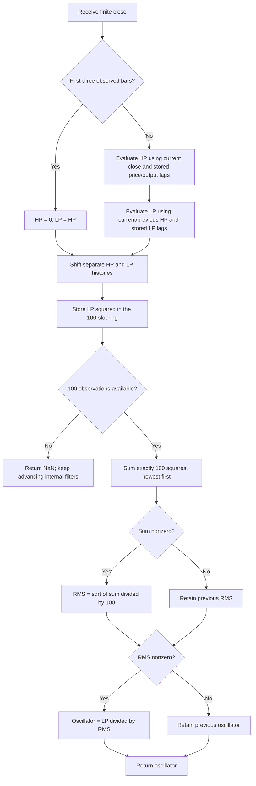

# Cybernetic Oscillator — research prototype master reference

John F. Ehlers introduced this oscillator in **“Making A Better Oscillator,” Technical Analysis of Stocks & Commodities, June 2025, volume 43, pages 8–14 and 19**. This folder is a self-contained specification for converting the Python master into other languages. It contains the mathematical interpretation of every calculation in the article, explicit startup and zero-handling rules, and the input/reference-data conventions. No external scientific packages are required.

The calculation is a **serial second-order highpass and SuperSmoother lowpass**, normalized by the **100-bar root mean square of their output**:

$\text{Close} \longrightarrow \text{HighPass}(HPLength) \longrightarrow \text{SuperSmoother}(LPLength) \longrightarrow \text{RMS normalization}.$

The master follows the article's and TradeStation's **highpass-first code order**. The article's prose describes the lowpass first; its linear-filter argument explains why either order has the same steady-state transfer function. Explicit startup rules make order relevant to a finite record, so a conversion must preserve the code order.

## Principles and physical interpretation

An oscillator removes slow price components and retains fluctuations that swing around a reference level. Ehlers analyzes this in the frequency domain: shorter periods mean higher frequencies, longer periods mean lower frequencies. The difference used by ordinary oscillators is itself a highpass filter, and smoothing is a lowpass operation. Specifying their frequency response explains what remains in the resulting time-domain curve.

The article models market cycle amplitudes as proportional to wavelength. With period $T$, frequency $f=1/T$ and amplitude $A$, its working assumption is

$$
A(T)\propto T,\qquad A(f)\propto\frac{1}{f}.
$$

A doubling of wavelength increases amplitude by

$$
20\log_{10}(2)\approx 6.0206\ \mathrm{dB},
$$

and a tenfold increase gives $20\log_{10}(10)=20\ \mathrm{dB}$. These are the article's 6 dB per octave and 20 dB per decade. A long trend can be viewed as a small segment of an even longer cycle. The article calls this a “pink noise power spectrum.” Strict spectral terminology distinguishes amplitude and power: $A(f)\propto f^{-1}$ implies power proportional to $f^{-2}$, whereas conventional pink-noise power is proportional to $f^{-1}$. The filter argument here uses the article's stated **6 dB amplitude increase per octave**, without requiring the color label to be exact or treating that scaling as universal market behavior.

For one observation per bar, discrete angular frequency is $\omega=2\pi f$. The Nyquist frequency is $f_N=1/2$ cycles per bar, corresponding to $T_N=2$ bars. Components above Nyquist alias into observable frequencies. Filtering a sampled record can attenuate the high-frequency end of the observed spectrum; it cannot reconstruct the original components after aliasing.

### Why ordinary differencing is insufficient

A one-bar difference is

$$
d_t=x_t-x_{t-1},\qquad D(z)=1-z^{-1}.
$$

For a sinusoid, its magnitude response is

$$
|D(e^{j\omega})|=2\left|\sin\frac{\omega}{2}\right|.
$$

At Nyquist, adjacent samples alternate signs and $|D(e^{j\pi})|=2$: the difference amplifies them by about 6 dB. At zero frequency, $D(1)=0$. For small $\omega$, $|D|\approx |\omega|$, giving only 6 dB per octave of attenuation toward longer wavelengths. Combined with the article's $A\propto 1/\omega$ model, the low-frequency product approaches a constant rather than disappearing. This is the article's explanation for residual trend bias in ordinary oscillators.

A two-bar average has response

$$
m_t=\frac{x_t+x_{t-1}}{2},\qquad M(z)=\frac{1+z^{-1}}{2}.
$$

It has a zero at Nyquist. Averaging a difference gives the prototype oscillator

$$
M(z)D(z)=\frac{1-z^{-2}}{2},\qquad |M(e^{j\omega})D(e^{j\omega})|=|\sin\omega|.
$$

That combination blocks DC and Nyquist, but still attenuates long periods with only first-order slope. In the article's examples, RSI can keep a directional bias when summed up moves exceed summed down moves, stochastic retains the displacement from its window minimum during a trend, and MACD's two moving averages leave low-frequency content in their difference. Subtracting the MACD signal average adds further detrending. These comparisons motivate the second-order highpass, rather than define additional outputs of this implementation.

### A stronger bandpass and an amplitude meter

The highpass numerator uses **two differences**, $(1-z^{-1})^2$. Its low-frequency response is proportional to $\omega^2$, yielding approximately **12 dB per octave** attenuation. Against $A\propto 1/\omega$, the remaining amplitude decreases proportionally to $\omega$. The SuperSmoother supplies a second-order lowpass with approximately 12 dB per octave high-frequency attenuation in its intended operating region, plus a transmission zero at Nyquist. These are rolloff descriptions, not claims that a sampled filter has a constant slope at every frequency.

A useful electrical analogy is two selective networks in series: one blocks slowly varying offsets and trends, the other damps rapid oscillations and noise. Their internal histories store the response of damped modes, like energy retained in reactive components. RMS normalization then acts like a trailing amplitude meter that expresses the output relative to recent signal energy. “Cybernetic” refers to the mechanical/electrical communication systems terminology used by Ehlers; the indicator is a causal filter, not a model that predicts future prices.

## Complete mathematical specification

Let $x_t$ be the current close, $h_t$ the highpass output, $\ell_t$ the smoothed highpass output, and $o_t$ the final dimensionless oscillator. Index $t$ begins at **zero** for the first supplied close. Article notation `Price[k]` means the input of that particular helper $k$ bars ago, and function-result `[k]` means that helper's own previous output.

### Coefficients: original printed equations and full-precision master

For each period $P$, the article and TradeStation compute

$$
\begin{aligned}
a(P)&=\exp\left(-\frac{1.414\cdot3.14159}{P}\right),\\
b(P)&=2a(P)\cos_{\mathrm{degrees}}\left(\frac{1.414\cdot180}{P}\right),\\
c_2(P)&=b(P),\\
c_3(P)&=-a(P)a(P).
\end{aligned}
$$

The highpass input coefficient is

$$
c_{1,H}(P)=\frac{1+c_2(P)-c_3(P)}{4},
$$

whereas the SuperSmoother input coefficient is

$$
c_{1,L}(P)=1-c_2(P)-c_3(P).
$$

Following the established user preference, the **default master and all reference fixtures use full-precision constants**, with the consistently converted radian angle

$$
\theta(P)=\frac{\sqrt{2}\pi}{P},\qquad a(P)=e^{-\theta(P)},\qquad b(P)=2a(P)\cos\theta(P).
$$

Python uses `math.pi`, `math.sqrt(2.0)`, `math.exp`, and `math.cos`. Every remaining coefficient and recurrence equation stays the same. Full precision changes output slightly compared with the literal printed constants; it cannot produce bit-identical output to those constants. Use `coefficient_mode="article"` to reproduce the printed coefficient arithmetic. In that mode, the exponential uses `3.14159`, but the **degree-to-radian conversion uses full pi**, since that is the meaning of EasyLanguage `Cosine`. Do not substitute `3.14159` into the cosine's radian conversion. Compatibility mode shares the documented finite-history startup mask.

### Second-order highpass

Set $P_H=HPLength$ and calculate its coefficients independently. The article's full initialization and recurrence are

$$
h_t=\begin{cases}
0,&0\le t<3,\\
c_{1,H}(P_H)(x_t-2x_{t-1}+x_{t-2})
+c_2(P_H)h_{t-1}+c_3(P_H)h_{t-2},&t\ge3.
\end{cases}
$$

Thus `CurrentBar >= 4` in the one-based standalone convention starts recursion at **index 3**, not index 4. Preserve raw price histories on every startup observation even though the output is zero. The recurrence on the fourth observation has enough history, and the first observation is not directly used by its second-difference term.

For compatible initial conditions, its transfer function is

$$
H_H(z)=\frac{c_{1,H}(1-z^{-1})^2}{1-c_2z^{-1}-c_3z^{-2}}.
$$

Its DC response is zero and its Nyquist gain is one: $H_H(1)=0$, $H_H(-1)=1$. The explicit $(1-z^{-1})^2$ both removes a constant level and makes an affine price ramp produce zero after the specified zero startup, apart from floating-point cancellation.

### SuperSmoother lowpass

Set $P_L=LPLength$ and calculate a separate set of coefficients. The helper's `Price` is **$h_t$**, not $x_t$. Its complete calculation is

$$
\ell_t=\begin{cases}
h_t,&0\le t<3,\\
c_{1,L}(P_L)\frac{h_t+h_{t-1}}{2}
+c_2(P_L)\ell_{t-1}+c_3(P_L)\ell_{t-2},&t\ge3.
\end{cases}
$$

The first three $h_t$ are zero, so the first three $\ell_t$ are also zero. The lowpass's own input lag and two output lags are separate from the highpass histories.

Its transfer function is

$$
H_L(z)=\frac{\frac{c_{1,L}}{2}(1+z^{-1})}{1-c_2z^{-1}-c_3z^{-2}}.
$$

Its DC gain is one and it blocks Nyquist: $H_L(1)=1$, $H_L(-1)=0$. Each filter has poles $z=a e^{\pm j\theta}$ in the full-precision form. For finite positive periods in exact arithmetic, $0<a<1$ gives decaying transients. Long periods place poles close to the unit circle and require more time to settle; extremely large settings can lose coefficient resolution in binary64.

The cascade has

$$
H_{BP}(z)=H_H(z;P_H)H_L(z;P_L).
$$

Multiplication commutes for the **linear transfer functions**, with consistent initial conditions. It does not justify reversing this prototype's explicitly initialized finite-record calculation. RMS division is nonlinear and must follow the cascade; it is not another interchangeable filter stage.

### Fixed 100-bar RMS and persistent conditional results

The source calls `$RMS(LP, 100)`. Set $N=100$ and calculate the squared sum **newest first**, including the current observation:

$$
Q_t=\sum_{k=0}^{99}\ell_{t-k}\ell_{t-k}.
$$

The actual source function assigns its result only when the squared sum is nonzero. With persistent RMS state $r_{\mathrm{prev}}$, initialized to zero, the complete rule is

$$
r_t=\begin{cases}
\sqrt{Q_t/100},&Q_t\ne0,\\
r_{\mathrm{prev}},&Q_t=0.
\end{cases}
$$

The oscillator also has a persistent result, initialized to zero, with a separate condition:

$$
o_t=\begin{cases}
\ell_t/r_t,&r_t\ne0,\\
o_{\mathrm{prev}},&r_t=0.
\end{cases}
$$

For a constant or affine input from the beginning, $h_t=\ell_t=0$, so a completed RMS window gives $r_t=0$ and $o_t=0$. If a helper has previously returned a positive RMS and later receives a completely zero window, the original conditional **retains the positive RMS**. The final zero numerator then gives an oscillator of zero. Replacing either conditional with a different divide-by-zero policy changes behavior.

RMS measures energy about zero, not deviation about the trailing sample mean. For a full window with mean $\bar\ell$ and population variance $\sigma^2$, the ordinary nonzero-window RMS satisfies

$$
r_t^2=\sigma_t^2+\bar\ell_t^2.
$$

If the filtered distribution is near zero-mean, RMS approximates standard deviation. The article uses that approximation to interpret swings beyond approximately $\pm1$ as sizable deviations. A sinusoid with amplitude $A$ has RMS $|A|/\sqrt2$ over complete cycles, giving normalized amplitude $\sqrt2$ rather than one. This is **not** a bounded $[-1,1]$ oscillator or an exact probability z-score. With the current sample included in a positive sum, $|o_t|\le\sqrt{100}=10$ in exact arithmetic; there is no explicit clipping.

## Parameters, output and startup contract

| Python parameter or constant | Article name | Default | Accepted range and meaning |
|---|---|---:|---|
| `hp_length` | `HPLength` | 30 | Finite real period $\ge1$ bars; longer settings admit slower cycles |
| `lp_length` | `LPLength` | 20 | Finite real period $\ge1$ bars; larger settings smooth more strongly |
| `coefficient_mode` | Precision policy | `"full_precision"` | Exactly `"full_precision"` or `"article"`; all reference fixtures use full precision |
| `RMS_LENGTH` | Literal RMS length | 100 | Fixed in the indicator; not a third signal-tuning parameter |
| `close` supplied to `update` | `Close` | None | One finite real observation, in chronological order |

The article gives practical recommendations rather than formal numeric bounds: **$LPLength>8$** to reduce high-frequency content and **$HPLength\gtrsim1.4LPLength$** to separate the two band edges by about half an octave. An exact half octave is a factor $\sqrt2\approx1.41421356$; the text rounds this to 1.4. These recommendations are not enforced restrictions. A period of one is accepted to follow the supplied NinjaTrader minimum and to exercise algebraic behavior, but lies below the two-bar Nyquist wavelength. Equal or reversed cutoff periods still define the arithmetic; they are not recommended passband choices.

High/low edge labels refer to **frequency**, whereas the inputs are **periods**: the high-frequency edge is controlled by the shorter `lp_length`, and the low-frequency edge by the longer `hp_length`. Larger numerical period means smaller frequency. They are not interchangeable names for the two periods.

`CyberneticOscillator.update(close)` returns one `float`. The plotted zero line is the constant zero, not a second computed output. Read-only diagnostics `highpass`, `smoothed`, and `rms` expose the latest internal values. `is_primed` becomes true after 100 successful observations. `reset()` clears every stage and repeats startup with the same configuration.

Absent prehistory is **not zero-padded**. The master consumes all observations, stores the source's three actual startup zeros in the RMS ring, and returns **NaN for indices 0–98** because a 100-observation window does not yet exist. Index 99 is the first available normalized result. The master does not restart the IIRs at index 99. Every parameter case has the same 99-NaN mask, even if a coefficient period is 252 or 500. Priming indicates availability, not that the recursive filters have fully settled.

TradeStation can use preloaded chart history or MaxBarsBack before displaying results. Without a specified platform history, exact early-bar chart equality is not well defined. This prototype's **fresh stream, one-based source bar count, full-window availability** is the portable contract; article mode matches the source's arithmetic under that contract. A chart comparison must align initialization and available prehistory as well as coefficients.

Nonfinite closes are rejected before any stage advances. Finite values must also keep recurrence results, squares, and squared sums representable. An arithmetic-overflow failure may occur after an earlier stage has advanced; callers should reset after such a failure. Ordinary input prices in this folder remain well within range.

## Algorithm and state to port



Each highpass needs two raw-input lags, two output lags, three coefficients, and a startup count. The SuperSmoother needs one HP-input lag, two LP-output lags, three coefficients, and a startup count. RMS needs a ring of 100 squared LP observations, the next insertion index, the number of populated slots, and its persistent previous result. The parent needs a persistent final output. Storage is constant with respect to stream length; each normalized update performs 100 plain additions to reproduce the original summation order.

Evaluate all expressions using old lags before shifting histories. Preserve negative `c3` and add its product in both recurrences. Sum newest to oldest using ordinary binary64 addition: a rolling total, compensation scheme, reversed loop, reordered expression or fused multiply-add may change final bits. Round only when writing fixture decimals. Use a tolerance such as `rel_tol=5e-13, abs_tol=5e-13` for typical cross-language binary64 implementations, with explicit NaN comparison; do not compare NaNs using equality.

## Published-port differences

The article and its TradeStation code are the primary computational references. Other supplied implementations are useful cross-checks but have observable differences:

| Source | Difference that affects comparisons |
|---|---|
| TradingView | Uses full pi with rounded 1.414; tests zero-based `bar_index >= 4`, so recursion starts on the fifth observation; its persistent SuperSmoother startup variable differs from explicit per-bar pass-through; exposes RMS length as an input |
| Python tip | Uses full pi with rounded 1.414; starts at zero-based `i >= 4`; **passes raw price through the highpass on its first four observations**; pandas handles unavailable RMS windows and zero division differently; RMS summation order differs |
| RealTest | Recurrences and one-based startup match the article; computes RMS unconditionally and divides directly, so it does not retain the two conditional results on zero |
| NinjaTrader | Uses full pi with rounded 1.414; tests zero-based `CurrentBar >= 4`; RMS sums a shortened startup window with a fixed denominator and a `Math.Min(CurrentBar, Length)` bound |
| MetaStock | The supplied SuperSmoother listing uses `(1+b2-c2)/4` where the article uses `1-c2-c3`; source names differ, but this is a distinct coefficient formula, not a rename |
| Zorro | Delegates to `HighPass3`, `Smooth`, and `SumSq`; uses `fix0(RMS)` for division, so helper startup and zero handling must be checked before treating it as exact parity |

These differences are preserved as source observations; they are not combined into a hybrid algorithm. No Mesa subfolder or book chapter accompanies this input, so none is used to alter the June 2025 calculation.

## Interpretation and the article's example strategy

The default `(hp_length=30, lp_length=20)` suppresses cycles much shorter than roughly one month or longer than roughly a month and a half on daily data. The article's second chart uses `(250,20)` to retain more long-period structure. Oscillator peaks and troughs in the swing example are used to identify potential reversions; the wider passband can spend longer above or below zero as trend information remains in the response. These are approximate frequency-selection descriptions, not strict brick-wall cutoffs or guaranteed trading signals.

For completeness, the article also gives a **separate, unnormalized dual rate-of-change strategy**, which uses the reverse filter order and different startup transients. Its complete signal equations are

$$
\begin{aligned}
s_t&=\operatorname{SuperSmoother}(x_t,20),\\
b_{1,t}&=\operatorname{HighPass}(s_t,55),\\
b_{2,t}&=\operatorname{HighPass}(s_t,156),\\
ROC_{1,t}&=b_{1,t}-b_{1,t-2},\\
ROC_{2,t}&=b_{2,t}-b_{2,t-2}.
\end{aligned}
$$

The source buys on the next bar's open if not already long and both rates are positive. It sells an existing long on the next bar's open if either rate is negative. It uses no RMS normalization in these signal equations. The strategy explains the 55/20 and 156/20 parameter cases; those fixtures still calculate the **normalized oscillator in highpass-first order**, not the strategy or its execution results.

## Confirmed reference cases and fixture format

The user confirmed all **16 cases on 2026-10-16**. RMS is 100 and coefficient mode is full precision for all cases. The “What it tests” text is copied verbatim as the first comment before each expected array; parameter values form the second comment.

| HP | LP | What it tests |
|---:|---:|---|
| 30 | 20 | Article default and swing example. |
| 250 | 20 | Article trend example. |
| 55 | 20 | Fast highpass from the strategy example. |
| 156 | 20 | Slow highpass from the strategy example. |
| 1 | 1 | Minimum algebraic periods, below Nyquist. |
| 3 | 2 | Nyquist-scale smoothing. |
| 12 | 8 | Short smoothing at the article's suggested boundary. |
| 15 | 10 | Short passband with half-octave separation. |
| 20 | 14 | Intermediate, closely spaced edges. |
| 28 | 20 | Article's minimum recommended 1.4 ratio. |
| 30.5 | 20 | Fractional highpass period. |
| 30 | 20.5 | Fractional lowpass period. |
| 60 | 40 | Longer swing cycles. |
| 150 | 100 | Lowpass period equal to the RMS window. |
| 252 | 180 | Long filter memory on the 252-bar record. |
| 500 | 20 | Highpass period longer than the input record. |

Array identifiers use parameter abbreviations `HP` and `LP` and substitute underscores for decimal points:

| Language | Example identifier/declaration | Unavailable value |
|---|---|---|
| Python | `EXPECTED_HP30_5_LP20 = [...]` | `math.nan` |
| Go | `var expectedHP30_5_LP20 = []float64{...}` | `math.NaN()` |
| TypeScript | `export const expectedHP30_5_LP20: number[] = [...]` | `NaN` |
| Rust | `pub fn expected_hp30_5_lp20() -> Vec<f64>` | `f64::NAN` |
| Zig | `pub fn expectedHP30_5_LP20() [252]f64` | `nan` |

Go's package is `cyberneticoscillator`. Rust input functions retain their copied `testdata` module; generated expected functions are at file scope. Zig retains `const math = @import("std").math;` and `const nan = math.nan(f64);`. The request's examples `math.Nan()`, `f64:NAN`, and `export const test_input() number[]` are spelling/syntax mistakes; the valid language forms above are used.

The Python master embeds the same 252 closes as copied `test_testdata.py`. Its generator checks equality with that file, computes 252 outputs per case, writes **15 significant digits**, then reads the Python arrays back to verify names, lengths, precision and the exact 99-NaN mask. It translates those verified decimal values into the other four files. Generated sections are marked and replaced on rerun, so rerunning does not duplicate arrays or overwrite input arrays.

From this folder:

```sh
python3 cybernetic-oscillator.py
# Regenerate the confirmed cases:
python3 cybernetic-oscillator.py --generate-reference-data
python3 -m unittest -v test_cybernetic_oscillator.py
```

Default full-precision normalized outputs at indices 99–103 are `-2.18035404237546`, `-2.26819017390787`, `-2.19199327342471`, `-2.09144977864608`, and `-1.99407588703125`.

### Verification record — 2026-10-16

**All 13 Python tests pass, with no skips**, after generation of the 16 confirmed cases. These include independent evaluation of expressions extracted from the article for every pair in both precision modes (oscillator and all three diagnostic series), fourth-bar startup, RMS priming and ring wraps, both persistent zero conditions, constant/affine inputs, the analytical cascade response to a sinusoid, Nyquist rejection, scale/translation/polarity behavior, reset, causality and input validation. Fixture checks verify every translated expected value and both comment lines, the exact 99-NaN warmup, input preservation, and byte-for-byte identical regeneration in all five languages.

Native fixture validators also pass with **Go 1.27.1, Rust 1.98.1, Zig 0.16.0, and Node 24.15.0** (using native TypeScript type stripping). Each checks all 16 expected arrays and all four copied input arrays: **20 arrays and 5,040 values per language**, comparing finite binary64 bit patterns against the Python fixture and checking NaNs separately. These checks validate fixture syntax and values; the streaming implementation itself is Python, ready for conversion into the other languages. All 16 expected arrays in each fixture contain 252 observations, with 15 significant digits for finite outputs.

## References and BibTeX

Primary sources actually used:

1. Ehlers, John F. (2025), **Making A Better Oscillator**, *Technical Analysis of Stocks & Commodities*, 43(6), 8–14, 19. [Article](https://technical.traders.com/archive/article.asp?file=\V43\C06\970EHLE.pdf). Local transcription: `../../tasc/2025-06-making-a-better-oscillator/content.md`.
2. **Traders' Tips, June 2025**, [publisher page](https://www.traders.com/Documentation/FEEDbk_docs/2025/06/TradersTips.html). Local `tips/tips.md` and `tips/TradeStation_CyberneticOscillator.els` under that article directory. The TradeStation contribution is credited to John Robinson.
3. The same Tips collection's `TradingView_CyberneticOscillator.pine`, `Python_CyberneticOscillator.py`, `RealTest_CyberneticOscillator_Indicator.rts`, `MetaStock_CyberneticOscillator.txt`, `Zorro_CyberneticOscillator_Indicator.c`, and NinjaTrader's `HighPassFilter.cs`, `SuperSmoother.cs`, `RMS.cs`, and `CyberneticOscillator.cs`, used to identify the platform differences above.

The article's further reading is included for bibliographic completeness. No unprovided chapter is claimed as an implementation source: *Cycle Analytics for Traders* (2013), *Cybernetic Analysis for Stocks and Futures* (2004), “Predictive and Successful Indicators” (January 2014), “A Technical Description of Market Data for Traders” (May 2021), “Removing Moving Average Lag” (March 2025), and “Linear Predictive Filters and Instantaneous Frequency” (January 2025).

```bibtex
@article{ehlers2025cybernetic,
  author = {John F. Ehlers},
  title = {Making A Better Oscillator},
  journal = {Technical Analysis of Stocks \& Commodities},
  volume = {43},
  number = {6},
  pages = {8--14, 19},
  year = {2025},
  month = jun,
  url = {https://technical.traders.com/archive/article.asp?file=\V43\C06\970EHLE.pdf}
}

@misc{traderstips2025jun,
  title = {Traders' Tips: Making A Better Oscillator},
  year = {2025},
  month = jun,
  url = {https://www.traders.com/Documentation/FEEDbk_docs/2025/06/TradersTips.html},
  note = {TradeStation contribution by John Robinson; TradingView, Python,
          RealTest, MetaStock, NinjaTrader and Zorro platform code accompanies
          Ehlers' Cybernetic Oscillator article}
}

@book{ehlers2013cycleanalytics,
  author = {John F. Ehlers},
  title = {Cycle Analytics for Traders: Advanced Technical Trading Concepts},
  publisher = {John Wiley \& Sons},
  year = {2013}
}

@book{ehlers2004cybernetic,
  author = {John F. Ehlers},
  title = {Cybernetic Analysis for Stocks and Futures: Cutting-Edge DSP Technology to Improve Your Trading},
  publisher = {John Wiley \& Sons},
  year = {2004}
}

@article{ehlers2014predictive,
  author = {John F. Ehlers},
  title = {Predictive and Successful Indicators},
  journal = {Technical Analysis of Stocks \& Commodities},
  volume = {32},
  year = {2014},
  month = jan
}

@article{ehlers2021marketdata,
  author = {John F. Ehlers},
  title = {A Technical Description of Market Data for Traders},
  journal = {Technical Analysis of Stocks \& Commodities},
  volume = {39},
  year = {2021},
  month = may
}

@article{ehlers2025movingaveragelag,
  author = {John F. Ehlers},
  title = {Removing Moving Average Lag},
  journal = {Technical Analysis of Stocks \& Commodities},
  volume = {43},
  year = {2025},
  month = mar
}

@article{ehlers2025linearpredictive,
  author = {John F. Ehlers},
  title = {Linear Predictive Filters and Instantaneous Frequency},
  journal = {Technical Analysis of Stocks \& Commodities},
  volume = {43},
  year = {2025},
  month = jan
}
```
