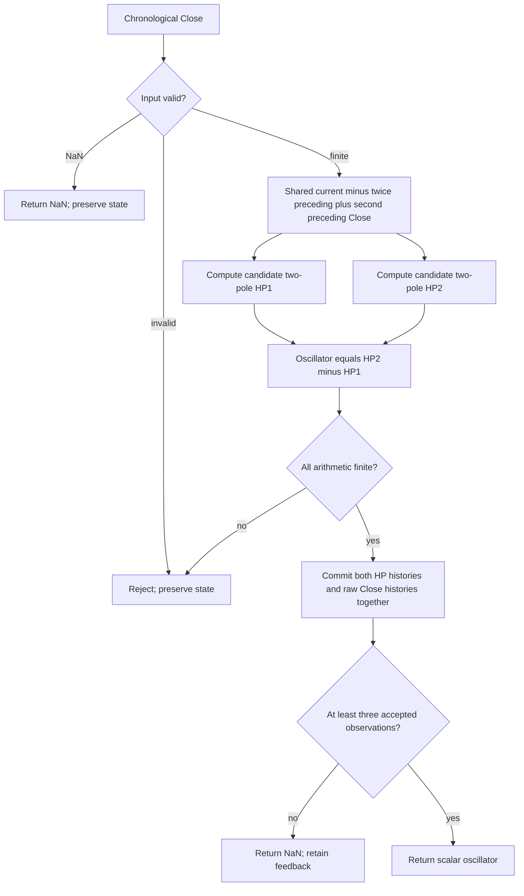

# Decycler Oscillator — Chapter 4 research prototype master

## Numerical authority and conversion scope

This is a self-contained **research prototype master reference**, based on the indicator's own listing in John F. Ehlers' *Cycle Analytics for Traders: Advanced Technical Trading Concepts* (Wiley, 2013). The Python calculation is chronological, standard-library only, and independent of other masters, zpano, NumPy and pandas. Each folder includes its complete numerical source, original source appendix, reference inputs and expected outputs for Python, Go, TypeScript, Rust and Zig. A conversion agent does not need the source book to implement the mathematics described here.

Mathematical constants have full precision: `math.pi`, `math.sqrt(2.0)` and its reciprocal replace printed `3.14159`, `1.414` and `.707` where they mean those constants. Python sine/cosine use radians; $360/P$ degrees becomes $2\pi/P$ radians. Design constants such as .25, .5, 1.5 and .991 retain their printed values. State calculations use unrounded binary64. Only the final exported literals use **15 significant digits**. Results therefore differ slightly from the original listing's truncated mathematical constants; source arithmetic ordering, signs, recurrences and guard conditions remain authoritative.

Each master is deliberately distinct from later similarly named Ehlers indicators. The Decycler is a one-pole low-pass, the Decycler Oscillator subtracts two two-pole high-pass outputs, Band-Pass uses a fixed-period resonator and its own leading trigger, and Hurst measures finite-window ranges. None is a substitute for the already prepared Chapter 11 adaptive family or spectrum filter banks.

## Stream API, state and startup

Call `update(close, time=None)` once per chronological Close. Time is accepted for interface consistency but has no numerical role. `parameters` is an immutable named tuple; `samples_seen` counts accepted observations; `warmup_bars` is the deterministic number of leading unavailable outputs; `is_primed` indicates that the required input history exists; `output` is the last accepted public result. `state` returns immutable diagnostic values, including internal results computed before public priming. `reset()` clears all histories while retaining the configuration and coefficients.

**Zero prehistory is part of this finite-record reference.** Absent Close values and declared source variables are zero. The first finite Close is accepted as standalone CurrentBar=1. Every recurrence and window calculation runs from that bar, even while public values are NaN. Do not seed histories with the first actual price, defer recurrence until priming, use public NaNs in feedback, or restart after a skipped observation. Commercial platforms may supply earlier history; matching this master requires the same initial conditions and accepted bars.

NaN represents a missing input: return an all-NaN result and preserve histories, accepted count and the previous `output`. Infinity, bool, nonnumeric input and arithmetic overflow raise `ValueError` before state mutation. All candidate downstream values are checked before commit, so a rejected update cannot leave one stage ahead of another. A missing or rejected value neither inserts a zero nor ages a finite lookback.

Public startup NaNs mark **input-history availability**, not convergence of an infinite-impulse-response filter. Coefficient periods do not specify a mandatory waiting window. A recursive filter with a period longer than 252 can still produce a valid finite-record output well before 252 bars; it may retain a large initialization transient. Changing a configured period requires a new instance rather than mutating an established stream. Future inputs never revise previously returned results.

## Shared sampled-data filter background

One Close per bar is a sampled signal. The Nyquist frequency is one-half cycle per bar, or a two-bar period. Low-pass filters retain slower changes and attenuate faster oscillations; high-pass filters remove a static term and attenuate slow changes. A band-pass combines those effects around a selected cycle period. Zeros determine exact rejected components, while poles determine recursive memory, damping and phase. A transfer function describes fixed coefficients with zero initial conditions, not a prediction of future prices.

The book's practical motivation is reduced delay without excessive aliasing noise. A first-order filter generally has weaker stop-band attenuation than a two-pole filter. For an analog-style interpretation, the recursive pole stores part of yesterday's displacement, much as a damped physical system retains energy. Cancellation is analogous to removing the rapidly varying part of a measured waveform. The resonator analogy for Band-Pass explains why sharper selectivity prolongs ringing. These are engineering explanations of the algorithm, not physical equations for market behavior.

The book discusses **spectral dilation**: market swing amplitude often grows with cycle period, approximately 6 dB per octave in its model. A single high-pass stage can then equalize rather than eliminate long-period content. This motivates two high-pass poles in the Decycler Oscillator and an additional high-pass before the Band-Pass resonator. The cited empirical approximations do not establish that every price record follows that spectral law.

## Two high-pass outputs and cancellation band

The trend-line Decycler subtracts a one-pole high-pass from Close. Listing 4-2 instead subtracts **two two-pole high-pass outputs**. Let $P_1,P_2$ be `highpass_period1` and `highpass_period2`, default 30 and 60 bars. For each $i\in\{1,2\}$ define

$$\theta_i=\frac{2\pi}{\sqrt2P_i},\quad
\alpha_i=\frac{\cos\theta_i+\sin\theta_i-1}{\cos\theta_i},\quad q_i=1-\alpha_i.$$

The printed `.707` is replaced by $1/\sqrt2$. Let the shared raw second difference be

$$\Delta^2x_t=x_t-2x_{t-1}+x_{t-2}.$$

Each high-pass stage follows the complete source recurrence:

$$h_{i,t}=(1-\alpha_i/2)^2\Delta^2x_t+2q_i h_{i,t-1}-q_i^2h_{i,t-2}.$$

The output is exactly

$$o_t=h_{2,t}-h_{1,t}.$$

Both filters have a double zero at DC, while their responses converge at high frequencies. Subtraction therefore suppresses very slow changes already rejected by both stages and cancels very fast changes passed similarly by both. The finite region between their cutoff periods remains. The full fixed-coefficient transfer function is

$$\begin{aligned}
H_i(z)&=\frac{(1-\alpha_i/2)^2(1-z^{-1})^2}{1-2q_i z^{-1}+q_i^2z^{-2}},\\
H_O(z)&=H_2(z)-H_1(z).
\end{aligned}$$

This is a cancellation band, not a fixed-coefficient copy of the Chapter 5 resonator. The equal high-frequency limits are one, including Nyquist, so subtracting them cancels the highest represented component too. The double high-pass poles offer approximately 12 dB/octave low-frequency roll-off in the relevant regime and help remove slow spectral dilation.

The independent stages have different phase and decay rates. Their difference is consequently sensitive to changes in trend slope. Chapter 4 suggests interpreting zero crossings as transitions between upward/downward trend behavior and using oscillator slope changes. These are qualitative uses; the recurrence neither forecasts a crossing nor calibrates its significance.

**Preserve the sign and the order.** The source computes the longer-cutoff `HP2` minus the shorter-cutoff `HP1`, defaults $(30,60)$. Swapping the periods produces the exact negative of the reference (apart from signed-zero representation). Equal periods cancel exactly to zero because both state histories and coefficients are identical. The master deliberately permits equality and reversed order as source-compatible cases; it never sorts the periods.

## Parameters, outputs and history requirement

| Parameter | Default | Valid range and meaning |
| --- | --- | --- |
| `highpass_period1` | 30.0 | Finite real $\ge5$ with numerically resolvable $0<q_1<1$; first high-pass. |
| `highpass_period2` | 60.0 | Finite real $\ge5$ with numerically resolvable $0<q_2<1$; second high-pass. Equality and reversed ordering are supported. |

There is no rounding to integer bars or hard upper cutoff, but poles that collapse numerically are rejected. bool is rejected. The output is an unbounded **scalar float in price units**; there is no Close division, percent multiplication, clipping, gain control or extra low-pass. The zero reference line in the source is a display choice. `state.high_pass1`, `state.high_pass2` and `state.value` expose the internal calculation.

`warmup_bars=2`: the first two public results are NaN, and bar three has a complete raw second difference. Both recursive high-pass stages calculate from bar one with absent closes and histories zero. On the first Close $x_0$, $h_{i,0}=(1-\alpha_i/2)^2x_0$, so the first internal oscillator need not be zero. The Band-Pass listing's first-two-zero rule **does not apply to this indicator**. Large periods at or beyond 252 bars keep the two-bar input-history rule.

## Calculation flow



Calculation and storage per update are $O(1)$. Each stage keeps two preceding outputs; they share two preceding closes. Coefficients are cached once. Cancellation cannot be reproduced by simply subtracting two one-pole Decycler trend lines.

## Confirmed reference combinations

All twelve cases were confirmed as part of the 48-case family plan on 2026-10-22. Each exported component has 252 values.

| Case | Parameters | What it tests |
| --- | --- | --- |
| 1 | `highpass_period1=30.0, highpass_period2=60.0` | Published two-pole high-pass pair and HP2 minus HP1 sign. |
| 2 | `highpass_period1=10.0, highpass_period2=20.0` | Short octave-spaced cancellation band. |
| 3 | `highpass_period1=20.0, highpass_period2=40.0` | Intermediate octave-spaced cancellation band. |
| 4 | `highpass_period1=20.0, highpass_period2=60.0` | Wider separation between cutoff periods. |
| 5 | `highpass_period1=40.0, highpass_period2=80.0` | Slower octave-spaced cancellation band. |
| 6 | `highpass_period1=60.0, highpass_period2=120.0` | Longer recursive high-pass histories. |
| 7 | `highpass_period1=30.5, highpass_period2=60.5` | Fractional periods for both independent coefficient sets. |
| 8 | `highpass_period1=30.0, highpass_period2=30.0` | Equal filters cancel exactly to zero. |
| 9 | `highpass_period1=60.0, highpass_period2=30.0` | Reversed period order reverses the oscillator sign. |
| 10 | `highpass_period1=5.0, highpass_period2=10.0` | Fast supported high-pass pair. |
| 11 | `highpass_period1=120.0, highpass_period2=252.0` | Long cancellation band spanning the record length. |
| 12 | `highpass_period1=252.0, highpass_period2=500.0` | Both periods at or beyond record length; recursive priming. |

## Files, reference generation and porting

`decycler-oscillator.py` contains the complete numerical calculation and marked-off fixture tooling. `description.md` is the standalone conversion specification. `test_decycler_oscillator.py` contains an independent full-history transcription of the listing and streaming/analytic checks. `verify_reference_data.py` parses all five fixture languages and compares metadata, values and NaN masks to the Python master.

The five fixtures retain the original **four 252-element OHLC arrays**, although this indicator consumes only Close. The exact Close input is also embedded inside the master's `__main__`. There are **12 expected arrays per language** in this folder: twelve parameter cases, with two components for Band-Pass and one VALUE component for each other master. Family total is 48 cases and 60 component arrays per language.

Names use shortcuts `C` (cutoff), `HP1`/`HP2` (the independent high-pass periods), `P`/`B` (center period/bandwidth), and `L`/`LP` (range length/smoothing period). Decimal points in parameter values become underscores. Example names are `EXPECTED_C60_VALUE`, `EXPECTED_HP130_HP260_VALUE`, `EXPECTED_P20_B0_3_SIGNAL`, and `EXPECTED_L30_LP20_VALUE`. Foreign names retain parameter separators: Go, TypeScript and Zig start with `expected`, while Rust uses `expected_` and lower-case tokens. Each array has the same two description/parameter comment lines in every language.

The generator writes Python first, reopens the exported literals, verifies the rounded numbers and NaNs, then translates those authoritative decimals to Go, TypeScript, Rust and Zig. NaN forms are Python `NaN = math.nan`, Go `math.NaN()`, TypeScript `NaN`, Rust `f64::NAN`, and Zig `nan` with the supplied standard math declarations. Go packages strip hyphens/underscores from the folder name. Rerunning replaces only marked expected-data sections and leaves copied input sections intact.

Run from this folder:

```sh
python3 decycler-oscillator.py
python3 decycler-oscillator.py --generate-reference-data
python3 verify_reference_data.py
python3 -m unittest discover -s . -p 'test_decycler_oscillator.py'
```

The master filename follows the folder name. To load it directly for streaming use:

```python
import importlib.util
from pathlib import Path

path = Path(__file__).resolve().parent / "decycler-oscillator.py"
spec = importlib.util.spec_from_file_location("book_master", path)
module = importlib.util.module_from_spec(spec)
spec.loader.exec_module(module)
indicator = module.DecyclerOscillator()
for close in [91.5, 94.815, 94.375, 95.095]:
    print(indicator.update(close))
```

A port needs only ordinary binary64 math, fixed histories and loops. Compare NaN placement exactly and finite values with combined absolute/relative tolerance, for example $10^{-10}$ on this shared record; libm results can vary in the last bits across languages. Internal values are unrounded. Preserving newest-first window bounds, arithmetic signs, initialization and branch ordering is more important than reproducing export formatting inside the indicator.

## Validation record

Completed on 2026-10-22:

- **8 Python tests passed** in this folder, including all twelve parameter cases against the independent listing oracle. Family total: 32 passing tests.
- `verify_reference_data.py` passed: **12 arrays and 3,024 values per language**, exact 15-significant-digit values, metadata comments, component names, NaN masks and preserved OHLC inputs across all five languages. Family total: 60 arrays / 15,120 values per language.
- All five generated fixture files regenerate **byte-for-byte identically**. Family total: twenty fixture files.
- Go, Rust and Zig compiled and ran fixture harnesses checking every exported array's length, exact NaN prefix and finite final value when present. Node loaded TypeScript with type stripping and passed the same checks; a separate TypeScript compiler was not used.
- Python sources and fixtures parse successfully, all new files pass the trailing-whitespace check, and source-document links resolve.

Source-oracle comparisons use combined absolute and relative tolerance $10^{-11}$; the fixture verifier checks the exact rounded exported values. Tests also cover invalid input/overflow without partial state commit, reset, immutable configuration, analytic or listing-specific behavior, scale behavior and exact public history boundaries.

The independent oracle recomputes coefficients and keeps full chronological variable histories; the numerical master uses bounded histories and cached coefficients. The oracle uses the same documented full-precision constants and zero-prehistory convention. Agreement with that source transcription does not imply that TradeStation itself was executed, nor that foreign-language indicator implementations have already been created. Compiler/runtime checks validate fixture source forms; the fixture parser checks every exported numeric value and comment.

## Sources and BibTeX

Numerical authority: Ehlers, *Cycle Analytics for Traders*, **Chapter 4, Listing 4-2**. Relevant theory is reproduced above and the original local source is included below. Chapter 3 Equation 3-3 supplies Hurst's final SuperSmoother; Chapter 7's spectral-dilation discussion supports the filter background. No external library implementation is imported or treated as a numerical authority.

- [Book and bibliographic record](../../2013-cycle-analytics-for-traders/toc.md).
- [Chapter 4 source](../../2013-cycle-analytics-for-traders/ch4.md), [Chapter 3 SuperSmoother](../../2013-cycle-analytics-for-traders/ch3.md), [Chapter 7 spectral dilation](../../2013-cycle-analytics-for-traders/ch7.md).

```bibtex
@Book{ehlers2013cycle,
  author = {Ehlers, John F.},
  title = {Cycle Analytics for Traders: Advanced Technical Trading Concepts},
  publisher = {Wiley},
  year = {2013},
  series = {Wiley Trading},
  isbn = {9781118728604}
}
```

## Original source appendix

The supplied Chapter 4 text and complete requested listing are reproduced below for conversion agents who will not have access to the source files. Printed constants, equations and code comments are retained; inaccuracies are identified and resolved by the mathematical/source-authority discussion above. Figure assets are omitted, and malformed caption emphasis is repaired. Both Chapter 4 listings are retained to make the one-pole/two-pole distinction explicit. This folder implements only Listing 4-2.

### Chapter 4: Decyclers

*“The wiggles have been canceled,” said Tom flatly.*

If technical analysis techniques include a detrender, then certainly there is room for its corollary, a decycler. A decycler removes the cycle components and retains only the trend components.

### Decycler Construction

The concept of a decycler is really pretty simple. The cyclic components are removed by the process of cancellation. Figure 4.1 shows the amplitude response of a high-pass filter. Note that the amplitude of the filter output is almost the same as the filter input amplitude (i.e., 0 dB). Thus, if the high-pass filter output is subtracted from the input data, the residual only contains the low-frequency components.

The transfer response of a decycler is written as the difference between input and the output of a high-pass filter as

$$H(z) = 1 - \frac{(1 - \alpha/2)(1 - z^{-1})}{1 - (1 - \alpha) z^{-1}}$$

By putting the right-hand side of this equation over a common denominator, we obtain

$$H(z) = \frac{(\alpha/2)(1 + z^{-1})}{1 - (1 - \alpha) z^{-1}}$$

This transfer response equation shows the decycler to be a one-pole ­filter because the denominator contains only a first-order polynomial. By ­examination, the decycler must closely follow the input data because there is no difference term in the numerator of the transfer response. The Easy-Language code to compute the decycler is written almost directly from the transfer response equation in Code Listing 4-1.

[Source figure omitted; its caption is retained.]

**Figure 4.1** *Frequency Response of a High-Pass Filter Having a 30-Bar Cutoff Period*

**Code Listing 4-1. EasyLanguage Code to Compute a Decycler**

```easylanguage
{
  Decycler
  © 2013 John F. Ehlers
}
Inputs:
  Cutoff(60);
Vars:
  alpha1(0),
  HP(0),
  Decycle(0);

//Highpass filter cyclic components whose periods are shorter than "cutoff" bars
alpha1 = (Cosine(360 / Cutoff) + Sine (360 / Cutoff) - 1) / Cosine(360 / Cutoff);

Decycle = (alpha1 / 2)*(Close + Close[1]) + (1- alpha1)*Decycle[1];

Plot1(Decycle);
```

### Decycler Application

The decycler removes the shorter cycle energy by cancellation, leaving the decycler output to be basically a one-pole low-pass filter. A decycler having a $30$-bar cutoff period is used as an example. The amplitude response is shown in Figure 4.2, and the lag is shown in Figure 4.3. The amplitude response confirms the $6$-dB-per-octave attenuation roll-off rate of a single-pole filter. For example, the response at a frequency of $0.1$ bars per cycle is approximately $−10$ dB, and the response one octave higher at a frequency of $0.2$ bars per cycle is approximately $−16$ dB.

[Source figure omitted; its caption is retained.]

**Figure 4.2** *Amplitude Response of a Decycler Having a 30-Bar Cutoff Period*

[Source figure omitted; its caption is retained.]

**Figure 4.3** *Lag of a Decycler Having a 30-Bar Cutoff Period*

The really important characteristic of the decycler is its exceptionally
low lag. The very longest cycle components are delayed less than five bars,
and at a frequency of 0.05 cycles per bar (a 20-bar cycle period), the lag is
on the order of 1.5 bars. Higher-frequency components are delayed even
less. The end result is the higher-frequency wiggles that make it through
the filter attenuation are roughly coincident with the wiggles in the price
itself. This feature makes the decycler an ideal “instantaneous trend line” that
­accurately portrays the trend of the data.

A similar smoothed filter output can be produced using a SuperSmoother
filter. However, when the results of the decycler are compared to those
of the SuperSmoother, the decycler will always have less lag. However, a
decycler is only a one-pole filter and therefore has inferior filtering capa-
bilities. Therefore, a decycler should not be used as a smoothing filter to
remove aliasing noise. Rather, its role should be relegated to producing an
instantaneous trend line where the selected cutoff period is relatively large.
The large cutoff period enables the decycler to attenuate the aliasing noise
because it is many octaves away from the Nyquist frequency.

It is certainly possible to create a decycler by subtracting a two-pole high-
pass filter output from the input data. In fact, such a decycler has some
­interesting properties because the long cycle components have substan-
tial lag, while the short cycle components continue to have minimal lag.
­However, interpretation of the indicator is more difficult because the larger
spread in lag across the spectrum. Therefore, only the single-pole decycler
is recommended for use as instantaneous trend lines.

### Decycler Oscillator

A decycler oscillator is created by subtracting the output of a high-pass filter having a shorter cutoff period from the output of another high-pass filter having a longer cutoff period. This way, both elements have a zero in their transfer responses at zero frequency. Thus, the very, very long cycle components (and the static term) are removed. There is a finite difference between the output of the two filters in the frequency range between their cutoff periods, but shorter cycle components are still removed by cancellation. As a result, the trend line is displayed as an oscillator. The EasyLanguage code to compute the decycler oscillator is shown in Code Listing 4-2.

**Code Listing 4-2. EasyLanguage Code for Decycler Oscillator**

```easylanguage
{
  Decycler Oscillator
  © 2013 John F. Ehlers
}
Inputs:
  HPPeriod1(30),
  HPPeriod2(60);
Vars:
  alpha1(0),
  alpha2(0),
  HP1(0),
  HP2(0),
  Decycle(0);

alpha1 = (Cosine(.707*360 / HPPeriod1) + Sine (.707*360 / HPPeriod1) - 1) / Cosine(.707*360 / HPPeriod1);

alpha2 = (Cosine(.707*360 / HPPeriod2) + Sine (.707*360 / HPPeriod2) - 1) / Cosine(.707*360 / HPPeriod2);

HP1 = (1 - alpha1 / 2)*(1 - alpha1 / 2)*(Close - 2*Close[1] + Close[2]) + 2*(1 - alpha1)*HP1[1] - (1 - alpha1)* (1 - alpha1)*HP1[2];

HP2 = (1 - alpha2 / 2)*(1 - alpha2 / 2)*(Close - 2*Close[1] + Close[2]) + 2*(1 - alpha2)*HP2[1] - (1 - alpha2)*(1 - alpha2)*HP2[2];

Decycle = HP2 - HP1;

Plot1(Decycle);
Plot2(0);
```

The decycler oscillator can be useful for determining the transition between uptrends and downtrends by the crossing of the zero line. Alternatively, the changes of slope of the decycler oscillator are easier to identify than the changes in slope of the original decycler. Optimum cutoff periods can easily be found by experimentation. The decycler and decycler oscillator examples are shown in Figure 4.4, where the cutoff period is $30$ bars. In the case of the decycler oscillator, the longer cutoff period is set to be $60$ bars.

[Source figure omitted; its caption is retained.]

**Figure 4.4** *Both Decyclers Show the Instantaneous Trend with Minimum Lag*

### Key Points to Remember

1. A decycler filter functions the same as a low-pass filter.
2. A decycler filter is created by subtracting the output of a high-pass filter from the input, thereby removing the high-frequency components by cancellation.
3. A decycler filter has very low lag.
4. A decycler oscillator is created by subtracting the output of a high-pass filter having a shorter cutoff period from the output of another high-pass filter having a longer cutoff period.
5. A decycler oscillator shows transitions between uptrends and downtrends at the zero crossings.
