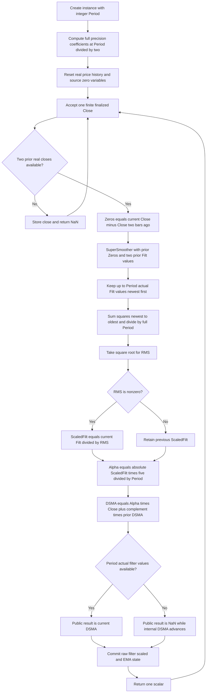

# Ehlers Deviation-Scaled Moving Average (DSMA) — RMS-adaptive price smoothing

This folder is the **research prototype master reference** for John F. Ehlers' “The Deviation-Scaled Moving Average,” *Technical Analysis of Stocks & Commodities*, volume 36, number 7, July 2018, pages 8–11, and the accompanying Mesa paper. The executable master is [deviation-scaled-moving-average.py](deviation-scaled-moving-average.py). `DeviationScaledMovingAverage.update(close)` consumes one chronological finalized price and returns one scalar adaptive moving average in price units. It uses only Python's standard library.

The pipeline is **two-bar raw-price difference → two-pole SuperSmoother → rolling root mean square → magnitude in RMS units → adaptive EMA of raw price**. The sole parameter is `period`, default **40**. It controls the RMS window and the SuperSmoother period, which is exactly `period / 2`. Diagnostic values are available through `state`; they are not additional indicator outputs.

**Reference-data status:** the user confirmed all twenty periods on **2026-10-20**. All five language fixtures now contain twenty expected arrays with 252 entries each, 15-significant-digit finite values, and the documented warmup NaNs. All original input values are preserved, and all 252 original `INPUT_CLOSE` values are embedded in `__main__`. Cross-language equality and repeatable regeneration have been verified.

## 1. Sources and numerical authority

The locally supplied sources read for this reference are:

1. [July 2018 TASC article](../../tasc/2018-07-the-deviation-scaled-moving-average/content.md): EMA equation, approximate critical-period alpha, zeros oscillator, RMS normalization, complete EasyLanguage listing, and interpretation.
2. [Mesa DSMA paper](../../tasc/2018-07-the-deviation-scaled-moving-average/mesa/content.md): the same derivation and listing, with an explicit `If RMS <> 0 Then ScaledFilt = Filt / RMS` guard.
3. [July 2018 Traders' Tips](../../tasc/2018-07-the-deviation-scaled-moving-average/tips/tips.md), especially the explicit [TradeStation function](../../tasc/2018-07-the-deviation-scaled-moving-average/tips/DSMA.els), [NinjaTrader listing](../../tasc/2018-07-the-deviation-scaled-moving-average/tips/ninja-trader/DSMA.cs), [eSignal listing](../../tasc/2018-07-the-deviation-scaled-moving-average/tips/DSMA.efs), [TradersStudio listing](../../tasc/2018-07-the-deviation-scaled-moving-average/tips/DSMA.trs), [AmiBroker listing](../../tasc/2018-07-the-deviation-scaled-moving-average/tips/DSMA.afl), [JuicyCharts listing](../../tasc/2018-07-the-deviation-scaled-moving-average/tips/DSMA.js), and [MetaStock formula](../../tasc/2018-07-the-deviation-scaled-moving-average/tips/DSMA.txt).
4. Ehlers, *Cycle Analytics for Traders* (2013), [Chapter 3, “Smoothing Filters on Steroids”](../../2013-cycle-analytics-for-traders/ch3.md), particularly SuperSmoother equation (3-3), and [Chapter 7, “Spectral Dilation”](../../2013-cycle-analytics-for-traders/ch7.md) for the spectrum and zero-mean qualifications.

The **Mesa / TradeStation equations** define the arithmetic, including retention of the prior scaled filter on exactly zero RMS. The article omits that guard; its unguarded division has no finite meaning on an all-zero oscillator window. The guarded listing is another original Ehlers source, not an invented alternate indicator.

The finite-record seed is explicit here: skip the first two raw closes, then calculate the first filter with zero previous oscillator and filter values, and calculate the adaptive EMA with previous DSMA equal to zero. This agrees with the initialized arrays and first difference index in NinjaTrader, combined with the Mesa zero-RMS guard. Public output is masked until a complete actual RMS window exists. This masking does not delay the internal EMA recurrence. Section 5 specifies every seed and index; a port must follow it.

**Precision:** replace `1.414` with $\sqrt{2}$ and `3.14159` with $\pi$, using `math.sqrt(2.0)` and `math.pi`. Convert the source's degree-based cosine to radians consistently. The literal `5` in alpha and the literal half-period are design choices, not approximations to mathematical constants, and remain unchanged. Binary64 state is never rounded; only expected-data text uses 15 significant decimal digits.

These substitutions and the declared finite-history convention mean equality refers to the original equations with the stated constants and seeds. Rounded-constant vendor binaries or a chart with hidden prehistory can differ in their low bits and startup. No supplied executable commercial platform was run. Verification uses an independent absolute-index transcription of the listings.

## 2. Principles and physical analogies

### 2.1 An EMA as a reservoir with an adjustable valve

The article and Mesa paper start with the EMA:

$$
Y_t=\alpha p_t+(1-\alpha)Y_{t-1}.
$$

For $0\le\alpha\le1$, imagine a reservoir whose current level is $Y_{t-1}$ and whose incoming level is $p_t$. The valve admits fraction $\alpha$ of the new reading. A small valve setting retains most of the previous level and produces heavy smoothing. A large setting follows the new reading faster. DSMA measures the oscillator's current strength relative to its recent RMS, then uses that measurement to set the valve each bar.

The analogy becomes extrapolation if alpha exceeds one: the old level receives a negative weight. The code permits that; the article's general EMA discussion describes $\alpha$ between zero and one, but its adaptive formula contains no clamp. A port must not quietly add a clamp.

### 2.2 Separate the direction measurement from the price being averaged

The oscillator is a **signed two-bar difference of raw prices**. Smoothing that oscillator reduces rapid fluctuations, and RMS supplies a reference amplitude. Taking the absolute value of the normalized result makes alpha nonnegative and removes directional preference: large positive and negative oscillator excursions both increase responsiveness.

The final EMA is applied to **raw Close**, not to the oscillator or its smoothed waveform. Thus the output remains a price-level overlay rather than an oscillator. The sign of the measured movement does not become the sign of alpha.

### 2.3 Spectrum equalization and the zeros oscillator

Under Ehlers' approximate market-spectrum model, long-period cyclic components have larger amplitudes: doubling cycle period increases amplitude by about a factor of two, or $20\log_{10}2\approx6.0206$ dB. A differentiating response decreases long-period amplitude at approximately the opposite rate, making the resulting spectrum more level. The zeros oscillator supplies this differentiation at low frequencies and rejects the exactly alternating sampled component at Nyquist.

In a mechanical analogy, position corresponds to price and a difference of positions measures displacement over an interval. A constant position gives zero displacement. A constant-speed ramp, however, gives **constant nonzero** displacement. The oscillator is nominally zero mean for the intended cyclical/stochastic inputs; it is not guaranteed to have zero mean for every finite record or trend.

Chapter 7 explains that a single differentiating/high-pass stage can equalize spectral dilation while still retaining low-frequency components. Consequently, the article's “no spectral distortion” language should not be read as a flat transfer function at all frequencies or a proof of exact zero mean. This DSMA uses the literal two-bar difference; it does not add the book's separate two-pole roofing filter.

### 2.4 The SuperSmoother as a damped resonator

The filter has two recursive memory values. Its poles are a damped complex-conjugate pair, and its input average introduces a zero at Nyquist. It suppresses short-period fluctuations while retaining the oscillator's slower movement. Chapter 3 contrasts its sharper transition and comparatively low lag with nonrecursive moving averages, while noting that recursive-filter delay varies with frequency.

For DSMA, the smoother's critical-period parameter is **half** the user period, retaining responsiveness. It is independent of the current oscillator amplitude. Compute its coefficients once per instance rather than every bar.

### 2.5 RMS as a reference ruler

Think of RMS as a ruler calibrated to the oscillator's recent energy. The ratio $f_t/R_t$ tells how large the **current** filtered movement is relative to that ruler. Alpha depends on this ratio, not on absolute RMS alone. If the whole input stream is multiplied by a fixed nonzero scale, the oscillator and RMS magnitudes scale together, leaving the ideal alpha sequence unchanged.

A large RMS by itself does not imply a large alpha. Holding $f_t$ fixed while increasing RMS decreases alpha. The article's prose about larger RMS and larger alpha is a qualitative account of joint movement; its actual formula is the authority.

The RMS window measures energy, not a sample standard deviation around an explicitly estimated mean. Do not replace it with a standard-deviation library call. A linear price ramp makes filtered displacement approach a nonzero constant, its RMS approach that same magnitude, and alpha approach $5/P$, whereas centered standard deviation would approach zero.

## 3. Complete mathematical calculation

### 3.1 Symbols and units

| Symbol | Source name | Meaning |
|---|---|---|
| $t$ | Bar index | Chronological zero-based index; first input is $t=0$. |
| $p_t$ | `Close` | Raw price, in price units. |
| $P$ | `Period` | Integer RMS window and approximate EMA critical-period parameter. |
| $T=P/2$ | `.5*Period` | SuperSmoother coefficient period, possibly fractional. |
| $z_t$ | `Zeros` | Raw two-bar price difference. |
| $f_t$ | `Filt` | Smoothed zeros oscillator, in price units. |
| $Q_t$ | RMS square sum | Sum of $P$ squared filtered samples. |
| $R_t$ | `RMS` | Zero-centered root mean square, in price units. |
| $s_t$ | `ScaledFilt` | Persistent signed filtered value in RMS units. |
| $\alpha_t$ | `alpha1` | Nonnegative, dimensionless adaptive EMA weight. |
| $Y_t$ | `DSMA` | Recursive adaptive moving average, in price units. |

### 3.2 Critical period and fixed-alpha reference

A critical frequency conventionally marks half-power transmission, $|H|^2=1/2$, or $10\log_{10}(1/2)\approx-3.0103$ dB. A cycle period $P$ bars corresponds to frequency $1/P$ cycles per bar and angular frequency $2\pi/P$ radians per bar. The article's approximation is:

$$
\alpha_0=\frac{5}{P}.
$$

A fixed-alpha EMA's transfer function, derived directly from the article's EMA equation, is:

$$
H_{\mathrm{EMA}}(z)=\frac{\alpha}{1-(1-\alpha)z^{-1}}.
$$

For a stable conventional EMA with $0<\alpha<1$:

$$
|H_{\mathrm{EMA}}(e^{i\omega})|^2=
\frac{\alpha^2}{1+(1-\alpha)^2-2(1-\alpha)\cos\omega}.
$$

Solving the exact half-power condition at $\omega_c$ gives, with $d=1-\cos\omega_c$:

$$
\alpha_{\mathrm{exact}}=-d+\sqrt{d^2+2d}.
$$

This is a mathematical comparison, **not an alternate implementation**. DSMA uses the article's $5/P$ approximation. Moreover, the adaptive filter is time varying and has no single fixed transfer response or fixed lag over the whole stream. $P$ is not an EMA span such as the common $2/(P+1)$ convention.

### 3.3 Two-bar difference and its spectral response

The complete source difference is:

$$
z_t=p_t-p_{t-2}.
$$

Its transfer function and sampled-frequency response are:

$$
H_Z(z)=1-z^{-2}=(1-z^{-1})(1+z^{-1}),
$$

$$
H_Z(e^{i\omega})=2i e^{-i\omega}\sin\omega,
\qquad |H_Z(e^{i\omega})|=2|\sin\omega|.
$$

At DC, $\omega=0$, the response is zero. At Nyquist, $\omega=\pi$ radians per bar or $0.5$ cycles per bar, the response is also zero. Nyquist has a **two-bar cycle period**; frequency and period should not be mixed. For a one-bar difference:

$$
H_1(z)=1-z^{-1},\qquad |H_1(e^{i\omega})|=2|\sin(\omega/2)|.
$$

Its Nyquist amplitude gain is two, approximately $+6.0206$ dB, whereas $H_Z$ rejects that component. Rejection of exactly Nyquist does not recover information that has already aliased into other frequencies.

For a long-period sinusoid $p_t=A\cos(\omega t)$ with $\omega=2\pi/C$:

$$
z_t=-2A\sin\omega\sin(\omega(t-1)),
\qquad A_Z=2A|\sin(2\pi/C)|\approx\frac{4\pi A}{C}.
$$

If the idealized price amplitude grows as $A(C)\propto C$, the long-period differenced amplitude is approximately constant. This derives the article's spectral-whitening argument. Real market spectra need not obey that exact amplitude law.

### 3.4 SuperSmoother: all coefficients and recurrence

The DSMA article / Mesa code uses Chapter 3's two-pole SuperSmoother equation (3-3), with its `Period` replaced by $T=P/2$. Written at full mathematical precision:

$$
\begin{aligned}
T&=\frac{P}{2},\\
\theta&=\frac{\sqrt{2}\pi}{T}=\frac{2\sqrt{2}\pi}{P},\\
a_1&=e^{-\theta},\\
b_1&=2a_1\cos\theta,\\
c_2&=b_1,\\
c_3&=-a_1^2,\\
c_1&=1-c_2-c_3,\\
f_t&=c_1\frac{z_t+z_{t-1}}{2}+c_2f_{t-1}+c_3f_{t-2}.
\end{aligned}
$$

EasyLanguage `Cosine` is degree based. Its full-precision argument is $\sqrt{2}\cdot180/T$ degrees, which becomes $\sqrt{2}\pi/T$ radians. Python and the target-language standard math libraries use the radian argument directly. Preserve the source order `c1 * (zeros + previous_zeros) / 2`, followed by the two signed recursive terms. Since $c_3<0$, it is **added as a negative product**.

The transfer function, pole positions, and combined oscillator response are useful direct derivations:

$$
H_{SS}(z)=\frac{\frac{c_1}{2}(1+z^{-1})}
{1-c_2z^{-1}-c_3z^{-2}},
\qquad \lambda_\pm=a_1e^{\pm i\theta},
$$

$$
H_F(z)=H_Z(z)H_{SS}(z)
=\frac{\frac{c_1}{2}(1-z^{-1})(1+z^{-1})^2}
{1-c_2z^{-1}-c_3z^{-2}}.
$$

The smoother has unit DC gain because $c_1=1-c_2-c_3$, although the combined difference/smoother has zero DC gain. The combined numerator has one DC zero and a double Nyquist zero. In exact arithmetic the pole radius is $a_1<1$ for positive finite $P$; excessively large periods may round coefficients into an unusable configuration and are rejected by this master. Positive small periods still produce algebraic coefficients, but the critical-period interpretation is intended for usable sampled cycle periods rather than a cutoff below Nyquist.

### 3.5 RMS, standard deviation, and persistent normalization

The source resets the accumulator and visits the newest sample first:

$$
Q_t=\sum_{k=0}^{P-1} f_{t-k}^2,
\qquad R_t=\sqrt{\frac{Q_t}{P}}.
$$

In executable source order, begin with $Q=0$ and repeat $Q\leftarrow Q+f_{t-k}f_{t-k}$ for $k=0,1,\ldots,P-1$. This order is part of the binary64 reference. Do not substitute a rolling-energy subtraction/addition or compensated summation when exact master rounding matters.

The connection to standard deviation is:

$$
\bar f_t=\frac{1}{P}\sum_{k=0}^{P-1}f_{t-k},\qquad
\sigma_t^2=\frac{1}{P}\sum_{k=0}^{P-1}(f_{t-k}-\bar f_t)^2,
$$

$$
R_t^2=\sigma_t^2+\bar f_t^2.
$$

Thus RMS equals the population standard deviation when the measured mean is exactly zero. DSMA assumes a **nominal** zero mean and calculates RMS without estimating or subtracting the mean. It never divides by $P-1$.

The guarded Mesa / TradeStation normalization is the complete piecewise equation:

$$
s_t=\begin{cases}
f_t/R_t,& R_t\ne0,\\
s_{t-1},& R_t=0,
\end{cases}
\qquad s_{\mathrm{initial}}=0.
$$

An all-zero window from reset therefore leaves $s_t=0$. If an exactly zero-energy window occurs after earlier activity, the last normalized value is retained. Do not add an epsilon, clear the value, or replace the result with a NaN. Ordinary tiny RMS is not exactly zero. Squaring very tiny numbers can underflow in binary64; the master follows the literal source arithmetic and guard rather than a rescaled norm algorithm.

### 3.6 Adaptive alpha and price output

The remaining complete article / Mesa equations are:

$$
\alpha_t=\frac{5|s_t|}{P},
$$

$$
Y_t=\alpha_tp_t+(1-\alpha_t)Y_{t-1}.
$$

For $|s_t|=1$, alpha equals $5/P$, exactly the article's baseline EMA alpha approximation. For smaller normalized amplitude the output retains more prior state. For larger normalized amplitude it follows current price faster and can extrapolate when alpha exceeds one.

For a nonzero RMS window that includes the current filtered observation:

$$
Q_t\ge f_t^2\ \Longrightarrow\ |s_t|\le\sqrt{P}
\ \Longrightarrow\ 0\le\alpha_t\le\frac{5}{\sqrt{P}}.
$$

The bound also applies to a previously retained scaled value in ideal arithmetic, since it was obtained from a prior window of the same size. Consequently:

- $P\ge25$ implies $\alpha_t\le1$ in exact arithmetic.
- $P=25$ is the boundary; $P>25$ gives a strict upper bound below one.
- $P<25$ permits negative previous-output weight and overshoot.
- $P\le6$ permits alpha above two. For a fixed alpha, the homogeneous error factor is $1-\alpha$, so alpha above two has magnitude above one. A time-varying filter's behavior depends on the product of successive factors, not merely one excursion.

For $P=1$ and nonzero RMS, $|s_t|=1$, alpha is five, and $Y_t=5p_t-4Y_{t-1}$ can grow rapidly. The supplied 252-value record remains finite for this case, but the growth is deliberately preserved to expose an accidental clamp in a future port. It is an algebraic stress case rather than a recommended market setting.

There is no alpha cap, amplitude clip, fixed fallback alpha, or extra output smoother in the source. Do not change $5|s|/P$ to $5|f|P^{-1}$, $5R/P$, or $5/(PR)$. Preserve both multiplications and the addition in the final EMA instead of rewriting it as `previous + alpha * (price - previous)`.

## 4. Configuration and public interface

| Setting | Default | Valid values in this master | Effect |
|---|---:|---|---|
| `period` (`Period`, `P`) | 40 | Python integer $P\ge1$, excluding booleans; coefficients must remain representably stable. | Sets RMS window to $P$, smoother period to $P/2$, alpha scale to $5/P$. |
| `smooth_period` | 20 | Read-only derived value $P/2$. | Odd $P$ produces a fractional coefficient period; no rounding. |
| Input `close` | — | One finite real scalar per accepted update. | Raw price for the difference and final EMA. |

TradeStation requires `Period > 0`. Other vendor interfaces choose minima of two or three. This master accepts the positive-integer algebraic domain and identifies its short-period consequences. A practical starting point is the article's 40; values at least 25 guarantee the ideal alpha upper bound of one. Periods greater than the record length are valid but may never produce a public value in that record.

`update(close)` returns a float. `output` is the most recent public result. `is_primed` becomes true once $P$ actual filter values exist, even if they are all zero. `warmup_bars` is $P+1$. `reset()` clears all history and returns the instance to its zero-variable seeds while retaining the parameter.

`state` is a named tuple with `zeros`, `filtered`, `rms`, `scaled_filtered`, `alpha`, `recursive_dsma`, and public `dsma`. The first two inputs leave all fields unavailable. From index two, the internal fields are finite during RMS fill; only `dsma` remains NaN. These diagnostics make it possible to locate another language's first divergence without changing the scalar output contract.

NaN and infinity inputs or nonfinite intermediate arithmetic raise `ValueError` before consuming a bar. Finite data after rejection continue with the previous state. Extremely large or tiny magnitudes follow ordinary binary64 limits; the master does not add non-source numerical rescaling. A fresh instance is an independent stream. There is no backfill, intrabar replacement, automatic reset on an input gap, or timestamp parameter.

## 5. Exact finite-record startup

Recursive listings have state even before meaningful public output exists. To make every one of the 252 reference entries reproducible, use this exact convention:

1. At $t=0$ and $t=1$, store real closes only and return NaN. `Close[2]` does not exist yet.
2. At $t=2$, compute $z_2=p_2-p_0$. Use the source variable seed $z_1=0$ and filter seeds $f_1=f_0=0$. These are recursive initialization values, not fabricated raw closes.
3. Starting at $t=2$, compute the filter, RMS, normalization, alpha, and EMA every accepted bar. Initialize $s=0$ and $Y_1=0$ as in the source declarations.
4. During RMS fill, fewer than $P$ actual filter samples exist. Missing older filter entries have source zero values, and RMS still divides by **$P$**, not by the fill count. The internal EMA already advances.
5. Mask the scalar output with NaN until $P$ actual filter samples exist. The first actual filter index is two; its $P$th value is at $t=P+1$. That bar's already-computed DSMA is the first public result.

| Stage | First real index | Seed or requirement |
|---|---:|---|
| Raw Close | 0 | No fabricated pre-record Close. |
| Two-bar difference | 2 | Three real prices; previous difference seed zero. |
| SuperSmoother | 2 | Two zero recursive filter lags. |
| Partial RMS and internal adaptive EMA | 2 | Full-$P$ denominator; previous DSMA zero. |
| Complete RMS and public output | $P+1$ | $P$ actual filtered samples. |

For a record of length $M$:

$$
\text{NaN prefix}=\min(P+1,M),\qquad
\text{public value count}=\max(0,M-P-1).
$$

At the default $P=40$, there are **41 NaNs and 211 finite outputs** on the 252-input record. $P=249$ gives two final public values; $P=250$ gives one; $P=251$ gives none.

This differs from waiting for both current and previous **actual** differences before computing the first filter, which would delay it by a bar and change its transient. It also differs from postponing the EMA until the window is full or seeding it with the first current/prior close. The master preserves the source zero-variable EMA recurrence and masks availability separately.

A constant-price record from reset makes every oscillator and alpha value zero. Since previous DSMA starts at zero, public DSMA remains **zero**, even if the constant price is 100. An exactly alternating two-bar price sequence has the same result because its two-bar difference is zero. Seeding DSMA at price would improve that particular visual behavior but would produce a different finite-record reference and is not done here.

The oscillator and alpha are invariant to adding a constant to every raw price, but the output is not exactly translation invariant during the zero-seed transient. With an input offset $b$ and the same alpha sequence, the output offset obeys:

$$
D_t=\alpha_tb+(1-\alpha_t)D_{t-1},\qquad D_1=0,
$$

$$
D_t=b\left(1-\prod_{j=2}^{t}(1-\alpha_j)\right).
$$

This explains the source seed's transient without modifying it. Multiplying all prices by a fixed nonzero scale multiplies the ideal DSMA by that scale; alpha is unchanged. Binary64 ties, underflow, and overflow can affect these identities numerically.

## 6. Vendor differences that affect reproducibility

| Source | Material behavior | Decision in this master |
|---|---|---|
| TASC article | Unguarded `ScaledFilt = Filt / RMS`; default 40; variables initialize to zero. | Same equations, with Mesa / TradeStation guard for zero RMS. |
| Mesa paper | Guard retains persistent `ScaledFilt` at zero RMS. | Numerical authority for the guard and all DSMA equations. |
| TradeStation `DSMA.els` | Guarded function; validates positive period; indicator 40, strategy fast 40 / slow 100; recursive variables zero. | Preserve arithmetic and seeds; one scalar, no strategy or alert outputs. |
| NinjaTrader `DSMA.cs` | Starts at zero-based index 2 with zero oscillator/filter/plot arrays; includes initialized filter zeros in RMS; immediately publishes; division unguarded. | Same first-filter/EMA zero seed; guarded normalization; public output masked until full actual window. |
| eSignal `DSMA.efs` | Already uses `Math.SQRT2` / `Math.PI`; waits for actual previous difference; RMS helper also checks one older value beyond its sum; main has a prior-price seed attempt. | Use full-precision constants; keep declared master startup rather than these distinct gates/seeds. |
| TradersStudio `DSMA.trs` | Guarded zero RMS and guarded period division. | Same guarded DSMA recurrence; positive integer period validated once. |
| AmiBroker `DSMA.afl` | Uses `IIR`, `Sum`, and `AMA` platform functions, truncated sqrt-two and a rounded pi literal. | Explicit recurrence and ordinary source-ordered sum; no assumptions about hidden platform seed rules. |
| JuicyCharts `DSMA.js` | Default 30, initializes filter array to **one**, oscillator to zero, seeds EMA from `source[period-1]`, starts output at `n=period`. | Include period 30 as a parameter comparison; retain zero-filter and zero-EMA seed rather than that alternate transient. |
| MetaStock `DSMA.txt` | Uses `Std(filt,tp)` instead of literal RMS; returns Close during its initial gate. | Preserve source uncentered RMS and NaN availability; centered standard deviation changes the algorithm. |

Wealth-Lab and NeuroShell tips use libraries rather than a locally visible complete arithmetic listing. The thinkorswim tip links to an externally hosted study without embedding its code. The Excel workbook is supplied as a binary spreadsheet, and its formulas are not used as the numerical authority. No dependencies or network downloads are needed to reproduce this reference.

## 7. Algorithmic calculation flow



Input checks and intermediate finiteness checks occur before commit. The first two valid inputs only fill raw history. Private zero seeds and public NaN availability are separate. State stores at most two raw prices, one previous difference, two filter lags, $P$ actual filter observations, persistent scaled value, and persistent EMA value. Work and storage are $O(P)$ per update; this transparent direct summation avoids a rolling accumulator's rounding drift and requires no scientific library.

## 8. Confirmed reference cases and five-language fixture contract

There is one source configuration parameter. All **20 cases** below were confirmed by the user on 2026-10-20 and generated, below the limit of 64. `P` abbreviates `period`; e.g. the default array is `EXPECTED_P40`. No arbitrary smoothing, clipping, or fallback parameter is added.

| Python array | Period | What it tests |
|---|---:|---|
| `EXPECTED_P40` | 40 | Article, Mesa, and TradeStation default critical period. |
| `EXPECTED_P1` | 1 | Minimum algebraic period: alpha equals five on nonzero RMS and growth is preserved. |
| `EXPECTED_P2` | 2 | Very short period: unclamped alpha can exceed two and amplify recursion. |
| `EXPECTED_P3` | 3 | Odd short period: half-period smoothing and unclamped overshoot. |
| `EXPECTED_P5` | 5 | Five-bar RMS window with an odd half-period smoother. |
| `EXPECTED_P8` | 8 | Fast eight-bar adaptation with a four-bar smoother. |
| `EXPECTED_P10` | 10 | Short ten-bar critical period and five-bar smoother. |
| `EXPECTED_P14` | 14 | Intermediate fourteen-bar responsiveness. |
| `EXPECTED_P20` | 20 | Twenty-bar critical period with possible alpha above one. |
| `EXPECTED_P24` | 24 | Just below the theoretical alpha-at-most-one boundary. |
| `EXPECTED_P25` | 25 | Exact theoretical alpha-at-most-one boundary with a 12.5-bar smoother. |
| `EXPECTED_P26` | 26 | Just above the boundary: alpha strictly below one. |
| `EXPECTED_P30` | 30 | JuicyCharts default period and moderately fast adaptation. |
| `EXPECTED_P50` | 50 | Moderately slower adaptation than the article default. |
| `EXPECTED_P80` | 80 | Long eighty-bar RMS window and forty-bar smoother. |
| `EXPECTED_P100` | 100 | TradeStation strategy slow period with an alpha upper bound of one half. |
| `EXPECTED_P200` | 200 | Long-history smoothing with fifty-one primed observations. |
| `EXPECTED_P249` | 249 | Record boundary: only the final two observations are primed. |
| `EXPECTED_P250` | 250 | Record boundary: only the final observation is primed. |
| `EXPECTED_P251` | 251 | Record boundary: every output remains unprimed. |

Every case emits **252 scalar DSMA values**. The NaN prefix is $\min(P+1,252)$, and every subsequent output is finite for the supplied input. Short-period growth is represented at the same 15-significant-digit precision as all other finite values; it is not clipped or omitted.

Before each expected array, the first comment copies the exact “What it tests” text above. The second comment gives `period=<P>`. Finite literals use `.15g`, meaning 15 significant digits rather than 15 digits after the decimal point. Integer-valued floats include `.0` where needed for portable Rust/Zig syntax. Recursive state uses full binary64 precision.

The generator appends the Python arrays and **reopens and verifies the written master fixture**: unique names, 252 values, exact NaN prefix, finite remainder, and 15-digit text rounding. Those verified written values become the source for all four translations. The original Close/High/Low/Open arrays remain intact; the indicator consumes only Close.

| File | Example declaration | NaN spelling |
|---|---|---|
| `test_testdata.py` | `EXPECTED_P40 = [...]` | `NaN`, an alias of `math.nan` |
| `testdata_test.go` | `var expectedP40 = []float64{...}` | `math.NaN()` with `import "math"` |
| `testdata.ts` | `export const expectedP40: number[] = [...]` | `NaN` |
| `testdata.rs` | `pub fn expected_p40() -> Vec<f64>` | `f64::NAN` |
| `testdata.zig` | `pub fn expectedP40() [252]f64` returning `.{...}` | `nan`, from `math.nan(f64)` |

Go package becomes `deviationscaledmovingaverage`, the lowercase indicator name with separators removed. TypeScript preserves the existing valid `export const testInput: number[]` input declaration. Rust preserves the original `#[cfg(test)] pub mod testdata` input module, with expected helpers at file scope; original inputs are called through `testdata::test_input()`. Zig keeps `const math = @import("std").math;` and `const nan = math.nan(f64);` at the top. The examples in the request containing `math.Nan()`, `f64:NAN`, or function-like TypeScript const syntax are implemented with the valid language spellings above.

Run the demonstration without changing fixture data:

```bash
python3 deviation-scaled-moving-average.py
```

Confirmation is recorded in `REFERENCE_CASES_CONFIRMED = True`. Regenerate all five language files with:

```bash
python3 deviation-scaled-moving-average.py --generate-reference-data
```

Reruns replace only the `BEGIN/END GENERATED DSMA EXPECTED DATA` section, preventing duplicate arrays. Compare unavailable values using `isnan`. For finite ported outputs, use an absolute and relative tolerance such as $5\cdot10^{-13}$; the growing $P=1$ case particularly requires a relative tolerance. First preserve operation grouping and investigate intermediate divergence; widening a tolerance should not hide a different recurrence.

## 9. Verification and conversion pitfalls

The standard-library suite [test_deviation_scaled_moving_average.py](test_deviation_scaled_moving_average.py) passes **13 tests**. It compares every confirmed period and all seven diagnostic fields with an independent absolute-index source translation, including explicit zero filter prehistory in its full-$P$ RMS loop, and compares all written Python expected arrays against that translation. It also checks exact startup, pre-public EMA advancement, source zero-seed behavior on constant and Nyquist inputs, unclamped period-one growth, the theoretical alpha boundary, uncentered RMS on a ramp, exact zero-RMS retention, scaling/negation symmetry, rejection without state advancement, reset/replay, parameter validation, all original inputs, and embedded Close equality.

The generator test uses temporary fixture copies, reopens generated Python arrays, compares them to the independent source translation, and checks byte-for-byte stable regeneration of all five files. It temporarily clears the in-memory confirmation flag to verify that an unconfirmed table cannot write files, while preserving the recorded authorization.

Every translated production array has been checked against the reopened Python fixture: twenty unique names, both comment lines, exactly 252 values, matching finite decimal values, correct NaN prefixes, and finite tails. Original Close/High/Low/Open values are preserved. Each file contains exactly one generated section, and regeneration in a temporary copy is byte-for-byte stable across all five files.

Go, Rust, and Zig compiler/execution checks passed with every expected helper instantiated, including the growing short-period cases and the entirely unprimed case. The TypeScript fixture was imported and executed with Node.js native type stripping; every expected array exactly matched Python and every original input array was preserved. This checks executable syntax rather than a separate TypeScript compiler type check. Verification harnesses and build caches were kept outside the reference folder.

Typical porting errors include using a one-bar difference, changing the fixed difference lag to `Period`, taking absolute value before the SuperSmoother, integer-dividing odd periods by two, using degrees in a radian cosine, reversing the signed recursive coefficient, halving the feedforward gain twice, computing centered/sample standard deviation, shortening the RMS denominator during startup, changing summation order, clamping alpha, resetting the persistent scaled value on zero RMS, initializing DSMA at price, starting EMA only after public warmup, or feeding NaNs into recursive variables.

## 10. References and BibTeX

1. Ehlers, John F. “The Deviation-Scaled Moving Average.” *Technical Analysis of Stocks & Commodities*, 36(7), July 2018, pp. 8–11. [Article archive](https://technical.traders.com/archive/article.asp?file=%5CV36%5CC07%5C680EHLE.pdf).
2. Ehlers, John F. “Deviation Scaled Moving Average (DSMA).” Mesa Software paper, 2018. [Mesa PDF](https://www.mesasoftware.com/papers/DEVIATION%20SCALED%20MOVING%20AVERAGE.pdf). Guarded original implementation and theory.
3. *Technical Analysis of Stocks & Commodities*. “Traders' Tips: July 2018.” [Online vendor collection](https://www.traders.com/Documentation/FEEDbk_docs/2018/07/TradersTips.html). Publication source of all vendor listings cited above.
4. Ehlers, John F. *Cycle Analytics for Traders: Advanced Technical Trading Concepts*. Wiley, 2013. ISBN 9781118728604. Chapters 3 and 7 provide SuperSmoother and spectral-dilation background.

The EMA half-power identity, difference/smoother transfer functions, RMS/variance relation, alpha bound, and transient offset identity are direct mathematical derivations from the reproduced source equations. They do not depend on an additional inaccessible indicator implementation. VIDYA and KAMA are mentioned in the article as motivation; neither formula is used in DSMA.

```bibtex
@article{ehlers_dsma_2018,
  author = {Ehlers, John F.},
  title = {The Deviation-Scaled Moving Average},
  journal = {Technical Analysis of Stocks \& Commodities},
  volume = {36},
  number = {7},
  pages = {8--11},
  year = {2018},
  month = jul,
  url = {https://technical.traders.com/archive/article.asp?file=%5CV36%5CC07%5C680EHLE.pdf}
}

@misc{ehlers_mesa_dsma_2018,
  author = {Ehlers, John F.},
  title = {Deviation Scaled Moving Average ({DSMA})},
  year = {2018},
  howpublished = {Mesa Software paper},
  url = {https://www.mesasoftware.com/papers/DEVIATION%20SCALED%20MOVING%20AVERAGE.pdf}
}

@misc{traders_tips_2018_07,
  author = {{Technical Analysis of Stocks \& Commodities}},
  title = {Traders' Tips: July 2018---The Deviation-Scaled Moving Average},
  year = {2018},
  month = jul,
  howpublished = {Online vendor implementation collection},
  url = {https://www.traders.com/Documentation/FEEDbk_docs/2018/07/TradersTips.html}
}

@book{ehlers2013cycle,
  author = {Ehlers, John F.},
  title = {Cycle Analytics for Traders: Advanced Technical Trading Concepts},
  publisher = {Wiley},
  year = {2013},
  series = {Wiley Trading},
  isbn = {9781118728604},
  note = {Chapters 3 and 7: SuperSmoother and spectral dilation}
}
```
