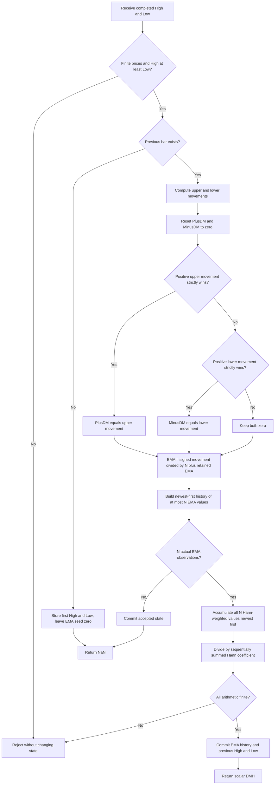

# Directional Movement using Hann Windowing (DMH)

This folder is the standalone research reference for John F. Ehlers' December
2021 **Directional Movement using Hann Windowing**, abbreviated DMH. The
streaming master is [directional-movement-hann.py](directional-movement-hann.py).
It returns a signed, smoothed directional movement in **price units**. The
single configurable parameter is `length`, default **14**.

The authorities are the article *The DMH: An Improved Directional Movement
Indicator*, its matching Mesa paper, and the matching TradeStation Traders'
Tip. Their calculation listings agree. This document includes the complete
calculation, the source listing, startup conventions, and supporting theory
so a port does not need access to those sources. Transfer functions and
analytical identities below are derivations explaining the listed algorithm;
the article and Mesa paper express the calculation primarily through code.
The further-reading books and articles are cited as such, rather than treated
as supplied book chapters.

## Required data and streaming interface

```python
indicator = DirectionalMovementHann(length=14)
dmh = indicator.update(high=93.25, low=90.125)
```

Each update consumes one completed bar in chronological order. **High and Low
are required.** Close alone cannot reproduce this indicator: bars with equal
closes can still have different upward and downward range extensions.
The supplied fixture contains aligned `INPUT_CLOSE`, `INPUT_HIGH`, `INPUT_LOW`
and `INPUT_OPEN` arrays, each with 252 entries. All four are copied without
changing their values into the five language files. The master embeds the
252 Close, High and Low values in `__main__`; it computes using High/Low and
retains Close as the requested shared record. Open is unused.

`update(high, low)` returns one float, DMH. Read-only `state` diagnostics are
a named tuple with `upper_move`, `lower_move`, `plus_dm`, `minus_dm`, `ema`,
and `dmh`. Diagnostic values do not add configurable parameters or additional
expected output series. `reset()` clears history and restores the zero EMA
seed. `is_primed` describes complete history availability; `warmup_bars`
is the number of leading unavailable outputs.

| Item | Default / valid values | Meaning |
|---|---|---|
| `length` ($N$) | 14; integer $N\ge1$; booleans rejected | Both the inverse EMA gain and number of Hann FIR taps. |
| `high`, `low` | Finite binary64-convertible numbers, $H_t\ge L_t$ | Current bar extremes. Zero or negative prices are allowed. |
| EMA gain ($\alpha$) | Derived as $1/N$ | Not a separate parameter and not $2/(N+1)$. |
| Hann angles | Derived using full $\pi$ | Source degree cosines converted to radians. |
| Output | NaN before full history, otherwise finite float | Signed price-unit movement, without a fixed amplitude bound. |

The source does not prescribe a maximum length. The master accepts positive
integers subject to available memory; a longer window consumes more memory
and delays the first available output. Length 1 is mathematically valid and
reduces DMH to raw signed movement. TradingView's minimum 2 is a UI restriction,
not a restriction of the primary equations. Inputs containing NaN/infinity,
an inverted High/Low range, or arithmetic overflow are rejected with
`ValueError`; the rejected bar does not change any state. There is no gap
filling or repeated-bar/intrabar replacement. Reset and replay for revisions.

## Principle: select directional extensions, then smooth them

Wilder's directional movement measures extensions of the bar's extremes.
An uptrend often makes higher highs; a downtrend often makes lower lows.
The rule chooses at most one positive extension per bar. Inside bars produce
no directional movement, and equal competing extensions also produce none.
The resulting signed sequence contains relatively sparse spikes.

The first smoother acts like a leaky reservoir: each signed spike contributes
to the current level while part of the previous level remains. A positive
spike fills it, a negative spike drains it, and subsequent zero movements
let the level decay exponentially toward zero. This is a signal-processing
analogy to a first-order lowpass, such as an RC circuit, rather than a physical
model of a market. A second smoother takes a weighted average of recent
reservoir levels. The Hann weights are largest near the middle and smaller
at both edges, reducing the abrupt rectangular-window weighting used by an
ordinary simple average.

Hann smoothing generally reduces sidelobes relative to rectangular weighting,
at the cost of a broader main lobe and lag. It does not predict future bars.
The whole filter from **selected signed movement** to output is linear for
fixed $N$. The preceding winner selection is nonlinear, so there is no general
linear transfer function from price to DMH.

## Complete mathematical calculation

### 1. Competing movements

For bar $t\ge1$, let $H_t$ be High and $L_t$ be Low. Define

$$
U_t=H_t-H_{t-1},\qquad D_t=L_{t-1}-L_t.
$$

The reversed subtraction for $D_t$ makes a lower low positive. The source's
strict comparisons yield

$$
P_t=\operatorname{PlusDM}_t=
\begin{cases}
U_t,&U_t>D_t\ \text{and}\ U_t>0,\\
0,&\text{otherwise},
\end{cases}
$$

$$
M_t=\operatorname{MinusDM}_t=
\begin{cases}
D_t,&D_t>U_t\ \text{and}\ D_t>0,\\
0,&\text{otherwise}.
\end{cases}
$$

Both $P_t$ and $M_t$ are reset to zero on every bar. Their product is always
zero. The signed input to the smoothers is

$$
x_t=P_t-M_t.
$$

| Bar relative to preceding bar | Selected movement |
|---|---|
| Higher High dominates a positive upward extension | $x_t=U_t>0$. |
| Lower Low dominates a positive downward extension | $x_t=-D_t<0$. |
| Inside bar: $H_t\le H_{t-1}$ and $L_t\ge L_{t-1}$ | Both zero. |
| Outside bar with $U_t=D_t>0$ | Both zero: ties are discarded. |
| Outside bar with unequal positive extensions | Only the larger extension. |
| Identical extremes | Both zero. |

This is not simply `high-low`, a close difference, or the sum of both
extensions. Upward selection can occur while the lower low also extends;
only the winning side contributes.

### 2. Exponential accumulation with inverse-length gain

The source's smoothing factor and EMA are

$$
\alpha=\operatorname{SF}=\frac1N,\qquad
E_t=\alpha(P_t-M_t)+(1-\alpha)E_{t-1}.
$$

The master starts $E_0=0$ as a seed and begins actual recurrence observations
at $t=1$. It does not initialize the EMA with an SMA or with the first movement.
For $t\ge1$, the zero-seeded closed form is

$$
E_t=\alpha\sum_{j=1}^{t}(1-\alpha)^{t-j}x_j.
$$

For constant selected movement $x_j=A$,

$$
E_t=A\bigl[1-(1-1/N)^t\bigr].
$$

Thus the EMA approaches the movement level $A$ rather than the unscaled
sum $NA$. A one-bar impulse $x_1=A$, followed by zero, produces
$E_t=(A/N)(1-1/N)^{t-1}$. This distinguishes the listing from an unnormalized
Wilder sum, which may have a different amplitude despite the same decay.

### 3. Interior Hann FIR smoothing

For source loop indices $c=1,2,\ldots,N$, define

$$
w_c=1-\cos\!\left(\frac{2\pi c}{N+1}\right)
=2\sin^2\!\left(\frac{\pi c}{N+1}\right).
$$

EasyLanguage writes the angle as $360c/(N+1)$ **degrees**. A port using radian
cosines must convert it. The stored window excludes the hypothetical zero
samples at $c=0$ and $c=N+1$, so its first and last stored weights are positive.
Do not substitute the common library window
$\tfrac12[1-\cos(2\pi k/(N-1))]$ for $k=0,\ldots,N-1$.

The complete source numerator, coefficient and output are

$$
S_t=\operatorname{DMSum}_t=\sum_{c=1}^{N}w_cE_{t-c+1},\qquad
C=\operatorname{coef}=\sum_{c=1}^{N}w_c,
$$

$$
\operatorname{DMH}_t=\frac{S_t}{C}\quad\text{when }C\ne0.
$$

The source uses a conditional assignment if $C\ne0$. For every valid positive
integer $N$, $C>0$, so the alternative is unreachable. $w_1$ multiplies current
$E_t$ and $w_N$ multiplies $E_{t-N+1}$: the loop is **newest first and inclusive**.
For $N=1$, $w_1=C=2$, $\alpha=1$, and $\operatorname{DMH}_t=x_t$.

In exact arithmetic the roots-of-unity identity gives

$$
\sum_{c=1}^{N}\cos\!\left(\frac{2\pi c}{N+1}\right)=-1,
\qquad C=N+1.
$$

Although this identity explains normalization, the master preserves the
source's sequential coefficient accumulation. It also preserves sequential
newest-to-oldest numerator accumulation rather than using pairwise summation,
compensated summation, symmetry folding, or a dot-product library. Those
alternatives can change the last binary64 digits.

### 4. ATR cancellation and the change in units

The article motivates removing the common ATR scale. To make this precise,
let $A_t>0$ be ATR and $\bar P_t$, $\bar M_t$ equally smoothed positive and
negative movement components. Conventional scaled components take the form

$$
\operatorname{DI}^{+}_t=100\frac{\bar P_t}{A_t},\qquad
\operatorname{DI}^{-}_t=100\frac{\bar M_t}{A_t}.
$$

Multiplication by the same positive factor cannot change their crossover:
$\operatorname{DI}^{+}_t>\operatorname{DI}^{-}_t$ exactly when
$\bar P_t>\bar M_t$. It also cancels from a signed normalized contrast,
when its denominator is nonzero:

$$
\frac{\operatorname{DI}^{+}_t-\operatorname{DI}^{-}_t}
     {\operatorname{DI}^{+}_t+\operatorname{DI}^{-}_t}
=\frac{\bar P_t-\bar M_t}{\bar P_t+\bar M_t}.
$$

These identities explain the article's reasoning; **DMH does not evaluate
that ratio**. It smooths an unnormalized signed difference. No ATR, true range,
division by $P+M$, factor 100, absolute value, or ADX smoothing belongs in the
DMH recurrence. Dropping normalization changes units and amplitudes. DMH can
take positive or negative values of any price-dependent magnitude, rather
than remaining within $[-1,1]$ or $[-100,100]$.

## Filter response, lag and interpretation

For fixed $N$, the linear cascade from $x_t$ to DMH has transfer function

$$
G(z)=\frac{\alpha}{1-(1-\alpha)z^{-1}}
\frac{\sum_{c=1}^{N}w_cz^{-(c-1)}}{C}.
$$

The EMA pole is $r=1-1/N$, with $0\le r<1$ for valid $N$. Its DC gain is one.
Normalized positive Hann weights also have unity DC gain, so their cascade
has unity DC gain. Symmetry $w_c=w_{N+1-c}$ gives the FIR a linear-phase
delay $(N-1)/2$ bars away from response zeros. The EMA's low-frequency group
delay is $r/(1-r)=N-1$. The cascade's DC group delay is consequently

$$
\tau_G(0)=N-1+\frac{N-1}{2}=\frac{3(N-1)}2.
$$

For the default 14, this is 19.5 bars. This is a small-signal, low-frequency
filter property relative to selected movement, not a universal price reversal
delay. The EMA phase depends on frequency, and High/Low selection is nonlinear.

Positive DMH means smoothed upward movement dominates; negative means downward
movement dominates. The article describes DMH zero crossings as the traditional
directional crossover timing signal and observes their lag. It proposes peaks
and valleys as alternatives, identified through one-bar rate of change:

$$
R_t=\operatorname{DMH}_t-\operatorname{DMH}_{t-1}.
$$

A crossing of $R_t$ from negative to positive indicates a valley; a crossing
from positive to negative indicates a peak. A plateau or exact-zero value
needs a caller-defined crossing convention. Detecting a turn requires the
next observation; it does not reveal a peak before it happens. The derivative
filter has response $1-e^{-i\omega}$ and magnitude
$2|\sin(\omega/2)|$, so it emphasizes higher frequencies and can amplify
residual noise. ROC is an interpretation described by the article, not an
extra output or an internal stage of this scalar master.

Adding the same constant to all High/Low prices leaves DMH unchanged.
Multiplying both by a positive constant multiplies DMH by that constant.
Reflecting price via $H'_t=-L_t$, $L'_t=-H_t$ swaps winning directions and
reverses the sign. Absolute amplitudes are therefore not directly comparable
between instruments with different price scales.

## Exact startup and porting contract

The EasyLanguage listings refer to historical bars and initialized variables;
the number of bars a chart platform preloads is external to the listing.
The fresh-stream reference makes that otherwise implicit boundary explicit:

1. Before updates: previous High/Low absent; EMA seed zero; EMA history empty.
2. Index 0: validate and store first High/Low; return NaN. No invented previous
   price and no synthetic EMA sample enters the Hann history.
3. Index 1: compute the first actual movement, update EMA from the zero seed,
   and record that EMA observation.
4. For indices $1\le t<N$, update the EMA and retain history but return NaN.
5. At index $t=N$, there are $N$ actual EMA observations $E_1,\ldots,E_N$.
   Compute the first complete Hann output.
6. Thereafter retain only the newest $N$ EMA observations and compute every bar.

The first **$N$** outputs are NaN. Default 14 has NaNs at indices 0–13 and
its first value at index 14, the fifteenth input bar. Length 251 has one
available value in the 252-bar fixture; length 252 has none. Feed one further
bar to length 252 and its first value becomes available.

NaN marks output availability only. The internal EMA always starts at zero
and remains finite for accepted bars. Full-window availability does not mean
the EMA startup transient has settled: an initial seed error decays by
$(1-1/N)^t$, and this memory can last well beyond the first output.

Ports must reproduce this history boundary as well as the recurrence to match
the expected arrays. A platform starting after additional prehistory, padding
unavailable EMA taps with zeros, or SMA-seeding an RMA will have a different
initial path. The master has been checked against the supplied code expressions
with the stated fresh-stream boundary; the original TradeStation/Mesa runtime
was not executed. It does not claim that an arbitrary chart's first displayed
bar shares this fixture's seed or hidden historical data.



The implementation also checks movement differences and the EMA for overflow
before building/committing the candidate state. With immutable precomputed
weights and a bounded newest-first list, memory and per-update work are
$O(N)$. The only indicator operations to port are comparisons, subtraction,
multiplication, division, cosine during setup, and bounded history storage.
Python's AST, file and formatting helpers are fixture tooling, not indicator
dependencies.

## Primary calculation listing

The article and Mesa listing, also matched by the TradeStation tip, are:

```easylanguage
{
    DMH - Directional Movement using Hann Windowing
    (C) 2021 John F. Ehlers
}
Inputs:
    Length(14);
Vars:
    SF(0), PlusDM(0), MinusDM(0),
    UpperMove(0), LowerMove(0), EMA(0),
    DMSum(0), coef(0), count(0), DMH(0);

SF = 1 / Length;
UpperMove = High - High[1];
LowerMove = Low[1] - Low;
PlusDM = 0;
MinusDM = 0;
If UpperMove > LowerMove and UpperMove > 0 Then
    PlusDM = UpperMove
Else If LowerMove > UpperMove and LowerMove > 0 Then
    MinusDM = LowerMove;

EMA = SF*(PlusDM - MinusDM) + (1 - SF)*EMA[1];

//Smooth Directional Movements with Hann Windowed FIR filter
DMSum = 0;
coef = 0;
For count = 1 to Length Begin
    DMSum = DMSum + (1 - Cosine(360*count / (Length + 1)))*EMA[count - 1];
    coef = coef + (1 - Cosine(360*count / (Length + 1)));
End;
If coef <> 0 Then DMH = DMSum / coef;
Plot1(DMH, "", red, 4, 4);
Plot2(0, "", white, 1, 1);
```

The plots, color settings and zero line are presentation options. They add
neither a second computed indicator output nor a parameter to this master.

## Traders' Tips differences

These supplied implementations are useful context but cannot all define
identical reference numbers. The primary equations above resolve conflicts.

| Supplied source | Relevant behavior |
|---|---|
| Article, Mesa, TradeStation `DMH.els` | Same inverse-length EMA and inclusive normalized Hann calculation; authoritative. |
| TradingView `DMH.pine` | Default 10, minimum 2; uses `ta.rma`, whose usual initialization is an SMA seed. `nz` converts unavailable Hann results to zero. Same interior Hann concept, different angle evaluation order and startup. |
| NinjaTrader `DMH.cs` | Skips first bar, but loop is `count < Length`, omitting the final tap. This shortens the window and destroys the primary kernel's symmetry. UI permits length zero even though `SF` divides by it. No full-history gate precedes Hann reads. |
| eSignal `DMH.efs` | Preallocates EMA history with zeros and returns before beginning the EMA until the current bar count reaches Length. Different startup; intrabar replacement also differs from this append-only stream. |
| Zorro `DMH.c` / tip | Returns the Hann weighted sum without dividing by its coefficient. Exact-arithmetic amplitude is $N+1$ times the normalized primary result with otherwise equal histories. |
| Optuma `DMH.optuma` / tip | Uses generic exponential MA and Hann helper calls without explicit alpha, seed, or Hann-index details. Equivalence cannot be established from those calls alone. |
| TradersStudio `DMH.trs` / tip | Same displayed mathematical recurrence; historical-array startup remains platform dependent. |
| Wealth-Lab, thinkorswim, NeuroShell, Excel tips | Platform examples, charts or workbook context; not the selected numerical authority. |

Do not copy NinjaTrader's omitted tap, Zorro's amplitude scaling, or Pine's
startup-zero policy into a port expected to match this master. Native versions
of those trading platforms have not been executed here.

## Confirmed reference cases

There is only one independent source parameter. Twelve lengths cover the
default, degenerate case, short kernels, medium smoothing, and record-boundary
availability. All twelve were confirmed by the user on 2026-10-19. This is
below the 64-case maximum.

| Length (`L`) | What it tests | Leading NaNs / finite values in 252 bars |
|---:|---|---:|
| 14 | Article, Mesa and TradeStation default. | 14 / 238 |
| 1 | Minimum length; raw signed movement after the setup bar. | 1 / 251 |
| 2 | Smallest smoothing kernel; equal two-tap Hann weights. | 2 / 250 |
| 3 | Short odd-length symmetric Hann kernel. | 3 / 249 |
| 5 | Fast response to directional movement spikes. | 5 / 247 |
| 8 | Short even-length smoothing window. | 8 / 244 |
| 10 | TradingView default length with primary-source EMA seeding. | 10 / 242 |
| 20 | Slower response over a monthly-scale window. | 20 / 232 |
| 30 | Longer smoothing and EMA startup transient. | 30 / 222 |
| 126 | Half-record Hann window and extended warmup. | 126 / 126 |
| 251 | Maximum length with one primed value in the 252-bar record. | 251 / 1 |
| 252 | Insufficient movement history; all 252 outputs are NaN. | 252 / 0 |

`REFERENCE_CASES` in the master uses these exact descriptions. Each generated
array has the description comment followed by `length=N` on the next
comment line. One 252-value scalar DMH array is generated per case, so each
language contains 12 arrays, 3,024 expected values including availability
NaNs. The four copied input arrays remain intact.

| Language | Default expected name / NaN spelling |
|---|---|
| Python | `EXPECTED_L14`; `math.nan` |
| Go | `var expectedL14 = []float64{...}`; `math.NaN()`; package `directionalmovementhann` |
| TypeScript | `export const expectedL14: number[] = [...]`; `NaN` |
| Rust | `pub fn expected_l14() -> Vec<f64>`; `f64::NAN` |
| Zig | `pub fn expectedL14() [252]f64`; `return .{...};`; `nan` |

Go imports `math` for the expected NaNs. Zig's copied fixture
already declares `const math = @import("std").math;` and
`const nan = math.nan(f64);`. TypeScript and Rust use their actual valid syntax,
including the Rust double colon in `f64::NAN`.

Calculation retains binary64 values throughout. Formatting uses **15 significant
decimal digits** (`.15g`), adds `.0` to otherwise integer-looking float literals,
and never feeds rounded output back into state. The generator first writes
Python arrays, reopens and verifies their counts, NaN prefixes, finiteness and
precision, then translates those verified Python values to the other four
languages. Generated sections have begin/end markers; reruns replace only
those sections, preserving the input arrays.

## Running and validation

From this folder, the demonstration and tests are:

```sh
python3 directional-movement-hann.py
python3 -m unittest discover -p 'test_directional_movement_hann.py' -v
```

Regenerate the confirmed expected data in all five files with:

```sh
python3 directional-movement-hann.py --generate-reference-data
```

The implementation passes **13 tests**, including exact binary64
agreement with an independent batch evaluator of the supplied EasyLanguage
expressions over all twelve confirmed lengths. Additional checks establish
tie/inside/outside selection, zero seed and inverse-length alpha, full-window
warmup, Hann symmetry/normalization/delay, impulse decay, constant-movement
closed form, sinusoidal cascade response, flat-bar zeros, translation/scaling,
reflection, causal prefixes, reset, rejected-bar state preservation, and
unchanged copied/embedded input arrays. The source evaluator reads the supplied
EasyLanguage file and has separate batch histories; it does not call the
streaming update or reuse its kernel.

All five files contain the expected arrays. The Python tests compare the
serialized values with the independent source-expression evaluator, verify
the exact NaN prefixes and paired comments, check identical values in every
language, and prove that repeated regeneration is byte-for-byte identical
while preserving the original input text.

Native Go, Rust and Zig fixture tests and a TypeScript check using Node's
native type stripping also pass. Each verifies all **16 arrays / 4,032 values**
(12 expected arrays plus four input arrays) against the parsed Python file:
finite values must have identical binary64 bit patterns and unavailable
values must be NaN. These checks validate the language fixture declarations
and literals; the indicator implementation itself remains the Python master.

## References

1. John F. Ehlers, “The DMH: An Improved Directional Movement Indicator,”
   *Technical Analysis of Stocks & Commodities* 39(12), December 2021,
   pp. 16–18. [Article](https://technical.traders.com/archive/article.asp?file=%5CV39%5CC12%5C341EHLE.pdf).
   Supplied local text: [content.md](../../tasc/2021-12-the-dmh-an-improved-directional-movement-indicator/content.md).
2. John F. Ehlers, “DMH — An Improved Directional Movement Indicator,” Mesa
   Software paper, 2021. [PDF](https://www.mesasoftware.com/papers/DMH.pdf).
   Supplied local text: [mesa/content.md](../../tasc/2021-12-the-dmh-an-improved-directional-movement-indicator/mesa/content.md).
3. *Stocks & Commodities*, “Traders' Tips, December 2021.”
   [Tips page](https://www.traders.com/Documentation/FEEDbk_docs/2021/12/TradersTips.html).
   Supplied [tips text](../../tasc/2021-12-the-dmh-an-improved-directional-movement-indicator/tips/tips.md),
   [TradeStation code](../../tasc/2021-12-the-dmh-an-improved-directional-movement-indicator/tips/code/DMH.els),
   [Pine code](../../tasc/2021-12-the-dmh-an-improved-directional-movement-indicator/tips/code/DMH.pine),
   [NinjaTrader code](../../tasc/2021-12-the-dmh-an-improved-directional-movement-indicator/tips/ninja-trader/DMH.cs),
   and [eSignal code](../../tasc/2021-12-the-dmh-an-improved-directional-movement-indicator/tips/code/DMH.efs).
   Includes the additional platform examples discussed above.
4. J. Welles Wilder Jr., *New Concepts In Technical Trading Systems*,
   Trend Research, 1978. Historical directional-movement source cited by the
   article and Mesa paper; no full chapter was supplied for this task.
5. John F. Ehlers, “Windowing,” *Technical Analysis of Stocks & Commodities*
   39, September 2021. Further reading cited by both supplied papers.
6. John F. Ehlers, “Cycle/Trend Analytics And The MAD Indicator,”
   *Technical Analysis of Stocks & Commodities* 39, October 2021.
   Further reading cited by the article.
7. Stuart Evens, “Directional Movement,” *Technical Analysis of Stocks &
   Commodities* 17, February 1999. Further reading cited by the article.

```bibtex
@article{ehlers2021dmh,
  author = {Ehlers, John F.},
  title = {The {DMH}: An Improved Directional Movement Indicator},
  journal = {Technical Analysis of Stocks \& Commodities},
  year = {2021},
  month = dec,
  volume = {39},
  number = {12},
  pages = {16--18},
  url = {https://technical.traders.com/archive/article.asp?file=%5CV39%5CC12%5C341EHLE.pdf}
}

@misc{ehlers2021dmhMesa,
  author = {Ehlers, John F.},
  title = {{DMH} -- An Improved Directional Movement Indicator},
  year = {2021},
  howpublished = {Mesa Software paper},
  url = {https://www.mesasoftware.com/papers/DMH.pdf},
  note = {Matching primary DMH calculation listing}
}

@misc{tasc2021traderstips12,
  author = {{Technical Analysis of Stocks \& Commodities}},
  title = {Traders' Tips, December 2021},
  year = {2021},
  month = dec,
  url = {https://www.traders.com/Documentation/FEEDbk_docs/2021/12/TradersTips.html},
  note = {TradeStation, TradingView, eSignal, NinjaTrader, TradersStudio,
          Zorro, Optuma and other platform implementations of Ehlers' DMH}
}

@book{wilder1978newConcepts,
  author = {Wilder, J. Welles, Jr.},
  title = {New Concepts In Technical Trading Systems},
  publisher = {Trend Research},
  year = {1978},
  note = {Historical source cited by the supplied article and Mesa paper}
}

@article{ehlers2021windowing,
  author = {Ehlers, John F.},
  title = {Windowing},
  journal = {Technical Analysis of Stocks \& Commodities},
  year = {2021},
  month = sep,
  volume = {39},
  note = {Further reading cited by the supplied DMH papers}
}

@article{ehlers2021mad,
  author = {Ehlers, John F.},
  title = {Cycle/Trend Analytics And The {MAD} Indicator},
  journal = {Technical Analysis of Stocks \& Commodities},
  year = {2021},
  month = oct,
  volume = {39},
  note = {Further reading cited by the supplied article}
}

@article{evens1999directionalMovement,
  author = {Evens, Stuart},
  title = {Directional Movement},
  journal = {Technical Analysis of Stocks \& Commodities},
  year = {1999},
  month = feb,
  volume = {17},
  note = {Further reading cited by the supplied article}
}
```
