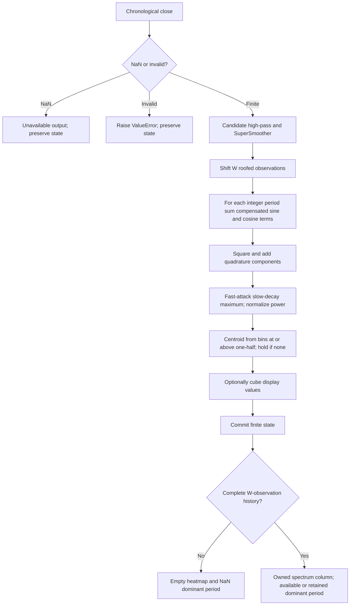

# Discrete Fourier Transform Spectrum: research prototype master reference

Master: [discrete-fourier-transform-spectrum.py](discrete-fourier-transform-spectrum.py), class `DiscreteFourierTransformSpectrum`. Returns a spectrum heatmap and the power-weighted dominant period per accepted close.

## Scope and numerical authority

This is a self-contained **research prototype master reference** for conversion to Python, Go, TypeScript, Rust and Zig. Only the Python standard library is required. The streaming class takes one chronological finalized Close per `update(close, time=None)`. No future samples, full price array, chart-platform state, NumPy, pandas or zpano runtime imports are used. The numerical helper code is above the fixture-tooling comment in the executable. The original 252 `INPUT_CLOSE` observations are embedded in `__main__` and also preserved in the five copied fixture files.

John F. Ehlers, *Cycle Analytics for Traders: Advanced Technical Trading Concepts* (Wiley, 2013), is the algorithm authority. The corresponding zpano implementation informs the API and comparison notes; differences are described rather than silently substituted. Source fragments are reproduced later in this document because a conversion agent may have this folder alone.

Mathematical constants use full binary64 precision: $\pi=\texttt{math.pi}$, $\sqrt2=\texttt{math.sqrt(2.0)}$, and $1/\sqrt2$ replace printed `3.14159`, `1.414`, and `.707`. Degree-based trig functions in EasyLanguage become radians in Python. Decimal design settings such as $0.995$, $0.5$, $0.3$ and the optional cubic display remain as specified; they are not truncated versions of mathematical constants. Unrounded state uses binary64, and only serialized expected data is rounded to **15 significant decimal digits**. Full-precision coefficients necessarily give slightly different values from code that retains the rounded constants. This master preserves the recurrence and operation order rather than promising bitwise identity with those rounded implementations.

## Physical principles and shared Roofing Filter

A high-pass circuit removes slow offsets and long-period variations; a low-pass circuit removes rapid noise. Cascading these two circuits retains a middle band of periods. In market terms the goal is to examine oscillatory movement without a price level or trend dominating the result. The source calls the tendency of longer price swings to have larger amplitudes **spectral dilation**. Its approximate scaling is $A(P)\propto P$, or $A(f)\propto1/f$, corresponding to about $20\log_{10}2=6.02$ dB amplitude growth per doubling of period. This is a motivating empirical model, not a universal law for all market records.

A one-pole high-pass provides approximately 6 dB/octave attenuation toward low frequencies and may mainly equalize that amplitude growth. The book uses two poles to provide additional rejection. A two-pole SuperSmoother then reduces short-period noise. It behaves like a damped resonator, whose retained state decays while rotating in phase; averaging its feedforward input over two adjacent samples creates an exact Nyquist zero. Sampling limits still apply: the Nyquist frequency is $1/2$ cycle per bar. The book commonly selects a shortest useful period near 10 bars.

Let $x_t$ be Close at accepted observation $t$, $H$ the high-pass coefficient period, $L$ the SuperSmoother coefficient period, and $h_t,f_t$ the high-pass and roofed outputs. All periods are measured in bars. Define

$$\theta_H=\frac{2\pi}{\sqrt2H},\qquad
\alpha_H=\frac{\cos\theta_H+\sin\theta_H-1}{\cos\theta_H},\qquad q=1-\alpha_H.$$

The two-pole high-pass is

$$h_t=(1-\alpha_H/2)^2(x_t-2x_{t-1}+x_{t-2})+2q h_{t-1}-q^2h_{t-2}.$$

Its transfer function is

$$H_{HP}(z)=\frac{(1-\alpha_H/2)^2(1-z^{-1})^2}{1-2qz^{-1}+q^2z^{-2}}.$$

Equation 3-3's SuperSmoother coefficients and recurrence are

$$a=e^{-\sqrt2\pi/L},\quad b=2a\cos(\sqrt2\pi/L),\quad
c_2=b,\quad c_3=-a^2,\quad c_1=1-c_2-c_3,$$

$$f_t=\frac{c_1}{2}(h_t+h_{t-1})+c_2f_{t-1}+c_3f_{t-2}.$$

$$H_{SS}(z)=\frac{(c_1/2)(1+z^{-1})}{1-c_2z^{-1}-c_3z^{-2}},\qquad
H_{Roof}(z)=H_{HP}(z)H_{SS}(z).$$

The negative $c_3$ is **added** in the recurrence; the positive $q^2$ term is **subtracted**. Do not change these signs when translating. Fractional cutoff periods change coefficients and are never rounded into rolling-window lengths. `highpass_period` and `smoothing_period` are independent of the displayed axis and of any observation window. A compact or single-bin map therefore keeps the original roof unless explicitly configured otherwise. No mandatory $H>L$ restriction is imposed: unusual bands are permitted within the stability limits, but may attenuate most of the input.

## Streaming, startup and heatmap contract

The returned `Heatmap` has fields closely matching `external/zpano/py/indicators/core/outputs/heatmap.py`:

| Field | Meaning |
| --- | --- |
| `time` | Optional timestamp supplied by the caller; it does not affect arithmetic. |
| `parameter_first`, `parameter_last` | Inclusive first and last displayed lag or period. |
| `parameter_resolution` | 1.0; bins ascend in integer increments. |
| `value_min`, `value_max` | Actual min/max of this outgoing numerical column. |
| `values` | Fresh list of bin values; its storage is never reused by the indicator. |

A public unavailable column has `values=[]` and NaN extrema. Fixture generation expands that empty column to the chosen bin width filled with NaNs. The complete bank is primed together; partial bins are not published. An empty runtime column and a NaN fixture row represent the same unavailable result.

`parameters` is an immutable named tuple. `samples_seen` counts accepted finite observations. `warmup_bars` counts leading unavailable observations and equals the zero-based index of the first full-history output. `is_primed` describes history availability, not convergence of the recursive transient. `state` returns an immutable diagnostic snapshot. `output` retains the last accepted output; `reset()` restores all initial state while keeping configuration.

All price, filter and array prehistory is explicitly zero. The roof evolves from the **first actual close**, and downstream internal calculations also evolve during masked startup. Do not postpone filter, AGC or centroid state until public priming. A positive constant input causes a finite startup transient because the two absent closes are zero. This follows the existing book-periodogram master's finite-record convention and makes the initial condition reproducible. A commercial chart may instead evaluate many earlier prices; matching that platform requires matching its prehistory. Startup NaNs never enter recursive state.

A NaN input is an omitted observation: return an unavailable public result and preserve all state, including the last accepted output and counter. The next finite sample follows the preceding finite sample. Infinity, booleans and invalid parameters raise `ValueError`; candidate arithmetic is checked before commit, so arithmetic overflow also preserves state. All sums visit the most recent sample first. No variance epsilon, stable-centered replacement, compensated summation, min subtraction or hidden price rescaling is introduced; those can change this numerical reference.

## Reference data and conversion workflow

The user confirmed **all 36 combinations across these three folders on 2026-10-22**, twelve per folder. The original four OHLC input arrays are preserved in every language file, although this indicator consumes only `INPUT_CLOSE`. Each expected array contains 252 chronological rows or scalar values. A matrix has one column per displayed bin. Min/max are computed from the values actually displayed, including optional contrast.

Run the demo with `python3 discrete-fourier-transform-spectrum.py`. Run `python3 discrete-fourier-transform-spectrum.py --generate-reference-data` to replace only the marked generated sections of all five fixture files. Run `python3 verify_reference_data.py` to verify every name, two parameter comments, dimension, decimal and NaN mask against the master. Generation reopens Python expected arrays before translating them, so the Python decimal data is the authority for all four other languages. Repeated generation is idempotent and leaves original input arrays intact.

Python names start `EXPECTED_`; Go/TypeScript/Zig use `expected` with uppercase parameter shortcuts; Rust uses `expected_` with lowercase shortcuts. Shortcuts are `L0/L1` for lag bounds, `P0/P1` for period bounds, `A` for averaging length, `W` for DFT window, `HP/LP` for roof cutoffs, `B` for bandwidth, `SDC` for compensation, and `E` for enhancement. Booleans encode as `1/0`; decimal points encode as underscores. Component suffixes identify `HEATMAP`, `MIN`, `MAX` and, for spectra, `DOMINANT_CYCLE`.

Valid language syntax takes precedence over typos in illustrative templates: Go uses `math.NaN()`, Rust uses `f64::NAN`, TypeScript uses `NaN`, and Zig uses `const math = @import("std").math; const nan = math.nan(f64);`. Heatmaps use `number[][]`, `[][]float64`, `Vec<Vec<f64>>`, or `[252][bins]f64`. Scalar arrays use the corresponding one-dimensional types. Go package names strip hyphens/underscores from this folder name. Input fixtures compile before generation; the generator adds Go's math import when expected NaNs are emitted.

Compare NaN placement exactly and finite outputs with both absolute and relative tolerances (for example $10^{-11}$ for this bounded reference record). Libraries' sine, cosine, exponential and square root can differ in their last bits; literal precision does not imply portable bitwise equality. Do not clamp spectrum or Pearson values to conceal a disagreement. Unit tests compare the streaming calculations with a separate direct transcription of the source recurrences and include behavior that a fixture round trip alone cannot prove.

## Spectrum normalization, dominant cycle and colors

Both spectrum algorithms return `SpectrumOutput(heatmap, dominant_cycle)`. A bank of period-dependent measurements resembles a row of resonators, each tuned to a different pitch. Their relative responses show where oscillatory content is concentrated. The vertical axis is **period in bars**, not frequency; it is therefore nonlinear in frequency. Closely spaced period samples are not independent Fourier frequency bins.

Let $Q_t(P)$ be unnormalized power at period $P$. The source's fast-attack, slow-decay maximum is

$$G_t=\max\left(0.995G_{t-1},\ \max_{P=P_0}^{P_1}Q_t(P)\right),\qquad G_{-1}=0.$$

$$p_t(P)=\begin{cases}Q_t(P)/G_t,&G_t>0,\\0,&G_t=0.\end{cases}$$

The zero branch defines the all-zero initialized spectrum without division by zero. For a decaying signal, $G_t$ can exceed the current maximum, so **the largest displayed bin need not equal one**. The denominator may remember pre-priming power; this is intentional. Do not normalize each column independently or subtract its minimum.

Use the source-selected powers $p_t(P)\ge1/2$:

$$S_t=\sum_{P:p_t(P)\ge1/2}p_t(P),\qquad
S_{x,t}=\sum_{P:p_t(P)\ge1/2}Pp_t(P),$$

$$D_t=\begin{cases}S_{x,t}/S_t,&S_t\ne0,\\D_{t-1},&S_t=0.\end{cases}$$

The internal $D_{-1}=0$ is retained until a nonempty centroid first exists. Public `dominant_cycle` is NaN while the bank is unprimed or no centroid has ever existed, then holds the last estimate through empty selections. `is_primed` can therefore be true for a zero input while the dominant cycle is NaN. Once identified, an estimate always remains inside the configured period bounds, but may be stale. It is a real-valued power-weighted period, not the brightest-bin index, a rounded integer or a trade prediction.

The optional display block cubes normalized power **after** centroid extraction:

$$v_t(P)=p_t(P)^3\quad\text{if enhanced, otherwise }v_t(P)=p_t(P).$$

This changes HEATMAP/MIN/MAX, never raw power, AGC or DOMINANT_CYCLE. No additional time smoothing of powers or dominant cycle is inserted. The original spectrum palette uses black/red/yellow rather than the autocorrelation stoplight colors:

$$(R,G,B)=\begin{cases}(510v,0,0),&v<1/2,\\(255,255(2v-1),0),&v\ge1/2.\end{cases}$$

The numerical master returns intensities, leaving RGB values and interpolation to rendering. The source comment “Convert to Decibels” accompanies a ratio computation, **not a logarithm**; the exported spectrum is linear normalized power. It is neither calibrated power spectral density nor a decibel measurement.

The book discusses a 0.991 amplitude-envelope design in Chapter 5 and uses 0.995 in these power-spectrum listings. Its prose motivates 0.995 as a rounded square root of 0.991; this master follows the **executable 0.995** setting rather than recomputing that relationship. Preserve design constants separately from full-precision $\pi$ and $\sqrt2$.

## Fourier calculation and mathematical background

For each integer trial period $P=P_0,\ldots,P_1$, let $W$ be the observation window and $k_P=P$ if spectral dilation compensation is enabled, otherwise $k_P=1$. With all sums newest to oldest:

$$C_t(P)=\sum_{n=0}^{W-1}\frac{f_{t-n}\cos(2\pi n/P)}{k_P},\qquad
S_t(P)=\sum_{n=0}^{W-1}\frac{f_{t-n}\sin(2\pi n/P)}{k_P},$$

$$Q_t(P)=C_t(P)^2+S_t(P)^2.$$

The book invokes the identity $A^2=A^2\sin^2x+A^2\cos^2x$ to motivate adding squared quadrature components. In complex notation this is the squared magnitude of $\sum_nf_{t-n}e^{i2\pi n/P}/k_P$. The sign convention of the imaginary part does not change magnitude squared. Sine/cosine tables can be computed once at construction, but neither a standard FFT nor a different frequency grid is substituted.

Compensation divides each term by period **before summation and squaring**. In exact arithmetic it reduces $Q$ by $P^2$ relative to the uncompensated calculation. Preserve division inside the sum to retain reference rounding. The window is not additionally divided by $W$, tapered, centered, or demeaned. The roofing filter precedes the Fourier window; subtraction of a rolling mean is not an equivalent filter.

A finite rectangular window causes spectral leakage unless a signal fits an integer number of cycles. Standard DFT bins occur at frequencies $k/W$ or periods $W/k$. This implementation samples the finite-window Fourier sum at **every configured integer period**, which is useful for visualization but does not create additional independent spectral resolution. Increasing $W$ can improve discrimination at the cost of averaging over more time and requiring longer history. Market signals are not assured stationary over that window. These constraints are why the book prefers the autocorrelation periodogram for many cycle measurements; the DFT remains useful as a comparison and independently specified measurement.

## Configuration, startup and complexity

| Parameter | Default | Valid range and meaning |
| --- | --- | --- |
| `min_period` | 10 | Integer $\ge3$; first trial period, strictly slower than Nyquist. |
| `max_period` | 48 | Integer $\ge\texttt{min_period}$; inclusive last trial period. |
| `window_length` | 48 | Integer $\ge2$; number of roofed samples in every Fourier sum. |
| `highpass_period` | 48.0 | Finite real $\ge5$ yielding a stable, resolvable pole. |
| `smoothing_period` | 10.0 | Finite real $\ge2$ yielding stable, resolvable coefficients. |
| `spectral_dilation_compensation` | True | Boolean; divide amplitude terms by $P$ before squaring. |
| `enhance_resolution` | False | Boolean; cube outgoing display powers after the centroid. |

All three period/window controls are independent. `max_period>window_length` is allowed as a research setting, but such long-period estimates rely on less than one cycle and may be poorly resolved. No arbitrary upper limit is imposed; construction costs and buffers increase with configured sizes. Extremely large coefficient periods that round to degenerate poles are rejected.

`warmup_bars=window_length-1`: defaults publish first at accepted bar 48, index 47. A 252-sample window publishes its first full-history result only at the final shared close. During earlier bars the zero-filled window still updates power, normalization maximum and the retained centroid, as the source executes every bar. Time work is $O(BW)$ and state is $O(BW+W+B)$ including precomputed trig tables, where $B=P_1-P_0+1$. Trig-on-demand ports can reduce storage to $O(W+B)$ while keeping the same angles and additions.

## Algorithm flow



## Source decisions and zpano comparison

The local listing breaks `SinePart` across a line; it is one variable. Its maximum scan begins at period 8 although powers are only calculated from 10 onward; the never-written 8/9 bins start at zero and cannot affect the default maximum. The generalized master scans exactly the configured calculated bins. The disabled cubic block is exposed by `enhance_resolution`. Despite a comment mentioning decibels, no logarithm is added.

zpano's `discrete_fourier_transform_spectrum` implements the MBST variant: rolling-mean subtraction on input, compensation by **period once on already squared magnitude**, optional floating minimum subtraction, descending internal period order, configurable fractional display resolution, and no returned book centroid. Its default calculation is numerically distinct. This book master uses roofing, amplitude compensation by period, fixed maximum-only normalization, ascending integer periods, and returns the source centroid with the heatmap. The existing `fourier-series-analysis` prepared master is a later three-harmonic model and does not cover this spectrum.

## Confirmed reference combinations

| Case | Parameters | What it tests |
| --- | --- | --- |
| 1 | `min_period=10, max_period=48, highpass_period=48.0, smoothing_period=10.0, spectral_dilation_compensation=True, enhance_resolution=False, window_length=48` | Published compensated DFT, fixed maximum normalization, and dominant period. |
| 2 | `min_period=10, max_period=48, highpass_period=48.0, smoothing_period=10.0, spectral_dilation_compensation=False, enhance_resolution=False, window_length=48` | Uncompensated amplitude spectrum. |
| 3 | `min_period=10, max_period=48, highpass_period=48.0, smoothing_period=10.0, spectral_dilation_compensation=True, enhance_resolution=True, window_length=48` | Cubic display contrast after the unchanged dominant-period calculation. |
| 4 | `min_period=10, max_period=48, highpass_period=48.0, smoothing_period=10.0, spectral_dilation_compensation=False, enhance_resolution=True, window_length=48` | Uncompensated spectrum with cubic display contrast. |
| 5 | `min_period=10, max_period=48, highpass_period=48.0, smoothing_period=10.0, spectral_dilation_compensation=True, enhance_resolution=False, window_length=24` | Short Fourier observation window and end effects. |
| 6 | `min_period=10, max_period=48, highpass_period=48.0, smoothing_period=10.0, spectral_dilation_compensation=True, enhance_resolution=False, window_length=96` | Long Fourier observation window. |
| 7 | `min_period=10, max_period=48, highpass_period=48.0, smoothing_period=10.0, spectral_dilation_compensation=True, enhance_resolution=False, window_length=252` | Record-length boundary: first complete DFT at the final shared close. |
| 8 | `min_period=10, max_period=48, highpass_period=48.0, smoothing_period=10.5, spectral_dilation_compensation=True, enhance_resolution=False, window_length=48` | Fractional SuperSmoother cutoff. |
| 9 | `min_period=10, max_period=48, highpass_period=80.0, smoothing_period=20.0, spectral_dilation_compensation=True, enhance_resolution=False, window_length=48` | Slower independent roofing band. |
| 10 | `min_period=6, max_period=24, highpass_period=24.0, smoothing_period=6.0, spectral_dilation_compensation=True, enhance_resolution=False, window_length=24` | Compact spectrum including shorter cycles. |
| 11 | `min_period=20, max_period=20, highpass_period=48.0, smoothing_period=10.0, spectral_dilation_compensation=True, enhance_resolution=False, window_length=48` | Single-period spectrum and exact centroid when selected. |
| 12 | `min_period=24, max_period=60, highpass_period=60.0, smoothing_period=12.0, spectral_dilation_compensation=True, enhance_resolution=False, window_length=60` | Shifted longer-cycle spectrum. |

All cases export HEATMAP/MIN/MAX plus DOMINANT_CYCLE. Expected-data completion and test counts are recorded in the validation note at the end.

## References

- John F. Ehlers, [Cycle Analytics for Traders (2013)](../../2013-cycle-analytics-for-traders/toc.md), especially [Chapter 3](../../2013-cycle-analytics-for-traders/ch3.md), [Chapter 5](../../2013-cycle-analytics-for-traders/ch5.md), [Chapter 7](../../2013-cycle-analytics-for-traders/ch7.md), and [Chapter 9](../../2013-cycle-analytics-for-traders/ch9.md).
- Local zpano comparison: `external/zpano/py/indicators/john_ehlers/discrete_fourier_transform_spectrum/discrete_fourier_transform_spectrum.py` and its `params.py`. Shared output structure: `external/zpano/py/indicators/core/outputs/heatmap.py`.

```bibtex
@book{ehlers2013cycle,
  author = {Ehlers, John F.},
  title = {Cycle Analytics for Traders: Advanced Technical Trading Concepts},
  publisher = {Wiley},
  year = {2013},
  series = {Wiley Trading},
  isbn = {9781118728604}
}
@misc{zpanoResearchImplementation,
  author = {{zpano contributors}},
  title = {Python John Ehlers indicators and Heatmap output contract},
  howpublished = {Local repository snapshot, external/zpano/py/indicators},
  note = {Inspected 2026-10-22; API comparison source, not the numerical authority}
}
```

## Source appendix: supplied mathematical description and listing

The following supplied-source material retains printed constants and transcription anomalies for comparison. The equations, source decisions and precision policy above define the working implementation. Image links are replaced by captions so this folder needs no external image assets.

# Chapter 9: Fourier Transforms

*“The spectrum displays are colorful,” said Tom plainly.*

In technical circles the term FFT (fast Fourier transform) is nearly synonymous with frequency measurement, and therefore the expectation is that Fourier transforms would be the technique of choice to measure market cycles. However, doing so means the violation of three basic requirements of Fourier transforms. These requirements are:

1. The data sample used is a representative of an infinitely long string of data.
2. The data must be stationary (unchanging characteristics) over the ­sample.
3. Only an integer number of cycles over the sample length can be ­analyzed to avoid end effects in the analysis.

As we saw in Chapter 8, market cycles are evanescent. They come and go and change periodicity. This fact alone is not consistent with requirements 1 and 2 above. Suppose we start with $64$ bars of data. The smallest integer number of cycles fitting in this data is one (a $64$-bar cycle). The next shortest allowable cycle period is $64 / 2 = 32$ bar cycle because $2$ is next largest integer number of allowed cycles. The next shortest allowed cycle period is $64 / 3 = 21.3$ bars, and the next shortest is $64 / 4 = 16$ bar cycle, and so on. The shortest allowed cycle period is a two-bar cycle, because any shorter cycle period violates the Nyquist sampling criteria of requiring at least two samples per cycle. The point is that it is unrealistic to expect a relatively short 12-bar market cycle to remain consistent in amplitude and frequency even over a relatively short data sample of 64 bars. But even if the stationarity constraint is met, the short data sample yields an extremely poor measurement resolution. For example, the closest spectral lines between a $16$-bar cycle and a $21.3-bar$ cycle yield a resolution of $5$ bars, or $31$ percent relative to the $16$-bar cycle. The only way to improve the resolution is to increase the length of the data sample, which exacerbates the problems with stationarity and averaging out short-term results over the longer term. Further, increasing the data length increases the latency of the measured result, further contributing to lag.

Nonetheless, I have been able to bludgeon the technology by taking liberal license with the mathematics to compute a Fourier transform that produces a spectral estimate that is useful for traders. The approach is to compute a moving discrete Fourier transform (DFT). Each computation is a block calculation over the historical data window, and the entire block computation is repeated for each succeeding bar of data. One of the tricks used is to compute the DFT in terms of cycle period rather than in the more conventional computation in terms of frequency. Traders can relate to a $20$-bar cycle period, but the equivalent $0.05$ cycles per bar frequency has no particular meaning. Another key feature to making the DFT usable is to display the spectral estimate as a heat map.

## Spectral Dilation

It is obvious, once stated, that annual cycle swings are greater than ­monthly cycle swings, that monthly cycle swings are greater than daily cycle swings, and that daily cycle swings are greater than hourly cycle swings. This is Spectral Dilation. Spectral Dilation is approximately linearly proportional to the period of the cycle being considered. If one is seeking the dominant cycle over a relatively small range of cycle periods, Spectral Dilation can be ignored. However, if the dominant cycle is being extracted from data containing several octaves of cycle periods, then fractal dilation must be compensated in the computational process.

I discovered the necessity for Spectral Dilation compensation when correlating the spectral results using the autocorrelation periodogram and the DFT described in this chapter. The autocorrelation periodogram described in Chapter 8 requires no compensation because the relative amplitudes of the spectral components are extracted from the correlation waveforms that are constrained to swing between $−1$ and $+1$. However, spectral ­components used in the computation of the DFT are subject to Spectral Dilation. Therefore, Spectral Dilation compensation is required for a correct spectral estimate using the DFT algorithm.

## Discrete Fourier Transform (DFT)

The DFT is accomplished by correlating the data with the cosine and sine of each period of interest over the selected window period. The sum of the squares of each of these correlated values represents the relative power at each period from the familiar trigonometric equation:

$$A^2 = A^{2}\sin^{2}(x) + A^{2}\cos^{2}(x)$$

The code to compute the DFT is shown in Code Listing 9-1. The only user input is whether to select Spectral Dilation compensation. The default selection is to use the compensation. The default window length is $48$ bars, selected to be one full cycle period of the longest cycle period to be computed. The arrays are sized for the longest cycle period’s being $48$ bars. After declaring the variables, the data are prefiltered in a high-pass filter having a $48$-bar cutoff period to be consistent with our longest computed cycle period and then smoothed in the SuperSmoother, described in Equation 3-3, and having a $10$-bar cutoff period to be consistent with the shortest cycle period of interest.

EasyLanguage executes the entire code from top to bottom for each new bar of data from oldest to newest. Computation of the DFT for each new data bar starts by multiplying the data with a sine wave and a cosine wave, respectively, divided by the period being calculated and summing the products over the window length. In this case, the window length was made to be equal to the period of the longest cycle period to be computed. The sine part and cosine part of the wave at each period are squared and summed to compute the power at each period. The wave amplitude of each period computation was divided by the value fractal dilation compensation. If the spectral dilation compensation input is set to false, the wave amplitudes are simply divided by 1, with the effect that there is no compensation.

In the next block of code, a fast attack−slow decay automatic gain control (AGC) is used to normalize the spectral components and to minimize the variance of the spectral power over time. The AGC concept was introduced in Chapter 5 of this book; however, in this case, we are scaling on the basis of power rather than on wave amplitude. Therefore, the correct decay factor is the square root of $0.991$, or $0.995$. If the current power is greater than the variable `MaxPwr`, then the variable MaxPwr is immediately set to the value of the current power. However, if the current power is less than `MaxPwr`, then the `MaxPwr` is allowed to decay to $0.995$ of its previous value.

The dominant cycle is extracted from the spectral estimate in the next block of code using a center-of-gravity (CG) algorithm. The CG algorithm measures the average center of two-dimensional objects. It is computed by summing the $Y$ values and independently summing the $X * Y$ values. Dividing the latter by the former yields the average position along the $X$ axis where all the $Y$ values reside. In the case of computing the dominant cycle, the $Y$ values are power and the $X$ values are the periods. Thus, the algorithm computes the average period at which the powers are centered. That is the dominant cycle. The dominant cycle is a value that varies with time and can be used to automatically tune other indicators such as the band-pass filter, commodity channel index (CCI), relative strength index (RSI), Stochastic, and so on.

The spectrum values vary between $0$ and $1$ after being normalized. These values are converted to colors. When the spectrum is greater than $0.5$ the colors combine red and green, with yellow being the result when ­spectrum = $1$ and red being the result when the spectrum = $0.5$. When the spectrum is less than $0.5$, the red saturation is decreased, with the result that the color is black when spectrum = $0$. Since the maximum value of the spectrum is unity, I have included an optional block of code (which has been commented out by the curly brackets) that provides additional visual resolution by raising the spectral components to a higher power. The selection of the power to be used is arbitrary.

**Code Listing 9-1. EasyLanguage Code to Compute a DFT Spectral Estimate**

```easylanguage
{
  Discrete Fourier Transform (DFT)
  © 2013   John F. Ehlers
}
Inputs:
  SpectralDilationCompensation(true);

Vars:
  alpha1(0),
  HP(0),
  a1(0),
  b1(0),
  c1(0),
  c2(0),
  c3(0),
  Filt(0),
  Period(0),
  N(0),
  M(0),
  MaxPwr(0),
  Comp(0),
  Sp(0),
  Spx(0),
  DominantCycle(0),
  Color1(0),
  Color2(0);

//Arrays are sized to have a maximum Period of 48 bars
Arrays:
  CosinePart[48](0),
  SinePart[48](0),
  Pwr[48](0);

//Highpass filter cyclic components whose periods are shorter than 48 bars
alpha1 = (Cosine(.707*360 / 48) + Sine (.707*360 / 48) - 1) / Cosine(.707*360 / 48);

HP = (1 - alpha1 / 2)*(1 - alpha1 / 2)*(Close - 2*Close[1] + Close[2]) + 2*(1 - alpha1)*HP[1] - (1 - alpha1)*(1 - alpha1)*HP[2];

//Smooth with a Super Smoother Filter
a1 = expvalue(-1.414*3.14159 / 10);
b1 = 2*a1*Cosine(1.414*180 / 10);
c2 = b1;
c3 = -a1*a1;
c1 = 1 - c2 - c3;
Filt = c1*(HP + HP[1]) / 2 + c2*Filt[1] + c3*Filt[2];

//This is the DFT
For Period = 10 to 48 Begin
  Comp = Period;
  If SpectralDilationCompensation = False Then Comp = 1;
  CosinePart[Period] = 0;
  SinePart[Period] = 0;

  //Find Cosine and Sine correlated components, compensated for fractal dilation
  For N = 0 to 47 Begin
    CosinePart[Period] = CosinePart[Period] + Filt[N]*Cosine(360*N/Period) / Comp;
    SinePart[Period] = SinePart[Period] + Filt[N]*Sine(360*N/Period) / Comp;
  End;

  Pwr[Period] = CosinePart[Period]*CosinePart[Period] + Sine
  Part[Period]*SinePart[Period];
End;

//Find Maximum Power Level for Normalization
MaxPwr = .995*MaxPwr[1];
For Period = 8 to 48 Begin
  If Pwr[Period] > MaxPwr Then MaxPwr = Pwr[Period];
End;

//Normalize Power Levels and Convert to Decibels
For Period = 10 to 48 Begin
  IF MaxPwr > 0 Then Pwr[Period] = Pwr[Period] / MaxPwr;
End;

//Compute the dominant cycle using the CG of the spectrum
Spx = 0;
Sp = 0;
For Period = 10 to 48 Begin
  If Pwr[Period] >= .5 Then Begin
    Spx = Spx + Period*Pwr[Period];
    Sp = Sp + Pwr[Period];
  End;
End;

If Sp <> 0 Then DominantCycle = Spx / Sp;

Plot2(DominantCycle, “DC”, RGB(0, 0, 255), 0, 2);

{
//Increase Display Resolution by raising the NormPwr to a higher mathematical power (optional)
For Period = 10 to 48 Begin
  Pwr[Period] = Power(Pwr[Period], 3);
End;
}

//Plot the Spectrum as a Heatmap
For Period = 10 to 48 Begin
  //Convert Power to RGB Color for Display
  If Pwr[Period] >= .5 Then Begin
    Color1 = 255;
    Color2 = 255*(2*Pwr[Period] - 1);
  End;

  If Pwr[Period] < .5 Then Begin
    Color1 = 255*2*Pwr[Period];
    Color2 = 0;
  End;

  If Period = 10 Then Plot10(10, “S10”, RGB(Color1, Color2, 0), 0,4);
  If Period = 11 Then Plot11(11, “S11”, RGB(Color1, Color2, 0), 0,4);
  If Period = 12 Then Plot12(12, “S12”, RGB(Color1, Color2, 0), 0,4);
  If Period = 13 Then Plot13(13, “S13”, RGB(Color1, Color2, 0), 0,4);
  If Period = 14 Then Plot14(14, “S14”, RGB(Color1, Color2, 0), 0,4);
  If Period = 15 Then Plot15(15, “S15”, RGB(Color1, Color2, 0), 0,4);
  If Period = 16 Then Plot16(16, “S16”, RGB(Color1, Color2, 0), 0,4);
  If Period = 17 Then Plot17(17, “S17”, RGB(Color1, Color2, 0), 0,4);
  If Period = 18 Then Plot18(18, “S18”, RGB(Color1, Color2, 0), 0,4);
  If Period = 19 Then Plot19(19, “S19”, RGB(Color1, Color2, 0), 0,4);
  If Period = 20 Then Plot20(20, “S20”, RGB(Color1, Color2, 0), 0,4);
  If Period = 21 Then Plot21(21, “S21”, RGB(Color1, Color2, 0), 0,4);
  If Period = 22 Then Plot22(22, “S22”, RGB(Color1, Color2, 0), 0,4);
  If Period = 23 Then Plot23(23, “S23”, RGB(Color1, Color2, 0), 0,4);
  If Period = 24 Then Plot24(24, “S24”, RGB(Color1, Color2, 0), 0,4);
  If Period = 25 Then Plot25(25, “S25”, RGB(Color1, Color2, 0), 0,4);
  If Period = 26 Then Plot26(26, “S26”, RGB(Color1, Color2, 0), 0,4);
  If Period = 27 Then Plot27(27, “S27”, RGB(Color1, Color2, 0), 0,4);
  If Period = 28 Then Plot28(28, “S28”, RGB(Color1, Color2, 0), 0,4);
  If Period = 29 Then Plot29(29, “S29”, RGB(Color1, Color2, 0), 0,4);
  If Period = 30 Then Plot30(30, “S30”, RGB(Color1, Color2, 0), 0,4);
  If Period = 31 Then Plot31(31, “S31”, RGB(Color1, Color2, 0), 0,4);
  If Period = 32 Then Plot32(32, “S32”, RGB(Color1, Color2, 0), 0,4);
  If Period = 33 Then Plot33(33, “S33”, RGB(Color1, Color2, 0), 0,4);
  If Period = 34 Then Plot34(34, “S34”, RGB(Color1, Color2, 0), 0,4);
  If Period = 35 Then Plot35(35, “S35”, RGB(Color1, Color2, 0), 0,4);
  If Period = 36 Then Plot36(36, “S36”, RGB(Color1, Color2, 0), 0,4);
  If Period = 37 Then Plot37(37, “S37”, RGB(Color1, Color2, 0), 0,4);
  If Period = 38 Then Plot38(38, “S38”, RGB(Color1, Color2, 0), 0,4);
  If Period = 39 Then Plot39(39, “S39”, RGB(Color1, Color2, 0), 0,4);
  If Period = 40 Then Plot40(40, “S40”, RGB(Color1, Color2, 0), 0,4);
  If Period = 41 Then Plot41(41, “S41”, RGB(Color1, Color2, 0), 0,4);
  If Period = 42 Then Plot42(42, “S42”, RGB(Color1, Color2, 0), 0,4);
  If Period = 43 Then Plot43(43, “S43”, RGB(Color1, Color2, 0), 0,4);
  If Period = 44 Then Plot44(44, “S44”, RGB(Color1, Color2, 0), 0,4);
  If Period = 45 Then Plot45(45, “S45”, RGB(Color1, Color2, 0), 0,4);
  If Period = 46 Then Plot46(46, “S46”, RGB(Color1, Color2, 0), 0,4);
  If Period = 47 Then Plot47(47, “S47”, RGB(Color1, Color2, 0), 0,4);
  If Period = 48 Then Plot48(48, “S48”, RGB(Color1, Color2, 0), 0,4);
End;
```

A sample computation and spectral display of the DFT is shown in ­Figure 9.1. Harmonic components are clearly present (at periods of half and one-third the stronger dominant cycle period). Nonetheless, the spectral estimate compares favorably with the preferred autocorrelation periodogram, as shown in Figure 9.2. This result is remarkable considering all the concessions made to pure theory.

*Source figure caption: Figure 9.1: An Example of a DFT Spectral Estimate.*

**Figure 9.1** *An Example of a DFT Spectral Estimate*

*Source figure caption: Figure 9.2: DFT Spectral Estimate Compares Favorably with an.*

**Figure 9.2** *DFT Spectral Estimate Compares Favorably with an Autocorrelation Periodogram*

## Key Points to Remember

1. The practical computation of a DFT for market data disregards theoretical requirements.
2. The DFT for traders is computed in terms of cycle period rather than frequency for ease of interpretation.
3. The DFT calculation should include compensation for Spectral Dilation.
4. The DFT results as computed in Figure 9.1 compare favorably with the results of the autocorrelation periodogram.

### Source equation 3-3: SuperSmoother

The equations for the SuperSmoother filter are:

$$\begin{aligned}
a &= e^{-1.414 \cdot 3.14159 / \text{Period}} \\
b &= 2 a \cos(1.414 \cdot 180 / \text{Period}) \\
c_2 &= b \\
c_3 &= -a \cdot a \\
c_1 &= 1 - c_2 - c_3 \\
\text{Output} &= c_1 \cdot (\text{Input} + \text{Input}[1]) / 2 + c_2 \cdot \text{Output}[1] + c_3 \cdot \text{Output}[2]
\end{aligned}$$

(3-3)


### Source Chapter 7: why two high-pass poles are required

The explanation for the lack of a zero mean is that the input data has a spectral power density proportional to $1/F^ \alpha$, and therefore increases amplitude at the rate of $6 dB$ per octave, more or less. The high-pass filter has a rejection slope that increases attenuation directly proportional to F$ *{0.5}$, or rolls off at the rate of $6 dB$ per octave. This response is similar to the frequency response shown in Figure 1.2. As a result, the only effect of the high-pass filter is to basically to equalize the fractal amplitude growth of all longer periods in the data. Therefore, the filter output still contains all of these frequency components. The only way we can reduce the effect of these lower-frequency components is to introduce another high-pass filter, adding an additional $6 dB$ per octave roll-off, so that the net effect of the filter is as originally surmised. I have added `Filt2` to the code in Code ­Listing 7-2, and the effect is shown as the solid line in Figure 7.2. The original roofing filter response is shown with the crosshatched markers. Note that in ad- dition to establishing a nominally zero mean, removal of the longer-cycle components caused by spectral dilation removes lag from the roofing filter output.

Since the roofing filter consists of the serial connection of a one-pole high-pass filter, a SuperSmoother, and another one-pole high-pass filter, it is clear the better formulation of the roofing filter would be the serial connection of a two-pole high-pass filter and the SuperSmoother.

**Code Listing 7-2. EasyLanguage Code for a Zero Mean Roofing Filter**


### Source Chapter 5: AGC design and decay equations

## Automatic Gain Control (AGC)

A band-pass filter described by Equations 5-1 and 5-2 will accurately ­display the amplitude of the cyclic swings in the input data. Consequently, the amplitude of these swings will vary among stock ticker signals because the ­prices range from penny stocks to well over $100 per share. A penny stock just cannot have as large a swing as a blue-chip stock because the basis is much smaller. Traders are used to indicators being normalized to a range like $0$ to $100$ so that the indicator scales the same regardless of the price amplitude swings. The purpose of the AGC is to provide a consistent indicator appearance independently from the range of the price swings. The process of the AGC divides the current price by the absolute value of the recent maximum swing so that the normalized waveform has a maximum of $1$ or a minimum of $−1$. I have never seen the AGC concept applied to technical indicators, which is a shame because it can be applied universally.

The specific kind of AGC is called a fast attack−slow decay AGC. The normalizing factor is allowed to decay a small amount before being compared to the next sample of the signal so the normalizing is not done on the largest swing throughout history. If the next sample of the signal is larger than the normalizing factor, then the normalizing factor is immediately assigned the value of the next sample. However, if the next sample of the signal is smaller than the normalizing factor, then the normalizing factor is allowed to decay another small amount and then is compared to the third sample, and so on. The amount of decay is exponential if the normalizing factor is not reset. If the decay factor is $K$ for the first sample, then it is $K * K = K^2$ for the next sample, and is $K * K * K = K^3$ for the third sample, and so on.

Figure 5.9 depicts the AGC action, where the absolute value of the sine wave signal is shown by the solid line. The normalizing factor, shown by the dashed line, decays exponentially with each sample. When the signal exceeds the normalizing factor, the normalizing factor is assigned the new value of the signal so that when the input signal is divided by the normalizing factor the AGC algorithm output normalized the input value to be 1. The process is repeated for each new sample of data. When changes are made in the time domain, there are always implications made in the frequency domain. Considering theoretical sine wave signals, the effective gain of the AGC is the decay factor to the exponent of the half period of the sine wave as

$$\text{Gain} = K^{(\text{Period} / 2)}$$

*Source figure caption: Figure 5.9: The AGC Normalizing Factor Decays Exponentially and Is.*

**Figure 5.9** *The AGC Normalizing Factor Decays Exponentially and Is Rapidly Reset to the Absolute Value of the Cyclic Swing*

About the shortest cycle period useful for trading is a $10$-bar cycle, and cycle periods longer than 48 bars can often be considered trends. Therefore, we are concerned with the gain slope over the range from a 10-bar period to a $48$-bar period. The gain ratio over this range can be expressed as

$$\text{Ratio} = \frac{K^{24}}{K^5} = K^{(24-5)} = K^{19}$$

Since we must accept some gain slope across the cycle periods of interest, an arbitrary but reasonable selection is $1.5$ dB. The numerical value of the ratio is computed as:

$$\begin{aligned}
-1.5 &= 20 \cdot \log_{10}(\text{Ratio}) \\
10^{(-1.5/20)} &= 10^{-0.75} = \text{Ratio} \\
\text{Ratio} &= 0.841
\end{aligned}$$

Knowing the desired gain ratio across the band, we can compute the decay factor as:

$$\begin{aligned}
K^{19} &= 0.841 \\
K &= 0.841^{(1/19)} \\
K &= 0.991
\end{aligned}$$

I will use this value for the AGC decay factor throughout the remainder of the book unless the AGC is used for amplitude compensation as a function of the cycle period.


## Validation and completed fixture status

All twelve confirmed cases are generated and verified. Each of the five language files contains **48 expected arrays** with **111,888 scalar values** including matrix entries. Original OHLC inputs are unchanged. All 252 rows, row widths, names, two comments, 15-significant-digit literals and NaN masks agree across Python, Go, TypeScript, Rust and Zig.

Nine Python behavior tests per folder pass (27 across the three folders). The source-transcription test independently checks every observation of every confirmed case, including internal roof state. Additional checks exercise source startup gates, full-history boundaries, omitted observations, rejected infinity/overflow, reset, owned snapshots, zero/degenerate signals, single bins, sinusoidal response, and display contrast versus the centroid.

Go 1.27.1 and Rust 1.98.1 compiled and executed checks loading every expected array; Zig 0.16.0 compiled and tested every fixture function; Node 24.15.0 loaded all TypeScript arrays with type stripping and checked their shapes. The TypeScript check is a runtime/module parse check, not a tsc static-type check. Both the literal verifier and language checks preserve generated NaN values. Repeated generation was byte-for-byte idempotent in every fixture file.

Run the Python tests with `python3 -m unittest discover -s . -p test_discrete_fourier_transform_spectrum.py` from this folder. Run `python3 verify_reference_data.py` for all five fixture languages. Foreign compiler harnesses were temporary validation tooling; all master code, documentation, inputs and expected data needed for conversion remain in this folder.

