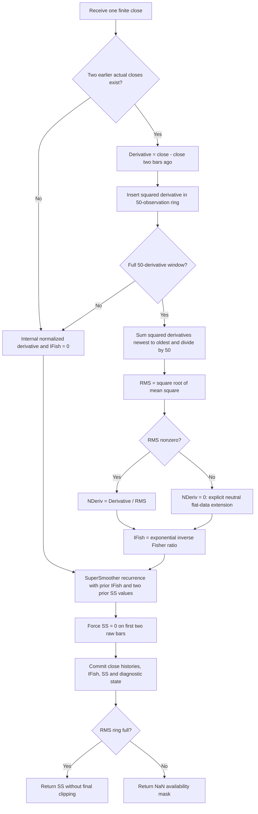

# Elegant Oscillator — research prototype master reference

This is a standalone mathematical specification and standard-library Python
streaming master of John F. Ehlers' **“Inverse Fisher Transform Redux: An
Elegant Oscillator,” February 2022**. The article and matching TradeStation
Traders' Tips code are the algorithmic authorities. Five copied test-data
files support conversion into Python, Go, TypeScript, Rust and Zig.

`ElegantOscillator(band_edge=20).update(close)` returns the SuperSmoother
output as one float. The two-bar difference and 50-bar RMS window are fixed.
The first **51 scalar outputs are NaN** under the fresh-stream contract below.
`state` exposes the derivative, RMS, normalized derivative, inverse Fisher
value and internal smoother output. The constant zero reference plot is not
another calculated output.

The source equations use rounded coefficient constants. Following the user's
established preference, this master defaults to full-precision `math.pi` and
`math.sqrt(2.0)`; `coefficient_mode="article"` retains the printed constants.
The fixtures use full precision. All 12 BandEdge values listed below were
confirmed by the user on **2026-10-16**, and their expected arrays are populated
in all five language files.

## Source scope

The supplied input contains the full article `content.md`, `tips/tips.md`, and
several separate platform implementations. No Mesa subfolder or book chapter
is supplied. All mathematical steps from the article's three code listings
are included here: Fisher transform, the Elegant Oscillator, and the auxiliary
hard/soft limiter comparison. Derived DSP explanations are identified as such.
The article's five further-reading sources are listed and given BibTeX, but
their unavailable chapters are not claimed as consulted mathematical sources.

The Python class implements the article's **Elegant Oscillator**, rather than
the separate comparison study or any trading strategy. Article and
TradeStation calculations agree. Platform differences are described below so
that a converter does not accidentally combine incompatible variants.

## Basic construction and physical interpretation

Ehlers describes three steps:

1. Differentiate price to whiten its spectrum and remove its constant level.
2. Limit the derivative's amplitude to reduce volatility's influence on timing.
3. Smooth the limited derivative with a SuperSmoother, described as integration.

The two-bar difference is a discrete derivative. A useful physical analogy is
velocity obtained from position: changes in position matter, while the
absolute coordinate origin disappears. Here the price difference emphasizes
changes rather than the price level. Its RMS measures recent signal energy.
Dividing by RMS makes the signal dimensionless, analogous to expressing a
measurement relative to its usual fluctuation size.

The inverse Fisher transform acts like a smoothly saturating amplifier. Small
inputs pass approximately unchanged; larger inputs approach a finite limit
without the sharp corners of a hard clipper. Sharp corners introduce stronger
high-frequency harmonics. Soft limiting is still nonlinear and generates
harmonics; it does not eliminate them entirely.

The SuperSmoother is a second-order lowpass that attenuates fast components of
the limited waveform. The article's “integration” is an engineering analogy
for smoothing. This is a stable lowpass with finite DC gain, not a cumulative
sum or an exact $1/(j\omega)$ integrator. Differentiating and then smoothing
does not exactly recover the original price; amplitude normalization and soft
limiting have deliberately changed it.

The intended use is swing timing and reversion to the mean. The article's
example finds peaks and valleys close to those of price, but this is not a
guarantee of zero lag for all frequencies or future bars. A peak detector that
requires a subsequent decline confirms the peak only after that decline.
No buy/sell thresholds or trading rules belong to this scalar implementation.

## Fisher transform: complete article mathematics

For an oscillator value $w$ strictly within $(-1,1)$, the Fisher transform is

$$
F(w)=\frac12\ln\left(\frac{1+w}{1-w}\right)=\operatorname{atanh}(w).
$$

The article's code clips its input before transforming it:

$$
\widetilde{w}=\min(0.999,\max(-0.999,w)),\qquad
F=\frac12\ln\left(\frac{1+\widetilde{w}}{1-\widetilde{w}}\right).
$$

At $w=1$, the denominator vanishes; at $w=-1$, the logarithm tends to negative
infinity. Clipping prevents these singularities. The article describes
$\pm0.999$ and $\pm0.9999$ as yielding approximately three and four standard
deviations. The exact formula instead gives

$$
\operatorname{atanh}(0.999)=3.800201167\ldots,\qquad
\operatorname{atanh}(0.9999)=4.951718776\ldots.
$$

The phrase “standard deviations” is a modeling interpretation, not a
distributional identity of this transform. A deterministic monotone transform
does not make every input distribution Gaussian. The interpretation depends
on the original signal and its calibration. This Fisher stage is background
from the article; the Elegant Oscillator applies its **inverse** directly to
the normalized derivative and does not apply a preceding Fisher transform.

### Inverse Fisher transform and soft limiting

Solving the Fisher equation for $w$ gives

$$
e^{2F}=\frac{1+w}{1-w},\qquad
w=\frac{e^{2F}-1}{e^{2F}+1}=\tanh F.
$$

For normalized derivative $n_t$, the oscillator therefore computes

$$
f_t=\frac{\exp(2n_t)-1}{\exp(2n_t)+1}=\tanh(n_t).
$$

Useful derived properties are

$$
\begin{aligned}
\tanh(-n)&=-\tanh(n),\\
\frac{d}{dn}\tanh n&=1-\tanh^2n,\\
\tanh n&=n-\frac{n^3}{3}+O(n^5),\\
\lim_{n\to\pm\infty}\tanh n&=\pm1.
\end{aligned}
$$

Thus it preserves the sign of nonzero finite inputs, is approximately linear
near zero, and compresses large swings smoothly. The source uses the displayed
exponential ratio, so the master also uses that expression rather than
substituting `math.tanh`, which can differ in the last floating-point bits.

## Elegant Oscillator: full source calculation

Let $x_t$ be the close at zero-based raw-bar index $t$. Histories use preceding
raw bars; `Close[2]` means two closes ago. $P=BandEdge$ is the only configurable
source input.

### Two-bar derivative

$$
d_t=x_t-x_{t-2}.
$$

There is no division by two. The first two actual closes cannot provide an
actual two-bar difference in a fresh stream; they are not substituted with a
zero price or a one-bar difference.

As a derived transfer response, with $q=z^{-1}$,

$$
D(z)=1-q^2,\qquad
D(e^{j\omega})=2j\sin\omega\,e^{-j\omega}.
$$

It has zeros at $\omega=0$ (DC) and $\omega=\pi$ (Nyquist). A one-bar difference
has only the DC zero; the two-bar difference also rejects the fastest
alternating-bar component. For small positive $\omega$, it behaves like
$2j\omega$ with a one-bar phase-delay factor.

If price's low-frequency spectral power approximately scales as
$1/\omega^2$, the derivative's squared magnitude approximately cancels that
scaling there. This is the article's whitening motivation. It is approximate
and frequency dependent; $\sin\omega$ is not $\omega$ across the whole sampled
band, and actual market spectra vary.

### Fixed 50-bar RMS and normalization

The source resets the squared sum to zero and adds exactly 50 terms, newest
first:

$$
S_t=\sum_{k=0}^{49}d_{t-k}d_{t-k},\qquad
R_t=\begin{cases}\sqrt{S_t/50},&S_t\ne0,\\0,&S_t=0.\end{cases}
$$

Its next assignment is

$$
n_t=\frac{d_t}{R_t}.
$$

RMS uses a fixed divisor 50 and does not subtract a window mean. It equals
population standard deviation only when that window's mean is zero. If
$\overline{d}_t$ is the 50-bar mean, then

$$
R_t^2=\sigma_{d,t}^2+\overline{d}_t^2.
$$

The article assumes an oscillator has nominal zero mean. A persistent linear
price trend has a constant nonzero difference, however; differentiation
removes the price level, not every trending contribution. The normalized
derivative can retain a directional bias.

The article and TradeStation leave the all-zero window's division $0/0$
undefined. For a usable reference, this master specifies

$$
n_t=0\quad\text{when }R_t=0,
$$

which yields $f_t=0$. eSignal's supplied `Calc_NDeriv` uses this neutral-zero
branch. It is an explicit extension for a case where the primary listing has
no finite numeric result. No epsilon, RMS floor or retained previous RMS is
used. After a previous nonzero window becomes completely zero, RMS becomes
zero again and the existing SuperSmoother state decays with zero inputs.

For nonzero $R_t$, the current derivative is included in the same window, so
in exact arithmetic

$$
|n_t|=\frac{|d_t|}{\sqrt{S_t/50}}\le\sqrt{50}\approx7.0711.
$$

Consequently $|2n_t|\le14.1422$, and the displayed exponential ratio does not
overflow on ordinary finite, representable squared sums. This avoids the
need for an unrelated arbitrary limiter on $n_t$.

### SuperSmoother coefficients

The complete printed coefficients are

$$
\begin{aligned}
a_1&=\exp\left(-\frac{1.414\cdot3.14159}{P}\right),\\
b_1&=2a_1\cos_{\mathrm{degrees}}\left(\frac{1.414\cdot180}{P}\right),\\
c_2&=b_1,\\
c_3&=-a_1a_1,\\
c_1&=1-c_2-c_3.
\end{aligned}
$$

The article uses degree-based `Cosine`. The full-precision master substitutes

$$
\theta=\frac{\sqrt2\pi}{P},\qquad
a_1=e^{-\theta},\qquad b_1=2a_1\cos\theta,
$$

and retains the remaining equations. In `"article"` mode the exponential uses
both rounded constants, while the degree angle is converted to radians with
full pi. Using rounded pi for that conversion would implement a different
cosine. Coefficients remain fixed for an instance.

### SuperSmoother recurrence and output

The complete source recurrence is

$$
y_t=\frac{c_1(f_t+f_{t-1})}{2}+c_2y_{t-1}+c_3y_{t-2},
$$

followed by the source override

$$
y_t=0\qquad\text{if }CurrentBar<3.
$$

With one-based `CurrentBar=t+1`, the override applies to raw indices 0 and 1.
The master maintains zero limiter and smoother histories while full-window
normalization is unavailable. When normalization first becomes available at
index 51, the recurrence runs immediately with previous limiter and smoother
states zero. It does not discard two further normalized observations or seed
the smoother with the first limiter value.

Preserve the source's operation order: first multiply $c_1$ by the sum of the
two limiter values, then divide by two, then add the two recursive terms.
$c_3$ is negative and is **added** as written. The 2022 formula has a different
coefficient convention from listings that fold the divide by two into $A_0$.

The derived transfer function is

$$
H_{SS}(z)=\frac{(c_1/2)(1+q)}{1-c_2q-c_3q^2}.
$$

It has DC gain one and a Nyquist zero. In full precision its poles are
$a_1e^{\pm j\theta}$ with radius $a_1<1$ for finite positive $P$ in exact
arithmetic. Increasing $P$ generally smooths more and slows transient decay.
The impulse response need not be nonnegative, so the output $y_t$ can
overshoot $[-1,1]$ even though the limiter input cannot. **Do not clamp the
final oscillator.**

For local small-signal analysis with RMS treated as approximately constant,
the combined linear response is proportional to

$$
(1-q^2)H_{SS}(z).
$$

This helps explain timing behavior, but the complete RMS/limiter oscillator
is nonlinear and time varying. A single transfer function does not describe
every input sequence.

## Auxiliary hard and soft limiter comparison

The article also defines a comparison study using the same derivative, RMS,
normalized derivative and inverse Fisher calculation, followed by a six-tap
FIR rather than SuperSmoother:

$$
Integ_t=\frac{f_t+2f_{t-1}+3f_{t-2}+3f_{t-3}+2f_{t-4}+f_{t-5}}{12}.
$$

Its separate hard-limiter path is

$$
\begin{aligned}
Clip_t&=\min(1,\max(-1,d_t)),\\
IntegClip_t&=\frac{Clip_t+2Clip_{t-1}+3Clip_{t-2}+3Clip_{t-3}
                     +2Clip_{t-4}+Clip_{t-5}}{12}.
\end{aligned}
$$

The source clips **raw Deriv**, not normalized `NDeriv`. The two paths
therefore have different input scaling as well as different limiter shapes;
the illustrated comparison is not a controlled experiment holding their
normalization identical. The raw clipping threshold of one is in price units.
These equations are reproduced as theoretical background and do not add
outputs or parameters to the requested Elegant Oscillator class.

The comparison FIR's derived transfer function is

$$
H_{FIR}(z)=\frac{1+2q+3q^2+3q^3+2q^4+q^5}{12}
=\frac{(1+q+q^2)(1+q+q^2+q^3)}{12}.
$$

It is a cascade of three- and four-bar SMAs, has symmetric weights, unit DC
gain and a 2.5-bar group delay. The factors give zeros at the two-, three- and
four-bar cycle frequencies discussed in the article. Its nonnegative weights
keep its output bounded when its input is bounded, unlike a general recursive
SuperSmoother response.

## Parameters and streaming API

| Setting | Default | Valid range | Meaning |
| --- | --- | --- | --- |
| `band_edge` / BE | 20 | Finite real $\ge1$; booleans rejected | Critical period for the SuperSmoother in bars. |
| `coefficient_mode` | `"full_precision"` | `"full_precision"` or `"article"` | Full mathematical constants or the printed coefficient constants. |
| Derivative lag | 2 | Fixed | Two-bar close difference. |
| RMS length | 50 | Fixed | Number of actual derivative observations in normalization. |

The article gives only BandEdge and default 20; it does not prescribe a lower
bound. This API uses the minimum 1 supported by the eSignal and NinjaTrader
parameter declarations. TradingView uses a minimum 2 and separately exposes
an RMS length. The master keeps RMS fixed at 50 to reproduce the article's
parameterization. Fractional BandEdge is supported, corroborated by the Pine
float input. BandEdge is not a history-window size or the warmup count.

Periods near one or two are numerical boundary cases, rather than evidence
of measurable market cycles below Nyquist. Extremely large periods can lose
coefficient resolution in binary64 or have settling times far beyond the
record. Inputs and intermediate arithmetic must remain finite and usable in
binary64; squared differences must not overflow, and underflow can erase tiny
signal energy. The master rejects NaN and infinity closes before state changes
and detects nonfinite squared sums/smoother results. After an intermediate
arithmetic failure, reset the instance before using it again.

`update(close)` consumes one finite chronological close and returns one float.
It does not skip missing bars, resample time or revise previous outputs.
`reset()` clears all price, RMS and recursive history. Parameters are readable
properties and fixed for each instance. `is_primed` reflects a complete RMS
window even if that window is all zero; it does not promise a settled filter.
`warmup_bars` is 51.

`state` is an `ElegantState` named tuple with fields `derivative`, `rms`,
`normalized_derivative`, `inverse_fisher`, `super_smoother`. During warmup,
unavailable derivative/RMS values appear as NaN there; the internal normalized
signal, limiter and smoother are zero.

For an affine price change $x'_t=ax_t+b$ with nonzero constant $a$, derivatives
scale by $a$ and RMS by $|a|$. In exact arithmetic the oscillator is unchanged
for positive $a$, and changes sign for negative $a$. Constant price offsets
cancel in the two-bar difference. Finite-precision subtraction and nonlinear
rounding can cause small deviations. The auxiliary raw hard limiter does not
share that scale invariance.

### Fresh-stream startup and priming

| Raw index | Available history and calculation | Returned scalar |
| --- | --- | --- |
| 0–1 | Fewer than three actual closes; no actual two-bar derivative is inserted. Internal limiter and smoother remain zero. | NaN |
| 2–50 | Actual derivatives accumulate, but fewer than 50 exist. No partial normalization is used. | NaN |
| 51 | Derivatives at indices 2–51 provide the first full 50-observation window. Compute RMS, inverse Fisher and the recurrence immediately. | First finite output |
| 52 onward | Replace the oldest squared derivative, re-sum newest first, and continue the recurrence. | Finite output |

The first full-window index is $2+(50-1)=51$: 51 leading NaNs and 201 finite
values per 252-element reference array. On that first available bar,

$$
y_{51}=c_1f_{51}/2.
$$

Missing closes are not zero-padded, and first-bar one-bar differences are not
substituted. Warmup NaNs are an output mask, never recursive history values.
This supplies a reproducible fresh-stream convention where the article
assumes chart history. Exact preloaded TradeStation chart startup depends on
its prior closes and MaxBarsBack settings. With equivalent histories and
coefficients, the listed recurrence is the reference; first visible chart
bars need not match a fresh run with no history.

## Algorithmic calculation flow



Storage is bounded: two previous closes, 50 derivative squares, one previous
inverse Fisher value and two previous smoother values. Each fully active
update performs an ordinary 50-term sum plus constant filter work. Keep that
summation order when porting. An incremental rolling sum, compensated sum or
vectorized reduction can change the reference's floating-point values.

## Confirmed reference cases

All cases use fixed RMS length 50, derivative lag 2, full-precision coefficients
and the supplied 252 closes. Only the source parameter BandEdge varies. The
“What it tests” wording is the exact comment before every language array.

| BandEdge | Array suffix | What it tests |
| ---: | --- | --- |
| 1 | BE1 | Minimum supported BandEdge. |
| 2 | BE2 | TradingView minimum BandEdge. |
| 3 | BE3 | Very short smoothing period. |
| 5 | BE5 | Short-cycle response. |
| 8 | BE8 | Fast swing response. |
| 10 | BE10 | Half-default smoothing period. |
| 15 | BE15 | Intermediate smoothing period. |
| 20 | BE20 | Article and TradeStation default. |
| 20.5 | BE20_5 | Fractional BandEdge without truncation. |
| 30 | BE30 | Slower swing response. |
| 50 | BE50 | BandEdge equals the fixed RMS length. |
| 252 | BE252 | BandEdge equals the input record length. |

These yield 12 expected arrays, each of length 252, or 3,024 outputs per
language. The four copied input arrays (Close, High, Low, Open) remain intact;
the class uses only Close. Including inputs, each file has 16 arrays and 4,032
values. The generator adds or replaces only its marked output section, along
with required Go/Zig package and import declarations.

| Language/file | Default expected identifier | NaN literal |
| --- | --- | --- |
| Python `test_testdata.py` | `EXPECTED_BE20` | `math.nan` |
| Go `testdata_test.go` | `expectedBE20` | `math.NaN()` |
| TypeScript `testdata.ts` | `expectedBE20` | `NaN` |
| Rust `testdata.rs` | `expected_be20()` | `f64::NAN` |
| Zig `testdata.zig` | `expectedBE20()` | `nan` |

Fractional tokens replace a decimal point with an underscore: `EXPECTED_BE20_5`.
The generated Go package will be `elegantoscillator`, with `math` imported.
TypeScript uses exported `number[]` constants; Rust functions return `Vec<f64>`;
Zig functions return `[252]f64`, with `math` and `nan` declarations at the top.

The generator calculates in binary64 without rounding recursive state, emits
15 **significant digits** using `.15g`, reopens and verifies the Python expected
arrays, and translates those verified values to all four other languages.
This is not a request to round to 15 places after the decimal point. A useful
port comparison tolerance is $5\times10^{-13}$ absolute and relative; handle
NaNs separately. Text literal translation can be checked bitwise, whereas
math-library calls need not produce identical last bits across platforms.

The default first available outputs from the master, indices 51–55,
are

```text
-0.0200440670989905
-0.0874787193077296
-0.196826335179938
-0.306653208751874
-0.356360330069096
```

## Usage and generation

From this folder, run the demonstration and tests:

```sh
python3 elegant-oscillator.py
python3 -m unittest -v test_elegant_oscillator.py
```

The `__main__` block embeds the exact 252 `INPUT_CLOSE` values from the copied
Python input fixture and streams them through a default instance. Regenerate
all 12 confirmed cases in the five fixture files with

```sh
python3 elegant-oscillator.py --generate-reference-data
```

The generator checks that the embedded closes equal the copied Python inputs.
Expected arrays are appended within a marked section; reruns replace only
that section and preserve inputs, avoiding duplicate arrays.

The requested filename contains a hyphen, so load it by path when embedding:

```python
import importlib.util
import math
from pathlib import Path

spec = importlib.util.spec_from_file_location(
    "elegant_master", Path("elegant-oscillator.py"))
master = importlib.util.module_from_spec(spec)
spec.loader.exec_module(master)

oscillator = master.ElegantOscillator(band_edge=20)
for close in closes:  # Finite closes, oldest to newest.
    output = oscillator.update(close)
    if not math.isnan(output):
        print(output)
```

## Supplied platform differences

| Source | Observed difference or scope |
| --- | --- |
| Article / TradeStation | Identical core formulas and fixed RMS=50. Rounded coefficient constants; all-zero RMS division undefined. Fresh-stream full-window masking and neutral-zero normalization are documented master conventions. |
| TradingView Pine v5 | Full pi and sqrt(2) coefficients support the master precision choice. Exposes RMS length and fractional BandEdge with minimum 2. Missing close delays use current/previous closes; unavailable RMS and recursive values use `nz` fallbacks, producing different startup. |
| eSignal EFS | Full pi/sqrt(2) coefficients and an explicit zero-normalization branch corroborate those choices. Returns SS plus auxiliary FIR soft/hard comparison outputs, uses platform series/null history, and gates execution by its bar count. |
| NinjaTrader | Partially sums derivative history during startup but divides by 50. Crucially, its cosine is `1.414*(Math.PI/2)/BandEdge`, half the angle in the article. It is not an interchangeable oracle for the article filter. |
| MetaStock | Sets normalized derivative to **1** when RMS is zero, giving a positive inverse Fisher signal instead of the master's neutral zero. Recursion uses `PREV` semantics. |
| TradersStudio | Implements the same nominal formulas with platform BarArray/TStation helpers and first-bar state initialization. Its listing omits the article's explicit `CurrentBar<3` output override. |
| Zorro | Delegates smoothing and inverse Fisher to `Smooth` and `FisherInv`. Its EO function exposes the RMS length but hardcodes smoothing 20 and takes platform closes even though a Data argument is passed. Includes separate hard-clip FIR and strategy demonstrations. |
| Wealth-Lab | Calls the built-in ElegantOscillator; supplied C# is a strategy using Bollinger bands and a loss rule, not an exposed core implementation. |
| Excel, thinkorswim, NeuroShell | Tips discuss demonstrations/platform use. They do not override the matching article/TradeStation equations chosen here. The spreadsheet is supplied but is not used as the numeric oracle. |

Changing startup padding, zero-RMS behavior or the cosine angle changes state
and can affect later values. This master preserves the primary recurrence and
documents its two required boundary conventions instead of silently combining
platform variants.

## Verification record — 2026-10-16

All **11 Python tests pass, with no skips**. They independently extract the actual
EasyLanguage assignments and compare all 12 confirmed periods in both precision
modes against a batch oracle using the documented startup. Additional checks
cover exact warmup and first recurrence, normalization bounds and tanh
equivalence, full flat windows and decay after nonzero history, price-offset
and scale/sign behavior, causal prefixes, reset reproducibility, rejection of
nonfinite inputs, fractional periods, impulse/transfer response, copied input
preservation and exact embedded closes.

All 12 expected arrays in Python and the four translations are checked for
names, 252-element length, exact 51-NaN prefixes, two comment lines and
agreement with the independent source-expression oracle. Regenerating twice
in a temporary directory produces byte-for-byte identical fixture files;
copied input values and the original Python/TypeScript/Rust input text are
preserved.

Temporary native validators compile or load the Go, Rust, Zig and TypeScript
fixtures and verify **all 16 arrays / 4,032 values per language**, including all
four input arrays, against the Python fixture. Finite literals match binary64
bit patterns exactly and NaNs pass each language's NaN predicate. These checks
validate the cross-language data, rather than implementations of the indicator
in those four languages.

## References

1. John F. Ehlers, “Inverse Fisher Transform Redux: An Elegant Oscillator,”
   *Technical Analysis of Stocks & Commodities*, 40(2), February 2022,
   pp. 19–23. [Publisher article](https://technical.traders.com/archive/article.asp?file=%5CV40%5CC02%5C372EHLE.pdf).
   Supplied full text: `../../tasc/2022-02-inverse-fisher-transform-redux/content.md`.
2. *Traders' Tips, February 2022*, [publisher page](https://www.traders.com/Documentation/FEEDbk_docs/2022/02/TradersTips.html).
   Supplied `tips/tips.md` and platform listings; TradeStation contribution
   credited to John Robinson. Primary code: `tips/code/ElegantOscillator.els`.
3. PineCoders, Pine v5 contribution: `tips/code/ElegantOscillator.pine`.
4. Intercontinental Exchange/eSignal, EFS contribution:
   `tips/code/ElegantOscillator.efs`.
5. Chris Lauber/NinjaTrader, contribution:
   `tips/ninja-trader/EllegantOscillator.cs` (spelling as supplied).
6. William Golson/MetaStock; Richard Denning/TradersStudio; Petra
   Volkova/Zorro; Gene Geren/Wealth-Lab; Ron McAllister/Excel, other platform
   contributors in the same Tips page and supplied code files.

Paths beginning `tips/` are relative to
`../../tasc/2022-02-inverse-fisher-transform-redux/`.

The article's further reading, included for provenance rather than as supplied
chapter content, is:

7. Ehlers, “Using the Fisher Transform,” *S&C*, volume 20, October 2002.
8. Ehlers, “The Inverse Fisher Transform,” *S&C*, volume 22, May 2004.
9. Ehlers, *Cybernetic Analysis for Stocks and Futures*, Wiley, 2004.
10. Ehlers, *Cycle Analytics for Traders*, Wiley, 2013.
11. Ehlers, “A Technical Description of Market Data for Traders,” *S&C*,
    volume 39, May 2021.

```bibtex
@article{ehlers2022inversefisher,
  author = {Ehlers, John F.},
  title = {Inverse Fisher Transform Redux: An Elegant Oscillator},
  journal = {Technical Analysis of Stocks \& Commodities},
  volume = {40},
  number = {2},
  pages = {19--23},
  year = {2022},
  month = feb,
  url = {https://technical.traders.com/archive/article.asp?file=%5CV40%5CC02%5C372EHLE.pdf}
}

@misc{tasc2022traderstips02,
  author = {{Technical Analysis of Stocks \& Commodities}},
  title = {Traders' Tips, February 2022},
  year = {2022},
  month = feb,
  url = {https://www.traders.com/Documentation/FEEDbk_docs/2022/02/TradersTips.html},
  note = {Supplied tips.md and platform code; consulted 2026-10-16}
}

@misc{robinson2022elegant,
  author = {Ehlers, John F. and Robinson, John},
  title = {Elegant Oscillator: TradeStation EasyLanguage Listing},
  year = {2022},
  month = feb,
  howpublished = {Traders' Tips, TradeStation contribution},
  url = {https://www.traders.com/Documentation/FEEDbk_docs/2022/02/TradersTips.html},
  note = {Local tips/code/ElegantOscillator.els; agrees with article}
}

@misc{pinecoders2022elegant,
  author = {{PineCoders}},
  title = {Elegant Oscillator: TradingView Pine Script v5},
  year = {2022},
  month = feb,
  howpublished = {Traders' Tips, TradingView contribution},
  url = {https://www.traders.com/Documentation/FEEDbk_docs/2022/02/TradersTips.html},
  note = {Local tips/code/ElegantOscillator.pine}
}

@misc{esignal2022elegant,
  author = {{Intercontinental Exchange, Inc.}},
  title = {Elegant Oscillator: eSignal Formula Script},
  year = {2022},
  howpublished = {Supplied EFS contribution accompanying Traders' Tips},
  url = {https://www.traders.com/Documentation/FEEDbk_docs/2022/02/TradersTips.html},
  note = {Local tips/code/ElegantOscillator.efs}
}

@misc{lauber2022elegant,
  author = {Lauber, Chris},
  title = {EllegantOscillator for NinjaTrader 8},
  year = {2022},
  month = feb,
  howpublished = {Traders' Tips, NinjaTrader contribution},
  url = {https://www.traders.com/Documentation/FEEDbk_docs/2022/02/TradersTips.html},
  note = {Local tips/ninja-trader/EllegantOscillator.cs; cosine-angle difference}
}

@misc{platforms2022elegant,
  author = {Golson, William and Denning, Richard and Volkova, Petra and
            Geren, Gene and McAllister, Ron},
  title = {Elegant Oscillator: Additional Platform Contributions},
  year = {2022},
  month = feb,
  howpublished = {Traders' Tips: MetaStock, TradersStudio, Zorro, Wealth-Lab, Excel},
  url = {https://www.traders.com/Documentation/FEEDbk_docs/2022/02/TradersTips.html},
  note = {Supplied code and discussion; implementation differences summarized}
}

@article{ehlers2002fisher,
  author = {Ehlers, John F.},
  title = {Using the Fisher Transform},
  journal = {Technical Analysis of Stocks \& Commodities},
  volume = {20},
  year = {2002},
  month = oct,
  note = {Further reading cited by the supplied 2022 article}
}

@article{ehlers2004inversefisher,
  author = {Ehlers, John F.},
  title = {The Inverse Fisher Transform},
  journal = {Technical Analysis of Stocks \& Commodities},
  volume = {22},
  year = {2004},
  month = may,
  note = {Further reading cited by the supplied 2022 article}
}

@book{ehlers2004cybernetic,
  author = {Ehlers, John F.},
  title = {Cybernetic Analysis for Stocks and Futures},
  publisher = {John Wiley \& Sons},
  year = {2004},
  note = {Further reading cited by the supplied 2022 article; chapters not supplied}
}

@book{ehlers2013cycle,
  author = {Ehlers, John F.},
  title = {Cycle Analytics for Traders},
  publisher = {John Wiley \& Sons},
  year = {2013},
  note = {Further reading cited by the supplied 2022 article; chapters not supplied}
}

@article{ehlers2021marketdata,
  author = {Ehlers, John F.},
  title = {A Technical Description of Market Data for Traders},
  journal = {Technical Analysis of Stocks \& Commodities},
  volume = {39},
  year = {2021},
  month = may,
  note = {Further reading cited by the supplied 2022 article}
}
```
