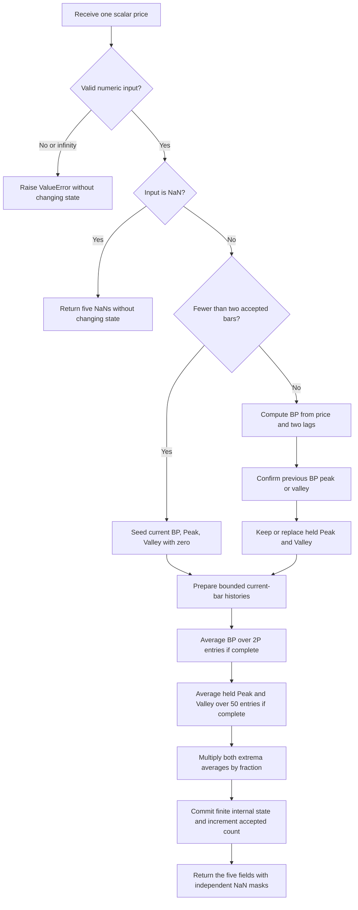

# Empirical Mode Decomposition

This folder is the self-contained research prototype master for **Empirical Mode Decomposition**, described by John F. Ehlers and Ric Way in the March 2010 issue of *Technical Analysis of STOCKS & COMMODITIES* (TASC), volume 28, pages 19–24. It supplies a causal, scalar-input Python implementation, the complete calculation specification, and input/expected fixtures for Python, Go, TypeScript, Rust, and Zig.

The numerical authority is the article's EasyLanguage EMD listing, also reproduced in the supplied MESA paper and Traders' Tips. The TradeStation tip uses the same recurrence and fixed 50-bar extremum averages. The supplied NinjaTrader tip makes the otherwise platform-dependent initial state explicit: the first two BP, Peak, and Valley values are zero. This master adopts those seeds and publishes **NaN for each incomplete output window**. The references use the user's requested `INPUT_CLOSE`, rather than the article's default midpoint price.

The returned fields are exactly `Trend`, `AvgPeak`, `FractalAbgPeak`, `AvgValley`, and `FractalAvhValley`. The latter two spellings are preserved as the requested interface; they represent the source variables **FracAvgPeak** and **FracAvgValley**, meaning a fraction of an average. There is no fractal-dimension calculation in these fields.

## Purpose and physical background

Market swings and sustained directional moves call for different trading rules. A strategy that buys and sells cycle extremes can continue selling into an uptrend or buying into a downtrend. Conversely, a trend strategy can suffer repeated reversals when a market oscillates around a fairly stationary center. The indicator estimates an evolving cycle component and a slower trend component, then compares the trend component to the recent cycle amplitude.

The articles describe price as a waveform containing several time scales. Slowly varying trends contribute low-frequency components, the desired trading swings occupy intermediate frequencies, and short-term fluctuations contribute higher frequencies. A **bandpass filter** attenuates both the slow and fast components while retaining a band around a chosen cycle period. Period is expressed in bars, so a 20-bar daily cycle is approximately one trading month. The same bar-based mathematics applies to weekly and intraday observations. The authors' reference to markets being fractal motivates this choice of time scale; it does not introduce a numerical fractal parameter.

A rotating **phasor** provides their cycle analogy. Imagine a vector of length $A$ rotating around an anchor with angular increment $\omega_0$ per bar. Its projection onto the vertical axis traces a sine wave:

$$
y_t=A\sin(\omega_0t+\phi),\qquad \omega_0=\frac{2\pi}{P}.
$$

The paper likens this to a pen attached to a string, with the other end pinned at the anchor and paper moving under the pen as in a seismograph or electrocardiogram. A stationary anchor produces a zero-mean oscillation. Moving the anchor vertically introduces a slowly varying center:

$$
y_t=m_t+A_t\sin(\omega_0t+\phi_t).
$$

If $m_t$, $A_t$, and $\phi_t$ vary slowly, averaging over an integer number of cycles largely cancels the oscillation while retaining its center. Higher swing highs and higher swing lows tend to accompany a positive trend component; lower swing highs and lower swing lows tend to accompany a negative component. The Ehlers/Way procedure estimates that center by averaging the **filtered** waveform over two nominal cycle periods.

A narrow bandpass resembles a lightly damped resonator or a bell: once excited, it can continue ringing after the excitation changes. Increasing `delta` broadens the passband and shortens this memory, helping the filter respond when the cycle period changes. Narrowing it improves selectivity at the cost of longer transients. The articles illustrate this using a chirp, a sine wave whose frequency changes continuously. A filter tuned to 20 bars retains a large swing near that period while suppressing both faster and slower oscillations and removing the chirp's constant price offset.

Here “empirical mode decomposition” names the authors' fixed-period bandpass and averaging procedure. The implementation follows those equations; it does not perform spline-envelope construction or iterative intrinsic-mode sifting. No automatic dominant-period measurement, normalization, reconstruction of price, or trading execution is added.

## Notation, input, and parameters

Let $t=0,1,2,\ldots$ index **accepted finite observations**, $x_t$ be the scalar input price, $P$ be `period`, $\delta$ be `delta`, and $F$ be `fraction`. The source notation `X[j]` denotes $X_{t-j}$, so `Price[2]` is the price two bars ago, not yesterday's price. All calculations use binary64 floating point.

| Setting | Default | Valid values | Role |
|---|---:|---|---|
| `period` ($P$) | 20 | Integer $P\ge3$; Boolean and fractional periods rejected | Nominal cycle period in bars; Trend uses exactly $2P$ bars. |
| `delta` ($\delta$) | 0.5 | Finite $0<\delta<P/8$, with computed $0<\alpha<1$ | Approximate fractional half-bandwidth; controls selectivity and damping. |
| `fraction` ($F$) | 0.1 | Finite $0\le F\le1$ | Multiplies the held peak and valley averages to form mode thresholds. |
| Peak/valley average length ($K$) | 50 | Fixed, not a constructor parameter | Literal 50-bar averages in the article and TradeStation tip. |
| Input `price` ($x_t$) | Caller supplied | Finite real scalar, or NaN to skip an observation | The article uses $(H_t+L_t)/2$; these fixtures use close. |

The introductory bandpass and trend-only listings default to $\delta=0.1$. The complete EMD listing defaults to $P=20$, $\delta=0.5$, and $F=0.1$. The MSFT chart demonstrating mode thresholds uses $F=0.25$. This master defaults to the **complete EMD listing**, not the chart's different fraction.

The article does not supply a rigorous parameter-validation domain. The limits above are explicit prototype rules. Requiring $P>2$ places the nominal frequency strictly between DC and Nyquist; integer $P$ gives an unambiguous integer window. Requiring $0<\delta<P/8$ keeps the bandwidth angle in the positive stable branch, rather than admitting periodic aliases or unstable coefficients. Extremely small positive `delta` may round $\alpha$ to one and is rejected. Fraction zero and one are supported endpoint cases. Fractions outside the documented interval are rejected instead of silently clipped. There is no arbitrary upper period cap; a period whose window exceeds the available history simply leaves Trend unprimed.

Settings are immutable through the public `parameters` tuple. Create a new indicator to change them. `reset()` clears history and outputs while retaining the settings and coefficients.

## Complete article mathematics

The TASC article and MESA paper express their calculation equations as EasyLanguage listings. All their mathematical steps, including the bandpass-only and trend-only studies, are reproduced below in mathematical notation. Additional transfer-function analysis is identified separately.

### 1. Bandpass coefficients

EasyLanguage's `Cosine` function uses **degrees**. Its coefficient equations are

$$
\beta=\cos\!\left(\frac{360^{\circ}}{P}\right),\qquad
\gamma=\frac{1}{\cos\!\left(\frac{720^{\circ}\delta}{P}\right)},\qquad
\alpha=\gamma-\sqrt{\gamma^2-1}.
$$

Python and the intended ports use radian trigonometric functions, so the implementation is

$$
\boxed{
\beta=\cos\!\left(\frac{2\pi}{P}\right),\qquad
\gamma=\frac{1}{\cos\!\left(\frac{4\pi\delta}{P}\right)},\qquad
\alpha=\gamma-\sqrt{\gamma^2-1}
}
$$

The gain and feedback coefficients cached by the implementation are

$$
g=\frac{1-\alpha}{2},\qquad b=\beta(1+\alpha).
$$

Use the platform's full-precision $\pi$ (`math.pi` in Python), not a truncated decimal approximation. Keep the printed $\gamma-\sqrt{\gamma^2-1}$ calculation and its arithmetic order for reference parity. The constants $0.5$, $1$, $2$, and $50$ are exact structural constants. The fractional bandwidth and threshold defaults are intentional user settings, not truncated approximations to transcendental constants. This listing does not use $\sqrt{2}$ or the truncated `1.414` found in other Ehlers filters.

### 2. Recursive cycle component

With $B_t$ denoting `BP`, the article's two-pole recursion is

$$
\boxed{
B_t=\frac{1-\alpha}{2}(x_t-x_{t-2})
     +\beta(1+\alpha)B_{t-1}-\alpha B_{t-2}.
}
$$

The two-bar price difference suppresses a constant input. The two feedback terms produce a resonator centered at the desired intermediate frequency. The bandpass-only study plots $B_t$ and a zero reference line. BP remains an internal diagnostic in this master; the requested interface has five different outputs.

The article describes `delta` as the approximate half-bandwidth relative to period. With $P=20$ and $\delta=0.1$, its stated period range is approximately 18–22 bars. With $P=20$ and $\delta=0.5$, it describes a broader approximate 10–30-bar range. These are the source's intuitive period ranges, not exact hard cutoffs. A recursive filter attenuates frequencies continuously, and frequency and period are reciprocal. This master calculates the published coefficients rather than constructing a rectangular passband from those examples.

### 3. Trend extraction

The trend-only study adds an ordinary simple average over the latest **two nominal cycle periods**:

$$
\boxed{
T_t=\operatorname{SMA}_{2P}(B)_t
   =\frac{1}{2P}\sum_{j=0}^{2P-1}B_{t-j}.
}
$$

The source calls this variable `Trend` in the trend-only study and `Mean` in the complete EMD study. This master returns it as `Trend`. Both names denote the same quantity. The trend-only study plots $T_t$ and zero. Averaging over two periods aims to suppress the oscillatory component while keeping a reasonably smooth center with moderate lag.

Trend is the mean of the **bandpass output**, not an average of the original price, a price-level trendline, or a residual obtained by subtracting a cycle from price. Its sign and amplitude reflect directional behavior in the filtered signal. A finite moving average suppresses a nominal sinusoid most effectively when its period actually agrees with $P$; changing amplitude, changing period, transients, and noise can leave a nonzero mean.

### 4. Confirmed, held peaks and valleys

Let $p_t$ and $v_t$ denote the source's `Peak` and `Valley`. The previous values are carried forward unless a strict three-point extremum is confirmed:

$$
\boxed{
p_t=\begin{cases}
B_{t-1},&B_{t-1}>B_t\ \text{and}\ B_{t-1}>B_{t-2},\\
p_{t-1},&\text{otherwise},
\end{cases}
}
$$

$$
\boxed{
v_t=\begin{cases}
B_{t-1},&B_{t-1}<B_t\ \text{and}\ B_{t-1}<B_{t-2},\\
v_{t-1},&\text{otherwise}.
\end{cases}
}
$$

The source explicitly initializes these held values to zero. A peak or valley on bar $t-1$ becomes known on bar $t$, after the next BP sample confirms a reversal. Record the newly confirmed value on **the current bar**; do not retroactively change yesterday's output. Equal neighboring values do not satisfy the strict comparisons, so a flat plateau is not a detected turning point. Do not impose a zero-sign test: a local peak can be negative and a local valley can be positive.

The separate article `if` statements and TradeStation's `if / else if` are equivalent because the strict peak and valley conditions cannot both hold at the same bar.

### 5. Average the held extrema, then scale

For $K=50$, the unscaled averages are

$$
\boxed{
A^p_t=\frac{1}{50}\sum_{j=0}^{49}p_{t-j},\qquad
A^v_t=\frac{1}{50}\sum_{j=0}^{49}v_{t-j}.
}
$$

The upper and lower mode thresholds are

$$
\boxed{U_t=F A^p_t,\qquad L_t=F A^v_t.}
$$

These are **50 bars of the held stepwise series**, not the last 50 detected peak or valley events. If no new peak is confirmed for ten bars, the same held peak contributes ten entries to the average. Initialize the series to zero before the first extremum is found; do not leave it NaN until the first event. Updating the held values must happen **before** their current-bar entries are averaged.

The complete article plots `Mean`, `Fraction*AvgPeak`, and `Fraction*AvgValley` (using plot numbers 1, 2, and 6). The TradeStation tip stores the scaled values as `FracAvgPeak` and `FracAvgValley` and uses consecutive plot numbers. Returning both raw averages and their scaled thresholds exposes the five requested quantities without changing any source equation.

| Requested output | Equation | Source meaning |
|---|---|---|
| `Trend` | $T_t$ | `Mean`, or `Trend` in the trend-only listing |
| `AvgPeak` | $A^p_t$ | Unscaled 50-bar average of held `Peak` |
| `FractalAbgPeak` | $F A^p_t$ | `FracAvgPeak`, upper mode threshold |
| `AvgValley` | $A^v_t$ | Unscaled 50-bar average of held `Valley` |
| `FractalAvhValley` | $F A^v_t$ | `FracAvgValley`, lower mode threshold |

### 6. Interpret the market mode

The authors' conceptual classification is

$$
\text{mode}_t=\begin{cases}
\text{uptrend},&T_t>U_t,\\
\text{downtrend},&T_t<L_t,\\
\text{cycle},&L_t\le T_t\le U_t.
\end{cases}
$$

This interpretation assumes the usual ordered lower and upper envelopes. Equality is not a strict trend crossing. Wait until all required fields are finite before comparing them. A larger positive fraction ordinarily widens the threshold zone and classifies more bars as cycling; a smaller fraction favors a trend classification. The authors prefer swing trading and illustrate a relatively wide zone using $F=0.25$.

The returned interface supplies the measurements, not a categorical signal or trading system. No clamps, sorting of thresholds, position rules, Bollinger bands, EMA filters, stops, or order execution are added. In unusual transients the extrema are not guaranteed to have particular signs; consumers should use the actual values rather than inventing an absolute-amplitude envelope.

## Further mathematical interpretation

This section derives consequences of the article's equations. It is included to explain the physical behavior and conversion checks; these equations introduce no additional implementation stages.

With fixed parameters and zero initial state, the BP transfer function is

$$
H_B(z)=\frac{\frac{1-\alpha}{2}(1-z^{-2})}
                 {1-\beta(1+\alpha)z^{-1}+\alpha z^{-2}}.
$$

The numerator has zeros at $z=1$ (DC) and $z=-1$ (Nyquist), rejecting both constant levels and an alternating one-bar component. Its poles solve

$$
r^2-\beta(1+\alpha)r+\alpha=0,
$$

so

$$
r_{\pm}=\frac{\beta(1+\alpha)\pm
\sqrt{\beta^2(1+\alpha)^2-4\alpha}}{2}.
$$

If the discriminant is negative, they form a complex conjugate pair of magnitude $\sqrt{\alpha}$. Some broader parameter choices yield real poles instead. For $|\beta|<1$ and $0<\alpha<1$, the second-order denominator is stable: its three real stability inequalities reduce to $1-\alpha>0$, $(1+\alpha)(1-\beta)>0$, and $(1+\alpha)(1+\beta)>0$. As a narrow-band pole approaches the unit circle, ringing and settling time increase. Passing a full finite window does not mean the recursive filter has fully settled.

At $\theta=4\pi\delta/P$, the coefficient is mathematically equivalent to

$$
\alpha=\sec\theta-\tan\theta
       =\frac{1-\sin\theta}{\cos\theta},\qquad 0<\theta<\frac{\pi}{2}.
$$

These identities explain the stable branch but are **not** substituted into the reference arithmetic: algebraically equivalent floating-point calculations can produce slightly different values.

For $0<\omega<\pi$, multiplying the numerator and denominator by $e^{i\omega}$ gives

$$
H_B(e^{i\omega})=
\frac{i(1-\alpha)\sin\omega}
{(1+\alpha)(\cos\omega-\beta)+i(1-\alpha)\sin\omega}.
$$

Thus the squared magnitude response is

$$
|H_B(e^{i\omega})|^2=
\frac{(1-\alpha)^2\sin^2\omega}
{(1+\alpha)^2(\cos\omega-\beta)^2+(1-\alpha)^2\sin^2\omega}.
$$

At the nominal frequency $\omega_0=2\pi/P$, $\cos\omega_0=\beta$, giving unit gain and zero steady-state phase difference. This explains why the source's chirp retains its full swing near the tuned period. The exact half-power frequencies satisfy

$$
|\cos\omega-\beta|=\frac{1-\alpha}{1+\alpha}|\sin\omega|.
$$

The $N$-bar averaging transfer function, with $N=2P$, is

$$
H_A(z)=\frac{1}{N}\sum_{j=0}^{N-1}z^{-j}
      =\frac{1-z^{-N}}{N(1-z^{-1})}.
$$

Its sinusoidal response is

$$
H_A(e^{i\omega})=
e^{-i\omega(N-1)/2}\frac{\sin(N\omega/2)}{N\sin(\omega/2)}.
$$

A constant-amplitude, exactly $P$-bar sinusoid is canceled by the $2P$ average after transients, while a slowly varying filtered center remains. The averaging stage has a linear-phase delay of $(2P-1)/2$ bars. The total price-to-Trend response is $H_B(z)H_A(z)$, so describing Trend as zero-lag would be incorrect.

A useful distinction is that a stable BP rejects a **constant price level** while responding to a **price ramp**. For $x_t=c+st$, a steady constant BP output solves the recurrence:

$$
B_{\infty}=
\frac{(1-\alpha)s}{(1+\alpha)(1-\beta)}.
$$

Its long-window mean has the same limit and the same sign as slope $s$. This reconciles DC rejection with the authors' positive and negative trend examples. Trend is a scaled directional measurement, not an estimate of the absolute level $c+st$.

## Initialization, priming, and update contract

The article's EasyLanguage declarations seed BP, Peak, and Valley to zero, but chart platforms differ in how prehistory and `MaxBarsBack` affect the first calculated bar. A finite 252-bar fixture therefore needs an explicit cold-start specification. This master uses the supplied NinjaTrader tip's first-two-bar initialization, then the article's complete-window sums.

1. Before the first observation, histories are empty and held Peak and Valley are zero. All five public fields are NaN.
2. At $t=0$ and $t=1$, store the real prices but set $B_t=p_t=v_t=0$. Insert these zero entries into their respective averaging histories. Do not apply the BP recurrence with an invented zero `Price[2]`.
3. Starting at $t=2$, evaluate BP using the current price, the real two-bar-old price, and the previous two BP values. Confirm the previous BP extremum using strict comparisons, then update the held series.
4. Return each average only when its complete window is present. Startup zero BP/Peak/Valley values count as entries; observations preceding $t=0$ do not.

| Output | Required accepted observations | First finite zero-based index | Leading NaNs |
|---|---:|---:|---:|
| `Trend` | $2P$ | $2P-1$ | $2P-1$ |
| `AvgPeak` | 50 | 49 | 49 |
| `FractalAbgPeak` | 50 | 49 | 49 |
| `AvgValley` | 50 | 49 | 49 |
| `FractalAvhValley` | 50 | 49 | 49 |

`warmup_bars` equals $\max(2P,50)-1$: the number of accepted bars before an **all-five-finite** output can appear. `is_primed` becomes true when `samples_seen > warmup_bars`. It does not mask an individual field whose shorter window is already complete. At the default $P=20$, Trend first appears on accepted bar 40 (index 39), and the other four first appear on accepted bar 50 (index 49).

For the 252-value record, $P=126$ gives exactly one finite Trend value, at index 251. With $P=127$, all 252 Trend values are NaN, while the four peak/valley fields still contain 203 finite values each. Fraction zero leaves the scaled fields NaN during their 49-bar warmup; it does not turn an unavailable average into an early zero.

`update(price)` handles one completed bar and returns an immutable `EmpiricalModeDecompositionOutput` named tuple. `output` preserves the last accepted tuple. A NaN observation returns five NaNs without advancing the counter, histories, extrema, or saved output. Consequently, lookbacks count accepted observations across gaps; callers who need calendar-bar gap behavior must define their sampling policy before calling the master. Infinity, Boolean values, invalid numeric inputs, and detected arithmetic overflow raise `ValueError` without committing a new state. These input-validation conventions extend the articles, which assume finite dense prices.

## Calculation flow and storage



The Python histories are stored **newest first**, making EasyLanguage bar-index notation straightforward to translate. Before committing a new bar, price history entry 1 is the desired two-bar-old price; BP entries 0 and 1 are the previous and two-bar-old BP. After committing, entry $j$ means the current bar's `X[j]`.

State consists of two previous prices, up to $2P$ BP samples, up to 50 held peaks, up to 50 held valleys, two held extrema, and a counter. The master uses ordinary bounded lists and explicit loops for clarity. Both time and storage per update are $O(P+50)$. Ports may use fixed circular buffers, provided they keep the same startup, extrema-update timing, and newest-to-oldest summation order. Do not use public NaNs as recursive seeds or replace the source recurrence with a rolling mean, an EMA, or an event-count average.

## Differences among the supplied source implementations

The original article, MESA paper, and TradeStation tip agree on the calculation above. Platform examples are useful for provenance but are not all interchangeable numerical oracles:

- **NinjaTrader:** explicitly initializes BP, Peak, and Valley to zero for `CurrentBar < 2` and uses the same 50-bar averages. Its supplied SMA implementation produces partial averages during warmup and updates a rolling average recursively. This master publishes only complete windows and uses direct finite-window summation. Once complete, their mathematical averages agree; final bits may differ with summation order.
- **Wealth-Lab:** also initializes the first two BP values to zero but changes extremum averaging length to `int(2.5 * period)`. That equals 50 at $P=20$ only. The master retains **50 for every period**, as required by the article. Its additional EMA and strategy rules are not indicator stages.
- **AmiBroker:** provides a cycle/trend display helper, seeds the polynomial-filter output differently, and uses a truncated decimal $\pi$. Those choices are not adopted.
- **Other Traders' Tips:** supply variants for eSignal, MetaStock, StockFinder, NeuroShell, TradingSolutions, Tradecision, NeoTicker, Wave59, and VT Trader. Their platform warmup conventions and price-source controls differ. The AIQ flat-base breakout example is explicitly unrelated to the EMD article.

The fixtures are therefore references for the documented **article recurrence, first-two-bar zero seeds, fixed 50-bar averages, complete-window NaN masks, close input, and full-precision constants**. Reproducing the article's midpoint-price chart requires feeding the same midpoint prices and matching the chart's prior history. Verification here compares against an independent mathematical translation of the supplied source; it does not claim to have executed proprietary TradeStation or NinjaTrader software.

## Confirmed reference parameter combinations

The user confirmed **all 16 combinations on 2026-10-25**. There are five scalar output arrays per combination, hence **80 arrays of 252 values in each language**. All cases start from fresh state and use the exact 252 `INPUT_CLOSE` values copied from the parent fixture. The copied high, low, and open arrays remain available but are not used to calculate these expectations.

| # | Period $P$ | Delta $\delta$ | Fraction $F$ | What it tests |
|---|---:|---:|---:|---|
| 1 | 20 | 0.5 | 0.1 | Article defaults. |
| 2 | 20 | 0.5 | 0.25 | Thresholds used in the article's MSFT example. |
| 3 | 20 | 0.1 | 0.1 | Narrow bandpass from the introductory listing. |
| 4 | 20 | 0.25 | 0.1 | Intermediate bandwidth. |
| 5 | 20 | 1.0 | 0.1 | Wider bandwidth and faster response. |
| 6 | 3 | 0.25 | 0.1 | Shortest supported period. |
| 7 | 10 | 0.5 | 0.1 | Short cycle; Trend primes before peak/valley averages. |
| 8 | 21 | 0.5 | 0.1 | Odd period and a 42-bar Trend window. |
| 9 | 25 | 0.5 | 0.1 | All five outputs prime together at 50 bars. |
| 10 | 40 | 0.5 | 0.1 | Longer cycle; peak/valley averages prime before Trend. |
| 11 | 126 | 0.5 | 0.1 | Trend becomes available only on the final input bar. |
| 12 | 127 | 0.5 | 0.1 | Insufficient input for Trend; other outputs remain available. |
| 13 | 20 | 0.5 | 0.0 | Zero fraction collapses both thresholds to zero. |
| 14 | 20 | 0.5 | 1.0 | Unit fraction makes thresholds equal their raw averages. |
| 15 | 20 | 0.01 | 0.1 | Very narrow bandwidth and long filter memory. |
| 16 | 4 | 0.49 | 0.1 | Bandwidth close to the stability boundary D < P/8. |

For each array, the first preceding comment reproduces the exact “What it tests” text from this table. The second lists `period`, `delta`, `fraction`, fixed `peak_average_length=50`, and `input=INPUT_CLOSE`.

Parameter shortcuts are `P`, `D`, and `F`. Decimal points become underscores and a redundant `.0` is omitted from **names**. An output suffix identifies the component:

```text
EXPECTED_P20_D0_5_F0_1_TREND
EXPECTED_P20_D0_5_F0_1_AVGPEAK
EXPECTED_P20_D0_5_F0_1_FRACTALABGPEAK
EXPECTED_P20_D0_5_F0_1_AVGVALLEY
EXPECTED_P20_D0_5_F0_1_FRACTALAVHVALLEY
```

The master serializes finite output using **15 significant decimal digits**, preserving magnitude with scientific notation when needed. Integral-valued floats retain a `.0` for Rust and Zig type correctness. Internal calculations are not rounded; only the exported reference literals are rounded. Conversions should normally compare finite values with both an absolute and a relative tolerance around $10^{-12}$, and compare NaN locations exactly. Bitwise equality is not promised across different standard-library trigonometric implementations or compiler floating-point optimizations.

| Language file | Expected declaration | Unavailable value |
|---|---|---|
| `test_testdata.py` | `EXPECTED_P20_D0_5_F0_1_TREND = [...]` | `NaN`, with `NaN = math.nan` |
| `testdata_test.go` | `var expectedP20_D0_5_F0_1_TREND = []float64{...}` | `math.NaN()` |
| `testdata.ts` | `export const expectedP20_D0_5_F0_1_TREND: number[] = [...]` | `NaN` |
| `testdata.rs` | `pub fn expected_p20_d0_5_f0_1_trend() -> Vec<f64>` | `f64::NAN` |
| `testdata.zig` | `pub fn expectedP20_D0_5_F0_1_TREND() [252]f64` | `nan` |

The Go package is `empiricalmodedecomposition`, the folder name stripped of separators and lowercased. Rust expected functions remain inside the copied `#[cfg(test)] pub mod testdata`. Zig retains `const math = @import("std").math;` and `const nan = math.nan(f64);` and uses an explicit `return .{...};`. TypeScript uses valid typed exported array constants.

## Running and verifying the master

Work in this folder. The no-argument command demonstrates the default streaming indicator using all 252 close prices embedded directly in `__main__`:

```bash
python3 empirical-mode-decomposition.py
```

Regenerate the confirmed references with:

```bash
python3 empirical-mode-decomposition.py --generate-reference
python3 -m unittest discover -s . -p 'test_empirical_mode_decomposition.py' -v
```

Generation first checks that the embedded input matches the copied Python input exactly. It runs each fresh stream, appends the 80 Python arrays, **reopens the Python file and verifies all array names, lengths, values, and NaN masks**, then exports the other four languages from those reopened Python arrays. Marked generated sections are replaced on regeneration so arrays are not duplicated; all copied input arrays are preserved.

The tests check the streaming values against a separately written chronological batch translation of the article, first-two-bar seeds, strict extremum confirmation, held-series averaging, per-field priming boundaries, threshold scaling, reset, skipped NaNs, invalid inputs, and constant/ramp/sinusoidal behavior. Fixture checks validate all 80 arrays and all four input arrays in all five languages, including identical decimal values and NaN locations. The generator is also checked for byte-identical regeneration. Go, TypeScript/JavaScript, Rust, and Zig syntax can be checked with their respective available toolchains; these fixture files contain data rather than target-language indicator implementations.

Because the filename contains hyphens, import it by path in Python applications, for example:

```python
import importlib.util
from pathlib import Path

path = Path("empirical-mode-decomposition.py")
spec = importlib.util.spec_from_file_location("emd_master", path)
module = importlib.util.module_from_spec(spec)
spec.loader.exec_module(module)

emd = module.EmpiricalModeDecomposition(period=20, delta=0.5, fraction=0.1)
for close in closes:
    result = emd.update(close)
    # result.Trend, result.AvgPeak, result.FractalAbgPeak,
    # result.AvgValley, result.FractalAvhValley
```

## References and source provenance

All numerical equations and conventions needed to port the master are included above. The following sources supply provenance and the authors' explanations:

1. **Ehlers, John F., and Ric Way (2010). “Empirical Mode Decomposition: Cycle Vs. Trend Mode Detection.”** *Technical Analysis of STOCKS & COMMODITIES*, 28(3), 19–24, March. [Publisher article](https://technical.traders.com/archive/article.asp?file=%5CV28%5CC03%5C043EHLR.pdf). Local article: [content.md](../../tasc/2010-03-empirical-mode-decomposition/content.md).
2. **Ehlers, John F., and Ric Way. “Empirical Mode Decomposition: A Novel Approach for Cycle and Trend Mode Detection.”** MESA Software paper, associated with the 2010 article. [Paper PDF](https://www.mesasoftware.com/papers/EmpiricalModeDecomposition.pdf). Local paper: [MESA content.md](../../tasc/2010-03-empirical-mode-decomposition/mesa/content.md). Repeats all three listings and cites “Corona Charts” for the earlier bandpass/cycle discussion.
3. **Technical Analysis, Inc. (2010). “Traders' Tips — March 2010: Empirical Mode Decomposition.”** [Publisher page](https://www.traders.com/Documentation/FEEDbk_docs/2010/03/TradersTips.html). Local collection: [tips.md](../../tasc/2010-03-empirical-mode-decomposition/tips/tips.md).
4. **Mills, Mark (2010), TradeStation Securities. “EmpiricalMode” / “EmpiricalMode: ModeTrader.”** TradeStation contribution to the March Traders' Tips, including BandPassFilter, TrendExtractor, EmpiricalMode, and a separate strategy. Local [EMD_tradestation.els](../../tasc/2010-03-empirical-mode-decomposition/tips/EMD_tradestation.els). The indicator equations and 50-bar averages agree with the article.
5. **Deux, Raymond, and Austin Pivarnik (2010), NinjaTrader. “EmpiricalModeDecomposition.”** NinjaTrader contribution to the same tips. Local [indicator C#](../../tasc/2010-03-empirical-mode-decomposition/tips/ninja-trader/EmpiricalModeDecomposition.cs) and [SMA C#](../../tasc/2010-03-empirical-mode-decomposition/tips/ninja-trader/@SMA.cs). Supplies explicit first-two-bar zero initialization and illustrates platform warmup/rolling-average differences.
6. **Sucher, Robert (2010), Wealth-Lab. “EmpiricalModeDecomp.”** Wealth-Lab contribution to the same tips. Local [EMD_wealthlab.cs](../../tasc/2010-03-empirical-mode-decomposition/tips/EMD_wealthlab.cs). Its `int(2.5*period)` peak-average length is a documented variant, not the master rule.
7. **Janeczko, Tomasz (2010), AmiBroker. “Empirical Mode Decomposition.”** AmiBroker contribution to the same tips. Local [EMD_amibroker.afl](../../tasc/2010-03-empirical-mode-decomposition/tips/EMD_amibroker.afl). Provides the cycle/trend display comparison and a different initialization/constant convention.
8. **Ehlers, John F. (2008). “Corona Charts.”** *Technical Analysis of STOCKS & COMMODITIES*, 26(11), November, beginning on page 19. Suggested reading in the TASC article and footnotes in the MESA paper. This is a bibliographic antecedent; no additional Corona calculation is needed to implement this EMD.

## BibTeX

```bibtex
@article{ehlers_way_emd_2010,
  author = {John F. Ehlers and Ric Way},
  title = {Empirical Mode Decomposition: Cycle Vs. Trend Mode Detection},
  journal = {Technical Analysis of STOCKS \& COMMODITIES},
  volume = {28},
  number = {3},
  pages = {19--24},
  year = {2010},
  month = mar,
  publisher = {Technical Analysis, Inc.},
  url = {https://technical.traders.com/archive/article.asp?file=%5CV28%5CC03%5C043EHLR.pdf}
}

@misc{ehlers_way_emd_mesa,
  author = {John F. Ehlers and Ric Way},
  title = {Empirical Mode Decomposition: A Novel Approach for Cycle and Trend Mode Detection},
  year = {2010},
  howpublished = {MESA Software paper},
  url = {https://www.mesasoftware.com/papers/EmpiricalModeDecomposition.pdf},
  note = {Associated paper; local archive does not state an independent publication date}
}

@misc{tasc_traders_tips_emd_2010,
  author = {{Technical Analysis, Inc.}},
  title = {Traders' Tips: Empirical Mode Decomposition},
  year = {2010},
  month = mar,
  url = {https://www.traders.com/Documentation/FEEDbk_docs/2010/03/TradersTips.html}
}

@misc{mills_tradestation_emd_2010,
  author = {Mark Mills},
  title = {TradeStation: Empirical Mode Decomposition},
  organization = {TradeStation Securities, Inc.},
  year = {2010},
  month = mar,
  howpublished = {Traders' Tips contribution; EasyLanguage source},
  url = {https://www.traders.com/Documentation/FEEDbk_docs/2010/03/TradersTips.html}
}

@misc{deux_pivarnik_ninjatrader_emd_2010,
  author = {Raymond Deux and Austin Pivarnik},
  title = {NinjaTrader: Empirical Mode Decomposition and SMA},
  organization = {NinjaTrader, LLC},
  year = {2010},
  month = mar,
  howpublished = {Traders' Tips contribution; archived C\# source},
  url = {https://www.traders.com/Documentation/FEEDbk_docs/2010/03/TradersTips.html}
}

@misc{sucher_wealthlab_emd_2010,
  author = {Robert Sucher},
  title = {Wealth-Lab: Empirical Mode Decomposition},
  organization = {Wealth-Lab},
  year = {2010},
  month = mar,
  howpublished = {Traders' Tips contribution; C\# source},
  url = {https://www.traders.com/Documentation/FEEDbk_docs/2010/03/TradersTips.html}
}

@misc{janeczko_amibroker_emd_2010,
  author = {Tomasz Janeczko},
  title = {AmiBroker: Empirical Mode Decomposition},
  organization = {AmiBroker.com},
  year = {2010},
  month = mar,
  howpublished = {Traders' Tips contribution; AFL source},
  url = {https://www.traders.com/Documentation/FEEDbk_docs/2010/03/TradersTips.html}
}

@article{ehlers_corona_charts_2008,
  author = {John F. Ehlers},
  title = {Corona Charts},
  journal = {Technical Analysis of STOCKS \& COMMODITIES},
  volume = {26},
  number = {11},
  year = {2008},
  month = nov,
  note = {Begins on page 19; cited by the supplied EMD article and MESA paper}
}
```
