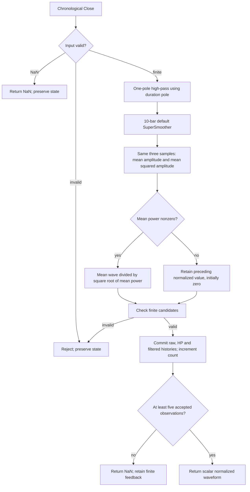

# Even Better Sinewave — Chapter 12 research prototype master

## Numerical authority and scope

This is a **research prototype master reference** for conversion to Python, Go, TypeScript, Rust and Zig. The numerical authority is this indicator's own listing in John F. Ehlers' *Cycle Analytics for Traders: Advanced Technical Trading Concepts* (Wiley, 2013). The implementation is chronological and uses only standard Python arithmetic, lists, tuples and `math`. Every folder is self-contained: no numerical runtime imports from another master, zpano, NumPy or pandas. The relevant original book prose and complete indicator listing are retained in the appendix, while the full mathematical specification is stated above it so a conversion agent does not need access to the book files.

Full-precision mathematical constants replace printed approximations: `math.pi`, `math.sqrt(2.0)` and its reciprocal correspond to `3.14159`, `1.414` and `.707` in the applicable formulas. The source's degrees are converted to radians. Decimal design constants such as .5 and the plotting levels .3/.7 are not reinterpreted as approximations to mathematical constants. All feedback and calculations use unrounded binary64. Only exported reference literals use **15 significant digits**. The original truncated-constant code may differ slightly; recurrence signs, arithmetic ordering, window bounds and guard behavior remain the chosen source authority.

The user confirmed **36 combinations**, twelve per folder, on 2026-10-22. Modified RSI and Even Better Sinewave each export a scalar VALUE array per case. Autocorrelation Reversals exports the plotted REVERSAL plus the source's SIGN_CHANGES count as an explicit diagnostic. Family total: **48 expected component arrays per language**, all with 252 rows. The Reversals master has an explicit source mode for the unused printed HPLength input; the default preserves the original listing.

## Streaming API and finite-record initialization

Call `update(close, time=None)` once per chronological scalar Close. Scalar indicators return a float; Reversals returns a named tuple. Time is metadata-compatible but does not enter the numerical calculation. `parameters` is immutable; `samples_seen` counts accepted observations; `warmup_bars` is the number of leading unavailable public rows; `is_primed` indicates that required history exists; `output` is the last accepted public output; `state` exposes immutable diagnostic values. `reset()` restores zero state while retaining configuration and coefficients.

Absent raw prices, filtered histories, correlation storage and declared recursive variables are explicitly zero. Every stage runs from the first accepted bar, even while public output is NaN. Zero prehistory and standalone CurrentBar=1 define this finite-record reference. Do not seed with the first Close, delay the recurrence until full history, use public NaNs as feedback, or replay earlier windows after future data arrives. A positive constant Close has a startup transient because absent closes were zero; a zero-only stream is a different experiment. A trading platform with preceding price history must use matched initialization and accepted bars to reproduce this reference.

NaN input denotes an omitted observation: return all-NaN output and preserve histories, accepted count and the previous `output`. Infinity, bool, nonnumeric input and arithmetic overflow raise `ValueError` before state mutation. All downstream candidates are checked before committing upstream filtering, so a rejected value cannot advance one stage without the other. Missing observations do not age lookbacks. Parameter booleans are rejected; periods that lose stable numerical coefficient resolution are also rejected.

Public NaNs mark **input availability, not convergence** of recursive feedback. Coefficient periods may exceed the 252-bar record without requiring a full-period waiting window. The exact history rule is stated separately for each indicator. Recursive early values still affect later output; no generic burn-in is silently inserted. Storage is bounded by configured windows rather than by total observation count. Previously returned values and immutable state snapshots do not change after another update.

## Sampled-data and spectral-dilation background

One Close per bar is a sampled signal. Nyquist is one-half cycle per bar, the highest representable frequency. A low-pass attenuates rapid changes, a high-pass rejects a static component and attenuates slow changes, and their cascade acts as a broad pass band. Zeros describe rejected components; poles describe damping and recursive memory. These are engineering characteristics of the filter, not a physical model or prediction of market prices.

Chapter 7 motivates stronger detrending through **spectral dilation**, where longer market cycles in the book's model have larger amplitude, approximately 6 dB per octave. A single high-pass's approximately 6 dB/octave low-frequency attenuation can then equalize rather than eliminate slow components. Two high-pass poles give approximately 12 dB/octave attenuation and better suppress that slow content. Modified RSI and Reversals use that two-pole roof. Chapter 12 deliberately uses a **one-pole** high-pass to retain more trend contribution after equalization; changing it to the common two-pole Roofing Filter would change the indicator's purpose and numbers.

The SuperSmoother reduces fast aliasing/noise contributions and has a feedforward zero at Nyquist. Its poles resemble a damped rotation in a physical instrument, but no market oscillation is assumed to obey a mechanical equation. The frequency and lag claims in the book are contextual motivation; the masters do not validate a trading strategy or calibrate forecast probabilities.

## A normalized waveform, without cycle estimation

Chapter 12 contrasts this calculation with the earlier Sinewave Indicator, which estimates a dominant cycle phase and synthesizes sine and phase-advanced lead lines. **Even Better Sinewave skips period/phase measurements entirely.** It normalizes the locally averaged output of a deliberately one-pole modified Roofing Filter. There is no Hilbert transform, dominant-cycle output, fitted sinusoid, lead waveform or trigonometric sine of an estimated phase.

The one-pole high-pass levels more slow price content instead of suppressing it as strongly as the two-pole roof. Retained trend-like contribution can make the normalized result linger near either extreme. The book's discussions of holding an indicated trend position explain this choice; they do not make duration a guaranteed future trade length or automatically create entries, exits or a strategy in this master. Near-zero local variation and trending data can have different interpretations than a strong repeating cycle.

## One-pole high-pass and SuperSmoother: full equations

Let $D$=`duration` and $L$=`smoothing_period`, defaults 40 and 10 bars. The source names its coefficient `alpha1`, but here it is the **recursive pole itself**:

$$\theta_D=\frac{2\pi}{D},\qquad
q=\frac{1-\sin\theta_D}{\cos\theta_D},\qquad g=\frac{1+q}{2},$$

$$h_t=g(x_t-x_{t-1})+q h_{t-1}.$$

There is **no $1/\sqrt2$ factor** in that angle. The coefficient is equivalent algebraically to one minus a conventional one-pole high-pass attenuation alpha, but ports should use the printed pole expression to preserve the calculation path. Substituting the common two-pole Roofing Filter would change both memory and cancellation behavior.

The Chapter 3 Equation 3-3 SuperSmoother is

$$a=e^{-\sqrt2\pi/L},\quad c_2=2a\cos(\sqrt2\pi/L),\quad
c_3=-a^2,\quad c_1=1-c_2-c_3,$$

$$f_t=\frac{c_1}{2}(h_t+h_{t-1})+c_2f_{t-1}+c_3f_{t-2}.$$

The linear pre-normalization transfer functions are

$$H_{HP}(z)=\frac{g(1-z^{-1})}{1-qz^{-1}},\quad
H_{SS}(z)=\frac{(c_1/2)(1+z^{-1})}{1-c_2z^{-1}-c_3z^{-2}}.$$

The high-pass has one DC zero and the smoother a Nyquist zero. Their cascade has nonlinear normalization afterward, so no single linear transfer function describes the entire returned indicator. At fixed high-pass coefficients, its impulse response is

$$h_0=g,\qquad h_t=-g(1-q)q^{t-1}\quad(t\ge1).$$

This reflects the initial pass of a displacement and exponential cancellation of a static term. The source still passes more long-period contribution on finite and varying price data than a double high-pass.

## Three-bar mean/RMS normalization and bounds

The same current and two preceding filtered values determine both averages:

$$w_t=\frac{f_t+f_{t-1}+f_{t-2}}3,\qquad
p_t=\frac{f_t^2+f_{t-1}^2+f_{t-2}^2}3,$$

$$y_t=\frac{w_t}{\sqrt{p_t}}\quad(p_t>0).$$

`Pwr` is the mean squared amplitude, not the square of the mean, not variance about a local mean, and not decaying maximum AGC. The averaging interval is fixed at **three** regardless of duration or smoothing period. Compute the mean waveform and mean power with the same samples and source addition order, then divide the mean by RMS. Do not multiply by $\sqrt2$ to imitate a sine normalization or independently smooth numerator/denominator.

Cauchy–Schwarz gives the bound in real arithmetic:

$$\left(\sum_{j=0}^2 f_{t-j}\right)^2\le3\sum_{j=0}^2f_{t-j}^2\quad\Longrightarrow\quad|y_t|\le1.$$

Equal nonzero samples give $y=+1$ or $-1$; opposite balanced samples can give zero with nonzero power. Only one nonzero sample gives magnitude $1/\sqrt3$. The result need not span both extrema on every record or form a mathematical sine wave. Ordinary binary64 rounding can perturb the boundary slightly; the master does not clip it.

The listing has an unguarded zero-power division. This reference explicitly defines

$$y_t=\begin{cases}w_t/\sqrt{p_t},&p_t\ne0,\\y_{t-1},&p_t=0,\end{cases}\qquad y_{-1}=0.$$

A zero-only stream stays at zero. This branch is a documented extension only where the source is undefined; finite nonzero power follows the exact ratio. It also covers power rounded to zero by binary64 underflow. No epsilon, last-value replacement of a nonzero ratio, clipping, peak normalizer or neutral .5 seed is inserted. Extreme inputs that overflow intermediate squared amplitudes are rejected before commit.

## Parameters, output and source interpretation

| Parameter | Default | Valid range and role |
| --- | --- | --- |
| `duration` | 40.0 | Finite real $\ge5$, resolvable pole $0<q<1$; one-pole high-pass cutoff period in bars. |
| `smoothing_period` | 10.0 | Finite real $\ge2$, resolvable stable SuperSmoother coefficients. |

The source exposes only `Duration(40)` and fixes its smoother at 10; exposing smoothing is an explicit research generalization with exact source defaults. Fractional periods are continuous coefficient controls. There is no arbitrary upper cap, but periods that collapse a pole to one or a feedforward gain to zero are rejected. Duration does not change the three-bar normalization window, and there is no extra final output smoother.

`update` returns one scalar normalized waveform. `state` exposes the single-pole `high_pass`, `filtered`, unnormalized `mean_wave`, `mean_power`, and internal normalized `value`. Neither period nor phase is measured. The existing zpano `sine_wave` synthesizes values from a cycle estimator and is a different indicator.

The chapter uses duration as an approximate maximum indicated trend-holding period through a cutoff setting. A filter cutoff attenuates a frequency range; it does not count down a position or guarantee a maximum trade length. Its example repeats “40” while saying duration increased, suggesting a source caption/text inconsistency. No second default is inferred from that prose; Listing 12-1's 40 is authoritative. There are no buy/sell calls in this reference master.

## Input-history rule and source startup

Absent $x_{-1},h_{-1},f_{-1},f_{-2}$ are zero, and all stages calculate from accepted bar one. The first nonzero Close gives an internal one-sample-normalized waveform of magnitude $1/\sqrt3$ despite unavailable public history. It is not seeded to a sine wave or to zero until warmup.

For three filtered values, the oldest $f_{t-2}$ feedforward pair uses $h_{t-2}$ and $h_{t-3}$, whose raw-price differences reach $x_{t-4}$. This reference waits for those finite feedforward input dependencies:

$$\texttt{warmup\_bars}=4,\qquad\text{first public output at bar }5.$$

Feedback prehistory remains explicitly zero and earlier values still influence the output. Duration 252 or 500 retains the same four-row NaN prefix; this is not a full-duration buffer or statistical settling rule. Missing NaNs do not insert bars into the three-sample history.

## Calculation flow



Update work and storage are both $O(1)$. Only the preceding raw Close, preceding high-pass, two preceding filtered outputs and current diagnostic values are needed. Coefficients are computed once at construction. The master stores no full record, cycle bank or phase accumulator.

## Confirmed reference combinations

All twelve cases were confirmed within the 36-case family plan. Each exported component has 252 rows.

| Case | Parameters | What it tests |
| --- | --- | --- |
| 1 | `duration=40.0, smoothing_period=10.0` | Published one-pole high-pass and three-bar RMS normalization defaults. |
| 2 | `duration=20.0, smoothing_period=10.0` | Shorter duration example discussed in Chapter 12. |
| 3 | `duration=5.0, smoothing_period=10.0` | Minimum supported duration and fast high-pass decay. |
| 4 | `duration=10.0, smoothing_period=10.0` | Short duration without a cycle estimator. |
| 5 | `duration=60.0, smoothing_period=10.0` | Longer retained trend components. |
| 6 | `duration=80.0, smoothing_period=10.0` | Slow high-pass normalization behavior. |
| 7 | `duration=40.5, smoothing_period=10.0` | Fractional duration coefficient period. |
| 8 | `duration=40.0, smoothing_period=10.5` | Fractional input SuperSmoother cutoff. |
| 9 | `duration=40.0, smoothing_period=6.0` | Faster input smoothing with fixed three-bar power average. |
| 10 | `duration=40.0, smoothing_period=20.0` | Slower input smoothing with fixed three-bar normalization. |
| 11 | `duration=252.0, smoothing_period=10.0` | Duration equal to record length; priming follows required input history. |
| 12 | `duration=500.0, smoothing_period=10.0` | Duration longer than the record and long recursive startup. |

## Files, fixtures and porting

`even-better-sinewave.py` is the numerical master and contains a separately marked fixture generator. `description.md` is the complete conversion specification. `test_even_better_sinewave.py` contains the independent full-history source oracle plus streaming and source-specific checks. `verify_reference_data.py` parses the generated fixtures in all five languages to check exact rounded values, dimensions, metadata, NaN masks and unchanged OHLC inputs.

The copied `test_testdata.py`, `testdata_test.go`, `testdata.ts`, `testdata.rs` and `testdata.zig` retain the original **four 252-element OHLC arrays**, although these calculations consume only Close. The exact Close array is also embedded inside the master's `__main__`. This folder has **12 expected component arrays per language**. Family total: 48 arrays or 12,096 values per language, representing 36 parameter combinations.

Names use parameter shortcuts `L`, `HP`, `LP` for Modified RSI; `L0`, `L1`, `A`, `HP`, `LP`, `T`, `SRC` for Reversals; and `D`, `LP` for Even Better Sinewave. Decimal points become underscores; source-mode hyphens likewise become underscores. Example: `EXPECTED_D40_LP10_VALUE`. The configured-highpass mode has `SRCconfigured_highpass`, distinct from `SRCbook`. Component suffixes identify VALUE, REVERSAL or SIGN_CHANGES. Go/TypeScript/Zig start names with `expected`, Rust uses `expected_` and lowercase tokens. Each array has the same description comment and parameter/input comment in all languages.

Run from this folder:

```sh
python3 even-better-sinewave.py
python3 even-better-sinewave.py --generate-reference-data
python3 verify_reference_data.py
python3 -m unittest discover -s . -p 'test_even_better_sinewave.py'
```

The generator writes marked Python expected arrays, reopens them to verify every rounded value and NaN, then translates those authoritative decimals to the foreign fixtures. NaNs use Python `NaN = math.nan`, Go `math.NaN()`, TypeScript `NaN`, Rust `f64::NAN` and Zig `nan` with the supplied standard math declarations. Go package names strip folder hyphens/underscores. Regeneration replaces only the marked expected sections; input arrays are preserved.

The requested hyphenated master filename can be loaded for streaming use without an external package:

```python
import importlib.util
from pathlib import Path

path = Path(__file__).resolve().parent / "even-better-sinewave.py"
spec = importlib.util.spec_from_file_location("book_master", path)
module = importlib.util.module_from_spec(spec)
spec.loader.exec_module(module)
indicator = module.EvenBetterSinewave()
for close in [91.5, 94.815, 94.375, 95.095, 93.78]:
    print(indicator.update(close))
```

Compare NaN placement exactly. Ordinary finite values can be compared with combined absolute/relative tolerance (for example $10^{-10}$ on this record), because binary64 library math may vary in the last bits across languages. Reversal pulses/counts should be checked exactly for this reference record; their decisions can change near a strict threshold if floating-point correlation signs change. Preserve source summation order, seed behavior and mappings rather than adding stabilizing corrections silently. All conversion calculations remain unrounded; 15-digit precision is serialization only.

## Validation record

Completed on 2026-10-22:

- **10 Python tests passed** in this folder, covering all twelve approved combinations against the independent full-history listing oracle and additional streaming/source boundary cases. Family total: 30 tests.
- `verify_reference_data.py` passed: **12 arrays and 3,024 values per language**, including exact 15-significant-digit numbers, NaN placement, names, two metadata comments and preserved original OHLC arrays across all five languages.
- All five fixture files regenerate **byte-for-byte identically**. Family total: fifteen fixture files.
- Go, Rust and Zig compiled and ran fixture harnesses checking every array's length, exact NaN prefix and final finite value when present. Node loaded TypeScript with type stripping and passed the same checks; no separate TypeScript compiler was used.
- All Python files parse successfully, all new files pass trailing-whitespace checks, and documentation source links resolve.

The oracle compares finite internal calculations with combined absolute/relative tolerance $2\times10^{-10}$; Reversals decisions and sign-change counts are compared exactly. The fixture verifier checks the exact exported rounded values. Tests also cover reset, immutable snapshots/configuration, skipped NaNs, rejected infinity/nonnumeric values and arithmetic overflow without partial commit, source-specific zero seeds, priming boundaries, scale behavior and the indicator's particular guard or normalization equations.

The independent oracle recalculates coefficients and keeps full chronological histories, while the streaming master uses cached coefficients and bounded buffers. Both use full-precision mathematics and this document's zero-prehistory/public-history conventions. This validates agreement with an independent source transcription; TradeStation itself was not executed. Foreign fixture compiler/runtime checks do not imply that foreign-language indicator ports have already been created.

## Sources and BibTeX

The numerical authority is **Chapter 12, Listing 12-1**, in Ehlers' 2013 book. Shared relevant theory uses Chapter 3 Equation 3-3 and Chapter 7's spectral-dilation/roofing discussion. [Book and bibliographic record](../../2013-cycle-analytics-for-traders/toc.md), [Chapter 12 source](../../2013-cycle-analytics-for-traders/ch12.md), [Chapter 3 SuperSmoother](../../2013-cycle-analytics-for-traders/ch3.md), [Chapter 7 roofing](../../2013-cycle-analytics-for-traders/ch7.md).

```bibtex
@Book{ehlers2013cycle,
  author = {Ehlers, John F.},
  title = {Cycle Analytics for Traders: Advanced Technical Trading Concepts},
  publisher = {Wiley},
  year = {2013},
  series = {Wiley Trading},
  isbn = {9781118728604}
}
```

Chapter 12 cites the following earlier Sinewave sources for historical context. They do not supply this master's numerical calculation.

```bibtex
@Article{ehlers1996stay,
  author = {Ehlers, John F.},
  title = {Stay in Phase},
  journal = {Technical Analysis of Stocks and Commodities},
  year = {1996},
  month = nov,
  volume = {14},
  number = {11},
  pages = {69},
  note = {Earlier Sinewave background cited in Chapter 12; not the numerical authority for the Even Better Sinewave}
}
@Book{ehlers2001rocket,
  author = {Ehlers, John F.},
  title = {Rocket Science for Traders: Digital Signal Processing Applications},
  publisher = {Wiley},
  address = {Hoboken, NJ},
  year = {2001},
  note = {Chapter 9 cited as earlier Sinewave background by Ehlers in Chapter 12}
}
```

## Original source appendix

The complete Chapter 12 description and Listing 12-1 are retained. Printed approximations and source narrative are retained for review; the full-precision formulas and explicit source distinctions above define the reference implementation. Figure assets are omitted but captions remain. Historical effectiveness claims in the book are not new validation results.

### Chapter 12: The Even Better Sinewave Indicator

*“This is heavy stuff,” said Tom lighty.*

Ifirst introduced the Sinewave Indicator as early as 1996.1,2 The concept was based on the idea that no technical indicator is predictive. All indicators rely on historical data, and are therefore their signals are always lagging. However, cycles exist in the market, and it is often true that an observed cycle will continue for a short while into the future. Therefore, if we can transfer the cyclic data swings to a sine wave, we can then artificially advance the phase of the sine wave to create a predictive indicator.

Two conditions must be satisfied to make the Sinewave Indicator useful. First, the market must be in a cycle mode. Making a cyclic prediction when the data are in a trend is basically futile. Second, the period of the dominant cycle must be estimated with reasonable accuracy. The downside of the Sinewave Indicator is that the amplitude swings must be from $−1$ to $+1$, and therefore there is no direct indication of when the market is in a trend mode.

Since the roofing filter gives control of the frequency content of the data to be analyzed, the basic idea is to use the frequency content to an advantage. This control enables the Even Better Sinewave Indicator to not only enter a trade as quickly as possible, but also use the trend component to give the confidence to stay with an existing trade without being whipsawed.

### Even Better Sinewave Approach

The original Sinewave Indicator was created by seeking the dominant cycle phase angle that had the best correlation between the price data and a theoretical dominant cycle sine wave. The Even Better Sinewave Indicator skips all the cycle measurements completely and relies on a strong normalization of the waveform at the output of a modified roofing filter. The modified roofing filter uses a single-pole high-pass filter to deliberately retain the longer-period trend components. The single-pole high-pass filter basically levels the amplitude of all the cycle components that would otherwise be larger with longer wavelengths due to Spectral Dilation. Therefore, when the waveform is normalized to the power in the waveform over a short period of time, the longer wavelength contributions tend to be an indication to stay in a trade when the market is in a trend.

The Even Better Sinewave Indicator works extraordinarily well when the market is in a trend mode. This means that the spectacular failures of most swing wave indicators are mitigated when the expected price turning point does not occur.

Although I have not studied it extensively, it appears that the Even Better Sinewave Indicator works well on futures intraday data. It takes a position in the correct direction and tends to stay with the good trades without excessive whipsawing.

### Even Better Sinewave Description

The Even Better Sinewave Indicator is described with reference to the EasyLanguage code given in Code Listing 12-1. The only user input for the indicator is the expected maximum duration of the trades when the market is in a trend. Making the duration input parameter shorter will increase the number of trades over a given time span, and will have a minor effect of entering the trades a little sooner. Conversely, increasing the duration input parameter has the primary effect of holding and indicated trade position longer.

After declaring variables, the data is filtered in a single-pole high-pass filter. A single-pole high-pass filter is deliberately selected to equalize the data spectrum and allow trending components through the filter into the indicator. The degree of the spectrum allowed through the filter is established by the duration input. The value of the duration input is set to be approximately the length of a trade position in a continuing trend. The default value of the duration input is 40 bars, so a maximum trade duration of about two months can be expected with this setting. Increasing the duration input will increase the maximum duration of a trade in a trend. This has the implication that you will be working through some additional drawdowns throughout the trade with the benefit that you will not be whipsawed out of a profitable trending trade.

The high-pass filtered data is then filtered in a SuperSmoother filter whose critical period is set to $10$ bars.

After the data is passed through the modified roofing filter the three-bar average of the wave amplitude and the power are computed. Power is proportional to the square of the wave amplitude. The Even Better Sinewave is then computed by normalizing the averaged wave amplitude to the square root of the averaged power, causing the indicator to swing between $−1$ and $+1$.

**Code Listing 12-1. Even Better Sinewave Indicator EasyLanguage Code**

```easylanguage
{
  Even Better Sinewave Indicator
  © 2013  John F. Ehlers
}
Inputs:
  Duration(40);

Vars:
  alpha1(0),
  HP(0),
  a1(0),
  b1(0),
  c1(0),
  c2(0),
  c3(0),
  Filt(0),
  count(0),
  Wave(0),
  Pwr(0);

//HighPass filter cyclic components whose periods are shorter than Duration input
alpha1 = (1 - Sine (360 / Duration)) / Cosine(360 / Duration);

HP = .5*(1 + alpha1)*(Close - Close[1]) + alpha1*HP[1];

//Smooth with a Super Smoother Filter from equation 3-3
a1 = expvalue(-1.414*3.14159 / 10);
b1 = 2*a1*Cosine(1.414*180 / 10);
c2 = b1;
c3 = -a1*a1;
c1 = 1 - c2 - c3;
Filt = c1*(HP + HP[1]) / 2 + c2*Filt[1] + c3*Filt[2];

//3 Bar average of Wave amplitude and power
Wave = (Filt + Filt[1] + Filt[2]) / 3;
Pwr = (Filt*Filt + Filt[1]*Filt[1] + Filt[2]*Filt[2]) / 3;

//Normalize the Average Wave to Square Root of the Average Power
Wave = Wave / SquareRoot(Pwr);

Plot1(Wave);
```

### Using the Even Better Sinewave Indicator

The Even Better Sinewave Indicator is shown in Figure 12.1, using the default duration setting of $40$ bars. This means that the maximum length of a trade when the market is in a trend is about two months. This is because the high-pass filter starts to attenuate the cyclic components that are longer than $40$ bars.

Interpretation of the Even Better Sinewave is simple. Hold a long position when the indicator value is near $+1$, and hold a short position (or go flat if trading to the long side only) when the indicator value is near $−1$.

The trade duration in a trend can be extended just by increasing the duration input value. For example, the indicator using a duration value of $40$ is shown in Figure 12.2. Sure enough, the indicated long position in the uptrend is extended. Doing this causes some of the short-term reversals during the trend to be eliminated. The duration input parameter is adjusted to fit your trading style.

[Source figure omitted; its caption is retained.]

**Figure 12.1** *The Default Even Better Sinewave Indicator Holds a Position for about Two Months in a Trend*

Conversely, decreasing the duration input parameter shortens the maximum trade length when the market is in a trend, being more sensitive to the shorter wavelengths in the data. For example, Figure 12.3 shows the indicator when the duration input is set to $20$ bars. Some care should be taken when shortening the duration input because the resulting shorter trades are more sensitive to entry and exit timing and computational lag of the indicator.

[Source figure omitted; its caption is retained.]

**Figure 12.2** *Trade Position Length is Increased by Increasing the Duration Input Parameter*

[Source figure omitted; its caption is retained.]

**Figure 12.3** *Decreasing the Duration Input Parameter Make the Even Better Sinewave Indicator More Sensitive to Short-Term Variations in the Data*

### Key Points to Remember

1. The Even Better Sinewave Indicator is a variant of the roofing filter, using a single-pole high-pass filter.
2. The unambiguous signals of the Even Better Sinewave Indicator are generated by normalizing the wave amplitude to the square root of the power.
3. The only input for the Even Better Sinewave Indicator is the duration parameter.
4. The duration parameter controls the maximum length of an indicated position by setting the critical period of the high-pass filter.

### Notes

1. John F. Ehlers, “Stay in Phase,” Stocks & Commodities, November 1996, Vol. 14, No. 11, p. 69.
2. John F. Ehlers, Rocket Science for Traders: Digital Signal Processing Applica- tions (Hoboken, NJ: John Wiley & Sons, 2001), Chapter 9.
