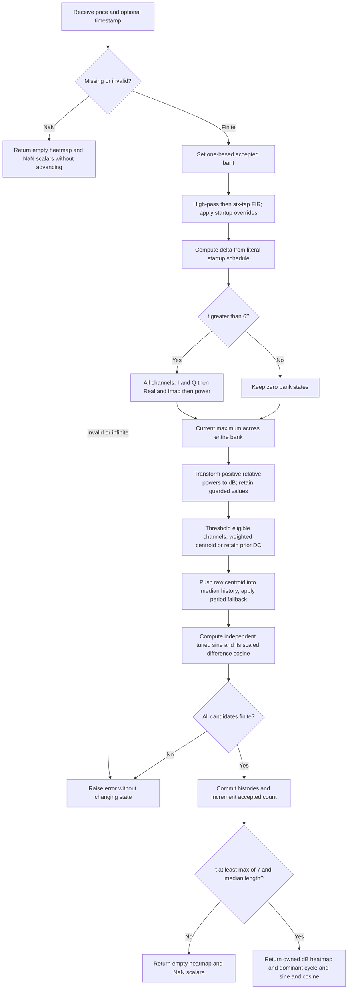

# Filter Bank Spectrum

This folder is the standalone research master for John F. Ehlers' **“Measuring Cycle Periods,” March 2008**. It estimates a spectrum with overlapping two-pole bandpass filters, estimates a dominant period, and uses that period to tune the article's sine/cosine oscillator. The Python implementation uses only the standard library and consumes one price per `update()` call.

The four indicator outputs are:

| Output field | Meaning | Units |
|---|---|---|
| `heatmap` | One timestamped column of transformed relative dB values, ordered by increasing period | Transformed dB attenuation: 0 hottest, 20 coldest |
| `dominant_cycle` | Median-smoothed weighted centroid, with the published startup fallback | Bars per cycle |
| `sine` | Article `Value1`, a dominant-cycle-tuned recursive filter output | Price units |
| `cosine` | Article `Value2`, the period-scaled one-bar difference of `Value1` | Price units |

“Sine” and “cosine” are the names of the filtered components. They are **not unit-amplitude trigonometric functions of an estimated phase**. No buy/sell decisions are part of this indicator.

## Source contract and reproducibility

The numerical authority is the two complete EasyLanguage sidebars in [the local article](../../tasc/2008-03-measuring-cycle-periods/content.md). The first displays the spectrum; the second produces the tuned sine and cosine. Both calculate and normalize a bank spanning **8 through 50 bars, inclusive**. Their centroid loops differ:

| Source | Spectrum bank | Centroid channels | Tuned output |
|---|---|---|---|
| Article spectrum display | 8–50 | 8–50 | None |
| Article dominant-cycle-tuned “bypass” filter | 8–50 | 10–50 | `Value1`, `Value2` |
| This master, default | 8–50 | 10–50 | `sine`, `cosine` |
| This master, `centroid_min_period=8` | 8–50 | 8–50 | Adds the same tuned recurrence to the first listing's DC |

The default combines the heatmap from the shared bank with the second listing's dominant period and oscillator. Selecting cutoff 8 reproduces the first listing's spectrum/DC calculation, with the oscillator added as an explicitly documented extension. The spectrum itself is identical between these two presets. Normalization **still includes channels 8 and 9** when the centroid excludes them. Moving the whole bank's minimum to 10 changes the algorithm.

Source fidelity includes these details:

1. `CurrentBar` is one-based. The filter bank begins on bar 7, after six bars of special preprocessing.
2. The high-pass filter is calculated on bar 1 even though `SmoothHP` is then forced to zero. Its first value remains in subsequent FIR history.
3. The startup half-bandwidth is `max(bandwidth, 0.5 - 0.015 * CurrentBar)`. With the default 0.15 it reaches its floor on **bar 24**. The prose's “about 50 bars” is inconsistent with the executable formula.
4. Bank filters use a **two-bar** difference of their input. Tuned `Value1` uses a **one-bar** difference. Both are preserved.
5. Channels whose dB update guard fails retain their previous dB, initially zero. A completely silent input therefore has an apparently hot spectrum and a finite centroid. This is a published initialization/degenerate-case behavior, not evidence of a market cycle.
6. The centroid retains its previous value if no channel meets the threshold. No extra decay, confidence test, interpolation, phase estimator, amplitude EMA, spectral dilation correction, or automatic gain control is added.
7. Full-precision $2\pi$ replaces the article's `6.283185` in quadrature and `6.28` in `Value2`, and the tips' `6.2831854`. Trigonometric functions use radians. Binary64 precision is retained internally; rounding occurs only in fixture serialization.

The local [TradeStation tips](../../tasc/2008-03-measuring-cycle-periods/tips/EhlersSpectrum.els) corroborate the separate spectrum/tuned indicators, shared quadrature constant, centroid cutoff 10 and explicit history shifts. Their extracted text has missing comparison operators and control blocks. The [eSignal extract](../../tasc/2008-03-measuring-cycle-periods/tips/ChRSpectrum.efs) is also damaged and mixes pieces of the two indicators; its `Median` helper selects the **upper middle** element for even lengths, and its startup handling differs. The separate `DCTunedBypassFilter.efs` file is empty. These extracts cannot serve as runnable independent originals. This master follows the complete article, not repairs inferred from damaged tips.

The [zpano Heatmap](../../../../external/zpano/py/indicators/core/outputs/heatmap.py) and [copied autocorrelation periodogram](../../../../external/zpano/py/indicators/john_ehlers/auto_correlation_periodogram/) inform the **output structure only**. Their numerical autocorrelation/DFT algorithms are not used here.

### Initial state and output availability

All numerical histories start at zero, including the unavailable price before the first supplied observation: $x_0=0$. This is a deterministic standalone convention because the fixture supplies no earlier price. An EasyLanguage chart can provide actual prehistory through `Price[1]` and platform lookback rules; comparison with such a chart requires aligning those histories. There is no claim of identical startup to every platform's loaded chart.

The median uses the ordinary arithmetic median: average the two middle values when its length is even. Its missing prehistory is zero. This makes the implicit `Median(DC,10)` choice explicit for conversion; an upper-middle median such as the damaged eSignal helper is a different variant.

The master computes **all internal states from accepted bar 1**, including the centroid and tuned oscillator. Public outputs are withheld until

$$t \ge t_{\mathrm{first}}=\max(7,M),\qquad \texttt{warmup\_bars}=\max(6,M-1),$$

where $M$ is median length. Before then, the heatmap is empty and all three scalar outputs are NaN. This availability policy is a research API convention, not a delay added to the underlying equations. By default the first valid output is one-based bar 10, array index 9. It does not mean all IIR transients have disappeared after ten bars. The tips additionally hide some plots until `CurrentBar > 10`; that presentation gate is not used.

`update(NaN, time)` returns an empty/NaN output without advancing the accepted-bar count or changing numerical state or the stored last accepted `output`. Infinity, booleans, unsupported values and arithmetic overflow raise `ValueError` without a partial state commit. This missing-data policy compresses time: process gaps externally if each calendar bar must occupy one sampling interval. The spectral model assumes equally spaced **accepted bars**, and its periods are in bars rather than elapsed time. The article's 1,000-tick example itself uses an activity-based, nonuniform calendar-time axis.

## Principles and physical analogies

A bandpass filter rejects both slow trend components and fast fluctuations. Its center frequency selects a cyclic component. An overlapping bank behaves like a **channelized radio receiver**: a signal falling near channel A's center excites A more strongly than distant channel B. Measuring every channel at the same bar gives a spectrum synchronized to price.

Selectivity has a transient cost. A bell is a narrow resonator: one strike makes it ring long after the excitation. A very narrow market filter similarly retains a sudden gap or shock and can report its own ringing. Wider bandwidth reduces persistence but separates nearby frequencies less effectively. Ehlers starts with broad channels and narrows them gradually to reduce startup ringing. Intraday gaps can excite many channels and distort the estimated dominant period.

The article calls a tuned two-pole bandpass filter lag-free for a **steady sinusoid at its center frequency**. That statement is frequency-specific. Broadband input, changing cycles, preprocessing and median smoothing all affect timing. The separately printed one-difference tuned recurrence also has a different numerator from the canonical bank filter; its behavior is derived below. The resulting indicator should not be interpreted as a universal zero-lag price estimate.

These are overlapping period-centered channels, not orthogonal Fourier bins. Powers are not probabilities and their sum is not total signal energy. The largest channel is a reference for the current bar, not an absolute measure of signal strength. A centroid of broad overlapping peaks is deliberately smoother than choosing the single maximum but can lie between competing cycles.

## Complete mathematical calculation

Let $x_t$ be the accepted price at one-based bar $t$, $P$ the high-pass period, $N$ an integer bank period, $M$ the median length, and $b$ the final relative half-bandwidth. Default values are $P=40$, $N=8,\ldots,50$, $M=10$ and $b=0.15$. Each formula below is evaluated at the current bar, using **frozen previous state** until the end-of-bar commit.

### 1. Detrend and smooth

Translate the article's degree arguments to radians:

$$a_{\mathrm{HP}}=\frac{1-\sin(2\pi/P)}{\cos(2\pi/P)}.$$

The first-order high-pass recurrence is

$$h_t=\frac{1+a_{\mathrm{HP}}}{2}(x_t-x_{t-1})+a_{\mathrm{HP}}h_{t-1}.$$

The six-tap finite impulse response filter is

$$s_t=\frac{h_t+2h_{t-1}+3h_{t-2}+3h_{t-3}+2h_{t-4}+h_{t-5}}{12}.$$

Apply the article's overrides in this order:

$$s_t=x_t-x_{t-1}\quad(1\le t<7),\qquad s_1=0.$$

The FIR weights sum to 12, so its DC gain is one; the preceding high-pass removes DC. The FIR is symmetric, with a 2.5-bar linear-phase delay in isolation. It is not the later Ehlers two-pole Super Smoother or roofing filter.

For interpretation, the constant-coefficient high-pass transfer function is

$$H_{\mathrm{HP}}(z)=\frac{1+a_{\mathrm{HP}}}{2}\frac{1-z^{-1}}{1-a_{\mathrm{HP}}z^{-1}},$$

and the FIR transfer function is

$$H_{\mathrm{FIR}}(z)=\frac{1+2z^{-1}+3z^{-2}+3z^{-3}+2z^{-4}+z^{-5}}{12}.$$

### 2. Startup bandwidth and channel coefficients

The exact executable schedule is

$$\delta_t=\max\left(b,\,0.5-0.015t\right).$$

For $0<b\le0.5$, the floor begins at

$$t_{\mathrm{floor}}=\max\left(1,\left\lceil\frac{0.5-b}{0.015}\right\rceil\right).$$

The article describes $\delta$ as relative half-bandwidth. Its example places a 20-bar channel with $\delta=0.15$ approximately between 17 and 23 bars. This is a useful approximate interpretation; period and frequency are reciprocals, so exact frequency-band endpoints do not map to symmetric period endpoints.

For each center $N$, calculate

$$\beta_N=\cos(2\pi/N),\qquad
\gamma_{N,t}=\frac{1}{\cos(4\pi\delta_t/N)},\qquad
\alpha_{N,t}=\gamma_{N,t}-\sqrt{\gamma_{N,t}^{2}-1}.$$

The source's `720*delta/N` is **$4\pi\delta/N$**, not $2\pi\delta/N$. Substituting a later book's differently defined bandwidth would change these filters. The master preserves this meaning of half-bandwidth and the literal square-root expression.

### 3. Quadrature and instantaneous channel power

The article's full theoretical basis for amplitude measurement is

$$\frac{d\sin(\omega t)}{dt}=\omega\cos(\omega t),$$

$$A^2=A^2\sin^2(u)+A^2\cos^2(u).$$

Since $\omega=2\pi/N$, the derivative should be multiplied by $N/(2\pi)$ to form equal-amplitude quadrature. The discrete inputs are

$$I_{N,t}=s_t,\qquad Q_{N,t}=\frac{N}{2\pi}(s_t-s_{t-1}).$$

Both inputs go through identical two-pole channels, for $t>6$:

$$R_{N,t}=\frac{1-\alpha_{N,t}}{2}(I_{N,t}-I_{N,t-2})
+\beta_N(1+\alpha_{N,t})R_{N,t-1}-\alpha_{N,t}R_{N,t-2},$$

$$J_{N,t}=\frac{1-\alpha_{N,t}}{2}(Q_{N,t}-Q_{N,t-2})
+\beta_N(1+\alpha_{N,t})J_{N,t-1}-\alpha_{N,t}J_{N,t-2},$$

$$A_{N,t}=R_{N,t}^{2}+J_{N,t}^{2}.$$

The article names this quantity `Ampl`, but it is **squared amplitude/power**, not its square root. For $t\le6$, all channel states stay zero. `OlderI` and `OlderQ` are the explicit two-bar histories of channel inputs; they are not accidentally lagged by two additional price bars.

At constant $\delta$, the bank transfer function for either component is

$$H_N(z)=\frac{(1-\alpha_N)(1-z^{-2})/2}
{1-\beta_N(1+\alpha_N)z^{-1}+\alpha_Nz^{-2}}.$$

At center frequency $\omega_N=2\pi/N$, direct substitution gives $H_N(e^{i\omega_N})=1$: unity gain and zero phase for the **canonical bank filter at a fixed center**. Its denominator poles have modulus $\sqrt{\alpha_N}$ when they are complex. Narrower bandwidth moves the poles closer to the unit circle, making the response ring longer. Time-varying coefficients during startup or adaptation do not have one fixed transfer function.

The finite-difference quadrature is an approximation to the derivative. For a complex sinusoid,

$$\frac{1-e^{-i\omega}}{\omega}
=\frac{2\sin(\omega/2)}{\omega}\,e^{i(\pi/2-\omega/2)}.$$

Thus its relative amplitude is $2\sin(\omega/2)/\omega$ and its lead is $90^\circ-\omega/2$, approaching ideal cosine quadrature for long periods. Squared-and-summed channel power can retain some within-cycle variation; it is not an exact continuous-time analytic-signal envelope.

### 4. Normalize and apply the nonlinear dB transform

Find the current-bar maximum over the **entire bank**:

$$A_{\max,t}=\max_{N=N_{\min},\ldots,N_{\max}} A_{N,t},\qquad
r_{N,t}=\frac{A_{N,t}}{A_{\max,t}}.$$

When $A_{\max,t}\ne0$ and $r_{N,t}>0$, update

$$d_{N,t}=-10\frac{\ln\left(0.01/(1-0.99r_{N,t})\right)}{\ln(10)}.$$

Then apply the source cap $d_{N,t}=\min(d_{N,t},20)$. If the update guard fails, retain $d_{N,t-1}$ and still apply the cap. Initial $d_{N,0}=0$.

In exact arithmetic, $r=1$ gives $d=0$ and $r\rightarrow0$ gives $d\rightarrow20$. Small binary64 residuals near zero are preserved; the master does not add a lower clipping operation. This is **not ordinary $-10\log_{10}(r)$**. The nonlinear map sharpens the display. Its “3 dB” cutoff corresponds approximately to

$$r\ge\frac{1-0.01\,10^{3/10}}{0.99}\approx0.98995,$$

so it selects channels within roughly one percent of the strongest power after this transform, rather than the usual half-power threshold. This distinction is essential when converting the centroid.

### 5. Dominant period and median

Let $C$ be `centroid_min_period` and

$$w_{N,t}=\begin{cases}
20-d_{N,t},&N\ge C\text{ and }d_{N,t}\le3,\\
0,&\text{otherwise}.
\end{cases}$$

The raw centroid is

$$D_t=\frac{\sum_{N=N_{\min}}^{N_{\max}}Nw_{N,t}}
{\sum_{N=N_{\min}}^{N_{\max}}w_{N,t}}$$

when the denominator is nonzero; otherwise $D_t=D_{t-1}$. Sum channels in ascending period order. The listing assigns the running centroid inside the loop; the final value is the same weighted ratio. It does **not** weight by raw power or by $10^{-d/10}$.

Sort the last $M$ raw centroids into $v_0\le\cdots\le v_{M-1}$. The master defines

$$\widetilde D_t=\begin{cases}
v_{\lfloor M/2\rfloor},&M\text{ odd},\\
(v_{M/2-1}+v_{M/2})/2,&M\text{ even}.
\end{cases}$$

Missing prehistory is zero. The tuned listing then applies

$$T_t=\begin{cases}20,&\widetilde D_t<8,\\\widetilde D_t,&\text{otherwise}.\end{cases}$$

`dominant_cycle` reports $T_t$, the period actually used to tune the oscillator. The first listing has no fallback, but once this master's output is primed its eligible periods are at least 8, so the fallback cannot alter its published DC. Diagnostic `state.centroid` exposes $D_t$ and `state.tuned_period` exposes $T_t$ even during hidden startup.

For an all-zero input, every dB remains zero. Default $D_t=(10+50)/2=30$, and cutoff 8 gives $(8+50)/2=29$. With default median length 10, the hidden tuned periods for the first six zero observations are $20,20,20,20,15,30$. Skipping the early centroid or oscillator would change later states.

### 6. Tune Value1 and form Value2

Recalculate coefficients with the smoothed, possibly fractional dominant period:

$$\beta_t=\cos(2\pi/T_t),\qquad
\gamma_t=1/\cos(4\pi\delta_t/T_t),\qquad
\alpha_t=\gamma_t-\sqrt{\gamma_t^2-1}.$$

The source's two output equations, with full-precision constants, are

$$y_t=\frac{1-\alpha_t}{2}(s_t-s_{t-1})
+\beta_t(1+\alpha_t)y_{t-1}-\alpha_ty_{t-2},$$

$$q_t^{\mathrm{out}}=\frac{T_t}{2\pi}(y_t-y_{t-1}).$$

Return `sine = y_t` and `cosine = q_t^{out}`. Neither is rescaled to $[-1,1]$. Do not round $T_t$ to an integer or select an existing channel's `Real`/`Imag` instead. The tuned oscillator has independent recursive state and follows the **current** period; both of its older outputs were produced under previous tuning coefficients.

At fixed tuning, its transfer function is

$$G_T(z)=\frac{(1-\alpha_T)(1-z^{-1})/2}
{1-\beta_T(1+\alpha_T)z^{-1}+\alpha_Tz^{-2}}
=\frac{H_T(z)}{1+z^{-1}}.$$

This derivation explains the printed one-bar numerator: at the center it has gain $1/(2\cos(\omega/2))$ and phase lead $\omega/2$ relative to the canonical unity-gain bank response. The article's broad no-lag statement should not be used to replace this equation with a two-bar difference.

### 7. Convert dB to the article's color scale

The master returns dB values so a later renderer can reproduce the spectrum rather than accepting packed RGB integers. In the source's RGB scale:

$$\operatorname{red}(d)=\begin{cases}255,&d\le10,\\255(2-d/10),&d>10,\end{cases}$$

$$\operatorname{green}(d)=\begin{cases}255(1-d/10),&d\le10,\\0,&d>10,\end{cases}\qquad
\operatorname{blue}(d)=0.$$

The progression is yellow at 0, red at 10, black at 20. A renderer should clamp tiny numerical excursions and explicitly choose integer channel rounding. Color rounding is presentation, outside numerical expectations. If a renderer instead expects brightness increasing with strength, use $1-d/20$ externally; the canonical heatmap fixtures remain the unmodified transformed dB values.

## Configuration

The article's only user inputs are price and the spectrum's `ShowDC` display flag. This master always exposes the requested outputs. The following parameters generalize constants for research and conversion tests; defaults retain the second listing:

| Parameter | Shortcut | Default | Valid range | Effect |
|---|---|---:|---|---|
| `min_period` | P | 8 | Integer $\ge8$ | First bank center |
| `max_period` | Q | 50 | Integer $\ge\texttt{min_period}$ | Last bank center, inclusive |
| `centroid_min_period` | C | 10 | Integer from min through max | First channel eligible for the centroid; all bank channels still normalize |
| `highpass_period` | HP | 40.0 | Finite real $>4$ | Preprocessing high-pass period |
| `median_length` | M | 10 | Integer $\ge1$ | Median of raw centroids; 1 disables median smoothing |
| `bandwidth` | B | 0.15 | Finite real $0<b\le0.5$ | Final relative half-bandwidth, with fixed startup schedule |

Booleans are rejected for numeric parameters. If selecting a bank that does not contain 10, explicitly set a valid `centroid_min_period`. The single-period test passes 20 for all three period parameters. The supported period minimum and maximum bandwidth keep channel cosine denominators positive. The HP period lower bound gives a stable, nonnegative high-pass pole. There is no arbitrary upper cap, though large banks/medians consume more memory and processing time. Very small positive bandwidths can reach floating-point coefficient limits; research ports must use binary64 or equivalent and the documented tolerances.

The six FIR taps, bank start at bar 7, initial bandwidth 0.5, decrement 0.015, dB constants 0.01/0.99, 20 cap, 3 threshold and 20 fallback are deliberately fixed.

## Calculation flow and porting details



Use one flat channel array for each current/one-bar/two-bar state, with index $j=N-N_{\min}$. The source arrays have period indices; the Python arrays have compact zero-based channel indices. Commit `OlderI ← OldI`, `OldI ← I`, and corresponding Q/Real/Imag histories only after computing every channel. `OldAmpl` is written but never read in the original, so it is omitted. HP history is newest first. Median history stores the **raw centroid**, not the fallback period or last public output.

No rolling price window is needed. With $K=N_{\max}-N_{\min}+1$, numerical memory is $O(K+M)$ and each update costs $O(K+M\log M)$ because the median is explicitly sorted. These short loops and fixed arrays are straightforward to port to Rust, Zig, Go and TypeScript.

The heatmap owns a new list for each valid output. Future updates and mutations of an old returned list cannot affect filter state. Diagnostic state uses immutable tuples. `reset()` restores zero histories and reproduces the same replay.

## Heatmap and fixture layout

`Heatmap` mirrors the copied zpano structure: `time`, `parameter_first`, `parameter_last`, `parameter_resolution`, `value_min`, `value_max`, `values`, plus `is_empty()` and `empty()`.

Valid columns have `parameter_first=min_period`, `parameter_last=max_period`, `parameter_resolution=1.0`, and exactly $K$ values. `value_min` and `value_max` are the actual numerical extrema in the column. Empty columns keep axis metadata but have `values=[]` and NaN extrema. A caller can pass a datetime or integer through `time`; timestamps do not affect calculations.

Reference arrays contain **252 rows**, aligned to the parent `INPUT_CLOSE`. All four original OHLC arrays are copied unchanged into every language fixture, but calculations use closes only. For each case there are six arrays:

| Suffix | Shape | Interpretation |
|---|---|---|
| `HEATMAP` | $252\times K$ | dB columns; row $t-1$, column $N-N_{\min}$ |
| `MIN` | 252 | Heatmap `value_min` |
| `MAX` | 252 | Heatmap `value_max` |
| `DOMINANT_CYCLE` | 252 | Published tuned period |
| `SINE` | 252 | `Value1` |
| `COSINE` | 252 | `Value2` |

To keep foreign-language matrices rectangular, an empty heatmap is represented by a **full NaN row**, not a variable-length empty row. Scalar arrays and extrema have NaN at the same unprimed indices. The runtime heatmap remains empty during warmup. Timestamps and fixed period-axis metadata are not duplicated into expected numeric arrays.

Python names follow `EXPECTED_P8_Q50_C10_HP40_M10_B0_15_HEATMAP`, with the component suffix distinguishing simultaneous outputs. Floating parameter tokens replace the decimal point with an underscore; `0.10` becomes `0_1` and integral `40.0` becomes `40`. All other component arrays use the same parameter suffix. Every array has the two required comments: its “What it tests” text, then complete parameter values plus `input=close`.

Only serialization uses **15 significant decimal digits** (`.15g`). Integral floating outputs include `.0` for Rust/Zig type compatibility. Expected fixtures are decimal references rather than bit-exact representations of unrounded internal values. Suggested port comparison is relative/absolute tolerance $3\times10^{-11}$, with exact NaN masks; branch-sensitive threshold changes should be investigated rather than hidden by a wider tolerance.

## Confirmed reference cases

All 12 combinations below were explicitly confirmed by the user. Each produces all six arrays, so there are **72 expected arrays per language**.

| Case | Bank P–Q | C | HP | M | B | What it tests |
|---|---|---:|---:|---:|---:|---|
| 1 | 8–50 | 10 | 40 | 10 | 0.15 | Article sine/cosine default |
| 2 | 8–50 | 8 | 40 | 10 | 0.15 | Article spectrum-display centroid |
| 3 | 8–50 | 10 | 40 | 1 | 0.15 | Unsmooth dominant cycle |
| 4 | 8–50 | 10 | 40 | 5 | 0.15 | Short median smoothing |
| 5 | 8–50 | 10 | 40 | 20 | 0.15 | Long median smoothing |
| 6 | 8–50 | 10 | 40 | 10 | 0.10 | Narrower resonators and longer ringing |
| 7 | 8–50 | 10 | 40 | 10 | 0.25 | Wider resonators and faster decay |
| 8 | 8–50 | 10 | 20 | 10 | 0.15 | Short high-pass cutoff |
| 9 | 8–50 | 10 | 80 | 10 | 0.15 | Long high-pass cutoff |
| 10 | 10–30 | 10 | 40 | 10 | 0.15 | Compact period bank |
| 11 | 8–80 | 10 | 40 | 10 | 0.15 | Extended period bank |
| 12 | 20–20 | 20 | 40 | 10 | 0.15 | Single-channel normalization |

Cases 1/2 isolate the two article centroid definitions; their heatmaps match. Cases 3–5 isolate median timing and different priming lengths. Cases 6/7 change final width and the bar on which the startup floor begins. Cases 8/9 isolate preprocessing. Cases 10/11 test dimensions and periods outside the article bank. Case 12 tests maximum normalization and centroid arithmetic without competing channels.

## Usage, generation and validation

From this folder:

```bash
python3 filter-bank-spectrum.py
python3 -m unittest discover -s . -p test_filter_bank_spectrum.py -v
python3 filter-bank-spectrum.py --generate-reference-data
python3 verify_reference_data.py
python3 verify_native_fixtures.py
```

The demonstration embeds all 252 closes, performs streaming updates, and prints the final output. The generation option runs all confirmed cases, appends/replaces only marked generated sections in the copied fixtures, reopens the Python arrays to verify dimensions, NaNs and every rounded value, then exports **those canonical Python decimals** to Go, TypeScript, Rust and Zig. Rerunning is idempotent. The copied input sections are preserved.

The master can be imported with `importlib.util.spec_from_file_location` because the requested filename contains hyphens. Instantiate `FilterBankSpectrum()` and call `update(price, time=None)`; the returned named tuple exposes all four outputs. Generation and foreign fixture utilities have no role in the numerical class.

The independent tests transcribe the source equations using full chronological arrays indexed by bar and period, rather than the master's bounded buffers. They compare every hidden preprocessing value, centroid, oscillator, power and dB channel for all 12 cases. Separate tests cover priming, the bar-24 schedule, full-precision quadrature, zero-input/retention branches, arithmetic even medians, a single channel, a steady synthetic 24-bar cycle, missing/overflowing observations, immutable numerical state, heatmap ownership and reset replay.

`verify_reference_data.py` parses all five languages without executing their literals, verifies the exact 15-digit master values, matching comments, names, dimensions and NaN masks, and checks preservation of all four 252-value inputs. There are **136,584 expected scalar values per language**, counting all heatmap entries and scalar series. Native compilation/runtime checks additionally exercise every generated Go array, TypeScript export, Rust function and Zig function; they do not constitute foreign-language indicator implementations.

`verify_native_fixtures.py` builds temporary harnesses, invokes all 76 arrays/functions (72 expected plus four inputs), checks their dimensions, and compares a checksum over **every parsed binary64 value** against Python. NaN payloads are canonicalized before hashing; their positions remain significant. It runs Go, Node's TypeScript stripping, Rust and Zig independently, with compiler caches in the temporary directory. Use `--language go`, `ts`, `rs` or `zig` to select one toolchain. No dependencies are downloaded. Native checks verified all **137,592 values including inputs** in each foreign language.

Validation on the prepared artifact: all nine numerical tests passed; all 72 arrays agreed across five languages; Go, TypeScript, Rust and Zig compiled and passed the complete-value native checks. These checks establish consistency with the independent full-precision article transcription and the documented standalone initialization, rather than with an unavailable running TradeStation chart.

The native tools used were Go 1.27.1, Node 24.15.0, Rust 1.98.1 and Zig 0.16.0. Regeneration was also checked to leave all five fixture files byte-identical.

## References and BibTeX

1. Ehlers, John F. (2008). “Measuring Cycle Periods.” *Technical Analysis of STOCKS & COMMODITIES*, 26(3), March, pp. 16–22. [Local full article and both sidebars](../../tasc/2008-03-measuring-cycle-periods/content.md); [publisher PDF](https://technical.traders.com/archive/article.asp?file=\V26\C03\043EHLR.pdf). Primary numerical and theoretical authority.
2. *Technical Analysis of STOCKS & COMMODITIES* (2008). “Traders' Tips,” March. [Local tips](../../tasc/2008-03-measuring-cycle-periods/tips/tips.md); [publisher page](http://traders.com/Documentation/FEEDbk_docs/2008/03/TradersTips/TradersTips.html). Relevant TradeStation contribution by Mark Mills and eSignal contribution by Jason Keck; local extraction limitations are listed above.
3. Ehlers, John F. (2007). “Fourier Transform For Traders.” *Technical Analysis of STOCKS & COMMODITIES*, 25(1), January. Suggested reading cited by the article for its earlier nonlinear spectrum display. The article's body refers to January 2006 for the DFT discussion, while its own bibliography specifies 2007; this document retains the bibliography's title/year. Not an additional algorithm imported into this master.
4. Ehlers, John F. (2006). “Swiss Army Knife Indicator.” *Technical Analysis of STOCKS & COMMODITIES*, 24(1), January. Suggested reading from the article for filter background; not a substitute for the present printed recurrences.
5. Local zpano excerpts: `core/outputs/heatmap.py` and `john_ehlers/auto_correlation_periodogram/`. Heatmap interface provenance only; version/author metadata was not supplied with the detached excerpts.

```bibtex
@article{ehlers_2008_measuring_cycle_periods,
  author  = {Ehlers, John F.},
  title   = {Measuring Cycle Periods},
  journal = {Technical Analysis of STOCKS \& COMMODITIES},
  volume  = {26},
  number  = {3},
  pages   = {16--22},
  year    = {2008},
  month   = mar,
  url     = {https://technical.traders.com/archive/article.asp?file=\V26\C03\043EHLR.pdf}
}

@misc{traders_tips_2008_03,
  author       = {{Technical Analysis of STOCKS \& COMMODITIES}},
  title        = {Traders' Tips: Measuring Cycle Periods},
  year         = {2008},
  month        = mar,
  howpublished = {Online column},
  url          = {http://traders.com/Documentation/FEEDbk_docs/2008/03/TradersTips/TradersTips.html},
  note         = {TradeStation contribution by Mark Mills; eSignal contribution by Jason Keck}
}

@article{ehlers_2007_fourier_transform_for_traders,
  author  = {Ehlers, John F.},
  title   = {Fourier Transform For Traders},
  journal = {Technical Analysis of STOCKS \& COMMODITIES},
  volume  = {25},
  number  = {1},
  year    = {2007},
  month   = jan,
  note    = {Suggested reading in Measuring Cycle Periods}
}

@article{ehlers_2006_swiss_army_knife_indicator,
  author  = {Ehlers, John F.},
  title   = {Swiss Army Knife Indicator},
  journal = {Technical Analysis of STOCKS \& COMMODITIES},
  volume  = {24},
  number  = {1},
  year    = {2006},
  month   = jan,
  note    = {Suggested reading in Measuring Cycle Periods}
}

@misc{zpano_local_heatmap_interface,
  author       = {{zpano project}},
  title        = {Heatmap Output and Autocorrelation Periodogram: Local Python Excerpts},
  howpublished = {Local source files supplied for conversion},
  note         = {external/zpano/py/indicators/core/outputs/heatmap.py;
                  external/zpano/py/indicators/john_ehlers/auto_correlation_periodogram/.
                  Used for output structure only; version not supplied}
}
```
