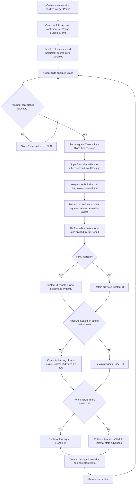

# Ehlers Fisher Deviation-Scaled Oscillator — conditional Fisher transform of RMS-normalized momentum

This folder is the standalone **research prototype master reference** for the “Deviation-scaled oscillator with Fisher transform” sidebar in John F. Ehlers' “Probability: Probably A Good Thing To Know,” *Technical Analysis of Stocks & Commodities*, volume 36, number 10, October 2018, pages 10–14. The executable master is [fisher-deviation-scaled-oscillator.py](fisher-deviation-scaled-oscillator.py). `FisherDeviationScaledOscillator.update(close)` consumes one chronological finalized finite price and returns one scalar dimensionless oscillator. Only Python's standard library is used.

The calculation is **two-bar raw-price difference → SuperSmoother → rolling RMS normalization → conditional persistent Fisher transform**. The sole parameter is `period`, default **40**. This is the transformed counterpart of the separate [deviation-scaled oscillator](../deviation-scaled-oscillator/description.md), and shares its exact normalized stage. It is not RocketRSI: there is no finite-window gain/loss RSI and no `.999` clamp.

**Reference-data status:** the user confirmed all twenty periods for both oscillators on **2026-10-20**. This folder's five language fixtures now contain twenty expected arrays with 252 entries each, 15-significant-digit finite values, and the documented warmup NaNs. All original input values are preserved, and all 252 original `INPUT_CLOSE` values are embedded in `__main__`. Cross-language equality and repeatable regeneration have been verified. The pair of folders contains forty distinct scalar reference series.

## 1. Sources, naming, and numerical authority

The locally supplied sources used for this reference are:

- [October 2018 article](../../tasc/2018-10-probability-probably-a-good-thing-to-know/content.md): complete oscillator and Fisher oscillator listings, probability-bin code, distribution examples, two-bar-difference / SuperSmoother / RMS rationale, and repeated MyRSI and RocketRSI context.
- [October 2018 Traders' Tips](../../tasc/2018-10-probability-probably-a-good-thing-to-know/tips/tips.md), especially [TradeStation `PD.els`](../../tasc/2018-10-probability-probably-a-good-thing-to-know/tips/PD.els), [eSignal `PD.efs`](../../tasc/2018-10-probability-probably-a-good-thing-to-know/tips/PD.efs), [TradersStudio `PD.trs`](../../tasc/2018-10-probability-probably-a-good-thing-to-know/tips/PD.trs), [NinjaTrader DSO](../../tasc/2018-10-probability-probably-a-good-thing-to-know/tips/ninja-trader/DSMAPD.cs), [NinjaTrader Fisher DSO](../../tasc/2018-10-probability-probably-a-good-thing-to-know/tips/ninja-trader/DSMAFisherPD.cs), and [NinjaTrader histogram utility](../../tasc/2018-10-probability-probably-a-good-thing-to-know/tips/ninja-trader/TASCProbabilityDistribution.cs).
- [July 2018 DSMA article](../../tasc/2018-07-the-deviation-scaled-moving-average/content.md) and [its Mesa paper](../../tasc/2018-07-the-deviation-scaled-moving-average/mesa/content.md): the same normalized oscillator as the adaptive-alpha stage of DSMA.
- [May 2018 RocketRSI article](../../tasc/2018-05-rocket-rsi-a-solid-propellant-for-your-rocket-science-trading/content.md): context for the two RSI indicators repeated in October. The two oscillators prepared here are not an RSI calculation.
- [January 2014 “Predictive And Successful Indicators”](../../tasc/2014-01-predictive-and-successful-indicators/content.md): the article's cited SuperSmoother and spectral-dilation background.
- Ehlers, *Cycle Analytics for Traders* (2013), [Chapter 3](../../2013-cycle-analytics-for-traders/ch3.md), SuperSmoother equation (3-3); [Chapter 7](../../2013-cycle-analytics-for-traders/ch7.md), spectral dilation and zero-mean limitations; [Chapter 15](../../2013-cycle-analytics-for-traders/ch15.md), Fisher transform and its domain.

There is no `mesa/` subfolder for the October input. The related July Mesa paper is identified above rather than presented as an October source.

The **October article** defines the arithmetic. It initializes both `ScaledFilt` and `FisherFilt` to zero and uses two persistent conditional assignments: retain `ScaledFilt` if RMS is zero, and retain `FisherFilt` if the absolute scaled value is at least two. TradeStation corroborates both. The master uses these source semantics even where a vendor differs.

The source sidebar names are “Deviation-scaled oscillator” and “Deviation-scaled oscillator with Fisher transform” / “Fisherized Deviation Scaled Oscillator.” The folder names `deviation-scaled-oscillator` and `fisher-deviation-scaled-oscillator` keep both discoverable. Some vendors call them `DSMAPD` and `DSMAFisherPD`; their displayed output is an oscillator, not the July price-level moving average.

The two-folder design preserves scalar interfaces and separate expected data. Each implementation and document contains everything needed for an independent port; neither imports its sibling or the July DSMA master. Diagnostic state gives access to the shared intermediate values. A production library may later share its difference/filter/RMS implementation internally while preserving these two public indicators.

**Precision policy:** replace truncated `1.414` and `3.14159` with full-precision `math.sqrt(2.0)` and `math.pi`. The source cosine is degree based; use its equivalent radian angle. The half-period, Fisher divisor two, strict amplitude-two gate, and multiplier one half are deliberate design constants and remain unchanged. State uses binary64 without intermediate rounding. Expected-data serialization alone uses 15 significant decimal digits.

Finite-record initialization is specified in section 5: first filter at zero-based index two, zero previous difference and filter lags, full-$P$ RMS denominator during fill, and public NaN availability until $P$ actual filters exist. This is consistent with the source variable seeds and the explicit first difference index in the NinjaTrader arrays, but commercial charts may have hidden prehistory. No commercial runtime has been executed. Source-equation equality is verified against an independently written whole-record transcription using the same declared seeds and full-precision constants.

## 2. Principles and physical analogies

### 2.1 A difference measures displacement, not price level

Think of price as the position of a moving object. The two-bar difference measures displacement over a fixed interval. A constant position produces zero displacement; a constant-speed position ramp produces constant nonzero displacement. Consequently, this oscillator removes a constant price level but does not remove every trend or guarantee a zero mean on every finite record.

The signed difference is smoothed before normalization. Its sign still describes the filtered recent price displacement. Taking an absolute value before this filter would prevent positive and negative displacements from cancelling and create another indicator. The final output has no price units because the filtered movement is divided by a reference amplitude measured in the same units.

### 2.2 Spectrum equalization and Nyquist rejection

Under Ehlers' approximate spectral-dilation model, longer-period market cycles have larger amplitudes, approximately $A(C)\propto C$. Doubling period then doubles amplitude, approximately $20\log_{10}2=6.0206$ dB. A low-frequency differentiating response decreases amplitude at the opposite rate as period grows, partly flattening this spectrum.

A two-bar difference also has a zero at the highest representable sampled frequency, Nyquist. One price per bar gives Nyquist frequency $0.5$ cycles per bar and cycle period **two bars**. The source's frequency/period wording is clarified in those units here. Rejecting this exactly alternating component reduces its effect; it cannot undo aliasing already folded into other frequencies.

January 2014 and book Chapter 7 explain that first-order differentiation can equalize spectral dilation without fully suppressing long-period components. Thus the article's “nominal zero mean” and “no spectral distortion” are modeling descriptions rather than exact statements for arbitrary inputs. The literal two-bar difference changes amplitudes and phases with frequency. No extra two-pole high-pass or roofing filter is added to these October indicators.

### 2.3 A damped resonator smooths the displacement

The two-pole SuperSmoother retains two prior outputs, like a damped resonator with stored energy. Its poles form a damped conjugate pair. Averaging the current and previous difference introduces a Nyquist zero in the feedforward path. Chapter 3's rationale is sharper noise attenuation and comparatively low lag for a chosen critical period; a recursive filter's delay still varies across frequency.

The oscillator smoother's period is $P/2$, half the user period, to retain responsiveness. The separate RMS window has $P$ observations. Neither setting is a momentum lag; the raw difference always uses two bars. Coefficients are computed once for a new instance.

### 2.4 RMS is a moving reference ruler

RMS measures recent squared filtered amplitude. Dividing the current filtered value by that ruler makes the oscillator dimensionless and adapts its amplitude to the recent input scale. For a steady sinusoid spanning complete cycles, RMS is approximately its peak amplitude divided by $\sqrt{2}$, so peak normalized magnitude is about $\sqrt{2}$.

For a steadily rising price ramp, filtered displacement instead approaches a nonzero constant, RMS approaches that constant's magnitude, and the normalized oscillator approaches $+1$. A falling ramp approaches $-1$. This is a concrete source of trend bias despite removal of the constant price level.

RMS is not a centered sample standard deviation. It is standard deviation about an assumed zero mean only when that mean is valid. Calculating centered variance or subtracting a rolling mean changes the algorithm.

### 2.5 Fisher is a nonlinear magnifier with a conditional hold

The Fisher map $\operatorname{atanh}(x)$ magnifies values near its domain endpoints. In this source, its input is **one half** of the normalized oscillator, and the map is evaluated only when the oscillator's absolute value is strictly below two. Outside that domain, the old transform persists.

As a pointwise mathematical map, Fisher adds no time filter. However, the source's **conditional hold is stateful** and can keep an earlier sign or value across several bars. It can create plateaus and discontinuities when the input reenters the permitted interval. This is not equivalent to saturation at a boundary, zero output, omission of a bar, or a new NaN.

This folder returns the persistent Fisher value. Its diagnostic state also exposes the normalized oscillator, but the reference arrays contain only the final Fisher output.

## 3. Complete oscillator mathematics

### 3.1 Symbols and units

| Symbol | Source name | Meaning |
|---|---|---|
| $t$ | Bar index | Chronological zero-based index; first Close is $t=0$. |
| $p_t$ | `Close` | Raw scalar price. |
| $P$ | `Period` | Positive integer RMS window, default 40. |
| $T=P/2$ | `.5*Period` | SuperSmoother coefficient period, possibly fractional. |
| $z_t$ | `Zeros` | Fixed two-bar raw-price difference, price units. |
| $f_t$ | `Filt` | Smoothed difference, price units. |
| $Q_t$ | RMS square sum | Sum of $P$ squared filtered samples. |
| $R_t$ | `RMS` | Root mean square, price units. |
| $s_t$ | `ScaledFilt` | Persistent signed normalized oscillator, dimensionless. |
| $x_t=s_t/2$ | Fisher input | Defined only for transform evaluation when $|s_t|<2$. |
| $v_t$ | `FisherFilt` | Persistent transformed oscillator, dimensionless. |

### 3.2 Fixed two-bar difference and its response

The complete source difference is:

$$
z_t=p_t-p_{t-2}.
$$

Its transfer function and frequency response, direct derivations, are:

$$
H_Z(z)=1-z^{-2}=(1-z^{-1})(1+z^{-1}),
$$

$$
H_Z(e^{i\omega})=2i e^{-i\omega}\sin\omega,
\qquad |H_Z(e^{i\omega})|=2|\sin\omega|.
$$

This response is zero at DC ($\omega=0$) and Nyquist ($\omega=\pi$). For comparison, a one-bar difference has:

$$
H_1(z)=1-z^{-1},\qquad |H_1(e^{i\omega})|=2|\sin(\omega/2)|,
$$

whose amplitude gain at Nyquist is two, approximately $+6.0206$ dB. The zeros oscillator removes that endpoint response.

For a sinusoidal price component $p_t=A\cos(\omega t)$ with cycle period $C$ and $\omega=2\pi/C$:

$$
z_t=-2A\sin\omega\sin(\omega(t-1)),
$$

$$
A_Z=2A|\sin(2\pi/C)|\approx\frac{4\pi A}{C}\quad(C\text{ large}).
$$

Thus $A(C)\propto C$ approximately cancels the differentiator's low-frequency amplitude decrease, explaining the article's whitening argument. This does not establish a universal market spectrum.

### 3.3 Every SuperSmoother coefficient and recurrence

The October listing uses the two-pole SuperSmoother from Chapter 3 equation (3-3), with period $T=P/2$. At full precision:

$$
\begin{aligned}
T&=P/2,\\
\theta&=\sqrt{2}\pi/T=2\sqrt{2}\pi/P,\\
a_1&=e^{-\theta},\\
b_1&=2a_1\cos\theta,\\
c_2&=b_1,\\
c_3&=-a_1^2,\\
c_1&=1-c_2-c_3,\\
f_t&=c_1\frac{z_t+z_{t-1}}{2}+c_2f_{t-1}+c_3f_{t-2}.
\end{aligned}
$$

Source `Cosine(sqrt(2)*180/T)` is in degrees and corresponds to `cos(sqrt(2)*pi/T)` in radians. Do not add a second degree-to-radian conversion. Preserve the signed $c_3$ term and the source order `c1 * (zeros + previous_zeros) / 2` before the two recursive products.

Useful direct derivations are:

$$
H_{SS}(z)=\frac{\frac{c_1}{2}(1+z^{-1})}{1-c_2z^{-1}-c_3z^{-2}},
\qquad \lambda_\pm=a_1e^{\pm i\theta},
$$

$$
H_F(z)=H_Z(z)H_{SS}(z)
=\frac{\frac{c_1}{2}(1-z^{-1})(1+z^{-1})^2}
{1-c_2z^{-1}-c_3z^{-2}}.
$$

The smoother has unit DC gain because $c_1=1-c_2-c_3$, whereas the combined difference/filter has zero DC gain. The combined numerator has one DC zero and a double Nyquist zero. The pole radius is below one for any finite positive period in exact arithmetic. Very large periods can round binary64 coefficients into an unusable configuration and are rejected. Small algebraic periods can place the nominal critical period below a useful sampled cycle range; the source-style equations are still defined.

### 3.4 Full RMS equation, accumulation order, and mean assumption

The source's full calculation is:

$$
Q_t=\sum_{k=0}^{P-1} f_{t-k}^2,
\qquad R_t=\sqrt{Q_t/P}.
$$

Start with $Q=0$ each bar. For $k=0,1,\ldots,P-1$, add the product $f_{t-k}f_{t-k}$, newest to oldest. Use ordinary left-associated binary64 additions. A rolling-energy accumulator or compensated summation can be mathematically reasonable but changes the master rounding sequence.

For the population mean and variance of that window:

$$
\bar f_t=\frac{1}{P}\sum_{k=0}^{P-1}f_{t-k},\qquad
\sigma_t^2=\frac{1}{P}\sum_{k=0}^{P-1}(f_{t-k}-\bar f_t)^2,
$$

$$
R_t^2=\sigma_t^2+\bar f_t^2.
$$

RMS equals standard deviation only when the actual window mean is zero. Neither mean subtraction nor division by $P-1$ occurs in the oscillator. Standard deviation itself is meaningful for non-Gaussian data; Gaussian tail probabilities require an additional distribution assumption.

### 3.5 Persistent normalized oscillator

The complete guarded source equation is:

$$
s_t=\begin{cases}
f_t/R_t,&R_t\ne0,\\
s_{t-1},&R_t=0,
\end{cases}\qquad s_{\mathrm{initial}}=0.
$$

No epsilon or else assignment appears in the article. A zero-energy record from reset produces zero after priming. A zero RMS after prior activity retains the previous signed value. Very tiny squares can underflow in binary64; the master follows the literal square/sum/divide/square-root operations and exact-zero guard rather than a rescaled norm.

Since the current sample is included in its normalizer:

$$
Q_t\ge f_t^2\ \Longrightarrow\ |s_t|\le\sqrt{P}
$$

for a nonzero RMS in exact arithmetic. A prior retained value comes from the same bound. DSO is therefore **not generally bounded by one, two, or three**. At $P=1$, a nonzero filter sample normalizes to $\pm1$; at $P=4$, the bound is two; at $P=9$, it is three. Larger periods can exceed the article histogram's range, which must be considered when measuring densities.

The normalized oscillator is the part of July DSMA that determines its adaptive alpha. July's remaining equations were $\alpha_t=5|s_t|/P$ and $Y_t=\alpha_tp_t+(1-\alpha_t)Y_{t-1}$. **Neither equation is part of either October oscillator.** Their outputs are dimensionless $s_t$ or $v_t$, not a smoothed price $Y_t$.

## 4. Complete Fisher mathematics and state rules

Chapter 15 defines the Fisher transform:

$$
\operatorname{Fisher}(x)=\frac12\ln\left(\frac{1+x}{1-x}\right)
=\operatorname{atanh}(x),\qquad |x|<1.
$$

The October oscillator's full source rule uses $x=s/2$ and a persistent variable:

$$
v_t=\begin{cases}
\frac12\ln\left(\frac{1+s_t/2}{1-s_t/2}\right),&|s_t|<2,\\
v_{t-1},&|s_t|\ge2,
\end{cases}\qquad v_{\mathrm{initial}}=0.
$$

The strict inequality excludes exactly $+2$ and $-2$, avoiding the infinite or zero logarithm argument. Values beyond either endpoint also skip transformation and retain the **previous** value, even if it has the opposite sign. The scaled oscillator is still updated normally on those bars. An eventual reentry transforms the then-current $s_t$ directly; no output smoother interpolates the transition.

Within the accepted domain:

$$
v(s)=\operatorname{atanh}(s/2)
=\frac{s}{2}+\frac{s^3}{24}+\frac{s^5}{160}+\cdots,
$$

$$
\frac{dv}{ds}=\frac{2}{4-s^2},\qquad
s=2\tanh v=2\frac{e^{2v}-1}{e^{2v}+1}.
$$

The slope at zero is one half, so small signals are roughly halved. The map grows without bound as an admissible input approaches either endpoint. There is no fixed $\pm3$ limit, no `.999` input clamp, and no configurable Fisher divisor. RocketRSI's limiter is a different source design: $\operatorname{atanh}(0.999)\approx3.8002011672502$, not exactly three. Do not import its clamp into these indicators.

Use the literal half-log-of-ratio expression to reproduce binary64 operation order. Replacing it with a language's `atanh`, two separate logarithms, or `log1p` can change the low bits. Replacing the gate with a clamp or transforming the previous scaled value rather than the current one changes the algorithm itself.

For $P<4$, the ideal scaled bound is strictly below two, so every filtered sample is in the Fisher domain. $P=4$ can meet the excluded boundary exactly. $P>4$ permits values beyond the gate and holding. Tiny binary64 underflow can break ideal amplitude bounds, so the actual source comparison remains necessary.

## 5. Exact finite-record initialization and public interface

The source declares `Zeros`, `Filt`, `ScaledFilt`, and `FisherFilt` with zero initial values. A standalone finite-record stream makes those seeds explicit:

1. At $t=0$ and $t=1$, store the raw prices and return NaN; `Close[2]` does not exist yet.
2. At $t=2$, compute $z_2=p_2-p_0$ using previous difference seed $z_1=0$ and recursive filter seeds $f_1=f_0=0$. These are initialized state variables, not invented raw prices.
3. From $t=2$ onward, update the filter, RMS, and persistent normalized value every bar. Missing older initialized filter lags contribute zero, and the divisor remains **$P$**, not the number of samples currently stored.
4. Update the persistent Fisher value from that normalized value whenever $|s_t|<2$, including during public warmup. Retain it otherwise. Its initial value is zero.
5. Public output remains NaN until $P$ actual filtered values exist. Actual filters start at $t=2$, so the $P$th one is at $t=P+1$ and that bar is the first public output.

The availability mask does not alter internal filter or persistent source-variable updates. Waiting for a previous **actual** difference rather than its source zero seed, delaying normalization until window fill, or starting the Fisher variable only when public output appears can change startup values.

For a record of length $M$:

$$
\text{NaN prefix}=\min(P+1,M),\qquad
\text{public output count}=\max(0,M-P-1).
$$

On 252 closes the default period 40 has **41 NaNs and 211 finite outputs**. Period 249 has two final public outputs, period 250 has one, and period 251 has none. A held Fisher value on a primed out-of-domain bar is a valid finite output, not an unavailable observation. In period 80, the first public bar in this fixture is outside the gate and returns a nonzero Fisher value calculated internally during warmup.

| Configuration / member | Default / behavior | Valid domain or meaning |
|---|---|---|
| `period` (`Period`, `P`) | 40 | Integer $P\ge1$, excluding booleans; stable representable coefficients required. |
| `smooth_period` | Read-only $P/2$ | Odd periods keep fractional smoothing periods, e.g. $P=41$ gives 20.5. |
| `update(close)` | One scalar float | One chronological finite finalized price; nonfinite arithmetic is rejected. |
| `warmup_bars` | $P+1$ | Public NaN-prefix length and first numeric zero-based index. |
| `is_primed` | Complete actual RMS history | True when $P$ actual filtered observations exist, including valid zeros. |
| `output` | Latest public scalar | NaN before priming, finite oscillator after priming. |
| `reset()` | Empty history and source zero variables | Preserve configuration and start an independent stream. |

The article has one period input and no listed minimum. eSignal exposes a minimum of one, while NinjaTrader uses two. This master accepts positive integer periods, documents the below-Nyquist coefficient settings as algebraic boundary cases, and keeps the default 40 as the article setting. Periods longer than a record are valid and may yield all public NaNs.

`state` is the `FisherDSOState` named tuple: `zeros`, `filtered`, `rms`, `scaled_filtered`, `fisher_filtered`, `fisher_updated`, and public `oscillator`. The first two inputs leave numeric fields NaN and `fisher_updated=False`. From index two, the internal numeric fields are finite, while public `oscillator` remains NaN until priming. `fisher_updated` is true only when that bar passes the strict gate; it may be true during warmup. Reading state does not advance the stream.

Nonfinite inputs or overflow raise `ValueError` before advancing real input or recursive histories. Rejecting a value does not consume a bar; the next valid update continues with the old state. There is no implicit reset on NaN, no timestamp/gap filling, and no intrabar replacement. Each successful call represents a new finalized observation.

For ideal arithmetic, adding a constant to every raw input leaves the difference, RMS, and oscillator unchanged. Multiplying all prices by a nonzero constant $k$ scales filtered/RMS values by $k$ and $|k|$, so the normalized oscillator keeps its magnitude and changes sign only if $k<0$. The Fisher map is odd, and its zero seed and symmetric gate preserve the same sign reversal, including held intervals. Binary64 cancellation, ties, and underflow can perturb these identities.

## 6. Probability measurement: complete article method and interpretation

### 6.1 Histogram equations and exact edges

The article accumulates indicator occurrences in **60 intervals of width 0.1**, with 30 below and 30 above zero. For one-based index $i=1,\ldots,60$:

$$
L_i=\frac{i-31}{10},\qquad U_i=\frac{i-30}{10},
$$

$$
B_i\leftarrow B_i+\mathbf{1}\{L_i<q_t\le U_i\},
$$

where $q_t$ is the plotted oscillator, $s_t$ for DSO or $v_t$ for Fisher DSO. The first interval is $(-3,-2.9]$, the last is $(2.9,3]$. Exactly $-3$ is excluded; exactly $+3$ is included. Zero belongs to $(-0.1,0]$, bin 30. No bin captures values outside $(-3,3]$.

The complete source fragment is:

```easylanguage
For I = 1 to 60 Begin
    J = (I - 31) / 10;
    K = (I - 30) / 10;
    If Indicator > J and Indicator <= K Then Bin[I] = Bin[I] + 1;
End;

If LastBarOnChart Then Begin
    For I = 1 to 61 Begin
        Print(File("C:\ProbabilityDensity.CSV"), (I - 31) / 10, ",", Bin[I]);
    End;
End;
```

The array provides `Bin[61]`, but the counting loop never increments bin 61. The export writes **61 rows**, using lower-edge labels from $-3$ through $+3$; its last row at $+3$ is an unused zero count. A faithful reproduction must distinguish that extra export row from the 60 measured bins. Warmup NaNs are not observations for an empirical distribution; count only valid public outputs.

The requested master indicator remains a scalar stream. The histogram and export are a **separate analysis procedure**, not additional streaming outputs or indicator configuration parameters. A minimal portable histogram equivalent, skipping unavailable output, is:

```python
import math

bins = [0] * 61  # Elements 0..59 count source bins 1..60; final element is unused.
finite_count = 0
outside_count = 0
for value in oscillator_outputs:
    if not math.isfinite(value):
        continue
    finite_count += 1
    counted = False
    for i in range(1, 61):
        if (i - 31) / 10.0 < value <= (i - 30) / 10.0:
            bins[i - 1] += 1
            counted = True
    if not counted:
        outside_count += 1
# Source export rows: ((i - 31) / 10.0, bins[i - 1]) for i in range(1, 62).
```

The raw bin count is not yet a normalized probability density. If $N$ is the number of finite observations, an unconditional bin probability estimate is $B_i/N$ and a density estimate is $B_i/(0.1N)$. The sum of bin probabilities is less than one when there are out-of-range values. Normalizing by $N_{\mathrm{in}}=\sum B_i$ instead gives a distribution conditional on being inside the histogram range and can obscure the tails. Record the out-of-range count when reproducing an analysis. Held Fisher values count once for each bar, as in the article, not just when a transform is newly evaluated.

### 6.2 What the article measured

The article applies default indicators to daily SPY for January 1, 2008 through December 31, 2017. It reports:

- Price-based MyRSI: roughly uniform histogram, with upside bias in that historical uptrend.
- RocketRSI: a more bell-shaped histogram after momentum and Fisher transformation.
- Deviation-scaled oscillator: an improved oscillator distribution but with trend bias and fat tails relative to a Gaussian shape.
- Fisher DSO with the amplitude-two gate: a nearly bell-shaped histogram on that same record.

Those observations explain the author's proposed mean-reversion interpretation. The supplied 252-value `INPUT_CLOSE` fixture is **not the ten-year SPY sample** used for the published charts; expected arrays verify arithmetic and cannot recreate or independently confirm those histograms.

### 6.3 A Fisher transform does not universally create a Gaussian

For an accepted input $S$ and $V=\operatorname{atanh}(S/2)$, the inverse map and density change of variables are:

$$
S=2\tanh V,\qquad \frac{dS}{dV}=2\operatorname{sech}^2V,
$$

$$
f_V(v)=f_S(2\tanh v)\,2\operatorname{sech}^2v.
$$

The result depends on the input density. For example, if $S$ is uniform on $(-2,2)$, then:

$$
f_V(v)=\frac12\operatorname{sech}^2v,
$$

which is logistic, not Gaussian. Gaussian output would require an appropriate input distribution, such as $S=2\tanh G$ with Gaussian $G$. The October conditional hold adds dependence on prior accepted values, so the pointwise density formula alone does not describe the full held stream. Empirical distributions must still be measured.

RMS scaling uses a moving sample of the same signal, includes the current observation, and assumes zero mean rather than estimating it. It therefore does not automatically create an independent standard-normal $z$ score. A histogram that looks bell-shaped does not establish exact zero mean, unit variance, normal tails, independence, or a conditional probability of future price movement.

For reference, **if** $G\sim N(0,1)$, the Gaussian density and lower-tail function are:

$$
\phi(g)=\frac{e^{-g^2/2}}{\sqrt{2\pi}},\qquad
\Phi(g)=\frac12\left[1+\operatorname{erf}(g/\sqrt{2})\right].
$$

The one-sided lower tails at $-1,-2,-3$ are about **15.865%, 2.275%, and 0.135%**; the corresponding two-sided tails beyond $\pm1,\pm2,\pm3$ are about **31.731%, 4.550%, and 0.270%**. The article's “2.5%” near $-2$ is approximate. Chapter 15's illustrative 32% / 8% / 2% comments at successive negative deviations are not the standard-normal one-sided tails. Reproduce the indicator equations rather than importing those numbers as mathematical identities or trading probabilities.

## 7. Vendor differences that matter to a port

| Source | Material behavior | Master decision |
|---|---|---|
| October article | Persistent zero-RMS normalization; Fisher updates only for strict absolute value below two, otherwise holds. | Numerical authority for both scalar oscillators. |
| TradeStation `PD.els` | Same persistent Fisher and scaled variables; adds OB/OS plots, strategy, export options. | Preserve indicator equations; no strategy, thresholds, or histogram outputs. |
| NinjaTrader `DSMAPD.cs` | Starts at index two with zero arrays; unguarded division; no complete-window public mask. | Same explicit source-style first filter seed; article zero-RMS guard and documented NaNs until full RMS history. |
| NinjaTrader `DSMAFisherPD.cs` | `FisherFilt` is a **local variable initialized to zero each bar**; out-of-domain bars therefore output zero. | Preserve article/TradeStation persistent prior-value hold instead. |
| eSignal `PD.efs` | Uses full-precision sqrt-two/pi; returns two plots; waits for a real previous difference and an extra older filter sample; locally scoped Fisher is undefined when gate fails. | Two standalone scalar masters, declared startup, persistent source hold; do not copy undefined output. |
| TradersStudio `PD.trs` | DSO matches guarded normalization. Fisher listing has `RMS = 0` inside a comment rather than an executable reset before its loop. | Use the article's RMS reset every bar; do not carry an accidental power accumulator. |
| Wealth-Lab `PD.cs` | Demonstrates histogram analysis on a library RocketRSI rather than an explicit DSO implementation. | Context only, not an alternate DSO numerical source. |
| NinjaTrader probability utility | Whole-study gate checks multiple unrelated indicator parameters; exports 61 rows. | Histogram background only; scalar availability depends on its own period. |

NeuroShell uses library indicators and Excel supplies a binary workbook. Neither is required to execute these masters. No additional platform or third-party math dependency is introduced.

## 8. Algorithmic flow



Input and candidate arithmetic checks happen before state commit. The core stores two prior real closes, one previous difference, two recursive filter lags, at most $P$ actual filtered observations, a persistent normalized value and a persistent Fisher value. The newest-to-oldest RMS sum is recomputed every bar, so work and bounded storage are $O(P)$. This direct arithmetic is intentionally easy to port without a numerical library.

## 9. Confirmed reference cases and five-language fixture contract

There is one source parameter. Both indicators use the same **20 periods**, confirmed by the user on 2026-10-20 and generated, making their outputs easy to compare. That is twenty cases per folder and forty scalar series across both indicators, within the requested maximum of 64. `P` abbreviates `period`, so the default array is `EXPECTED_P40` in each folder, representing that folder's own scalar output.

| Python array | Period | What it tests |
|---|---:|---|
| `EXPECTED_P40` | 40 | Article default: forty-bar RMS window and twenty-bar SuperSmoother. |
| `EXPECTED_P1` | 1 | Minimum period: nonzero outputs are Fisher transforms of plus or minus one half. |
| `EXPECTED_P2` | 2 | Short RMS window: normalized amplitudes always lie inside the Fisher gate. |
| `EXPECTED_P3` | 3 | Odd short period: fractional smoother and no theoretical gate rejection. |
| `EXPECTED_P4` | 4 | Strict gate boundary: exactly plus or minus two retains the previous Fisher value. |
| `EXPECTED_P5` | 5 | First period allowing normalized amplitudes above two and persistent Fisher holds. |
| `EXPECTED_P8` | 8 | Fast normalization with Fisher gate rejection and subsequent reentry. |
| `EXPECTED_P9` | 9 | Odd nine-bar normalization with Fisher gate rejection and reentry. |
| `EXPECTED_P10` | 10 | Short ten-bar horizon with conditional Fisher transformation. |
| `EXPECTED_P14` | 14 | Intermediate RMS horizon with conditional Fisher transformation. |
| `EXPECTED_P20` | 20 | Half the default horizon with amplitude-two gate and retained output. |
| `EXPECTED_P30` | 30 | Moderately faster response than the article default. |
| `EXPECTED_P41` | 41 | Odd period next to the default with exact 20.5-bar smoothing and persistent Fisher holds. |
| `EXPECTED_P60` | 60 | Longer normalization history and thirty-bar smoother. |
| `EXPECTED_P80` | 80 | Slow eighty-bar normalization and forty-bar smoother. |
| `EXPECTED_P100` | 100 | Extended hundred-bar RMS history and fifty-bar smoother. |
| `EXPECTED_P200` | 200 | Long-history setting with fifty-one primed observations. |
| `EXPECTED_P249` | 249 | Record boundary: only the final two observations are primed. |
| `EXPECTED_P250` | 250 | Record boundary: only the final observation is primed. |
| `EXPECTED_P251` | 251 | Record boundary: every output remains unprimed. |

Each series has **252 values** from the shared original `INPUT_CLOSE`. Its NaN prefix is $\min(P+1,252)$ and its remaining values are finite on this input. Gate failures after priming contain retained finite Fisher values, not new NaNs. Small periods cover the strict boundary and periods with no gate rejection; longer periods cover real held intervals and reentry.

The first preceding comment copies the exact “What it tests” text above; the second gives `period=<P>`. Finite values use `.15g`: **15 significant decimal digits**, rather than 15 digits after the decimal point. Integer-valued floats use `.0` where necessary for Rust/Zig syntax. No recursive state is rounded.

Generation first appends Python arrays, then **reopens and verifies the written Python fixture**: unique case names, 252 entries, NaN prefixes, finite tails, and serialized rounding. Those written verified values become the source for all four translations. All original Close/High/Low/Open inputs remain intact; the indicator consumes only Close.

| File | Example declaration | NaN spelling |
|---|---|---|
| `test_testdata.py` | `EXPECTED_P40 = [...]` | `NaN`, alias of `math.nan` |
| `testdata_test.go` | `var expectedP40 = []float64{...}` | `math.NaN()` with `import "math"` |
| `testdata.ts` | `export const expectedP40: number[] = [...]` | `NaN` |
| `testdata.rs` | `pub fn expected_p40() -> Vec<f64>` | `f64::NAN` |
| `testdata.zig` | `pub fn expectedP40() [252]f64` returning `.{...}` | `nan`, from `math.nan(f64)` |

Go package is `fisherdeviationscaledoscillator`, using the lowercase folder name with separators removed. TypeScript preserves its valid `export const testInput: number[]` input. Rust preserves the original `#[cfg(test)] pub mod testdata` input module and appends expected helpers at file scope; original Close is accessed via `testdata::test_input()`. Zig keeps `const math = @import("std").math;` and `const nan = math.nan(f64);` at the top. Request examples such as `math.Nan()`, `f64:NAN`, and function-like TypeScript const syntax are represented by valid language spellings above.

Run the streaming demonstration without changing fixtures:

```bash
python3 fisher-deviation-scaled-oscillator.py
```

Confirmation is recorded in `REFERENCE_CASES_CONFIRMED = True` in both masters. Regenerate this folder's five files with:

```bash
python3 fisher-deviation-scaled-oscillator.py --generate-reference-data
```

Reruns replace only the marked `BEGIN/END GENERATED FISHER DSO EXPECTED DATA` section, preventing duplicates. Compare NaNs using `isnan`; for finite language-port outputs use an absolute and relative tolerance such as $5\cdot10^{-13}$. Investigate source grouping, first divergent intermediate, and especially the gate branch before adjusting tolerances. Fisher is sensitive near the endpoints, and any changed gate decision affects retained output on later bars.

## 10. Verification and conversion pitfalls

The standard-library suite [test_fisher_deviation_scaled_oscillator.py](test_fisher_deviation_scaled_oscillator.py) passes **14 tests**. It compares every confirmed period and each diagnostic field with an independent absolute-index article translation, and compares every written Python expected array against that translation. It checks exact filter seeds and full-window availability, constant/Nyquist inputs, a ramp showing RMS rather than centered standard deviation, the $\sqrt{P}$ bound, minimum period, exact zero-RMS retention, offset/scale/sign identities, rejection without state advancement, reset, validation, and embedded/copy input equality. Additional tests exercise exact $+2/-2$ equality, just-inside and just-outside binary64 neighbors, initial held zero, nonzero prior-value retention across both signs, reentry, the seven actual held default bars, and a nonzero held first public output seeded during warmup.

The fixture-generator test uses temporary copies without modifying the production reference data. It reopens generated Python arrays, compares them to the source transcription, and checks byte-for-byte repeatability of all five files. The confirmation-guard test temporarily clears only the in-memory flag, so an unconfirmed table still cannot write files while the recorded user authorization is preserved.

Every translated production array has been checked against the reopened Python fixture: twenty unique names, both comment lines, exactly 252 values, identical finite decimal values, correct NaN prefixes, and finite tails. Original Close/High/Low/Open inputs are preserved. Each file has exactly one generated section, and regeneration in temporary copies is byte-for-byte stable across all five files.

Go, Rust, and Zig compiler/execution checks passed with every expected helper instantiated, including the entirely unprimed case. TypeScript fixtures were imported and executed using Node.js native type stripping; every expected array exactly matched Python and all original input arrays were preserved. This verifies executable syntax rather than a separate TypeScript compiler type check. Verification harnesses and build caches were kept outside the reference folders.

Common porting errors are changing the fixed two-bar raw lag, using an adaptive price EMA, absolute value before smoothing, rounding odd half-periods, using degrees with radian cosine, reversing $c_3$, halving feedforward gain twice, replacing RMS with centered/sample deviation, shortening the warmup denominator, changing sum traversal, adding a norm epsilon, resetting scaled state at zero RMS, adding a `.999` Fisher clamp, using `<=2`, resetting Fisher at rejected values, returning a new NaN after priming, or delaying persistent Fisher initialization until public availability.

## 11. References and BibTeX

1. Ehlers, John F. “Probability: Probably A Good Thing To Know.” *Technical Analysis of Stocks & Commodities*, 36(10), October 2018, pp. 10–14. [Article archive](https://technical.traders.com/archive/article.asp?file=%5CV36%5CC10%5C728EHLE.pdf). Primary oscillator equations and histogram study.
2. *Technical Analysis of Stocks & Commodities*. “Traders' Tips: October 2018.” [Online collection](https://www.traders.com/Documentation/FEEDbk_docs/2018/10/TradersTips.html). Publication source for the vendor listings identified above.
3. Ehlers, John F. “The Deviation-Scaled Moving Average.” *Technical Analysis of Stocks & Commodities*, 36(7), July 2018, pp. 8–11. [Article archive](https://technical.traders.com/archive/article.asp?file=%5CV36%5CC07%5C680EHLE.pdf). Original normalization stage.
4. Ehlers, John F. “Deviation Scaled Moving Average (DSMA).” Mesa Software paper, 2018. [Mesa PDF](https://www.mesasoftware.com/papers/DEVIATION%20SCALED%20MOVING%20AVERAGE.pdf). Related July source with guarded RMS.
5. Ehlers, John F. “RocketRSI—A Solid Propellant For Your Rocket Science Trading.” *Technical Analysis of Stocks & Commodities*, 36(5), May 2018, pp. 8–12. [Article archive](https://technical.traders.com/archive/article.asp?file=%5CV36%5CC05%5C207EHLE.pdf). RSI / Fisher context repeated in October.
6. Ehlers, John F. “Predictive And Successful Indicators.” *Technical Analysis of Stocks & Commodities*, 32(1), January 2014, pp. 16–25. [Article archive](https://technical.traders.com/archive/article.asp?file=%5CV32%5CC01%5C692EHLE.pdf). SuperSmoother and spectral-dilation discussion cited by October.
7. Ehlers, John F. *Cycle Analytics for Traders: Advanced Technical Trading Concepts*. Wiley, 2013. ISBN 9781118728604. Chapters 3, 7, and 15 supply filter, spectrum, and transform background.

Transfer functions, the RMS/variance identity, the amplitude bound, density-change formula, and Gaussian tail clarifications are direct derivations or standard mathematical identities. They do not require an inaccessible external implementation. All indicator equations needed for an independent port are reproduced above.

```bibtex
@article{ehlers_probability_2018,
  author = {Ehlers, John F.},
  title = {Probability: Probably A Good Thing To Know},
  journal = {Technical Analysis of Stocks \& Commodities},
  volume = {36},
  number = {10},
  pages = {10--14},
  year = {2018},
  month = oct,
  url = {https://technical.traders.com/archive/article.asp?file=%5CV36%5CC10%5C728EHLE.pdf}
}

@misc{traders_tips_2018_10,
  author = {{Technical Analysis of Stocks \& Commodities}},
  title = {Traders' Tips: October 2018---Probability: Probably A Good Thing To Know},
  year = {2018},
  month = oct,
  howpublished = {Online vendor implementation collection},
  url = {https://www.traders.com/Documentation/FEEDbk_docs/2018/10/TradersTips.html}
}

@article{ehlers_dsma_2018,
  author = {Ehlers, John F.},
  title = {The Deviation-Scaled Moving Average},
  journal = {Technical Analysis of Stocks \& Commodities},
  volume = {36},
  number = {7},
  pages = {8--11},
  year = {2018},
  month = jul,
  url = {https://technical.traders.com/archive/article.asp?file=%5CV36%5CC07%5C680EHLE.pdf}
}

@misc{ehlers_mesa_dsma_2018,
  author = {Ehlers, John F.},
  title = {Deviation Scaled Moving Average ({DSMA})},
  year = {2018},
  howpublished = {Mesa Software paper},
  url = {https://www.mesasoftware.com/papers/DEVIATION%20SCALED%20MOVING%20AVERAGE.pdf}
}

@article{ehlers_rocket_rsi_2018,
  author = {Ehlers, John F.},
  title = {{RocketRSI}---A Solid Propellant For Your Rocket Science Trading},
  journal = {Technical Analysis of Stocks \& Commodities},
  volume = {36},
  number = {5},
  pages = {8--12},
  year = {2018},
  month = may,
  url = {https://technical.traders.com/archive/article.asp?file=%5CV36%5CC05%5C207EHLE.pdf}
}

@article{ehlers_predictive_2014,
  author = {Ehlers, John F.},
  title = {Predictive And Successful Indicators},
  journal = {Technical Analysis of Stocks \& Commodities},
  volume = {32},
  number = {1},
  pages = {16--25},
  year = {2014},
  month = jan,
  url = {https://technical.traders.com/archive/article.asp?file=%5CV32%5CC01%5C692EHLE.pdf}
}

@book{ehlers2013cycle,
  author = {Ehlers, John F.},
  title = {Cycle Analytics for Traders: Advanced Technical Trading Concepts},
  publisher = {Wiley},
  year = {2013},
  series = {Wiley Trading},
  isbn = {9781118728604},
  note = {Chapters 3, 7, and 15: SuperSmoother, spectral dilation, and Fisher transform}
}
```
