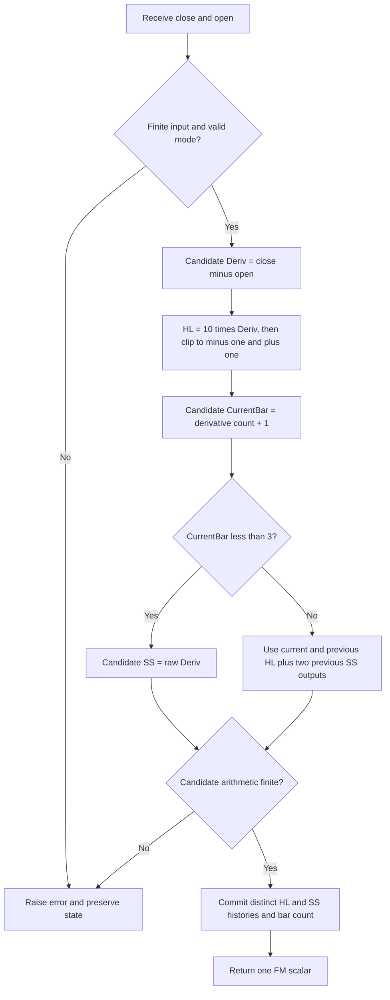

# FM Demodulator — Frequency Modulation Timing Indicator

This folder is the independent Python research master for the **FM Demodulator** in John F. Ehlers' May 2021 article *A Technical Description of Market Data for Traders*. `fm-demodulator.py` defines `FMDemodulator`, a standard-library streaming class returning the article's single `SS` timing waveform. Its five language fixtures contain all 252 shared closes and opens. The user confirmed all 14 reference periods on 2026-10-19.

**User-required precision:** all coefficient calculations use `math.sqrt(2.0)` and `math.pi`, replacing printed EasyLanguage 1.414 and 3.14159. This intentionally changes numerical outputs relative to the unmodified rounded constants, while preserving the article's limiting, recurrence and initialization. The user also confirmed that every reference case uses `INPUT_CLOSE` paired with `INPUT_OPEN`.

## Market model, spectrum and physical analogies

The May article describes market prices as a nonstationary random process: their statistical behavior changes over time. Its physical analogy is a drunkard's walk, where successive random steps create a path. The paper names diffusion and telegrapher equations as continuous descriptions of such random walks, but does not supply a solvable price boundary-value model or use a PDE in these indicators. They perform direct sampled-data calculations.

The spectrum analogy is colored light: a waveform consists of components at different frequencies, just as white light combines colors. Ehlers calls the tendency for longer cycles to have greater amplitude **spectral dilation**. His working hypothesis is that amplitude is proportional to cycle period. Thus doubling period doubles amplitude, which is $20\log_{10}2\approx6.0206$ dB per octave. The article illustrates this with a 5:1 change between daily and weekly time scales and an assumed corresponding 5:1 amplitude scale.

This is the author's approximate empirical market hypothesis, not a universal theorem about prices. Conventional pink-noise power spectral density is proportional to $1/f$, whereas amplitude proportional to period corresponds to an amplitude scale proportional to $1/f$ and a squared-amplitude scale proportional to $1/f^2$. One must distinguish amplitude, spectral power and empirical cycle estimates when interpreting the paper's term “pink noise.” The code makes no spectral estimate and requires neither hypothesis to execute.

MESA (maximum entropy spectral analysis) is used in the paper to display an SPY spectral heatmap over May 2019–November 2020, with cycle periods approximately 12–54 bars. The author observes a frequent roughly 20-bar component and rapidly changing periods resembling an audio chirp. That observation motivates modeling locally dominant components as a narrow-band process. It does not fix a globally constant market cycle or add a MESA stage to either implementation.

The article's complete modulation model is

$$
S(t)=A(t)\sin\bigl(\omega t+\Theta(t)\bigr).
$$

Here $A(t)$ is time-varying amplitude, $\omega$ is a fixed carrier angular frequency, and $\Theta(t)$ is time-varying phase. The amplitude term is analogous to AM radio's changing carrier envelope. The changing phase is analogous to FM radio; instantaneous angular frequency is, by differentiation,

$$
\omega_{\mathrm{inst}}(t)=\omega+\frac{d\Theta(t)}{dt}.
$$

This latter equation is an explanation of the phase/frequency relation stated in the paper. Neither indicator explicitly estimates $\Theta(t)$ or reports frequency in cycles per bar. AM aims to recover an envelope related to bar volatility; FM aims to provide a price-timing waveform after reducing amplitude dependence.

## Differencing, whitening and input bars

The article starts its explanation with one-bar differencing, analogous to a derivative in calculus. For closes $p_t$, the difference $d_t=p_t-p_{t-1}$ has transfer response

$$
H_D(z)=1-z^{-1}.
$$

The source's small-departure explanation is

$$
\mathrm{Output}=(1+e)-1=e.
$$

More precisely, at sampled angular frequency $\Omega$,

$$
H_D(e^{i\Omega})=1-e^{-i\Omega}
=2i\sin(\Omega/2)e^{-i\Omega/2},
$$

$$
|H_D(e^{i\Omega})|=2|\sin(\Omega/2)|\approx|\Omega|
\quad\text{near DC}.
$$

It has a zero at DC, magnitude increasing about 6 dB per octave of frequency near DC, and phase $\pi/2-\Omega/2$ for $0<\Omega<\pi$. Its half-bar linear delay is combined with the differentiator's quadrature phase. Under the author's amplitude-proportional-to-period hypothesis, differencing approximately flattens the low-frequency amplitude slope. The exact response is not flat at every frequency, and prices need not satisfy that hypothesis.

The executable source instead uses

$$
d_t=p_t-o_t,
$$

where $o_t$ is the same completed bar's **open**. The identity

$$
p_t-p_{t-1}=(p_t-o_t)+(o_t-p_{t-1})
$$

shows that Close−Open removes the opening gap from the close-to-close movement. It is useful intraday and whenever gaps should be excluded, but it is not generally equal to Close−Close[1]. The close/open pair is not a fixed linear filter of closes alone, so the differencer transfer function applies exactly to the close-only alternative and approximately to the paper's interpretation of the paired bar signal.

**Reference input choice confirmed by the user:** all reference cases pair the 252 `INPUT_CLOSE` values with the existing 252 `INPUT_OPEN` values. `update(close, open_value)` therefore reproduces the article's exact bar-difference definition. Both prototypes also offer `input_mode="close_difference"` for `update(close)`; its first close is unavailable because no preceding close exists. Input mode is fixed at construction and cannot be switched midstream. Reference arrays use `close_open` exclusively.

## Relationship of the two indicators

The AM Detector takes $|d_t|$, holds recent peaks with a sliding maximum, and averages those peak estimates. This is analogous to rectifying an AM carrier and using a peak detector followed by smoothing. Rectification discards sign; the short maximum window reduces dependence on the carrier's instantaneous phase. A finite maximum is an envelope estimate, not an analytic-signal/Hilbert envelope or a calibrated standard deviation.

The FM Demodulator multiplies $d_t$ by 10, limits it to ±1, and applies a two-pole SuperSmoother. This resembles a radio receiver's amplitude limiter followed by integration/smoothing. The limiter removes magnitude differences only when its input is saturated; changes smaller than 0.1 price units remain proportional to their amplitude. It is a clipped ramp, not an unconditional sign function.

The paper says AM corresponds to volatility and FM contains timing information, and compares their plots to price swings. These are interpretations of the depicted data. AM measures body movement without gaps or wicks; FM does not recover a physical instantaneous-frequency value. Neither is a prediction, probability, volatility in return units, or complete trading system.


## Complete FM calculation and source initialization

For a completed bar,

$$
d_t=p_t-o_t.
$$

The source uses fixed gain 10 followed by a hard limiter:

$$
h_t=\operatorname{clip}(10d_t,-1,+1)
=\begin{cases}
+1,&d_t>0.1,\\
10d_t,&-0.1\leq d_t\leq0.1,\\
-1,&d_t<-0.1.
\end{cases}
$$

At the equality boundaries the linear region yields the same ±1 output as clipping. An exact zero gives $h_t=0$. This operation is **not** a sign function: for $d_t=0.05$, limited output is 0.5, not 1. The threshold is in price units and therefore depends on price scale.

With $P=period$ and full precision,

$$
a_1=\exp\left(-\frac{\sqrt2\,\pi}{P}\right),\qquad
b_1=2a_1\cos\left(\frac{\sqrt2\,\pi}{P}\right),
$$

$$
c_2=b_1,\qquad c_3=-a_1^2,\qquad c_1=1-c_2-c_3.
$$

The recurrence is

$$
s_t=c_1\frac{h_t+h_{t-1}}2+c_2s_{t-1}+c_3s_{t-2}.
$$

Then the source applies `If CurrentBar < 3 Then SS = Deriv`. With one-based `CurrentBar=t+1` for the paired derivative stream, the complete startup rule is

$$
s_0=d_0,\qquad s_1=d_1,
$$

$$
s_t=c_1\frac{h_t+h_{t-1}}2+c_2s_{t-1}+c_3s_{t-2},\qquad t\geq2.
$$

The first two **raw derivatives** seed the output history, while their **limited values** seed the separate $h$ history. The third output uses previous limited derivative and two previous raw derivative outputs. Do not replace startup with zero, clipped values, a period-length warmup, or three pass-through bars.

The original complete listing, with rounded source constants shown for traceability, is

```text
Inputs: Period(30);
Vars: Deriv(0), HL(0), a1(0), b1(0), c1(0), c2(0), c3(0), SS(0);
Deriv = Close - Open;
HL = 10*Deriv;
If HL > 1 Then HL = 1;
If HL < -1 Then HL = -1;
a1 = expvalue(-1.414*3.14159 / Period);
b1 = 2*a1*Cosine(1.414*180 / Period);
c2 = b1;
c3 = -a1*a1;
c1 = 1 - c2 - c3;
SS = c1*(HL + HL[1]) / 2 + c2*SS[1] + c3*SS[2];
If Currentbar < 3 Then SS = Deriv;
Plot1(SS);
Plot2(0);
```

`Cosine` in EasyLanguage accepts degrees; the master uses radians after the requested full-precision substitution. `Plot2(0)` is a reference line, not another output. The class returns one scalar `SS`, without exposing limiter or derivative as extra fixture components.

## SuperSmoother background from the cited book

*Cycle Analytics for Traders*, chapter 3, develops the SuperSmoother from a modified two-pole Butterworth filter. A Butterworth design is maximally flat near zero frequency. Removing extra numerator terms reduces lag; adding a two-element moving average creates a zero at Nyquist at the cost of half a bar of additional delay. Recursive filters have frequency-dependent delay, so stronger attenuation does not imply zero lag.

The complete relevant book equation (3-3), printed with abbreviated constants and a degree-based cosine, is

$$
\begin{aligned}
a&=\exp(-1.414\cdot3.14159/P),\\
b&=2a\cos_{\mathrm{degrees}}(1.414\cdot180/P),\\
c_2&=b,\\
c_3&=-a^2,\\
c_1&=1-c_2-c_3,\\
y_t&=c_1(u_t+u_{t-1})/2+c_2y_{t-1}+c_3y_{t-2}.
\end{aligned}
$$

The user's full-precision requirement replaces 1.414 by $\sqrt2$ and 3.14159 by $\pi$, while converting cosine to radians. With

$$
q=\frac{\sqrt2\,\pi}{P},\qquad a=e^{-q},
$$

the coefficients used in the master are

$$
c_2=2a\cos(q),\qquad c_3=-a^2,\qquad c_1=1-c_2-c_3.
$$

The zero-state transfer response derived from the recurrence is

$$
H_{SS}(z)=\frac{c_1(1+z^{-1})/2}{1-c_2z^{-1}-c_3z^{-2}}.
$$

It has a zero at $z=-1$ (Nyquist) and unit DC gain because $c_1=1-c_2-c_3$. Its poles are

$$
p_\pm=a e^{\pm iq},
$$

so their magnitude $a<1$ ensures stability for finite positive $P$. Very large $P$ can round the coefficients to unresolved boundaries in binary64; the class rejects those configurations. The critical period is a design parameter associated with lowpass smoothing; it is not a requirement to collect $P$ prices before producing output.

The book discusses a two-pole attenuation slope of roughly 12 dB per octave, sampled-data aliasing, Nyquist at 0.5 cycles per bar, and a practical period around 10 for attenuating short-period noise. Differencing and limiting do not cure aliasing or remove all kinds of noise. The FM master uses the article's period 30 by default and applies this filter to the limited derivative. AM uses an ordinary finite SMA and does not apply the SuperSmoother.

The book's chapter 7 describes spectral dilation and roofing filters. A roofing filter adds explicit highpass and lowpass stages to constrain cycle content. No roofing, spectral estimator, three-pole filter, or adaptive-cycle stage appears in these May AM/FM algorithms. The relevant common spectrum discussion and complete SuperSmoother recurrence are included here; distinct book indicators are not additional stages of these masters.


## Scale, amplitude removal and transient behavior

The limited driving input lies within ±1. The public smoother output is **not guaranteed bounded by ±1**. First, the source's raw derivative startup can be arbitrarily larger than the limiter range. Those values enter the recursive feedback and can persist, especially at long periods. Second, a two-pole filter can overshoot for some inputs. The master never clamps the final output or normalizes its amplitude.

The source's first two outputs on the supplied paired fixture are −1 and 3.315. Both are valid startup outputs; 3.315 exceeds the limiter bound intentionally. At Period 30, those two samples influence the transient even though all later driving inputs are limited.

When different signals have the same saturated sign pattern **and identical startup seeds**, their subsequent FM outputs are identical: the limiter presents the same sequence to the same recursive filter. Without identical startup seeds, differently scaled first derivatives cause different transients. Unsaturated values also retain amplitude information, so the paper's statement that the limiter strips all amplitude is a saturation-regime interpretation rather than a general property.

A constant positive derivative gives a constant limited input; after the initialization transient decays, unit DC gain makes the filter converge to that limited input, such as 0.5 for a derivative of 0.05 or 1 for a derivative of 2. An identically zero derivative gives zero throughout. Neither steady nonzero bar movement nor the clipped signal necessarily has zero mean on a trending market series.

The output is a normalized driving waveform with raw price-unit initialization, not a measured frequency in Hz or cycles/bar. Its period controls smoothing, not a literal demodulated carrier frequency. It is scale-sensitive through the gain/threshold and startup rules.

## Parameters, range and availability

| Parameter | Default | Valid range | Meaning |
| --- | --- | --- | --- |
| `period` | 30 | Integer $P\geq1$, yielding resolvable stable coefficients | SuperSmoother critical period in bars. Periods 1–2 are mathematical research cases near/above the sampled Nyquist limit; practical periods are usually at least 3. |
| `input_mode` | `close_open` | `close_open` or `close_difference` | Source paired bar differences or an optional close-only stream. Fixed per instance. |

Limiter gain 10 and clipping levels ±1 stay fixed as in the article. The full-precision coefficient policy is fixed and has no alternate rounded mode. Booleans and float periods such as 30.0 are rejected. Extremely large periods rounding pole radius to one or the input coefficient to zero are rejected as numerically unresolved. Change configuration by constructing a new instance.

In paired mode the first derivative exists on the first input, and the two raw startup outputs are defined initialized values. **There is no NaN prefix**: `warmup_bars=0`, and `is_primed` is true after the first accepted close/open pair. A period of 252 still produces output immediately; priming is availability, not decay of a long IIR transient. There is no fixed price-window requirement of length Period.

In close-only mode the first close is NaN because no previous close exists. It does not advance the derivative counter or filter startup. The next two closes produce the first two raw derivative outputs; the fourth close begins recursion. Its `warmup_bars=1`, and `is_primed` becomes true after the first valid derivative. This alignment makes it identical to a paired stream with each open set to the prior close, after the initial close is supplied.

`reset()` restores empty close history, zero recursive seeds, zero derivative-bar count and NaN output while preserving configuration. `output` exposes the latest scalar without consuming a bar. Finite input conversion and every computed stage are checked before committing state. Invalid/nonfinite input, overflow in Close−Open, overflow in gain multiplication or nonfinite recursion raises an error without consuming the bar. No opening price is silently ignored or supplied in close-only mode.

## Algorithm flow and state



The close-only path establishes a previous close before any derivative stage. Persistent state consists of one previous close, one previous limited derivative, two previous output values, input/derivative bar counters, configuration coefficients and latest output. Work and storage are $O(1)$ per update. Compute coefficients once; they are constant for an instance. The class has no file I/O or third-party dependency.

The source recurrence's signs are important: $c_3$ is negative and its signed product is **added**, not negated again. Preserve `c1*(HL+HL[1])/2 + c2*SS[1] + c3*SS[2]` operation order and update feedback only after the current calculation is complete. Internal state is full binary64, never the 15-digit exported decimals.

## Source differences and the requested precision change

Article, Mesa and TradeStation agree on source limiter, recurrence and a **two-bar** pass-through when CurrentBar is one-based. NinjaTrader tests zero-based `CurrentBar < 3`, passing through three bars; its startup differs by one bar. eSignal adds `getCurrentBarCount() < Period - 3` gating and accesses previous limited input with `getValue(1)` where normal historical indexing is negative; it is not the initialization/index authority. Zorro, Optuma and NeuroShell call library smoothers with potentially different seeds. TradeStation's supplied function also has a misspelled returned identifier; the article's `SS` mathematical calculation is the authority.

The master replaces both shortened constants with full precision as explicitly requested. It compares against the extracted source formulas **after those replacements**; it does not claim equality to the unmodified rounded EasyLanguage output. Math-library argument reduction and degree/radian conversion can change final floating-point digits. The source-aligned startup and recurrence are preserved.

## Confirmed reference periods

The following **14 periods**, confirmed by the user on 2026-10-19, have generated 14 arrays per language with 252 values each. All use the confirmed close/open pair input, fixed gain 10 and full-precision coefficients.

| # | Period P | What it tests |
| --- | --- | --- |
| 1 | 30 | Article and Mesa default critical period with full-precision constants. |
| 2 | 1 | Minimum supported research period; very fast stable smoother. |
| 3 | 2 | Nyquist-scale research period and source raw-derivative startup. |
| 4 | 3 | Short smoother with a cutoff below the Nyquist frequency. |
| 5 | 5 | Fast five-bar critical period and hard-limiter transitions. |
| 6 | 8 | Short-cycle smoother near the book aliasing discussion. |
| 7 | 10 | Book-recommended ten-bar SuperSmoother critical period. |
| 8 | 14 | Intermediate smoothing with the common fourteen-bar setting. |
| 9 | 20 | Twenty-bar critical period associated with a monthly trading cycle. |
| 10 | 48 | Slower critical period near the book cycle and trend boundary. |
| 11 | 60 | Long smoothing with persistent source initialization transients. |
| 12 | 100 | Very slow smoother and unbounded startup-seeded transient behavior. |
| 13 | 126 | Half-record critical period without postponing output availability. |
| 14 | 252 | Full-record critical period; initialized outputs still start immediately. |

Names use `EXPECTED_P{period}`, for example `EXPECTED_P30`. The first preceding comment is the exact **What it tests** text; the second states `period=..., input_mode=close_open, limiter_gain=10`. There are no extra arrays for the plotting zero line or hidden intermediate states.

## Usage and expected-data generation

From this directory:

```sh
python3 fm-demodulator.py
python3 -m unittest -v test_fm_demodulator.py
```

The no-argument `__main__` embeds the exact 252 `INPUT_CLOSE` and `INPUT_OPEN` values and demonstrates a default instance, output formatting and reset. The streaming usage is `indicator.update(close, open_value)` in default mode. For a one-close stream, construct with `input_mode="close_difference"` and call `indicator.update(close)`; do not fabricate an opening price.

Regenerate all confirmed reference arrays:

```sh
python3 fm-demodulator.py --generate-reference-data
```

This generation flag computes every confirmed case, appends Python arrays first, reopens the actual written `test_testdata.py` through AST parsing and verifies expected names, 252-value lengths, exact availability prefixes, finite numeric outputs and 15-digit serialization. It then translates **those written Python values** to the other four files with identical comments. Reruns replace only marked generated blocks, preserve original inputs and prevent duplicate arrays. Input mode is recorded in comments rather than treated as an additional reference combination.

Formatting uses **15 significant decimal digits** (`.15g`); `.0` is appended to integral float literals when needed for Rust. All streaming arithmetic and internal state remain unrounded binary64. NaNs are compared by classification. A mixed absolute/relative output tolerance such as $10^{-12}+10^{-12}|expected|$ covers decimal export and ordinary math-library differences for this price-scale data.

| Language | Name form | Missing value |
| --- | --- | --- |
| Python | `EXPECTED_P30 = [...]` | `math.nan` |
| Go | `var expectedP30 = []float64{...}` | `math.NaN()` |
| TypeScript | `export const expectedP30: number[] = [...]` | `NaN` |
| Rust | `pub fn expected_p30() -> Vec<f64>` | `f64::NAN` |
| Zig | `pub fn expectedP30() [252]f64` | `nan` |

Go's package is `fmdemodulator` and imports `math`. A blank reference to `math.NaN` keeps that requested import valid even when a selected input contract yields no missing values. Zig's header contains `const math = @import("std").math;` and `const nan = math.nan(f64);`. Rust expected functions remain inside the copied `#[cfg(test)] pub mod testdata`, alongside its input functions. These spellings use valid native syntax.


## Verification

All **11 Python checks passed on 2026-10-19**, with no skipped checks. They compare the actual source expressions after the requested precision substitutions across all confirmed periods, distinguish output from unmodified shortened constants, and check source startup, separate limited-input/output histories, limiter boundaries and unsaturated values, identical saturated driving sequences, constant/zero steady states, close-only alignment, opening-gap exclusion, reset, causality, period-independent availability, input integrity and rejection without state changes. The expected-data check verifies all 14 arrays of 252 values in every language, their two preceding comments, names, availability and exact serialized values.

The generated Python fixture was imported successfully. Go, Rust and Zig fixtures were compiled and exercised with temporary native test harnesses; TypeScript fixtures were imported and exercised with Node 24's built-in type stripping. Each harness loaded all four original input arrays and every expected array, verified their lengths, and matched a byte-level fingerprint against the written Python values. No language implementations of the indicator were introduced at this preparation stage.

For reproducibility, the native checks process arrays in the order `INPUT_CLOSE`, `INPUT_HIGH`, `INPUT_LOW`, `INPUT_OPEN`, then expected arrays in table order. Their 64-bit FNV-1a fingerprint is `300827730d6e624d`, over big-endian binary64 values with every NaN canonicalized to `0x7ff8000000000000`. All 3,528 expected values are finite; paired-input initialization has no NaN prefix, including periods 126 and 252.

Running `python3 fm-demodulator.py --generate-reference-data` again leaves all five fixture files **byte-for-byte unchanged**, as checked by SHA-256 before and after regeneration. The no-argument example returns raw startup values `-1` and `3.315`, default final FM `-0.110652557158926`, and `is_primed=False` after reset. Cross-language value equality refers to loading the exported fixtures; source-formula agreement with the full-precision substitution is established separately by the independent Python checks described above.

## Sources and BibTeX

Direct sources are [the May 2021 TASC article](../../tasc/2021-05-a-technical-description-of-market-data-for-traders/content.md), [the Mesa AMFM paper](../../tasc/2021-05-a-technical-description-of-market-data-for-traders/mesa/content.md), and [May Traders' Tips](../../tasc/2021-05-a-technical-description-of-market-data-for-traders/tips/tips.md), including [TradeStation AM-FM.els](../../tasc/2021-05-a-technical-description-of-market-data-for-traders/tips/AM-FM.els). Related mathematics is in [Cycle Analytics, chapter 3](../../2013-cycle-analytics-for-traders/ch3.md) and [chapter 7](../../2013-cycle-analytics-for-traders/ch7.md). Input closes and opens originate in [the parent Python fixture](../test_testdata.py).

Other supplied platform examples establish the differences described above. References below include the direct sources, the paper's cited explanatory links and further reading. Those further-reading articles are not separate numeric authorities for the May implementation.

```bibtex
@article{ehlers_technical_market_data_2021,
  author = {Ehlers, John F.},
  title = {A Technical Description of Market Data for Traders},
  journal = {Technical Analysis of Stocks \& Commodities},
  volume = {39}, number = {5}, pages = {8--14},
  month = may, year = {2021},
  url = {https://technical.traders.com/archive/article.asp?file=\V39\C05\238EHLE.pdf}
}

@misc{ehlers_mesa_amfm_2021,
  author = {Ehlers, John F.},
  title = {A Technical Description of Market Data for Traders},
  howpublished = {MESA Software paper}, year = {2021},
  url = {https://www.mesasoftware.com/papers/AMFM.pdf}
}

@misc{traders_tips_2021_05,
  author = {{Technical Analysis of Stocks \& Commodities}},
  title = {Traders' Tips: A Technical Description of Market Data for Traders},
  month = may, year = {2021},
  url = {https://www.traders.com/Documentation/FEEDbk_docs/2021/05/TradersTips.html},
  note = {Platform implementations in TradeStation, NinjaTrader, eSignal, Zorro,
          AIQ, Optuma, NeuroShell, Excel, and Wealth-Lab}
}

@book{ehlers_cycle_analytics_2013,
  author = {Ehlers, John F.},
  title = {Cycle Analytics for Traders: Advanced Technical Trading Concepts},
  publisher = {Wiley}, series = {Wiley Trading}, year = {2013},
  isbn = {9781118728604},
  note = {Chapter 3: SuperSmoother; chapter 7: spectral dilation}
}

@misc{ehlers_cycles_tutorial,
  author = {Ehlers, John F.}, title = {Cycles Tutorial},
  howpublished = {MESA Software website},
  url = {http://www.mesasoftware.com/ehlers_cycles_tutorial.htm},
  note = {Random-walk background cited by the May article; no PDE stage implemented}
}

@misc{stationary_nonstationary_background,
  author = {{Investopedia}}, title = {Stationary and Nonstationary Processes},
  url = {https://www.investopedia.com/articles/trading/07/stationary.asp},
  note = {Explanatory link cited by the Mesa paper}
}

@misc{pink_noise_background,
  author = {{Wikipedia contributors}}, title = {Pink Noise},
  url = {https://en.wikipedia.org/wiki/Pink_noise},
  note = {Spectrum background linked by the Mesa paper}
}

@article{ehlers_measuring_market_cycles_2016,
  author = {Ehlers, John F.}, title = {Measuring Market Cycles},
  journal = {Technical Analysis of Stocks \& Commodities},
  volume = {34}, month = sep, year = {2016}
}

@article{ehlers_aliasing_2016,
  author = {Ehlers, John F.}, title = {Aliasing},
  journal = {Technical Analysis of Stocks \& Commodities},
  volume = {34}, month = jan, year = {2016}
}

@article{ehlers_whiter_is_brighter_2015,
  author = {Ehlers, John F.}, title = {Whiter Is Brighter},
  journal = {Technical Analysis of Stocks \& Commodities},
  volume = {33}, month = jan, year = {2015}
}

@article{ehlers_predictive_successful_indicators_2014,
  author = {Ehlers, John F.}, title = {Predictive and Successful Indicators},
  journal = {Technical Analysis of Stocks \& Commodities},
  volume = {32}, month = jan, year = {2014}
}
```
