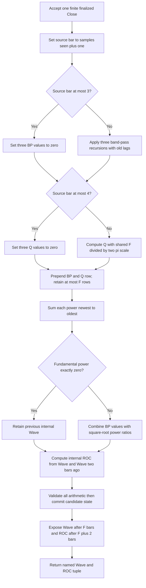

# Fourier Series Analysis — Ehlers's three-harmonic market model

This is a standalone research prototype master reference for John F. Ehlers's
“Fourier Series Model Of The Market,” published in *Technical Analysis of
STOCKS & COMMODITIES*, June 2019, volume 37, number 6, pages 9–14. It follows
the article, its Mesa manuscript, and the TradeStation Traders' Tip. It uses
full-precision mathematical constants and explicitly defined streaming startup.

The master is `fourier-series-analysis.py`. Its `FourierSeriesAnalysis.update(close)`
consumes one finalized, finite closing price and returns
`FourierSeriesOutput(wave, roc)`. Wave is the principal article indicator. ROC
is the optional cyclic trading signal printed in the article and enabled in
the TradeStation indicator listing. The constant zero plot is a chart reference
line and needs no expected-data array. The class also exposes diagnostic state
and coefficients to support faithful ports into other languages.

The user **confirmed all 20 Fourier parameter combinations on 2026-10-20**.
All five copied input fixtures contain the generated master expected data:
40 arrays of 252 values per language, covering Wave and ROC for every case.
The previously confirmed October 2018 DSO and Fisher DSO
masters remain in their separate folders. They are separate conversion targets
with different formulas and startup; this Fourier implementation does not alter them.

## Purpose and the physical picture

Market prices can contain several oscillations at once. A resonant filter behaves
like a tuning fork or a tuned electrical circuit: a sinusoid near its resonant
frequency passes strongly, while slower and faster components are attenuated.
Three such filters, tuned to a fundamental and its second and third harmonics,
extract three overlapping cyclic components. Their relative powers then determine
the weights used to combine the components into a smooth, time-varying waveform.

This is a causal recursive filter bank with a fixed chosen fundamental period.
It does not compute an FFT, fit a whole-record Fourier series, or automatically
estimate the dominant cycle. It uses the relative phases present in the filter
outputs; it does not explicitly estimate phase angles and restart synthetic sine
waves on each bar. All output at bar $t$ depends only on inputs through bar $t$.

A conventional Fourier expansion of a periodic signal can be written

$$
x(t)=a_0+\sum_{h=1}^{\infty}
\left[a_h\cos(h\omega_0t)+b_h\sin(h\omega_0t)\right]
=a_0+\sum_{h=1}^{\infty}A_h\sin(h\omega_0t+\phi_h).
$$

Here $a_0$ is the mean, $\omega_0$ is the fundamental angular frequency, and
$A_h,\phi_h$ are harmonic amplitudes and phases. Ehlers's implementation retains
only $h=1,2,3$, suppresses the mean with band-pass filters, and lets the amplitudes
and phases evolve causally. It is an approximate market model rather than an
exact Fourier coefficient decomposition.

## Hurst's five principles

The article builds on J. M. Hurst's *The Profit Magic of Stock Transaction Timing*
(1970). These principles motivate the model; they are hypotheses about market
behavior rather than mathematical guarantees about all price series.

| Principle | Meaning in the article | Connection to this implementation |
|---|---|---|
| Summation | A complicated cyclic shape can be composed from sinusoidal components. | Combine the fundamental and two harmonics. |
| Commonality | Similar markets can share approximate cycle durations and synchronized extremes. | A chosen parameter should be examined across comparable instruments. |
| Variation | Periods, amplitudes, and phases change over time. | Filters have finite bandwidth; rolling powers change the weights. |
| Nominality | Some approximate cycle durations recur. | The default is a 20-bar fundamental, motivated by a roughly monthly daily-data cycle. |
| Proportionality | Longer cycles tend statistically to have larger amplitudes. | Measure relative harmonic powers instead of assuming equal amplitudes. |

Ehlers calls the last effect **spectral dilation**: long-period market components
can dominate a measurement because their amplitudes are larger. This model adapts
relative weights, but it does not add the separate high-pass prefilter or automatic
gain control used in other Ehlers indicators. The article uses raw Close in each
band-pass recursion; adding those stages would change the reference.

## Mathematical examples from the article

The article and Mesa manuscript give these complete synthesis examples, with
$x$ measured in radians:

$$y_{\mathrm{double}}(x)=\sin(x)+0.33\sin(3x).$$

The shape alternates double tops and double bottoms.

$$y_{\mathrm{head}}(x)=\sin(x)+0.1\sin(3x)+0.2\sin(5x).$$

The shape alternates direct and inverse head-and-shoulders patterns. This example
contains a fifth harmonic, which the actual three-filter implementation does not
include. It illustrates synthesis, not an extra implemented filter.

$$y_{\mathrm{Elliott}}(x)=\sin(x)-0.5\sin(2x)+0.33\sin(3x).$$

The shape resembles an Elliott-wave pattern. The coefficients $0.33$, $0.1$,
$0.2$, and $-0.5$ are chosen shape coefficients. They are retained as printed;
the precision requirement does not turn $0.33$ into $1/3$.

In the article, deterministic Elliott-like and double-top signals are used to
check approximate reconstruction before application to prices. Such checks are
also included here, alongside a separate source transcription. The literal
weighting formula below is not an exact inverse synthesis operation.

## Configuration and outputs

| Item | Default | Valid values | Meaning |
|---|---:|---|---|
| `fundamental` ($F$) | 20 | Python integer $F\ge7$; coefficients must remain representably stable | Fundamental period in bars and number of bars in each harmonic power sum. |
| Bandwidth ($B$) | 0.1 | Fixed source design value | Controls selectivity and transient response of all three filters. |
| Input `close` ($C_t$) | None | Finite binary64 value | One chronological finalized price per call. |
| `wave` ($W_t$) | NaN during startup | Finite value after priming | Relative-power-weighted reconstruction, in price units. |
| `roc` ($R_t$) | NaN during startup | Finite value after priming | Scaled two-bar Wave difference, in price units. |

Bandwidth is a local variable in the article and TradeStation listing, not an
input. Some Traders' Tips expose it as an extension; this master keeps the
original one-parameter contract. Both outputs are always computed; there is no
`plot_roc` calculation parameter. A caller may choose which result to display.

The article does not prescribe a validated range for $F$. The master's minimum
is a sampling constraint: the highest modeled frequency is $3/F$ cycles per
bar, which must be strictly below Nyquist, $1/2$ cycles per bar. Thus $F>6$.
At $F=6$ the third harmonic is at Nyquist, where the band-pass numerator has a
zero. Smaller periods alias harmonics into the sampled band. Reject booleans,
fractional values, and integral floats as configuration; the rolling window
requires an explicit integer count. Odd values are supported: $F/2$ and $F/3$
use real division. There is no 252-bar cap; longer valid periods simply cannot
prime on a 252-bar record. Very large values that round $G_h$ or $S_h$ to one,
or $L_h$ to a degeneracy boundary, are rejected before allocating history.

Configuration is read-only. `reset()` clears all histories and restores the
original zero-valued source variables. Invalid or nonfinite input and nonfinite
intermediate arithmetic raise `ValueError` without consuming a bar. There is
no missing-value skip or gap-fill policy; sanitize a feed before calling `update`.

## Complete calculation equations

### 1. Harmonic filter coefficients

Let $t=0,1,2,\ldots$ index accepted closes. Source `CurrentBar` is $t+1$.
For $h\in\{1,2,3\}$, define the real-valued harmonic period and angular frequency

$$T_h=\frac{F}{h},\qquad \omega_h=\frac{2\pi}{T_h}=\frac{2\pi h}{F}.$$

The article's degree-valued cosine expressions become

$$
L_h=\cos\left(\frac{2\pi}{T_h}\right),\qquad
G_h=\cos\left(\frac{B\,2\pi}{T_h}\right),\qquad
S_h=\frac{1}{G_h}-\sqrt{\frac{1}{G_h^2}-1}.
$$

These coefficients are computed once. In the source, `Cosine(360 / T_h)` uses
degrees; Python's `math.cos(2*pi / T_h)` uses radians. Use a language's complete
binary64 $\pi$ constant. `6.28` in quadrature scaling is replaced by $2\pi$ and
`12.57` in ROC by $4\pi$. All recurrence and power arithmetic remains binary64;
only the fixture text is rounded to 15 significant decimal digits.

### 2. Two-pole band-pass filters

The relevant transfer function from chapter 5 of *Cycle Analytics for Traders*
is

$$
H_h(z)=\frac{\tfrac12(1-S_h)(1-z^{-2})}
{1-L_h(1+S_h)z^{-1}+S_hz^{-2}}.
$$

Here $z^{-1}$ is a delay by one input bar. Multiplying the transfer relation
by its denominator gives the exact recurrence used by the article:

$$
\widetilde{BP}_{h,t}=\tfrac12(1-S_h)(C_t-C_{t-2})
+L_h(1+S_h)BP_{h,t-1}-S_hBP_{h,t-2}.
$$

The source's startup overwrite is part of the definition:

$$
BP_{h,t}=\begin{cases}
0,&t\le2,\\
\widetilde{BP}_{h,t},&t\ge3.
\end{cases}
$$

The two recursive BP lag seeds are zero. On $t=3$, the first active difference
is $C_3-C_1$, not $C_3-C_0$ or a fabricated prehistory value. Skipping calculations
whose results are forcibly overwritten avoids accessing unavailable raw prices.
It is equivalent to the literal source after the overwrite.

The transfer numerator vanishes at zero frequency and at Nyquist. Thus the
filter attenuates both the mean/slow variation and fast alternating noise.
At its exact center frequency its steady-state gain is one with zero phase
shift. Away from the center it changes both amplitude and phase. A causal filter
can lead an off-center sinusoid's phase without using future prices.

The denominator polynomial is

$$z^2-L_h(1+S_h)z+S_h.$$

For $0<S_h<1$ and $-1<L_h<1$, the second-order stability conditions hold:

$$
1-S_h>0,\qquad
1-L_h(1+S_h)+S_h=(1+S_h)(1-L_h)>0,\qquad
1+L_h(1+S_h)+S_h=(1+S_h)(1+L_h)>0.
$$

These inequalities explain the coefficient validation in the Python class.
When the poles are a complex conjugate pair, their radius is $\sqrt{S_h}$;
their free oscillation envelope decays approximately as $S_h^{n/2}$.

**Source transcription caveat.** The supplied chapter text also labels an
incompatible transfer expression as equation 5-1,
$H(z)=(1-\sigma z^{-1})/[(1-\gamma z^{-1})(1-\gamma z^{-2})]$, and has incomplete
coefficient definitions around it. It does not produce the printed two-pole
recurrence. The transfer function above follows chapter equation 5-2, the book's
code listing, and all three Fourier BP recurrences; the incompatible expression
is not used as a numerical authority.

### 3. Bandwidth and ringing

Chapter 5 describes a band-pass filter as both a detrender and smoother. Its
selectivity is related to bandwidth. A narrower passband rejects unwanted
frequencies more strongly but takes longer to build up and rings longer after
an impulse or the end of a cycle. A bell is the physical analogy for a filter
with high quality factor. The chapter gives

$$Q_{\mathrm{filter}}\approx\frac{f_0}{\Delta f}\approx\frac{1}{B},$$

and the energy definition

$$Q_{\mathrm{filter}}=2\pi\frac{\text{energy stored}}{\text{energy dissipated per cycle}}.$$

This quality factor is unrelated to the variables $Q_h$ used for quadrature.
For a 30% bandwidth the chapter gives $Q\approx3.33$; for the Fourier article's
10% setting it gives the qualitative high-selectivity/$Q\approx10$ comparison.
The article describes a 20-bar center and nominal periods 19–21 as a bandwidth
example. These are engineering descriptions, not exact discrete-filter cutoff
solutions; the coefficient equations are the numerical authority.

Priming a full $F$-bar window does not imply that these narrow filters have
settled. Transients may last multiple cycles. Longer history is useful when
comparing observed data to steady-state harmonic theory.

### 4. Quadrature approximation and its limitations

The literal implemented rule for each harmonic is

$$
Q_{h,t}=\begin{cases}
0,&t\le3,\\
\dfrac{F}{2\pi}(BP_{h,t}-BP_{h,t-1}),&t\ge4.
\end{cases}
$$

The one-bar difference approximates a derivative, giving an approximately
90-degree phase-shifted signal. The article and Mesa manuscript print

$$\frac{d\sin(\omega t)}{dt}=\frac{1}{\omega}\cos(\omega t).$$

**This printed derivative identity is incorrect.** The correct derivative and
the amplitude-normalized relation are

$$
\frac{d\sin(\omega t)}{dt}=\omega\cos(\omega t),\qquad
\frac{1}{\omega}\frac{d\sin(\omega t)}{dt}=\cos(\omega t).
$$

For a sampled sinusoid $BP_{h,t}=A_h\sin(\omega_ht+\phi_h)$,

$$
BP_{h,t}-BP_{h,t-1}
=2A_h\sin(\omega_h/2)
\cos(\omega_h(t-\tfrac12)+\phi_h).
$$

Consequently the literal code's quadrature has amplitude multiplier

$$d_h=\frac{F}{\pi}\sin\left(\frac{\pi h}{F}\right),$$

and a half-bar time offset in its cosine argument. For long periods $d_h\approx h$.
Amplitude-normalizing each individual harmonic would instead use
$T_h/(2\pi)=F/(2\pi h)$ in the derivative approximation. **The article and
TradeStation code deliberately remain the numerical authority: all three use
$F/(2\pi)$, and this master retains that shared scale.** Correcting the prose
identity does not justify silently changing $Q_2$ and $Q_3$.

### 5. Harmonic powers

The article invokes the identity

$$\sin^2(x)+\cos^2(x)=1.$$

An ideal amplitude-matched in-phase/quadrature pair has constant summed squares
$A_h^2$. The actual implementation sums the literal BP and approximate Q squares
over the fundamental window:

$$
P_{h,t}=\sum_{k=0}^{F-1}\left(BP_{h,t-k}^2+Q_{h,t-k}^2\right).
$$

No division by $F$ appears in the source. A common average divisor would cancel
in the power ratios, but this master preserves the sums themselves. There is
no subtraction of a mean, sample-variance denominator, RMS normalization, or
exponential power average. The fundamental-length window covers one fundamental
cycle, two second-harmonic cycles, and three third-harmonic cycles at the exact
nominal frequencies, including when $T_h$ is nonintegral.

For a settled isolated harmonic the literal quadrature rule gives

$$P_h\approx\frac{F A_h^2}{2}(1+d_h^2).$$

Thus the article's statement that these are amplitude-matched harmonic powers
is only approximate under its shared quadrature scale. Averaging whole cycles
removes phase-dependent oscillation from the idealized sum; it does not remove
the harmonic-dependent multiplier $d_h$.

For portability, recompute each power newest to oldest with ordinary addition:
`P = (P + BP*BP) + Q*Q`. Do not regroup it as `P += BP*BP + Q*Q`, replace it
with a sliding add/subtract accumulator, use compensated summation, or fuse the
recurrence's multiplications and additions when comparing the reference literals.

### 6. Wave reconstruction and the zero-power branch

The article's exact synthesis rule is

$$
W_t=\begin{cases}
BP_{1,t}+\sqrt{P_{2,t}/P_{1,t}}\,BP_{2,t}
+\sqrt{P_{3,t}/P_{1,t}}\,BP_{3,t},&P_{1,t}\ne0,\\
W_{t-1},&P_{1,t}=0.
\end{cases}
$$

The persistent seed is $W_{-1}=0$. A constant price stream remains zero after
priming; zero fundamental power does not force an unavailable value or divide
by zero. The source has no `else`, so a later zero-power interval retains the
previous Wave. Test exact zero, not an arbitrary tolerance.

The factors $\sqrt{P_2/P_1}$ and $\sqrt{P_3/P_1}$ are nonnegative. Harmonic signs
and phases are carried by BP itself. BP already has an amplitude; multiplying
it by an amplitude-like ratio weights it again. Accordingly this literal Wave
is not simply $BP_1+BP_2+BP_3$, and its amplitude need not match the original
synthetic signal exactly. There is no gain limiter if $P_1$ is very small.
Using other quadrature scales, normalizing BP to unit amplitude, adding a fifth
harmonic, or changing this weighting would define a different indicator.

### 7. Optional cyclic trading signal

The article's optional rate-of-change signal, enabled in the TradeStation tip, is

$$R_t=\frac{F}{4\pi}(W_t-W_{t-2}).$$

For a fundamental sinusoid this is a central-difference derivative approximation
aligned approximately to $t-1$. Specifically,

$$W_t-W_{t-2}=2A\sin(\omega_0)\cos(\omega_0(t-1)+\phi).$$

Its zero crossings identify discrete cyclic turning regions. It can lag a
turning point by approximately one bar, and changing harmonic weights or noise
can produce other crossings. The article's predictive interpretation assumes
that observed cycles continue; neither Wave nor ROC uses future observations.
The master contains no trading orders or profitability assumptions.

## Exact startup and availability contract

All source BP, Q, Wave and lag variables start at zero. Before the first accepted
bar, nonexistent BP/Q history is treated as zero for **internal** partial power
sums. Missing pre-stream raw prices are never invented. Every accepted source
bar advances internal state, including the source's forced-zero observations.

| Zero-based index | Source CurrentBar | BP | Q | Public availability |
|---:|---:|---|---|---|
| 0–2 | 1–3 | Forced zero | Forced zero | Both NaN. |
| 3 | 4 | First active recursion using $C_3-C_1$ | Forced zero | Both NaN for supported $F$. |
| 4 onward | 5 onward | Active recursion | Active one-bar difference | Await complete source observation window. |
| $F-1$ | $F$ | Active | Active | First available Wave. |
| $F$ | $F+1$ | Active | Active | Wave available; ROC still NaN. |
| $F+1$ | $F+2$ | Active | Active | Both available. |

Wave requires $F$ accepted source BP/Q observations. Forced zeros on actual
source bars count as observations; invented history does not. Thus it has
$F-1$ leading NaNs. This differs from an extra requirement of $F$ active nonzero
filter observations, which the source does not specify. ROC waits until both
endpoints of its two-bar Wave difference are publicly available, so it has
$F+1$ leading NaNs. Internal Wave and ROC are calculated throughout startup,
and public NaNs never enter recursive histories.

On 252 closes, available counts are

$$n_W=\max(0,253-F),\qquad n_R=\max(0,251-F).$$

This startup is an explicit portable contract. The article shows seeded early
zeros rather than NaN masks and depends on platform historical-series behavior.
After priming, the master matches a direct transcription with these source seeds
and the requested full-precision constants. It does not claim identical startup
or final bits to every Traders' Tips platform or to the rounded-constant listing.

## Streaming calculation flow



Two past raw closes, two BP lag tuples, two internal Wave lags, and at most $F$
BP/Q rows suffice. The implementation has $O(F)$ memory and $O(F)$ work per bar.
It intentionally favors source-order arithmetic over a faster rolling power sum.

## Confirmed reference parameter cases

There are **20 parameter combinations**, below the 64-case limit. Every combination
produces **two 252-value arrays**, one for each output. `F` abbreviates Fundamental;
bandwidth is fixed at 0.1 for all cases. The two comment lines preceding each
array contain the exact “What it tests” text below and the parameter values.

| Fundamental | What it tests |
|---:|---|
| 20 | Article default: twenty-bar fundamental with second and third harmonics. |
| 7 | Minimum supported fundamental: third harmonic just below Nyquist. |
| 8 | Short even fundamental with a fractional third-harmonic period. |
| 9 | Short odd fundamental with a three-bar third harmonic. |
| 10 | Ten-bar fundamental: short-cycle response and fractional third harmonic. |
| 12 | Exact six-bar second and four-bar third harmonic periods. |
| 14 | Intermediate fast fundamental with a fractional third harmonic. |
| 16 | Intermediate even fundamental with an eight-bar second harmonic. |
| 19 | Odd fundamental immediately below the article default. |
| 21 | Odd fundamental immediately above the article default. |
| 24 | Exact twelve-bar second and eight-bar third harmonic periods. |
| 30 | Longer fundamental with exact fifteen-bar and ten-bar harmonics. |
| 40 | Twice the default fundamental and a forty-bar power window. |
| 60 | Long fundamental with exact thirty-bar and twenty-bar harmonics. |
| 80 | Slow eighty-bar fundamental with a fractional third harmonic. |
| 100 | Extended hundred-bar power window and slow transient response. |
| 200 | Long-history setting: fifty-three available Wave and fifty-one ROC values. |
| 250 | Record boundary: three available Wave values and only the final ROC value. |
| 252 | Record boundary: only the final Wave value is available and all ROC values are NaN. |
| 253 | Record boundary: both outputs remain unprimed throughout the 252-bar record. |

Naming example for the article default:

| Language | Wave | ROC | Unavailable value |
|---|---|---|---|
| Python | `EXPECTED_F20_WAVE` | `EXPECTED_F20_ROC` | `NaN`, defined as `math.nan` |
| Go | `expectedF20_WAVE` | `expectedF20_ROC` | `math.NaN()` |
| TypeScript | `expectedF20_WAVE` | `expectedF20_ROC` | `NaN` |
| Rust | `expected_f20_wave()` | `expected_f20_roc()` | `f64::NAN` |
| Zig | `expectedF20_WAVE()` | `expectedF20_ROC()` | `nan`, defined as `math.nan(f64)` |

The Go package is `fourierseriesanalysis`. TypeScript uses valid exported
`number[]` constants. Rust expected functions return `Vec<f64>`; the copied
template's input functions remain inside its `#[cfg(test)] pub mod testdata`.
Zig expected functions return `[252]f64`. All original close, high, low and open
arrays are preserved, although this indicator only consumes Close.

Run the standalone example from this directory:

```sh
python3 fourier-series-analysis.py
python3 -m unittest discover -s . -p test_fourier_series_analysis.py
```

Confirmation is recorded in `REFERENCE_CASES_CONFIRMED`. Regenerate the data with:

```sh
python3 fourier-series-analysis.py --generate-reference-data
```

The generator appends a marked section to Python, reopens it, and verifies the
set of names, 252-value lengths, the two exact NaN prefixes, and 15-digit values.
It then translates those **reopened Python arrays** into the other four languages.
Only its own marked sections are replaced on reruns, making regeneration stable.
Use approximate numerical comparisons for port results (for example absolute
and relative tolerances of $5\times10^{-12}$ on this input scale); NaN masks
must match exactly. Input rounding is never changed, and numeric indicator state
is never rounded on each update.

## Verification design

Validation after confirmation on 2026-10-20: all **13 Python tests passed**.
The saved fixtures contain all 40 arrays with identical rounded values and
availability masks across five languages. Their values were checked against the
master's 15-digit outputs; all original OHLC input arrays remain intact. Go, Rust,
and Zig compiler/runtime checks passed using copies of the saved fixtures;
Node 24 executed the saved TypeScript fixture and checked all 40 arrays.
The TypeScript check verifies executable syntax and values; a separate static
`tsc` type check was not available in this environment. Regeneration of copies
of the saved fixtures was byte-for-byte stable in all five languages.

`test_fourier_series_analysis.py` includes an independent whole-record
transcription with absolute-index history and full source power loops; it checks
all confirmed periods, all three BP/Q/power series, internal Wave/ROC, and public
availability. Other checks cover constant input, the source's unusual initial
guards, harmonic period division, persistent zero-power behavior, reset,
configuration validation, rejection without consuming a bar, and bounded history.

Deterministic long sinusoids check each filter's unity gain and phase at its
center frequency, the quadrature's exact sampled amplitude and half-bar offset,
and the associated full-cycle power. Elliott-like and double-top signals check
the literal reconstruction after settling, including leakage and amplitude
weighting. Tests do not assert perfect synthesis where the source approximation
does not provide it. The fixture-generation check uses temporary copies and
test-local authorization; it does not approve or populate the production data.

## Source authority and variant differences

| Source | Material used | Differences relevant to a port |
|---|---|---|
| June 2019 TASC article | Primary equations, synthesis examples, BP/Q guards, powers and Wave | Optional ROC is commented out; rounded constants and derivative typo are printed. |
| Mesa manuscript | Parallel theoretical explanation and full listing | Same mathematical and numerical rules as the article. |
| TradeStation `FSM.els` | Direct code corroboration and optional ROC output | Uses `once` for coefficients and enables ROC in its indicator. Its separate strategy places orders, which are outside this master. |
| NinjaTrader `FourierSeriesAnalysis.cs` | Cross-check of filter bank and power loop | Uses zero-based platform `CurrentBar`, shifts the early BP/Q guards by a bar, delays power calculation, exposes floating Fundamental, and uses rounded angle constants. It is not the startup authority. |
| AmiBroker `FSM.afl` | Cross-check of three filters and shared quadrature | Uses native IIR initialization, a rounded $\pi$, grouped power additions, and unconditional ratios; initialization differs. |
| MetaStock `FSM.met` | Cross-check of recurrence and power equations | Exposes bandwidth, uses platform `PREV`/`Sum` behavior, and omits explicit BP/Q guards and persistent zero-power branch. |
| AIQ `FSM.trs` | Cross-check of three-harmonic method | Exposes bandwidth and omits explicit BP/Q startup guards. |
| eSignal `Fourier_Series_Indicator.efs` | Cross-check of full-precision filter angles | Delays filter initialization until Fundamental bars and has platform-specific undefined values on zero power. |
| Quantacula `FSM-Quantacula.cs` | Context for use in a strategy | Calls a library `FourierSeries` whose numerical implementation is not included; its `StartIndex=201` is a strategy setting, not this indicator's warmup. |
| Ehlers 2013, chapter 5 | Two-pole transfer/recurrence, frequency response and quality factor | Its complete BandPass indicator adds high-pass, AGC and trigger stages; those stages are not in the 2019 Fourier article. |

Do not combine a vendor's startup behavior with another vendor's power
calculation and call the result the article's exact reference. This master uses
the article/TradeStation recurrences, declared zero source seeds, full-precision
constants, and the explicitly documented public NaN policy.

## References

1. Ehlers, John F. (2019). “Fourier Series Model Of The Market.” *Technical
   Analysis of STOCKS & COMMODITIES* 37(6), 9–14.
   [Article PDF](https://technical.traders.com/archive/article.asp?file=%5CV37%5CC06%5C870EHLE.pdf).
   Local transcription: `../../tasc/2019-06-fourier-series-model-of-the-market/content.md`.
2. Ehlers, John F. (2019). “Fourier Series Model of the Market.” Mesa Software
   manuscript. [PDF](https://www.mesasoftware.com/papers/FOURIER%20SERIES%20MODEL%20OF%20THE%20MARKET.pdf).
   Local transcription: `../../tasc/2019-06-fourier-series-model-of-the-market/mesa/content.md`.
3. *Technical Analysis of STOCKS & COMMODITIES* (June 2019). “Traders' Tips.”
   [Listings](https://www.traders.com/Documentation/FEEDbk_docs/2019/06/TradersTips.html).
   Local directory: `../../tasc/2019-06-fourier-series-model-of-the-market/tips/`.
   The numerical comparisons above use its named vendor listings.
4. Ehlers, John F. (2013). *Cycle Analytics for Traders: Advanced Technical
   Trading Concepts*. John Wiley & Sons. Chapter 5, “Band-Pass Filters.”
   ISBN 978-1-118-72860-4 (as recorded in the supplied book metadata). Local transcription:
   `../../2013-cycle-analytics-for-traders/ch5.md`.
5. Hurst, J. M. (1970). *The Profit Magic of Stock Transaction Timing*.
   Prentice-Hall. The five-principle account here follows Ehlers's article;
   a local transcription of Hurst's book is not supplied.
6. Graphmatica. [Graphing software](http://www.graphmatica.com), cited by Ehlers
   as the plotting tool for his harmonic synthesis examples. It is not a
   numerical dependency of this implementation.

## BibTeX

```bibtex
@article{ehlers_fourier_series_2019,
  author = {Ehlers, John F.},
  title = {Fourier Series Model Of The Market},
  journal = {Technical Analysis of STOCKS \& COMMODITIES},
  volume = {37},
  number = {6},
  pages = {9--14},
  year = {2019},
  month = jun,
  url = {https://technical.traders.com/archive/article.asp?file=%5CV37%5CC06%5C870EHLE.pdf}
}

@misc{ehlers_fourier_mesa_2019,
  author = {Ehlers, John F.},
  title = {Fourier Series Model of the Market},
  year = {2019},
  howpublished = {Mesa Software manuscript},
  url = {https://www.mesasoftware.com/papers/FOURIER%20SERIES%20MODEL%20OF%20THE%20MARKET.pdf}
}

@misc{traders_tips_fourier_2019,
  author = {{Technical Analysis of STOCKS \& COMMODITIES}},
  title = {Traders' Tips: Fourier Series Model Of The Market},
  year = {2019},
  month = jun,
  howpublished = {TradeStation, NinjaTrader, AmiBroker, MetaStock, AIQ,
                  eSignal, and Quantacula code listings},
  url = {https://www.traders.com/Documentation/FEEDbk_docs/2019/06/TradersTips.html}
}

@book{ehlers_cycle_analytics_2013,
  author = {Ehlers, John F.},
  title = {Cycle Analytics for Traders: Advanced Technical Trading Concepts},
  publisher = {John Wiley \& Sons},
  year = {2013},
  isbn = {9781118728604},
  note = {Chapter 5: Band-Pass Filters}
}

@book{hurst_profit_magic_1970,
  author = {Hurst, J. M.},
  title = {The Profit Magic of Stock Transaction Timing},
  publisher = {Prentice-Hall},
  year = {1970}
}

@misc{graphmatica,
  author = {{Graphmatica}},
  title = {Graphmatica graphing software},
  url = {http://www.graphmatica.com},
  note = {Plotting tool cited in Ehlers's harmonic synthesis examples}
}
```
