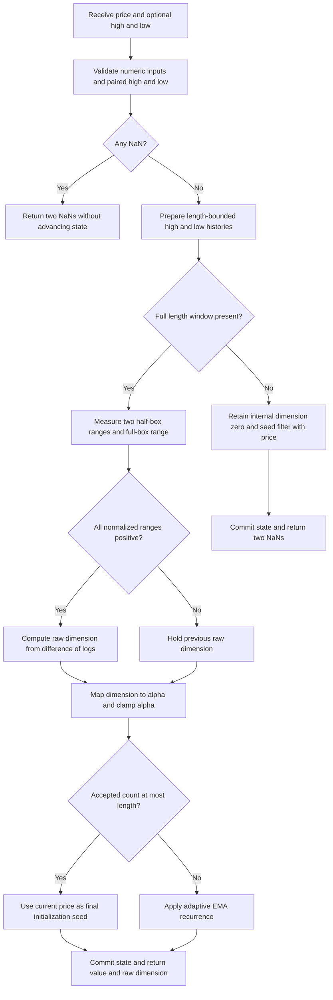

# Fractal Adaptive Moving Average (FRAMA)

This folder is the self-contained research prototype master for John F. Ehlers' **Fractal Adaptive Moving Average**, introduced in *Technical Analysis of STOCKS & COMMODITIES* (TASC), October 2005, volume 23, pages 81–82. The streaming Python class returns both the moving average and the **raw estimated fractal dimension used to adapt it**. Input and expected data are provided for Python, Go, TypeScript, Rust, and Zig.

The calculation follows the 2005 article and the corresponding MESA paper. The June 2010 article, *Fractal Dimension As A Market Mode Sensor*, and Chapter 6 of the 2013 book *Cycle Analytics for Traders* supply related theory and **different smoothing procedures**. Those procedures are fully described below, so a conversion agent does not need the source documents. They are not inserted into FRAMA's adaptation path.

There is one explicit coefficient choice: the default uses the requested **full-precision** $\ln(A)$ mapping, where $A$ is the slowest smoothing factor. A compatibility mode retains the literal $-4.6$ from the 2005 code. The two differ slightly because $-4.6$ is not exactly $\ln(0.01)$. Both modes have separate reference cases and share the original range calculation, unclamped dimension, zero-range guard, and filter initialization.

## What the indicator measures

A moving average trades smoothness for lag. A small fixed exponential smoothing factor suppresses fluctuations but responds slowly to a major change. A large factor follows changes quickly but also follows congestion noise. Market observations are nonstationary: their roughness and relevant time scales change, so one fixed smoothing factor is often an awkward compromise.

FRAMA adapts the smoothing factor using a **two-scale range estimate of fractal dimension**. A relatively straight, sparse path resembles a line and has a dimension near one. A path that repeatedly moves up and down through its enclosing box occupies more of that box and has a dimension nearer two. FRAMA uses the first case to increase its response and the second to slow its response. It estimates local structure rather than predicting direction or estimating a future turning point.

The articles motivate the calculation through statistical self-similarity: unlabeled intraday, daily, and weekly charts can appear similarly rough. Their claim of fractality is a modeling motivation, not proof that every finite market window has a well-defined exact mathematical dimension. The implemented number is a finite-window **estimate** based on normalized ranges, not a literal count of every small square intersecting the price path.

A shoreline is a useful analogy. Measuring it with a coarse ruler misses small bends; using a finer ruler captures more detail. A line does not add as much detail as a rough shoreline when the scale changes. FRAMA approximates this change in occupied extent by comparing two half-window boxes with one full-window box. The dependence on lookback matters: a short part of a long sine wave can look like a trend even though the longer waveform cycles.

## Complete box-counting background from the sources

To cover a generalized pattern, use $N_1$ objects of size $s_1$ and $N_2$ objects of size $s_2$. For dimension $D$, the source relationship is

$$
\frac{N_2}{N_1}=\left(\frac{s_1}{s_2}\right)^D,
\qquad
D=\frac{\log(N_2/N_1)}{\log(s_1/s_2)}.
$$

The logarithm base does not matter if used consistently. The implementation uses natural logarithms at full binary64 precision.

For a line segment ten meters long, covering with one-meter objects takes $N_1=10$ and covering with 0.1-meter objects takes $N_2=100$:

$$
D_{\mathrm{line}}=
\frac{\log(100/10)}{\log(1/0.1)}=1.
$$

For a square ten meters on each side, one-meter squares require $N_1=100$, while 0.1-meter squares require $N_2=10{,}000$:

$$
D_{\mathrm{square}}=
\frac{\log(10{,}000/100)}{\log(1/0.1)}=2.
$$

Natural fractals have statistical rather than perfectly algorithmic self-similarity. The articles recommend combining measurements across scales. For uniformly spaced price observations, Ehlers approximates the box count through the range per interval length:

$$
N=\frac{\mathrm{HighestPrice}-\mathrm{LowestPrice}}{\mathrm{Length}}.
$$

This proxy has the units of price per bar. Those units cancel in the logarithmic ratio, leaving dimension dimensionless. It measures vertical extent per interval, rather than adding the lengths of every movement inside the interval.

## Parameters, input, and output contract

Let $L$ be the entire lookback length, $h=L/2$ its half length, $A$ the slowest smoothing factor, and $C$ the coefficient mode. Let $t=0,1,\ldots$ count **accepted finite observations**. For a bar, $H_t$ and $\ell_t$ denote high and low, while $x_t$ is the chosen price supplied to the filter.

| Parameter | Default | Valid values | Meaning |
|---|---:|---|---|
| `length` ($L$) | 16 | Even integer $L\ge2$; Boolean and non-integer values rejected | Full range window, split into two equal, disjoint halves. |
| `slowest_smoothing_factor` ($A$) | 0.01 | Finite $0<A\le1$ | Minimum alpha; in full-precision mode also defines the exponential map. |
| `coefficient_mode` ($C$) | 1 | Integer 1 or 0 | 1: full precision $k=\ln(A)$; 0: literal-2005 compatibility $k=-4.6$. |
| `price` ($x_t$) | Supplied each update | Finite real scalar, or NaN to skip | Value passed to the adaptive EMA. |
| Optional `high`, `low` | Both equal `price` | Supply both or neither; finite real values or NaN; high must be at least low | Range observations; independent of the selected filter price. |

Compatibility mode 0 requires $A=0.01$, the article's literal alpha floor. Other floors are supported in full-precision mode. The article itself supplies only the even length parameter; exposing $A$ is a documented research generalization that also corresponds to the copied zpano implementation's parameter.

`update(price)` uses $H_t=\ell_t=x_t$. These fixtures deliberately use `INPUT_CLOSE` in that scalar form. They do **not** silently use `INPUT_HIGH` and `INPUT_LOW`. To follow the 2005 article on actual bars, call `update((high+low)/2, high, low)`. To filter close while retaining the article's bar-range estimator, call `update(close, high, low)`.

The immutable output tuple has two fields:

| Field | Units | Meaning |
|---|---|---|
| `value` | Input-price units | FRAMA's adaptive moving average. |
| `fractal_dimension` | Dimensionless | Raw, guarded 2005 range estimate that controls alpha. |

The dimension is deliberately **not clamped to $[1,2]$**. That interval describes the ideal line/area analogy, not a guaranteed lower bound for the finite, disjoint-window range proxy. The 2005 code clamps alpha, not `Dimen`. This distinction is a material difference from the copied zpano implementation.

## Complete FRAMA calculation

### Three normalized ranges

The EasyLanguage notation `X[j]` means the observation $j$ bars ago. The recent half uses offsets $0$ through $h-1$, the older half uses $h$ through $L-1$, and the full window uses $0$ through $L-1$. There is no shared midpoint sample and no omitted sample.

Define

$$
R_1(t)=\max_{0\le j<h}H_{t-j}-\min_{0\le j<h}\ell_{t-j},
$$

$$
R_2(t)=\max_{h\le j<L}H_{t-j}-\min_{h\le j<L}\ell_{t-j},
$$

$$
R_3(t)=\max_{0\le j<L}H_{t-j}-\min_{0\le j<L}\ell_{t-j}.
$$

The article's normalized box proxies are

$$
\boxed{N_{1,t}=\frac{R_1(t)}{h},\quad
N_{2,t}=\frac{R_2(t)}{h},\quad
N_{3,t}=\frac{R_3(t)}{L}.}
$$

The older and recent half labels can be swapped without changing $N_1+N_2$. The copied zpano code stores oldest-first windows and scans the older half first, while this master stores newest-first and follows the article's recent-half-first notation. That label difference does not change the mathematical estimate.

### Raw fractal dimension and the positivity guard

When all three normalized ranges are positive,

$$
\boxed{
\widehat D_t=\frac{\ln(N_{1,t}+N_{2,t})-\ln(N_{3,t})}{\ln2}.
}
$$

The original variable `Dimen` persists between bars because it is assigned only under the guard. Accordingly, the master uses

$$
D_t=\begin{cases}
\widehat D_t,&N_{1,t}>0,\ N_{2,t}>0,\ N_{3,t}>0,\\
D_{t-1},&\text{otherwise},
\end{cases}
$$

with internal initial $D=0$. A flat half-window is sufficient to retain the previous dimension even if the full window spans a nonzero jump. Do not replace this rule with an epsilon inside the logarithms, a reset to one, or an unconditional `log` calculation. Public NaNs express unavailable history; they are not the internal held-dimension seed.

The archived MESA prose prints `D = log(N1 + N2) - log(N3) / log(2)` without clear parentheses. The MESA EasyLanguage listing, 2005 TASC listing, 2010 article, and book all resolve the intended grouping: **divide the entire log difference by $\ln2$**.

### Why the raw estimate can fall below one

Using $L=2h$, the same expression can be written mathematically as

$$
\widehat D_t=\log_2\!\left(\frac{2(R_1+R_2)}{R_3}\right).
$$

This identity helps interpretation, but the master preserves the printed difference-of-logs evaluation order. In exact arithmetic $R_1\le R_3$ and $R_2\le R_3$, giving an upper bound of two when the guard passes. There is no corresponding lower bound of one: a gap between two narrow halves can make $R_3$ much larger than $R_1+R_2$.

Even a scalar ramp $x_t=c+st$, with $s\ne0$, gives $R_1=R_2=|s|(h-1)$ and $R_3=|s|(2h-1)$:

$$
\widehat D_{\mathrm{ramp}}=
\log_2\!\left(\frac{4(h-1)}{2h-1}\right),\qquad h>1.
$$

For $L=16$, this is $\log_2(28/15)$, approximately 0.90046, below one. FRAMA then clamps alpha to one and follows price immediately. Clamping the reported dimension would conceal the actual estimator without changing the alpha in this particular case.

For scalar $L=2$, each half contains one observation and has zero range. The guard always fails, so the initially held dimension remains zero and alpha is one. The minimum-length fixture documents this legitimate, degenerate source behavior; it is not a useful roughness estimate.

### Dimension-to-alpha mapping

The printed 2005 mapping and clamps are

$$
\alpha^{\mathrm{raw}}_t=\exp[-4.6(D_t-1)],\qquad
\alpha_t=\min(1,\max(0.01,\alpha^{\mathrm{raw}}_t)).
$$

The source explains the intended endpoints as alpha one at dimension one and alpha 0.01 at dimension two. Numerically,

$$
e^{-4.6}=0.0100518357446336\ldots,
\qquad
\ln(0.01)=-4.605170185988091\ldots.
$$

The literal alpha floor therefore is not quite reached at $D=2$. To honor the requested full precision, **default coefficient mode 1** uses

$$
\boxed{k=\ln(A),\quad
\alpha^{\mathrm{raw}}_t=\exp[k(D_t-1)],\quad
\alpha_t=\min(1,\max(A,\alpha^{\mathrm{raw}}_t)).}
$$

In real arithmetic this gives exactly alpha one at $D=1$ and alpha $A$ at $D=2$. It is mathematically $A^{D-1}$, but the implementation uses the documented log/exp path. The scalar parameter $A=0.01$ is a desired endpoint, not an approximation to a transcendental constant.

**Coefficient mode 0** uses the literal $k=-4.6$ and requires $A=0.01$ so the article can be compared directly. Arrays identify the mode with `C0` or `C1`. The full-precision default cannot be claimed to reproduce the literal-2005 values bit for bit; both sets are explicitly generated.

For $D\le1$, the mathematical exp-then-clamp result is always one. The implementation chooses one directly in this branch, preventing an unnecessary exponential overflow when a large inter-half gap yields a negative dimension. It does not alter the public raw dimension. For $D>1$, the exponent is nonpositive, so overflow of the exponential is avoided; underflow to zero simply invokes the documented minimum alpha.

### Adaptive EMA and equivalent time scale

After initialization, the original filtered value is

$$
\boxed{y_t=\alpha_t x_t+(1-\alpha_t)y_{t-1}.}
$$

The master retains this arithmetic order. The algebraically equivalent update $y_{t-1}+\alpha_t(x_t-y_{t-1})$, used in the copied implementation, can differ in final floating-point bits.

For a fixed alpha, an EMA's conventional equivalent length is

$$
L_{\mathrm{equiv}}=\frac{2}{\alpha}-1,
\qquad \alpha=\frac{2}{L_{\mathrm{equiv}}+1}.
$$

At alpha one the output equals the input. At alpha 0.01 the conventional equivalent length is 199 bars, which explains the article's approximate “200-day average” analogy. This is an equivalence of smoothing weights, not an assertion that an EMA equals a 199-bar simple average.

Holding alpha fixed gives transfer function

$$
H_{\mathrm{EMA}}(z)=\frac{\alpha}{1-(1-\alpha)z^{-1}}.
$$

Its pole is $1-\alpha$, and its impulse weights are $\alpha(1-\alpha)^j$ for $j\ge0$. Smaller alpha spreads influence farther into history; the mean age is $(1-\alpha)/\alpha$. In adaptive FRAMA alpha changes each bar, so one fixed transfer function does not describe the entire run. Since $0<\alpha\le1$, every finite update is a convex combination of the current price and the previous filtered value, with no added extrapolation.

### Initialization and priming

The 2005 article and MESA listing state

```text
Filt = alpha*Price + (1-alpha)*Filt[1]
If CurrentBar < N+1 then Filt = Price
```

For a deterministic cold start, this master treats `CurrentBar` as the one-based accepted observation count. It seeds the filter with each of the first $L$ prices, exposes both outputs once the full $L$-sample range window exists, and starts adaptive recursion at observation $L+1$:

$$
y_t=x_t\quad(0\le t\le L-1),
\qquad
y_t=\alpha_t x_t+(1-\alpha_t)y_{t-1}\quad(t\ge L).
$$

During observations 1 through $L-1$, both public fields are NaN; internal filter state follows price and the held dimension is zero. At observation $L$ (zero-based index $L-1$), calculate dimension from the complete window, expose that dimension, and expose the **last price seed** as FRAMA. The next accepted observation performs the first adaptive update.

`warmup_bars=L-1`, `samples_seen` counts accepted observations, and `is_primed` becomes true at count $L$. Priming means the range window is complete, not that the finite estimator has reached an ideal geometric dimension or that the adaptive EMA has settled.

With 252 input values, length 250 gives three finite results: one seed and two adaptive updates. Length 252 gives one finite result, a final price seed with its dimension. Length 254 gives no finite result. The eSignal tip starts adaptive filtering at count $L$, and the copied zpano implementation also adapts at $L$; that is a distinct startup convention and is not silently adopted here.

## June 2010: the separate fractal-dimension market-mode sensor

The 2010 article retains the same box-counting relationship and line/square examples but uses the estimated dimension as a **mode sensor**, not as an EMA coefficient. Its defaults are price $(H+L)/2$ and an even box window $N=30$.

First it applies a four-tap FIR smoother:

$$
s_t=\frac{x_t+2x_{t-1}+2x_{t-2}+x_{t-3}}{6}.
$$

The FIR transfer polynomial factors as

$$
H_{\mathrm{FIR}}(z)=\frac{1+2z^{-1}+2z^{-2}+z^{-3}}{6}
=\frac{(1+z^{-1})(1+z^{-1}+z^{-2})}{6}.
$$

Its zeros notch two-bar and three-bar oscillations. Its symmetric coefficients give a delay of 1.5 bars. The article chooses midpoint price as a smoother starting series than close with respect to high-frequency components.

Next calculate $N_1$, $N_2$, and $N_3$ using maxima and minima of the **single smoothed series $s_t$**, rather than raw bar highs and lows. Let $d_t$ be the raw log-range dimension of those boxes. The EasyLanguage `Ratio` and `Dimen` update is

$$
r_t=\begin{cases}
\tfrac12(d_t+q_{t-1}),&N_{1,t}>0,\ N_{2,t}>0,\ N_{3,t}>0,\\
r_{t-1},&\text{otherwise},
\end{cases}
$$

$$
\boxed{q_t=\frac1{20}\sum_{j=0}^{19}r_{t-j}.}
$$

The feedback term is **the previous averaged dimension $q_{t-1}$**, not the previous raw estimate and not merely an independent EMA of raw dimension. Both `Ratio` and `Dimen` are initialized to zero by the source. The 20-bar average is a separate, fixed smoothing stage, considered a reasonable match to the 30-bar box window.

The article plots $q_t$ and fuzzy boundaries at 1.4 and 1.6. Values near one suggest a trend without specifying up or down; values near two suggest repeated swings/cycle mode. The midpoint 1.5 is an intuitive boundary, and the 1.4–1.6 band acknowledges estimation uncertainty. A separate slope or price-direction measure is required to assign a trend's sign.

Its chirp illustration uses $N=20$: cycles shorter than the window tend to fill the box and look cyclic, while sufficiently long cycles are locally read as trends. Near turning points even long cycles can fill the box, so averaging reduces those excursions. Mode classification depends on the observation window and is not an intrinsic permanent property of the instrument.

The FRAMA `fractal_dimension` output is $D_t$ from the 2005 adaptation path. It is **not $q_t$** from this 2010 sensor. Feeding the smoothed sensor into the 2005 exponential mapping would create a new hybrid indicator rather than reproduce either article.

## Book search: Chapter 6, not a second FRAMA listing

The table of contents and all 17 archived chapters of *Cycle Analytics for Traders* were searched for FRAMA and fractal-dimension calculations. Chapter 6, **Market Structure and the Hurst Coefficient**, repeats the relevant box-counting theory and provides Listing 6-1 for a **Hurst coefficient estimator**. The archived book contains no separate FRAMA moving-average implementation.

The chapter models power spectra as

$$
S(f)=\frac{K}{f^a},\qquad
\log S(f)=\log K-a\log f.
$$

The archive's displayed expansion has a plus sign before $a\log f$, while the surrounding text correctly states a slope of $-a$. The equation above gives the algebraically correct sign. The chapter discusses long memory, notes that integration changes a spectral exponent by two and differentiation changes it by minus two, and reports the relationships

$$
H=2-D,\qquad H=1-a/2.
$$

The latter is reported as the book's stated convention; spectral-exponent/Hurst relations depend on whether the modeled data are levels or increments and should not be substituted across different stochastic-process conventions. It is not used by FRAMA. The operational identity in Listing 6-1 is $H=2-D$.

For the book's even `Length` (default 30), compute the three normalized ranges on **Close**, without the 2010 FIR. With raw close-range estimate $d_t$, update

$$
D^{\mathrm{book}}_t=
\begin{cases}
\tfrac12(d_t+D^{\mathrm{book}}_{t-1}),&N_{1,t}>0,\ N_{2,t}>0,\ N_{3,t}>0,\\
D^{\mathrm{book}}_{t-1},&\text{otherwise}.
\end{cases}
$$

Convert to $H_t=2-D^{\mathrm{book}}_t$, then use a 20-bar SuperSmoother. With the requested full-precision replacement of the printed `1.414` and `3.14159`, its coefficients are

$$
a_1=\exp\!\left(-\frac{\sqrt2\pi}{20}\right),\qquad
b_1=2a_1\cos\!\left(\frac{\sqrt2\pi}{20}\right),
$$

$$
c_2=b_1,\qquad c_3=-a_1^2,\qquad c_1=1-c_2-c_3,
$$

and the output recursion is

$$
\widetilde H_t=c_1\frac{H_t+H_{t-1}}2
+c_2\widetilde H_{t-1}+c_3\widetilde H_{t-2}.
$$

The source's cosine expression `Cosine(1.414*180/20)` uses degrees; the radian equivalent is the angle shown above. These equations are included for a complete account of the related book implementation. The SuperSmoother is **not** a FRAMA stage and adds no parameter to this master.

The book associates $H=0.5$ with a random-walk boundary, larger values with persistence and smaller values with antipersistence. It stresses that this is an estimate of observed structure, depends strongly on the chosen length, and has no direct predictive value. Its long-cycle examples have the same finite-window interpretation as the 2010 dimension sensor.

### Physical analogies in Chapter 6

The chapter also motivates trend and cycle behavior through a constrained one-dimensional drunkard's walk. Let lattice spacing be $\Delta x$ and step time $\Delta t$. Taking both toward zero with $(\Delta x)^2/\Delta t$ proportional to a diffusion constant $\kappa$ gives the diffusion equation for position-density $P(x,t)$:

$$
\frac{\partial P}{\partial t}=\kappa\frac{\partial^2 P}{\partial x^2}.
$$

Here $\kappa$ is not the fractal dimension $D$. The source compares spreading uncertainty to a widening smoke plume and diffusion to heat flowing along a spoon. When the next step direction remembers the previous direction, with continuation probability $p$ and reversal probability $1-p$, the persistent-walk limit leads to the telegrapher's equation:

$$
\frac{\partial^2 P}{\partial t^2}
+\frac1T\frac{\partial P}{\partial t}
=c^2\frac{\partial^2 P}{\partial x^2},\qquad x^2<c^2t^2.
$$

The constants $T$ and $c$ characterize persistence and propagation. The chapter uses vibrating rulers, stretched rubber bands, river meanders, and a compressed strip of paper to illustrate temporary harmonic response to disturbances and boundary conditions. River paths can be locally coherent and globally variable; the analogy is that a market cycle can be useful over a local interval without remaining fixed indefinitely.

These are the book's explanatory models, not governing equations solved by FRAMA. Neither a PDE solver nor a stochastic simulation is needed to convert this indicator.

## Comparison with the copied zpano implementation

The supplied code under `external/zpano/py/indicators/john_ehlers/fractal_adaptive_moving_average/` was inspected statically. It was not imported as a standalone package and was not modified; its missing surrounding framework is irrelevant to the numerical comparison.

| Aspect | 2005 source | Copied zpano implementation | New master |
|---|---|---|---|
| Filter price | Default midpoint $(H+L)/2$ | Bar component defaults to close; explicit midpoint in its reference tests | Caller supplied; reference fixtures use close. |
| Dimension ranges | Highest High / Lowest Low in each box | Same bar-range structure; scalar/trade adapters use value for both | Same; optional explicit high/low API. |
| Half order | Recent first, older second | Older first, recent second | Recent first; sum is symmetric. |
| Dimension formula | Difference of logs divided by `Log(2)` | Difference of logs multiplied by `log2(e)` | Source division order with `math.log(2)`. |
| Reported dimension | Raw guarded value; no clamp | Clamped to $[1,2]$ | Raw guarded value. |
| Alpha mapping | Fixed literal `-4.6`, floor 0.01 | `log(slowest_smoothing_factor)`, adjustable floor | Full precision by default; explicit literal compatibility mode. |
| Initialization | Filter follows price through observation $L$ | Seed at $L-1$, adapt at $L$ | Source seed through $L$, adapt at $L+1$. |
| Public priming | Platform-dependent plotted prefix | NaN until $L$ observations | NaN until $L$ observations; first public value is final seed. |
| EMA arithmetic | `alpha*price+(1-alpha)*previous` | `previous+(price-previous)*alpha` | Printed source order. |
| Zero-range handling | Hold previous dimension under guard | Unconditional logarithms | Source guard and initial dimension zero. |
| Extrema initialization | First high/low in the relevant box | Maximum initialized with `sys.float_info.min` | First real observation in each box. |
| Odd length | Requires an even length | Rounds odd values upward | Rejects odd lengths explicitly. |
| Minimum alpha | Source fixed positive 0.01 | Params permit zero, factory calls `log(0)` | Rejects zero; finite $0<A\le1$. |
| Missing samples | Not specified | NaN returns NaN and freezes numeric state | NaN returns two NaNs and freezes the whole observation. |
| Nonfinite settings/input | Not specified | Infinity/NaN settings and infinity samples are not consistently validated | Finite validation and atomic rejection. |
| 2010/book smoothing | Separate indicators | Neither included | Neither inserted into FRAMA. |

Three differences deserve particular attention when converting existing zpano data:

1. **The dimension clamp changes the returned dimension.** Valid close-range estimates commonly fall below one, including the ramp example above. With a log-alpha map, alpha still clamps to one for those values, so a dimension mismatch does not always imply a filtered-value mismatch.
2. **The first adaptive update changes the filtered values.** The copied code updates at observation $L$ using the price at $L-1$ as its filter seed. The source/master returns the price at $L$ as the last seed and first adapts at $L+1$. Subsequent differences can persist according to the changing alpha.
3. **The copied code has edge-case faults beyond intentional variants.** `sys.float_info.min` is the smallest positive normal float, not a negative sentinel; zero or negative highs can therefore give an incorrect maximum. Flat half or full boxes can cause `log(0)` because the source guard is missing. Length two is especially problematic for scalar inputs because both half-ranges are always zero. The factory permits a zero slowest factor and then evaluates `log(0)`.

The copied `_LOG2E` multiplier and EMA rewrite are mathematically equivalent transformations with small rounding differences; they are not conceptual algorithm changes. Its default precise alpha map is a reasonable endpoint interpretation of the article and is the default selected here. Its entity metadata, timestamps, and adapters are framework concerns; this master supplies the numerical calculation only.

The existing copied tests use midpoint/high/low spreadsheet fixtures and the copied startup/clamp conventions. Those expectations should not be relabeled as the new close-only, raw-dimension, source-startup references. An independent batch translation checks the new calculation instead.

## Streaming flow and storage



Invalid inputs or detected arithmetic overflow raise `ValueError` before state is committed. The diagram's validation step also rejects reversed high/low. A valid NaN gap freezes histories, count, dimension, alpha, filter, and saved output. Lookbacks therefore count accepted observations rather than calendar intervals across missing data. The source assumes dense data; these skip/rejection conventions are explicit API rules.

State is bounded by two $L$-entry high/low histories, a held dimension, a held alpha, a held filter value, a counter, and the last output. Extrema are recomputed with straightforward loops, giving $O(L)$ time and storage. Newest-first lists make source offsets easy to port. Circular buffers are acceptable if they preserve the box boundaries and state update order. No NumPy, pandas, external numerical package, or sibling indicator module is required.

## Confirmed reference combinations

The user confirmed all 16 combinations on 2026-10-25. Each generates two arrays of 252 values, for **32 expected arrays per language**. Every case starts from fresh state and supplies the exact copied `INPUT_CLOSE` scalar values, making high and low equal to close. The additional copied high, low, and open arrays are retained for future tests but do not affect these expectations.

| # | Length $L$ | Slowest $A$ | Mode $C$ | What it tests |
|---|---:|---:|---:|---|
| 1 | 16 | 0.01 | 1 | Full-precision default. |
| 2 | 2 | 0.01 | 1 | Minimum length; scalar half-ranges are zero, so the source retains dimension zero. |
| 3 | 4 | 0.01 | 1 | Short window and rapid adaptation. |
| 4 | 8 | 0.01 | 1 | Half the default lookback. |
| 5 | 20 | 0.01 | 1 | One-month daily lookback. |
| 6 | 30 | 0.01 | 1 | Lookback used by the related 2010 dimension sensor. |
| 7 | 64 | 0.01 | 1 | Longer window and slower changes in the estimate. |
| 8 | 128 | 0.01 | 1 | Long lookback with 125 finite outputs. |
| 9 | 250 | 0.01 | 1 | Only three finite outputs: one seed and two adaptive updates. |
| 10 | 252 | 0.01 | 1 | Only the final bar is primed; FRAMA is the final price seed. |
| 11 | 254 | 0.01 | 1 | Insufficient history; both outputs are entirely NaN. |
| 12 | 16 | 0.001 | 1 | Slower congestion response. |
| 13 | 16 | 0.1 | 1 | Faster congestion response. |
| 14 | 16 | 1.0 | 1 | Unit smoothing factor makes FRAMA track price. |
| 15 | 16 | 0.01 | 0 | Literal 2005 article coefficient for direct source comparison. |
| 16 | 30 | 0.01 | 0 | Literal article coefficient with a longer lookback. |

Each array has two preceding comments. The first reproduces the exact “What it tests” text above. The second gives all settings and the input convention, for example:

```text
length=16, slowest_smoothing_factor=0.01, coefficient_mode=1; input=INPUT_CLOSE; high=low=close
```

The names use shortcuts `L`, `A`, and `C`; decimal points become underscores and redundant `.0` is omitted from **names**. Output suffixes are `VALUE` and `FDIM`:

```text
EXPECTED_L16_A0_01_C1_VALUE
EXPECTED_L16_A0_01_C1_FDIM
```

All internal calculations retain binary64 precision. Expected literals use **15 significant decimal digits**; scientific notation preserves small magnitudes and `.0` is retained for integer-valued floats where target syntax requires it. Compare NaN locations exactly and use both relative and absolute tolerances around $10^{-12}$ for finite values when porting across language math libraries. Native last-bit equality is not promised between different logarithm/exponential libraries or different arithmetic optimizations.

| Language | Expected declaration example | NaN spelling |
|---|---|---|
| Python | `EXPECTED_L16_A0_01_C1_VALUE = [...]` | `NaN`, declared as `NaN = math.nan` |
| Go | `var expectedL16_A0_01_C1_VALUE = []float64{...}` | `math.NaN()` |
| TypeScript | `export const expectedL16_A0_01_C1_VALUE: number[] = [...]` | `NaN` |
| Rust | `pub fn expected_l16_a0_01_c1_value() -> Vec<f64>` | `f64::NAN` |
| Zig | `pub fn expectedL16_A0_01_C1_VALUE() [252]f64` | `nan` |

Go uses package `fractaladaptivemovingaverage`, with folder separators removed. Rust expected functions remain in the existing `#[cfg(test)] pub mod testdata`. Zig retains `const math = @import("std").math;` and `const nan = math.nan(f64);` and an explicit array-return statement. TypeScript declarations use valid typed exported constants.

## Usage, regeneration, and verification

In this folder, run the standalone demonstration or regenerate the confirmed fixtures:

```bash
python3 fractal-adaptive-moving-average.py
python3 fractal-adaptive-moving-average.py --generate-reference
python3 -m unittest discover -s . -p 'test_fractal_adaptive_moving_average.py' -v
```

The master embeds all 252 close values in `__main__`. Generation checks them against `test_testdata.py`, computes each fresh case, appends the 32 Python output arrays, reopens the file to verify names, lengths, literal precision, and NaN locations, then generates the four other languages **from the reopened Python arrays**. Marked generated blocks are replaced on repeat runs so regeneration does not duplicate data or alter input arrays.

The tests compare both coefficient modes against an independently written chronological translation of the 2005 source. Additional checks cover the final price seed and first adaptive update, raw dimensions below one, complete-window priming, zero/negative/constant data, flat-half guards, bar high/low ranges, alpha endpoints, affine invariance, NaN gaps, reset, and invalid inputs. Fixture checks compare all four input arrays and every expected array across all five files, including exact NaN masks, comments, and byte-identical regeneration.

The filename has hyphens, so import it by path when embedding the master:

```python
import importlib.util
from pathlib import Path

path = Path("fractal-adaptive-moving-average.py")
spec = importlib.util.spec_from_file_location("frama_master", path)
module = importlib.util.module_from_spec(spec)
spec.loader.exec_module(module)

frama = module.FractalAdaptiveMovingAverage(length=16)
for close in closes:
    result = frama.update(close)
    # result.value and result.fractal_dimension

# Actual-bar alternative matching the article's input/range distinction:
result = frama.update((high + low) / 2, high, low)
```

Create separate streams for different input conventions. `reset()` clears the accepted count, windows, filter, dimension, alpha, and public output while preserving the immutable settings.

## Sources and references

All numerical details needed for conversion are included above. The archived sources and published provenance are:

1. **Ehlers, John F. (2005). “Fractal Adaptive Moving Averages.”** *Technical Analysis of STOCKS & COMMODITIES*, 23(10), 81–82, October. [Publisher article](https://technical.traders.com/archive/article.asp?file=%5CV23%5CC10%5C217EHLR.pdf). Local [article](../../tasc/2005-10-fractal-adaptive-moving-averages/content.md).
2. **Ehlers, John F. (2005). “FRAMA — Fractal Adaptive Moving Average.”** MESA Software paper. [PDF](https://www.mesasoftware.com/papers/FRAMA.pdf). Local [MESA paper](../../tasc/2005-10-fractal-adaptive-moving-averages/mesa/content.md). Its EasyLanguage listing resolves the log-expression grouping and repeats the article's initialization.
3. **Technical Analysis, Inc. (2005). “Traders' Tips: Fractal Adaptive Moving Averages.”** [Publisher page](https://www.traders.com/Documentation/FEEDbk_docs/2005/10/TradersTips/TradersTips.html). Local [tips](../../tasc/2005-10-fractal-adaptive-moving-averages/tips/tips.md), [TradeStation code](../../tasc/2005-10-fractal-adaptive-moving-averages/tips/FRAMA.els), and [eSignal code](../../tasc/2005-10-fractal-adaptive-moving-averages/tips/FRAMA.efs). The TradeStation function repeats the original recurrence; the eSignal startup is a documented variant.
4. **Ehlers, John F., and Ric Way (2010). “Fractal Dimension As A Market Mode Sensor.”** *Technical Analysis of STOCKS & COMMODITIES*, 28(6), 16–20, June. [Publisher article](https://technical.traders.com/archive/article.asp?file=%5CV28%5CC06%5C109EHLR.pdf). Local [article](../../tasc/2010-06-fractal-dimension-as-a-market-mode-sensor/content.md).
5. **Technical Analysis, Inc. (2010). “Traders' Tips: Fractal Dimension As A Market Mode Sensor.”** [Publisher page](https://www.traders.com/Documentation/FEEDbk_docs/2010/06/TradersTips.html). Local [tips](../../tasc/2010-06-fractal-dimension-as-a-market-mode-sensor/tips/tips.md), [original article code](../../tasc/2010-06-fractal-dimension-as-a-market-mode-sensor/tips/FRAC_article.els), and [TradeStation code](../../tasc/2010-06-fractal-dimension-as-a-market-mode-sensor/tips/FRAC.els).
6. **Ehlers, John F. (2013). *Cycle Analytics for Traders: Advanced Technical Trading Concepts*.** Wiley Trading, ISBN 9781118728604. Local [contents](../../2013-cycle-analytics-for-traders/toc.md) and [Chapter 6](../../2013-cycle-analytics-for-traders/ch6.md), “Market Structure and the Hurst Coefficient,” Listing 6-1.
7. **Copied zpano project source. “FractalAdaptiveMovingAverage.”** User-supplied local [implementation](../../../../external/zpano/py/indicators/john_ehlers/fractal_adaptive_moving_average/fractal_adaptive_moving_average.py), [parameters](../../../../external/zpano/py/indicators/john_ehlers/fractal_adaptive_moving_average/params.py), and [tests](../../../../external/zpano/py/indicators/john_ehlers/fractal_adaptive_moving_average/test_fractal_adaptive_moving_average.py). Used for the static comparison, not as a runtime dependency or numerical oracle.
8. **Weiss, G. H., and R. J. Rubin (1982). “Random Walks: Theory and Selected Applications.”** *Advances in Chemical Physics*, 52, 363–505. Cited by the book for its constrained-walk analogies; no calculation from that reference is needed at runtime.

The 2005 article and MESA paper also name earlier adaptive-filter background: Chande and Kroll's *The New Technical Trader* (1994; VIDYA), Ehlers' *Rocket Science for Traders* (2001; MAMA), Ehlers' *Cybernetic Analysis for Stocks and Futures* (2004), and Kaufman's *Trading Systems and Methods* (3rd edition, 1998) / *New Trading Systems and Methods* (4th edition, 2005; KAMA). These are bibliographic antecedents, not additional FRAMA formulas imported into this master.

## BibTeX

```bibtex
@article{ehlers_frama_2005,
  author = {John F. Ehlers},
  title = {Fractal Adaptive Moving Averages},
  journal = {Technical Analysis of STOCKS \& COMMODITIES},
  volume = {23}, number = {10}, pages = {81--82},
  year = {2005}, month = oct,
  url = {https://technical.traders.com/archive/article.asp?file=%5CV23%5CC10%5C217EHLR.pdf}
}

@misc{ehlers_frama_mesa_2005,
  author = {John F. Ehlers},
  title = {FRAMA -- Fractal Adaptive Moving Average},
  year = {2005}, howpublished = {MESA Software paper},
  url = {https://www.mesasoftware.com/papers/FRAMA.pdf}
}

@misc{traders_tips_frama_2005,
  author = {{Technical Analysis, Inc.}},
  title = {Traders' Tips: Fractal Adaptive Moving Averages},
  year = {2005}, month = oct,
  url = {https://www.traders.com/Documentation/FEEDbk_docs/2005/10/TradersTips/TradersTips.html},
  note = {Includes TradeStation AdaptMovAvg\_Fractal and eSignal FRAMA contributions}
}

@article{ehlers_way_dimension_2010,
  author = {John F. Ehlers and Ric Way},
  title = {Fractal Dimension As A Market Mode Sensor},
  journal = {Technical Analysis of STOCKS \& COMMODITIES},
  volume = {28}, number = {6}, pages = {16--20},
  year = {2010}, month = jun,
  url = {https://technical.traders.com/archive/article.asp?file=%5CV28%5CC06%5C109EHLR.pdf}
}

@misc{traders_tips_dimension_2010,
  author = {{Technical Analysis, Inc.}},
  title = {Traders' Tips: Fractal Dimension As A Market Mode Sensor},
  year = {2010}, month = jun,
  url = {https://www.traders.com/Documentation/FEEDbk_docs/2010/06/TradersTips.html}
}

@book{ehlers_cycle_analytics_2013,
  author = {John F. Ehlers},
  title = {Cycle Analytics for Traders: Advanced Technical Trading Concepts},
  publisher = {Wiley}, series = {Wiley Trading},
  year = {2013}, isbn = {9781118728604},
  note = {Chapter 6, Market Structure and the Hurst Coefficient; Listing 6-1}
}

@misc{zpano_frama_local,
  title = {FractalAdaptiveMovingAverage: Copied zpano Implementation},
  howpublished = {User-supplied local source archive},
  note = {external/zpano/py/indicators/john\_ehlers/fractal\_adaptive\_moving\_average/; statically inspected}
}

@incollection{weiss_rubin_random_walks_1982,
  author = {G. H. Weiss and R. J. Rubin},
  title = {Random Walks: Theory and Selected Applications},
  booktitle = {Advances in Chemical Physics},
  volume = {52}, pages = {363--505}, year = {1982},
  note = {Bibliographic antecedent cited in Ehlers' Chapter 6}
}

@book{chande_kroll_new_technical_trader_1994,
  author = {Tushar S. Chande and Stanley Kroll},
  title = {The New Technical Trader},
  publisher = {John Wiley \& Sons}, year = {1994}
}

@book{ehlers_rocket_science_2001,
  author = {John F. Ehlers}, title = {Rocket Science for Traders},
  publisher = {John Wiley \& Sons}, year = {2001}
}

@book{ehlers_cybernetic_analysis_2004,
  author = {John F. Ehlers}, title = {Cybernetic Analysis for Stocks and Futures},
  publisher = {John Wiley \& Sons}, year = {2004}
}

@book{kaufman_trading_systems_1998,
  author = {Perry J. Kaufman}, title = {Trading Systems and Methods},
  edition = {3}, publisher = {John Wiley \& Sons}, year = {1998}
}

@book{kaufman_new_trading_systems_2005,
  author = {Perry J. Kaufman}, title = {New Trading Systems and Methods},
  edition = {4}, publisher = {John Wiley \& Sons}, year = {2005}
}
```
