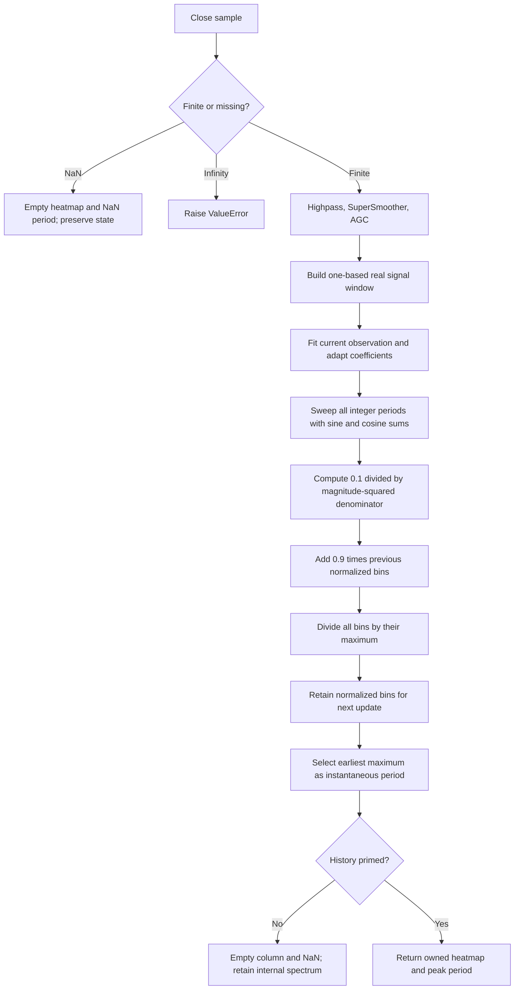

# Griffiths Spectrum: research prototype master reference

Return the article's normalized all-pole spectrum as a structured heatmap column, together with the period at its brightest bin. This is a standalone Python master for later conversion to Python, Go, TypeScript, Rust and Zig. The numerical authority is the supplied January 2025 TASC listing, with the source differences and explicit streaming initialization recorded here.

Three independent folders are intentional. Their common adaptive coefficients can be factored into a shared core in a target repository, but prediction, normalized heatmap power, and raw-power dominant cycle have distinct defaults and recursions. This folder includes every equation and the required background without depending on a sibling description.

## Physical picture and purpose

Ehlers treats market prices as a sampled, changing waveform. His analogy is a drunkard's walk whose useful behavior sometimes resembles the wave equation and sometimes the diffusion equation. Coherent waves can be extrapolated for a short time; diffusion is closer to randomness. These are motivating analogies, not differential equations solved by this implementation or a proof that financial prices are predictable.

For orientation, the canonical one-dimensional equations are

$$\frac{\partial^2 u}{\partial t^2}=v^2\frac{\partial^2 u}{\partial x^2},\qquad
\frac{\partial u}{\partial t}=D\frac{\partial^2 u}{\partial x^2}.$$

The articles discuss these equations qualitatively; the displayed canonical forms above are explanatory additions. Market boundary conditions are unavailable, so this indicator does not attempt a closed-form PDE solution. Instead it fits a discrete linear prediction model to band-limited observations.

A price waveform can be represented in time or frequency. A Laplace transform describes continuous-time systems including transients; Fourier analysis describes frequency components; the $z$ transform describes sampled systems, with $z^{-1}$ representing one sample of delay. Evaluate a $z$-domain response on the unit circle $z=e^{j\omega}$ to obtain its frequency response. Here $j^2=-1$, $\omega$ is radians per bar, and a period $p$ in bars corresponds to $\omega_p=2\pi/p$.

The article's bandpass analogy is a derivative followed by an integrator. A difference suppresses the slow trend, and an average suppresses fast noise. This explains why highpass followed by lowpass can approximately retain a useful oscillation. Practical filters have frequency-dependent gain and phase; the analogy does not make them exact inverse operators. Above the filter center period the output can lead the input; below the center period it can lag. Narrower bands and higher filter orders increase phase slope. Ehlers recommends roughly an octave or more of bandwidth to accommodate a changing cycle without extreme phase changes.

Cycles such as 20, 25 and 32 bars can appear at different times, so a fixed indicator parameter can stop matching the current waveform. The Griffiths coefficients change with every observation. A forecast or spectral period can support adaptive indicators, but neither is a probability of profitable trading or a forecast of the unfiltered close.

## Complete mathematical specification

This section carries all the mathematical expressions in the supplied TASC and MESA articles, plus the equations implied by their executable listings. The two articles contain the same all-pole derivation. No book chapters or original Griffiths paper text were supplied; the bibliography distinguishes those further-reading references from material actually implemented.

### The article's simple two-pole example

The motivating all-pole transfer function is

$$H(z)=\frac{1}{1-(c_1z^{-1}+c_2z^{-2})}.$$

Because transfer response is output divided by input, rearrange it as

$$\mathrm{In}=(1-(c_1z^{-1}+c_2z^{-2}))\,\mathrm{Out},$$

$$\mathrm{In}_t=\mathrm{Out}_t-c_1\mathrm{Out}_{t-1}-c_2\mathrm{Out}_{t-2}.$$

This input is the prediction-error/excitation term in the usual autoregressive interpretation. The article calls it the new data point or prediction. The adaptive Griffiths forecast below instead directly extrapolates the learned weighted sum of past observations; do not implement this inverse-filter example in place of the adaptive forecast.

The accompanying simple predictor uses $Q=0.35$, initial $c_0=1$, $c_1=1.8Q$, $c_2=-Q^2$, and normalization

$$d=1-c_1-c_2,\qquad \widetilde c_i=c_i/d\quad(i=0,1,2),$$

$$\mathrm{Predict}_t=\widetilde c_0\mathrm{LP}_t-
\widetilde c_1\mathrm{LP}_{t-1}-\widetilde c_2\mathrm{LP}_{t-2}.$$

Its DC gain is one because $(c_0-c_1-c_2)/d=1$. Its printed example applies highpass period 15 and lowpass period 30; the Griffiths implementations explicitly use highpass `upper_bound` and lowpass `lower_bound`. A commented test replaces LP with $\sin(2\pi t/20)$. Smaller $Q$ reduces the lead, and large $Q<1$ can cause peaking. $Q$ is background for a separate simple predictor and is not a parameter of these three masters.

### Second-order highpass and SuperSmoother

Let $U$ be `upper_bound`, $B$ be `lower_bound`, $L$ be `length`, and $x_t$ be the close at accepted sample $t$, starting at $t=1$. Both filter functions use

$$\theta(P)=\frac{\sqrt{2}\pi}{P},\quad a(P)=e^{-\theta(P)},\quad
b(P)=2a(P)\cos\theta(P),\quad c_2(P)=b(P),\quad c_3(P)=-a(P)^2.$$

Highpass feedforward gain:

$$c_{1,H}(P)=\frac{1+c_2(P)-c_3(P)}4.$$

For $t\ge4$, with $P=U$:

$$h_t=c_{1,H}(U)(x_t-2x_{t-1}+x_{t-2})+c_2(U)h_{t-1}+c_3(U)h_{t-2}.$$

SuperSmoother feedforward gain:

$$c_{1,S}(P)=1-c_2(P)-c_3(P).$$

For $t\ge4$, with $P=B$:

$$y_t=\frac{c_{1,S}(B)}2(h_t+h_{t-1})+c_2(B)y_{t-1}+c_3(B)y_{t-2}.$$

The source sets $h_t=0$ for $t<4$ and returns the input to the SuperSmoother on those bars, so $y_t=h_t=0$. $h_0,h_{-1},y_0,y_{-1}$ are zero. The associated responses are

$$H_H(z)=\frac{c_{1,H}(U)(1-2z^{-1}+z^{-2})}
{1-c_2(U)z^{-1}-c_3(U)z^{-2}},\qquad
H_S(z)=\frac{\tfrac12c_{1,S}(B)(1+z^{-1})}
{1-c_2(B)z^{-1}-c_3(B)z^{-2}}.$$

These are the specific 2025 article functions, not another Ehlers roofing-filter variant. The approximate frequency passband is $1/U$ to $1/B$ cycles per bar, with transition regions. Full-precision `math.sqrt(2.0)` and `math.pi` replace `1.414` and `3.14159`. EasyLanguage's `Cosine(1.414*180/P)` in degrees becomes `cos(sqrt(2)*pi/P)` in radians. Keep all recursive calculations in binary64; no intermediate decimal rounding.

### Automatic gain control

Starting with $A_0=0.1$ and $s_0=0$, the fast-attack, slow-decay envelope and normalized signal are

$$A_t=\max(0.991A_{t-1},|y_t|),$$

$$s_t=\begin{cases}y_t/A_t,&A_t\ne0,\\s_{t-1},&A_t=0.\end{cases}$$

The source retains `Signal` when the peak is zero. The master retains that branch, including after eventual underflow of a long all-zero stream. For finite ordinary input, $|s_t|\le1$. In a 30-bar cycle consecutive absolute peaks are about 15 bars apart. The articles' numerical illustration is

$$0.991^{15}\simeq0.873,\qquad -20\log_{10}(0.991^{15})\simeq1.18\ \mathrm{dB}.$$

The AGC is a signal-amplitude envelope, not an RMS or zero-lag autocorrelation normalizer. The article motivates it using an ergodic, unity-autocorrelation approximation. An unchanging price level disappears through the second difference; a rapidly changing price level can still excite the filters. A commented diagnostic substitutes $s_t=\sin(2\pi t/30)$ **after** filtering and AGC. The masters do not add a production `test_signal` parameter; deterministic tests can supply cycles as price input, which includes the filters.

### Adaptive coefficients and the indexing convention

Preserve the published one-based arrays. Each update builds a chronological temporary window

$$X_t[k]=s_{t-L+k}\quad(1\le k\le L),\qquad X_t[0]=0.$$

Thus $X_t[L]$ is current, $X_t[L-1]$ is one bar old, and $X_t[1]$ is $L-1$ bars old. Missing prehistory uses zero. All $c_l(0)$ are zero. The convergence factor is fixed by the article:

$$\mu=\frac1L.$$

Use old coefficients to estimate the current sample:

$$\bar X_t=\sum_{l=1}^{L}c_l(t-1)X_t[L-l],\qquad e_t=X_t[L]-\bar X_t.$$

Then update every coefficient with the **same** precomputed error:

$$c_l(t)=c_l(t-1)+\mu e_t X_t[L-l],\qquad 1\le l\le L.$$

This is an LMS-style gradient update. For the instantaneous objective $J_t=\tfrac12e_t^2$, $\partial J_t/\partial c_l=-e_tX_t[L-l]$, which gives the stated update. It is not normalized LMS; there is no divisor for the energy of the regressor vector. It is not Burg recursion or the Levinson recursion used in block maximum-entropy spectral analysis. AGC bounds the observations but does not guarantee convergence for every signal or configuration.

**Critical literal-source detail:** the training loop reaches $X_t[0]$ at $l=L$, which was initialized to zero and never assigned. Consequently $c_L(t)=0$ forever. There are $L-1$ effective trainable taps. Do not silently change the array filling to include $s_{t-L}$, start tap phases at zero, or drop the final zero in a way that shifts the remaining coefficients. Those changes produce another algorithm. Prediction uses the newly adapted coefficients; fitting used the previous coefficients.

### Recovering the spectrum from the learned filter

The full-order expression printed in both articles is

$$H(z)=\frac1{1-\sum_{l=1}^{L}c_lz^{-l}}.$$

Substitute $z^{-l}=e^{-j\omega l}$. The articles then print

$$P(\omega)=\frac1{\left(1-\sum_{l=1}^{L}c_le^{-j\omega l}\right)^2}.$$

That printed square omits the magnitude notation. Squaring a complex number does not by itself produce a real power. The executable listings implement the correct magnitude squared:

$$P(\omega)=|H(e^{j\omega})|^2=
\frac1{\left|1-\sum_{l=1}^{L}c_le^{-j\omega l}\right|^2}.$$

At each integer period $p=B,B+1,\ldots,U$, define

$$R_t(p)=\sum_{l=1}^{L}c_l(t)\cos(2\pi l/p),\qquad
I_t(p)=\sum_{l=1}^{L}c_l(t)\sin(2\pi l/p),$$

$$D_t(p)=(1-R_t(p))^2+I_t(p)^2,\qquad q_t(p)=\frac{0.1}{D_t(p)}.$$

The imaginary sign chosen for $e^{-j\omega l}$ does not affect $I^2$. The angular multiplier is $2\pi$, **not** `360` in languages whose trigonometry takes radians. The leading $0.1$ is a published scale/smoothing factor, not an estimate of innovation variance. Therefore unnormalized $q$ is a relative response, not calibrated power spectral density. Summing bins is not an estimate of total signal variance, particularly because uniform period spacing is nonuniform frequency spacing.

For the heatmap, the exact recursion is

$$u_t(p)=q_t(p)+0.9v_{t-1}(p),\quad M_t=\max_{B\le p\le U}u_t(p),$$

$$v_t(p)=\begin{cases}u_t(p)/M_t,&M_t\ne0,\\u_t(p),&M_t=0.\end{cases}$$

Initialize $v_0(p)=0$. **The feedback is yesterday's normalized $v$, because the source normalizes `Pwr[Period,1]` in place.** A conventional EMA that retains unnormalized power separately changes the result. Every valid column has its largest value equal to one; absolute amplitude across time is discarded. This is maximum normalization, with no minimum subtraction or logarithmic conversion.

The article's raster coloring is

$$\mathrm{red}(v)=\begin{cases}510v,&v<0.5,\\255,&v\ge0.5,\end{cases}\qquad
\mathrm{green}(v)=\begin{cases}0,&v<0.5,\\255(2v-1),&v\ge0.5,\end{cases}\qquad\mathrm{blue}=0.$$

Black is zero, red is one-half and yellow is one. The prose also describes a white-hot palette, but the printed RGB code reaches yellow. The master returns numeric power bins; a renderer chooses colors and any integer quantization. Do not quantize reference data to RGB.

For a strict ascending maximum sweep, the raw peak period is

$$p_t^*=\min\operatorname*{arg\,max}_{p\in\{B,\ldots,U\}}q_t(p).$$

The dominant-cycle listing does **not** apply the heatmap smoothing or normalization. Starting with $C_0=0$, its two comparisons implement

$$C_t=\min\bigl(C_{t-1}+2,\max(C_{t-1}-2,p_t^*)\bigr).$$

Do not clamp startup $C_t$ to $[B,U]$: the initial 2, 4, 6, ... ramp is literal source behavior. Fractional values are allowed by the scalar API even though the printed initialization, integer bins and fixed two-bar step normally produce integral values. The spectrum's additional instantaneous period is the earliest maximum of the **displayed** $v_t(p)$, with no slew limit. It can differ from $C_t$ because the two procedures use different power and time filtering.

## Initialization, missing samples and precision contract

`update` consumes one close at a time. The master explicitly chooses one-based `CurrentBar=t`, zero prehistory, zero initial coefficients, power and cycle, and initial peak 0.1. State advances from the first finite input, even while the public result is masked. The first available public output is at accepted sample

$$t_{\mathrm{prime}}=\max(4,L).$$

Before that sample all scalar outputs are NaN; a heatmap has `values=[]` and NaN extrema. There is no separate convergence delay. This mask is a research portability convention: the article plots without a public NaN rule, and native chart engines may first evaluate after a platform-specific MaxBarsBack history. To compare a native engine, give it the same explicit origin, history, coefficient initialization and full-precision constants. The full-precision master is intentionally not bit-identical to code retaining `1.414`/`3.14159`.

NaN input produces an unavailable output and leaves every state variable untouched; it does not increment accepted-sample count. Infinity raises `ValueError` before state changes. Finite input that overflows a filter or coefficient update is rejected before committing that stage. A zero/nonfinite spectral denominator or overflowing recursive forecast raises `ValueError`; no arbitrary epsilon, spectrum clipping or stabilization is inserted. Such a later-stage failure may follow an accepted adaptive update, so call `reset()` before restarting a failed stream. `reset()` returns all state to its documented initial conditions and preserves configuration. Published arbitrary all-pole coefficients are not proven stable merely because their responses are evaluated on a unit circle.

Configuration is immutable through the public API; create a new object for new parameters. `state` returns immutable diagnostics with accepted count, highpass, lowpass, peak, normalized signal, fitted current value, and one-based coefficient tuple. Public NaNs never become internal recursive values. Processing is causal: the forecast is returned at the current timestamp even if it describes a later bar; no future close is read or used to refit a past result.

## Porting and fixture contract

Each folder is self-contained: its master uses only Python's standard library, and its input files are copies of the five shared templates. The `__main__` embeds all 252 `INPUT_CLOSE` values verbatim, runs a default streaming example, and offers `--generate-reference-data`. The user confirmed all 48 combinations on 2026-10-21; `REFERENCE_CASES_CONFIRMED=True` records that authorization.

Generation appends a marked expected-data section to `test_testdata.py`, then reopens it with an AST literal parser, verifies all 252 time rows, dimensions, NaN masks and 15-significant-digit values, and translates those **reopened literals** to Go, TypeScript, Rust and Zig. Reruns replace only that marked section. Existing input arrays, including high/low/open arrays not consumed here, stay intact. Do not generate from a different dataset or freshly round the other languages independently.

`LB`, `UB`, `L` mean lower bound, upper bound and adaptive length. Predictor names also include `BF` (forecast horizon) and `V` (`0` article; `1` TradeStation/MESA). Names append an output component because one configuration may return multiple outputs. For example `EXPECTED_LB18_UB40_L18_BF2_V0_PRED`. Any future decimal-valued parameter would use `_` in place of `.`. Every expected array has the confirmed grid's “What it tests” comment followed by its full parameter comment.

The language equivalents are `expectedLB...` Go variables, `expectedLB...` exported TypeScript constants, `expected_lb...()` Rust functions, and `expectedLB...()` Zig functions. Go uses a lowercase package stripped of hyphens/underscores and `math.NaN()`. TypeScript uses `NaN`; Rust uses the valid spelling `f64::NAN`; Zig uses the shared `math` import and `nan = math.nan(f64)` declarations.

Scalar series contain 252 floating point values. Heatmaps use **time-major** shape `[252][UB-LB+1]`, with ascending period within each row. An unavailable heatmap becomes a full NaN row for fixed-size fixtures, while the runtime heatmap stays empty. `MIN` and `MAX` export the actual heatmap extrema and have the same NaN mask. Constant parameter metadata (first, last, resolution 1) need not be repeated 252 times. Retain binary64 and the shown summation order; `format(value, '.15g')` rounds serialized fixtures only. Allow small floating point tolerances in ports using different math libraries, and compare NaNs by classification, not equality.

## References and source audit

1. John F. Ehlers, “Linear Predictive Filters And Instantaneous Frequency,” *Technical Analysis of STOCKS & COMMODITIES*, vol. 43, January 2025, pp. 8–18. [Article URL](https://technical.traders.com/archive/article.asp?file=%5CV43%5CC01%5C898EHLE.pdf). Supplied source: `../../tasc/2025-01-linear-predictive-filters-and-instantaneous-frequency/content.md`.
2. John F. Ehlers, [MESA PDF](https://www.mesasoftware.com/papers/Linear%20Predictive%20Filters.pdf), same title. Supplied source: the article folder's `mesa/content.md`, Listings 1–6. Its local BibTeX says 2026, while the listings say copyright 2024 and overlap January 2025; the PDF publication date is not independently established. It is treated as an undated alternate manuscript, not evidence of a new 2026 algorithm.
3. [Traders' Tips, January 2025](https://www.traders.com/Documentation/FEEDbk_docs/2025/01/TradersTips.html), supplied `tips/tips.md` and individual TradeStation `.els` files. Primary source comparisons are TASC and TradeStation; the predictor master exposes their differing shift sequences as explicit modes.
4. Lloyd J. Griffiths, “Rapid Measurement of Digital Instantaneous Frequency,” *IEEE Transactions on Acoustics, Speech, and Signal Processing*, ASSP-23, pp. 187–202, 1975. Ehlers cites this paper as the foundation; its full text was not supplied or used as a separate oracle.
5. Local heatmap interface: `external/zpano/py/indicators/core/outputs/heatmap.py` and `external/zpano/py/indicators/john_ehlers/auto_correlation_periodogram/`. The master's `Heatmap` mirrors field names, ordering, axis semantics and empty-column behavior; it does not import that repository's indicator framework or dependencies.

Further reading cited by the article: *Cybernetic Analysis for Stocks and Futures* (2004), *Cycle Analytics for Traders* (2013), “Predictive And Successful Indicators” (January 2014), and “A Technical Description of Market Data for Traders” (May 2021). No chapters from these books were supplied for this conversion. They are bibliographic context, not unexamined sources of additional equations.

Other platform implementations are not numerically interchangeable. The supplied Wealth-Lab code uses a lag-zero regressor/phase and defers adaptation, so it does not preserve the one-based TASC taps. The TradingView spectrum omits the 0.9 power-memory addition, and its power matrix is dimensioned using length rather than upper bound. The supplied NinjaTrader code passes degree-style `360*count/period` directly to radian `Math.Sin/Cos` (with integer arithmetic); its startup and predictor loops also differ. These differences are documented rather than blended into an unidentified “reference.”

```bibtex
@article{ehlers2025linear,
  author = {Ehlers, John F.},
  title = {Linear Predictive Filters and Instantaneous Frequency},
  journal = {Technical Analysis of Stocks \& Commodities},
  volume = {43}, number = {1}, pages = {8--18},
  year = {2025}, month = jan,
  url = {https://technical.traders.com/archive/article.asp?file=%5CV43%5CC01%5C898EHLE.pdf}
}
@misc{ehlersMesaLinear,
  author = {Ehlers, John F.},
  title = {Linear Predictive Filters and Instantaneous Frequency},
  howpublished = {MESA Software manuscript},
  url = {https://www.mesasoftware.com/papers/Linear%20Predictive%20Filters.pdf},
  note = {Undated PDF; supplied listings copyright 2024; local transcription cites 2026}
}
@misc{traderstips2025jan,
  title = {Traders' Tips: January 2025},
  publisher = {Technical Analysis, Inc.}, year = {2025}, month = jan,
  url = {https://www.traders.com/Documentation/FEEDbk_docs/2025/01/TradersTips.html},
  note = {TradeStation, Wealth-Lab, NeuroShell, TradingView and NinjaTrader implementations}
}
@article{griffiths1975rapid,
  author = {Griffiths, Lloyd J.},
  title = {Rapid Measurement of Digital Instantaneous Frequency},
  journal = {IEEE Transactions on Acoustics, Speech, and Signal Processing},
  volume = {23}, pages = {187--202}, year = {1975},
  note = {Foundation cited by Ehlers; original full text not supplied}
}
@book{ehlers2004cybernetic,
  author = {Ehlers, John F.}, title = {Cybernetic Analysis for Stocks and Futures},
  publisher = {John Wiley \& Sons}, year = {2004}
}
@book{ehlers2013cycle,
  author = {Ehlers, John F.}, title = {Cycle Analytics for Traders},
  publisher = {John Wiley \& Sons}, year = {2013}
}
@article{ehlers2014predictive,
  author = {Ehlers, John F.}, title = {Predictive and Successful Indicators},
  journal = {Technical Analysis of Stocks \& Commodities},
  volume = {32}, year = {2014}, month = jan
}
@article{ehlers2021marketdata,
  author = {Ehlers, John F.}, title = {A Technical Description of Market Data for Traders},
  journal = {Technical Analysis of Stocks \& Commodities},
  volume = {39}, year = {2021}, month = may
}
@misc{zpanoHeatmapInterface,
  title = {zpano Python heatmap output and autocorrelation periodogram},
  howpublished = {Local source repository, external/zpano/py/indicators},
  note = {Interface structure only; not a numerical Griffiths source}
}
```

## Spectrum outputs and heatmap structure

`GriffithsSpectrum(...).update(close, time=None)` returns `SpectrumOutput(heatmap, instantaneous_period)`. `Heatmap` has the same fields, in the same order, as the requested zpano interface:

| Field | Meaning |
|---|---|
| `time` | Optional `datetime` supplied by caller, or None |
| `parameter_first` | Lower period bound, floating point bars |
| `parameter_last` | Upper period bound, floating point bars |
| `parameter_resolution` | 1.0 bar between bins |
| `value_min` | Actual minimum normalized power in this column |
| `value_max` | Actual maximum, normally 1.0 |
| `values` | Owned list of normalized powers, ascending period |

Bin $i$ represents period $B+i$. The value list is a snapshot; changing a returned list cannot alter the next calculation. The tuple fields themselves are immutable. `Heatmap.empty` carries axis metadata, empty values and NaN extrema. The numerical calculation ignores timestamps. A renderer appends columns in time order and maps normalized values to colors.

The added scalar is

$$\mathrm{IP}_t=\min\operatorname*{arg\,max}_{p\in\{B,\ldots,U\}}v_t(p).$$

It is the period at the brightest displayed bin, measured in bars. It is not angular frequency or cycles per bar, not interpolated between bins, and not slew-limited. The original spectrum listing returns only its raster plots, so IP is an explicit requested extension derived from the exact displayed spectrum. If a consumer needs frequency, $f_t=1/\mathrm{IP}_t$ and $\omega_t=2\pi/\mathrm{IP}_t$ after priming. A flat spectrum, including an all-zero signal with all coefficients zero, picks the lower bound by the strict-maximum tie convention; it does not signify a measured market cycle. No power threshold or peak prominence criterion was added.

## Parameters and streaming API

| Parameter | Default | Master valid range | Meaning and selection |
|---|---:|---|---|
| `lower_bound` | 10 | Integer 3..98, less than upper bound | Shortest passband and displayed period |
| `upper_bound` | 40 | Integer 4..99, greater than lower bound | Longest passband and displayed period |
| `length` | 40 | Integer 2..99 | Window slots, $L-1$ learned taps, $\mu=1/L$ |

Booleans are rejected for integer parameters. The 99 ceiling preserves the published spectrum plot range (the printed arrays have 100 as their maximum index). This master conservatively applies the same ceiling to length; it is a portability restriction, not an intrinsic DSP limit. AGC decay 0.991, power scale 0.1, memory 0.9, one-bar period resolution and maximum normalization are fixed source design choices, not exposed knobs.

Practical `lower_bound` is greater than 8, and approximately `upper_bound >= 2*lower_bound` keeps a useful bandwidth. Prefer `length >= upper_bound` to include a whole cycle at the longest searched period. Excessive length averages away rapid variation and slows adaptation. The printed default is 10/40/40; Figure 1 uses 10/40/54. Work is $O(L(U-B+1))$ per accepted observation, plus $O(L)$ adaptation and $O(U-B+1)$ smoothing. Persistent storage is $O(L+U-B+1)$; no DFT/FFT package or matrix library is needed.



## Confirmed reference configurations: eight cases, confirmed by the user on 2026-10-21

Each case exports `IP`, `HEATMAP`, `MIN` and `MAX`: 32 arrays. Heatmap shapes vary with the period band, but always contain 252 time rows. These eight cases share their parameters with the confirmed dominant-cycle grid so that downstream comparisons can expose the difference between smoothed and unsmoothed peaks.

| Lower bound | Upper bound | Length | What it tests |
|---:|---:|---:|---|
| 10 | 40 | 40 | Printed spectrum default; broad swing-cycle band |
| 10 | 40 | 54 | Article Figure 1 settings; longer adaptive memory |
| 18 | 40 | 40 | Printed dominant-cycle default; monthly swing-cycle band |
| 18 | 40 | 80 | Long memory; slower coefficient adaptation |
| 12 | 24 | 24 | Short octave band; faster cycle tracking |
| 9 | 18 | 18 | Lower recommended band edge; short adaptive window |
| 9 | 99 | 99 | Published spectrum display limit; many period bins |
| 24 | 60 | 60 | Longer-cycle band; full-cycle adaptive window |


## Completed validation

The user confirmed 48 configurations in total: 32 predictor, eight spectrum and eight dominant cycle. All expected fixtures have been generated, with 64 arrays per language for predictor, 32 for spectrum and eight for dominant cycle. All arrays have 252 time rows; heatmap rows have the documented number of bins.

The six local unittest cases compare every configuration against an independent full-history translation of the source equations, and compare the saved Python arrays against streaming output rounded to 15 significant digits. They also check priming, zero-signal ties, NaN skipping, infinity rejection, reset, configuration bounds and synthetic cycles. Output-specific checks cover forecast isolation and source-mode divergence, heatmap metadata and snapshot ownership, or the exact dominant-cycle slew limit.

An additional one-time audit matched every literal and both comment lines in all four translated languages to the Python fixture, verified all 252 input closes, and regenerated a scratch copy without any byte changes. Go fixture compilation passed with `go test testdata_test.go`; Rust compilation passed with `rustc --cfg test --crate-type lib --emit metadata testdata.rs -o /tmp/griffiths-fixture.rmeta`. TypeScript syntax passed with `node --experimental-strip-types --check testdata.ts`. Zig 0.16 tests invoked every fixture function, forcing all array bodies and dimensions to be checked. These validate the portable datasets; implementations of the other-language indicators are intended for the next repository.

To rerun this folder's calculation and fixture tests:

```sh
python3 -m unittest discover -s . -p 'test_griffiths*.py' -v
```

To regenerate all five files from the embedded input and confirmed grid:

```sh
python3 griffiths-spectrum.py --generate-reference-data
```

The native TradeStation/TradingView/Wealth-Lab/NinjaTrader engines were not run. Source equivalence here means the explicitly documented standalone origin, initialization, indexing, source mode and full-precision constants, checked against the independent literal-equation translation. Platform-specific history origins or the printed rounded constants can produce different numerical series.
