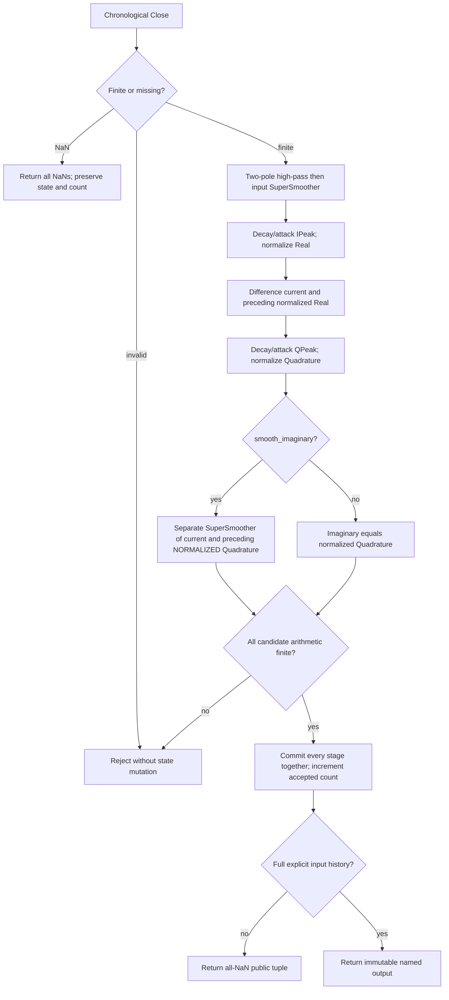

# Hilbert Transformer Indicator — Chapter 14 research prototype master

## Numerical authority and scope

`HilbertTransformerIndicator.update(close, time=None)` returns `HilbertOutput(real, imaginary)`. Default configuration reproduces **listing 14-3** with a 48-bar high-pass, 20-bar input SuperSmoother and separate 10-bar quadrature SuperSmoother. `smooth_imaginary=False` reproduces **listing 14-2**. Both belong in one folder because the latter is the unsmoothed intermediate construction of the former. No heatmap or dominant-cycle estimate is part of these two listings.

This is a self-contained, standard-library-only chronological streaming master for later conversion. The numerical implementation embeds its filter dependencies and the exact shared 252 closes in `__main__`; sibling masters, NumPy and pandas are unnecessary. Equations, original source sections, initialization, parameter grid and references are reproduced here so conversion agents need no original book.

`math.pi`, `math.sqrt(2.0)` and its reciprocal replace printed `3.14159`, `1.414` and `.707`; trigonometric arguments use radians. Published peak decay **0.991** is a design value and stays unchanged. Recursive state uses unrounded binary64; 15 significant digits are used only for fixture export. Thus the truncated-constant EasyLanguage listing will differ slightly. Agreement means a full-precision transcription with these explicit finite-record conventions, not a claimed run inside TradeStation.

## Analytic signal and derivative analogy

An ideal Hilbert transform creates a quadrature component of a real signal. One convention is

$$\mathcal H\{x\}(t)=\frac1\pi\operatorname{PV}\int_{-\infty}^{\infty}\frac{x(\tau)}{t-\tau}\,d\tau,
\qquad z(t)=x(t)+i\mathcal H\{x\}(t).$$

The book uses a **leading** cosine when the real component is sine. Under the integral convention above this would have the opposite quadrature sign; sign conventions do not change the orthogonality analogy, but the master preserves the book's derivative sign.

For an ideal in-phase signal $I=A\sin\theta$ and quadrature $Q=A\cos\theta$,

$$\int_0^{2\pi}\sin\theta\cos\theta\,d\theta=0,\qquad
\sin^2\theta+\cos^2\theta=1,\qquad I^2+Q^2=A^2.$$

The vectors rotate in a complex plane; a 360-degree revolution is a full cycle. For angular advance $\Delta\theta=18^\circ$ per bar, $T=360^\circ/18^\circ=20$ bars. This is background only; this master does not estimate phase or cycle period.

The book's truncated FIR coefficient shape is

$$b_n=\frac{\sin^2(\pi n/2)}{n},\quad n\ne0,\qquad b_0=0.$$

Its printed 23-element example is

$$[.091,0,.111,0,.143,0,.2,0,.33,0,1,0,-1,0,-.33,0,-.2,0,-.143,0,-.111,0,-.091]/1.865.$$

An odd-length linear-phase FIR has delay $(N-1)/2$: eleven bars at $N=23$. The shortest printed comparison $[1,0,-1]$ gives $x_t-x_{t-2}$, with response $2i e^{-i\omega}\sin\omega$ and one-bar delay. It strongly changes amplitude with frequency. These comparisons are not evaluated by the requested revised algorithm.

The revised algorithm uses the first difference of **peak-normalized roofed data**. For a constant-amplitude sinusoid,

$$\sin(\omega t)-\sin(\omega(t-1))
 =2\sin(\omega/2)\cos(\omega(t-1/2)).$$

It resembles a leading cosine but contains a half-bar delay relative to the continuous derivative and a frequency-dependent amplitude. A second envelope normalization compensates approximately for this amplitude. On nonstationary prices the envelopes vary; neither exact Hilbert orthogonality nor unit complex magnitude follows. Additional quadrature smoothing introduces more phase delay, which the book explicitly says destroys orthogonality. Crossings are causal heuristics, not guaranteed forecasts, and can change during a transition into trend behavior.

## Shared Roofing Filter equations

Let $x_t$ be Close, $H$ be `highpass_period`, $L$ be `smoothing_period`, and $h_t,f_t$ be high-pass and roofed outputs. Periods are in bars. Define

$$\theta_H=\frac{2\pi}{\sqrt2 H},\quad
\alpha_H=\frac{\cos\theta_H+\sin\theta_H-1}{\cos\theta_H},\quad q=1-\alpha_H.$$

$$h_t=(1-\alpha_H/2)^2(x_t-2x_{t-1}+x_{t-2})+2q h_{t-1}-q^2 h_{t-2}.$$

Equation 3-3's SuperSmoother follows:

$$a=e^{-\sqrt2\pi/L},\quad c_2=2a\cos(\sqrt2\pi/L),\quad c_3=-a^2,\quad c_1=1-c_2-c_3,$$

$$f_t=\frac{c_1}{2}(h_t+h_{t-1})+c_2f_{t-1}+c_3f_{t-2}.$$

The transfer functions are

$$H_{HP}(z)=\frac{(1-\alpha_H/2)^2(1-z^{-1})^2}{1-2qz^{-1}+q^2z^{-2}},\quad
H_{SS}(z)=\frac{(c_1/2)(1+z^{-1})}{1-c_2z^{-1}-c_3z^{-2}},\quad H_{Roof}=H_{HP}H_{SS}.$$

Two high-pass poles reject slow spectral dilation; their low-frequency roll-off is approximately 12 dB/octave compared with the source's approximate 6 dB/octave growth of swing amplitude with period. The SuperSmoother reduces high-frequency noise and has a feedforward zero at Nyquist, the highest representable frequency of one-half cycle per bar. Its poles act like an exponentially damped rotation. This is an analogy for the filter, not a physical equation for market prices.

## Two independent peak normalizers and final smoother

All variables below are zero before the first accepted observation. With $f_t$ the roofed value,

$$E^I_t=\max(0.991E^I_{t-1},|f_t|),\qquad
I_t=\begin{cases}f_t/E^I_t,&E^I_t\ne0,\\I_{t-1},&E^I_t=0.\end{cases}$$

This is automatic gain control: a peak detector attacks immediately when amplitude rises and releases exponentially when it falls. The release half-life is $\ln(1/2)/\ln(0.991)\approx76.7$ bars, not a finite lookback window.

$$d_t=I_t-I_{t-1},\qquad E^Q_t=\max(0.991E^Q_{t-1},|d_t|),$$

$$q_t=\begin{cases}d_t/E^Q_t,&E^Q_t\ne0,\\q_{t-1},&E^Q_t=0.\end{cases}$$

The source divides by zero on an initially zero input. This master defines a retained normalized value initially zero. No NaNs enter feedback. There is no denominator epsilon, rolling maximum, DC subtraction or clipping in these stages; the instantaneous peak attack naturally bounds $|I_t|,|q_t|\le1$ when the denominator is nonzero.

Listing 14-2 returns $J_t=q_t$. In listing 14-3 use an independent SuperSmoother period $L_Q=10$ (generalized by `quadrature_period`):

$$a_Q=e^{-\sqrt2\pi/L_Q},\quad k_2=2a_Q\cos(\sqrt2\pi/L_Q),\quad
k_3=-a_Q^2,\quad k_1=1-k_2-k_3,$$

$$J_t=\frac{k_1}{2}(q_t+q_{t-1})+k_2J_{t-1}+k_3J_{t-2}.$$

**The previous $q_{t-1}$ is normalized quadrature.** The source writes back to the `Quadrature` series after division. Feeding a previous raw difference into this equation is wrong. The input roofing coefficients and final quadrature coefficients remain separate; the source overwrites local coefficient variables only after calculating the input roof. Smoothed $J_t$ can overshoot $[-1,1]$ and is not clipped.

## Configuration, initialization and API

| Parameter | Default | Valid range and role |
| --- | --- | --- |
| `highpass_period` | 48.0 | Finite real $\ge5$ yielding resolvable stable coefficients; explicit research control of the printed fixed 48. |
| `smoothing_period` | 20.0 | Finite real $\ge2$ with stable coefficients; printed `LPPeriod` input. |
| `quadrature_period` | 10.0 | Finite real $\ge2$ with stable coefficients; research control of printed fixed 10; validated but ignored numerically in raw mode. |
| `smooth_imaginary` | True | Boolean; True is listing 14-3, False is listing 14-2. |

No relation between cutoff periods is enforced; they are filter coefficient periods, not buffers. Booleans are rejected as numerical periods, and values so large that poles lose numerical resolution are rejected. Zero prehistory includes raw prices, high-pass, filtered, normalized Real, normalized Quadrature, both peak envelopes and both imaginary histories. A nonzero constant price produces a startup transient from absent zero prices; first-price seeding would change fixtures.

The high-pass needs $x_t,x_{t-1},x_{t-2}$, derivative needs the preceding roofed calculation, and the optional quadrature smoother needs its preceding normalized derivative. We adopt **four actual closes for raw mode and five for smoothed mode**: `warmup_bars` is three or four leading unavailable rows. This explicit feedforward-history convention is not exponential settling. Cutoffs of 252 or more do not imply 252 NaNs. Internal recurrences calculate from the first finite close with zero prehistory, regardless of public startup masking.

NaN skips an observation, returns an all-NaN tuple and leaves state, `samples_seen` and last accepted `output` unchanged. Infinity, bool input and overflow raise `ValueError` before commit. Optional time is accepted and ignored. `parameters` and `state` are immutable named tuples; `state` includes high-pass, filtered value, peaks, difference and normalized quadrature. `samples_seen` counts accepted bars; `is_primed` means the specified input history is populated; `reset()` clears all histories while preserving coefficients. Complexity is $O(1)$ work and storage per accepted bar.

## Calculation flow



Candidate arithmetic is separate from commit. A downstream failure cannot leave the roof or cycle estimator one bar ahead. Missing observations do not shift the preceding-value trigger or derivative history. Every returned tuple is immutable and future observations cannot revise it.

## Confirmed reference combinations

All twelve cases were confirmed in the 36-case Chapter 14–15 family plan on 2026-10-22. Each component array contains 252 values.

| Case | Parameters | What it tests |
| --- | --- | --- |
| 1 | `highpass_period=48.0, smoothing_period=20.0, quadrature_period=10.0, smooth_imaginary=True` | Published listing 14-3 defaults; normalized quadrature is smoothed separately. |
| 2 | `highpass_period=48.0, smoothing_period=20.0, quadrature_period=10.0, smooth_imaginary=False` | Listing 14-2 raw normalized quadrature; no final smoothing. |
| 3 | `highpass_period=48.0, smoothing_period=10.0, quadrature_period=10.0, smooth_imaginary=True` | Faster input smoothing with the published output smoother. |
| 4 | `highpass_period=48.0, smoothing_period=40.0, quadrature_period=10.0, smooth_imaginary=True` | Slower input smoothing with independent quadrature smoothing. |
| 5 | `highpass_period=48.0, smoothing_period=20.5, quadrature_period=10.0, smooth_imaginary=True` | Fractional input SuperSmoother period. |
| 6 | `highpass_period=48.0, smoothing_period=20.0, quadrature_period=10.5, smooth_imaginary=True` | Fractional quadrature SuperSmoother period. |
| 7 | `highpass_period=48.0, smoothing_period=20.0, quadrature_period=2.0, smooth_imaginary=True` | Minimum supported quadrature smoothing period. |
| 8 | `highpass_period=48.0, smoothing_period=20.0, quadrature_period=20.0, smooth_imaginary=True` | Slower quadrature smoothing and added phase delay. |
| 9 | `highpass_period=24.0, smoothing_period=6.0, quadrature_period=6.0, smooth_imaginary=True` | Explicit research variant with shorter roofing and output smoothing. |
| 10 | `highpass_period=80.0, smoothing_period=20.0, quadrature_period=10.0, smooth_imaginary=True` | Explicit research variant with longer high-pass cutoff. |
| 11 | `highpass_period=48.0, smoothing_period=2.0, quadrature_period=10.0, smooth_imaginary=False` | Minimum input smoothing period and raw quadrature. |
| 12 | `highpass_period=48.0, smoothing_period=252.0, quadrature_period=10.0, smooth_imaginary=True` | Input cutoff equals record length; IIR cutoff is not a history window. |

## Example, fixture generation and conversion files

```sh
python3 hilbert-transformer-indicator.py
python3 hilbert-transformer-indicator.py --generate-reference-data
python3 verify_reference_data.py
python3 -m unittest discover -s . -p 'test_master.py'
```

The default run processes all 252 embedded closes chronologically and prints the last named output. Import a hyphenated research filename with `importlib.util.spec_from_file_location`, then construct `HilbertTransformerIndicator()` and call `update(close)` for each observation; a target language may use its idiomatic module naming.

The Python master is the numerical specification and generator; this description is the standalone theoretical specification. `test_testdata.py`, `testdata_test.go`, `testdata.ts`, `testdata.rs`, `testdata.zig` preserve four input arrays and contain **24 expected component arrays per language**. `test_master.py` compares the bounded stream against an independent full-history source transcription. `verify_reference_data.py` checks all five languages' exact rounded values, comments, names, dimensions, NaNs and preserved inputs.

The generator writes Python expected arrays first, reopens them and checks every 15-significant-digit value, then translates those authoritative rounded literals into the other four languages. Re-running replaces only the marked generated section. Names use uppercase parameter shortcuts after `EXPECTED_`, a component suffix, and underscores instead of decimal points; Go/TypeScript/Zig start `expected` and Rust uses `expected_` plus lowercase shortcuts. Go package names strip hyphens/underscores. NaNs are Python/TypeScript `NaN`, Go `math.NaN()`, Rust `f64::NAN` and Zig `nan` with standard math declarations. Every array has the two approved description/parameter comments.

Keep binary64 recursive state unrounded in every port. Preserve operation order and full mathematical constants; finite libm results can vary in their last bits, so compare finite port results with a combined absolute/relative tolerance such as $10^{-10}$ and NaN masks exactly. No foreign-language indicator implementation is claimed merely because its fixtures compile.

## Validation record

Completed on 2026-10-22:

- **11 Python tests passed** in this folder; **32** passed across the three-master family. All twelve confirmed cases match an independent full-history transcription of the source, including internal values and public NaN masks. Zero input, reset, immutable snapshots, skipped inputs, parameter validation and atomic arithmetic/transform rejection passed.
- Exact five-language fixture verification passed: **24 arrays and 6,048 values per language** in this folder. Family total is **108 arrays and 27,216 values per language**. Original OHLC inputs, every 15-significant-digit decimal, NaN mask, name and both metadata comments are verified.
- All five fixtures in this folder regenerate **byte-for-byte identically**; family total is fifteen files.
- Go 1.27.1, Rust 1.98.1 and Zig 0.16.0 compiled and ran fixture harnesses checking every expected array's length, finite/NaN partition and final value. Node 24.15.0 loaded the TypeScript fixtures with type stripping and passed the same checks. A separate TypeScript compiler was not used.
- Python syntax, whitespace and local source-reference links passed.

The independent source oracle uses full-precision mathematical constants and the documented zero-prehistory/undefined-division conventions, with a combined absolute/relative comparison tolerance of $5\times10^{-10}$. TradeStation was not executed; its platform history and truncated mathematical constants can change results. The fixture verifier compares exact rounded export values. Foreign compiler checks validate reference fixtures, not completed indicator ports.

A synthetic 10-to-40-bar chirp matches the independent construction. Tests verify that raw and smoothed variants share the same Real, that the smoother consumes preceding normalized Quadrature, and that a constant nonzero close produces the documented zero-prehistory transient.

## Sources and BibTeX

The numerical authorities are Chapter 14 listings 14-2 and 14-3. Roofing theory is shared with Chapter 3 equation 3-3 and Chapter 7; peak AGC is also discussed in Chapter 5. Listing 14-1 appears only as a comparison, and Chapter 14 cycle estimators 14-4 onward are outside this master.

- John F. Ehlers, *Cycle Analytics for Traders: Advanced Technical Trading Concepts*, Wiley, 2013. [Book and bibliographic record](../../2013-cycle-analytics-for-traders/toc.md), [Chapter 14](../../2013-cycle-analytics-for-traders/ch14.md), [Chapter 15](../../2013-cycle-analytics-for-traders/ch15.md), [Chapter 11](../../2013-cycle-analytics-for-traders/ch11.md), [Chapter 3](../../2013-cycle-analytics-for-traders/ch3.md), [Chapter 7](../../2013-cycle-analytics-for-traders/ch7.md), [Chapter 8](../../2013-cycle-analytics-for-traders/ch8.md).

```bibtex
@Book{ehlers2013cycle,
  author = {Ehlers, John F.},
  title = {Cycle Analytics for Traders: Advanced Technical Trading Concepts},
  publisher = {Wiley},
  year = {2013},
  series = {Wiley Trading},
  isbn = {9781118728604}
}
```

The following source excerpts retain printed approximations and historical interpretation. Port the full-precision equations and explicit finite-stream rules above. Statistical claims in the historical text do not supersede the qualifications above.

## Original Chapter 14 theory and listings

# Chapter 14: The Hilbert Transformer

*“The wave has an imaginary component,” said Tom realistically.*

An analytic signal allows for time-variable parameters and is a generalization of the phasor concept, which is restricted to time-invariant amplitude, phase, and frequency. The analytic representation of a real-valued function or signal facilitates many mathematical manipulations of the signal. For example, computing the phase of a signal or the power in the wave is much simpler using analytic signals.

The Hilbert transformer is the technique to create an analytic signal from a real one. The conventional Hilbert transformer is theoretically an infinite-length FIR filter. Even when the filter length is truncated to a useful but finite length, the induced lag is far too large to make the transformer useful for trading.

I have therefore created a modified Hilbert transformer that has only a small lag but still has performance characteristics superior to those of a truncated FIR Hilbert transformer.

The modified Hilbert transformer can be used as an effective trading indicator because the quadrature component output leads the real output in the same manner a cosine wave leads a sine wave. In this sense, a modified Hilbert transformer is a predictive indicator.

In this chapter, I demonstrate three different ways to measure the time-variant dominant cycle period using analytic signals. These are all basically measuring the instantaneous phase of the signal and, in essence, summing the phases to estimate the cycle period. Since the smoothing length is ­usually less than one full cycle period, the results are fairly noisy and are ­therefore only marginally useful for trading. I include the code for these dominant cycle measurements primarily for completeness and because someone smarter than me may be able to use them successfully.

## Analytic Signals

Without getting all mathy on you, I will try a simplified description of the theory of numbers for you to reach an understanding of analytic signals. The numbers that you know and love extend from minus infinity to plus infinity along a straight line. This line includes integers, rational numbers, irrational numbers, and even zero. This is not exactly as trivial as it seems because the Roman numerals, for example, had no concept of zero. It wasn’t until 976 a.d. that the Persian encyclopedist Muhammad ibn Ahmad al-Khwarizmi (from whom we get the word algorithm) used the notation and wasn’t until 1202 a.d. that Fibonnaci introduced the concept of zero to Europe at the beginning of the Renaissance. Of course, that was before margin calls, and so the idea of negative numbers didn’t arise until relatively recently. With that digression, the main idea is that all “real” numbers can be pictured as being on a straight line.

A straight line is not the only construct we can use to visualize a numbering system. For example, if we place numbers on a plane surface we can describe numbers by their location on the plane. We do this by using a “real” axis and an “imaginary” axis that is at right angles to the real axis. The names are not necessarily significant except in a historical context. After all, if we can have irrational numbers we can have an imaginary axis.

Figure 14.1 shows the relevance of analytic signals to traders using indicators. As a function of time the sine wave starts at zero and increases toward its maximum value while the cosine wave starts at its maximum value and decreases in amplitude. Note that the cosine wave crosses zero just as the sine wave reaches its maximum value and has zero slope. The cosine wave represents the rate of change of the sine wave. These two waveforms can also be represented as vectors in the complex plane having the real and imaginary axes. The waves in the time domain are represented by projections on the imaginary axis as the two vectors rotate counterclockwise. A full cycle in the time domain is completed when the vectors rotate a full 360 degrees in the complex plane.

[Source figure omitted; caption retained.]

**Figure 14.1** *Sine and Cosine Waves as Analytic Signals*

Note that the vectors in the complex plane are at right angles, and are said to be orthogonal. Because of the right angle property, I often refer to the sine component as the in-phase component, and the cosine component is the quadrature component. More generally, orthogonality means that the product of the two vectors is uncorrelated. For example, the sum of $\sin(x) * \cos(x)$ over a full cycle is zero. Knowing about analytic signals opens the door to making some interesting calculations using market data. For example, $\sin^{2}(x) + \cos^{2}(x)$ is equal to a constant. We also know this from basic trigonometry. Failing to compute the sum of the squares as a constant is an indication of the failure of creating an analytic signal. In this case, that failure means the market is probably transitioning between a cycle mode and a trend mode.

Analytic signals also open the possibility of making very rapid measurements of the dominant cycle period by examining the rate change of phase angle of the vectors in the complex plane. For example if the vector angle changes $18$ degrees per bar, the dominant cycle period must be $20$ bars because that rate of change gives a total of $360$ degree over the $20$-bar period.

## Hilbert Transformer Mathematics

A Hilbert transformer is just an FIR filter whose purpose is to create a quadrature component from the real data stream. The filter length is theoretically infinite, but can be truncated as an approximation. The filter coefficients can be expressed as $\sin^{2}(\pi n / 2) / n$, where $n$ is the position from the center of the filter. Coefficients older than half the filter have a negative sign. For example, a $23$-element Hilbert transformer filter has coefficients as:

$$[.091 0 .111 0 .143 0 .2 0 .33 0 1 0 −1 0 −.33 0 −.2 0 −.143 0 −.111 0 −.091] / 1.865$$

[Source figure omitted; caption retained.]

**Figure 14.2** ^Frequency Response of a 23-Element Hilbert Transformer*

The frequency response of this filter is shown in Figure 14.2. This filter output response has ripple throughout its pass band and roll-off at zero frequency and the Nyquist frequency due to truncation of the coefficients. Ideally, the Hilbert transformer is an all-pass filter. We can manipulate the coefficients to reduce the amount of in-band ripple; however, it is not worth the effort. The problem is that this FIR filter has a $11$-bar lag. More generally, the FIR filter lag is $(N − 1) / 2$, where there are an odd number of elements in the filter. In our case, a lag of $11$ bars is just unacceptable for trading.

The lag of a Hilbert transformer can be reduced by reducing the number of elements in the filter. In the limit, the shortest truncated Hilbert trans- former has the coefficients as:

$$[1 0 −1]$$


[Source figure omitted; caption retained.]

**Figure 14.3** *Frequency Response of a Three-Element Hilbert Transformer*

This shorter Hilbert transformer is nice for trading because it has only a one-bar lag. However, the frequency response of the three-element Hilbert transformer has a substantial amplitude slope across the pass band, as shown in Figure 14.3. The pass band of interest extends from approximately a $50$-bar period (frequency = $0.02$) to a $10$-bar period (frequency = $0.1$). The shorter Hilbert transformer is also not acceptable for trading because of the huge amplitude variation over the pass band.

I have included the EasyLanguage code to compute the Hilbert transformer as a classic truncated FIR filter in Code Listing 14-1 because it can be useful for comparing results to the modified Hilbert transformer I will derive. After declaring variables, the code begins by computing the roofing filter as a combination of a two-pole high-pass filter and a SuperSmoother filter. The automatic gain control (AGC) technique described in Chapter 5 is used to compute the normalized Real signal. The variable Real is basically the same as the variable Filt except that it has a normalized amplitude. The imaginary signal, called Imag, is computed from the FIR filtering of the variable Real. Then the Real and Imag signals are plotted. Note that the plot for the imaginary signal is artificially moved to the left by 11 bars to compensate for the lad induced by the FIR filter. If the Real and Imag signals were to be used for trading, Real would have to be delayed by $11$ bars to have the correct relationship to Imag.

**Code Listing 14-1. EasyLanguage Code to Compute a Classic Hilbert Transformer**

```easylanguage
{
  Classic Hilbert Transformer
  © 2013  John F. Ehlers
}
Vars:
  alpha1(0),
  HP(0),
  a1(0),
  b1(0),
  c1(0),
  c2(0),
  c3(0),
  Filt(0),
  Real(0),
  Imag(0),
  IPeak(0);

//Highpass filter cyclic components whose periods are shorter than 48 bars
alpha1 = (Cosine(.707*360 / 48) + Sine (.707*360 / 48) - 1) / Cosine(.707*360 / 48);

HP = (1 - alpha1 / 2)*(1 - alpha1 / 2)*(Close - 2*Close[1] + Close[2]) + 2*(1 - alpha1)*HP[1] - (1 - alpha1)*(1 - alpha1)*HP[2];

//Smooth with a Super Smoother Filter from equation 3-3
a1 = expvalue(-1.414*3.14159 / 10);
b1 = 2*a1*Cosine(1.414*180 / 10);
c2 = b1;
c3 = -a1*a1;
c1 = 1 - c2 - c3;
Filt = c1*(HP + HP[1]) / 2 + c2*Filt[1] + c3*Filt[2];
IPeak = .991*IPeak[1];
If Absvalue(Filt) > IPeak Then IPeak = AbsValue(Filt);
Real = Filt / IPeak;

//Truncated Hilbert Transform FIR filter as a test
Imag = (.091*Real + .111*Real[2] + .143*Real[4] + .2*Real[6] + .333*Real[8] + Real[10] - Real[12] - .333*Real[14] - .2*Real[16] - .143*Real[18] - .111*Real[20] - .091*Real[22]) / 1.865;

Plot1(Real);
Plot2(0);
Plot6[11](Imag);
```

## Computing the Hilbert Transformer

The Hilbert Transform Indicator is described with reference to the Easy­ Language code shown in Code List 14-2. The computations begin with the roofing filter as with the classic Hilbert transformer except that the critical period of the SuperSmoother is provided as a user-selectable input. This gives the indicator more flexibility in providing greater or lesser smoothing as desired.

The Real component is computed exactly as it was in the classic Hilbert transformer, by normalizing Filt to its recent peak value as determined by the AGC algorithm.

The imaginary component calculation starts by taking the one bar difference of the Real variable. This is analogous to taking the derivative of a sine wave to generate a cosine wave. The one-bar difference computation provides the phase quadrature required for the imaginary component. The amplitude correction is provided by a second AGC action performed on the imaginary component alone. Having the phase quadrature and the normalized amplitude fulfills all the requirements for the imaginary component.

The lag of the Real and Imag analytic signals is very small, and no compensation in the plotting routine is required. In other words, an indicator has been created that has a predictive capability.

**Code Listing 14-2. EasyLanguage Code to Compute the Hilbert Transformer**

```easylanguage
{
  Hilbert Transformer
  © 2013  John F. Ehlers
}
Inputs:
  LPPeriod(20);
  (Continued )

Vars:
  alpha1(0),
  HP(0),
  a1(0),
  b1(0),
  c1(0),
  c2(0),
  c3(0),
  Filt(0),
  QFilt(0),
  Real(0),
  Imag(0),
  IPeak(0),
  QPeak(0);

//Highpass filter cyclic components whose periods are shorter than 48 bars
alpha1 = (Cosine(.707*360 / 48) + Sine (.707*360 / 48) - 1) / Cosine(.707*360 / 48);

HP = (1 - alpha1 / 2)*(1 - alpha1 / 2)*(Close - 2*Close[1] + Close[2]) + 2*(1 - alpha1)*HP[1] - (1 - alpha1)*(1 - alpha1)*HP[2];

//Smooth with a Super Smoother Filter from equation 3-3
a1 = expvalue(-1.414*3.14159 / LPPeriod);
b1 = 2*a1*Cosine(1.414*180 / LPPeriod);
c2 = b1;
c3 = -a1*a1;
c1 = 1 - c2 - c3;
Filt = c1*(HP + HP[1]) / 2 + c2*Filt[1] + c3*Filt[2];

IPeak = .991*IPeak[1];
If Absvalue(Filt) > IPeak Then IPeak = AbsValue(Filt);
Real = Filt / IPeak;

QFilt = (Real - Real[1]);
QPeak = .991*QPeak[1];
If Absvalue(QFilt) > QPeak Then QPeak = AbsValue(QFilt);
Imag = QFilt /QPeak;

Plot1(Real);
Plot2(0);
Plot6(Imag);
```

[Source figure omitted; caption retained.]

**Figure 14.4** *The Hilbert Transformer Indicator Has the Correct Phase and Amplitude as Shown by the Response to a Chirped Sine Wave Whose Period Varies from 10 Bars to 40 Bars*

The outstanding performance of the Hilbert transformer is best demonstrated by its response to a chirped sine wave whose period continuously increases from $10$ bars to $40$ bars. Throughout the entire range, the indicator maintains the correct phase and amplitude relationship between the real and imaginary components. This performance is vastly superior to that of the classic Hilbert transformer using a truncated FIR filter.

## The Hilbert Transformer Indicator

Figure 14.5 shows the real and imaginary components of the Hilbert transformer below the price chart. Basically, the real component moves with the general direction of the prices, and the imaginary component is a predictive indicator for the real component in the same sense that a cosine wave is a predictor of a sine wave. Although the default LPPeriod input is set to $20$ bars in an attempt to smooth the indicator the imaginary component is still too erratic to be useful.

[Source figure omitted; caption retained.]

**Figure 14.5** *Initial Application of the Hilbert Transformer to DG*

Code Listing 14-3 shows the EasyLanguage code for the Hilbert transformer indicator. The code is exactly the same as for the Hilbert transformer except that a SuperSmoother filter has been added to smooth the imaginary component.

**Code Listing 14-3. EasyLanguage Code to Compute the Hilbert Transformer Indicator**

```easylanguage
{
  Hilbert Transformer Indicator
  © 2013  John F. Ehlers
}
Inputs:
  LPPeriod(20);

Vars:
  alpha1(0),
  HP(0),
  a1(0),
  b1(0),
  c1(0),
  c2(0),
  c3(0),
  Filt(0),
  QFilt(0),
  Real(0),
  Quadrature(0),
  IPeak(0),
  QPeak(0),
  Imag(0);

//Highpass filter cyclic components whose periods are shorter than 48 bars
alpha1 = (Cosine(.707*360 / 48) + Sine (.707*360 / 48) - 1) / Cosine(.707*360 / 48);

HP = (1 - alpha1 / 2)*(1 - alpha1 / 2)*(Close - 2*Close[1] + Close[2]) + 2*(1 - alpha1)*HP[1] - (1 - alpha1)*(1 - alpha1)*HP[2];

//Smooth with a Super Smoother Filter from equation 3-3
a1 = expvalue(-1.414*3.14159 / LPPeriod);
b1 = 2*a1*Cosine(1.414*180 / LPPeriod);
c2 = b1;
c3 = -a1*a1;
c1 = 1 - c2 - c3;
Filt = c1*(HP + HP[1]) / 2 + c2*Filt[1] + c3*Filt[2];

IPeak = .991*IPeak[1];
If Absvalue(Filt) > IPeak Then IPeak = AbsValue(Filt);
Real = Filt / IPeak;

Quadrature = (Real - Real[1]);
QPeak = .991*QPeak[1];
If Absvalue(Quadrature) > QPeak Then QPeak = AbsValue(Quadrature);
Quadrature = Quadrature /QPeak;

a1 = expvalue(-1.414*3.14159 / 10);
b1 = 2*a1*Cosine(1.414*180 / 10);
c2 = b1;
c3 = -a1*a1;
c1 = 1 - c2 - c3;
Imag = c1*(Quadrature + Quadrature[1]) / 2 + c2*Imag[1] + c3*Imag[2];

Plot1(Real);
Plot2(0);
Plot6(Imag);
```

The performance of the Hilbert transformer indicator is demonstrated in Figure 14.6. The smoothing afforded by the added SuperSmoother filter destroys the orthogonality of the imaginary component because it introduces several bars of lag. However, the SuperSmoother made the imaginary component useful by smoothing out its erratic behavior. Now the predicted turning point to the upside is when the imaginary component crosses over the real component. This gives you time to actually place the trade before the turning point has occurred. Similarly, the predicted turning point to the downside is when the imaginary component crosses under the real component. You have some control over the indicator through the `LPPeriod` input parameter.

[Source figure omitted; caption retained.]

**Figure 14.6** *The Imaginary Component of the Hilbret Transformer Indicator Predicts the Turning Points of the Real Component*

The problem with predicting the turning point is that it may not be a swing turning point at all. Rather, it can be the onset of a new trend. In this case, the turning point prediction will be dead wrong. One way to mitigate an incorrect turning point prediction is to first take the trade in the predicted direction, but then be quick and agile to exit the trade if it is not confirmed by the Even Better Sinewave Indicator.

