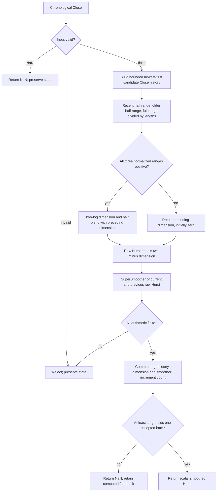

# Hurst Coefficient — Chapter 6 research prototype master

## Numerical authority and conversion scope

This is a self-contained **research prototype master reference**, based on the indicator's own listing in John F. Ehlers' *Cycle Analytics for Traders: Advanced Technical Trading Concepts* (Wiley, 2013). The Python calculation is chronological, standard-library only, and independent of other masters, zpano, NumPy and pandas. Each folder includes its complete numerical source, original source appendix, reference inputs and expected outputs for Python, Go, TypeScript, Rust and Zig. A conversion agent does not need the source book to implement the mathematics described here.

Mathematical constants have full precision: `math.pi`, `math.sqrt(2.0)` and its reciprocal replace printed `3.14159`, `1.414` and `.707` where they mean those constants. Python sine/cosine use radians; $360/P$ degrees becomes $2\pi/P$ radians. Design constants such as .25, .5, 1.5 and .991 retain their printed values. State calculations use unrounded binary64. Only the final exported literals use **15 significant digits**. Results therefore differ slightly from the original listing's truncated mathematical constants; source arithmetic ordering, signs, recurrences and guard conditions remain authoritative.

Each master is deliberately distinct from later similarly named Ehlers indicators. The Decycler is a one-pole low-pass, the Decycler Oscillator subtracts two two-pole high-pass outputs, Band-Pass uses a fixed-period resonator and its own leading trigger, and Hurst measures finite-window ranges. None is a substitute for the already prepared Chapter 11 adaptive family or spectrum filter banks.

## Stream API, state and startup

Call `update(close, time=None)` once per chronological Close. Time is accepted for interface consistency but has no numerical role. `parameters` is an immutable named tuple; `samples_seen` counts accepted observations; `warmup_bars` is the deterministic number of leading unavailable outputs; `is_primed` indicates that the required input history exists; `output` is the last accepted public result. `state` returns immutable diagnostic values, including internal results computed before public priming. `reset()` clears all histories while retaining the configuration and coefficients.

**Zero prehistory is part of this finite-record reference.** Absent Close values and declared source variables are zero. The first finite Close is accepted as standalone CurrentBar=1. Every recurrence and window calculation runs from that bar, even while public values are NaN. Do not seed histories with the first actual price, defer recurrence until priming, use public NaNs in feedback, or restart after a skipped observation. Commercial platforms may supply earlier history; matching this master requires the same initial conditions and accepted bars.

NaN represents a missing input: return an all-NaN result and preserve histories, accepted count and the previous `output`. Infinity, bool, nonnumeric input and arithmetic overflow raise `ValueError` before state mutation. All candidate downstream values are checked before commit, so a rejected update cannot leave one stage ahead of another. A missing or rejected value neither inserts a zero nor ages a finite lookback.

Public startup NaNs mark **input-history availability**, not convergence of an infinite-impulse-response filter. Coefficient periods do not specify a mandatory waiting window. A recursive filter with a period longer than 252 can still produce a valid finite-record output well before 252 bars; it may retain a large initialization transient. Changing a configured period requires a new instance rather than mutating an established stream. Future inputs never revise previously returned results.

## Shared sampled-data filter background

One Close per bar is a sampled signal. The Nyquist frequency is one-half cycle per bar, or a two-bar period. Low-pass filters retain slower changes and attenuate faster oscillations; high-pass filters remove a static term and attenuate slow changes. A band-pass combines those effects around a selected cycle period. Zeros determine exact rejected components, while poles determine recursive memory, damping and phase. A transfer function describes fixed coefficients with zero initial conditions, not a prediction of future prices.

The book's practical motivation is reduced delay without excessive aliasing noise. A first-order filter generally has weaker stop-band attenuation than a two-pole filter. For an analog-style interpretation, the recursive pole stores part of yesterday's displacement, much as a damped physical system retains energy. Cancellation is analogous to removing the rapidly varying part of a measured waveform. The resonator analogy for Band-Pass explains why sharper selectivity prolongs ringing. These are engineering explanations of the algorithm, not physical equations for market behavior.

The book discusses **spectral dilation**: market swing amplitude often grows with cycle period, approximately 6 dB per octave in its model. A single high-pass stage can then equalize rather than eliminate long-period content. This motivates two high-pass poles in the Decycler Oscillator and an additional high-pass before the Band-Pass resonator. The cited empirical approximations do not establish that every price record follows that spectral law.

## Spectral memory and physical background from Chapter 6

The chapter discusses white noise, random walks, long memory and spectra of the form $S(F)=C/F^\alpha$. The complete logarithmic transformation is

$$\begin{aligned}
\log S(F)&=\log(C/F^\alpha)\\
&=\log C-\alpha\log F.
\end{aligned}$$

The source prints a plus sign before the second term but immediately describes a slope $-\alpha$; the corrected minus sign above follows the algebra. Integrating a time signal multiplies its power spectrum by a factor proportional to $F^{-2}$ and raises the spectral exponent by two; differentiating reverses that effect. These are model-dependent sampled-data interpretations, not additional operations on the supplied closes.

The chapter states $H=1-\alpha/2$ and $H=2-D$. Its spectral relation is not a universal identity for all definitions of the exponent or process: standard fractional Brownian motion has spectral exponent $2H+1$, while its stationary increments have exponent $2H-1$. This master does **not** estimate a spectral exponent. It follows Listing 6-1's finite-window range estimate of dimension and computes $H=2-D$ directly. Statements about Brownian motion ($H=.5$), persistence ($H>.5$) and antipersistence ($H<.5$) describe the theoretical parameter under the relevant process assumptions, not a guarantee that every finite output is such a parameter.

Chapter 6 also supplies a philosophical random-walk analogy. An independent left/right walk can lead, in a continuum limit with an appropriate fixed spatial-step-square/time-step ratio, to the diffusion equation

$$\frac{\partial P}{\partial t}=D_{diff}\frac{\partial^2P}{\partial x^2}.$$

$P(x,t)$ is a probability density or concentration; $D_{diff}$ is a diffusion constant, distinct from fractal dimension $D$. Heat moving along a spoon and a smoke plume spreading around its mean path are physical examples. The book compares spreading probability to uncertainty that grows with forecast distance, without measuring that probability in this indicator.

When step direction has persistence, the chapter motivates the telegrapher's equation

$$\frac{\partial^2P}{\partial t^2}+\frac1\tau\frac{\partial P}{\partial t}
=c^2\frac{\partial^2P}{\partial x^2}.$$

The terms represent finite-speed propagation plus damping. Rulers, rubber bands and meandering rivers illustrate local oscillatory coherence with longer-term uncertainty. These equations and analogies are included because the source uses them to discuss cycle/trend modes; the **Hurst code does not solve either partial differential equation**, infer propagation speed, enforce a conservation law, or test the efficient-market hypothesis. The diffusion coefficient's exact convention can include a factor of two depending on the walk step definition. The local range statistic is not a fit of those physical models.

## Box-counting dimension: full source derivation

Cover a geometric pattern with $N$ objects of size $S$. The source relates two scales by

$$\frac{N_2}{N_1}=\left(\frac{S_1}{S_2}\right)^D,\qquad
D=\frac{\log(N_2/N_1)}{\log(S_1/S_2)}.$$

A ten-meter line covered by one-meter and .1-meter objects gives $N_1=10$, $N_2=100$ and

$$D=\frac{\log(100/10)}{\log(1/.1)}=1.$$

A ten-meter square gives $N_1=100$, $N_2=10{,}000$ and

$$D=\frac{\log(10{,}000/100)}{\log(1/.1)}=2.$$

For uniformly spaced price samples the book approximates box count by average range per time unit:

$$N=\frac{\operatorname{HighestPrice}-\operatorname{LowestPrice}}{\operatorname{Length}}.$$

Two adjacent half-length intervals supply two small-scale estimates, and the full interval supplies the larger-scale estimate:

$$D_{raw,t}=\frac{\log(N_{1,t}+N_{2,t})-\log(N_{3,t})}{\log2}.$$

This is a two-scale **range-based approximation**, not exact geometric box counting over multiple scales, a rescaled-range $R/S$ regression, a detrended-fluctuation analysis, or the FRAMA moving average. FRAMA uses a related range dimension to adjust a filter coefficient; this listing outputs a smoothed transformed dimension instead.

## Exact half windows, dimension feedback and output smoother

Let `length` be an even integer $L\ge2$, $T=L/2$, and $x_t$ be raw Close. The windows are adjacent and nonoverlapping, with exact source bounds:

$$N_{1,t}=\frac{\max_{0\le j<T}x_{t-j}-\min_{0\le j<T}x_{t-j}}{T},$$

$$N_{2,t}=\frac{\max_{T\le j<L}x_{t-j}-\min_{T\le j<L}x_{t-j}}{T},$$

$$N_{3,t}=\frac{\max_{0\le j<L}x_{t-j}-\min_{0\le j<L}x_{t-j}}{L}.$$

The first half starts with current Close; the second starts with `Close[length/2]`. There is no duplicated endpoint, use of High/Low intrabar extrema, Roofing Filter, typical-price substitution or partial-window normalization.

The actual listing **averages the dimension recursively** and retains it when any required range is zero:

$$D_t=\begin{cases}
\frac12\left(\frac{\log(N_{1,t}+N_{2,t})-\log(N_{3,t})}{\log2}+D_{t-1}\right),
&N_{1,t}>0,\ N_{2,t}>0,\ N_{3,t}>0,\\
D_{t-1},&\text{otherwise},
\end{cases}$$

$$h_t=2-D_t.$$

That fixed .5 feedback is independent of `smoothing_period`. Natural logs are used; the base would cancel in exact algebra, but ports should retain the two separate `log` calls and `log(2)` denominator to match floating-point ordering.

The final SuperSmoother is Chapter 3 Equation 3-3, with $S$=`smoothing_period`, default 20:

$$a=e^{-\sqrt2\pi/S},\quad c_2=2a\cos(\sqrt2\pi/S),\quad
c_3=-a^2,\quad c_1=1-c_2-c_3,$$

$$y_t=\frac{c_1}{2}(h_t+h_{t-1})+c_2y_{t-1}+c_3y_{t-2}.$$

Its fixed transfer function on $h$ is

$$H_{SS}(z)=\frac{(c_1/2)(1+z^{-1})}{1-c_2z^{-1}-c_3z^{-2}}.$$

This two-pole smoothing has a feedforward zero at Nyquist. Both its coefficients and positive recurrence feedback signs follow Equation 3-3 and Listing 6-1; the different modified-Butterworth equations elsewhere in Chapter 3 are not substituted.

## Source initialization, degenerate windows and interpretation

**Do not clip the dimension or either Hurst value.** Listing 6-1 declares `Dimen(0)`, `Hurst(0)` and `SmoothHurst(0)`. Initially $D_{-1}=0$, $h_{-1}=0$ and both smoother histories are zero. At the first bar, if the ranges cannot update dimension, $h_0=2$ and $y_0=c_1$. Later invalid-range bars hold $D$ and continue output smoothing. Initializing dimension to 1.5 or substituting a neutral Hurst .5 would change ordinary source outputs.

For $L=2$, each half contains one sample and both half ranges are always zero, even when the full two-sample range is nonzero. Dimension consequently stays zero for every input and internal raw Hurst stays two. The smoother tends to two. This case is included deliberately to expose the source guard; it is not presented as a useful Hurst estimate. An exactly constant stream has the same retained-zero dimension behavior.

Even with positive ranges, the finite ratio can lie outside the theoretical dimension interpretation. Since both half ranges are at most the full range, $(N_1+N_2)/N_3\le4$, but widely separated price levels can make that ratio arbitrarily small. Therefore a sampled discontinuous window can give $D_{raw}<1$ or negative dimension, and the zero-seeded dimension feedback can transiently be below one. The final SuperSmoother can also overshoot. The listing's outputs need not be bounded to $[0,1]$, and its finite-window “Hurst” is not a calibrated asymptotic exponent or predictive statistic. The book itself emphasizes dependence on the selected data length and absence of direct predictive value.

Positive rescaling of all Close values leaves the range ratio and result unchanged in exact arithmetic. Once windows are fully populated, range measurements are also invariant to an additive shift; the explicit zero prehistory can make early recursive results depend on that shift. Ports should preserve the given seed rather than enforce invariance by altering startup.

## Parameters, output and history requirement

| Parameter | Default | Valid range and role |
| --- | --- | --- |
| `length` | 30 | Even integer $\ge2$; full range window, with each half exactly `length/2` samples. bool and fractional integers are rejected. |
| `smoothing_period` | 20.0 | Finite real $\ge2$ with resolvable stable SuperSmoother coefficients. Generalizes the listing's fixed 20-bar output smoother; fractional values are supported. |

The source exposes only `Length(30)` and fixes smoothing at 20. The extra smoother parameter is an explicit research generalization; defaults reproduce the listing. It does not change the .5 dimension averaging. There is no arbitrary length maximum, but memory/time grow with length. Very large smoothing periods whose poles collapse in binary64 are rejected.

`update` returns one **scalar float**, the smoothed `SmoothHurst` value. `state` exposes $N_1,N_2,N_3$, the averaged `dimension`, raw `hurst`, smoothed `value`, and whether the current dimension updated. These diagnostics are not extra fixture outputs. No thresholded market-mode labels are returned.

`warmup_bars=length`: the first public result is at bar $L+1$, because the smoother pairs the current and previous raw Hurst values, each requiring a full input window. Internal ranges, dimension and smoother still evolve from bar one. For default $L=30$, the first 30 public rows are NaN and bar 31 is finite. For $L=250$, the first finite row is bar 251; for $L=252$, **all supplied 252 rows are NaN**, and an additional bar 253 produces the first public result. This is a defined source-record history convention, not an assertion that the estimator has statistically converged.

## Calculation flow



Update work and history storage are $O(L)$. The master explicitly recomputes extrema in bounded lists instead of requiring a monotonic deque or numerical package. SuperSmoother coefficients are cached once. The reference serialization and full-history oracle are separate tooling, not part of streaming storage.

## Confirmed reference combinations

All twelve cases were confirmed as part of the 48-case family plan on 2026-10-22. Each exported component has 252 values.

| Case | Parameters | What it tests |
| --- | --- | --- |
| 1 | `length=30, smoothing_period=20.0` | Published range length and SuperSmoother defaults. |
| 2 | `length=20, smoothing_period=20.0` | Shorter range length used in the chapter cycle example. |
| 3 | `length=200, smoothing_period=20.0` | Long range length used in the chapter trend example. |
| 4 | `length=2, smoothing_period=20.0` | Single-sample half windows: dimension guard always holds its zero seed. |
| 5 | `length=4, smoothing_period=20.0` | Shortest nondegenerate pair of half-window ranges. |
| 6 | `length=10, smoothing_period=20.0` | Fast finite-window structure estimate. |
| 7 | `length=60, smoothing_period=20.0` | Medium-long range measurement. |
| 8 | `length=100, smoothing_period=20.0` | Long range measurement. |
| 9 | `length=250, smoothing_period=20.0` | Current and previous full windows become available at bar 251. |
| 10 | `length=252, smoothing_period=20.0` | 253-observation history requirement: all 252 public rows remain NaN. |
| 11 | `length=30, smoothing_period=10.0` | Faster final SuperSmoother; dimension averaging stays fixed at one half. |
| 12 | `length=30, smoothing_period=20.5` | Fractional final smoothing coefficient period. |

## Files, reference generation and porting

`hurst-coefficient.py` contains the complete numerical calculation and marked-off fixture tooling. `description.md` is the standalone conversion specification. `test_hurst_coefficient.py` contains an independent full-history transcription of the listing and streaming/analytic checks. `verify_reference_data.py` parses all five fixture languages and compares metadata, values and NaN masks to the Python master.

The five fixtures retain the original **four 252-element OHLC arrays**, although this indicator consumes only Close. The exact Close input is also embedded inside the master's `__main__`. There are **12 expected arrays per language** in this folder: twelve parameter cases, with two components for Band-Pass and one VALUE component for each other master. Family total is 48 cases and 60 component arrays per language.

Names use shortcuts `C` (cutoff), `HP1`/`HP2` (the independent high-pass periods), `P`/`B` (center period/bandwidth), and `L`/`LP` (range length/smoothing period). Decimal points in parameter values become underscores. Example names are `EXPECTED_C60_VALUE`, `EXPECTED_HP130_HP260_VALUE`, `EXPECTED_P20_B0_3_SIGNAL`, and `EXPECTED_L30_LP20_VALUE`. Foreign names retain parameter separators: Go, TypeScript and Zig start with `expected`, while Rust uses `expected_` and lower-case tokens. Each array has the same two description/parameter comment lines in every language.

The generator writes Python first, reopens the exported literals, verifies the rounded numbers and NaNs, then translates those authoritative decimals to Go, TypeScript, Rust and Zig. NaN forms are Python `NaN = math.nan`, Go `math.NaN()`, TypeScript `NaN`, Rust `f64::NAN`, and Zig `nan` with the supplied standard math declarations. Go packages strip hyphens/underscores from the folder name. Rerunning replaces only marked expected-data sections and leaves copied input sections intact.

Run from this folder:

```sh
python3 hurst-coefficient.py
python3 hurst-coefficient.py --generate-reference-data
python3 verify_reference_data.py
python3 -m unittest discover -s . -p 'test_hurst_coefficient.py'
```

The master filename follows the folder name. To load it directly for streaming use:

```python
import importlib.util
from pathlib import Path

path = Path(__file__).resolve().parent / "hurst-coefficient.py"
spec = importlib.util.spec_from_file_location("book_master", path)
module = importlib.util.module_from_spec(spec)
spec.loader.exec_module(module)
indicator = module.HurstCoefficient()
for close in [91.5, 94.815, 94.375, 95.095]:
    print(indicator.update(close))
```

A port needs only ordinary binary64 math, fixed histories and loops. Compare NaN placement exactly and finite values with combined absolute/relative tolerance, for example $10^{-10}$ on this shared record; libm results can vary in the last bits across languages. Internal values are unrounded. Preserving newest-first window bounds, arithmetic signs, initialization and branch ordering is more important than reproducing export formatting inside the indicator.

## Validation record

Completed on 2026-10-22:

- **8 Python tests passed** in this folder, including all twelve parameter cases against the independent listing oracle. Family total: 32 passing tests.
- `verify_reference_data.py` passed: **12 arrays and 3,024 values per language**, exact 15-significant-digit values, metadata comments, component names, NaN masks and preserved OHLC inputs across all five languages. Family total: 60 arrays / 15,120 values per language.
- All five generated fixture files regenerate **byte-for-byte identically**. Family total: twenty fixture files.
- Go, Rust and Zig compiled and ran fixture harnesses checking every exported array's length, exact NaN prefix and finite final value when present. Node loaded TypeScript with type stripping and passed the same checks; a separate TypeScript compiler was not used.
- Python sources and fixtures parse successfully, all new files pass the trailing-whitespace check, and source-document links resolve.

Source-oracle comparisons use combined absolute and relative tolerance $10^{-11}$; the fixture verifier checks the exact rounded exported values. Tests also cover invalid input/overflow without partial state commit, reset, immutable configuration, analytic or listing-specific behavior, scale behavior and exact public history boundaries.

The independent oracle recomputes coefficients and keeps full chronological variable histories; the numerical master uses bounded histories and cached coefficients. The oracle uses the same documented full-precision constants and zero-prehistory convention. Agreement with that source transcription does not imply that TradeStation itself was executed, nor that foreign-language indicator implementations have already been created. Compiler/runtime checks validate fixture source forms; the fixture parser checks every exported numeric value and comment.

## Sources and BibTeX

Numerical authority: Ehlers, *Cycle Analytics for Traders*, **Chapter 6, Listing 6-1**. Relevant theory is reproduced above and the original local source is included below. Chapter 3 Equation 3-3 supplies Hurst's final SuperSmoother; Chapter 7's spectral-dilation discussion supports the filter background. No external library implementation is imported or treated as a numerical authority.

- [Book and bibliographic record](../../2013-cycle-analytics-for-traders/toc.md).
- [Chapter 6 source](../../2013-cycle-analytics-for-traders/ch6.md), [Chapter 3 SuperSmoother](../../2013-cycle-analytics-for-traders/ch3.md), [Chapter 7 spectral dilation](../../2013-cycle-analytics-for-traders/ch7.md).

```bibtex
@Book{ehlers2013cycle,
  author = {Ehlers, John F.},
  title = {Cycle Analytics for Traders: Advanced Technical Trading Concepts},
  publisher = {Wiley},
  year = {2013},
  series = {Wiley Trading},
  isbn = {9781118728604}
}
```

Chapter 6 cites G. H. Weiss and R. J. Rubin, “Random Walks: Theory and Selected Applications,” *Advances in Chemical Physics* 52 (1982), 363–505, for the physical analogy. That paper is contextual background and was not independently used to modify the source estimator.

```bibtex
@InCollection{weissrubin1982random,
  author = {Weiss, George H. and Rubin, Robert J.},
  title = {Random Walks: Theory and Selected Applications},
  booktitle = {Advances in Chemical Physics},
  volume = {52},
  pages = {363--505},
  publisher = {Wiley},
  year = {1982},
  note = {Physical-model background cited in Ehlers Chapter 6; not the numerical authority for the Hurst estimator}
}
```

## Original source appendix

The supplied Chapter 6 text and complete requested listing are reproduced below for conversion agents who will not have access to the source files. Printed constants, equations and code comments are retained; inaccuracies are identified and resolved by the mathematical/source-authority discussion above. Figure assets are omitted, and malformed caption emphasis is repaired. The philosophical background does not introduce extra stages into the implementation.

### Chapter 6: Market Structure and the Hurst Coefficient

*“The market has a definite structure,” said Tom randomly.*

It is well understood that white noise has no correlation in time, and random walk (Brownian motion) noise has no correlation between increments. Brownian walks can be generated from a function where the spectral density is proportional to $1/F^ {\alpha}$, where $F$ is frequency, $\alpha$ is a power law, and $\alpha = 1$ generally signifies “long memory,” as I will describe in Chapter 8. Thus, $1/F$ noise is synonymous with long-range dependence. Integration of noise increases the exponent $\alpha$ by $2$, whereas the inverse operation of differentiation decreases it by $2$. Therefore, $1/F^ {\alpha}$ noise cannot be obtained by the simple procedure of integration or of differentiation of such convenient signals. The widespread occurrence of signals exhibiting such behavior suggests that a generic mathematical explanation might exist. The ubiquity of $1/F^ {\alpha}$ noise is one of the oldest puzzles of contemporary physics and science in general.

Figure 6.1: displays some time series and, in the same colors, their associated power spectra. Such time series arise in many natural systems. Power spectra are plotted in log-log coordinates, as is customary, because

$$\begin{aligned}
\log(S(F)) &= \log(\text{constant} / F^{\alpha}) \\
&= \alpha \log(F) + \log(\text{constant})
\end{aligned}$$

[Source figure omitted; its caption is retained.]

**Figure 6.1** *Time Series and Spectral Densities for Several Kinds of Noise*

In other words, the logarithmic transform renders the $1/F^ {\alpha}$ power spectrum a straight line whose slope, $−\alpha$, can be easily estimated. Clearly, for such natural systems, observed by humans, neither arbitrarily small nor arbitrarily large frequencies can be recorded. These models are simply relevant to physically plausible situations.

Noise in economic data is usually studied as long-range dependence or long memory. It has been shown repeatedly that the autocorrelation functions of economic time series, such as series of stock prices over days, weeks, or months, or the gross national product of various countries over years, do not decay exponentially as they would if the process generating the series were a simple autoregressive process. Instead, the autocorrelation functions of many economic time series reach a nonzero asymptote and remain there for the entire series, albeit often at a low value, indicating that economic events some distance in the past continue to have an influence on current prices. You only need to do an Internet search on “stock market spectral density” to find a number of academic papers, both measured and theoretical, regarding the frequency content of the market.

The Hurst coefficient is one way to attempt to get a handle on the slope of the power density of market data. The Hurst coefficient varies between $0$ and $1$, and is related to the $\alpha$ power coefficient as $H = 1 − \alpha/2$. The Hurst coefficient is more estimated than computed. I find the estimate using the fractal dimension is the most practical for shorter-term market data. The Hurst coefficient is related to the fractal dimension as $H = 2 − D$. I would like to make it perfectly clear that the Hurst coefficient or the fractal dimension has no direct practical application to trading not only because it is an estimate, but also because it has no predictive value. These computations only reflect the general structure of the market, and the answer you get is dependent on your assumptions. For example, the Hurst coefficient changes dramatically with the length of data used in making the estimate.

### Fractal Dimension

To determine the fractal dimension of a generalized pattern, we cover the pattern with a number “$N$” of small objects of several various sizes “$S$”. The relationship of the number of objects in two sets of sizes is:

$$\frac{N_2}{N_1} = \left(\frac{S_1}{S_2}\right)^D$$

$$D = \frac{\log(N_2 / N_1)}{\log(S_1 / S_2)}$$

As an example, we can start with a pattern that is a line segment $10$ meters long. We chose the two small dimensions as $S1 = 1 $meter and $S2 = 0.1$ meter. Placing boxes along the line we can fit ten $1$-meter boxes on the segment, therefore $N1 = 10$. Similarly, we can fit one hundred $0.1$-meter boxes on the same $10$-meter line segment. Therefore, $N2 = 100$. The fractal dimension of the line then computes to:

$$D = \frac{\log(100/10)}{\log(1/0.1)} = 1.0$$

As a second example, we will use the pattern as a square that is $10$ meters on a side instead of a line segment. Retaining the same sizes of our small boxes as $1$ meter and $0.1$ meter on a side, respectively, we get $N1 = 100$ and $N2 = 10,000$. When the square is our pattern, the fractal dimension therefore computes to be:

$$D = \frac{\log(10000/100)}{\log(1/0.1)} = 2.0$$

A perfect square represents an idealized geometry not found in nature. Natural fractals, such as that of a seashore, lack the true regularity of an algorithmic structure but are self-similar in a statistical sense. Thus, in order to determine the fractal dimension of natural shapes, we must average the measured fractal dimension made over different scales.

We could measure the fractal dimension of prices by covering the curve with a series of small boxes. This is a burdensome task, but if we take into account that the price samples are uniformly spaced, we note that the box count is approximately the average slope of the curve. Therefore, we can estimate the box count as the highest price during an interval minus the lowest price during that interval, divided by the length of the interval itself. The equation for the number of boxes is then:

$$N = \frac{\text{HighestPrice} - \text{LowestPrice}}{\text{Length}}$$

We compute the fractal dimension by computing $N$ over two equal intervals to get the averaging over each interval. Interval $1$ covers the period from $0$ to $T$ bars ago. Interval $2$ covers the period from $T$ to $2T$ bars ago. Therefore, $N1 = (Highest Price − Lowest Price)$ over the interval from $0$ to $T$, divided by $T$. Similarly, $N2 = (Highest Price − Lowest Price)$ over the interval from $T$ to $2T$, divided by $T$. We also define an $N3 = (Highest Price − Lowest Price)$ over the entire interval from $0$ to $2T$, divided by $2T$. Since we are looking backwards in time, the slope computation of the fractal dimension is:

$$D = \frac{\log(N_1 + N_2) - \log(N_3)}{\log(2)}$$

The fractal dimension varies over the range from $D = 1$ to $D = 2$. Since the Hurst coefficient is related to the fractal dimension as $H = 2 − D$, so that it varies between $0$ and $1$. A value of $0.5$ indicates a true random walk (a Brownian time series). In a random walk there is no correlation between any element and a future element. A coefficient between $0.5$ and $1$ indicates “persistent behavior,” that is, a long-term dependence. A Hurst coefficient between $0$ and $0.5$ exists with time series with “antipersistent behavior” — in other words, “a countertrender” (a term that I detest).

### Computing the Hurst Coefficient

The EasyLanguage code to compute the Hurst coefficient is given in Code Listing 6-1. The only user input is the length of data to be used. The number can be arbitrarily large if you have sufficient data. The results are critically dependent on the input data length selected. After declaring variables, the coefficients of a $20$-bar SuperSmoother filter are computed. The computations of $N1$, $N2$, and $N3$ are as described in the previous section. The fractal dimension is then converted to the Hurst coefficient, which is subsequently smoothed in the SuperSmoother filter.

**Code Listing 6-1. EasyLanguage Code to Compute the Hurst Coefficient**

```easylanguage
(Continued )
{
  Hurst Coeffivient
  © 2013 John F. Ehlers
}
Inputs:
  Length(30);  {Length must be an even number}
Vars:
  a1(0),
  b1(0),
  c1(0),
  c2(0),
  c3(0),
  count(0),
  N1(0),
  N2(0),
  N3(0),
  HH(0),
  LL(0),
  Dimen(0),
  Hurst(0),
  SmoothHurst(0);

//Smooth with a Super Smoother Filter from equation 3-3
a1 = expvalue(-1.414*3.14159 / 20);
b1 = 2*a1*Cosine(1.414*180 / 20);
c2 = b1;
c3 = -a1*a1;
c1 = 1 - c2 - c3;

N3 = (Highest(Close, Length) - Lowest(Close, Length)) / Length;
HH = Close;
LL = Close;

For count = 0 to Length / 2 - 1 begin
  If Close[count] > HH then HH = Close[count];
  If Close[count] < LL then LL = Close[count];
End;

N1 = (HH - LL) / (Length / 2);
HH = Close[Length / 2];
LL = Close[Length / 2];

For count = Length / 2 to Length - 1 begin
  If Close[count] > HH then HH = Close[count];
  If Close[count] < LL then LL = Close[count];
End;

N2 = (HH - LL)/(Length / 2);
If N1 > 0 and  N2 > 0 and N3 > 0 then Dimen = .5*((Log(N1 + N2) - Log(N3)) / Log(2) + Dimen[1]);

Hurst = 2 - Dimen;
SmoothHurst = c1*(Hurst + Hurst[1]) / 2 + c2*SmoothHurst[1] + c3*SmoothHurst[2];

Plot1(SmoothHurst);
```

### The Hurst Coefficient in Action

The fractal dimension indicator is applied to approximately one year of data of Dollar General (symbol DG) in Figure 6.2 using an input length of $30$. With this setting, the Hurst coefficient swings between showing persistence and antipersistence. However, when the input length is increased to $200$, as shown in Figure 6.3, the uptrend is reflected as the Hurst coefficient rising to be above $0.5$.

[Source figure omitted; its caption is retained.]

**Figure 6.2** *Using an Input Length of 30, the Hurst Coefficient Swings between Showing Persistence and Antipersistence*
[Source figure omitted; its caption is retained.]

**Figure 6.3** *The Longer-Term Trend is Indicated by a Hurst Coefficient Greater than 0.5 When an Input Length of 200 Is Used*
It is perhaps instructive to describe action of the Hurst coefficient from another theoretical perspective. In Figure 6.4, the indicator is applied to a theoretical sine wave whose period is continuously increasing from left to right from a period of 10 bars to 40 bars. A period of $20$ bars is approximately in the horizontal center of the chart. In this case, I have given the Hurst coefficient indicator an input of $20$. The periodicity in the persistent case is due to the peaks and valleys of the time waveform tending to “fill the boxes” of the fractal dimension. From this perspective, the Hurst coefficient can be used to define trend modes ($> 0.5$) and cycle modes ($< 0.5$) in the market relative to the selected input length.

[Source figure omitted; its caption is retained.]

**Figure 6.4** *Cycle Periods Shorter than the Hurst Coefficient Input Parameter Display as Antipersistent; Longer Cycle Periods Display as Persistent*
### Drunkard’s Walk Hypothesis for

The efficient markets model statement that the price fully reflects available information has been assumed to imply that successive price changes are independent of each other. In addition, it has usually been assumed that successive changes are identically distributed. Together, these two hypotheses constitute the random walk model. This model says that the conditional and marginal probability distributions of an independent random variable are identical. In addition, it says that the probability density function must be the same for all time. This model is clearly flawed. If the mean return is constant over time then the return is independent of any information available at a given time.

I assume that there are an adequate number of traders involved in making the market that a statistical analysis involving a random walk is appropriate. There must be several constraints to such a random walk. The first constraint is that the prices are constrained to one dimension—they can only go up or down. The second constraint is that time must progress monotonically.

I propose a philosophical basis of market action from extensive work using constrained random walks in the physical sciences. $^1$  The expression of such a random walk is that of a drunkard moving on a one-dimensional array of regularly spaced points. At regular intervals the drunkard flips a coin and makes one step to the right or left, depending on the outcome of the coin toss. At the end of n steps, he can be at any one of $2n + 1$ sites, and the probability that he is at any site can be calculated. Let the distance between the points on the lattice be $Δ L$, and let the time between successive steps be $ΔT$. If $Δ L$ and $ΔT$ are allowed to shrink to zero in such a way that $(Δ L)^2 / ΔT$ remains constant to the diffusion constant $D$, then the equation governing the distribution of the displacement of the random walker from his starting point is

$$\frac{\partial P}{\partial t} = D \frac{\partial^2 P}{\partial x^2}$$

This rather famous partial differential equation is called the diffusion equation. The function P(x,t) can be interpreted in two ways. It can be taken to express either the probability density or the concentration of diffusing matter at position x at time t. Following the latter interpretation, it can, for example, describe the way heat flows up the stem of a silver spoon when placed in a hot cup of coffee.

To better understand the theory of diffusion, imagine the way a smoke plume leaves a smokestack. Think about how the smoke rises as comparable to how a trend carries itself through the market. A gentle breeze determines the angle to which the smoke, or trend, is bent. The widening of the smoke plume represents the probability density of the smoke particles as a function of distance from the smokestack. This widening is analogous to the decreased accuracy of the prediction of future trend prices further into the future.

The formulation of the drunkard’s walk has no property that can be regarded as the analog of momentum. A more realistic model of the motion of a physical object needs to take into account some form of memory— we need to know where the object came from and the likelihood that it will continue to move in the same direction. The simplest modification of the random walk is to allow the coin toss to determine the persistence of motion. In other words, with probability $p$ the drunkard makes his next step in the same direction as the last one, and with probability $1 − p$ he makes a move in the opposite direction. The ordinary drunkard’s walk occurs when $p = 1/2$ because either move is equally likely. The interesting feature of the modified drunkard’s walk is that as the distance between the point and the time between steps decreases, one no longer obtains the diffusion equation, but rather the following equation:

$$\frac{\partial^2 P}{\partial t^2} + \frac{1}{T}\frac{\partial P}{\partial t} = c^2 \frac{\partial^2 P}{\partial x^2}$$

in one dimension, where $T$ and $c^2$ are constants. This is another famous partial differential equation called the telegrapher’s equation. This equation ­expresses the idea that diffusion occurs in restricted regions, such that $x^2 < c^2t^2$. That is, the position must be less than the velocity of propagation ($c$) multiplied by time ($t$). More important, the telegrapher’s equation describes the harmonic motion of $P(x, t)$ just as surely as it describes the electric wave traveling down a pair of wires.

Harmonic motion is ubiquitous. It is the natural response to a disturbance on any scale ranging from the atomic to the galactic. You can demonstrate the effect to yourself by holding a ruler over the edge of a table, bending the ruler down, and then releasing it. The resulting vibration is harmonic motion. Alternatively, you can stretch a rubber band between your fingers, pull the band to one side, and then release it. The oscillations of the rubber band also constitute harmonic motion. Since there are plenty of opportunities for market disturbances, it is only a small stretch to extend the solution to the drunkard’s walk problem from physical phenomena and use it to describe the action of the market.

The drunkard’s walk solution can describe two market conditions. The first condition, where the probability is evenly divided between stepping to the right or the left, results in the trend mode, described by the diffusion equation. The second condition, where the probability of motion direction is skewed, results in the cycle mode, described by the telegrapher’s equation. The difference between the two conditions can be as simple as the question that the majority of traders are constantly asking themselves. If the question is “I wonder if the market will go up or down?,” then the probability of market movement is about 50−50, establishing the conditions for a trend mode. However, if the question is posed as “Will the trend continue?,” then the conditions are such that the telegrapher’s equation applies. As a result, the cycle mode of the market can be established.

The telegrapher’s equation solution also describes the meandering of a river. Viewed as an aerial photograph, every river in the world meanders. This meandering is not due to a lack of homogeneity in the soil, but to the conservation of energy. (You can appreciate that soil homogeneity is not a factor because other streams, such as ocean currents, also meander in a nearly homogeneous medium.) Ocean currents are not nearly as visible as rivers and are therefore not as familiar to most of us. Every meander in a river is independent of other meanders, and thus all are completely random. If we were to look at all the meanders as an ensemble, overlaying one on top of the other like a multiple-exposure photograph, the meander randomness would also become apparent. The composite envelope of the river paths would be about the same as the cross-section of the smoke plume. However, if we are in a given meander, we are virtually certain of the general path of the river for a short distance downstream. The result is that the river can be described as having a short-term coherency but is random over the longer span.

River meanders are the kind of cycles we have in the market. We can measure and use these short-term cycles to our advantage if we realize they can come and go in the longer term.

We can extend our analogy to understand when short-term cycles occur. Rivers meander in an attempt to maintain a constant slope on their way to the ocean. If the slope is too severe, the meanders have the same effect as a skier who weaves back and forth across the slope to slow his descent. The flow of a river physically adjusts itself for the purpose of energy conservation. If the water speeds up, the width of the river decreases to yield a constant flow volume. The faster flow contains more kinetic energy, and the river attempts to slow it down by changing direction. At the same time, the river direction cannot change abruptly because of the momentum of the flow of water. Meandering results. Thus, meanders cause the river to take the path of least resistance in the sense of energy conservation. We should think of markets the same way. Time must progress as surely as the river must flow to the ocean. Overbought and oversold conditions result from an attempt to conserve the “energy” of the market. This “energy” arises from the fear and greed of traders.

Again, it may be useful to test the principle of conservation of energy for yourself. Tear a strip about $1$ inch wide along the side of a standard sheet of paper about 11 inches long. Grasp each end of this strip between the thumb and forefinger of each hand. Now move your hands toward each other. Your compression is putting energy into this strip, and its natural response can take one of four modes. These modes are determined by the boundary conditions that you forced. If both hands are pointing up, the response is a single upward arc, approximating one alternation of a sine wave. If both hands are pointing down, the response is a downward arc. If one hand is pointing up and the other pointing down, the strip response to the energy input is approximately a full sine wave. The four lowest modes are the natural responses following the principle of conservation of energy. You can introduce additional bends in the strip, but a minor jiggling will cause the paper to snap to one of the four lowest modes, with the exact mode depending on the boundary conditions that you impose. The two full sine wave modes are approximately the second harmonic of the two single-alternation modes.

The market only has a single dominant cycle most of the time, as shown by the spectrum measurements in Chapters 8 through 10. When multiple cycles are simultaneously present, they are generally harmonically related. This is not to say that nonharmonic simultaneous cycles cannot exist, just that they are rare enough to be discounted in simplified models of market action. The general observation of a single dominant cycle tends to support the notion that the natural response to a disturbance is monotonic harmonic motion.

It is true that if you are a hammer, the rest of the world looks like a nail. We must take care to recognize that all market action is not strictly described by cycles alone and that cycle tools are not always appropriate. A more complete model of the market can be achieved by recognizing the fact that there are times when the solution to the telegrapher’s equation prevails and times when the solution to the diffusion equation applies. We can therefore divide the market action into a cycle mode and a trend mode. By having only two modes in our market model we can switch our trading strategy back and forth between them, using the more appropriate tool according to our situation. Since our digital signal processing tools analyze cycles, we can establish that a trend mode is more appropriate at any given time due to the failure of a cycle mode.

### Key Points to Remember

1. The markets can be characterized as noise having varying degrees of long-term memory.
2. The Hurst coefficient is related to the power spectral density of the noise and to the fractal dimension. The use of these terms is interchangeable.
3. The Hurst coefficient is more estimated than computed.
4. The Hurst coefficient has no predictive value and therefore has no direct
5. The appearance of the Hurst coefficient is critically dependent on the length of data used to compute it.
6. A Hurst coefficient less than 0.5 indicates a cycle mode.
7. A Hurst coefficient greater than 0.5 indicates a trend mode.
8. A drunkard’s walk model can also be used to form a philosophical basis of market activity.

### Note

1. G. H. Weiss and R. J. Rubin, “Random Walks: Theory and Selected Applications,” Advances in Chemical Physics 52 (1982): 363−505.
