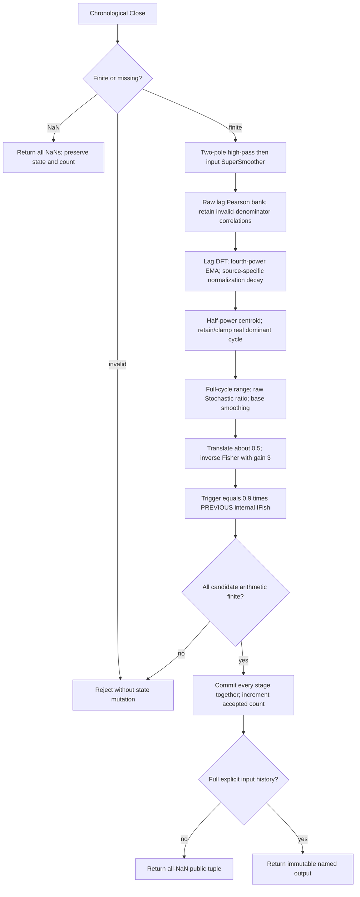

# Inverse Fisher Adaptive Stochastic — Chapter 15 research prototype master

`InverseFisherAdaptiveStochastic.update(close, time=None)` embeds the complete Chapter 11 Stochastic and applies Chapter 15 listing 15-2. This is a self-contained standard-library streaming reference for later conversion to five languages; it requires no sibling master. The exact original 252 closes are embedded in `__main__`.

Full `math.pi`, `math.sqrt(2.0)` and its reciprocal replace printed `3.14159`, `1.414` and `.707`. Trigonometric arguments use radians. Design decimals such as .2/.8, source-specific .991/.995, transform gains and clipping stay unchanged. State uses unrounded binary64; only exported data uses 15 significant digits. The original truncated-constant listing will differ slightly.

## Inverse Fisher of the smoothed adaptive Stochastic and delayed trigger

The returned `InverseFisherOutput` contains `value`, `trigger`, `dominant_cycle` and `lookback_length`. The untransformed smoothed Stochastic remains in `state.base_value`; its feedback is separate from transformed output. Chapter 15 changes only the plot-stage calculation:

$$u_t=2(y_t-0.5),\qquad
F_t=\frac{e^{2\cdot3\cdot u_t}-1}{e^{2\cdot3\cdot u_t}+1}=\tanh(3u_t),$$

$$T_t=0.9F_{t-1}.$$

For general gain $K$, the chapter's full equation is $F=(e^{2Ku}-1)/(e^{2Ku}+1)=\tanh(Ku)$, obtained by solving $u=\tfrac12\ln((1+F)/(1-F))$. This master fixes **K=3** and trigger attenuation **0.9** at listing 15-2 values.

A hyperbolic tangent acts like a soft limiter or saturating amplifier:

$$\frac{d\tanh(Ku)}{du}=K\operatorname{sech}^2(Ku),\quad
\lim_{u\to\pm\infty}\tanh(Ku)=\pm1.$$

Near zero it amplifies by three; near either extreme it suppresses small wiggles. At base values zero/one it gives $\pm\tanh(3)\approx\pm0.99505475368673$. The base SuperSmoother can overshoot $[0,1]$; do not clip it before transformation. Binary64 saturation can produce exactly $\pm1$, although the mathematical value is strictly inside those limits for finite input.

The ordinary numerical path follows the source exponential expression to preserve its rounding. If the exponent exceeds 700, return the limiting +1 without overflowing; at that size it is already indistinguishable from unity in binary64. Negative exponents safely underflow toward -1. This is an explicit finite-arithmetic extension of an exponential ratio that otherwise becomes infinity/infinity. Exponent multiplication overflow is rejected before any commit. A port may use `tanh(3*u)` with suitable fixture tolerance, but the source-compatible ordinary path is the master authority.

`IFish(0)` initializes the previous transformed value to **zero**, independently of `Stoc(0)` and the base smoother's zero state. On the first accepted bar the trigger is zero, even though inverse Fisher applied to zero base is near -1. On every subsequent accepted bar the trigger uses the previous **internally computed transformed value**, including startup bars masked publicly with NaN. It is not the transform of the previous raw Stochastic ratio, not the previous base value scaled by .9, and not the previous public tuple. The first public trigger is therefore finite; no extra NaN row is added because the Chapter 11 whole-bank warmup already supplies preceding history.

The pointwise transform adds no lag to the existing base calculation. The trigger deliberately delays one accepted observation. The book suggests upward/downward crossings for entries/exits; the master emits no orders or calibrated trade probabilities. Compression can simplify a display without demonstrating prediction accuracy.

## Adaptive observation interval

A changing oscillator period calls for an observation interval that tracks its cycle. RSI uses half a cycle of upward/downward changes; Stochastic uses a full cycle to include both range extremes. The causal periodogram can be noisy or ambiguous; the selected period is not statistical confidence. Filtering and smoothing retain their delay after the pointwise transform.

## Shared Roofing Filter equations

Let $x_t$ be Close, $H$ be `highpass_period`, $L$ be `smoothing_period`, and $h_t,f_t$ be high-pass and roofed outputs. Periods are in bars. Define

$$\theta_H=\frac{2\pi}{\sqrt2 H},\quad
\alpha_H=\frac{\cos\theta_H+\sin\theta_H-1}{\cos\theta_H},\quad q=1-\alpha_H.$$

$$h_t=(1-\alpha_H/2)^2(x_t-2x_{t-1}+x_{t-2})+2q h_{t-1}-q^2 h_{t-2}.$$

Equation 3-3's SuperSmoother follows:

$$a=e^{-\sqrt2\pi/L},\quad c_2=2a\cos(\sqrt2\pi/L),\quad c_3=-a^2,\quad c_1=1-c_2-c_3,$$

$$f_t=\frac{c_1}{2}(h_t+h_{t-1})+c_2f_{t-1}+c_3f_{t-2}.$$

The transfer functions are

$$H_{HP}(z)=\frac{(1-\alpha_H/2)^2(1-z^{-1})^2}{1-2qz^{-1}+q^2z^{-2}},\quad
H_{SS}(z)=\frac{(c_1/2)(1+z^{-1})}{1-c_2z^{-1}-c_3z^{-2}},\quad H_{Roof}=H_{HP}H_{SS}.$$

Two high-pass poles reject slow spectral dilation; their low-frequency roll-off is approximately 12 dB/octave compared with the source's approximate 6 dB/octave growth of swing amplitude with period. The SuperSmoother reduces high-frequency noise and has a feedforward zero at Nyquist, the highest representable frequency of one-half cycle per bar. Its poles act like an exponentially damped rotation. This is an analogy for the filter, not a physical equation for market prices.

**The oscillator's final SuperSmoother uses these same $c_1,c_2,c_3$ coefficients.** Changing `smoothing_period` changes both roofing smoothing and output smoothing. No independent EMA, clipping or output cutoff is inserted. The roof controls are independent of the searched cycle range; a compact range does not silently retune the roof. Fractional roof periods control coefficients and are not rounded into window lengths.

## Embedded Chapter 11 autocorrelation periodogram

Let $P_0,P_1$ be the minimum and maximum trial periods. All internal lags $\ell=0,\ldots,P_1$ are evaluated. For `averaging_length=A>0` use $M_\ell=A$; for zero use $M_\ell=\ell$. With $X_j=f_{t-j}$ and $Y_j=f_{t-\ell-j}$,

$$S_x=\sum_{j=0}^{M_\ell-1}X_j,\quad S_y=\sum_jY_j,\quad
S_{xx}=\sum_jX_j^2,\quad S_{xy}=\sum_jX_jY_j,\quad S_{yy}=\sum_jY_j^2.$$

$$V_\ell=(M_\ell S_{xx}-S_x^2)(M_\ell S_{yy}-S_y^2),$$

$$r_t(\ell)=\frac{M_\ell S_{xy}-S_xS_y}{\sqrt{V_\ell}}\quad(V_\ell>0).$$

If $V_\ell\le0$, retain the preceding **raw** correlation at that lag, initially zero. Do not map it to colors or reset it to zero. Lag zero at $A=0$ has no samples and retains zero; hidden lags zero through two are not included in the Fourier sum. Five sums visit samples newest first in source order. No centered-sum replacement, clamping or variance epsilon is added.

For every trial period $P=P_0,\ldots,P_1$,

$$C_t(P)=\sum_{n=3}^{P_1}r_t(n)\cos(2\pi n/P),\quad
S_t(P)=\sum_{n=3}^{P_1}r_t(n)\sin(2\pi n/P),$$

$$Q_t(P)=C_t(P)^2+S_t(P)^2,\qquad
R_t(P)=0.2Q_t(P)^2+0.8R_{t-1}(P).$$

The source explicitly squares `SqSum` again: $R$ smooths the **fourth power of Fourier amplitude**, not ordinary magnitude squared. This matters when reproducing dominant periods. The Fourier transform is across lag, while the EMA is across time. The Chapter 11 listings use a full 360-degree angle, without Chapter 8's local 370-degree anomaly.

Let $d$ be the listing-specific decay:

$$G_t=\max(dG_{t-1},\max_PR_t(P)),\quad
p_t(P)=\begin{cases}R_t(P)/G_t,&G_t\ne0,\\0,&G_t=0.\end{cases}$$

$G$ is a fast-attack, slow-decay normalization maximum. No minimum subtraction, cubic color enhancement, separate power normalization or spectral-dilation compensation is inserted. Correlations themselves are amplitude normalized. The zero-maximum branch defines otherwise undefined divisions as an all-zero spectrum, preserving finite feedback. The embedded listing does not guard this zero division; the all-zero spectrum is an explicit finite-stream extension.

Select only normalized bins at or above one-half:

$$W_t=\sum_{P:p_t(P)\ge0.5}p_t(P),\quad
W_{x,t}=\sum_{P:p_t(P)\ge0.5}Pp_t(P),$$

$$D_t^*=\begin{cases}W_{x,t}/W_t,&W_t\ne0,\\D_{t-1},&W_t=0,\end{cases}\qquad
D_t=\min(P_1,\max(P_0,D_t^*)).$$

The source clamps an initially zero dominant period to its lower bound. This master initializes the equivalent fallback to $P_0$. If no cycle ever exists, the public period still becomes $P_0$ once history is primed, because that fallback is used to tune the source indicator. `state.cycle.has_cycle` distinguishes a measured/retained centroid from this fallback. Empty later selections hold the previous cycle. `dominant_cycle` is real-valued and must not be rounded before tuning or division.

**The embedded Stochastic uses $d=0.995$**, as printed in listing 11-2. The Chapter 11 RSI uses 0.991, so substituting its engine would change the result.

## Configuration, API and initialization

| Parameter | Default | Valid range and role |
| --- | --- | --- |
| `min_period` | 10 | Integer $\ge6$; first trial cycle and fallback lower bound. |
| `max_period` | 48 | Integer $\ge\texttt{min_period}$; final trial cycle, including a single-bin range. |
| `averaging_length` | 3 | Integer zero or $\ge2$; zero gives $M=\ell$. One is rejected as a degenerate correlation window. |
| `highpass_period` | 48.0 | Finite real $\ge5$ yielding resolvable stable coefficients. |
| `smoothing_period` | 10.0 | Finite real $\ge2$ yielding resolvable stable coefficients; shared by input and output smoothing. |

`max_period` controls both the Fourier lag range and cycle search. It is not a scalar lookback selected once at construction. Its minimum of six leaves at least a three-change RSI window and keeps all adaptive tunings strictly slower than Nyquist. No arbitrary upper cap is imposed, but storage and computation grow with the chosen range. Coefficient periods so large that poles numerically collapse are rejected. Booleans are not valid numerical parameters.

All absent raw prices, roof outputs, correlations, powers, maximum and output smoother histories are explicitly zero. The first finite Close is accepted as standalone CurrentBar=1. The roof, estimator and oscillator update from that first bar using their defined prehistory, even while public outputs are NaN. A nonzero constant input has an initial transient from absent zero closes. Do not seed prices with the first actual Close, postpone the estimator until full history, clear it when the cycle changes, or replay old oscillator windows.

NaN input means an omitted observation: return all-NaN output and preserve state, accepted count and last accepted `output`. Infinity, bool input, invalid parameters and arithmetic overflow raise `ValueError` before state commit. Time is optional, ignored by scalar calculations. `parameters` is immutable; `samples_seen` counts accepted finite inputs; `warmup_bars` counts leading unavailable outputs; `is_primed` marks full required history, not convergence. `state` exposes immutable diagnostics. `reset()` clears all histories while keeping coefficients and configuration.

The estimator's required correlation history is

$$N_{corr}=P_1+(A\text{ if }A>0\text{ else }P_1).$$

Each public output waits for this full bank history, plus the indicator-specific history stated below. All named output fields share that NaN prefix. Internal state and the prior oscillator result used for smoothing are never replaced by public NaN values. Defaults have $N_{corr}=51$ and publish first at bar 51, index 50. A commercial platform with earlier price data can match this reference only after matching its initial conditions and evaluation history.

## Fixture generation and porting

The user confirmed all **36 combinations**, twelve per folder, on 2026-10-22. Every folder retains the original four 252-element OHLC input arrays in the five language fixtures, although only Close is used. The master embeds the exact Close array in `__main__`. Expected values use 15 significant digits; all-NaN startup rows are exported as ordinary per-component scalar arrays. Parameter tokens are `P0`, `P1`, `A`, `HP`, `LP` with decimal points changed to underscores. Component suffixes identify the named output fields. Each array has a description comment and a parameter/input comment.

Run `python3 inverse-fisher-adaptive-stochastic.py` for the streaming demonstration, `python3 inverse-fisher-adaptive-stochastic.py --generate-reference-data` to regenerate marked expected sections, and `python3 verify_reference_data.py` to verify all five languages against the master. Python expected arrays are reopened and checked before translating their rounded values to the other languages. Go package names strip hyphens and underscores from the folder name; NaN spelling is `math.NaN()`, TypeScript `NaN`, Rust `f64::NAN` and Zig `nan` using the supplied standard math declarations. All functions/arrays retain the valid language forms of the established fixture templates.

Binary64 libm results can vary in their last bits across languages. Compare NaN placement exactly, and finite values with combined absolute and relative tolerances (for example $10^{-10}$ for this supplied record). A port must preserve the adaptive integer-bound semantics, newest-first sums, source-specific decay, guard conditions and previous-bar ratio definitions. Running future bars must never change earlier returned values.

## Autocorrelation background and source interpretation

Chapter 8 motivates the calculation by analogy with noisy radar reflections: an exponentially filtered random input can retain memory even though its new innovations are random. A one-pole memory model is $y_t=\eta u_t+(1-\eta)y_{t-1}$. The chapter also gives the long-memory power-law form

$$\operatorname{Autocorrelation}(\ell)=C\ell^{-\alpha},\qquad \ell>0,$$

as contextual motivation, not an equation evaluated by this indicator or a universal market law. For an ideal sine wave $f_t=a\sin(2\pi t/T+\phi)$ and an appropriate full-cycle average, the normalized autocorrelation is

$$r(\ell)=\cos(2\pi\ell/T).$$

It is $+1$ at zero/full-cycle lag and $-1$ at half-cycle lag. Thus a Fourier analysis of lag correlations exposes cyclic recurrence, independent of the sine amplitude. Short, finite Pearson windows do not equal this ideal cosine exactly, and may saturate at $\pm1$ for two samples. No physical sinusoidal model is fitted to Close.

The Chapter 8 prose connects cosine and sine parts through the identity

$$a^2=a^2\sin^2(\theta)+a^2\cos^2(\theta).$$

The implementation follows the **actual Chapter 11 fourth-power smoothing expression** already given above. It does not substitute the ordinary power suggested by that prose identity. Similarly, Chapter 8's listing contains 370 degrees and its prose says decay 0.991 while its code says 0.995; each Chapter 11 listing explicitly uses 360 degrees and its own decay. The source code chosen for this master resolves these discrepancies.

The two-pole Roofing Filter is not an ideal brick-wall pass band, and its output is not guaranteed to have an exactly zero mean on every finite record. The book's spectral-dilation and aliasing discussions motivate the cutoffs; they are not empirical validation of this dataset. The SuperSmoother equations above are the complete relevant Equation 3-3 with full mathematical precision and the **positive feedback signs** used in Chapter 11. The modified Butterworth equations elsewhere in Chapter 3 are different filters and are not additional stages here.

The normalization is an amplitude/envelope operation rather than a probability. A strongest period still exists when a noisy record has no economically meaningful cycle. The public fallback and diagnostics let a port reproduce this behavior without interpreting a selected period as statistical confidence.

## Stochastic calculation and full-cycle rationale

The observation window must contain both a cycle's highest and lowest roofed values. Thus the listing uses a full dominant cycle, with the integer counter visiting all $j\le D_t-1$:

$$K_t=\lfloor D_t-1\rfloor+1=\lfloor D_t\rfloor.$$

Retain the real $D_t$ for diagnostics and never round it to nearest integer. For instance, $D_t=17.9$ visits indices zero through 16 and uses 17 samples.

$$H_t=\max_{0\le j<K_t}f_{t-j},\qquad
L_t=\min_{0\le j<K_t}f_{t-j},\qquad B_t=H_t-L_t,$$

$$q_t=\begin{cases}(f_t-L_t)/B_t,&B_t\ne0,\\q_{t-1},&B_t=0,\end{cases}$$

$$y_t=\frac{c_1}{2}(q_t+q_{t-1})+c_2y_{t-1}+c_3y_{t-2}.$$

The listing initializes `HighestC` and `LowestC` with the **current roofed value**, then visits the window. It smooths the ratio directly with the already computed SuperSmoother coefficients; it does not smooth the numerator and denominator separately and does not introduce a second %D line.

The source has an unguarded `0/0` on a flat window. This reference explicitly retains the preceding ratio in that branch and continues the smoother. Its initial ratio is **zero, matching `Stoc(0)`**, including the ratio's previous-bar value on the first nonflat observation. A zero-only stream consequently stays at zero. Inserting a neutral 0.5 seed would alter ordinary startup outputs and is not the source's initial condition. A positive constant Close is a different experiment: zero raw prehistory produces a nonflat roof startup transient.

The embedded base produces fraction-scale smoothed Stochastic, a real-valued dominant cycle and a lookback measured in roofed samples. The public `value` is its inverse Fisher transform, with cycle and lookback exported unchanged and an additional delayed transformed trigger. Raw nonflat $q_t$ is within $[0,1]$; the final recursive output can overshoot, and remains unclipped. The plotted .3/.7 levels are reference lines only. This uses Close alone, not rolling OHLC extrema as in some conventional Stochastic implementations.

Required public history is

$$N_{Stoch}=\max(N_{corr},P_1),\qquad
\texttt{warmup\_bars}=N_{Stoch}-1.$$

The default has **50 leading NaNs** and publishes first at bar 51. All states still evolve before that bar.

## Calculation flow



Candidate arithmetic is separate from commit. A downstream failure cannot leave the roof or cycle estimator one bar ahead. Missing observations do not shift the preceding-value trigger or derivative history. Every returned tuple is immutable and future observations cannot revise it.

For maximum period $P_1$ and $B=P_1-P_0+1$ trial bins, fixed-average updates take $O(P_1A+P_1B)$ work; lag-dependent averages take $O(P_1^2)$ work. Cached trigonometric tables use $O(P_1B)$ memory and bounded dynamic histories use $O(P_1+A)$ for fixed averages or $O(P_1)$ for lag-dependent averages. Adaptive oscillator window work is at most $O(P_1)$ and the final transform is $O(1)$.

## Confirmed reference combinations

All twelve cases were confirmed in the 36-case Chapter 14–15 family plan on 2026-10-22. Each component array contains 252 values.

| Case | Parameters | What it tests |
| --- | --- | --- |
| 1 | `min_period=10, max_period=48, averaging_length=3, highpass_period=48.0, smoothing_period=10.0` | Published defaults and listing-specific periodogram decay. |
| 2 | `min_period=10, max_period=48, averaging_length=0, highpass_period=48.0, smoothing_period=10.0` | Lag-dependent Pearson windows and longer priming history. |
| 3 | `min_period=10, max_period=48, averaging_length=2, highpass_period=48.0, smoothing_period=10.0` | Two-sample Pearson windows with strong sign changes. |
| 4 | `min_period=10, max_period=48, averaging_length=5, highpass_period=48.0, smoothing_period=10.0` | Less reactive fixed correlation window. |
| 5 | `min_period=10, max_period=48, averaging_length=20, highpass_period=48.0, smoothing_period=10.0` | Longer correlation window and delayed tuning. |
| 6 | `min_period=10, max_period=48, averaging_length=100, highpass_period=48.0, smoothing_period=10.0` | Long fixed Pearson history. |
| 7 | `min_period=10, max_period=48, averaging_length=3, highpass_period=48.0, smoothing_period=10.5` | Fractional roofing/output SuperSmoother cutoff. |
| 8 | `min_period=10, max_period=48, averaging_length=3, highpass_period=80.0, smoothing_period=20.0` | Slower independent roofing and output smoothing. |
| 9 | `min_period=6, max_period=24, averaging_length=3, highpass_period=24.0, smoothing_period=6.0` | Compact short-cycle estimator and adaptive windows. |
| 10 | `min_period=20, max_period=20, averaging_length=3, highpass_period=48.0, smoothing_period=10.0` | Single cycle bin, integer-bound window behavior and deterministic tuning. |
| 11 | `min_period=10, max_period=48, averaging_length=204, highpass_period=48.0, smoothing_period=10.0` | 252-observation history boundary: first public result at final close. |
| 12 | `min_period=24, max_period=60, averaging_length=3, highpass_period=60.0, smoothing_period=12.0` | Longer-cycle estimator and adaptive windows. |

## Example, fixture generation and conversion files

```sh
python3 inverse-fisher-adaptive-stochastic.py
python3 inverse-fisher-adaptive-stochastic.py --generate-reference-data
python3 verify_reference_data.py
python3 -m unittest discover -s . -p 'test_master.py'
```

The default run processes all 252 embedded closes chronologically and prints the last named output. Import a hyphenated research filename with `importlib.util.spec_from_file_location`, then construct `InverseFisherAdaptiveStochastic()` and call `update(close)` for each observation; a target language may use its idiomatic module naming.

The Python master is the numerical specification and generator; this description is the standalone theoretical specification. `test_testdata.py`, `testdata_test.go`, `testdata.ts`, `testdata.rs`, `testdata.zig` preserve four input arrays and contain **48 expected component arrays per language**. `test_master.py` compares the bounded stream against an independent full-history source transcription. `verify_reference_data.py` checks all five languages' exact rounded values, comments, names, dimensions, NaNs and preserved inputs.

The generator writes Python expected arrays first, reopens them and checks every 15-significant-digit value, then translates those authoritative rounded literals into the other four languages. Re-running replaces only the marked generated section. Names use uppercase parameter shortcuts after `EXPECTED_`, a component suffix, and underscores instead of decimal points; Go/TypeScript/Zig start `expected` and Rust uses `expected_` plus lowercase shortcuts. Go package names strip hyphens/underscores. NaNs are Python/TypeScript `NaN`, Go `math.NaN()`, Rust `f64::NAN` and Zig `nan` with standard math declarations. Every array has the two approved description/parameter comments.

Keep binary64 recursive state unrounded in every port. Preserve operation order and full mathematical constants; finite libm results can vary in their last bits, so compare finite port results with a combined absolute/relative tolerance such as $10^{-10}$ and NaN masks exactly. No foreign-language indicator implementation is claimed merely because its fixtures compile.

## Validation record

Completed on 2026-10-22:

- **11 Python tests passed** in this folder; **32** passed across the three-master family. All twelve confirmed cases match an independent full-history transcription of the source, including internal values and public NaN masks. Zero input, reset, immutable snapshots, skipped inputs, parameter validation and atomic arithmetic/transform rejection passed.
- Exact five-language fixture verification passed: **48 arrays and 12,096 values per language** in this folder. Family total is **108 arrays and 27,216 values per language**. Original OHLC inputs, every 15-significant-digit decimal, NaN mask, name and both metadata comments are verified.
- All five fixtures in this folder regenerate **byte-for-byte identically**; family total is fifteen files.
- Go 1.27.1, Rust 1.98.1 and Zig 0.16.0 compiled and ran fixture harnesses checking every expected array's length, finite/NaN partition and final value. Node 24.15.0 loaded the TypeScript fixtures with type stripping and passed the same checks. A separate TypeScript compiler was not used.
- Python syntax, whitespace and local source-reference links passed.

The independent source oracle uses full-precision mathematical constants and the documented zero-prehistory/undefined-division conventions, with a combined absolute/relative comparison tolerance of $5\times10^{-10}$. TradeStation was not executed; its platform history and truncated mathematical constants can change results. The fixture verifier compares exact rounded export values. Foreign compiler checks validate reference fixtures, not completed indicator ports.

Tests verify zero initial IFish trigger, the preceding internal transformed value at the first public row, safe positive exponential saturation and the mathematical tanh identity. A204 has one finite output at the final close; a separately tested A205 requirement leaves the whole record unprimed.

## Sources and BibTeX

The numerical authority is Chapter 15 listing 15-2 applied to Chapter 11 listing 11-2. Shared theory is Chapter 3 equation 3-3, Chapter 7 Roofing Filter and Chapter 8 autocorrelation/periodogram. The numerical source-specific normalization decay is 0.995. No newer RSI/Stochastic or generic Fisher implementation replaces this base.

- John F. Ehlers, *Cycle Analytics for Traders: Advanced Technical Trading Concepts*, Wiley, 2013. [Book and bibliographic record](../../2013-cycle-analytics-for-traders/toc.md), [Chapter 14](../../2013-cycle-analytics-for-traders/ch14.md), [Chapter 15](../../2013-cycle-analytics-for-traders/ch15.md), [Chapter 11](../../2013-cycle-analytics-for-traders/ch11.md), [Chapter 3](../../2013-cycle-analytics-for-traders/ch3.md), [Chapter 7](../../2013-cycle-analytics-for-traders/ch7.md), [Chapter 8](../../2013-cycle-analytics-for-traders/ch8.md).

```bibtex
@Book{ehlers2013cycle,
  author = {Ehlers, John F.},
  title = {Cycle Analytics for Traders: Advanced Technical Trading Concepts},
  publisher = {Wiley},
  year = {2013},
  series = {Wiley Trading},
  isbn = {9781118728604}
}
```

The following source excerpts retain printed approximations and historical interpretation. Port the full-precision equations and explicit finite-stream rules above. Statistical claims in the historical text do not supersede the qualifications above.

## Original Chapter 11 section and Listing 11-2

The following local book section is included so a conversion agent can inspect the complete published calculation without access to the input repository. The EasyLanguage listing retains its printed constants and comments, including source errors already explained above. **Port the full-precision equations and explicit initialization/undefined-division rules in this document**, rather than treating these printed approximations as the fixture authority. Figure assets are omitted; captions are retained. Claims in the historical source narrative do not replace the mathematical interpretations above.


The basic idea of the stochastic indicator is that it measures the current closing price relative to the lowest close over the observation range, and normalize that relative price to the range between the highest close and the lowest close over the observation range. Since finding the highest close and lowest close over the dominant cycle period is assured only by searching over the entire dominant cycle period, the entire dominant cycle period is used for the observation range in the calculations.

The adaptive stochastic indicator starts with the computation of the dominant cycle using the autocorrelation periodogram approach. Rather than ­describing the computations, the reader is referred to the description in Chapter 8. Code Listing 11-2 contains the EasyLanguage code for the adaptive stochastic indicator, and the identification of the indicator itself following the dominant cycle calculation is noted by the comment near the end. Since the objective is to use only those frequency components passed by the roofing filter, the variable Filt is used as a data input rather than closing prices.

The first step is to identify the highest “close” and the lowest “close” over the period of the current dominant cycle. The variable Stoc is computed as the ratio of the current value of Filt to the price range and is the unfiltered value of the adaptive stochastic. The Stoc variable is filtered using the SuperSmoother filter first describe in Chapter 3. Rather than independently taking the averages of the numerator and denominator, I chose to perform smoothing on the ratio Stoc using the SuperSmoother filter described in Chapter 3. The coefficients for the SuperSmoother filters have previously been computed in the dominant cycle measurement part of the code. I have included reference lines at the $30$ percent and $70$ percent levels, but these can easily be adjusted to $20$ percent/$80$ percent or whatever else serves the purpose.

**Code Listing 11-2. EasyLanguage Code for the Adaptive Stochastic Indicator**

```easylanguage
{
  Adaptive Stochastic
  (c) 2013 John F. Ehlers
}
Vars:
  AvgLength(3),
  M(0),
  N(0),
  X(0),
  Y(0),
  alpha1(0),
  HP(0),
  a1(0),
  b1(0),
  c1(0),
  c2(0),
  c3(0),
  Filt(0),
  Lag(0),
  count(0),
  Sx(0),
  Sy(0),
  Sxx(0),
  Syy(0),
  Sxy(0),
  Period(0),
  Sp(0),
  Spx(0),
  MaxPwr(0),
  DominantCycle(0);

Arrays:
  Corr[48](0),
  CosinePart[48](0),
  SinePart[48](0),
  SqSum[48](0),
  R[48, 2](0),
  Pwr[48](0);

//Highpass filter cyclic components whose periods are shorter than 48 bars
alpha1 = (Cosine(.707*360 / 48) + Sine (.707*360 / 48) - 1) / Cosine(.707*360 / 48);

HP = (1 - alpha1 / 2)*(1 - alpha1 / 2)*(Close - 2*Close[1] + Close[2]) + 2*(1 - alpha1)*HP[1] - (1 - alpha1)*(1 - alpha1)*HP[2];

//Smooth with a Super Smoother Filter from equation 3-3
a1 = expvalue(-1.414*3.14159 / 10);
b1 = 2*a1*Cosine(1.414*180 / 10);
c2 = b1;
c3 = -a1*a1;
c1 = 1 - c2 - c3;
Filt = c1*(HP + HP[1]) / 2 + c2*Filt[1] + c3*Filt[2];

//Pearson correlation for each value of lag
For Lag = 0 to 48 Begin
  //Set the averaging length as M
  M = AvgLength;
  If AvgLength = 0 Then M = Lag;
  Sx = 0;
  Sy = 0;
  Sxx = 0;
  Syy = 0;
  Sxy = 0;

  For count = 0 to M - 1 Begin
    X = Filt[count];
    Y = Filt[Lag + count];
    Sx = Sx + X;
    Sy = Sy + Y;
    Sxx = Sxx + X*X;
    Sxy = Sxy + X*Y;
    Syy = Syy + Y*Y;
  End;

  If (M*Sxx - Sx*Sx)*(M*Syy - Sy*Sy) > 0 Then Corr[Lag] = (M*Sxy - Sx*Sy)/SquareRoot((M*Sxx - Sx*Sx)*(M*Syy - Sy*Sy));
End;

For Period = 10 to 48 Begin
  CosinePart[Period] = 0;
  SinePart[Period] = 0;

  For N = 3 to 48 Begin
    CosinePart[Period] = CosinePart[Period] + Corr[N]*Cosine(360*N / Period);
    SinePart[Period] = SinePart[Period] + Corr[N]*Sine(360*N / Period);
  End;

  SqSum[Period] = CosinePart[Period]*CosinePart[Period] + SinePart[Period]*SinePart[Period];
End;

For Period = 10 to 48 Begin
  R[Period, 2] = R[Period, 1];
  R[Period, 1] = .2*SqSum[Period]*SqSum[Period] + .8*R[Period, 2];
End;

//Find Maximum Power Level for Normalization
MaxPwr = .995*MaxPwr;
For Period = 10 to 48 Begin
  If R[Period, 1] > MaxPwr Then MaxPwr = R[Period, 1];
End;

For Period = 3 to 48 Begin
  Pwr[Period] = R[Period, 1] / MaxPwr;
End;

//Compute the dominant cycle using the CG of the spectrum
Spx = 0;
Sp = 0;
For Period = 10 to 48 Begin
  If Pwr[Period] >= .5 Then Begin
    Spx = Spx + Period*Pwr[Period];
    Sp = Sp + Pwr[Period];
  End;
End;

If Sp <> 0 Then DominantCycle = Spx / Sp;
If DominantCycle < 10 Then DominantCycle = 10;
If DominantCycle > 48 Then DominantCycle = 48;

//Stochastic Computation starts here
Vars:
  HighestC(0),
  LowestC(0),
  Stoc(0),
  SmoothNum(0),
  SmoothDenom(0),
  AdaptiveStochastic(0);

HighestC = Filt;
LowestC = Filt;

For count = 0 to DominantCycle - 1 Begin
  If Filt[count] > HighestC then HighestC = Filt[count];
  If Filt[count] < LowestC then LowestC = Filt[count];
End;

Stoc = (Filt - LowestC) / (HighestC - LowestC);
AdaptiveStochastic = c1*(Stoc + Stoc[1]) / 2 + c2*AdaptiveStochastic[1] + c3*AdaptiveStochastic[2];

Plot1(AdaptiveStochastic);
Plot2(.7);
Plot6(.3);
```

The adaptive Stochastic has been applied to Dollar General (symbol DG) over roughly the last year in Figure 11.2. An eyeball scan comparing the prices and the adaptive stochastic shows that this indicator accurately portrays the relative detrended prices over the length of the dominant cycle period, and has many characteristics in common with the adaptive RSI.

[The source figure is omitted; its caption is retained below.]

**Figure 11.2** *Adaptive Stochastic Accurately Displays the Relative Detrended Prices over the Channel Length of the Dominant Cycle Period*


## Original Chapter 15 transform section


Whereas the Fisher transform expands the base indicator near the extremes, the purpose of the inverse Fisher transform is to compress the indicator in these regions. By compressing values near the extremes many extraneous and irrelevant wiggles are removed from the indicator, making interpretation of the real meaning of the indicator be far simpler. In a sense, the inverse Fisher transform acts as a soft limiter.

The equation for the inverse Fisher transform is

$$\text{Output} = \frac{e^{(2\cdot K\cdot\text{Input})}-1}{e^{(2\cdot K\cdot\text{Input})}+1}$$

The input may have as large a value as desired. If the input values are very large, then the exponential terms in both the numerator and denominator are very large compared to one, and so the output is approximately $1$. If the input values are very large, but negative, then the exponential terms in both the numerator and denominator are very small compare to one, with the result that the output is approximately $−1$. The $K$ in the expression is an optional amplifying term because conventional indicators already fall between the limits of $−1$ and $+1$, and so amplifying them is necessary to reap the benefits of the soft limiting of the inverse Fisher transform.

[Source figure omitted; caption retained.]

**Figure 15.3** *Transfer Response of the Inverse Fisher Transform Shows the Compression of Larger Values of the Input*

The transfer response of the inverse Fisher transform is shown in Figure 15.3. The input values are shown by the straight line, and the output values are shown by the curved line. This graphical representation shows how larger and larger absolute values of the input are compressed to essentially be unity.

To implement the inverse Fisher transform on an adaptive Stochastic indicator, replace the plot statements of Code Listing 11-2 with the code fragment given in Code Listing 15-2. I have chosen to amplify the adaptive Stochastic by a factor of $3$ when taking the inverse Fisher transform.

**Code Listing 15-2. EasyLanguage Code Fragment to Implement the Inverse Fisher Transform on the Adaptive Stochastic Indicator**

```easylanguage
Vars:
 IFish(0);

Value1 = 2*(AdaptiveStochastic - .5);
IFish = (ExpValue(2*3*Value1) - 1) / (ExpValue(2*3*Value1) + 1);

Plot1(IFish);
Plot4(.9*IFish[1]);
```

I have also included a trigger line, which is just the inverse Fisher transform delayed by one bar and attenuated to 90 percent. The crossings of the inverse Fisher transform line and the trigger line provide clear and unequivocal indications for the buy and sell points, as demonstrated in the example of Figure 15.4.

[Source figure omitted; caption retained.]

**Figure 15.4** *The Inverse Fisher Transform of the Adaptive Stochastic Indicator Gives Clear and Unambiguous Indications of the Proper Buy and Sell Points*

The use of the inverse Fisher adaptive Stochastic indicator involves the crossings of the inverse Fisher line and the trigger line. When the inverse Fisher line crosses over the trigger line, then buy. When the inverse Fisher line crosses under the trigger line, then sell short, or if you choose, exit the long position. The inverse Fisher transform should be one of the biggest weapons in your arsenal of trading indicators and strategies. Its use as a soft limiter is universal and can help remove many of the distracting and irrelevant squiggles in your indicators. The only constraint should be that the original input has a nearly a zero mean. You may need to amplify the input to attain the desired compression at the output. If you want a simple “digital” output, just amplify the input by a large amount.

