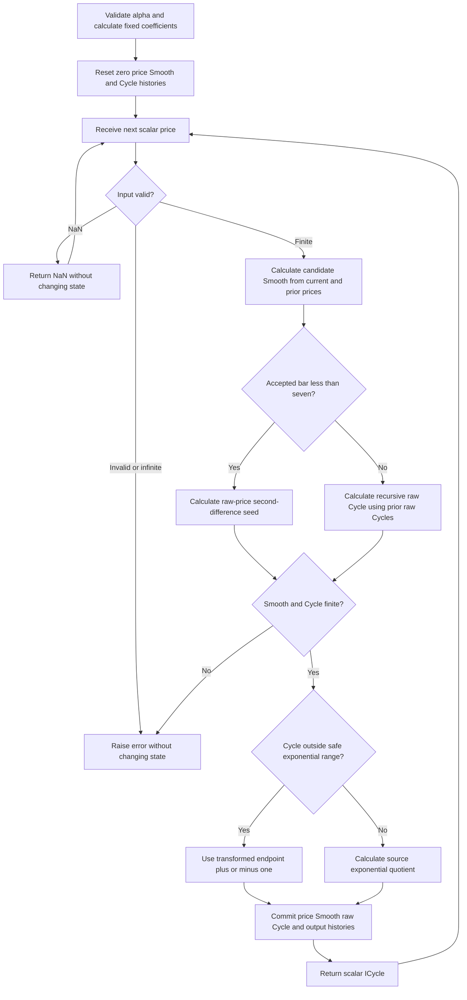

# Inverse Fisher Cyber Cycle

This folder is the standalone **research prototype master reference** for the Cyber Cycle variant in John F. Ehlers' May 2004 article **“The Inverse Fisher Transform”**, its corresponding MESA paper, and the TradeStation Traders' Tip. The indicator smooths a scalar price, applies the recursive Cyber Cycle filter, and compresses its variable-amplitude output through the inverse Fisher transform.

`InverseFisherCyberCycle.update(price)` returns a single floating-point value: the source's **ICycle**. The raw Cycle and Smooth are exposed as diagnostics, not additional reference output arrays. The only numerical configuration parameter is `alpha`, default 0.07. The plotted reference lines at +0.5 and −0.5 are constants for interpretation, not filter parameters.

The implementation uses only Python's standard library and bounded state. It has no dependency on another prepared indicator. The requested fixtures use **`INPUT_CLOSE`** as the selected scalar price; the article's default $(H+L)/2$ can be supplied by the caller instead.

## Numerical authority and source contract

The Cyber Cycle equations in [the article](../../tasc/2004-05-the-inverse-fisher-transform/content.md), [the MESA paper](../../tasc/2004-05-the-inverse-fisher-transform/mesa/content.md) and [TradeStation IFT.els](../../tasc/2004-05-the-inverse-fisher-transform/tips/IFT.els) agree. They are the numerical authority. The master preserves their multiplication/addition order and six-bar startup override.

| Source detail | Master behavior |
|---|---|
| Price defaults to `(H+L)/2` | Accept an already selected scalar. Use Close for these fixtures, as requested. |
| `Smooth = (Price + 2*Price[1] + 2*Price[2] + Price[3])/6` | Calculate on every accepted bar, including all startup bars. |
| `If CurrentBar < 7 then Cycle = ...` | Bars 1–6 use raw-price second differences divided by 4. At bar 7, begin the recursive Smooth-based equation. |
| The recursive Cycle is assigned before the startup override | Store only the surviving startup Cycle. The discarded recursive candidate has no side effects and need not be evaluated. |
| `Cycle[1]` and `Cycle[2]` appear in feedback | Store **untransformed Cycle**, including the startup seeds. Never substitute ICycle. |
| `ICycle = (ExpValue(2*Cycle)-1)/(ExpValue(2*Cycle)+1)` | Use the literal exponential quotient on its ordinary finite domain; do not add gain, normalization, centering or another smoother. |
| `Plot1(ICycle)` is unconditional | Return a valid source startup value from the first accepted bar. Do not invent a six-bar NaN mask. |
| Finite-record prehistory is not specified for a chart | Explicitly initialize all absent price, Smooth and Cycle lags to zero. Chart comparison requires matching earlier history. |
| Exponential overflow is unguarded | For finite Cycle above +350 or below −350, return the binary64 limiting +1 or −1 before doubling/exponentiating. |

The ordinary master path matches an independent chronological transcription of the article **exactly** for all 252 supplied closes and all 12 confirmed alphas, including every Smooth, raw Cycle and ICycle value. The overflow guard is an explicit arithmetic extension for very large finite inputs; it does not affect these reference cases.

No irrational coefficient is truncated in the supplied Cyber Cycle code. The constants 0.5, 2, 4 and 6 are exact rational design values, while alpha 0.07 is the intended parameter. Internal state uses full binary64 precision. Any $\pi$, logarithm or hyperbolic function in this document explains the mathematics; it does not introduce a different coefficient design.

### Traders' Tips differences

The [May 2004 tips](../../tasc/2004-05-the-inverse-fisher-transform/tips/tips.md) contain many implementations, with meaningful differences:

| Source | Difference or corroboration |
|---|---|
| TradeStation, Mark Mills | The Cyber Cycle strategy repeats the article's exact equations and first-six-bar override. Its buy/sell thresholds affect strategy execution, not ICycle. The RSI strategy's alpha 0.1 is an RSI scaling factor and must not replace the Cyber Cycle default 0.07. |
| MESA paper | Repeats both article variants and the exact Cyber Cycle listing. No additional Cyber Cycle normalization is supplied. |
| [eSignal IFT.efs](../../tasc/2004-05-the-inverse-fisher-transform/tips/IFT.efs), TS Support LLC | Smooth's midpoint expansion agrees, but the startup expression has **twice the required lag-two midpoint**: $(p_t-2p_{t-1}+2p_{t-2})/4$. Its zero-based oldest-bar difference `<7` can also select seven seed bars. These startup semantics differ from the article and are not used. |
| [AmiBroker IFT.afl](../../tasc/2004-05-the-inverse-fisher-transform/tips/IFT.afl), Tomasz Janeczko | Sets the initial Cycle array to one scalar second difference from the first three prices, then starts recursion at zero-based index 6. Thus the first six stored Cycles are that same scalar, not six chronological second differences. Later transients differ. |
| [MetaStock IFT.mss](../../tasc/2004-05-the-inverse-fisher-transform/tips/IFT.mss), William Golson | Supplies recursive formulas without the article's explicit six-bar override. Platform PREV and initialization conventions determine the startup. |
| [NeoTicker IFT.ntk](../../tasc/2004-05-the-inverse-fisher-transform/tips/IFT.ntk) | Its printed smoother uses a lag-three weight of **2**, instead of 1, giving weights summing to $7/6$. Its recursive `Cycle_ge_7` retains its own history separately from the selected seed series. Both change the result. |
| [Aspen IFT.asp](../../tasc/2004-05-the-inverse-fisher-transform/tips/IFT.asp) | Repeats the source coefficient expressions and `<7` override with platform bar-count notation. |
| TradingSolutions | Its conditional internal-cycle formula expresses the same smoother, second difference, recursive coefficients and seed branch, subject to matching bar numbering and history. |
| [Financial Data Calculator IFT.fdc](../../tasc/2004-05-the-inverse-fisher-transform/tips/IFT.fdc) | Uses `tanh` in the inverse Fisher macros, corroborating the mathematical identity. The Cyber Cycle macro is expressed through platform weighted filters and first-six-bar handling. |
| Wealth-Lab | Delegates Cyber Cycle and inverse Fisher to included external libraries; their internals are not printed in the supplied listing. |

The eSignal file contains two studies with duplicate `main` declarations; the Cyber Cycle is the second study. It cannot serve as an unchanged article-equivalence oracle because its startup mathematics already differs. This master tests against the shared article/MESA/TradeStation equations instead.

## Principles and physical analogies

Ehlers' simplified market model splits price into trend and cyclic components. Slowly changing trend corresponds to low frequencies; rapid bar-to-bar noise corresponds to high frequencies. The four-tap smoother suppresses the fastest components, while the Cyber Cycle's high-pass section rejects constant level and slow changes. Their combination behaves like a bandpass response, leaving intermediate cyclic movement.

An electronics analogy is a smoothing network followed by two coupling/high-pass sections. A coupling section rejects a sustained constant voltage but passes changes; two such sections emphasize changes of changes. The second difference $x_t-2x_{t-1}+x_{t-2}$ is the discrete counterpart of curvature or acceleration. A straight-line price ramp has zero second difference, while a curved or oscillating path does not.

Recursive poles retain memory. With the conventional alpha domain, the two poles are repeated positive real values, so their natural transient is a decaying combination of an exponential and an exponential times bar count. These are not rotating complex poles or an automatic market-cycle estimator. A small alpha makes the decay longer; changing alpha changes filtering and phase response, not a directly measured cycle period.

The raw Cyber Cycle has variable amplitude in the chosen price units. The inverse Fisher transform acts like a **smooth saturating amplifier**: near zero it is approximately linear, while sufficiently large positive or negative values approach +1 or −1. This makes strong excursions look more decisive, but does not create new timing information or distinguish a real cycle from a transient.

The transform does not normalize prices. Multiplying all prices by $k$ multiplies the raw Cycle by $k$, but changes the nonlinear output to $\tanh(kC)$. A price quoted in cents rather than dollars can therefore saturate much more strongly. No adaptive amplitude normalizer or gain parameter is present in the source.

## Complete mathematical background from the sources

The following equations include the Fisher/inverse Fisher mathematics, the article's contrasting RSI construction, and every operation required for the Cyber Cycle variant. Use $p_t$ for raw price, $S_t$ for Smooth, $C_t$ for raw Cycle and $I_t$ for ICycle.

### Fisher transform and its inverse

For a normalized variable $r\in(-1,1)$, the article and MESA paper define the Fisher transform as

$$y=\frac12\ln\left(\frac{1+r}{1-r}\right)=\operatorname{atanh}(r).$$

Exponentiating and solving for $r$ gives

$$e^{2y}=\frac{1+r}{1-r},$$

$$r(1+e^{2y})=e^{2y}-1,$$

$$r=\frac{e^{2y}-1}{e^{2y}+1}=\tanh(y).$$

The direct Fisher transform is expansive near its domain endpoints; the inverse is compressive. In the target indicator, **Cycle is the input $y$ of the inverse**, so the final equation is

$$I_t=\frac{e^{2C_t}-1}{e^{2C_t}+1}=\tanh(C_t).$$

Do not apply `atanh` to Cycle, clamp Cycle to $(-1,1)$, or first Fisher-transform it. The article applies the inverse directly to the oscillator's raw output.

The inverse response has

$$\frac{d\tanh(y)}{dy}=1-\tanh^2(y)=\operatorname{sech}^2(y),$$

$$\tanh(y)=y-\frac{y^3}{3}+\frac{2y^5}{15}+O(y^7),$$

$$\lim_{y\to+\infty}\tanh(y)=1,\qquad
\lim_{y\to-\infty}\tanh(y)=-1.$$

The source says inputs between −0.5 and +0.5 give nearly unchanged output, and absolute inputs above about 2 are strongly compressed. Quantitatively,

$$\tanh(0.5)\approx0.462117157260010,\qquad
\tanh(2)\approx0.964027580075817.$$

The mathematical output is strictly inside $(-1,1)$ for finite input, but binary64 evaluation can round to exactly either endpoint. A value at an endpoint is a valid saturated output, not a missing value.

### Probability-distribution interpretation

The article describes the Fisher transform as making normalized data more nearly Gaussian and the inverse transform as encouraging a bipolar distribution. These are interpretations of particular data, not guarantees for arbitrary input distributions.

For a random Cycle variable $C$ with density $p_C$ and $I=\tanh C$, change of variables gives

$$p_I(i)=\frac{p_C(\operatorname{atanh}i)}{1-i^2},\qquad -1<i<1.$$

The distribution after transformation therefore depends on the original amplitudes. If most Cycles stay near zero, most outputs also stay near zero. If Cycles frequently have large absolute values, mass moves toward the endpoints. The transform itself is not a probability, and its value does not estimate the likelihood of a trade succeeding.

### RSI variant discussed in the article

The other article sidebar applies the inverse transform to a five-bar RSI. If $R_t=\operatorname{RSI}(\operatorname{Close},5)$ lies in $[0,100]$, its translation/scaling is

$$V_{1,t}=0.1(R_t-50),\qquad -5\le V_{1,t}\le5.$$

The nine-bar weighted moving average uses the largest weight on the current value:

$$V_{2,t}=\frac{9V_{1,t}+8V_{1,t-1}+\cdots+V_{1,t-8}}{45},$$

$$\operatorname{IFish}_t=\frac{e^{2V_{2,t}}-1}{e^{2V_{2,t}}+1}.$$

The source explains that this weighted average is a smoothing choice; another length or EMA could be used for that RSI variant. **The target Cyber Cycle listing has neither RSI, the 0.1 scaling, the subtraction of 50, nor this nine-bar average.** Its own four-price smoother and raw Cycle are used directly.

## Cyber Cycle calculation and theory

### Four-price smoother

On every accepted bar, including startup,

$$S_t=\frac{p_t+2p_{t-1}+2p_{t-2}+p_{t-3}}{6}.$$

Its symmetric weights sum to one. For a zero-state linear-system interpretation, its Z-domain response is

$$H_S(z)=\frac{1+2z^{-1}+2z^{-2}+z^{-3}}{6}
=\frac{(1+z^{-1})(1+z^{-1}+z^{-2})}{6}.$$

It preserves DC, has 1.5 bars of linear-phase delay away from its spectral zeros, and rejects the two-bar alternating component and the three-bar component. This modest finite impulse response reduces very high-frequency input before the recursive second difference.

### Recursive Cycle

Let $a$ be the configured `alpha`, and define

$$q=1-a,\qquad g=1-\frac a2.$$

From accepted bar 7 onward, the article gives

$$C_t=g^2(S_t-2S_{t-1}+S_{t-2})+2qC_{t-1}-q^2C_{t-2}.$$

The three fixed coefficients are

$$c_0=g^2=(1-a/2)^2,\qquad c_1=2q,\qquad c_2=q^2.$$

The recurrence **subtracts** $c_2C_{t-2}$. Do not both make $c_2$ negative and subtract it, which would reverse the sign.

With zero initial state, the transfer function from Smooth to Cycle is

$$H_{C/S}(z)=\frac{g^2(1-2z^{-1}+z^{-2})}{1-2qz^{-1}+q^2z^{-2}}
=\left(\frac{g(1-z^{-1})}{1-qz^{-1}}\right)^2.$$

Thus it is the cascade of two identical one-pole high-pass sections. For one section with input $u_t$,

$$h_t=g(u_t-u_{t-1})+qh_{t-1}.$$

The identity requires corresponding zero states or aligned cascade states; arbitrary source startup overrides cannot automatically be treated as zero-state cascade initialization. The unit tests verify it after six zero-valued source seeds.

The complete linear price-to-Cycle response, apart from the special seed interval, is

$$H_C(z)=H_S(z)\frac{g^2(1-z^{-1})^2}{(1-qz^{-1})^2}.$$

There are two DC zeros, two repeated poles at $q$, and the smoothing zeros at the fastest components. This explains the bandpass-like combination. It is not a separately tuned resonator, an FFT, or an adaptive estimate of dominant cycle length.

Each one-pole high-pass section has unity gain at Nyquist:

$$H_{HP}(-1)=\frac{2g}{1+q}=\frac{2-a}{2-a}=1.$$

The preceding smoother has a Nyquist zero, so the entire price-to-Cycle cascade still rejects that component. Passing a constant or a straight-line trend yields zero second difference once the needed histories are aligned. Startup and finite-arithmetic cancellation can produce transients.

### Stability and alpha meaning

The general recursive denominator is stable for $|q|<1$, or $0<a<2$. This master supports the conventional **nonnegative-pole branch**

$$0<a\le1,\qquad 0\le q<1.$$

The upper boundary $a=1$ gives $q=0$, so feedback disappears and

$$C_t=\frac14(S_t-2S_{t-1}+S_{t-2}),\qquad t\ge7.$$

Its post-startup zero-state impulse response from price has six taps,

$$h_C=\frac1{24}[1,0,-1,-1,0,1].$$

The source does not validate alpha. Values between 1 and 2 have alternating real-pole transients and are excluded by this preparation's conventional domain. Alpha zero and two reach unit-circle repeated poles; values outside the general stable range can be unstable. Very small positive binary64 values that round $1-a$ to exactly one are also rejected.

For $0<a<1$, the homogeneous recursive response has the form

$$C_t^{(h)}=(A+Bt)q^t.$$

The single-pole exponential decay scale is

$$\tau=-\frac1{\ln q}.$$

At alpha 0.001 it is approximately 999.5 bars, much longer than the 252-value reference record. The repeated-pole factor means this scale alone is not a settling-time guarantee. Alpha is a decay/filter coefficient, not an observation window and not a number of bars that must be collected for priming.

### Inverse Fisher output and source reference lines

After calculating the surviving raw Cycle for the current bar,

$$I_t=\frac{\exp(2C_t)-1}{\exp(2C_t)+1}.$$

The article plots constant lines at +0.5 and −0.5. Their preimages in raw Cycle are

$$C_{\pm0.5}=\pm\operatorname{atanh}(0.5)
=\pm\frac12\ln3
\approx\pm0.549306144334055.$$

Because the transform is increasing, those transformed crossings correspond mathematically to crossings of the raw Cycle levels above. The article suggests buying on upward crossings and selling short on downward crossings, with phase/history qualifications. The TradeStation strategy combines the two levels with OR conditions. The plain Cyber Cycle is also discussed with a one-bar-delayed crossing trigger. This master returns only ICycle; it does not implement orders, repeat-signal rules, horizontal-line output arrays or a delayed trigger.

The article proposes that bounded transformed waveforms might aid some predictive algorithms. For any finite $N$,

$$E_N=\sum_{t=1}^{N}I_t^2\le N.$$

Bounded amplitude therefore bounds finite-record energy. It does not imply finite total energy over an infinite record or convergence of every predictive algorithm. No predictor is implemented here.

## Startup, priming and finite arithmetic

All absent histories before the first input are zero:

$$p_0=p_{-1}=p_{-2}=0,\qquad
S_0=S_{-1}=0,\qquad C_0=C_{-1}=0.$$

For one-based accepted bars $1\le t\le6$, override the recursive Cycle with

$$C_t=\frac{p_t-2p_{t-1}+p_{t-2}}{4}.$$

Smooth is still calculated and stored on all those bars. Store each surviving raw Cycle seed too. At bar 7, use the recursive equation with $S_7,S_6,S_5$ and **the actual raw seeds $C_6,C_5$**. Do not begin recursion with fresh zero Cycle histories or with the transformed first-six outputs.

The source plots ICycle even during startup, so

$$\texttt{warmup\_bars}=0,\qquad t_{\mathrm{first\ output}}=1.$$

Before any input, `output` is NaN and `is_primed` is false. After the first accepted input, the source's startup output is available and `is_primed` is true. `uses_recursive_cycle` becomes true only after bar 6. These distinguish public availability from the switch to the long-memory recurrence and from eventual settling.

For the supplied Close series, the first raw Cycle is $91.5/4=22.875$, and the transformed first output rounds to +1. The second output rounds to −1 because of the explicitly zero absent price history. They are source initialization transients, not evidence of a market reversal. The default's last raw Cycle is **−0.8045072071018384**, and its unrounded ICycle is **−0.6665490116621898**.

The finite-record convention is deliberate and reproducible. A platform chart may have real earlier prices available to its Price lags when `CurrentBar` begins. To compare with that chart, supply aligned earlier bars and initialization; simply copying a displayed tail cannot reproduce unspecified prehistory.

The ordinary inverse-transform path uses `exp(2*Cycle)` and the printed quotient to preserve source rounding. `tanh(Cycle)` is mathematically equivalent and more accurate for extremely small inputs, but can produce different last bits. For example, the source quotient rounds to zero at Cycle $10^{-20}$ because its exponential rounds to one. Those small differences are retained rather than silently changing the master arithmetic.

For Cycle above +350 or below −350, the master returns the appropriate limiting endpoint before multiplying by two. At those magnitudes the mathematical distance from the endpoint is negligible even in binary64. This avoids a large positive exponential becoming infinity/infinity and avoids multiplication overflow for a huge finite Cycle. It is unrelated to clipping raw Cycle before feedback: **the finite raw Cycle remains unchanged in the recursive history**.

NaN input represents an omitted observation: return NaN without changing accepted count, histories, diagnostics or the last accepted `output`. The next finite input follows the previous accepted bar. Infinity, invalid types, booleans and non-finite Smooth/Cycle arithmetic raise `ValueError` before any state mutation. A finite price can be rejected if the literal weighted sums overflow. The source assumes ordinary chart data; these are explicit streaming conventions for missing and invalid observations.

## Configuration

| Parameter or constant | Shortcut | Default | Valid range | Meaning |
|---|---|---|---|---|
| `alpha` | A | 0.07 | Finite real $0<a\le1$, with representable $1-a<1$ | Cyber Cycle pole/decay coefficient |
| Four-price smoother | Fixed | Weights 1, 2, 2, 1 divided by 6 | Not configurable | High-frequency smoothing |
| Startup override | Fixed | First six accepted bars | Not configurable | Raw-price second difference divided by 4 |
| Inverse Fisher gain | Fixed | 1 | Not configurable | Transform is $\tanh(C)$, with no extra multiplier |
| Reference lines | Fixed | +0.5 and −0.5 | Interpretation only | Article's horizontal crossing levels |
| Scalar price | External | Article midpoint; fixture Close | Finite real; NaN omission supported | Caller selects the price series |

Smaller alpha retains longer raw-Cycle memory. Larger alpha moves the pole toward zero. The article's 0.07 is a design choice, not a truncated irrational constant. The preparation does not introduce period-based alpha conversion or alpha adaptation. All configurations produce an immediate source startup output even when their decay exceeds the record length.

`coefficients` exposes an immutable tuple of feedforward, first feedback and positive second feedback coefficients. `state` exposes an owned tuple snapshot with the accepted count, three previous prices, current/previous Smooth, current/previous raw Cycle and transformed output. `reset()` clears all histories while retaining alpha and coefficients.

## Algorithmic flow and porting notes



All numerical candidates are calculated from old histories, then committed together. The numerical kernel retains three raw prices, two Smooth values and two raw Cycle values, giving constant runtime and memory per update. No array sorting, matrix operation, FFT or external numerical library is required.

Preserve the arithmetic and state order:

```text
Smooth = (price + 2*price1 + 2*price2 + price3) / 6
if accepted_bar < 7:
    Cycle = (price - 2*price1 + price2) / 4
else:
    Cycle = (1-alpha/2)*(1-alpha/2)*(Smooth - 2*smooth1 + smooth2)
            + 2*(1-alpha)*cycle1 - (1-alpha)*(1-alpha)*cycle2
ICycle = inverse_fisher(Cycle)
commit raw price, Smooth, raw Cycle and transformed output
```

A fused multiply-add, rearranged recurrence or replacement with `tanh` can change binary64 rounding. Compute full-precision coefficients once and retain internal state without rounding. Ports can use the ordinary exponential function plus the same saturation guard; only basic arithmetic is needed for the filter itself.

## Confirmed reference cases and fixture format

The five shared fixtures are copied into this folder. All four 252-value OHLC input arrays are preserved. Expected output uses **Close only**. The master embeds those exact 252 closes in `__main__` and verifies equality with the copied Python Close array before generation.

The user explicitly confirmed all **12 alpha cases** below on 2026-10-25. The “What it tests” text is copied exactly into the first comment before every generated expected array. The second comment gives alpha and input selection.

| Case | Alpha (A) | What it tests |
|---|---|---|
| 1 | 0.001 | Very slow pole decay and a transient longer than the record |
| 2 | 0.005 | Slow decay with long untransformed Cycle memory |
| 3 | 0.01 | Low-alpha filtering and sustained inverse Fisher saturation |
| 4 | 0.03 | Slower Cycle response than the article default |
| 5 | 0.05 | Moderately slow filtering near the default |
| 6 | 0.07 | Article MESA and TradeStation default alpha |
| 7 | 0.1 | Faster decay than the article default |
| 8 | 0.15 | Intermediate short-memory Cycle response |
| 9 | 0.25 | Reduced recursive memory and weaker cycle amplitudes |
| 10 | 0.5 | Short recursive memory with a pole of one half |
| 11 | 0.9 | Near-memoryless filtering and small recursive contribution |
| 12 | 1 | Valid memoryless boundary; zero feedback coefficients |

Each case generates one 252-value scalar ICycle array. Names follow **`EXPECTED_A0_07`** for the default, with decimal points replaced by underscores; alpha 1.0 uses `EXPECTED_A1`. No additional component suffix is needed for a single output.

There are **no leading NaNs** in these complete finite-price cases: the article emits transformed seed values immediately. NaN remains the representation of an unavailable output before any input or an omitted NaN observation. Do not add fake warmup NaNs to make the fixture resemble an unrelated rolling indicator.

Only export rounds to **15 significant decimal digits**, using `.15g`. Integral floating literals include `.0` for Rust and Zig. All other languages receive the already written and verified canonical Python decimals:

| Language | Expected declaration example | NaN convention |
|---|---|---|
| Python | `EXPECTED_A0_07 = [...]` | `NaN = math.nan` |
| Go | `var expectedA0_07 = []float64{...}`; package `inversefishercybercycle` | `math.NaN()` |
| TypeScript | `export const expectedA0_07: number[] = [...]` | `NaN` |
| Rust | `pub fn expected_a0_07() -> Vec<f64>` inside the copied test module | `f64::NAN` |
| Zig | `pub fn expectedA0_07() [252]f64` returning an array | `nan = math.nan(f64)` |

The Go file retains the requested `math` import with a blank reference to `math.NaN`, since these all-finite expected arrays need no NaN calls. This adds no fake value or extra data array. Existing input naming and values remain intact.

Suggested comparison tolerance is relative and absolute $3\times10^{-12}$, with exact NaN positions and lengths. The ordinary Python reference equals its independent literal oracle exactly; a different language's exponential function or compiler arithmetic can differ in the last bits. Native fixture checks verify the exported decimals themselves, not a separate foreign indicator port.

The generated data contain **12 expected arrays / 3,024 expected scalar values per language**, or **16 arrays / 4,032 values** including the four inputs. `REFERENCE_CASES_CONFIRMED` is `True`, recording authorization for generation and regeneration of these same cases. The generator still checks this flag before writing fixtures.

## Usage, generation and verification

From this folder, run the working default demo and numerical tests:

```bash
python3 inverse-fisher-cyber-cycle.py
python3 -m unittest discover -s . -p test_inverse_fisher_cyber_cycle.py -v
```

The demo streams all 252 embedded closes and prints the last ICycle, raw Cycle and alpha. Because the requested filename contains hyphens, import it using `importlib`:

```python
import importlib.util
from pathlib import Path

path = Path("inverse-fisher-cyber-cycle.py")
spec = importlib.util.spec_from_file_location("ifcc", path)
module = importlib.util.module_from_spec(spec)
spec.loader.exec_module(module)

indicator = module.InverseFisherCyberCycle(alpha=0.07)
for close in [100.0, 101.0, 100.5, 102.0, 101.5, 103.0, 102.0]:
    transformed = indicator.update(close)
    print(transformed, indicator.state.cycle)
```

Generate or regenerate the canonical data and verify all five languages:

```bash
python3 inverse-fisher-cyber-cycle.py --generate-reference-data
python3 verify_reference_data.py
python3 verify_native_fixtures.py
```

Generation appends or replaces only its marked expected-data sections. It reopens the Python literals, checks every rounded value and NaN position, and translates those canonical arrays into the four foreign fixtures. Rerunning should produce byte-identical files. Original input values remain unchanged.

`verify_reference_data.py` checks all expected names, both comments, dimensions, values, NaN masks and preservation of all four OHLC arrays. `verify_native_fixtures.py` compiles/executes every expected foreign array/function using Go, Node's TypeScript support, Rust and Zig in temporary directories without downloaded dependencies. A checksum covers every exported binary64 value, canonicalizing NaN payloads while preserving their positions. Foreign indicator implementations belong to the later conversion repository.

**13 numerical tests passed**. They cover all 12 alphas against a literal chronological article transcription; first-six-bar alpha-independent seeds; immediate public output; Smooth/seed histories at bar 7; the two-cascaded-high-pass identity; alpha-one's analytic impulse response; Fisher/tanh equivalence and half-level preimages; safe saturation and source near-zero rounding; price-scale dependence; constant/ramp rejection; missing/invalid-input atomicity; bounded state; reset and parameter validation. All **3,024 source outputs** and their hidden Smooth/Cycle values agree exactly.

All five generated fixture languages agree on names, comments, 15-digit values and NaN masks. Native checks passed using Go 1.27.1, Node 24.15.0, Rust 1.98.1 and Zig 0.16.0, verifying all **16 arrays / 4,032 values** in each foreign language. Regeneration produced byte-identical copies of all five fixture files.

## References and BibTeX

1. Ehlers, John F. (2004). “The Inverse Fisher Transform.” *Technical Analysis of STOCKS & COMMODITIES*, 22(5), May, pp. 38–42. [Local article](../../tasc/2004-05-the-inverse-fisher-transform/content.md); [publisher PDF](https://technical.traders.com/archive/article.asp?file=\V22\C05\095EHLR.pdf). Primary theory and Cyber Cycle implementation.
2. Ehlers, John F. “The Inverse Fisher Transform.” MESA Software paper. [Local paper](../../tasc/2004-05-the-inverse-fisher-transform/mesa/content.md); [MESA PDF](https://www.mesasoftware.com/papers/TheInverseFisherTransform.pdf). Corresponding equations and code; independent paper publication date is not stated in the supplied text.
3. *Technical Analysis of STOCKS & COMMODITIES* (2004). “Traders' Tips,” May. [Local column](../../tasc/2004-05-the-inverse-fisher-transform/tips/tips.md); [publisher page](http://traders.com/Documentation/FEEDbk_docs/2004/05/TradersTips/TradersTips.html). Source for the platform listings, authors and comparisons above.
4. Mills, Mark (TradeStation Securities, 2004). “InvFisher-CyberCycle,” May Traders' Tips strategy. [Local IFT.els](../../tasc/2004-05-the-inverse-fisher-transform/tips/IFT.els). Corroborates the article recurrence and seeds.
5. TS Support LLC (eSignal, 2004). “Cyber Cycle with Inverse Fisher Transform,” May Traders' Tips. [Local IFT.efs](../../tasc/2004-05-the-inverse-fisher-transform/tips/IFT.efs). Documented alternate startup expression.
6. Ehlers, John F. (2002). “Using The Fisher Transform.” *Technical Analysis of STOCKS & COMMODITIES*, 20, November. Suggested reading in the article; the MESA paper cites page 40.
7. Ehlers, John F. (2004). *Cybernetic Analysis for Stocks and Futures*. John Wiley & Sons. Suggested reading in the article; the MESA paper cites Chapter 1 for Fisher background.

The suggested 2002 article and book are included for provenance. This master's complete equations are specified by the supplied May 2004 article/MESA listings; no book-specific numerical variant is substituted. The transfer-function, probability-density and stability derivations above explain those equations without adding indicator stages.

```bibtex
@article{ehlers_inverse_fisher_2004,
  author  = {Ehlers, John F.},
  title   = {The Inverse Fisher Transform},
  journal = {Technical Analysis of STOCKS \& COMMODITIES},
  volume  = {22},
  number  = {5},
  pages   = {38--42},
  year    = {2004},
  month   = may,
  url     = {https://technical.traders.com/archive/article.asp?file=\V22\C05\095EHLR.pdf}
}

@misc{ehlers_mesa_inverse_fisher,
  author       = {Ehlers, John F.},
  title        = {The Inverse Fisher Transform},
  howpublished = {MESA Software paper},
  url          = {https://www.mesasoftware.com/papers/TheInverseFisherTransform.pdf},
  note         = {Corresponds to the May 2004 article; independent paper date not stated}
}

@misc{traders_tips_2004_05,
  author       = {{Technical Analysis of STOCKS \& COMMODITIES}},
  title        = {Traders' Tips: The Inverse Fisher Transform},
  howpublished = {Online column and platform source listings},
  year         = {2004},
  month        = may,
  url          = {http://traders.com/Documentation/FEEDbk_docs/2004/05/TradersTips/TradersTips.html}
}

@misc{mills_inverse_fisher_cybercycle_2004,
  author       = {Mills, Mark},
  title        = {InvFisher-CyberCycle: TradeStation Strategy},
  howpublished = {TradeStation contribution to May 2004 Traders' Tips},
  year         = {2004},
  note         = {IFT.els source supplied locally},
  url          = {http://traders.com/Documentation/FEEDbk_docs/2004/05/TradersTips/TradersTips.html}
}

@misc{ts_support_inverse_fisher_efs_2004,
  author       = {{TS Support LLC}},
  title        = {Cyber Cycle with Inverse Fisher Transform: eSignal Study},
  howpublished = {eSignal contribution to May 2004 Traders' Tips},
  year         = {2004},
  note         = {IFT.efs source supplied locally; startup differences documented},
  url          = {http://traders.com/Documentation/FEEDbk_docs/2004/05/TradersTips/TradersTips.html}
}

@article{ehlers_using_fisher_2002,
  author  = {Ehlers, John F.},
  title   = {Using The Fisher Transform},
  journal = {Technical Analysis of STOCKS \& COMMODITIES},
  volume  = {20},
  year    = {2002},
  month   = nov,
  note    = {Suggested reading; MESA paper cites page 40}
}

@book{ehlers_cybernetic_analysis_2004,
  author    = {Ehlers, John F.},
  title     = {Cybernetic Analysis for Stocks and Futures},
  publisher = {John Wiley \& Sons},
  year      = {2004},
  note      = {Suggested reading; MESA paper cites Chapter 1 for Fisher background}
}
```
