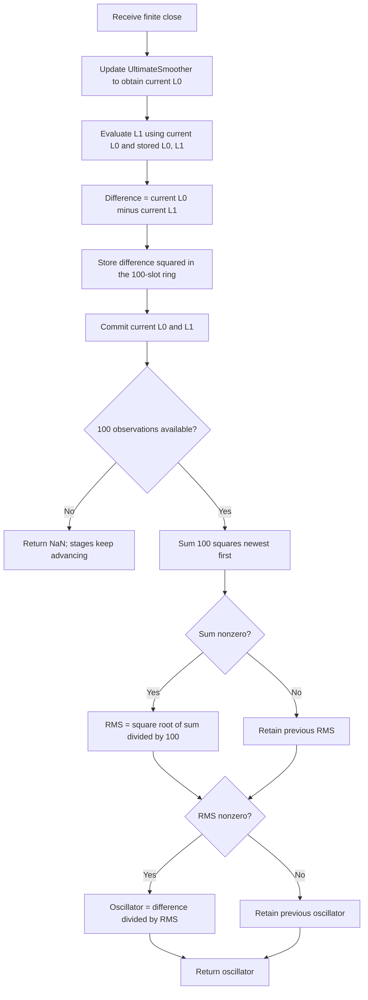

# Laguerre Oscillator — research prototype master reference

This is a self-contained specification and standard-library Python streaming
implementation of John F. Ehlers' **July 2025 “Laguerre Filters”** indicator.
It is intended as the master for conversion into Go, TypeScript, Rust and Zig.
The user confirmed all 16 Length/Gamma reference pairs for both indicators on
**2026-10-16**. Every generated output has 252 observations and is written at
15 significant digits, with full-precision pi and square root of two.

`LaguerreOscillator(length=30, gamma=0.5).update(close)` returns one scalar
normalized oscillator. Its default allpass recurrence follows **TradeStation
and Mesa**, with `recurrence_mode="article"` available for the TASC
transcription. Their raw signals differ by a positive scale factor that RMS
normalization cancels in exact arithmetic. The first 99 outputs are NaN while
the 100-bar RMS fills. The plotted zero line is a constant, not another output.

## Laguerre polynomials and the intended discrete structure

The article and Mesa paper attribute the polynomials to Edmond Laguerre (1834–1886). As classical mathematical background, the ordinary Laguerre polynomial of degree $n$ solves

$$
s y''(s)+(1-s)y'(s)+ny(s)=0.
$$

The differential-equation form is background context; the article implements a **discrete recursive basis**, rather than evaluating classical polynomials at each price. Its complete displayed discrete expression is

$$
L_N(Z)=\frac{1-\gamma}{1-\gamma Z^{-1}}
\left[\frac{Z^{-1}-\gamma}{1-\gamma Z^{-1}}\right]^N.
$$

Here $Z^{-1}$ denotes a one-bar delay, $N$ is a nonnegative stage index, and $\gamma$ is the common stage coefficient. This expression describes transfer functions applied to an input, not an ordinary polynomial value in the current price. The source uses the prefactor $1-\gamma$; no additional orthonormal-basis scale factor is inserted.

The first factor is an EMA:

$$
E_0(Z)=\frac{1-\gamma}{1-\gamma Z^{-1}},\qquad
e_t=(1-\gamma)x_t+\gamma e_{t-1}.
$$

The bracketed factor is a first-order allpass:

$$
A(Z)=\frac{Z^{-1}-\gamma}{1-\gamma Z^{-1}},\qquad
y_t=-\gamma u_t+u_{t-1}+\gamma y_{t-1}.
$$

For $q=e^{-j\omega}$ and real $|\gamma|<1$,

$$
|A(e^{j\omega})|=1,\qquad
\tau_A(\omega)=\frac{1-\gamma^2}{1+\gamma^2-2\gamma\cos\omega}.
$$

Thus the allpass changes phase while preserving steady-state sinusoid amplitude. Its **group delay** varies with frequency: $\tau_A(0)=(1+\gamma)/(1-\gamma)$ and $\tau_A(\pi)=(1-\gamma)/(1+\gamma)$. Positive gamma emphasizes delay at longer wavelengths. This is a linear, time-invariant filter with nonlinear **phase as a function of frequency**; the article's “nonlinear delay functions” do not imply a nonlinear input/output stage.

An electrical analogy is an allpass network that rotates a sinusoid's phase without changing its amplitude. A tapped delay line provides multiple phase-shifted versions of the same signal; weighted summation causes frequency-dependent reinforcement and cancellation. This is a transversal architecture. Ordinary SMA and FIR filters use literal delays and weighted taps; the recursive Laguerre architecture has internal pole memory and is generally IIR even though it has finitely many taps.

Ehlers replaces the initial EMA with the UltimateSmoother to improve responsiveness. The intended basis then becomes $U(Z)A(Z)^N$, where $U$ is the UltimateSmoother response. The actual **Filter listing differs from that allpass basis**, as explained below. The default Oscillator implements the allpass recurrence in TradeStation and Mesa.

## UltimateSmoother: complete source equations

Let $x_t$ be a close, $u_t=L_{0,t}$ the smoothed close, and $P=Length$ the critical period in bars. For each fixed $P$, the printed article, Mesa, and TradeStation coefficients are

$$
\begin{aligned}
a_1&=\exp\left(-\frac{1.414\cdot3.14159}{P}\right),\\
b_1&=2a_1\cos_{\mathrm{degrees}}\left(\frac{1.414\cdot180}{P}\right),\\
c_2&=b_1,\\
c_3&=-a_1a_1,\\
c_1&=\frac{1+c_2-c_3}{4}.
\end{aligned}
$$

The master follows the user's full-precision preference by substituting the consistently converted angle

$$
\theta=\frac{\sqrt2\pi}{P},\qquad a_1=e^{-\theta},\qquad b_1=2a_1\cos\theta,
$$

and retaining the remaining coefficient equations. Python uses `math.sqrt(2.0)` and `math.pi`, not the printed approximations. The optional `coefficient_mode="article"` retains `1.414` and `3.14159` exactly. In that mode the cosine remains degree-based, so its conversion to radians uses full pi; using `3.14159` as the cosine's radian-conversion constant would implement a different equation.

With zero-based observation index $t$, the complete source recurrence and startup are

$$
u_t=\begin{cases}
x_t,&0\le t<3,\\
(1-c_1)x_t+(2c_1-c_2)x_{t-1}-(c_1+c_3)x_{t-2}
+c_2u_{t-1}+c_3u_{t-2},&t\ge3.
\end{cases}
$$

The first three observations pass through. `CurrentBar >= 4` is interpreted one-based, so recursion starts on the **fourth supplied close, index 3**. Raw-input histories and smoother-output histories remain separate. `c3` is negative, and its signed product is **added**, not negated a second time.

The transfer function for compatible initial conditions is

$$
U(Z)=\frac{(1-c_1)+(2c_1-c_2)Z^{-1}-(c_1+c_3)Z^{-2}}
{1-c_2Z^{-1}-c_3Z^{-2}}.
$$

It can also be written as the unfiltered input minus a second-order highpass:

$$
U(Z)=1-\frac{c_1(1-Z^{-1})^2}{1-c_2Z^{-1}-c_3Z^{-2}}.
$$

The highpass has a double zero at DC; subtracting it preserves slow components with near-zero phase lag at low frequencies. $U(1)=1$ and $U(-1)=0$. This is a low-lag property near DC, not a claim of zero delay at every frequency or of future-price prediction. Full-precision poles are $a_1e^{\pm j\theta}$, with radius less than one for finite positive periods in exact arithmetic. Long periods slow the decay of transients. Extremely large periods may lose coefficient resolution in binary64.

## Filter: literal article/TradeStation calculation

Both the article and TradeStation Filter define five terms $L_0,\ldots,L_4$, initialized to zero before the supplied stream. The exact update is

$$
\begin{aligned}
L_{0,t}&=u_t,\\
L_{1,t}&=-\gamma L_{0,t-1}+L_{0,t-1}+\gamma L_{1,t-1},\\
L_{2,t}&=-\gamma L_{1,t-1}+L_{1,t-1}+\gamma L_{2,t-1},\\
L_{3,t}&=-\gamma L_{2,t-1}+L_{2,t-1}+\gamma L_{3,t-1},\\
L_{4,t}&=-\gamma L_{3,t-1}+L_{3,t-1}+\gamma L_{4,t-1},\\
F_t&=\frac{L_{0,t}+4L_{1,t}+6L_{2,t}+4L_{3,t}+L_{4,t}}{16}.
\end{aligned}
$$

The two plots are $F_t$ and $L_{0,t}$. Every delayed-stage right-hand side reads **previous-bar** values. Updating stages in place and using the new preceding stage would change the indicator. The master also preserves the three-term arithmetic rather than replacing the first two terms with their factored expression, to retain source rounding behavior.

For analysis only, the stage equation simplifies to

$$
L_{k,t}=(1-\gamma)L_{k-1,t-1}+\gamma L_{k,t-1},\qquad
B(Z)=\frac{(1-\gamma)Z^{-1}}{1-\gamma Z^{-1}}.
$$

**$B$ is a delayed EMA, not the allpass $A$.** In particular, an allpass negative term would use current $L_{k-1,t}$ instead of previous $L_{k-1,t-1}$. The mathematical description and the repeated code listings therefore disagree. This prototype preserves the article/TradeStation code because the requested reference must reproduce a published implementation; it does not silently replace it with the ideal allpass.

The weights $1,4,6,4,1$ are the binomial coefficients of $(1+v)^4$, sum to 16, and give the literal Filter response

$$
H_F(Z)=U(Z)\frac{1+4B+6B^2+4B^3+B^4}{16}
=U(Z)\left(\frac{1+B(Z)}{2}\right)^4.
$$

All stages have DC gain one, so $H_F(1)=1$. For $0\le\gamma<1$, the delayed EMA has DC group delay $1/(1-\gamma)$. The binomial mix gives low-frequency delay approximately $2/(1-\gamma)$ in addition to the UltimateSmoother's near-zero DC delay. This helps explain stronger smoothing and increasing lag as gamma approaches one. It does not support a blanket “no lag” claim for this literal listing.

At $\gamma=0$, $B(Z)=Z^{-1}$ and

$$
F_t=\frac{u_t+4u_{t-1}+6u_{t-2}+4u_{t-3}+u_{t-4}}{16},
$$

with absent pre-stream taps set to their initialized zero state. The first output for any gamma is $F_0=x_0/16$, alongside $L_{0,0}=x_0$. This startup transient is intentional source initialization, not a missing output or a request to seed all stages with the first price.

The article calls this a “fifth-order filter,” referring to its five displayed terms. The implementation has four post-smoother recursive stages, indices 1–4, and fixed five-tap weights; it does not expose an arbitrary-order parameter or Hann weighting. The paper's suggestions about changing order, using unweighted taps, or Hann weighting describe possible variants and do not change the master.

### Mesa and other Filter variants

Mesa's Filter listing adds

$$
L_{5,t}=-\gamma L_{4,t-1}+L_{4,t-1}+\gamma L_{5,t-1}
$$

and uses $L_5$ as the last weighted tap, omitting $L_4$ from the sum:

$$
F_{Mesa,t}=\frac{L_{0,t}+4L_{1,t}+6L_{2,t}+4L_{3,t}+L_{5,t}}{16},
\qquad
H_{F,Mesa}(Z)=\frac{U(Z)}{16}(1+4B+6B^2+4B^3+B^5).
$$

TradingView and the Python tip also use that $L_5$ sum. This is a different response, even though the weights still sum to 16. The master uses the article/TradeStation **$L_4$** sum. The theoretical binomial allpass variant would instead have response $U(Z)(1+A(Z))^4/16$; neither variant is substituted into the reference data.

## Oscillator: TradeStation/Mesa allpass and article alternative

The default Oscillator uses the TradeStation and Mesa listing:

$$
\begin{aligned}
L_{0,t}&=u_t,\\
L_{1,t}&=-\gamma L_{0,t}+L_{0,t-1}+\gamma L_{1,t-1},\\
d_t&=L_{0,t}-L_{1,t}.
\end{aligned}
$$

Initialize $L_{0,-1}=L_{1,-1}=0$. Thus $L_{1,0}=-\gamma x_0$ and $d_0=(1+\gamma)x_0$. This is the allpass $A$ in the theoretical introduction. Its unnormalized oscillator response is

$$
H_d(Z)=U(Z)(1-A(Z))
=U(Z)\frac{(1+\gamma)(1-Z^{-1})}{1-\gamma Z^{-1}}.
$$

It removes DC through a first-order difference and smooths that difference using pole gamma. An equivalent signal recurrence, useful for analysis and testing, is

$$
d_t=(1+\gamma)(u_t-u_{t-1})+\gamma d_{t-1}.
$$

The master computes the source's $L_1$ equation then subtracts, rather than substituting this recurrence and changing arithmetic order.

The TASC article transcription and some tips use the delayed stage instead:

$$
\widetilde L_{1,t}=-\gamma L_{0,t-1}+L_{0,t-1}+\gamma\widetilde L_{1,t-1},
\quad
\widetilde d_t=u_t-\widetilde L_{1,t},
\quad
\widetilde H_d(Z)=U(Z)\frac{1-Z^{-1}}{1-\gamma Z^{-1}}.
$$

This is available through `recurrence_mode="article"`; the default is `"tradestation"`. With matched zero stage initialization and the same $u_t$,

$$
d_t=(1+\gamma)\widetilde d_t.
$$

RMS scales by the same positive factor, so **normalized outputs agree in exact arithmetic**, including aligned conditional state. The raw $L_1$, difference and RMS histories differ; floating-point cancellation can also leave small normalized differences. Preserving the chosen listing makes the reference reproducible. An unrelated startup or an RMS of the wrong series breaks this equivalence.

At $\gamma=0$, $L_{1,t}=u_{t-1}$ and $d_t=u_t-u_{t-1}$. For constant $x_t=C$ from the stream start, the allpass's initialized transient gives

$$
d_t=(1+\gamma)C\gamma^t
$$

in exact arithmetic, with $\gamma^0=1$ at the first observation. It decays for gamma less than one; do not incorrectly require zero output immediately for a **nonzero constant** input. The first observation encounters zero stage prehistory, and gamma near one can retain its effect through much of this short record. With an identically zero input, the entire raw stream is zero.

The article suggests $L_0-L_2$ for a smoother, more delayed oscillator. Under an allpass basis that would use $U(Z)(1-A(Z)^2)$. It is an optional design suggestion, not a selectable order or another output in this master.

### Complete fixed RMS and normalized result

The original call is `$RMS(L0-L1,100)`: use **the difference $d$**, not $L_0$ or $L_1$. For a complete trailing window, including the current observation,

$$
Q_t=\sum_{k=0}^{99}d_{t-k}d_{t-k}.
$$

The source performs plain sequential addition newest to oldest. Its RMS function and oscillator result both retain their previous values when their assignment condition is false. Initialize both persistent results to zero:

$$
r_t=\begin{cases}\sqrt{Q_t/100},&Q_t\ne0,\\r_{previous},&Q_t=0,\end{cases}
\qquad
o_t=\begin{cases}d_t/r_t,&r_t\ne0,\\o_{previous},&r_t=0.\end{cases}
$$

An all-zero completed window retains a previous nonzero RMS if one exists; then a zero numerator produces zero. If RMS has never become nonzero, the result remains its initialized zero. Preserve the two conditionals independently. Do not introduce a division epsilon, clipping, a centered standard deviation, or an unconditional RMS reassignment.

For a nonzero window with mean $\bar d$ and population variance $\sigma^2$,

$$
r_t^2=\sigma_t^2+\bar d_t^2.
$$

The article interprets the scaling as standard deviations. That is an approximation when the difference is near zero-mean, not an exact z-score or a probability guarantee. A sinusoid of amplitude $A$ has RMS $|A|/\sqrt2$ over complete cycles; its normalized amplitude is $\sqrt2$. The Oscillator is not constrained to $[-1,1]$ or $[0,100]$. With its current value included in a positive squared sum, exact arithmetic implies $|o_t|\le\sqrt{100}=10$. The implementation does not clip to that bound.

## Parameters, initialization and precision contract

| Parameter | Default in this master | Accepted range and meaning |
|---|---|---|
| `length` | 30 | Finite real period $\ge1$ bars; sets UltimateSmoother coefficients, not a rolling window length |
| `gamma` | 0.5 | Finite real $0\le\gamma<1$; common stage pole; zero is supported |
| `coefficient_mode` | `"full_precision"` | `"full_precision"` or `"article"`; all reference arrays use full precision |
| `recurrence_mode` | `"tradestation"` | Oscillator only: `"tradestation"` current-L0 allpass or `"article"` delayed stage |
| `RMS_LENGTH` | 100 | Fixed Oscillator normalization window, not a tunable input |

The Filter's source defaults are Length 40, gamma 0.8. The Oscillator's source defaults are Length 30, gamma 0.5. Length 30/gamma 0.8 is the first Filter chart, Length 60/gamma 0.2 is the crossover chart, and Length 20/gamma 0.8 is the Oscillator chart. Chart examples and listing defaults are intentionally different.

The article does not impose explicit parameter bounds. This API uses period at least one, consistent with the supplied NinjaTrader helper's minimum. Period one is an algebraic boundary below the two-bar Nyquist wavelength, not a recommended market setting. Fractional periods such as 20.5 are retained; no integer truncation is allowed. The conventional gamma range ensures decaying, nonnegative pole memory. Negative $|\gamma|<1$ is algebraically stable but outside this API's conventional range; gamma one does not decay, and gamma greater than one is unstable. Gamma is not the smoother period or the filter order.

Both masters consume one finite close at a time, chronologically, and store only past values. `reset()` restores the specified initialization without changing parameters. Invalid/nonfinite closes are rejected before state advances. Finite observations must keep intermediate recurrences, squares and sums representable. An arithmetic-overflow error may occur after an earlier stage has advanced, so reset after such an error. The supplied price record is well within range.

`coefficient_mode="article"` reproduces printed coefficients under this standalone startup contract. The default full-precision mode changes some output digits compared with printed approximations. Exact chart comparisons also require matching platform prehistory, bar indexing and initialization. Full precision and rounded source constants cannot give bit-identical outputs in general.

Availability and settling are different. The Filter uses initialized zero stage prehistory and returns both outputs from the **first observation**, with no NaN prefix. The Oscillator needs **100 observed difference values**, so indices 0–98 return NaN and index 99 is its first normalized result. All internal stages run throughout that warmup. It does not fabricate missing RMS history as zeros or restart stages at bar 100. Both a length of 252 and gamma of 0.99 obey the same availability contract, even though their transients can last much longer.

## Differences among supplied implementations

| Source | Consequence for a direct comparison |
|---|---|
| TASC article | Filter uses delayed stages and final $L_4$; Oscillator transcription uses delayed $L_0$ in the negative term |
| TradeStation | Filter matches article $L_4$ sum; Oscillator uses current $L_0$ allpass; primary computational reference for this prototype |
| Mesa paper | Filter uses $L_5$ in the final sum, skipping $L_4$; Oscillator uses current $L_0$ allpass |
| TradingView | Filter uses $L_5$ sum; UltimateSmoother recursion starts at zero-based `bar_index >= 4`, one observation later; uses full pi but rounded 1.414; oscillator has selectable RMS length and returns NaN when RMS is zero |
| Python tip | Filter uses $L_5$ sum and leaves the very first weighted result initialized to zero; smoother begins recursion at zero-based `i >= 4`; oscillator computes RMS of **$L_1$**, not the difference, and initializes its first $L_1$ to zero; this gives a substantially different normalization |
| RealTest | Filter uses $L_4$ and Oscillator current-$L_0$ allpass; zero/prehistory conventions are engine-dependent, RMS is unconditional and direct division differs on zero |
| MetaStock | Filter uses $L_4$ delayed stages; Oscillator uses delayed $L_0$, with an explicit zero-division result of zero; smoother and plot-start conventions differ |
| NinjaTrader | Filter uses $L_4$ delayed stages; Oscillator comment shows allpass but executing code uses delayed $L_0$; skips first indicator update; smoother uses zero-based `CurrentBar >= 4`, full pi/rounded 1.414; RMS uses a shortened startup sum with fixed denominator |
| WealthLab | Supplied file is a strategy using library `Laguerre`, `UltimateSmoother`, and `LaguerreOsc` classes; their internals are not provided, so it cannot establish exact recurrence parity |

The two masters contain all their own computational and generation helpers. No sibling indicator imports, scientific packages, external price downloads or library indicator definitions are required. The documents explain both source indicators so either folder remains understandable when copied into a conversion repository.

## Streaming calculation flow and state



The UltimateSmoother needs two raw-close lags, two smoother-output lags, three
coefficients and a startup count. The parent stores previous L0 and L1 and the
last oscillator. RMS stores at most 100 squared differences, its next insertion
index, populated count and persistent result. Diagnostics `l0`, `l1`, `signal`
and `rms` expose current internal values; RMS is NaN during warmup.
`warmup_bars` is 99 and `is_primed` becomes true after 100 observations.
Storage is constant relative to stream length; each primed update performs
100 sequential additions. The ring is updated even while output is unavailable.

## Confirmed cases and five-language reference files

Only Length and Gamma vary. All reference outputs use full-precision
coefficients and the documented default recurrence. The following 16 pairs
are identical in both folders. Each “What it tests” entry is copied verbatim
into the first comment before every corresponding array; the second comment
lists `length` and `gamma`.

| Length | Gamma | What it tests |
|---:|---:|---|
| 40 | 0.8 | Filter default. |
| 30 | 0.5 | Oscillator default. |
| 30 | 0.8 | Article's first Filter chart. |
| 60 | 0.2 | Article's crossover example. |
| 20 | 0.8 | Article's Oscillator chart. |
| 1 | 0 | Minimum period and pure-delay boundary. |
| 2 | 0.2 | Nyquist-period boundary. |
| 5 | 0.5 | Short-period response. |
| 10 | 0.8 | Short smoother with strong stage memory. |
| 20 | 0 | Zero-gamma limit. |
| 20 | 0.2 | Low stage memory. |
| 20 | 0.5 | Moderate stage memory. |
| 20 | 0.95 | Long stage memory. |
| 20 | 0.99 | Near-unit-pole behavior. |
| 20.5 | 0.8 | Fractional smoother period. |
| 252 | 0.8 | Full-record period. |

| Language | Example identifier/declaration | Unavailable value |
|---|---|---|
| Python | `EXPECTED_L40_G0_8 = [...]` | `math.nan` |
| Go | `var expectedL40_G0_8 = []float64{...}` | `math.NaN()` |
| TypeScript | `export const expectedL40_G0_8: number[] = [...]` | `NaN` |
| Rust | `pub fn expected_l40_g0_8() -> Vec<f64>` | `f64::NAN` |
| Zig | `pub fn expectedL40_G0_8() [252]f64` | `nan` |

Decimal points in parameters become underscores, for example `L20_5_G0_8`.
Each case has one scalar array with no output suffix:
**16 expected arrays per language**, each with exactly 99 leading NaNs and
153 finite normalized values. RMS length is fixed at 100 in all cases.

Go's package is `laguerreoscillator`. Rust input functions remain in the
copied `testdata` test module; expected functions are appended at file scope.
Zig includes `const math = @import("std").math;` and `const nan = math.nan(f64);`.
The request's `math.Nan()`, `f64:NAN`, and `export const test_input() number[]`
examples are syntax/spelling errors; the valid forms above are used.

The master embeds exactly the copied Python fixture's 252 `INPUT_CLOSE` values.
Generation calculates the entire stream in binary64, rounds only during
15-significant-digit text emission, then reloads the Python arrays to verify
names, counts, precision and availability. Other-language arrays are translated
from those verified values. Generated sections are marked and replaced on
rerun, preserving input arrays and avoiding duplicate reference data.

Preserve source expression order, negative coefficient signs and lag indexing.
Do not feed serialized, rounded values into later updates. A rolling RMS total,
compensated summation, reversed addition order, or fused multiply-add may change
final bits. Cross-language comparison should explicitly handle NaNs and use a
typical binary64 tolerance such as `rel_tol=5e-13, abs_tol=5e-13`.

From this folder:

```sh
python3 laguerre-oscillator.py
python3 laguerre-oscillator.py --generate-reference-data
python3 -m unittest -v test_laguerre_oscillator.py
```

## Verification

All **11 Python tests** for this indicator pass. Checks independently evaluate
the extracted TradeStation and applicable article expressions for every pair
and supported precision/recurrence policy; verify stage histories, fourth-bar
smoother startup, the gamma-zero limit, constant-input transients, an analytical
sinusoidal response, zero handling, reset, causality, scaling and invalid-input
state preservation. Fixture checks compare every output and both comment lines
across all five languages, confirm input preservation, and verify byte-for-byte
identical regeneration. Native fixture validators also pass for Go 1.27.1, Rust 1.98.1, Zig 0.16.0,
and Node 24.15.0 using native TypeScript type stripping. Each validator checks
all expected arrays and all four copied input arrays: **20 arrays and
5,040 values per language**, comparing finite binary64 bit patterns against
the Python fixture and handling NaNs separately. These validate fixture syntax
and data; the streaming master itself is Python. Verification completed on
2026-10-16.

## References and BibTeX

Primary sources used in this specification:

1. Ehlers, John F. (2025), **Laguerre Filters**, *Technical Analysis of Stocks & Commodities*, 43(7), 9–12. [Article](https://technical.traders.com/archive/article.asp?file=\V43\C07\984EHLE.pdf). Local source: `../../tasc/2025-07-laguerre-filters/content.md`.
2. **Traders' Tips, July 2025**, [publisher page](https://www.traders.com/Documentation/FEEDbk_docs/2025/07/TradersTips.html). Local `tips/tips.md` and `tips/TradeStation_LaguerreFilters.els` in that source directory; TradeStation contribution by John Robinson.
3. Ehlers, **Laguerre Filters**, [Mesa paper](https://www.mesasoftware.com/papers/Laguerre%20Filters.pdf), local `mesa/content.md`. Its local BibTeX transcription gives year 2026, but no publication date is established by the paper text. The entry below leaves the date unspecified rather than asserting that it replaces the July 2025 article.
4. Supplied TradingView, Python, RealTest, MetaStock, NinjaTrader and WealthLab code under the same `tips/` directory, used for the specific source differences above.
5. Ehlers (2024), **The Ultimate Smoother**, *Technical Analysis of Stocks & Commodities*, 42, April; its complete relevant helper equations are reproduced above.

The article additionally cites *Cybernetic Analysis for Stocks and Futures* (2004), *Cycle Analytics for Traders* (2013), and “A Technical Description of Market Data for Traders” (May 2021). These are included as further-reading bibliography. No book chapter accompanies this input; no unprovided chapter is claimed as an implementation source.

```bibtex
@article{ehlers2025laguerrefilters,
  author = {John F. Ehlers},
  title = {Laguerre Filters},
  journal = {Technical Analysis of Stocks \& Commodities},
  volume = {43},
  number = {7},
  pages = {9--12},
  year = {2025},
  month = jul,
  url = {https://technical.traders.com/archive/article.asp?file=\V43\C07\984EHLE.pdf}
}

@misc{traderstips202507,
  title = {Traders' Tips: Laguerre Filters},
  howpublished = {Technical Analysis of Stocks \& Commodities},
  year = {2025},
  month = jul,
  url = {https://www.traders.com/Documentation/FEEDbk_docs/2025/07/TradersTips.html},
  note = {TradeStation contribution by John Robinson; supplied TradingView,
          Python, RealTest, MetaStock, NinjaTrader and WealthLab code also consulted}
}

@misc{ehlersMesaLaguerre,
  author = {John F. Ehlers},
  title = {Laguerre Filters},
  howpublished = {Mesa Software technical paper},
  url = {https://www.mesasoftware.com/papers/Laguerre%20Filters.pdf},
  note = {Undated paper; local transcription's BibTeX gives an unverified 2026 date}
}

@article{ehlers2024ultimatesmoother,
  author = {John F. Ehlers},
  title = {The Ultimate Smoother},
  journal = {Technical Analysis of Stocks \& Commodities},
  volume = {42},
  year = {2024},
  month = apr
}

@book{ehlers2004cybernetic,
  author = {John F. Ehlers},
  title = {Cybernetic Analysis for Stocks and Futures: Cutting-Edge DSP Technology to Improve Your Trading},
  publisher = {John Wiley \& Sons},
  year = {2004}
}

@book{ehlers2013cycleanalytics,
  author = {John F. Ehlers},
  title = {Cycle Analytics for Traders: Advanced Technical Trading Concepts},
  publisher = {John Wiley \& Sons},
  year = {2013}
}

@article{ehlers2021marketdata,
  author = {John F. Ehlers},
  title = {A Technical Description of Market Data for Traders},
  journal = {Technical Analysis of Stocks \& Commodities},
  volume = {39},
  year = {2021},
  month = may
}
```
