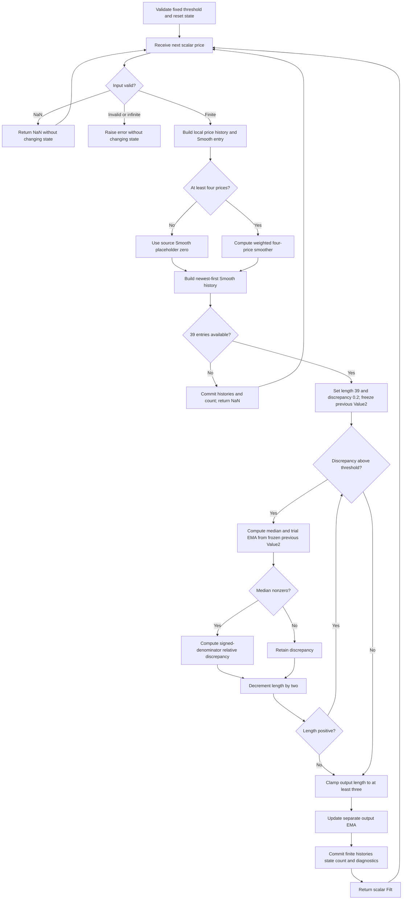

# Median-Average Adaptive Filter

This folder is the standalone **research prototype master reference** for John F. Ehlers' March 2005 article **“What's The Difference?”**. The indicator compares a trailing median with an EMA trial, shortens an odd search length until their relative difference passes a threshold, then uses the resulting length in a separate adaptive EMA. A fixed four-price smoother precedes that calculation.

`MedianAverageAdaptiveFilter.update(price)` returns the single scalar `Filt`. The implementation uses only Python's standard library, bounded histories and one completed bar per update. The sole configurable numerical parameter is `threshold`, default 0.002. The article's hardcoded 39-bar search length, three-bar output minimum and 0.2 search sentinel remain fixed.

The requested fixtures use **`INPUT_CLOSE`**, although the original source defaults to $(H+L)/2$. To use the article's price selection, compute the midpoint externally and pass it to `update`. Selecting another scalar price does not change the filtering algorithm.

## Numerical authority and source differences

The [article](../../tasc/2005-03-whats-the-difference/content.md) supplies the principal equations and EasyLanguage recurrence. The [March 2005 Traders' Tips](../../tasc/2005-03-whats-the-difference/tips/tips.md) supply platform implementations. This master follows the article's search arithmetic with the explicit startup and termination guard in **[eSignal MAAF.efs](../../tasc/2005-03-whats-the-difference/tips/MAAF.efs)**. No MESA paper is present in the supplied input folder.

| Detail | Master contract and rationale |
|---|---|
| `Value2[1]` inside the search | Every trial uses the **previous bar's one shared Value2**, held fixed throughout the current search. There is no separate historical EMA for each trial length. |
| `Length = Length - 2` inside the loop | Decrement after every evaluated trial, including the successful one. The output length is usually two below the successful trial length. |
| Final `If Length < 3 then Length = 3` | Clamp the output length after the search. Length 1 may still be evaluated as a trial. |
| `Value3 = .2` before the loop | Preserve the empirical 0.2 sentinel. Thresholds equal to or above it skip the loop, retaining length 39 and previous Value2. |
| `AbsValue(Value1 - Value2) / Value1` | The denominator is the **signed median**, not its absolute value. Negative medians can stop the search immediately; zero medians retain the preceding discrepancy. |
| Article has no in-loop length guard | Use eSignal's `if (Length <= 0) break`. This prevents a negative median length after a zero-median search. On ordinary positive data the article terminates at length 1 without this extra guard. |
| Article does not define finite-record chart history | Reproduce the eSignal `NEWBAR` history gates exactly: first three Smooth placeholders are zero; public output begins at accepted bar 39. |
| Initial recursive state | Value2 and Filt start at zero and remain zero through warmup. Do not seed either with price or Smooth. |
| Article declares `Length(30)` but assigns `Length = 39` each bar | The effective search length is 39. The variable initializer 30 is not a parameter or operative search length. |

These details materially affect reference data. The master agrees **exactly**, before decimal serialization, with execution of the supplied eSignal code on all 252 closes for all 14 confirmed thresholds. That comparison checks both public Filt and the shared trial-EMA state. Agreement with an EasyLanguage chart also requires the same earlier chart history and initialization; the article does not specify the platform's MaxBarsBack setup.

There are no truncated irrational constants in this algorithm. Integer weights, divisions by 6 and the EMA formula $2/(L+1)$ are evaluated at full binary64 precision. The 0.2 sentinel and 0.002 default are algorithm inputs, not approximations of $\pi$ or $\sqrt2$. Neither internal state nor search comparisons are rounded.

### Differences among Traders' Tips

| Reference | Material behavior |
|---|---|
| eSignal, Jason Keck | Uses the previous bar's shared Value2, zero startup, signed median denominator, unconditional decrement and a nonpositive-length guard. This is the numerical authority for finite-record startup. |
| [NeuroShell MAAF.bas](../../tasc/2005-03-whats-the-difference/tips/MAAF.bas), Marge Sherald | Preserves the previous-bar trial semantics and decrement. For `MAXLENGTH=39`, starts at zero-based index 41, or bar 42, and seeds both previous recurrences from `Smooth(i-1)`. It omits the nonpositive-length guard. Its initialization changes the entire early response. |
| [AmiBroker MAAF.afl](../../tasc/2005-03-whats-the-difference/tips/MAAF.afl), Tomasz Janeczko | Computes `AMA(Smooth, alpha)` separately for every fixed length across the whole series. It scans every length down to 3 rather than stopping on the first passing trial, and chooses `AvgLength` through a different array expression. Its `Nz` treatment also differs. This is a different adaptation algorithm and is not substituted here. |
| [NeoTicker MAAF.ntk](../../tasc/2005-03-whats-the-difference/tips/MAAF.ntk), Kenneth Yuen | Resets local Value2 to zero each bar and feeds a trial's result into the next trial. Its odd-length branch averages two middle entries instead of selecting the single center, reading a second heap entry even for a length-one trial. These semantics differ from the article/eSignal recurrence. |
| TradeStation and MetaStock sections of the tips | Cover other authors' options and breakout indicators. They do not supply another Ehlers MAAF numerical implementation. |

The master does not combine the platforms' initialization or search choices. They are documented so a conversion agent can distinguish genuine source differences from a porting error.

## Principles and physical analogies

An average and a median suppress noise in different ways. Averaging combines every sample; independent zero-mean noise tends to cancel as more samples are added. A median ranks the samples and selects a middle value; an isolated extreme sample can be rejected without averaging its magnitude into the output.

The article's example begins with ten ones. Both average and median are 1. Replacing one sample by 10 changes the mean to

$$\overline x=\frac{9\cdot1+10}{10}=1.9,$$

while the median stays 1. A sufficiently large impulse strongly moves the mean regardless of its sign, while the median resists it as long as enough other observations determine the center. This motivates the video analogy of **salt-and-pepper noise**: isolated bright or dark pixels are replaced by the neighborhood's central rank rather than blended into it.

For independent noise with mean zero and variance $\sigma^2$, an ordinary $L$-sample mean has noise variance $\sigma^2/L$. That calculation assumes uncorrelated noise. Market noise can be correlated, and this indicator pre-smooths the input, so it is background rather than a performance guarantee for the whole filter.

For odd $L=2k+1$, the median tolerates up to $k$ arbitrarily extreme replacements in a constant-valued window before a majority can determine another center. This does not mean an arbitrary median is unchanged by every spike: a replacement near the central rank, a sustained move, or multiple impulses can change it. The four-price pre-smoother also spreads a one-bar impulse over several Smooth samples.

The adaptive mechanism acts as a feedback controller. The median is a robust comparison level; a trial EMA represents an alternative response using the current Smooth and the previous trial state. Their discrepancy controls the next output EMA's memory. The search tries a long memory first and shortens it when the discrepancy is too large. A shorter length means larger alpha, giving the current Smooth more weight.

The author's intended behavior is rapid adjustment on sharp moves and smoother behavior during congestion. The executable compares a shared adaptive EMA state with medians, so it cannot be reduced to a bank of independent fixed-length filters. Nor does it identify whether a large move is noise or information. The output may respond rapidly to an isolated impulse as well as to a genuine price change; the article's chart observation is not a general no-whipsaw guarantee.

## Complete mathematical calculation

The following equations reproduce every mathematical operation needed from the supplied article and source listings. Let $x_t$ be the selected scalar price, $s_t$ be Smooth, $v_t$ be the shared trial EMA (`Value2`), and $f_t$ be Filt. Bars are one-based and advance only when a finite input is accepted.

### Four-price pre-smoother

For $t\ge4$,

$$s_t=\frac{x_t+2x_{t-1}+2x_{t-2}+x_{t-3}}{6}.$$

The weights sum to one, preserving a constant input once the four prices exist. Its finite impulse response is symmetric, with transfer function

$$H_s(z)=\frac{1+2z^{-1}+2z^{-2}+z^{-3}}{6}
=\frac{(1+z^{-1})(1+z^{-1}+z^{-2})}{6}.$$

Consequently it has a constant linear-phase delay of 1.5 bars away from its spectral zeros. It rejects the alternating two-bar component through the $1+z^{-1}$ factor and the three-bar component through the other factor. This interpretation describes the smoother only; the adaptive filter adds variable recursive delay.

For the first three accepted bars, the eSignal price gate returns before calculating Smooth. Its newly inserted history entries therefore remain

$$s_1=s_2=s_3=0.$$

These are explicit source placeholders, not a claim that the actual price was zero. A full-window smoother convention that omits those entries would start adaptive calculation at bar 42 and produce different reference data.

### Odd-length median

For a tested odd length $L$, collect the newest $L$ Smooth values:

$$W_t(L)=\{s_t,s_{t-1},\ldots,s_{t-L+1}\}.$$

Sort a **copy** ascending, $w_{(0)}\le\cdots\le w_{(L-1)}$. Then

$$m_t(L)=w_{((L-1)/2)}.$$

The chronological history must remain unsorted for the next update. For $L=1$, the median is simply $s_t$. Every evaluated length is odd: 39, 37, …, 3, 1.

### EMA coefficient and trial state

The source maps a trial length to its ordinary EMA coefficient:

$$a(L)=\frac{2}{L+1}.$$

Every trial on bar $t$ evaluates

$$v_t(L)=a(L)s_t+\bigl(1-a(L)\bigr)v_{t-1}.$$

Here **$v_{t-1}$ is fixed throughout the current bar**. A trial does not use the preceding trial's candidate; there is no vector of EMA histories indexed by $L$. At the end of the search, store only the final evaluated candidate as the new shared $v_t$.

Using an array of separate fixed-length EMA histories, recursively advancing the candidate inside the while loop, or using prior Filt in this equation would each implement a different indicator.

### Discrepancy and descending search

At the beginning of every active bar, set

$$L\leftarrow39,\qquad d\leftarrow0.2.$$

While $d>T$, where $T$ is `threshold`, compute the median and trial EMA above. If the median is nonzero, update

$$d\leftarrow\frac{|m_t(L)-v_t(L)|}{m_t(L)}.$$

If $m_t(L)=0$, leave $d$ unchanged. Then **always** set

$$L\leftarrow L-2.$$

The next trial runs only if $d>T$ and the decremented length is positive. eSignal breaks when $L\le0$. Finally set the output length

$$\ell_t=\max(3,L).$$

For example, if the first successful evaluated length is 15, the output uses 13. If evaluated length 3 or 1 succeeds, the output uses 3. If length 39 succeeds, the output uses 37. When $T\ge0.2$, no trial is evaluated and the output uses 39.

The article calls the result the shortest filter length for the prescribed threshold. The executable actually stops at the **first passing trial when descending from 39**, and then uses two fewer samples. It does not search all passing lengths or prove a global minimum. Median changes across nested windows can make the discrepancy nonmonotonic, so the code should be ported directly rather than replaced by binary search or a mathematical minimum operation.

For positive $s_t$ at length 1, $a(1)=1$, so $v_t(1)=m_t(1)=s_t$ and $d=0$. This guarantees a stopping trial on positive data with $T\ge0$. A zero median does not update $d$ and needs the explicit length guard. A negative median produces a nonpositive ratio despite the absolute numerator and can stop the search early. The signed denominator is retained for numerical fidelity; this control was primarily described for positive prices.

### Final adaptive EMA

Compute the separate output coefficient and recurrence:

$$\alpha_t=\frac{2}{\ell_t+1},$$

$$f_t=\alpha_ts_t+(1-\alpha_t)f_{t-1}.$$

Filt and Value2 are independent state channels. Filt uses the decremented/clamped length; Value2 stores the candidate from the evaluated trial length. When the loop is skipped, keep $v_t=v_{t-1}$, but still update Filt with $\alpha_t=2/40=0.05$.

With an enabled search, the possible output lengths are 3, 5, …, 37, giving $1/19\le\alpha_t\le1/2$. With a skipped search, alpha is 0.05. These convex weights keep the output between current Smooth and the previous Filt for finite inputs; they do not remove its startup transient.

### Recursive memory and lag

For a fixed length $L$, the output EMA has

$$H_{\mathrm{EMA}}(z)=\frac{\alpha}{1-(1-\alpha)z^{-1}},\qquad
\alpha=\frac{2}{L+1}.$$

Its pole $1-\alpha$ has magnitude less than one. Under a constant input, an initialization error decays by $(1-\alpha)$ per accepted bar. The low-frequency delay is

$$\tau_{\mathrm{EMA}}(0)=\frac{1-\alpha}{\alpha}=\frac{L-1}{2}.$$

Adding the smoother's 1.5-bar delay gives $1.5+(L-1)/2$ for the corresponding **fixed-length, steady-state** cascade. For example, it is 2.5 bars at $L=3$ and 20.5 bars at $L=39$. Those formulas do not assign one transfer function or one lag to the changing adaptive system.

If alpha varies, the exact solution from an active starting bar $t_0$ is

$$f_t=f_{t_0-1}\prod_{j=t_0}^{t}(1-\alpha_j)
+\sum_{i=t_0}^{t}\alpha_i s_i\prod_{j=i+1}^{t}(1-\alpha_j).$$

This shows how historical observations retain weights determined by all subsequent alphas. The system is time-varying and nonlinear because median selection and threshold decisions depend on data. It is not an FIR mean over $\ell_t$ bars, and its length is not an estimated market cycle period.

## Startup and streaming contract

The source-equivalent finite-record initialization is:

1. Begin with no prices or Smooth entries and with hidden $v=f=0$.
2. On each accepted bar, insert the newest price and a new Smooth entry.
3. For bars 1–3, that entry is zero. Starting at bar 4, calculate the four-price smoother.
4. Until 39 Smooth entries exist, return NaN and keep both recursive states zero.
5. At bar 39, start the search and output recurrence; keep processing on every later accepted bar.

Therefore

$$\texttt{warmup\_bars}=38,\qquad t_{\mathrm{first\ output}}=39.$$

On the first active bar, the 39-entry median history includes 36 fully calculated Smooth values and three source zero placeholders. The oldest placeholder disappears at bar 40, the second at 41, and the last at 42. Do not reinterpret warmup as 39 *valid four-price averages*.

For the supplied closes and default threshold, the first output is **42.870416666666664**, from $\alpha_{39}=0.5$ and zero prior Filt. The final unrounded output at bar 252 is **109.39138767748712**, with selected length 25 and alpha $1/13$. These are useful smoke checks; the complete expected arrays cover every bar.

“Primed” means the eSignal history gate is open. It does not mean the recursive error has settled. Public warmup NaNs never enter either feedback recurrence.

NaN input is an omitted observation: return NaN without changing accepted count, histories, diagnostic fields or the last accepted `output`. The next finite price follows the previous accepted price. Invalid types, booleans, infinities and non-finite intermediate arithmetic raise `ValueError` atomically. The source assumes ordinary chart data; these are explicit master conventions for missing/invalid observations. Intermediates preserve the source arithmetic order, so a finite input can be rejected if a weighted sum or discrepancy overflows.

The API exposes immutable diagnostic snapshots through `state`, plus `selected_length`, `evaluated_length`, `trial_count`, `discrepancy` and `alpha`. Before priming, no length has been selected. If the search is skipped, `evaluated_length` is `None` and `trial_count` is zero. Those diagnostics are not additional public output arrays. `reset()` restores startup while preserving threshold.

## Configuration

| Parameter or constant | Shortcut | Default | Valid range | Meaning |
|---|---|---|---|---|
| `threshold` | T | 0.002 | Finite real $\ge0$ | Relative discrepancy fraction; 0.002 means **0.2%** |
| Search length | Fixed | 39 | Not configurable | Largest tested odd median length; resets each bar |
| Minimum output length | Fixed | 3 | Not configurable | Floor applied after the search; does not prohibit a length-one trial |
| Initial discrepancy | Fixed | 0.2 | Not configurable | Sentinel controlling whether the first trial runs |
| Input price | External | Article $(H+L)/2$; fixtures Close | Finite scalar; NaN omission supported | Caller chooses the scalar series |

The meaningful adaptive threshold region is $0\le T<0.2$. Exactly $T=0.2$ and larger finite thresholds are supported because the executable specifies their loop-skip behavior. They give the same fixed 39-length output EMA and hold the shared trial state at its initial zero. Negative thresholds are rejected: zero agreement cannot satisfy them and the article's unguarded loop would not terminate. No arbitrary upper threshold is imposed.

A looser threshold generally permits an earlier stop and longer smoothing, but monotonic behavior across all histories is not guaranteed: each threshold's prior adaptive Value2 also differs. Neither threshold nor search length is an automatic measurement of a cycle period.

## Algorithmic flow and porting notes



All candidates are local until the whole calculation passes finite-arithmetic validation. In a port, apply the same error checks before committing state. The chart omits intrabar recalculation here: each update is one finalized bar, corresponding to eSignal's `BARSTATE_NEWBAR` branch.

The master keeps up to four prices and 39 Smooth entries, newest first. A median trial copies and sorts the newest $L$ entries, selecting zero-based index $L//2$. Standard sorting is sufficient; do not change the stored history's chronological order. At most 20 trials run per bar. With fixed maximum 39, runtime and memory are bounded independently of stream length; no general-purpose matrix, FFT or numerical library is required.

Preserve the following operation order when matching the reference:

```text
Smooth = (x + 2*x1 + 2*x2 + x3) / 6
trial = a*Smooth + (1-a)*previous_trial_from_previous_bar
discrepancy = abs(median-trial) / median     # only when median != 0
length = length - 2                         # also on success
length = max(length, 3)                     # after loop
Filt = alpha*Smooth + (1-alpha)*previous_Filt
```

Replacing the final recurrence with `Filt += alpha*(Smooth-Filt)`, using fused multiply-add, or rounding the trial before threshold comparison can change binary64 results and possibly a selected length near equality. Native math-library differences are minimal here because the core uses sorting and basic arithmetic rather than transcendental functions.

## Confirmed reference cases and fixture format

The five shared files are copied into this folder. All four 252-value OHLC inputs are retained unchanged, while expected output uses **Close only**. The master embeds all 252 closes in `__main__` and checks that they equal the copied Python fixture when generating data.

The user explicitly confirmed all **14 cases** below on 2026-10-25. All use the fixed article constants above. The “What it tests” text is also the first comment above each generated array; the second comment gives threshold, fixed search length and input selection.

| Case | Threshold (T) | What it tests |
|---|---|---|
| 1 | 0 | Exact-agreement search and minimum output-length clamp |
| 2 | 0.0001 | Very strict tolerance; rapid adaptation |
| 3 | 0.0005 | Strict tolerance below the article default |
| 4 | 0.001 | Half the article threshold |
| 5 | 0.002 | Article and eSignal default threshold |
| 6 | 0.003 | Moderately relaxed tolerance near the default |
| 7 | 0.005 | Half-percent median-to-trial discrepancy tolerance |
| 8 | 0.01 | One-percent discrepancy tolerance |
| 9 | 0.02 | Two-percent tolerance and longer smoothing |
| 10 | 0.05 | Loose tolerance and slower adaptation |
| 11 | 0.1 | Ten-percent tolerance and long selected lengths |
| 12 | 0.199 | Search enabled just below the initial discrepancy sentinel |
| 13 | 0.2 | Sentinel equality skips the search; fixed 39-length output EMA |
| 14 | 0.25 | Above-sentinel threshold preserves the loop-skip branch |

There is one 252-value scalar array per threshold, with exactly 38 leading NaNs. Names follow **`EXPECTED_T0_002`** for the default; decimal points become underscores. The zero case is `EXPECTED_T0`, and the loop-skip boundaries are `EXPECTED_T0_2` and `EXPECTED_T0_25`.

Only serialization rounds output to **15 significant decimal digits**, using `.15g`. Integral floating literals include `.0` for Rust and Zig. The foreign fixtures are exported from the already written and verified Python decimal arrays:

| Language | Expected name and type | NaN spelling |
|---|---|---|
| Python | `EXPECTED_T0_002 = [...]` | `NaN`, declared as `math.nan` |
| Go | `var expectedT0_002 = []float64{...}`; package `medianaverageadaptivefilter` | `math.NaN()` with `import "math"` |
| TypeScript | `export const expectedT0_002: number[] = [...]` | `NaN` |
| Rust | `pub fn expected_t0_002() -> Vec<f64>` inside the copied test module | `f64::NAN` |
| Zig | `pub fn expectedT0_002() [252]f64` with a return statement | `nan`, declared through `std.math.nan(f64)` |

Existing input naming is preserved. Go's hyphens and underscores are removed for its package name.

Suggested comparison tolerance is relative and absolute $3\times10^{-12}$, with exact NaN positions. Search boundaries still require the exact strict `>` comparison. On the supplied record, Python and Node executing the unchanged tip agree exactly before rounding. This is evidence for these cases, not a promise that every compiler optimization produces identical arithmetic for every possible input.

The generated data contain **14 expected arrays / 3,528 expected values per language**, or **18 arrays / 4,536 values** when including the four inputs. `REFERENCE_CASES_CONFIRMED` is `True`, recording authorization for generation and regeneration of these cases. The generator still checks this flag before writing fixtures.

## Usage, generation and verification

From this folder, the default demo and independent numerical tests already work:

```bash
python3 median-average-adaptive-filter.py
python3 -m unittest discover -s . -p test_median_average_adaptive_filter.py -v
python3 verify_source_equivalence.py
```

The demo streams every embedded close and prints the last Filt, selected length and alpha. Because the requested filename contains hyphens, import the master as follows:

```python
import importlib.util
from pathlib import Path

path = Path("median-average-adaptive-filter.py")
spec = importlib.util.spec_from_file_location("maaf", path)
module = importlib.util.module_from_spec(spec)
spec.loader.exec_module(module)

indicator = module.MedianAverageAdaptiveFilter(threshold=0.002)
for close in [100.0] * 45:
    filtered = indicator.update(close)
    print(filtered)  # NaN for the first 38 accepted observations
```

Generate or regenerate and verify the canonical five-language data:

```bash
python3 median-average-adaptive-filter.py --generate-reference-data
python3 verify_reference_data.py
python3 verify_native_fixtures.py
```

The generator runs all approved cases, appends or replaces only its marked expected-data sections, reopens the Python literals, verifies every 15-digit value and NaN position, then translates those canonical decimals into the four other languages. Repeated generation should be byte-identical. The original input values remain unchanged.

`verify_reference_data.py` checks array names, both comments, values, dimensions and NaN masks in all five languages, plus preservation of the four OHLC input arrays. `verify_native_fixtures.py` compiles and exercises every foreign array/function in temporary harnesses using Go, Node's TypeScript support, Rust and Zig. It checks a checksum covering every binary64 value with canonicalized NaN payloads. These are fixture checks; the four foreign indicator ports belong to the later conversion repository. No dependencies are downloaded.

`verify_source_equivalence.py` is an optional check in this source repository: it reads the unchanged original MAAF.efs, runs it through Node with stubbed chart functions, sets high and low equal to Close, and compares every raw output and Value2. It requires Node and the supplied source path. The numerical unit tests do not require the original source or Node, so the master remains self-contained when transferred.

**11 numerical tests passed**, covering all 14 confirmed thresholds against an independent chronological transcription, exact startup, unconditional decrement, previous-bar trial semantics, zero-median termination, signed denominator, sentinel boundaries, DC convergence, bounded histories, reset and invalid/missing-input atomicity. Direct execution of the original eSignal code matched **3,528 bars exactly** for both public output and hidden trial EMA.

All five generated fixture languages agree on names, comments, 15-digit values and NaN masks. Native checks passed using Go 1.27.1, Node 24.15.0, Rust 1.98.1 and Zig 0.16.0, verifying all **18 arrays / 4,536 values** in each foreign language. Regeneration produced byte-identical copies of all five fixture files.

## References and BibTeX

1. Ehlers, John F. (2005). “What's The Difference?” *Technical Analysis of STOCKS & COMMODITIES*, 23(3), March, pp. 28–29. [Local article](../../tasc/2005-03-whats-the-difference/content.md); [publisher PDF](https://technical.traders.com/archive/article.asp?file=\V23\C03\055EHL.pdf). Primary theory and arithmetic.
2. *Technical Analysis of STOCKS & COMMODITIES* (2005). “Traders' Tips,” March. [Local tips](../../tasc/2005-03-whats-the-difference/tips/tips.md); [publisher page](http://traders.com/Documentation/FEEDbk_docs/2005/03/TradersTips/TradersTips.html). Platform sources and attribution.
3. Keck, Jason (eSignal, 2005). “Median-Average Adaptive Filter,” MAAF.efs, version 1.0, January 7; published with the March 2005 tips. [Local source](../../tasc/2005-03-whats-the-difference/tips/MAAF.efs). Numerical authority for startup and the guard.
4. Janeczko, Tomasz (AmiBroker, 2005). “Median-Average Adaptive Filter,” MAAF.afl. [Local source](../../tasc/2005-03-whats-the-difference/tips/MAAF.afl). Documented alternate adaptation.
5. Sherald, Marge (Ward Systems Group, 2005). “BASIC Code for Median-Average Adaptive Filter,” MAAF.bas. [Local source](../../tasc/2005-03-whats-the-difference/tips/MAAF.bas). Documented alternate initialization.
6. Yuen, Kenneth (TickQuest, 2005). “Median-Average Adaptive Filter,” MAAF.ntk. [Local source](../../tasc/2005-03-whats-the-difference/tips/MAAF.ntk). Documented alternate trial/median semantics.

No book chapter was needed or substituted for the supplied article. The transfer-function, noise and time-varying-EMA derivations above explain the published recurrences; they do not introduce a separate numerical design.

```bibtex
@article{ehlers_whats_the_difference_2005,
  author  = {Ehlers, John F.},
  title   = {What's The Difference?},
  journal = {Technical Analysis of STOCKS \& COMMODITIES},
  volume  = {23},
  number  = {3},
  pages   = {28--29},
  year    = {2005},
  month   = mar,
  url     = {https://technical.traders.com/archive/article.asp?file=\V23\C03\055EHL.pdf}
}

@misc{traders_tips_2005_03,
  author       = {{Technical Analysis of STOCKS \& COMMODITIES}},
  title        = {Traders' Tips: What's The Difference? by John F. Ehlers},
  howpublished = {Online column},
  year         = {2005},
  month        = mar,
  url          = {http://traders.com/Documentation/FEEDbk_docs/2005/03/TradersTips/TradersTips.html}
}

@misc{keck_maaf_efs_2005,
  author       = {Keck, Jason},
  title        = {Median-Average Adaptive Filter: MAAF.efs},
  howpublished = {eSignal contribution to March 2005 Traders' Tips},
  year         = {2005},
  note         = {Version 1.0, January 7, 2005; source supplied locally},
  url          = {http://traders.com/Documentation/FEEDbk_docs/2005/03/TradersTips/TradersTips.html}
}

@misc{janeczko_maaf_afl_2005,
  author       = {Janeczko, Tomasz},
  title        = {Median-Average Adaptive Filter: MAAF.afl},
  howpublished = {AmiBroker contribution to March 2005 Traders' Tips},
  year         = {2005},
  url          = {http://traders.com/Documentation/FEEDbk_docs/2005/03/TradersTips/TradersTips.html}
}

@misc{sherald_maaf_basic_2005,
  author       = {Sherald, Marge},
  title        = {BASIC Code for Median-Average Adaptive Filter},
  howpublished = {NeuroShell Trader contribution to March 2005 Traders' Tips},
  year         = {2005},
  url          = {http://traders.com/Documentation/FEEDbk_docs/2005/03/TradersTips/TradersTips.html}
}

@misc{yuen_maaf_neoticker_2005,
  author       = {Yuen, Kenneth},
  title        = {Median-Average Adaptive Filter: MAAF.ntk},
  howpublished = {NeoTicker contribution to March 2005 Traders' Tips},
  year         = {2005},
  url          = {http://traders.com/Documentation/FEEDbk_docs/2005/03/TradersTips/TradersTips.html}
}
```
