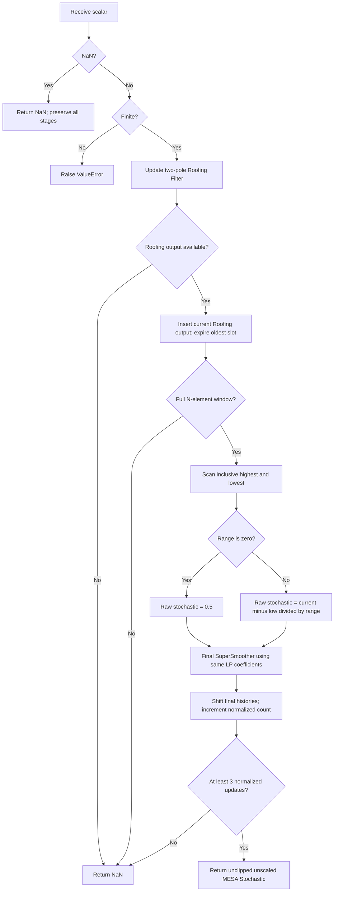

# MESA Stochastic: research prototype master

The master file is `mesa-stochastic.py`, class `MesaStochastic`. It implements the article's MESA Stochastic and book chapter 7 listing 7-4, named “Modified Stochastic Indicator” there. The entire calculation is: **two-pole Roofing Filter → rolling range normalization → SuperSmoother**. Defaults are `length=20`, shortest period 10, longest period 48. The file embeds its Roofing dependency, so copying this one folder is sufficient.

## Principles and analogies

A conventional stochastic compares a current price with the highest and lowest observations in a recent interval. The normalized position is near the upper end during a persistent rise and near the lower end during a fall. Ehlers argues that its single-difference structure does not adequately remove spectral dilation: the slow, large-amplitude components can dominate the position in the interval and distort a short-cycle interpretation.

MESA Stochastic first limits the input spectrum with the two-pole Roofing Filter. This resembles connecting a detrending electronic circuit and a noise-reduction circuit ahead of the measuring instrument. The stochastic then acts like a ruler whose endpoints follow the highest and lowest filtered values in a sliding observation window. The final low-pass stage smooths that normalized position. This normalization is nonlinear and time-varying, so the whole oscillator does not have a single linear transfer function even though both filter stages do.

The high-pass stage attacks long-period input components growing roughly at 6 dB/octave through spectral dilation; two poles supply about 12 dB/octave attenuation toward low frequency. The SuperSmoother attacks high-frequency/short-period noise and includes an exact Nyquist zero. The article smooths the normalized result once, rather than using the customary sequence of moving-average %K/%D smoothings. The two SuperSmoother stages use the **same** coefficients in the original code.

This indicator uses only historical and current observations. The “predictive” discussion in the article concerns interpreting thresholds before a presumed cyclical turning point, not reading future prices or adding extrapolation to this formula.

## Full mathematical calculation

Let $L$ be the shortest (low-pass) critical period and $H$ the longest (high-pass) critical period. $L<H$. Short **periods** mean high **frequencies**; the high-pass stage removes long periods, while the low-pass stage removes short periods. These complementary meanings are easy to reverse during conversion.

For one high-pass pole use $\theta=2\pi/H$. For two high-pass poles use $\theta=\sqrt{2}\pi/H$, the exact radian conversion of the printed `.707*360/H`. Define

$$
\alpha=\frac{\cos\theta+\sin\theta-1}{\cos\theta},\qquad
q=1-\alpha,\qquad g=1-\frac\alpha2.
$$

The master evaluates the algebraically equivalent half-angle expression

$$t=\tan\frac\theta2,\qquad \alpha=\frac{2t}{1+t}.$$

This avoids cancellation for small angles and the removable $0/0$ at $\theta=\pi/2$. At one-pole $H=4$, its continuous extension gives $\alpha=1$, $g=1/2$, $q=0$. The direct source expression is mathematically undefined there; a naive binary64 evaluation in the copied code produced the wrong coefficient. Port this half-angle evaluation if exact consistency with the master fixtures is desired. All admitted angles lie between 0 and $\pi$.

**Book listing 7-1**, a single high-pass stage followed by smoothing:

$$h_t=g(x_t-x_{t-1})+qh_{t-1}.$$

**Book listing 7-3 and the article**, a two-pole high-pass followed by smoothing:

$$h_t=g^2(x_t-2x_{t-1}+x_{t-2})+2qh_{t-1}-q^2h_{t-2}.$$

Compute the low-pass coefficients from equation 3-3 with $L$:

$$
\begin{aligned}
\beta&=\frac{\sqrt2\pi}{L},&a&=e^{-\beta},\\
c_2&=2a\cos\beta,&c_3&=-a^2,\\
c_1&=1-c_2-c_3,\\
f_t&=\frac{c_1(h_t+h_{t-1})}{2}+c_2f_{t-1}+c_3f_{t-2}.
\end{aligned}
$$

**Book listing 7-2**, when the first stage has one pole, adds the same one-pole high-pass after $f_t$:

$$r_t=g(f_t-f_{t-1})+qr_{t-1}.$$

The selected output is $f_t$ for plain one-pole and two-pole variants, and $r_t$ for the one-pole-plus-zero-mean variant. Book listing 7-2 also plots intermediate $f_t$; listing 7-3 plots $f_t$ and $f_{t-2}$. This master returns the selected current filter value only; delayed plots and the constant zero reference line are display constructions.

The corresponding high-pass transfer functions are

$$H_{HP1}(z)=\frac{g(1-z^{-1})}{1-qz^{-1}},\qquad
H_{HP2}(z)=\frac{g^2(1-z^{-1})^2}{(1-qz^{-1})^2}.$$

The SuperSmoother transfer function is

$$H_{SS}(z)=\frac{\frac{c_1}{2}(1+z^{-1})}{1-c_2z^{-1}-c_3z^{-2}}.$$

Multiply transfer functions for cascaded stages: $H_{HP2}H_{SS}$ in article mode, $H_{HP1}H_{SS}$ in preliminary one-pole mode, or $H_{HP1}H_{SS}H_{HP1}$ in the book's additional-high-pass mode. The last and first forms have two high-pass poles overall but use different $\theta$ at the same $H$, so their numerical arrays differ. Cascaded zero-state linear filters can be reordered in transfer theory; different standalone initial conditions can make finite-record startup differ.

Each high-pass pole gives a zero at DC, and the SuperSmoother numerator gives a zero at Nyquist. The two-pole high-pass double DC zero rejects a sustained linear ramp after its boundary transient. Its stable pole is repeated at $q$; $|q|<1$ for admitted finite periods in exact arithmetic. Negative $q$ at unusually short periods is mathematically valid but can cause alternating transients. Passing only a nominal band between $L$ and $H$ means gradual attenuation, not a rectangular passband or exact finite-window zero mean.

## Complete normalization and final smoothing equations

For the Roofing equations above, select **two** high-pass poles, use $\theta=\sqrt2\pi/H$, and take $f_t$ as the filtered input. The earlier one-pole book variants are included above for mathematical context but are not MESA Stochastic configuration choices.

For an integer observation length $N$, once $N$ usable Roofing outputs exist, compute

$$
\begin{aligned}
U_t&=\max_{0\le j<N} f_{t-j},\\
D_t&=\min_{0\le j<N} f_{t-j},\\
s_t&=\frac{f_t-D_t}{U_t-D_t},\qquad U_t>D_t,\\
m_t&=\frac{c_1(s_t+s_{t-1})}{2}+c_2m_{t-1}+c_3m_{t-2}.
\end{aligned}
$$

The current sample is included: loop bounds are exactly $0$ through $N-1$, not $1$ through $N$ and not $0$ through $N$. `length` is a true integer window count. $c_1,c_2,c_3$ are the **same** full-precision coefficients computed with shortest period $L$ for Roofing's low-pass stage. There is no independent final smoothing length in the source or this API.

At equal extrema $U_t=D_t$, the printed division is undefined. This master deliberately defines $s_t=1/2$, the midpoint, and continues the final smoother. This gives deterministic neutral behavior for constant filtered input. It is a specified degenerate-case extension, not an epsilon threshold or a rule printed by Ehlers. Every strictly positive range uses the actual ratio, however small it is. The source's usual non-flat arithmetic is unchanged.

Raw $s_t$ is in $[0,1]$, but the recursive smoother's impulse response can overshoot: $m_t$ may be below 0 or above 1. **Do not clamp** it. Do not multiply by 100: the article and TradeStation use thresholds 0.2 and 0.8. Some tips, including AmiBroker, scale the plot to percentages; their plotted values require dividing by 100 before comparison with this master.

## Oscillator timing and sine-wave interpretation

The article measured a value distribution resembling that of a sine wave. For a phasor rotating at uniform phase, $v=A\sin\phi$ has density

$$p(v)=\frac{1}{\pi\sqrt{A^2-v^2}},\quad -A<v<A.$$

If scaled to $u=(v/A+1)/2$, the density becomes

$$p(u)=\frac{1}{\pi\sqrt{u(1-u)}},\quad 0<u<1.$$

These explanatory density equations derive the primitive discussed in the article; the supplied article compares histograms rather than giving these formulas. A sine spends more phase/time near its extrema. Resemblance of marginal distributions alone does not establish deterministic turning-point timing.

The article's conventional rules buy on an upward crossing of 0.2 and sell short on a downward crossing of 0.8. Its anticipatory rules instead buy on a downward crossing of 0.2 and sell short on an upward crossing of 0.8. For consecutive finite oscillator values, the latter crossings can be expressed as

$$\text{buy}_t=(m_{t-1}\ge0.2)\land(m_t<0.2),\qquad
\text{short}_t=(m_{t-1}\le0.8)\land(m_t>0.8).$$

These are interpretations, not returned outputs or implemented trades. The article's rough lag example assumes a 20-bar cycle (ten bars per half cycle): about two bars for each SuperSmoother plus one bar to execute a trade and about three bars waiting for confirmation totals eight. Anticipating by three bars instead gives roughly two bars net. Book chapter 17 discusses the same lag issue and uses an observation length of 10 in its demonstration, whereas chapter 7 listing 7-4 and the article default to 20.

The book's rotating-phasor analogy says that a centered sine's extrema and zero crossings are related by a quarter cycle. Its separate cosine-leading construction is

$$\operatorname{Cosine}_t\approx\frac{T}{2\pi}(BP_t-BP_{t-1}),$$

from $d\sin(\omega t)/dt=\omega\cos(\omega t)$. This explains an alternative leading trigger discussed in chapter 17; **it is not part of MESA Stochastic**. No derivative, measured dominant period, phase forecast, trade entry, or stop logic is added to this master's output.

## Configuration, output, and exact startup

| Parameter | Shortcut | Default | Valid values | Meaning |
| --- | --- | ---: | --- | --- |
| `length` | `N` | 20 | Integer $N\ge2$ | Number of usable Roofing outputs in the inclusive rolling extrema window. |
| `shortest_cycle_period` | `LP` | 10.0 | Finite real $L\ge2$ | Critical period for **both** SuperSmoother stages. |
| `longest_cycle_period` | `HP` | 48.0 | Finite real $H>L$ | Two-pole high-pass critical period. |

Only `length` is exposed by the article; making filter periods configurable is a documented generalization of its fixed 10/48 constants. `length=1` is rejected because its range is always zero. Fractional filter periods are supported; fractional or boolean window lengths are rejected. Thresholds are explanatory plot levels and do not affect calculation or fixtures.

`update(sample)` returns the single unscaled $m_t$. First execute the embedded two-pole Roofing Filter with zero internal histories, storing the first two raw inputs and computing its first second difference on bar 3. Roofing hides bars 1–4 and first exposes bar 5. Only its **visible finite** outputs enter the stochastic window; zero-filled hidden startup outputs are not observations.

Wait for a complete $N$-element window. Thus the first raw $s_t$ is computed on bar $N+4$. Initialize its previous raw value and both final smoother histories to zero. Evaluate and store the last recurrence on that first raw stochastic bar and on all later bars. Hide its first two normalized/smoothed updates; expose the third.

Total leading NaNs are

$$W=4+(N-1)+2=N+5,$$

and the first valid output is bar $N+6$. With default $N=20$, `warmup_bars=25`, bar 26 first returns `0.0799403230710887`. This is an explicit standalone policy. The eSignal tip also requires full history before normalization, but relies on platform-managed filter seeds; AmiBroker and NinjaTrader use different startup constructs. The source's zero-initialized final oscillator state is preserved, while the undefined flat-range division is extended as stated above.

An indefinitely constant input produces zero Roofing values, raw stochastic 0.5 after the window fills, and a final output approaching 0.5 after the zero-state low-pass transient. Its first visible value need not already equal 0.5. This behavior is tested.

Store the window as a fixed $N$-element circular array and scan it for min/max. This is O($N$) storage and O($N$) work per update. Circular slot order does not affect extrema. The test cases cover index wrapping and expiring old extrema. There is no numpy operation, rolling-window dependency, or monotonic queue to reproduce in another language.

## Calculation flow



## Precision, source equivalence, and porting contract

All calculations use ordinary Python `float` (IEEE 754 binary64), `math.pi`, and `math.sqrt(2.0)`. Angles passed to `sin`, `cos`, and `tan` are radians. In printed EasyLanguage, trigonometric arguments are degrees: multiply by $\pi/180$ when converting. `x[N]` means the value $N$ bars earlier; it is a historical reference, not a forward array index.

The user explicitly requested full-precision replacements for `1.414`, `.707`, and `3.14159`. Consequently this master reproduces the source **algorithm** with precise constants and the explicit standalone startup described here; it cannot also reproduce every decimal of a platform running the truncated literals. The supplied platforms have differing seeds and input availability. Their historical chart output is not a unique finite-sequence startup oracle. Source recurrences are independently evaluated with the same mathematical constants and declared startup in the accompanying tests.

Do not round coefficients, differences, histories, or intermediate outputs. Serialization alone uses **15 significant decimal digits** (`.15g`), not 15 digits after the decimal point. A port should use a small relative/absolute numerical tolerance for floating-point comparison, for example $10^{-11}$ at ordinary price scales; bit-for-bit equality across different math libraries or fused multiply-add settings is not required. The tests check the complete NaN prefix and every usable output, rather than skipping dozens of bars as the copied legacy tests did.

The indicator accepts one scalar input per `update`. The source examples use the close. It does not choose high/low/median automatically. Zero and negative finite samples are valid. A NaN sample returns NaN and leaves **all** state and priming counters unchanged; the next finite sample follows the preceding finite sample. This treats missing calls as omitted observations, not calendar gaps. Infinite inputs raise `ValueError` before any state is changed. Use `reset()` to clear the entire series state. A primed filter has an available output; its recursive transient need not have settled. Very large periods can approach binary64 coefficient-resolution limits even when they satisfy the finite-period validation.

Each folder is self-contained. Its Python file includes the numeric classes it needs, the embedded 252 closes in `__main__`, and a standard-library-only generator. Numeric code above the fixture-tooling boundary is the code to port; AST parsing, file formatting, and command-line helpers do not belong in an indicator's runtime calculation.

## Confirmed reference data

The user confirmed the following cases on 2026-10-20. There are 34 combinations across all three masters: 10 SuperSmoother, 12 Roofing, and 12 MESA Stochastic; each indicator is below the requested 64-case limit. Each expected array contains 252 positions aligned with the embedded `INPUT_CLOSE`.

| Array suffix | Parameter values | What it tests |
| --- | --- | --- |
| `N2_LP10_HP48` | `length=2, shortest_cycle_period=10, longest_cycle_period=48` | Minimum stochastic window: current value and one preceding Roofing sample. |
| `N5_LP10_HP48` | `length=5, shortest_cycle_period=10, longest_cycle_period=48` | Short stochastic window: frequent range-extreme changes. |
| `N10_LP10_HP48` | `length=10, shortest_cycle_period=10, longest_cycle_period=48` | Book chapter 17 demonstration: ten-bar observation period. |
| `N14_LP10_HP48` | `length=14, shortest_cycle_period=10, longest_cycle_period=48` | Intermediate stochastic window: sensitivity to rolling extrema. |
| `N20_LP10_HP48` | `length=20, shortest_cycle_period=10, longest_cycle_period=48` | Article and book listing 7-4 default: twenty-bar MESA Stochastic. |
| `N30_LP10_HP48` | `length=30, shortest_cycle_period=10, longest_cycle_period=48` | Longer observation window: slower normalization-range changes. |
| `N48_LP10_HP48` | `length=48, shortest_cycle_period=10, longest_cycle_period=48` | Observation window equals high-pass period: full long-cycle range. |
| `N100_LP10_HP48` | `length=100, shortest_cycle_period=10, longest_cycle_period=48` | Long observation window: extended NaN prefix and rolling-slot wraparound. |
| `N20_LP5_HP24` | `length=20, shortest_cycle_period=5, longest_cycle_period=24` | Short-cycle Roofing: both SuperSmoother stages use five-bar coefficients. |
| `N20_LP10_5_HP48` | `length=20, shortest_cycle_period=10.5, longest_cycle_period=48` | Fractional low-pass period in both filtering and final smoothing. |
| `N20_LP20_HP80` | `length=20, shortest_cycle_period=20, longest_cycle_period=80` | Longer Roofing periods: normalized oscillator with slower smoothing. |
| `N40_LP40_HP80` | `length=40, shortest_cycle_period=40, longest_cycle_period=80` | Book Roofing example combined with a forty-bar stochastic window. |


Run the streaming demonstration and regenerate the confirmed fixtures from this folder:

```bash
python3 mesa-stochastic.py
python3 mesa-stochastic.py --generate-reference-data
python3 test_mesa_stochastic.py
```

The generator first writes and rereads Python expected arrays, verifies 252 values and exact serialized 15-digit precision, then propagates those saved values and identical two-line comments to Go, TypeScript, Rust, and Zig. It replaces only its marked generated section on reruns; copied input arrays remain intact. `__main__` embeds the closes and checks they equal the copied Python input before generation. Synthetic constant, ramp, and boundary tests supplement the market-data fixtures.

| Language | File | Expected declaration / NaN |
| --- | --- | --- |
| Python | `test_testdata.py` | `EXPECTED_` plus suffix; list / `math.nan` |
| Go | `testdata_test.go` | `expected` plus suffix; `[]float64` / `math.NaN()`; package `mesastochastic` |
| TypeScript | `testdata.ts` | `export const expected` plus suffix; `number[]` / `NaN` |
| Rust | `testdata.rs` | `pub fn expected_` plus lowercase suffix; `Vec<f64>` / `f64::NAN` |
| Zig | `testdata.zig` | `pub fn expected` plus suffix; `[252]f64` with `return` / `nan` |

Decimal parameter points are underscores: 10.5 becomes `10_5`; booleans in suffixes are 0/1. Python suffixes follow `EXPECTED_P10`, `EXPECTED_LP10_HP48_PO2_ZM0`, or `EXPECTED_N20_LP10_HP48` as appropriate. Other-language fixture comments reproduce the Python descriptions and parameter names verbatim. The copied Rust inputs stay inside their `#[cfg(test)] pub mod testdata`; expected functions are at file scope. Use both scopes as needed in a port's tests.

The accompanying tests extract original expressions from the supplied sources and compare every output against an independent batch calculation with precise constants and the specified startup. They also check the 15-digit Python values, all four translations including NaNs and comments, invalid parameters, reset behavior, and NaN state preservation. Source expressions are reproduced in this document; if source files are unavailable after copying the folder, the tests fall back to these code blocks.

## References and BibTeX

- John F. Ehlers, *Cycle Analytics for Traders: Advanced Technical Trading Concepts*, Wiley, 2013. [Book record](../../2013-cycle-analytics-for-traders/toc.md), [chapter 3](../../2013-cycle-analytics-for-traders/ch3.md), [chapter 4](../../2013-cycle-analytics-for-traders/ch4.md), [chapter 7](../../2013-cycle-analytics-for-traders/ch7.md), and [chapter 17](../../2013-cycle-analytics-for-traders/ch17.md). Relevant equations and code are reproduced below so a conversion agent does not need these files.
- John F. Ehlers, “Predictive And Successful Indicators,” *Technical Analysis of STOCKS & COMMODITIES* 32(1), January 2014, pp. 16–25. [Local article](../../tasc/2014-01-predictive-and-successful-indicators/content.md), [published PDF](https://technical.traders.com/archive/article.asp?file=\V32\C01\692EHLE.pdf).
- *Traders' Tips*, January 2014. [Local collection](../../tasc/2014-01-predictive-and-successful-indicators/tips/tips.md), [published collection](https://www.traders.com/Documentation/FEEDbk_docs/2014/01/TradersTips.html). TradeStation reproduces the recurrences; eSignal checks history availability; AmiBroker uses different initial array seeds.
- R. W. Hamming, *Digital Filters*, third edition, Prentice Hall, 1997, cited by Ehlers in chapter 3 for the smoothing-filter background.
- The [initial implementation investigation](../../tasc/2014-01-predictive-and-successful-indicators/implementation-comparison.md) compared the copied zpano implementations. It is a project audit, not an additional mathematical authority.

```bibtex
@book{ehlers2013cycle,
  author    = {Ehlers, John F.},
  title     = {Cycle Analytics for Traders: Advanced Technical Trading Concepts},
  publisher = {Wiley},
  year      = {2013},
  series    = {Wiley Trading},
  isbn      = {9781118728604},
  note      = {Chapter 3, equation 3-3; chapter 4, high-pass transfer functions;
               chapter 7, listings 7-1 through 7-4; chapter 17, oscillator timing}
}
@article{ehlers2014predictive,
  author  = {Ehlers, John F.},
  title   = {Predictive And Successful Indicators},
  journal = {Technical Analysis of STOCKS \& COMMODITIES},
  volume  = {32},
  number  = {1},
  pages   = {16--25},
  year    = {2014},
  month   = jan,
  url     = {https://technical.traders.com/archive/article.asp?file=\V32\C01\692EHLE.pdf}
}
@misc{traderstips2014january,
  author       = {{Technical Analysis of STOCKS \& COMMODITIES}},
  title        = {Traders' Tips: Predictive And Successful Indicators},
  year         = {2014},
  month        = jan,
  howpublished = {Online},
  url          = {https://www.traders.com/Documentation/FEEDbk_docs/2014/01/TradersTips.html},
  note         = {TradeStation, eSignal, and AmiBroker implementations supplied locally}
}
@book{hamming1997digital,
  author    = {Hamming, Richard W.},
  title     = {Digital Filters},
  edition   = {3},
  publisher = {Prentice Hall},
  address   = {Upper Saddle River, NJ},
  year      = {1997},
  note      = {Page 49; cited in Ehlers chapter 3}
}
```

## Original Roofing source prose and listings

These source passages and complete code listings retain the published approximate constants. Use the full-precision equations and initialization above for conversion. Original figure links are omitted; the text referring to figures is retained.

### Article: Spectral Dilation

Traders and technical analysts know that market data is fractal; a chart of daily data or weekly data will look basically the same if the scales were removed. In other words, the amplitude of the cyclic swings scale in direct proportion to the cycle period. I call this effect spectral dilation because longer cycle periods have larger swings. The Hurst coefficient is directly related to the degree of dilation. Fibonaccians use the golden spiral to show the dilation factor is 1.618. The exact degree of dilation is not important. That dilation exists is beyond question. So, in round numbers, the spectrum amplitude increases 6 dB per octave of cycle period. This $1/f$ phenomenon seems to be almost universal in physical systems.

Here was my epiphany regarding market data: Like everyone, I knew the market data was fractal. However, I completely disregarded this fact when looking at oscillator-type indicators such as the momentum, stochastic, relative strength index (RSI), moving average convergence/divergence (MACD), or commodity channel index (CCI). In a nutshell, all these indicators are first-order differentiators, that is, they all take just one difference in their calculation. A basic principle of filtering is that a filter has an attenuation rolloff of 6 dB per octave per order of the filter in the attenuation band of the filter. Thus, all of these indicators roll off at the rate of 6 dB per octave. Since the data amplitude swings are increasing at the rate of 6 dB per octave, the best these indicators can do is to flatten the response of the spectrum in the indicator output.

**FIGURE 2: SINGLE POLE HIGHPASS FILTER (OR OSCILLATOR).** The low frequency components are not removed, which results in the output failing to have a zero mean.

Figure 2 shows the practical effect of a first-order high-pass filter when applied to some sample market data. Note that during the period of the long uptrend, the oscillator does not have a zero mean. That is, the wiggles are not centered on zero. The interpretation is that the data has not been fully detrended and that the longer cycle period signals are leaking through the rejection band of the filter.

When I introduce a second-order high-pass filter, the attenuation rate is now 12 dB per octave in the attenuation band. The filter attenuation exceeds the 6 dB per octave dilation in the data, and therefore, effective filtering of the longer cycle components is accomplished. Figure 3 shows the contrast between using a first-order high-pass filter and second-order high-pass filter. The dotted red line is the original first-order response given in Figure 2 and the solid blue line is the second-order response. Note the second-order response provides a nominal zero mean for the oscillator and that much of the lag induced by the "leaking" longer cyclic components is eliminated.

**FIGURE 3: TWO-POLE HIGH-PASS FILTER.** The effects of spectral dilation are removed. This gives the oscillator a zero mean to accurately assess turning points and generally reduces indicator lag.

I call the combination of the SuperSmoother filter and the second-order high-pass filter a roofing filter because it provides a roof over the data spectrum, so the data is preprocessed for use with any indicator that may follow. The roofing filter is not a bad indicator in its own right. The EasyLanguage code for computing the roofing filter can be found in sidebar "EasyLanguage Code To Compute The Roofing Filter." In a sense, the roofing filter is a kind of bandpass filter. The roofing filter differs from a bandpass filter because the rejection response on the high-frequency side is specifically designed to reject aliasing noise, and the second-order rejection response on the low-frequency side is specifically designed to eliminate the effects of spectral dilation.

### Book chapter 7: construction of the three Roofing variants

A “roofing filter” can be used to limit the frequency content of an input before proceeding to construct an indicator. The roofing filter is composed of a high-pass filter that passes only frequency components whose periods are shorter than $48$ bars, for example. It also is composed of a SuperSmoother filter that passes frequency components whose periods are longer than 10 bars. Thus, the roofing filter is a wide bandwidth band-pass filter that passes only frequency components whose periods fall between 10 bars and 48 bars. This, by itself, is a simple indicator. The EasyLanguage code for this indicator is given in Code Listing 7-1, and the indicator output is displayed in Figure 7.1.

While the roofing filter indicator wiggles in proportion to the wiggles in the price data as you would expect, it is noticeable that the indicator is above zero for extended periods where the market is in an uptrend. In other words, the filter output does not have a zero mean as you would expect if the output consisted only of cyclic components whose periods fall between $10$ bars and $48$ bars.

**Code Listing 7-1. HP-LP Roofing Filter EasyLanguage Code**

```easylanguage
{
  HP-LP Roofing Filter
  © 2013 John F. Ehlers
}
Vars:
  alpha1(0),
  HP(0),
  a1(0),
  b1(0),
  c1(0),
  c2(0),
  c3(0),
  Filt(0);

//Highpass filter cyclic components whose periods are shorter than 48 bars
alpha1 = (Cosine(360 / 48) + Sine (360 / 48) - 1) / Cosine(360 / 48);

HP = (1 - alpha1 / 2)*(Close - Close[1]) + (1 - alpha1)*HP[1];

//Smooth with a Super Smoother Filter from equation 3-3
a1 = expvalue(-1.414*3.14159 / 10);
b1 = 2*a1*Cosine(1.414*180 / 10);
c2 = b1;
c3 = -a1*a1;
c1 = 1 - c2 - c3;
Filt = c1*(HP + HP[1]) / 2 + c2*Filt[1] + c3*Filt[2];

Plot1(Filt);
Plot2(0);
```

**Figure 7.1** *Roofing Filter Display Does Not Have a Zero Mean*

The explanation for the lack of a zero mean is that the input data has a spectral power density proportional to $1/F^ \alpha$, and therefore increases amplitude at the rate of $6 dB$ per octave, more or less. The high-pass filter has a rejection slope that increases attenuation directly proportional to F$ *{0.5}$, or rolls off at the rate of $6 dB$ per octave. This response is similar to the frequency response shown in Figure 1.2. As a result, the only effect of the high-pass filter is to basically to equalize the fractal amplitude growth of all longer periods in the data. Therefore, the filter output still contains all of these frequency components. The only way we can reduce the effect of these lower-frequency components is to introduce another high-pass filter, adding an additional $6 dB$ per octave roll-off, so that the net effect of the filter is as originally surmised. I have added `Filt2` to the code in Code ­Listing 7-2, and the effect is shown as the solid line in Figure 7.2. The original roofing filter response is shown with the crosshatched markers. Note that in ad- dition to establishing a nominally zero mean, removal of the longer-cycle components caused by spectral dilation removes lag from the roofing filter output.

Since the roofing filter consists of the serial connection of a one-pole high-pass filter, a SuperSmoother, and another one-pole high-pass filter, it is clear the better formulation of the roofing filter would be the serial connection of a two-pole high-pass filter and the SuperSmoother.

**Code Listing 7-2. EasyLanguage Code for a Zero Mean Roofing Filter**

```easylanguage
{
  Zero Mean Roofing Filter
  © 2013 John F. Ehlers
}
Vars:
  alpha1(0),
  HP(0),
  a1(0),
  b1(0),
  c1(0),
  c2(0),
  c3(0),
  Filt(0),
  Filt2(0);

//Highpass filter cyclic components whose periods are shorter than 48 bars
alpha1 = (Cosine(360 / 48) + Sine (360 / 48) - 1) / Cosine(360 / 48);

HP = (1 - alpha1 / 2)*(Close - Close[1]) + (1 - alpha1)*HP[1];

//Smooth with a Super Smoother Filter from equation 3-3
a1 = expvalue(-1.414*3.14159 / 10);
b1 = 2*a1*Cosine(1.414*180 / 10);
c2 = b1;
c3 = -a1*a1;
c1 = 1 - c2 - c3;
Filt = c1*(HP + HP[1]) / 2 + c2*Filt[1] + c3*Filt[2];
Filt2= (1 - alpha1 / 2)*(Filt - Filt[1]) + (1 - alpha1)*Filt2[1];

Plot1(Filt);
Plot2(Filt2);
Plot6(0);
```

## Roofing Filter as an Indicator

The roofing filter does an excellent job of using only the frequency components between its upper and lower critical periods. All that needs to be done to create an indicator from the roofing filter is to add more generality by allowing the high-pass and low-pass critical periods be supplied as indicator inputs. In the code of Code Listing 7-3, the two high-pass filters have been implemented as a single two-pole high-pass filter.

**Figure 7.2** * Zero Mean Roofing Filter Output Contains Only Desired Frequency Components*

The ideal time to buy is when the cycle is at a trough, and the ideal time to exit a long position or to sell short is when the cycle is at a peak. These conditions are flagged by the filter crossing itself delayed by two bars, and are included as part of the indicator.

**Code Listing 7-3. EasyLanguage Code for a Roofing Filter Indicator**

```easylanguage
{
  Roofing Filter Indicator
  © 2013 John F. Ehlers
}
Inputs:
  LPPeriod(40),
  HPPeriod(80);
Vars:
  alpha1(0),
  HP(0),
  a1(0),
  b1(0),
  c1(0),
  c2(0),
  c3(0),
  Filt(0),
  Filt2(0);

//Highpass filter cyclic components whose periods are shorter than 48 bars
alpha1 = (Cosine(.707*360 / HPPeriod) + Sine (.707*360 / HPPeriod) - 1) / Cosine(.707*360 / HPPeriod);

HP = (1 - alpha1 / 2)*(1 - alpha1 / 2)*(Close - 2*Close[1] + Close[2]) + 2*(1 - alpha1)*HP[1] - (1 - alpha1)*(1 - alpha1)*HP[2];

//Smooth with a Super Smoother Filter from equation 3-3
a1 = expvalue(-1.414*3.14159 / LPPeriod);
b1 = 2*a1*Cosine(1.414*180 / LPPeriod);
c2 = b1;
c3 = -a1*a1;
c1 = 1 - c2 - c3;
Filt = c1*(HP + HP[1]) / 2 + c2*Filt[1] + c3*Filt[2];

Plot1(Filt);
Plot2(Filt[2]);
Plot6(0);
```

An example of the roofing filter indicator is shown in Figure 7.3, where the LP period rather arbitrarily has been set at 40 and the HP period also has been arbitrarily set at 80 bars. A casual glance shows the roofing filter to be an excellent indicator whose signals are not marred by computational lag. The two inputs can be set to get the best response for a particular stock, exchange-traded fund, or future symbol. This indicator gives excellent guidance for discretionary trading, but additional rules would be required to create a good mechanical trading system from it.

If a normalized amplitude indicator is desired, the automatic gain control (AGC) code fragment described in Chapter 5 can be added after the Filt calculation.

**Figure 7.3** *The Roofing Filter Is an Outstanding Technical Indicator*

## EasyLanguage Code To Compute The Roofing Filter

```easylanguage
{
  Roofing filter
  © 2013 John F. Ehlers
}
Vars: alpha1(0), HP(0), a1(0), b1(0), c1(0), c2(0), c3(0), Filt(0);

//Highpass filter cyclic components whose periods are shorter than 48 bars
alpha1 = (Cosine(.707*360 / 48) + Sine(.707*360 / 48) - 1) / Cosine(.707*360 / 48);
HP = (1 - alpha1 / 2)*(1 - alpha1 / 2)*(Close - 2*Close[1] + Close[2])
     + 2*(1 - alpha1)*HP[1] - (1 - alpha1)*(1 - alpha1)*HP[2];

//Smooth with a Super Smoother Filter
a1 = expvalue(-1.414*3.14159 / 10);
b1 = 2*a1*Cosine(1.414*180 / 10);
c2 = b1;
c3 = -a1*a1;
c1 = 1 - c2 - c3;

Filt = c1*(HP + HP[1]) / 2 + c2*Filt[1] + c3*Filt[2];

Plot1(Filt);
Plot2(0);
```

## Original source mathematics and code

The following source material is reproduced without changing its mathematical expressions. The supplied transcription of preceding equations 3-1 and 3-2 also contains unusual signs and a factor 1.25; these are preserved as source text and are not used by this master. Equation 3-3 and the article sidebar agree on the implemented recurrence. Printed coefficient approximations and degree angles remain visible here for audit; the master implementation uses the precise radian equations above. Image links are omitted.

### Book chapter 3: SuperSmoother derivation and applications

One of the advantages of recursive filters is that the transition between the pass band and the stop band can be much sharper compared to that of the nonrecursive filters. As a matter of computational simplicity, the critical period of the filter can be established independently from the degree of the filter. On the downside, recursive filters don’t have the same delay at all frequencies. This variable delay across the spectrum leads to dispersion distortion of the output waveform. Most of the dispersion occurs at those frequency components that have been attenuated, so the effect of the distortion is a relatively minor one.

A Butterworth filter is a favorite analog filter because its frequency response is maximally flat, near zero frequency. Years ago, I translated analog Butterworth filters to their digital approximations having like degrees in the numerator and denominator of the transfer response. The transfer response is characterized by a single variable: the critical period. The critical period is that where the output is attenuated by $3$ dB relative to the input data.

The digital Butterworth filter approximations included numerators whose coefficients were $[1 2 1] and [1 3 3 1]$ for two- and three-pole con- figurations, respectively. However, for applications to trading, I noted that the primary contribution of the numerator terms was to increase the filter lag. So I created modified versions simply by deleting all but the constant term in the numerator of the Butterworth transfer response.

The equations for the two-pole modified Butterworth filter are:

$$\begin{aligned}
a &= e^{-1.414 \cdot 3.14159 / \text{Period}} \\
b &= 2 a \cos(1.414 \cdot 1.25 \cdot 180 / \text{Period}) \\
c_2 &= b \\
c_3 &= -a \cdot a \\
c_1 &= 1 - c_2 - c_3 \\
\text{Output} &= c_1 \cdot \text{Input} - c_2 \cdot \text{Output}[1] - c_3 \cdot \text{Output}[2]
\end{aligned}$$

(3-1)

The equations for the three-pole modified Butterworth filter are:

$$\begin{aligned}
a &= e^{-3.14159 / \text{Period}} \\
b &= 2 a \cos(1.738 \cdot 180 / \text{Period}) \\
c &= a \cdot a \\
d_2 &= b + c \\
d_3 &= -(c + b \cdot c) \\
d_4 &= c \cdot c \\
d_1 &= 1 - d_2 - d_3 - d_4 \\
\text{Output} &= d_1 \cdot \text{Input} - d_2 \cdot \text{Output}[1] - d_3 \cdot \text{Output}[2] - d_4 \cdot \text{Output}[3]
\end{aligned}$$

(3-2)

The frequency responses for two- and three-pole modified Butterworth filters whose critical period was set at a 10-bar cycle are shown in ­Figure 3.8. The three-pole version gives about 6 dB more attenuation at the Nyquist frequency than the two-pole version. That means the output wave amplitude of the three-pole version would be half the wave amplitude at the Nyquist frequency. In some applications, this difference in filtered amplitude could be important.

**Figure 3.8** *Frequency Response of Two- and Three-Pole Modified Butterworth Filters Where Period = 10*

The delay of the two- and three-pole modified Butterworth filters whose critical period was set at a 10-bar cycle is shown in Figure 3.9. The price to be paid for the additional rejection band attenuation is an increase of almost two bars of additional delay near the critical period. In addition, there is greater percentage dispersion distortion across the pass band.

Having obtained good filtering with minimum delay and minimum delay distortion, it is relatively easy to obtain a zero in the transfer response at the Nyquist frequency by adding a two-element moving average in the numerator. The delay cost is only half a bar, and that cost seems worth it. By doing this, a filter I call the SuperSmoother is created. The equations for the SuperSmoother filter are:

$$\begin{aligned}
a &= e^{-1.414 \cdot 3.14159 / \text{Period}} \\
b &= 2 a \cos(1.414 \cdot 180 / \text{Period}) \\
c_2 &= b \\
c_3 &= -a \cdot a \\
c_1 &= 1 - c_2 - c_3 \\
\text{Output} &= c_1 \cdot (\text{Input} + \text{Input}[1]) / 2 + c_2 \cdot \text{Output}[1] + c_3 \cdot \text{Output}[2]
\end{aligned}$$

(3-3)

**Figure 3.9** *Lags of Two- and Three-Pole Modified Butterworth Filters Where Period = 10*

The frequency response of the SuperSmoother filter where the critical period is set to $10$ is shown in Figure 3.10.

**Figure 3.10** *Frequency Response of a SuperSmoother Filter Where Period = 10*

## SuperSmoother Filter Applications

A SuperSmoother filter is used anytime a moving average of any type would otherwise be used, with the result that the SuperSmoother filter output would have substantially less lag for an equivalent amount of smoothing produced by the moving average. For example, a five-bar SMA has a cutoff period of approximately 10 bars and has two bars of lag. A SuperSmoother filter with a cutoff period of 10 bars has a lag a half bar larger than the two-pole modified Butterworth filter shown in Figure 3.9. Therefore, such a SuperSmoother filter has a maximum lag of approximately 1.5 bars and even less lag into the attenuation band of the filter. The differential in lag between moving average and SuperSmoother filter outputs becomes even larger when the cutoff periods are larger.

Market data contain noise, and removal of noise is the reason for using smoothing filters. In fact, market data contain several kinds of noise. I’ll group one kind of noise as systemic, caused by the random events of trades being exercised. A second kind of noise is aliasing noise, caused by the use of sampled data. Aliasing noise is the dominant term in the data for shorter cycle periods.

It is easy to think of market data as being a continuous waveform, but it is not. Using the closing price as representative for that bar constitutes one sample point. It doesn’t matter if you are using an average of the high and low instead of the close, you are still getting one sample per bar. Since sampled data is being used, there are some DSP aspects that must be considered. For example, the shortest analysis period that is possible (without aliasing) $2$ is a two-bar cycle. This is called the Nyquist frequency, $0.5$ cycles per sample. A perfect two-bar sine wave cycle sampled at the peaks becomes a square wave due to sampling. However, sampling at the cycle peaks cannot be guaranteed, and the interference between the sampling frequency and the data frequency creates the aliasing noise. The noise is reduced as the data period is longer. For example, a four-bar cycle means there are four samples per cycle. Because there are more samples, the sampled data are a better replica of the sine wave component. The replica is better yet for an eight-bar data component. The improved fidelity of the sampled data means the aliasing noise is reduced at longer and longer cycle periods. The rate of reduction is $6$ dB per octave. My experience is that the systemic noise rarely is more than $10$ dB below the level of cyclic information, so that we create two conditions for effective smoothing of aliasing noise:

1. It is difficult to use cycle periods shorter that two octaves below the Nyquist frequency. That is, an eight-bar cycle component has a quantization noise level 12 dB below the noise level at the Nyquist frequency. Longer cycle components therefore have a systemic noise level that ­exceeds the aliasing noise level.
2. A smoothing filter should have sufficient selectivity to reduce aliasing noise below the systemic noise level. Since aliasing noise increases at the rate of $6$ dB per octave above a selected filter cutoff frequency and since the SuperSmoother attenuation rate is $12$ dB per octave, the SuperSmoother filter is an effective tool to virtually eliminate aliasing noise in the output signal.

I urge readers to universally adapt the SuperSmoother filter set to a cutoff period of $10$ bars or so on all data to attenuate aliasing noise. The output of the SuperSmoother filter can be used directly as an indicator or as the sampled data fed to any other indicator.

## EasyLanguage Code To Compute The SuperSmoother Filter

```easylanguage
{
  SuperSmoother filter
  © 2013 John F. Ehlers
}
Vars: a1(0), b1(0), c1(0), c2(0), c3(0), Filt(0);

a1 = expvalue(-1.414*3.14159 / 10);
b1 = 2*a1*Cosine(1.414*180 / 10);
c2 = b1;
c3 = -a1*a1;
c1 = 1 - c2 - c3;

Filt = c1*(Close + Close[1]) / 2 + c2*Filt[1] + c3*Filt[2];

Plot1(Filt);
Plot2(0);
```

## Original MESA Stochastic source material

### Article: Adding A Filter

In Figure 4 you see a comparison of the conventional stochastic indicator and a stochastic calculation preceded by a roofing filter. I remember seeing technician George Lane, a grandiose speaker, list the myriad of rules for use of the stochastic. Some depended on %D crossing %K on the right side or left side. For example, one rule was, "In an uptrend, don't go short until %D crosses below 80 three times." As we now see, all those rules are just plain silly. The distortion of the stochastic in an uptrend is due solely to spectral dilation. When the roofing filter precedes the stochastic, the result is an easy-to-use oscillator, which I call MESA Stochastic to differentiate it from the conventional stochastic oscillator. The swings of the MESA Stochastic are nearly in synchronization with the swings in prices. I have included the complete indicator in sidebar "EasyLanguage Code To Compute MESA Stochastic Indicator" for those of you who wish to replicate it.

**FIGURE 4: ROOFING FILTER.** The addition of a roofing filter preceding a stochastic removes spectral dilation distortion.

The computation of the MESA Stochastic is a simple one, where the current value of the roofing filter is differenced from the lowest value over the observation period, and the difference is normalized to the range between the highest and lowest value of the roofing filter over the observation period. Rather than use the usual arcane multiple smoothings, I smooth the stochastic just once using a SuperSmoother.

### Article: Effective Trading Strategies and Making It Predictive

Conventional wisdom says to wait for confirmation of the turning point before making a trade entry. That means that buy signals are created when the indicator crosses over 20 and sell signals are created when the indicator crosses under 80. In Figure 5 you see the conventional trading rules in action. The green and red arrows indicate application of those rules.

**FIGURE 5: CONVENTIONAL TRADING RULES.** Buy when the indicator crosses above 20% and sell short when the indicator crosses below 80%.

A casual review of those rules seems to confirm they can result in good trades. Not trusting anecdotal evidence, I wrote a trading strategy that contains only those rules. There were no other qualifying rules and no stop exits. When I ran that trading system on 10 years of continuous daily data on the S&P futures data, it resulted in the equity growth curve you see in Figure 6. The trading system using conventional wisdom was a consistent loser!

A quick analysis will tell you what went wrong. First, assume there is a 20-bar dominant cycle in the data. This happens to be more or less true from my spectral measurements. It is also logical from a fundamental perspective because the companies that comprise the S&P index generally have to make their numbers on a monthly basis. So, generally speaking, you would expect a 10-bar move to the upside and a 10-bar move to the downside. Now, I'll add up the lag in my calculations.

The SuperSmoother has about two bars of lag, both in the roofing filter and stochastic. You can only make a trade entry on the bar after the signal, so there is another bar of lag. In addition, you average about three bars of lag, waiting for confirmation. When I added these lags, I found that they total eight bars. That's eight bars of lag in an expected 10-bar move. No wonder the trading strategy is a consistent loser!

It is natural to be tempted to simply reverse the rules to convert the trading strategy into a winner. Unfortunately, that's like doing brain surgery with an axe. I avoid such tactics because sloppy rules like that generally return to bite you. There is a much more elegant solution available.

**FIGURE 6: EQUITY CURVE FROM APPLYING THE STOCHASTIC OSCILLATOR ON 10 YEARS OF S&P DAILY FUTURES DATA.** Consistent losses are incurred when trading the stochastic oscillator using the conventional rule of waiting for confirmation.

## Making It Predictive

The MESA Stochastic indicator is just like any other indicator in the sense that it is created using historical data. In and of itself, it has no predictive power. However, note that the waveform of the indicator in Figure 5 is more than vaguely reminiscent of a sine wave. Based on this observation, I measured the probability density of the values of the indicator over the last 10 years, or about 2,500 samples. Figure 7 shows the resulting probability density of the indicator compared to the probability density of a theoretical sine wave over the same number of samples. The probability density functions are nearly the same.

**FIGURE 7: PROBABILITY DENSITY FUNCTION.** Here you see the resulting probability density of the indicator (top chart) compared to the probability density of a theoretical sine wave (bottom chart) over the same number of samples. The probability density functions are nearly the same.

I know that I can anticipate the peak of a sine wave if I know its amplitude is increasing and the amplitude value is near +1. I can also anticipate the valley of a sine wave if I know its amplitude is decreasing and the amplitude value is near -1. Since the probability density functions are similar, I can anticipate and predict the price turning points using MESA Stochastic.

All I have to do to predict the price turning points is to create rules to buy when the indicator crosses under 20 and to sell short when the indicator crosses over 80. The rules are displayed as the green and red arrows overlaid on the MESA Stochastic indicator in Figure 8.

**FIGURE 8: PREDICTIVE INDICATORS.** You would buy when the indicator crosses below 20% before the indicator reaches its minimum value. You would sell short when the indicator crosses above 80%, before the indicator reaches its maximum value.

As before, I created a trading strategy using only these rules and ran the strategy over 10 years of continuous daily data for S&P daily futures. The resulting equity growth curve is shown in Figure 9. Now we have a consistent winner! It is not too much work to add some ancillary rules, stops, and so forth to have a real trading system.

Nothing has changed in the indicator calculations. There are still two bars of lag due to the SuperSmoother in the roofing filter and stochastic calculation. There is still a one-bar lag, making the trade entry after getting the signal. The difference is that now there is a minus three bars of lag because you are anticipating the turning point of the MESA Stochastic indicator. Therefore, there is a net two-bar lag of your trade entry relative to the nominal extremes in price movement. In other words, you have virtually predicted the point at which the price will reverse its swing.

> Anticipating swing turning points results in consistently profitable trading strategies.

**FIGURE 9: PREDICTIVE EQUITY CURVE.** Consistent winners occur when trading the stochastic oscillator by anticipating the indicator turning points.

## EasyLanguage Code To Compute MESA Stochastic Indicator

```easylanguage
{
  MESA Stochastic Indicator
  © 2013 John F. Ehlers
}
Inputs: Length(20);

Vars: alpha1(0), HP(0), a1(0), b1(0), c1(0), c2(0), c3(0), Filt(0),
      HighestC(0), LowestC(0), count(0), Stoc(0), MESAStochastic(0);

//Highpass filter cyclic components whose periods are shorter than 48 bars
alpha1 = (Cosine(.707*360 / 48) + Sine(.707*360 / 48) - 1) / Cosine(.707*360 / 48);
HP = (1 - alpha1 / 2)*(1 - alpha1 / 2)*(Close - 2*Close[1] + Close[2])
     + 2*(1 - alpha1)*HP[1] - (1 - alpha1)*(1 - alpha1)*HP[2];

//Smooth with a Super Smoother Filter
a1 = expvalue(-1.414*3.14159 / 10);
b1 = 2*a1*Cosine(1.414*180 / 10);
c2 = b1;
c3 = -a1*a1;
c1 = 1 - c2 - c3;

Filt = c1*(HP + HP[1]) / 2 + c2*Filt[1] + c3*Filt[2];

HighestC = Filt;
LowestC = Filt;
For count = 0 to Length - 1 Begin
  If Filt[count] > HighestC then HighestC = Filt[count];
  If Filt[count] < LowestC then LowestC = Filt[count];
End;
Stoc = (Filt - LowestC) / (HighestC - LowestC);
MESAStochastic = c1*(Stoc + Stoc[1]) / 2 +
  c2*MESAStochastic[1] + c3*MESAStochastic[2];

Plot1(MESAStochastic);
Plot2(.8);
Plot6(.2);
```

### Book chapter 7: impact on the stochastic indicator

**Figure 7.4: Spectral Dilation Removal Has a Dramatic Impact on the Stochastic Indicator*

Conventional indicators are not immune to the effects of spectral dilation. For example, a Stochastic indicator remains near its upper bound when the market is in an uptrend even though a relatively short lookback period is used. This, of course, is due to the presence of the larger and longer cyclic components in the data. I describe the effect on the Stochastic indicator with reference to Figure 7.4. A Stochastic indicator basically displays the current closing price relative to the highest and lowest values in the lookback range. If you stop and think about it, the current price will tend to be in the high end of the range when the market is in an uptrend. In a broad sense, the classic Stochastic indicator acts as a one-pole filter because there is just a single difference term in the numerator of its calculation. The first subgraph in Figure 7.4 shows my calculation of a Stochastic over a 20-bar lookback range. This calculation is the same as the standard, except I use a SuperSmoother for the smoothing instead of moving averages. The bottom subgraph shows an identical calculation except that the Stochastic calculations are preceded by the roofing filter that constrains the cyclic components to fall within the range from 10-bar to 48-bar periods. Clearly, the Stochastic indicator has been dramatically altered by the insertion of the roofing filter.

The interpretation and use of the Stochastic indicator, or any other indicator, preceded by the roofing filter will not be addressed. Those kinds of applications can fill books all by themselves. Therefore, I will leave it to the reader to explore how standard indicators can be improved simply by inserting the roofing filter before the indicator computations are begun. As a point of reference, the EasyLanguage code used to create the bottom subgraph in Figure 7.4 is given in Code Listing 7-4.

**Code Listing 7-4. EasyLanguage Code to Compute the Modified Stochastic Indicator**

```easylanguage
{
  Modified Stochastic Indicator
  © 2013 John F. Ehlers
}
Inputs:
  Length(20);
Vars:
  alpha1(0),
  HP(0),
  a1(0),
  b1(0),
  c1(0),
  c2(0),
  c3(0),
  Filt(0),
  HighestC(0),
  LowestC(0),
  count(0),
  Stoc(0),
  MyStochastic(0);

//Highpass filter cyclic components whose periods are shorter than 48 bars
alpha1 = (Cosine(.707*360 / 48) + Sine (.707*360 / 48) - 1) / Cosine(.707*360 / 48);

HP = (1 - alpha1 / 2)*(1 - alpha1 / 2)*(Close - 2*Close[1] + Close[2]) + 2*(1 - alpha1)*HP[1] - (1 - alpha1)*(1 - alpha1)*HP[2];

//Smooth with a Super Smoother Filter from equation 3-3
a1 = expvalue(-1.414*3.14159 / 10);
b1 = 2*a1*Cosine(1.414*180 / 10);
c2 = b1;
c3 = -a1*a1;
c1 = 1 - c2 - c3;
Filt = c1*(HP + HP[1]) / 2 + c2*Filt[1] + c3*Filt[2];
HighestC = Filt;
LowestC = Filt;

For count = 0 to Length - 1 Begin
  If Filt[count] > HighestC then HighestC = Filt[count];
  If Filt[count] < LowestC then LowestC = Filt[count];
End;

Stoc = (Filt - LowestC) / (HighestC - LowestC);
MyStochastic = c1*(Stoc + Stoc[1]) / 2 + c2*MyStochastic[1] + c3*MyStochastic[2];

Plot1(MyStochastic);
```

### Book chapter 17: timing and sine-wave interpretation

By analogy to gambling, trading strategy performance is most easily characterized by percent winning trades and profit factor. Profit factor is the ratio of gross winnings to gross losses, comparable to the payout on a wager. Percent winning trades is self-explanatory. There is no unique combination of these characteristics that lead to a successful trading strategy, so the trading style is optional.

Trend following usually means trying to identify an entry opportunity and then exit the trade quickly if the trend does not develop. This means one can make a lot of money on a few trades, but there will be many losing trades along the way. Therefore, trading the trend means being willing to accept a relatively low percentage of winning trades to achieve a relatively high profit factor. Alternatively, a trend trader may elect to hold a position through adversity to profit in the long run. Holding trades through adversity usually means accepting large drawdowns. In my view, trend trading works because the general market is unbounded and has an upside bias due to economic growth and inflation. I assert that there are no predictive indicators for trends, and therefore this style of trading does not fit my ­preferred ­process.

Predictive indicators are more applicable to short-term processes such as swing or momentum trading because, like the weather, predicting the future is fragile and evanescent. If the indicators are indeed predictive, short-term trading is characterized by a higher percentage of winning trades. The profit factor of short-term trades is generally smaller because spectral dilation limits the swings of the short-term market movements. The general class of indicators that support short-term trading are called oscillators.

As described in Chapter 6, we are dealing with random variables when trying to describe the market. Additionally, traders generally prefer to err on the side of caution because losses are painful. These considerations lead to a trading philosophy that waits for confirmation of the turning point of an indicator before signaling a trade entry. For example, the conventional Stochastic indicator rule could be “wait until the oscillator crosses above 20 percent before making a long position trade, and wait until the oscillator crosses below 80 percent before reversing to a short position trade.” This rule set waits until the Stochastic indicator moves in the direction of the desired trade before making the trade decision. As an example, assume the market has a monthly cycle. We would then want to set the length parameter of a stochastic indicator to 10 because there are roughly 10 days up and 10 days down in a monthly cycle. When we invoke the conventional Stochastic indicator rule using the two-pole Stochastic indicator of Chapter 7, we obtain the equity curve of Figure 17.1 when applied to 10 years of the S&P Futures data.

**Figure 17.1** *Using a Conventional Stochastic Indicator Rule Is Not ­Profitable*

These trading results are awful! Just a little analysis can show what went wrong. First, the roofing filter has a lag of about two bars, almost like the SuperSmoother filter. There is basically no lag computing the Stochastic, and then there is another two-bar lag of the SuperSmoother filter that smooths the Stochastic calculation. So there is a total of four bars of lag just to compute the indicator. We don’t get a signal for about 25 percent of the move in time, or about three bars, after the turning point of the indicator. Further, we cannot make a trade entry until the day after the signals are given. Therefore, our trade entries and reversals are about 8 bars late on a 10-bar move. This means we are trading almost exactly opposite of the way the market is moving in a monthly cycle. This is the penalty for waiting for confirmation.

## Anticipating the Turning Point

I think the best way to trade an oscillator is to anticipate the turning point and rely on the statistical return to the mean as being predictive. I wrote a paper on this subject that was awarded the 2008 Runner-Up Winner of the Market Technician Association’s Charles H. Dow Award.1 In contrast to the conventional wisdom, the Stochastic indicator anticipation of the turning point trading rule would be “make a long position trade when the oscillator crosses below 20 percent, and reverse to a short position trade when the oscillator crosses above 80 percent.” The anticipation rule enables us to get the trading signal nominally three bars before the turning point of the indicator. We still have the four bars of computational lag and the one bar lag of entry following the signal. Therefore, our net lag in making the trade entry is only two bars relative to the real turning point in the data. In other words, out timing is just about right. Invoking the anticipated trading rule using the two-pole Stochastic indicator of Chapter 7, we obtain the equity curve of Figure 17.2 when applied to 10 years of the S&P Futures data.

**Figure 17.2** *Using the Anticipated Stochastic Indicator Turning Point Rule Is Generally Profitable*

The anticipation rule is equally applicable to most oscillators. Example oscillators in this book would be the band-pass filter in Chapter 5 and the two-pole RSI in Chapter 7. The anticipation rule using the two-pole Stochastic indicator is not intended to be a complete trading system. For example, the 10-bar period was selected for demonstration purposes. The computation period of the indicator can be optimized for a given symbol to produce the best timing for the trade entries and exits. Further, no stop-loss values have been used.

The purpose of describing the conventional wisdom of waiting for confirmation as contrasted with anticipating the turning points with no other changes of parameters or rules is to sensitize you to the impacts of ­computational lag.

## Sine Wave Uniqueness

According to Fourier analysis, any complex waveform can be synthesized using a combination of sine wave components. That makes a sine wave a primitive from which all patterns can be formed. It is best to use a primitive in trading in the interest of robustness. Further, it is difficult enough just to measure one primitive in the market data, let alone a complex set that creates anecdotal patterns. With a sufficiently small bandwidth, the band-pass filter creates an output that can be characterized as a sine wave having a slowly varying amplitude and phase. Armed with this information, we can examine the use of sine waves in providing trading signals.

A sine wave can be generated by the projection of a rotating phasor on its vertical axis,2 as depicted in Figure 17.3. As the phasor rotates, the sine wave rises from zero to its maximum, back to zero, to its minimum, and then back to zero again to complete one full cycle period. Note that the “tail” of the phasor is pinned at the origin. If the tail of the phasor were offset from the origin, then the sine wave would be distorted and would not have a zero mean. Since market data have Spectral Dilation, it is crucial that the Spectral Dilation effects be removed, as discussed in Chapter 5, before working with the filtered sine wave.

**Figure 17.3** *A Sine Wave Can Be Generated by a Rotating Phasor That Is Pinned at the Origin*

The position of the phasor at any instant in time is the phase angle of the sine wave. There is a special relationship if the phase angle between two phasors is 90 degrees, or a quarter of a cycle. As shown in Figure 17.4, a phasor leading the sine wave phasor by 90 degrees creates a cosine wave. The fact that a cosine wave leads a sine wave by 90 degrees is important because it gives us a way to artificially advance the turning point of a band-pass filter output by a quarter of a cycle. By advancing the waveform a quarter of a cycle we can negate or reduce the computational lag required by the filter.

**Figure 17.4** *A Cosine Wave Leads a Sine Wave by 90 Degrees (a quarter of a cycle)*

From the calculus we know that the rate of change of the sine wave is ­exactly a cosine wave whose amplitude is modified by the argument. A one-bar difference creates the rate of change of the sine wave, so an amplitude-corrected cosine wave can be computed in code as (using EasyLanguage notation):

$$Cosine = (Period / 2\pi) * (BP − BP[1])$$

Yes, it really is that simple to create a leading trading signal using the out-
put of a band-pass filter if you know or estimate the period of the sine wave.

The object of using the cosine wave is to create a buy signal when the co-
sine wave is at or near a trough and to create a sell signal when the ­cosine wave
is at or near a peak. One way to do this is by noting that the sine wave crosses
below zero when the cosine wave is at its trough and the sine wave crosses
over zero when the cosine wave is at its peak. In other words, we can create
buy and sell signals simply based on the zero crossings of the sine wave.

It is a little more conservative to create a trigger signal that lags the cosine wave by a bar or two, as shown in Figure 17.5. Using a delayed cosine wave as a trigger means giving back a little of the lag we have struggle to minimize.

**Figure 17.5** *Buy and Sell Signals Can Be Created by Crossovers with a Cosine Wave and the Cosine Wave Delayed by a Bar or Two*

Some whipsaw trades can be eliminated by using the zero crossings of the sine wave as an entry signal only when confirmed by the crossover of the cosine wave with itself delayed by one bar.
