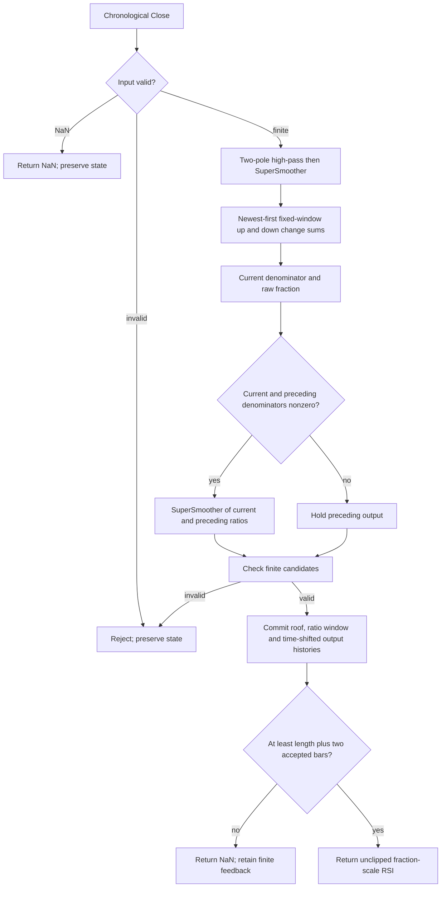

# Modified Relative Strength Index — Chapter 7 research prototype master

## Numerical authority and scope

This is a **research prototype master reference** for conversion to Python, Go, TypeScript, Rust and Zig. The numerical authority is this indicator's own listing in John F. Ehlers' *Cycle Analytics for Traders: Advanced Technical Trading Concepts* (Wiley, 2013). The implementation is chronological and uses only standard Python arithmetic, lists, tuples and `math`. Every folder is self-contained: no numerical runtime imports from another master, zpano, NumPy or pandas. The relevant original book prose and complete indicator listing are retained in the appendix, while the full mathematical specification is stated above it so a conversion agent does not need access to the book files.

Full-precision mathematical constants replace printed approximations: `math.pi`, `math.sqrt(2.0)` and its reciprocal correspond to `3.14159`, `1.414` and `.707` in the applicable formulas. The source's degrees are converted to radians. Decimal design constants such as .5 and the plotting levels .3/.7 are not reinterpreted as approximations to mathematical constants. All feedback and calculations use unrounded binary64. Only exported reference literals use **15 significant digits**. The original truncated-constant code may differ slightly; recurrence signs, arithmetic ordering, window bounds and guard behavior remain the chosen source authority.

The user confirmed **36 combinations**, twelve per folder, on 2026-10-22. Modified RSI and Even Better Sinewave each export a scalar VALUE array per case. Autocorrelation Reversals exports the plotted REVERSAL plus the source's SIGN_CHANGES count as an explicit diagnostic. Family total: **48 expected component arrays per language**, all with 252 rows. The Reversals master has an explicit source mode for the unused printed HPLength input; the default preserves the original listing.

## Streaming API and finite-record initialization

Call `update(close, time=None)` once per chronological scalar Close. Scalar indicators return a float; Reversals returns a named tuple. Time is metadata-compatible but does not enter the numerical calculation. `parameters` is immutable; `samples_seen` counts accepted observations; `warmup_bars` is the number of leading unavailable public rows; `is_primed` indicates that required history exists; `output` is the last accepted public output; `state` exposes immutable diagnostic values. `reset()` restores zero state while retaining configuration and coefficients.

Absent raw prices, filtered histories, correlation storage and declared recursive variables are explicitly zero. Every stage runs from the first accepted bar, even while public output is NaN. Zero prehistory and standalone CurrentBar=1 define this finite-record reference. Do not seed with the first Close, delay the recurrence until full history, use public NaNs as feedback, or replay earlier windows after future data arrives. A positive constant Close has a startup transient because absent closes were zero; a zero-only stream is a different experiment. A trading platform with preceding price history must use matched initialization and accepted bars to reproduce this reference.

NaN input denotes an omitted observation: return all-NaN output and preserve histories, accepted count and the previous `output`. Infinity, bool, nonnumeric input and arithmetic overflow raise `ValueError` before state mutation. All downstream candidates are checked before committing upstream filtering, so a rejected value cannot advance one stage without the other. Missing observations do not age lookbacks. Parameter booleans are rejected; periods that lose stable numerical coefficient resolution are also rejected.

Public NaNs mark **input availability, not convergence** of recursive feedback. Coefficient periods may exceed the 252-bar record without requiring a full-period waiting window. The exact history rule is stated separately for each indicator. Recursive early values still affect later output; no generic burn-in is silently inserted. Storage is bounded by configured windows rather than by total observation count. Previously returned values and immutable state snapshots do not change after another update.

## Sampled-data and spectral-dilation background

One Close per bar is a sampled signal. Nyquist is one-half cycle per bar, the highest representable frequency. A low-pass attenuates rapid changes, a high-pass rejects a static component and attenuates slow changes, and their cascade acts as a broad pass band. Zeros describe rejected components; poles describe damping and recursive memory. These are engineering characteristics of the filter, not a physical model or prediction of market prices.

Chapter 7 motivates stronger detrending through **spectral dilation**, where longer market cycles in the book's model have larger amplitude, approximately 6 dB per octave. A single high-pass's approximately 6 dB/octave low-frequency attenuation can then equalize rather than eliminate slow components. Two high-pass poles give approximately 12 dB/octave attenuation and better suppress that slow content. Modified RSI and Reversals use that two-pole roof. Chapter 12 deliberately uses a **one-pole** high-pass to retain more trend contribution after equalization; changing it to the common two-pole Roofing Filter would change the indicator's purpose and numbers.

The SuperSmoother reduces fast aliasing/noise contributions and has a feedforward zero at Nyquist. Its poles resemble a damped rotation in a physical instrument, but no market oscillation is assumed to obey a mechanical equation. The frequency and lag claims in the book are contextual motivation; the masters do not validate a trading strategy or calibrate forecast probabilities.

## Two-pole Roofing Filter: complete equations

Let $x_t$ be Close, $H$ be `highpass_period` (or the explicitly selected effective period), and $L$ be `smoothing_period`. The two-pole high-pass is

$$\theta_H=\frac{2\pi}{\sqrt2H},\quad
\alpha_H=\frac{\cos\theta_H+\sin\theta_H-1}{\cos\theta_H},\quad q=1-\alpha_H,$$

$$h_t=(1-\alpha_H/2)^2(x_t-2x_{t-1}+x_{t-2})+2q h_{t-1}-q^2h_{t-2}.$$

Chapter 3 Equation 3-3 gives the following SuperSmoother:

$$a=e^{-\sqrt2\pi/L},\quad
c_2=2a\cos(\sqrt2\pi/L),\quad c_3=-a^2,\quad c_1=1-c_2-c_3,$$

$$f_t=\frac{c_1}{2}(h_t+h_{t-1})+c_2f_{t-1}+c_3f_{t-2}.$$

The fixed-coefficient transfer functions are

$$H_{HP}(z)=\frac{(1-\alpha_H/2)^2(1-z^{-1})^2}
{1-2qz^{-1}+q^2z^{-2}},\quad
H_{SS}(z)=\frac{(c_1/2)(1+z^{-1})}{1-c_2z^{-1}-c_3z^{-2}},\quad
H_{Roof}(z)=H_{HP}(z)H_{SS}(z).$$

The high-pass has a double DC zero, and the smoother has a Nyquist zero. The roof is not an ideal brick-wall band and cannot enforce exactly zero mean in every finite window. The printed `.707` means $1/\sqrt2$; the SuperSmoother uses $\sqrt2$ itself. Keep those different roles. The recurrence **adds** $c_2$ and negative $c_3$ products, while subtracting positive $q^2h_{t-2}$. The modified-Butterworth equations elsewhere in Chapter 3 are separate filters and are not used.

Each stage keeps two historical outputs. Both raw prehistory closes and all filter output histories are zero. The first accepted Close $x_0$ already creates $h_0=(1-\alpha_H/2)^2x_0$ and $f_0=c_1h_0/2$; these are not overwritten by startup NaNs. Parameterized cutoffs are coefficient periods, including fractions, and do not become finite SMA lengths.

## Full RSI algebra and fixed-window calculation

Chapter 7 starts with Wilder's fraction-scale relative strength and percentage RSI:

$$RS=\frac{CU}{CD},\qquad RSI_{100}=100-\frac{100}{1+RS}.$$

Here $CU$ is the positive sum of upward price changes and $CD$ is the positive magnitude sum of downward changes over the same interval. The complete reduction is

$$\begin{aligned}
RSI_{100}&=100-\frac{100}{1+CU/CD}\\
&=100-\frac{100CD}{CU+CD}\\
&=\frac{100(CU+CD)}{CU+CD}-\frac{100CD}{CU+CD}\\
&=\frac{100CU}{CU+CD}.
\end{aligned}$$

Listing 7-5 omits the factor 100 and computes finite sums using roofed Close $f_t$, not raw Close and not Wilder's recursive averages. For an integer `length` $N\ge1$,

$$\Delta_{t,j}=f_{t-j}-f_{t-j-1},\quad
U_t=\sum_{j=0}^{N-1}\max(\Delta_{t,j},0),\quad
D_t=\sum_{j=0}^{N-1}\max(-\Delta_{t,j},0),$$

$$B_t=U_t+D_t,\qquad
r_t=\begin{cases}U_t/B_t,&B_t\ne0,\\r_{t-1},&B_t=0.\end{cases}$$

The source loops newest first, includes exactly $N$ changes and therefore reads $N+1$ filtered samples. The parenthesized change is added directly; do not borrow the left-associated accumulation used by some later MyRSI code. Length stays fixed at construction. The source discusses choosing half a measured cycle as a useful interval, but **Listing 7-5 does not measure a cycle or adapt this length**.

The final source smoothing uses the same $c_1,c_2,c_3$ that filtered the input:

$$y_t=\begin{cases}
\frac{c_1}{2}(r_t+r_{t-1})+c_2y_{t-1}+c_3y_{t-2},
&B_t\ne0\text{ and }B_{t-1}\ne0,\\
y_{t-1},&\text{otherwise}.
\end{cases}$$

The previous ratio is the preceding bar's computed gain/loss ratio. **Both denominators must be nonzero**. The first nonflat input alone cannot update the smoother because the preceding denominator is zero. If the guard fails, output holds and both recursive output histories still advance with accepted bar time. A retained ratio on zero denominator is only a finite diagnostic convention: the source's guarded expression never uses an undefined ratio in that branch.

Although the chapter calls output smoothing optional in prose, the listing calculates and plots `MyRSI` with smoothing. This master follows the complete listing and does not silently disable that final filter. Raw ratio is within $[0,1]$ on finite valid sums, but a two-pole SuperSmoother can overshoot, so **the output is not clipped**. The .3/.7 plots are constant reference lines, not output values or implicit clipping limits. There is no 100 scaling, centered $[-1,1]$ transformation, Fisher transform or gain normalization.

For a pure sinusoidal swing, a half-cycle interval can contain only rising changes or only falling changes, producing raw ratio one or zero. A much longer interval mixes both signs toward one-half; an overly short one can remain at an extreme. Roofing suppresses slow trend components that otherwise bias those sums. This explains the source motivation without claiming a universally optimal trading length.

## Parameters, output and distinctions from existing masters

| Parameter | Default | Valid range and role |
| --- | --- | --- |
| `length` | 10 | Integer $\ge1$; fixed number of one-bar filtered changes. bool/fractional values are rejected. |
| `highpass_period` | 48.0 | Finite real $\ge5$, numerically resolvable stable high-pass coefficients. |
| `smoothing_period` | 10.0 | Finite real $\ge2$, resolvable stable SuperSmoother coefficients; changes both input roofing and final output smoothing. |

The printed source exposes only `Length(10)` and fixes the roof at 48/10. Exposing those two cutoff periods is an explicit research generalization with exact source defaults. No arbitrary length cap is imposed; storage and work grow with the window. Very large coefficient periods that collapse poles or feedforward gains in binary64 are rejected. There is no constraint silently forcing the output window to match either cutoff.

`update` returns the fraction-scale scalar `value`. `state` exposes `high_pass`, `filtered`, `closes_up`, `closes_down`, `denominator`, retained `raw_ratio`, internal `value`, and `smoothing_updated` for source checks. There is no dominant-cycle output.

This differs from the prepared **2018 MyRSI**, which smooths raw Close before calculating a centered gain/loss balance and has no identical roof or final smoother. It differs from the **Swami RSI**'s clipped heatmap and from Chapter 11 **Adaptive RSI**'s measured half-cycle window. Those masters are not numerical substitutes for Listing 7-5.

`warmup_bars=N+1`: the first public result is at accepted bar $N+2$, with the current and previous ratio windows populated. Every internal filter and sum still runs from bar one with zero prehistory. At default $N=10$, eleven NaNs precede the first finite output at bar 12. The approved $N=250$ case has only the final row finite; $N=251$ has all 252 rows NaN and publishes at an additional bar 253. Priming is a history rule, not proof of settled filtering.

## Calculation flow



Update work is $O(N)$, using fresh finite sums; bounded filtered history is $O(N)$, and both recursive filters use constant-size feedback. Coefficients are cached once. No numerical package, periodic rescan of the whole record or additional cycle estimator is required.

## Confirmed reference combinations

All twelve cases were confirmed within the 36-case family plan. Each exported component has 252 rows.

| Case | Parameters | What it tests |
| --- | --- | --- |
| 1 | `length=10, highpass_period=48.0, smoothing_period=10.0` | Published fixed-window Modified RSI defaults and guarded final smoothing. |
| 2 | `length=1, highpass_period=48.0, smoothing_period=10.0` | One-change RSI window and both-denominator guard. |
| 3 | `length=2, highpass_period=48.0, smoothing_period=10.0` | Short two-change window. |
| 4 | `length=5, highpass_period=48.0, smoothing_period=10.0` | Responsive five-change window. |
| 5 | `length=14, highpass_period=48.0, smoothing_period=10.0` | Traditional fourteen-change length with book roofing. |
| 6 | `length=20, highpass_period=48.0, smoothing_period=10.0` | Longer fixed observation window. |
| 7 | `length=40, highpass_period=48.0, smoothing_period=10.0` | Long fixed-window gain/loss sums. |
| 8 | `length=10, highpass_period=48.0, smoothing_period=10.5` | Fractional period shared by roofing and final SuperSmoother. |
| 9 | `length=10, highpass_period=80.0, smoothing_period=20.0` | Slower independent roofing and output smoothing. |
| 10 | `length=5, highpass_period=24.0, smoothing_period=6.0` | Short-cycle roofing and observation interval. |
| 11 | `length=250, highpass_period=48.0, smoothing_period=10.0` | 252-observation boundary: only the final result is primed. |
| 12 | `length=251, highpass_period=48.0, smoothing_period=10.0` | 253-observation history requirement: all public results remain NaN. |

## Files, fixtures and porting

`modified-relative-strength-index.py` is the numerical master and contains a separately marked fixture generator. `description.md` is the complete conversion specification. `test_modified_relative_strength_index.py` contains the independent full-history source oracle plus streaming and source-specific checks. `verify_reference_data.py` parses the generated fixtures in all five languages to check exact rounded values, dimensions, metadata, NaN masks and unchanged OHLC inputs.

The copied `test_testdata.py`, `testdata_test.go`, `testdata.ts`, `testdata.rs` and `testdata.zig` retain the original **four 252-element OHLC arrays**, although these calculations consume only Close. The exact Close array is also embedded inside the master's `__main__`. This folder has **12 expected component arrays per language**. Family total: 48 arrays or 12,096 values per language, representing 36 parameter combinations.

Names use parameter shortcuts `L`, `HP`, `LP` for Modified RSI; `L0`, `L1`, `A`, `HP`, `LP`, `T`, `SRC` for Reversals; and `D`, `LP` for Even Better Sinewave. Decimal points become underscores; source-mode hyphens likewise become underscores. Example: `EXPECTED_L10_HP48_LP10_VALUE`. The configured-highpass mode has `SRCconfigured_highpass`, distinct from `SRCbook`. Component suffixes identify VALUE, REVERSAL or SIGN_CHANGES. Go/TypeScript/Zig start names with `expected`, Rust uses `expected_` and lowercase tokens. Each array has the same description comment and parameter/input comment in all languages.

Run from this folder:

```sh
python3 modified-relative-strength-index.py
python3 modified-relative-strength-index.py --generate-reference-data
python3 verify_reference_data.py
python3 -m unittest discover -s . -p 'test_modified_relative_strength_index.py'
```

The generator writes marked Python expected arrays, reopens them to verify every rounded value and NaN, then translates those authoritative decimals to the foreign fixtures. NaNs use Python `NaN = math.nan`, Go `math.NaN()`, TypeScript `NaN`, Rust `f64::NAN` and Zig `nan` with the supplied standard math declarations. Go package names strip folder hyphens/underscores. Regeneration replaces only the marked expected sections; input arrays are preserved.

The requested hyphenated master filename can be loaded for streaming use without an external package:

```python
import importlib.util
from pathlib import Path

path = Path(__file__).resolve().parent / "modified-relative-strength-index.py"
spec = importlib.util.spec_from_file_location("book_master", path)
module = importlib.util.module_from_spec(spec)
spec.loader.exec_module(module)
indicator = module.ModifiedRelativeStrengthIndex()
for close in [91.5, 94.815, 94.375, 95.095, 93.78]:
    print(indicator.update(close))
```

Compare NaN placement exactly. Ordinary finite values can be compared with combined absolute/relative tolerance (for example $10^{-10}$ on this record), because binary64 library math may vary in the last bits across languages. Reversal pulses/counts should be checked exactly for this reference record; their decisions can change near a strict threshold if floating-point correlation signs change. Preserve source summation order, seed behavior and mappings rather than adding stabilizing corrections silently. All conversion calculations remain unrounded; 15-digit precision is serialization only.

## Validation record

Completed on 2026-10-22:

- **10 Python tests passed** in this folder, covering all twelve approved combinations against the independent full-history listing oracle and additional streaming/source boundary cases. Family total: 30 tests.
- `verify_reference_data.py` passed: **12 arrays and 3,024 values per language**, including exact 15-significant-digit numbers, NaN placement, names, two metadata comments and preserved original OHLC arrays across all five languages.
- All five fixture files regenerate **byte-for-byte identically**. Family total: fifteen fixture files.
- Go, Rust and Zig compiled and ran fixture harnesses checking every array's length, exact NaN prefix and final finite value when present. Node loaded TypeScript with type stripping and passed the same checks; no separate TypeScript compiler was used.
- All Python files parse successfully, all new files pass trailing-whitespace checks, and documentation source links resolve.

The oracle compares finite internal calculations with combined absolute/relative tolerance $2\times10^{-10}$; Reversals decisions and sign-change counts are compared exactly. The fixture verifier checks the exact exported rounded values. Tests also cover reset, immutable snapshots/configuration, skipped NaNs, rejected infinity/nonnumeric values and arithmetic overflow without partial commit, source-specific zero seeds, priming boundaries, scale behavior and the indicator's particular guard or normalization equations.

The independent oracle recalculates coefficients and keeps full chronological histories, while the streaming master uses cached coefficients and bounded buffers. Both use full-precision mathematics and this document's zero-prehistory/public-history conventions. This validates agreement with an independent source transcription; TradeStation itself was not executed. Foreign fixture compiler/runtime checks do not imply that foreign-language indicator ports have already been created.

## Sources and BibTeX

The numerical authority is **Chapter 7, Listing 7-5**, in Ehlers' 2013 book. Shared relevant theory uses Chapter 3 Equation 3-3 and Chapter 7's spectral-dilation/roofing discussion. [Book and bibliographic record](../../2013-cycle-analytics-for-traders/toc.md), [Chapter 7 source](../../2013-cycle-analytics-for-traders/ch7.md), [Chapter 3 SuperSmoother](../../2013-cycle-analytics-for-traders/ch3.md), [Chapter 7 roofing](../../2013-cycle-analytics-for-traders/ch7.md).

```bibtex
@Book{ehlers2013cycle,
  author = {Ehlers, John F.},
  title = {Cycle Analytics for Traders: Advanced Technical Trading Concepts},
  publisher = {Wiley},
  year = {2013},
  series = {Wiley Trading},
  isbn = {9781118728604}
}
```

Wilder is historical RSI background; this master follows Ehlers' roofed finite-window listing rather than Wilder smoothing.

```bibtex
@Book{wilder1978new,
  author = {Wilder, J. Welles, Jr.},
  title = {New Concepts in Technical Trading Systems},
  publisher = {Hunter},
  address = {Winston-Salem, NC},
  year = {1978},
  note = {Historical RSI background identified by Ehlers; original book not independently used as the numerical authority}
}
```

## Original source appendix

The relevant RSI narrative and complete Listing 7-5 are retained. The shared two-pole Roofing Filter and Equation 3-3 are fully specified above; separate roofing/Stochastic listings are not additional stages in this master. Printed approximations and source narrative are retained for review; the full-precision formulas and explicit source distinctions above define the reference implementation. Figure assets are omitted but captions remain. Historical effectiveness claims in the book are not new validation results.

Welles Wilder defined the RSI as
$$RSI = 100—100 / (1 + RS)$$
where
$$RS = (Closes\ Up) / (Closes\ Down) = CU / CD$$

$RS$ is shorthand for relative strength. That is, $CU$ is the sum of the difference in closing prices over the observation period where that difference is positive. Similarly, $CD$ is the sum of the difference in closing prices over the observation period where that difference is negative, but the sum is expressed as a positive number. When we substitute $CU / CD$ for $RS$ and simplify the RSI equation, we get

$$RSI = 100 - \frac{100}{1 + CU/CD} = 100 - \frac{100 \cdot CD}{CU + CD} = \frac{100 \cdot (CU + CD)}{CU + CD} - \frac{100 \cdot CD}{CU + CD} = \frac{100 \cdot CU}{CU + CD}$$

In other words, the RSI is the percentage of the sum of the delta closes up to the sum of all the delta closes over the observation period. The only variable here is the observation period. To have maximum effectiveness the observation period should be half of the measured period. If the observation period is half the dominant cycle, then for a pure sine wave, the closes up is exactly equal to the total closes during part of the cycle from the valley to the peak. In this case, the RSI would have a value of $100$. During another part of the cycle—the next half cycle—there would be no closes up. During this half cycle, the RSI would have a value of zero. So, in principle, half the measured cycle is the correct choice for the RSI observation period. In Figure 7.5 I have shown a standard RSI (except I used a SuperSmoother filter) in the first subgraph with a modified RSI that is preceded by a roofing filter in the second subgraph. The modified RSI is far more responsive and has less lag because the low frequency components have been removed by the high-pass part of the roofing filter. The RSI is functionally the same as a single-pole high-pass filter because the CU term in the numerator is just a summation of one-bar differences.

The EasyLanguage code to compute the modified RSI indicator is given in Code Listing 7-5. The computation starts with the roofing filter, followed by the routine calculations for an RSI. I have included an optional SuperSmoother to produce the MyRSI variable. The indicator lag can be reduced a little by not using a smoothing filter, but the decreased lag comes at the expense of the indicator’s being more irregular.

[Source figure omitted; its caption is retained.]

**Figure 7.5** *The Modified RSI Is More Responsive than the Standard RSI*

**Code Listing 7-5. EasyLanguage Code to Compute the Modified RSI Indicator**

```easylanguage
{
  Modified RSI Indicator
  © 2013 John F. Ehlers
}
Inputs:
  Length(10);
Vars:
  alpha1(0),
  HP(0),
  a1(0),
  b1(0),
  c1(0),
  c2(0),
  c3(0),
  Filt(0),
  ClosesUp(0),
  ClosesDn(0),
  count(0),
  Denom(0),
  MyRSI(0);

//Highpass filter cyclic components whose periods are shorter than 48 bars
alpha1 = (Cosine(.707*360 / 48) + Sine (.707*360 / 48) - 1) / Cosine(.707*360 / 48);

HP = (1 - alpha1 / 2)*(1 - alpha1 / 2)*(Close - 2*Close[1] + Close[2]) + 2*(1 - alpha1)*HP[1] - (1 - alpha1)*(1 - alpha1)*HP[2];

//Smooth with a Super Smoother Filter from equation 3-3
a1 = expvalue(-1.414*3.14159 / 10);
b1 = 2*a1*Cosine(1.414*180 / 10);
c2 = b1;
c3 = -a1*a1;
c1 = 1 - c2 - c3;
Filt = c1*(HP + HP[1]) / 2 + c2*Filt[1] + c3*Filt[2];
ClosesUp = 0;
ClosesDn = 0;

For count = 0 to Length - 1 Begin
  If Filt[count] > Filt[count + 1] Then ClosesUp = ClosesUp + (Filt[count] - Filt[count + 1]);
  If Filt[count] < Filt[count + 1] Then ClosesDn = ClosesDn + (Filt[count + 1] - Filt[count]);
End;

Denom = ClosesUp + ClosesDn;
If Denom <> 0 and Denom[1] <> 0 Then MyRSI = c1*(ClosesUp / Denom + ClosesUp[1] / Denom[1]) / 2 + c2*MyRSI[1] + c3*MyRSI[2];

Plot1(MyRSI);
Plot2(.7);
Plot6(.3);
```

