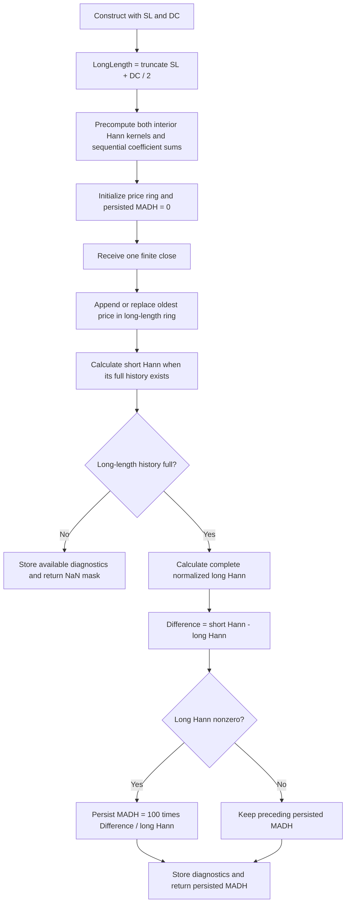

# Moving Average Difference–Hann — research prototype master reference

This folder provides a standalone mathematical specification and a
standard-library Python streaming master of John F. Ehlers' **November 2021
“The MAD Indicator, Enhanced.”** The indicator is also called **MADH**, moving
average difference with Hann windowing. The article and matching TradeStation
listing are the primary algorithmic sources.

`MovingAverageDifferenceHann(short_length=8, dominant_cycle=27).update(close)`
returns one scalar percentage spread between two normalized Hann filters.
The long length is derived by truncation, so the defaults produce **21 bars**
and **20 leading NaNs** under this master's complete-window startup. A zero
long filter **retains the preceding MADH**, initially zero, exactly as the
article's conditional assignment specifies.

All 16 parameter cases below were confirmed by the user on **2026-10-19**,
and their expected arrays are populated in all five language fixtures.
Calculations use binary64 and full
`math.pi` for degree-to-radian conversion, consistent with the user's
full-precision preference. This source has no rounded 1.414 or 3.14159
coefficient constants to replace.

## Supplied source scope

The input folder includes the full article `content.md`, `tips/tips.md`, and
separate platform implementations. No Mesa paper or book chapter is supplied.
This document includes every mathematical calculation in the article's MADH
listing and explains its background. Additional transfer-function and scaling
results are derived from those calculations, rather than represented as
equations copied from an unavailable book.

The September “Windowing” and October MAD articles are cited by the November
article. The preceding MAD formula is included here to make the construction
standalone. The further-reading bibliography is preserved; unsupplied chapters
are not claimed to have been consulted. The master implements MADH itself,
without a signal line, original MAD output, strategy, or extra rate-of-change
output. Diagnostics are exposed through a named tuple for inspection.

## Basic principles and physical analogies

The preceding MAD indicator compares two trailing simple moving averages.
It derives a trend signal from their separation and normalizes that separation
by the long average. The shorter average reacts more to recent changes; the
longer average supplies a slower reference. The November enhancement replaces
both equal-weight averages with Hann-windowed finite impulse response (FIR)
filters. The subtraction and percentage calculation then use those two
normalized filter outputs.

A rectangular SMA window abruptly jumps from zero weight outside the window
to equal weight inside it. In frequency analysis, those edges contribute to
sidelobes: unwanted responses away from the main lowpass lobe. Hann tapering
softens the transition. The tradeoff is a broader main lobe for a comparable
support length, while sidelobe leakage is generally reduced. Hann is not a
perfect brick-wall filter; finite support and nonzero sidelobes remain.

An electrical analogy is two smoothing networks driven by the same input and
compared by a differential amplifier. Each has unity DC gain, so a constant
price cancels in their difference. Their differing delayed responses retain
information about price changes. Tapering the averaging kernels is analogous
to reducing sharp switching at the boundary of each network's memory window.

Another analogy is comparing two weighted records of position over different
time spans. Their separation responds to recent motion rather than absolute
position. Unlike a literal velocity measurement, this remains a filtered
comparison, and the final percentage depends on the varying long-filter level.

The article aims to preserve useful turning-point timing while reducing small
oscillations that cause noisy trading signals. It relates extrema to zero
crossings of the indicator's one-bar change. Differencing emphasizes faster
variation, so smoothing the underlying indicator can reduce unwanted sign
changes. The illustrated reduction in false signals is an empirical example,
not a guarantee for every market or parameter pair.

## Review of the original MAD and parameter rationale

For closes $x_t$ and positive integer lengths $S,L$, the original SMA is

$$
A_{N,t}=\frac1N\sum_{k=0}^{N-1}x_{t-k},
$$

and the preceding MAD is

$$
MAD_t=100\frac{A_{S,t}-A_{L,t}}{A_{L,t}}.
$$

The article recommends selecting the short length according to desired
smoothness and the long length according to a known dominant cycle period $T$:

$$
L\approx S+T/2.
$$

If the cycle is unknown, the preceding article's fallback is $L=2S$. For MADH's
inputs, setting $DominantCycle=2S$ produces that fallback exactly.
`DominantCycle` is a supplied design input; the indicator does not estimate
the market's cycle, update that estimate, or change filter lengths each bar.

The article repeats a claim that half-cycle length separation gives exact
phase alignment with price. That is a design heuristic, not a universal
identity of two different FIR responses. Hann changes the amplitude response
of each individual filter, and the resulting difference's phase depends on
both lengths and the tested frequency. Preserve the published construction
rather than attempting to force its explanatory phase claim numerically.

## Complete MADH source mathematics

Let $S=ShortLength$, $T=DominantCycle$ and $x_t=Close_t$. The source sets

$$
L=\operatorname{IntPortion}(S+T/2).
$$

`IntPortion` truncates toward zero. For the accepted positive parameters,

$$
L=\lfloor S+T/2\rfloor=S+\lfloor T/2\rfloor.
$$

The first expression is used by the implementation to preserve source
calculation order. The source's declared `LongLength(20)` is overwritten by
this assignment before it is used. With defaults $S=8,T=27$,

$$
L=\operatorname{trunc}(8+13.5)=21.
$$

The default is therefore not an independent 8/20 pair. For a fixed integer
$S$, changing $T$ within a two-bar interval can leave $L$ unchanged. For
example, 26, 27 and 27.5 all give $L=21$ when $S=8$, while 28 gives $L=22$.
Because $T$ is used only to derive $L$, those cases have identical outputs
whenever their derived lengths match.

### Interior Hann weights

For either length $N=S$ or $N=L$, the source iterates $c=1,\ldots,N$ and uses

$$
\begin{aligned}
w_{N,c}&=1-\cos_{\mathrm{degrees}}\left(\frac{360c}{N+1}\right)\\
       &=1-\cos\left(\frac{2\pi c}{N+1}\right)
        =2\sin^2\left(\frac{\pi c}{N+1}\right),\\
C_N&=\sum_{c=1}^{N}w_{N,c}.
\end{aligned}
$$

The source weight sum and weighted filter are

$$
\begin{aligned}
F_{N,t}^{raw}&=\sum_{c=1}^{N}w_{N,c}\,x_{t-c+1},\\
F_{N,t}&=\begin{cases}
F_{N,t}^{raw}/C_N,&C_N\ne0,\\
F_{N,t}^{raw},&C_N=0.
\end{cases}
\end{aligned}
$$

For valid lengths $N\ge1$, $C_N$ is positive. The zero-coefficient branch
reproduces the listing but does not occur mathematically for this kernel.
The newest close has weight $w_{N,1}$, and the oldest has weight $w_{N,N}$.
Both are positive. They are the **interior samples** of a Hann taper whose
omitted zero endpoints would be at $c=0,N+1$. Do not substitute a common
library Hann of length $N$ with denominator $N-1$ and zero stored endpoints.

The article describes a cosine-squared-shaped envelope. The exact implemented
expression is $2\sin^2(\pi c/(N+1))$, equivalently a shifted cosine squared
envelope. Its overall factor of two disappears on normalization.

The two complete filters are

$$
Filt1_t=F_{S,t},\qquad Filt2_t=F_{L,t}.
$$

Each numerator and coefficient sum uses ordinary sequential addition in the
source's increasing-$c$ order, which is newest to oldest for input prices.
The master precomputes each coefficient sequence once, since parameters are
fixed. It retains the source's sequential coefficient sum rather than using
an algebraic shortcut or pre-normalized weights.

### Difference, percentage and conditional persistence

The final calculation is

$$
\Delta_t=F_{S,t}-F_{L,t},\qquad
MADH_t=\begin{cases}
100\dfrac{F_{S,t}-F_{L,t}}{F_{L,t}},&F_{L,t}\ne0,\\
MADH_{t-1},&F_{L,t}=0.
\end{cases}
$$

`MADH` is initialized to zero. The zero-denominator hold follows the exact
source statement `If Filt2 <> 0 Then MADH = ...`, which has no else assignment.
This differs from October MAD, whose unguarded division is undefined at zero.
Do not transplant that predecessor's NaN policy into this indicator.

The denominator is the long Hann filter, not current price, a long SMA, or
the absolute long-filter value. Preserve subtraction, multiplication by 100,
then division. A rewrite as $100(F_S/F_L-1)$ is algebraically equivalent but
can round differently. No final clipping is applied.

The plotted zero line is a constant reference. A value of 2 means the short
Hann filter is two percent above the long filter when the denominator is
positive. Negative or near-zero filter levels need the literal formula rather
than an automatic bullish/bearish interpretation. The source does not impose
a fixed output range of $[-100,100]$.

## Derived filter properties and normalization

Using the roots-of-unity cosine sum,

$$
\sum_{c=1}^{N}\cos\left(\frac{2\pi c}{N+1}\right)=-1,
\qquad C_N=N+1
$$

in exact arithmetic. This identity explains why averaging weighted values
with divisor $N$ gives the wrong scale. The master still computes $C_N$ by
the source loop to preserve floating-point rounding.

The weights satisfy $w_{N,c}=w_{N,N+1-c}$. The normalized kernel has unity DC
gain and, with newest-first lag $k=c-1$, centroid

$$
\frac{\sum_{c=1}^{N}(c-1)w_{N,c}}{C_N}=\frac{N-1}{2}.
$$

For a constant close $x_t=B$, each filter returns $B$ in exact arithmetic,
so MADH is zero for nonzero $B$. Independent finite-precision sums can leave
tiny residuals between different-length filters. Equal lengths use identical
weights and summation, so their difference is exactly zero for the same inputs.
For a length-one kernel, weight 2 divided by coefficient 2 returns the current
close. Length two has equal weights and equals a two-bar SMA in exact arithmetic.

For a linear trend $x_t=a+bt$, kernel symmetry gives

$$
\begin{aligned}
F_{N,t}&=x_t-b(N-1)/2,\\
\Delta_t&=b(L-S)/2,\\
MADH_t&=100\frac{b(L-S)/2}{x_t-b(L-1)/2},\quad F_{L,t}\ne0.
\end{aligned}
$$

Thus the trend spread matches the corresponding SMA spread for an ideal
linear ramp. Differences between MAD and MADH emerge from curved, cyclic or
noisy components rather than from a different DC gain or kernel centroid.

Multiplying prices by nonzero constant $a$ scales both filters and their
difference by $a$, leaving their percentage unchanged in exact arithmetic.
That includes negative scaling; both numerator and denominator reverse sign.
Adding a constant instead changes the denominator while leaving the raw
difference unchanged:

$$
MADH_t(x+B)=100\frac{\Delta_t(x)}{F_{L,t}(x)+B},
$$

when the shifted denominator is nonzero. Conditional holds must also be
considered if an offset changes which windows have a zero denominator.

## Derived frequency responses and timing limits

With $q=z^{-1}$ denoting a one-bar delay, each Hann FIR has transfer function

$$
H_N(z)=\frac{1}{C_N}\sum_{c=1}^{N}
\left[1-\cos\left(\frac{2\pi c}{N+1}\right)\right]q^{c-1}.
$$

For $\omega$ radians per bar, symmetry permits

$$
H_N(e^{j\omega})=e^{-j\omega(N-1)/2}A_N(\omega),
$$

where $A_N(\omega)$ is real and may change sign. This is a linear-phase FIR,
with group delay $(N-1)/2$ away from response zeros and phase-branch changes.
It has finite support and is not recursive.

For another exact representation, define the unnormalized rectangular sum
$D_N(\omega)=\sum_{k=0}^{N-1}e^{-j\omega k}$ and $\alpha=2\pi/(N+1)$. Then

$$
H_N(e^{j\omega})=
\frac{D_N(\omega)-\tfrac12e^{j\alpha}D_N(\omega-\alpha)
                    -\tfrac12e^{-j\alpha}D_N(\omega+\alpha)}{C_N}.
$$

This decomposition explains the Hann response as a combination of shifted
rectangular-window responses. The exact interior-sample convention matters
to those shifts and amplitudes.

The raw difference has response

$$
H_\Delta(z)=H_S(z)-H_L(z),\qquad H_\Delta(1)=0.
$$

Each individual FIR is symmetric, but their subtraction over unequal support
lengths is generally not symmetric or antisymmetric, so the difference need
not itself have linear phase. The response depends on the absolute lengths,
not just their separation. At low frequency,

$$
H_N(e^{j\omega})=1-j\omega(N-1)/2+O(\omega^2),\qquad
H_\Delta(e^{j\omega})=j\omega(L-S)/2+O(\omega^2).
$$

This derivative-like behavior relates low-frequency raw spread to trend
slope. A half-cycle separation does not generally make $H_\Delta$ real at
that cycle frequency. Tapering improves selected noise behavior without
proving zero lag for every signal.

The normalized percentage is not LTI. For small fluctuations $u_t$ around a
nonzero positive baseline $B$,

$$
MADH_t(B+u)\approx\frac{100}{B}\,[F_{S,t}(u)-F_{L,t}(u)]
$$

to first order. A zero-centered pure sine can have a long filter near zero;
use the raw spread to inspect FIR amplitude/phase rather than treating its
singular percentage as a linear response.

### Turning points and one-bar rate of change

The article discusses using

$$
ROC_t=MADH_t-MADH_{t-1}
$$

to detect changes in direction. A transition from negative to positive ROC
can confirm a valley; a positive-to-negative transition can confirm a peak.
Exactly zero changes and flat plateaus require an explicit strategy rule.
The code in the article plots MADH and zero only, so the class does not add
ROC or trading signals to its output contract.

The one-bar difference has frequency response and magnitude

$$
H_{ROC}(e^{j\omega})=1-e^{-j\omega},\qquad
|H_{ROC}(e^{j\omega})|=2|\sin(\omega/2)|.
$$

It emphasizes faster fluctuations relative to slower ones. The article's
statement that a derivative increases noise describes this frequency
emphasis; actual noise power depends on its spectrum. A smoother underlying
MADH may reduce unwanted ROC crossings. Detecting a turning point from a
subsequent sign change confirms it after the needed bar arrives and does not
predict future closes.

## Configuration, streaming API and startup

| Setting | Default | Valid range | Role |
| --- | ---: | --- | --- |
| `short_length` / SL | 8 | Positive integer; booleans excluded | Short Hann support length. |
| `dominant_cycle` / DC | 27 | Finite real $\ge1$; booleans excluded | Fixed design period used to derive long length. |
| `long_length` | 21 | Derived, not independently settable | `trunc(short_length + dominant_cycle / 2)`. |

The primary article does not specify numeric minimums. eSignal and NinjaTrader
declare minimum 1; the master uses that range. TradingView restricts short
length to at least 2 and its integer cycle input to at least 4. The master
also accepts fractional DC values because the primary EasyLanguage
calculation is numeric followed by explicit truncation, and eSignal exposes
numeric parameters. Its default reference cases include a fractional value
to validate that contract.

For accepted parameters, $L\ge S\ge1$. A positive cycle less than 2 derives
equal lengths, giving zero for nonzero denominators. Short length must be an
integer count; `8.0`, fractional counts, zero, negative values and booleans are
rejected. A cycle is not measured internally. Changing it requires a new
instance, even if the change would derive the same long length.

Lengths can exceed the input fixture's 252 bars; such a fresh stream remains
unprimed until its full long support exists. Filter coefficient/ring storage
is proportional to the derived length, so practical lengths must fit available
memory. Derived arithmetic must remain finite and meaningful in binary64.

`update(close)` consumes one chronological finite close and returns one float.
NaN or infinite inputs raise `ValueError` before changing history. Finite zero
and negative prices are accepted for analytical tests. Nonfinite weighted
sums or percentage outputs caused by extreme magnitudes raise `ValueError`;
reset after an intermediate arithmetic failure. Tiny nonzero denominators
are used literally, with no epsilon, clipping or price floor.

`reset()` clears price history and reinitializes persisted MADH to zero.
`is_primed` is true when the long window is full, regardless of whether its
current level is zero. `warmup_bars=long_length-1`. Properties expose both
inputs and the derived long length. `state` is a
`MovingAverageDifferenceHannState` named tuple with `short_filter`,
`long_filter`, `difference`, `madh`; the last field is the internal unmasked
persisted value, initially zero.

### Complete-window fresh-stream convention

| Raw close index | Calculation availability | Scalar return |
| --- | --- | --- |
| $0\ldots S-2$ | Neither short filter nor long filter has full history. | NaN |
| $S-1\ldots L-2$ | Short filter is inspectable; long filter remains unavailable. Persistent MADH stays zero. | NaN |
| $L-1$ onward | Both complete filters are calculated; nonzero denominator updates MADH, zero denominator holds it. | Finite current or held MADH |

Empty ranges are omitted when $S=1$ or $S=L$. With defaults $L=21$, indices
0–19 are unavailable and index 20 is the first finite result. For the
126/252 inputs, derived $L=252$, so only index 251 is available in the fixture.

Missing history is not zero-padded or averaged over a shorter window. The
returned NaNs are availability masks; they are never stored in price history
or persisted MADH. This supplies a reproducible fresh-stream contract for the
article's chart-based calculation. TradeStation may start with preloaded
history; compare equivalent input histories rather than assuming the first
visible chart bar is a fresh stream. eSignal explicitly gates on both window
lengths. Platform differences below include other startup policies.

Unlike an IIR smoother, the Hann filters have finite memory: after a full
window, their weighted values depend only on that window, with no earlier
recursive filter transient. The conditional MADH hold can nevertheless carry
an older ratio across a sequence of zero-denominator windows.

## Algorithmic calculation flow



Coefficient arrays hold $S+L$ weights and one ring retains at most $L$ closes.
Storage is bounded independently of stream duration. Each active update
requires $O(S+L)$ multiply/add operations. Weights are computed once, but each
weighted numerator is summed in the published order on every bar. Avoid
pre-normalizing coefficients, reordering reductions, or substituting an
ordinary rolling SMA accumulator when reproducing this master arithmetic.

## Confirmed reference cases

Each case uses the same 252 closes and a fresh instance. The “What it tests”
strings below are the exact comment lines before every expected
array. The next comment line includes SL, DC and the derived long length.

| SL | DC | Derived L | What it tests |
| ---: | ---: | ---: | --- |
| 8 | 27 | 21 | Article and TradeStation default; derived long length 21. |
| 8 | 26 | 21 | Even cycle derives the same long length as the default. |
| 8 | 28 | 22 | Next truncation boundary increases the long length to 22. |
| 8 | 27.5 | 21 | Fractional cycle retains the default truncated long length. |
| 1 | 1 | 1 | Minimum inputs derive equal one-bar filters. |
| 1 | 2 | 2 | Current-close short filter and minimum unequal lengths. |
| 2 | 4 | 4 | TradingView minimum inputs and short Hann kernels. |
| 5 | 30 | 20 | Thirty-bar cycle with derived long length 20. |
| 8 | 16 | 16 | Unknown-cycle fallback yields a two-to-one length ratio. |
| 10 | 30 | 25 | Longer short filter with a 15-bar length separation. |
| 15 | 30 | 30 | Monthly-scale two-to-one length ratio. |
| 20 | 40 | 40 | Slower swing response. |
| 30 | 60 | 60 | Longer smoothing windows. |
| 60 | 120 | 120 | Long filter history. |
| 126 | 252 | 252 | Derived long window equals the 252-bar input record. |
| 8 | 1 | 8 | Positive cycle truncates to equal eight-bar filters. |

There are 16 expected arrays of length 252, totaling
4,032 outputs per language. All four copied input arrays (Close, High, Low,
Open) remain intact; MADH consumes only Close. Including input arrays gives
20 arrays and 5,040 values per file. The default, DC26 and DC27.5 arrays
deliberately match because their effective kernels match.

| Language/file | Default expected identifier | NaN literal |
| --- | --- | --- |
| Python `test_testdata.py` | `EXPECTED_SL8_DC27` | `math.nan` |
| Go `testdata_test.go` | `expectedSL8_DC27` | `math.NaN()` |
| TypeScript `testdata.ts` | `expectedSL8_DC27` | `NaN` |
| Rust `testdata.rs` | `expected_sl8_dc27()` | `f64::NAN` |
| Zig `testdata.zig` | `expectedSL8_DC27()` | `nan` |

Fractional name tokens replace the decimal point with an underscore:
`EXPECTED_SL8_DC27_5`. Names encode the two input parameters; long length is
derived and appears in the parameter comment rather than as an independent
name token. Go's generated package is `movingaveragedifferencehann`,
with `math` imported. TypeScript uses valid exported `number[]` constants;
Rust returns `Vec<f64>`; Zig returns `[252]f64`, with `math` and `nan`
declarations at the top.

Reference calculation stays in binary64, without rounding coefficients or
internal values to fixture precision. Text emission uses `.15g`, meaning
15 **significant digits**, not 15 decimal places. The generator reopens and
verifies emitted Python arrays before translating their parsed values to the
other languages. Compare ports with an absolute/relative tolerance such as
$5\times10^{-13}$ and handle NaNs separately; trig libraries and equivalent
angle evaluation orders can produce different last bits. Native fixture
literals can be checked for binary64 bit equality after translation.

The master demonstration's default first available results, indices 20–24,
are

```text
-3.08553039827778
-3.20312014462028
-3.47400423385559
-3.9865241241146
-4.79941319145796
```

## Usage and generation

From this folder, run the demonstration and current verification suite:

```sh
python3 moving-average-difference-hann.py
python3 -m unittest -v test_moving_average_difference_hann.py
```

The `__main__` block embeds the exact 252 `INPUT_CLOSE` values from the copied
Python input file and updates the default indicator once for each close.
Regenerate all 16 confirmed expected fixture outputs with

```sh
python3 moving-average-difference-hann.py --generate-reference-data
```

The generator checks the embedded input against the copied Python fixture.
It appends a marked expected-data section initially, and replaces only that
section on subsequent runs, preserving copied inputs. Required Go package
and Go/Zig declarations are also supplied. The class itself has no runtime
file dependency or dependency on another indicator folder.

To load the requested hyphenated Python filename from another program:

```python
import importlib.util
import math
from pathlib import Path

spec = importlib.util.spec_from_file_location(
    "madh_master", Path("moving-average-difference-hann.py"))
master = importlib.util.module_from_spec(spec)
spec.loader.exec_module(master)

indicator = master.MovingAverageDifferenceHann(8, 27)
for close in closes:  # Finite closes in chronological order.
    madh_percent = indicator.update(close)
    if not math.isnan(madh_percent):
        print(madh_percent, indicator.long_length)
```

## Supplied platform differences

The TradeStation listing matches the article. Other platform contributions
are useful context but do not all implement the same numerical algorithm.

| Source | Material observation |
| --- | --- |
| Article / TradeStation | Same interior Hann weights, sequential normalization, truncation, default inputs and conditional previous-value hold. Fresh full-window availability is explicitly defined by this master. |
| TradingView Pine | Same weight shape and truncation. Uses radian angles and `nz` to map unavailable filters and undefined output to zero. It returns zero on a zero denominator rather than retaining previous MADH. Inputs are restricted to SL >=2 and integer DC >=4. |
| eSignal | Same normalization and truncation, with full-window bar-count gating. Conditional global `ret` is not assigned on zero denominator; its JavaScript initial lifetime is platform-dependent, whereas the article explicitly initializes MADH to zero. |
| NinjaTrader | Derives long length by truncation but skips until zero-based `CurrentBar >= LongLength`, one bar later than the first complete window. In the short-weight loop `360*i/(ShortLength+1)` performs integer division before conversion to radians, quantizing the degree angle. LongLength is double, so the long loop does not share that integer division. A missing assignment to `Value[0]` is not an explicit scalar previous-MADH hold. |
| TradersStudio | Uses the same nominal kernels but derives length with `CInt`, whose rounding semantics are not necessarily `IntPortion` truncation. Odd/fractional cycles require verification on that platform. MADH is a BarArray, so zero-assignment history semantics also depend on its runtime. |
| Optuma | Computes original SMA-based MAD at 8/23, then applies one Hann FIR of length 20 to MAD. This is a different algorithm from comparing two normalized Hann averages. |
| Zorro | Its `hann` returns weighted prices and the code divides each sum by the ordinary SMA length, not by the sum of Hann coefficients. Its API takes direct short/long periods (example 8/23), rather than SL/DC. The resulting percentage has a normalization bias relative to the article. |
| Wealth-Lab | Supplied code is a strategy calling opaque built-in MAD/MADH functions with arguments 8/20. The core function parameter semantics and implementation are not exposed there for numerical verification. |
| thinkorswim, NeuroShell, Excel | Tips discuss demonstrations and DLL/platform use. The supplied workbook is not used as the numeric oracle. These discussions do not override the article's equation and state contract. |

To quantify the Zorro normalization difference, the sum of its weighted prices
is $C_NF_N=(N+1)F_N$ in exact arithmetic. Dividing by $N$ yields
$\widetilde{F}_N=((N+1)/N)F_N$, so its published ratio becomes

$$
100\left[\frac{(S+1)L}{S(L+1)}\frac{F_S}{F_L}-1\right].
$$

Even constant nonzero prices then give

$$
100\frac{L-S}{S(L+1)}
$$

instead of zero. At 8/23 this is 7.8125 percent. The master uses normalized
Hann filters as the article specifies, not this bias-producing construction.

## Verification record — 2026-10-19

All **11 Python tests pass, with no skips**. An independent batch oracle extracts the
actual weight and MADH expressions from the supplied EasyLanguage file,
evaluates each coefficient sum and full-window weighted sum independently,
and matches all 16 confirmed cases exactly for the supplied closes under the
same degree-conversion arithmetic.

Additional tests cover the derived long length and exact warmup, diagnostic
availability, nonzero stored endpoint weights, coefficient sums, symmetry,
kernel centroid and singleton behavior, identical effective cycles and
truncation boundaries, equal filters, initial-zero and previous-value holds
on zero denominator, recovery, linear trends, constants and scale invariance,
sinusoidal FIR response, one-bar difference noise emphasis, reset
reproducibility, causal prefixes, nonfinite input rejection, parameter
validation, copied input preservation and exact embedded closes.

All 16 expected arrays are checked for names, 252-element lengths, exact
case-specific NaN prefixes, finite post-warmup values, two comment lines and
agreement with the independent source-expression oracle. The DC26, DC27 and
DC27.5 cases match exactly because their derived kernels match. Equal-filter
fixtures are exactly zero after priming, and the full-record 126/252 case has
exactly one available value. Regenerating twice in a temporary directory
produces byte-for-byte identical fixture files. Copied input text is preserved
apart from required Go package/import and Zig NaN declarations.

Temporary native validators compile or load the Go, Rust, Zig and TypeScript
fixtures and verify **all 20 arrays / 5,040 values per language**, including
all four input arrays, against the Python fixture. Finite literals match
binary64 bit patterns exactly; NaNs pass each language's NaN predicate. These
checks validate fixture translation, rather than indicator implementations in
those four languages.

## References

1. John F. Ehlers, “The MAD Indicator, Enhanced,” *Technical Analysis of
   Stocks & Commodities*, 39(11), November 2021, pp. 24–26.
   [Article](https://technical.traders.com/archive/article.asp?file=%5CV39%5CC11%5C330EHLE.pdf).
   Supplied full text: `../../tasc/2021-11-the-mad--indicator-enhanced/content.md`.
2. *Traders' Tips, November 2021*,
   [publisher page](https://www.traders.com/Documentation/FEEDbk_docs/2021/11/TradersTips.html).
   Supplied `tips/tips.md` and source files.
3. John Robinson/TradeStation, `tips/code/MADH.els`, the primary code oracle.
4. PineCoders/TradingView, `tips/code/MADH.pine`.
5. Eric Lippert/eSignal, `tips/code/MADH.efs`.
6. NinjaTrader, `tips/ninja-trader/MADH.cs`.
7. Richard Denning/TradersStudio, `tips/code/MADH.trs`.
8. Petra Volkova/Zorro, `tips/code/MADH.c`.
9. Optuma, `tips/code/MADH.optuma`.
10. Gene Geren/Wealth-Lab, `tips/code/MADH.cs`, plus Ron McAllister/Excel,
    thinkorswim and Ward Systems/NeuroShell discussions in the same Tips page.

Paths beginning `tips/` are relative to the input folder above. The article's
further reading is included for provenance:

11. Ehlers, “Windowing,” *S&C*, volume 39, September 2021.
12. Ehlers, “Cycle/Trend Analytics And The MAD Indicator,” *S&C*, volume 39,
    October 2021. Its preceding formula is reproduced above.
13. Ehlers, *Cycle Analytics For Traders*, John Wiley & Sons, 2013.

```bibtex
@article{ehlers2021madh,
  author = {Ehlers, John F.},
  title = {The {MAD} Indicator, Enhanced},
  journal = {Technical Analysis of Stocks \& Commodities},
  year = {2021},
  month = nov,
  volume = {39},
  number = {11},
  pages = {24--26},
  url = {https://technical.traders.com/archive/article.asp?file=%5CV39%5CC11%5C330EHLE.pdf}
}

@misc{tasc2021traderstips11,
  author = {{Technical Analysis of Stocks \& Commodities}},
  title = {Traders' Tips, November 2021},
  year = {2021},
  month = nov,
  url = {https://www.traders.com/Documentation/FEEDbk_docs/2021/11/TradersTips.html},
  note = {Supplied discussion and platform listings; consulted 2026-10-19}
}

@misc{robinson2021madh,
  author = {Ehlers, John F. and Robinson, John},
  title = {Moving Average Difference--Hann: TradeStation EasyLanguage},
  year = {2021},
  month = nov,
  howpublished = {Traders' Tips, TradeStation contribution},
  url = {https://www.traders.com/Documentation/FEEDbk_docs/2021/11/TradersTips.html},
  note = {Local tips/code/MADH.els; matches article code}
}

@misc{pinecoders2021madh,
  author = {{PineCoders}},
  title = {MADH: TradingView Pine Script},
  year = {2021},
  month = nov,
  howpublished = {Traders' Tips, TradingView contribution},
  url = {https://www.traders.com/Documentation/FEEDbk_docs/2021/11/TradersTips.html},
  note = {Local tips/code/MADH.pine}
}

@misc{lippert2021madh,
  author = {Lippert, Eric},
  title = {Moving Average Difference--Hann Indicator: eSignal EFS},
  year = {2021},
  month = nov,
  howpublished = {Traders' Tips, eSignal contribution},
  url = {https://www.traders.com/Documentation/FEEDbk_docs/2021/11/TradersTips.html},
  note = {Local tips/code/MADH.efs}
}

@misc{ninjatrader2021madh,
  author = {{NinjaTrader LLC}},
  title = {MADH for NinjaTrader 8},
  year = {2021},
  month = nov,
  url = {https://www.traders.com/Documentation/FEEDbk_docs/2021/11/TradersTips.html},
  note = {Local tips/ninja-trader/MADH.cs; startup and short-angle differences}
}

@misc{denning2021madh,
  author = {Denning, Richard},
  title = {MADH for TradersStudio},
  year = {2021},
  month = nov,
  url = {https://www.traders.com/Documentation/FEEDbk_docs/2021/11/TradersTips.html},
  note = {Local tips/code/MADH.trs; uses CInt instead of IntPortion}
}

@misc{volkova2021madh,
  author = {Volkova, Petra},
  title = {MADH for the Zorro Project},
  year = {2021},
  month = nov,
  url = {https://www.traders.com/Documentation/FEEDbk_docs/2021/11/TradersTips.html},
  note = {Local tips/code/MADH.c; coefficient-normalization difference}
}

@misc{platforms2021madh,
  author = {{Optuma} and Geren, Gene and McAllister, Ron and
            {thinkorswim} and {Ward Systems Group}},
  title = {MADH: Additional Platform Contributions},
  year = {2021},
  month = nov,
  howpublished = {Traders' Tips, Optuma, Wealth-Lab, Excel,
                  thinkorswim and NeuroShell contributions},
  url = {https://www.traders.com/Documentation/FEEDbk_docs/2021/11/TradersTips.html},
  note = {Supplied code and discussion; differences identified in master documentation}
}

@article{ehlers2021windowing,
  author = {Ehlers, John F.},
  title = {Windowing},
  journal = {Technical Analysis of Stocks \& Commodities},
  volume = {39},
  year = {2021},
  month = sep,
  note = {Further reading cited by supplied MADH article}
}

@article{ehlers2021mad,
  author = {Ehlers, John F.},
  title = {Cycle/Trend Analytics And The {MAD} Indicator},
  journal = {Technical Analysis of Stocks \& Commodities},
  volume = {39},
  number = {10},
  pages = {20--23},
  year = {2021},
  month = oct,
  url = {https://technical.traders.com/archive/article.asp?file=%5CV39%5CC10%5C314EHLE.pdf},
  note = {Further reading cited by MADH; preceding SMA formula reproduced for context}
}

@book{ehlers2013cycle,
  author = {Ehlers, John F.},
  title = {Cycle Analytics For Traders},
  publisher = {John Wiley \& Sons},
  year = {2013},
  note = {Further reading cited by MADH article; chapters not supplied}
}
```
