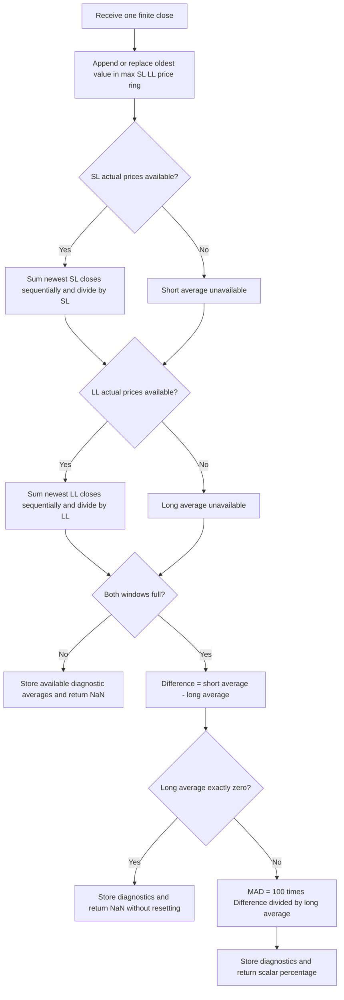

# Moving Average Difference — research prototype master reference

This folder contains a standalone mathematical specification, a streaming
standard-library Python master, and five copied input fixtures for conversion
into Python, Go, TypeScript, Rust and Zig. It implements John F. Ehlers'
**October 2021 “Cycle/Trend Analytics And The MAD Indicator.”** The full
article and matching TradeStation MAD code are the primary sources.

`MovingAverageDifference(short_length=8, long_length=23).update(close)` returns
one scalar expressed as a **percentage of the long simple moving average**.
The default has 22 leading NaNs while its complete 23-bar window fills. A
primed bar with a zero long average also returns NaN because the ratio is
undefined; subsequent valid windows recover without resetting.

All 16 parameter pairs below were confirmed by the user on **2026-10-19**.
Expected arrays are populated in all five language fixtures. No mathematical
pi or square-root constant is required in the MAD computation; all arithmetic
uses ordinary Python binary64 floats.

## Source scope and naming

The input includes the complete article `content.md`, Traders' Tips discussion
and several platform code files. There is no supplied Mesa paper or book
chapter. This document reproduces the complete mathematical calculation of
MAD, the article's cycle/trend derivation, and relevant code-defined analysis
steps. Transfer functions and phase checks are derived here from those
equations; unavailable further-reading chapters are not claimed as consulted.

MAD here means **moving average difference**, not mean absolute deviation,
median absolute deviation, or a difference of exponential moving averages.
The article also defines a colored Cycle/Trend Analytics study. That study
explains the construction and is documented below, but the requested master
returns MAD alone. The constant zero plot, color choices and theoretical sine
input do not add output fields or configuration options to this class.

## Basic principle and physical analogy

A simple moving average retains the constant price level and slow variation,
while attenuating some faster variation. Subtracting it from current price
produces a price-relative oscillator. If several SMA lengths are used, their
price-minus-average oscillators share the same current-price term. The
separation between their lines therefore isolates a difference of averages.

For the usual shorter and longer windows, a rising trend puts the recent
short average above the longer average. A falling trend reverses that order.
Taking their difference gives a nominal zero-centered trend signal; dividing
by the long average expresses it relative to price scale. Increasing the
short window generally reduces fast fluctuations, although exact response
depends on both windows and the input frequencies.

An electrical analogy is two smoothing networks receiving the same input,
followed by a differential amplifier. Their common DC response cancels, while
different responses to changing signals remain. The raw difference is a
finite impulse response (FIR) filter with zero DC gain. A mechanical analogy
is comparing two trailing position measurements over different time spans:
their separation reflects recent motion rather than absolute position.

The price-relative oscillators also resemble displacement from a smoothed
reference. Subtracting two such displacements cancels the shared current
position. This explains why MAD can appear smoother than either raw
price-minus-average oscillator. It does not eliminate all high-frequency
content; SMA frequency responses have sidelobes and frequency-dependent zeros.

The article calls it a “thinking man's MACD” because it provides a cycle-based
rationale for choosing lengths and uses two SMAs with no additional signal
line. The fixed-length raw difference is linear and time invariant; the
percentage normalization makes the final indicator nonlinear because its
denominator changes with price.

## Complete mathematical calculation

Let $x_t$ be the close on zero-based observation index $t$. Let $S=ShortLength$
and $L=LongLength$ be positive integer numbers of bars. The trailing simple
moving average is

$$
A_{N,t}=\frac{1}{N}\sum_{k=0}^{N-1}x_{t-k}.
$$

The article's exact MAD formula, also used in TradeStation, is

$$
\begin{aligned}
A_{S,t}&=Average(Close,ShortLength),\\
A_{L,t}&=Average(Close,LongLength),\\
\Delta_t&=A_{S,t}-A_{L,t},\\
MAD_t&=100\frac{A_{S,t}-A_{L,t}}{A_{L,t}}.
\end{aligned}
$$

The numerator is a difference of simple averages. The denominator is the
**long average**, not current close, mean of the two averages, or absolute
long average. The expression evaluates subtraction, multiplication by 100,
then division. For example, short average 102 and long average 100 give
$MAD=2$, meaning a two-percent spread. If long average is negative, the
percentage sign may oppose the raw spread sign.

An algebraically equivalent expression used by Zorro is

$$
MAD_t=100\left(\frac{A_{S,t}}{A_{L,t}}-1\right).
$$

This can round differently, especially when the averages are close. Preserve
the article's subtraction-first form when reproducing master fixtures.

The primary listing calls the platform's `Average` without supplying its
internal summation routine. This master defines it explicitly: sum actual
window values **newest to oldest**, using ordinary sequential addition, and
divide by the integer window length. It re-sums each window rather than using
a rolling accumulator. Platform built-ins may use different reductions, so
published-formula equivalence does not imply identical floating-point last
bits across every platform.

### Constant, trend and scale behavior

For nonzero constant input $x_t=c$, both full averages equal $c$, giving
$\Delta_t=0$ and $MAD_t=0$. For a linear trend $x_t=a+bt$,

$$
\begin{aligned}
A_{N,t}&=x_t-b\frac{N-1}{2},\\
\Delta_t&=b\frac{L-S}{2},\\
MAD_t&=100\frac{b(L-S)/2}{x_t-b(L-1)/2}.
\end{aligned}
$$

Thus the raw spread is proportional to slope and window separation. The
percentage adjusts that spread by the trailing price scale. A nonzero constant
trend does not force MAD to have zero time average; “nominal zero mean” refers
to rejection of constant price level, not a requirement that every output
record average to zero.

If every price is multiplied by nonzero constant $a$, both averages and their
difference scale by $a$, so the percentage is unchanged in exact arithmetic,
including negative scaling. Adding a constant $c$ instead leaves the spread
unchanged but changes the denominator:

$$
MAD_t(x+c)=100\frac{\Delta_t(x)}{A_{L,t}(x)+c}.
$$

MAD is scale invariant, but is not invariant to a price-level offset. It has
no general fixed range $[-100,100]$. For positive closes it is greater than
$-100$ in exact arithmetic, since $A_S/A_L>0$, but positive values can exceed
100. Near-zero denominators can produce large values. Do not clip the output.

## Full cycle/trend derivation from the article

The auxiliary study chooses a price series according to `CTMode`:

$$
p_t=\begin{cases}
\sin_{\mathrm{degrees}}(360\,CurrentBar/30),&CTMode=\text{“cycle”},\\
x_t,&CTMode=\text{“trend”}.
\end{cases}
$$

The article defaults to cycle mode; the supplied TradeStation Tips listing
defaults to trend mode. In a fresh one-based clock, $CurrentBar=t+1$, so its
synthetic series is $\sin(2\pi(t+1)/30)$. The sine has no price-level offset:
the auxiliary display plots raw differences, not the percentage ratio that
would divide by a long average potentially near zero.

For every integer $N=5,6,\ldots,30$, the article computes

$$
Osc_{N,t}=p_t-A_{N,t}(p).
$$

It assigns color components

$$
Red_N=255,\qquad Green_N=306-10.2N,\qquad Blue_N=0.
$$

This yields yellow at $N=5$ and red at $N=30$. The `Osc[50]` source array has
more entries than are calculated; the conditional plot for length 4 never
runs inside a loop that starts at 5. These indexing/color artifacts do not
affect MAD arithmetic.

In cycle mode it also plots the synthetic input and

$$
D_{5,30,t}=A_{5,t}(p)-A_{30,t}(p).
$$

Later the article suggests changing the long length from 30 to 20, yielding
$A_5-A_{20}$ with a 15-bar separation, half the 30-bar synthetic period.
Taking the difference between two price-relative oscillators gives

$$
Osc_{L,t}-Osc_{S,t}
=(p_t-A_{L,t})-(p_t-A_{S,t})
=A_{S,t}-A_{L,t}.
$$

This is the MAD numerator. The shared price term cancels exactly. Reversing
the oscillator order reverses the numerator sign, so this subtraction order
matters to the uptrend/downtrend convention.

### Article's length-selection guidance

For a dominant cycle period $T$, the article recommends

$$
L-S\approx T/2,\qquad L\approx S+T/2.
$$

When $T$ is unknown, its fallback is

$$
L=2S.
$$

Lengths must be integer observation counts in this master, so a noninteger
desired period separation needs an explicit user-selected integer pair. The
master does not measure a dominant cycle, round a supplied real period or
adapt its lengths internally. Defaults $S=8,L=23$ give separation 15 bars.

The article interprets short price-minus-average oscillators as leading the
input by almost 90 degrees, then describes exact input phase alignment at
half-cycle settings. Those statements are useful intuition and a design
heuristic, but are not universal identities of the discrete filters. The
following exact responses establish their limits.

## Derived frequency response and phase limits

With $q=z^{-1}$ denoting one-bar delay, an SMA has transfer function

$$
H_N(z)=\frac1N\sum_{k=0}^{N-1}q^k
      =\frac{1-q^N}{N(1-q)}.
$$

For $\omega$ radians per bar,

$$
H_N(e^{j\omega})
=e^{-j\omega(N-1)/2}\frac{\sin(N\omega/2)}{N\sin(\omega/2)}.
$$

The symmetric SMA has group delay $(N-1)/2$ where its response is nonzero
and its phase branch is continuous. Its signed amplitude term can change
sign, creating phase flips; phase is undefined at a response zero. SMA
linearity does not mean the difference of two SMAs has constant group delay.

The price-minus-average response is

$$
G_N(e^{j\omega})=1-H_N(e^{j\omega}).
$$

At low frequency,

$$
G_N(e^{j\omega})\approx j\omega\frac{N-1}{2}.
$$

This derivative-like response explains a roughly 90-degree lead when the
window is short compared with the cycle. At $N=T/2$, an SMA of a sampled sine
does not generally make $1-H_N$ real. For a 30-bar cycle, $G_{15}$ has phase
about $+34.20$ degrees, not zero. $H_{30}$ is zero at that exact cycle
frequency, so $G_{30}=1$ there.

The raw MAD numerator has response

$$
H_\Delta(z)=H_S(z)-H_L(z),\qquad H_\Delta(1)=0.
$$

For the usual $S<L$, its FIR weights are

$$
h_k=\begin{cases}
1/S-1/L,&0\le k<S,\\
-1/L,&S\le k<L,\\
0,&\text{otherwise}.
\end{cases}
$$

These weights sum to zero but are generally not symmetric or antisymmetric,
so the difference need not have linear phase. At low frequency,

$$
H_\Delta(e^{j\omega})\approx j\omega\frac{L-S}{2},
$$

which agrees with the exact linear-trend calculation. Its high-frequency
response depends on the SMA zeros and sidelobes. Shared current-price terms
cancel in the derivation, but this does not cancel every fast frequency.

For $T=30$, $\omega=2\pi/30$, the exact raw-difference phases are

| Pair | Separation | Phase relative to the input sine |
| --- | ---: | ---: |
| 5 / 20 | 15 | approximately $-0.5868^\circ$ |
| 8 / 23 | 15 | approximately $-24.6103^\circ$ |
| 5 / 30 | 25 | $-24^\circ$ |

The article's modified 5/20 example is almost aligned, but a 15-bar separation
alone does not establish exact phase alignment. Each absolute length matters.
This master preserves the article's SMA formula rather than altering its
response to force the explanatory phase claims.

The percentage MAD is not an LTI filter. For a positive baseline $B$ and a
small zero-mean fluctuation $u_t$ with $|u_t|\ll B$,

$$
MAD_t(B+u)\approx\frac{100}{B}\,[A_{S,t}(u)-A_{L,t}(u)]
$$

to first order. This links the raw-difference response to ordinary price
signals. For a zero-centered pure sine without a baseline, the normalization
can approach a singularity; use the raw difference for cycle-response tests,
as the article's analysis plots do.

## Parameters, API and boundary behavior

| Parameter | Default | Valid range | Purpose |
| --- | ---: | --- | --- |
| `short_length` / SL | 8 | Positive integer; booleans excluded | Window used in the first SMA term. |
| `long_length` / LL | 23 | Positive integer; booleans excluded | Window used in the subtracted SMA and denominator. |

The source formula and supplied platform parameter declarations do not
require $S<L$. The master accepts equal or reversed lengths without swapping
them. Their interpretation changes: equal full windows give exact zero when
their average is nonzero; reversed windows change both the numerator sign
and the normalization denominator. In general

$$
MAD_{L,S}=-\frac{100\,MAD_{S,L}}{100+MAD_{S,L}},
$$

when the involved averages are nonzero. It is not simply the negative of the
original percentage.

Fractional lengths, float values such as `8.0`, zero, negatives and booleans
are rejected. SMA length is an observation count, unlike real-valued critical
periods used by some other Ehlers filters. Lengths can exceed the 252-bar
fixture record; those windows remain unavailable until enough closes arrive.

`update(close)` consumes one finite close in chronological order and returns
one float. NaN and infinity inputs raise `ValueError` before altering history.
Finite negative and zero closes are accepted for explicit analytical tests.
Ordinary positive prices give the article's intended sign interpretation.
Nonfinite sums or outputs caused by extreme magnitudes raise `ValueError`;
reset the instance after such an intermediate arithmetic failure.

`is_primed` indicates that both complete windows exist.
`warmup_bars=max(S,L)-1` counts leading unavailable outputs due to history.
`reset()` clears observations without changing parameters. Construct another
instance to change lengths. `state` is a `MovingAverageDifferenceState` named
tuple with fields `short_average`, `long_average`, `difference`, `mad`.
An individual shorter window can be inspected before both windows are full.

When a full $A_L=0$, the exact division is undefined even if $\Delta=0$.
The master returns NaN for that bar. It does not insert NaN in its price ring,
restart warmup, retain a previous MAD, add an epsilon or force zero. A later
nonzero denominator recovers naturally. A very small nonzero denominator is
used as supplied; no hidden price threshold changes the formula.

### Startup and availability

Let $M=\max(S,L)$. For a fresh stream with no preloaded closes:

$$
MAD_t=NaN\quad\text{for }0\le t<M-1.
$$

On index $M-1$, both averages use full actual windows including the current
close, and the ratio is calculated if $A_L\ne0$. No partial average or
zero-filled missing history is used. The default first available index is 22.

All reference closes are positive, so every post-warmup denominator is
positive. For the 126/252 pair, indices 0–250 are NaN and index 251
provides the only finite output. Equal 8/8 windows have seven leading NaNs
and then exact zero. Actual zero-denominator NaNs beyond warmup are covered
by separate analytical tests, not artificially inserted in positive-price
fixtures.

This full-window convention matches the intended fixed-window formula and
eSignal's explicit bar-count gating. TradeStation uses preloaded chart history,
and NinjaTrader's supplied SMA computes partial averages at startup, so those
platforms' first visible bars can differ. Compare complete histories and
formula values with appropriate numerical tolerance.

## Algorithmic calculation flow



One circular buffer retains at most $\max(S,L)$ closes, independent of stream
length. Each active update takes $O(S+L)$ summation work. Newest-to-oldest
re-summing prevents accumulated rolling-sum drift and defines a simple
reference arithmetic order for ports. A faster rolling sum can be a later
implementation choice, but its expected values should be compared with
tolerance because summation order changes floating-point rounding.

## Confirmed reference cases

All cases use a fresh instance and the same 252 copied closes. There are no
extra coefficient or smoothing parameters. The “What it tests” strings below
are copied verbatim into the comments before each expected array, followed
by a second line listing the two parameter values.

| SL | LL | What it tests |
| ---: | ---: | --- |
| 8 | 23 | Article and TradeStation default; 15-bar length separation. |
| 5 | 20 | Article cycle example; 15-bar length separation. |
| 5 | 30 | Original cycle-display pair; 25-bar length separation. |
| 8 | 16 | Article fallback rule: long length is twice short length. |
| 1 | 2 | Minimum unequal windows and one-bar warmup. |
| 1 | 23 | Short average is the current close. |
| 2 | 3 | Adjacent small windows. |
| 23 | 8 | Reversed windows retain the designated normalization denominator. |
| 5 | 10 | Fast response with a two-to-one length ratio. |
| 10 | 25 | Longer smoothing with 15-bar length separation. |
| 15 | 30 | Monthly-scale two-to-one length ratio. |
| 20 | 40 | NeuroShell example lengths with article percentage scale. |
| 30 | 60 | Slower trend response. |
| 60 | 120 | Long-window trend response. |
| 126 | 252 | Long window equals the 252-bar record length. |
| 8 | 8 | Equal windows give exact zero after priming. |

There are 16 expected arrays of 252 values, totaling 4,032 outputs per
language. The four input arrays (Close, High, Low, Open)
remain copied intact; MAD consumes Close only. Including those inputs yields
20 arrays and 5,040 values per file.

| Language/file | Default expected identifier | NaN literal |
| --- | --- | --- |
| Python `test_testdata.py` | `EXPECTED_SL8_LL23` | `math.nan` |
| Go `testdata_test.go` | `expectedSL8_LL23` | `math.NaN()` |
| TypeScript `testdata.ts` | `expectedSL8_LL23` | `NaN` |
| Rust `testdata.rs` | `expected_sl8_ll23()` | `f64::NAN` |
| Zig `testdata.zig` | `expectedSL8_LL23()` | `nan` |

The generated Go package is `movingaveragedifference`, with `math`
imported. TypeScript uses exported `number[]` constants; Rust functions return
`Vec<f64>`; Zig functions return `[252]f64` and use
`const math = @import("std").math;` plus `const nan = math.nan(f64);`.
Integer lengths require no fractional name tokens.

All calculations use binary64 without rounding intermediate state. Decimal
serialization uses `.15g`: **15 significant digits**, rather than 15 digits
after the decimal point. The Python arrays are reopened and verified before
their parsed values are translated to the other languages. A practical
calculated-output tolerance is $5\times10^{-13}$ absolute and relative,
with NaNs compared separately. Native data-file literal translation can be
checked for binary64 bit equality.

The master demonstration's default first five available values, indices
22–26, are

```text
-3.16314429340132
-4.11035022036871
-4.36803317157307
-4.87055832696083
-5.37755465922617
```

## Usage and generation

From this folder, run the streaming demonstration or the current tests:

```sh
python3 moving-average-difference.py
python3 -m unittest -v test_moving_average_difference.py
```

The `__main__` block embeds all 252 `INPUT_CLOSE` values exactly as copied
from the parent fixture and updates a default instance once per value.
Regenerate all confirmed expected arrays in all five languages:

```sh
python3 moving-average-difference.py --generate-reference-data
```

The generator verifies that the embedded closes equal the copied Python
fixture. It appends marked output sections, or replaces just those sections
on reruns; required Go/Zig package/import declarations are also supplied.
Input arrays are preserved. The scalar implementation has no runtime
dependency on sibling indicators, external libraries or files.

To load the requested hyphenated filename from another Python program:

```python
import importlib.util
import math
from pathlib import Path

spec = importlib.util.spec_from_file_location(
    "mad_master", Path("moving-average-difference.py"))
master = importlib.util.module_from_spec(spec)
spec.loader.exec_module(master)

indicator = master.MovingAverageDifference(short_length=8, long_length=23)
for close in closes:  # Finite chronological closes.
    mad_percent = indicator.update(close)
    if not math.isnan(mad_percent):
        print(mad_percent)
```

## Supplied platform differences and provenance

| Source | Relevant observation |
| --- | --- |
| Article / TradeStation | Same percentage formula, defaults 8/23. `Average` internals and preloaded chart startup are not supplied. The combined Tips filename and some comments refer to other issue months, but the MAD block and October attribution agree. |
| TradingView Pine v4 | Same SMA formula and defaults; SMA history availability is platform-defined. Plot color varies with sign, without changing values. |
| eSignal EFS | Same formula, defaults and minimum parameter length 1. Explicitly waits for both window lengths in raw bar count. |
| NinjaTrader MAD / supplied SMA | Same formula. SMA uses a rolling sum and partial-window divisors before enough bars exist, rather than this master's fresh complete-window sums. It also handles platform bar revisions, outside the append-only streaming API. |
| Optuma, AIQ, TradersStudio | Same normalized difference, expressed with native averaging functions. Optuma groups the division before multiplication by 100, so last-bit rounding may differ. |
| Zorro | Uses `100*(shortSMA/longSMA-1)`, algebraically equivalent with a different rounding order. Its sine demonstration plots a raw 5/20 difference. The supplied text's “normalized to +/-100” does not imply a mathematical bound. |
| NeuroShell | Example lengths are 20/40; formula omits multiplication by 100 and returns a fractional spread. This master's 20/40 case retains the article's percentage scale. |
| Wealth-Lab | Tips describe a zero-crossing strategy, but the linked `MAD.cs` is absent from the supplied folder. No additional core recurrence is available there for validation. |
| Excel | Supplied workbook and illustrations provide a demonstration; the workbook is not used as the numerical oracle. |

The article's introductory mention dates the FM Demodulator work to February
2021, whereas its further-reading list specifies June 2021. Bibliography below
preserves the further-reading date and records the discrepancy rather than
silently selecting an unavailable issue as a mathematical source.

## Verification record — 2026-10-19

All **11 Python tests pass, with no skips**. An independent batch oracle extracts the
actual MAD expression from the supplied EasyLanguage listing and evaluates it
with complete-window averages. Every confirmed pair matches exactly for the
252 closes under the specified summation convention.

Additional checks establish exact case-specific warmup, partial diagnostic
availability, bounded history, constant input, singleton and equal windows,
zero-denominator recovery without reset, reversed-window denominator behavior,
linear-trend equations, price-scale invariance, analytical sinusoidal FIR
responses and phase limits, causal prefixes, reset reproducibility, rejection
of nonfinite closes, parameter validation, preservation of all copied Python
inputs, and exact embedded closes.

All expected arrays are checked for names, 252-element lengths, exact
case-specific NaN prefixes, finite post-warmup values, two parameter/description
comment lines, and agreement with the source-expression oracle. The 126/252
fixture has exactly one finite value, and the 8/8 fixture is exactly zero
after its seven-bar warmup. Regenerating twice in a temporary directory
produces byte-for-byte identical fixture files. All copied input text is
preserved apart from required Go package/import and Zig NaN declarations.

Temporary native validators compile or load the Go, Rust, Zig and TypeScript
fixtures and verify **all 20 arrays / 5,040 values per language**, including
all four input arrays, against the Python fixture. Finite literals match
binary64 bit patterns exactly; NaNs pass the language's NaN predicate. These
checks validate data translation, rather than implementations of MAD in those
four languages.

## References

1. John F. Ehlers, “Cycle/Trend Analytics And The MAD Indicator,” *Technical
   Analysis of Stocks & Commodities*, 39(10), October 2021, pp. 20–23.
   [Article](https://technical.traders.com/archive/article.asp?file=%5CV39%5CC10%5C314EHLE.pdf).
   Supplied full text: `../../tasc/2021-10-cycle-trend-analytics-and-the-mad-indicator/content.md`.
2. *Traders' Tips, October 2021*,
   [publisher page](https://www.traders.com/Documentation/FEEDbk_docs/2021/10/TradersTips.html).
   Supplied `tips/tips.md` and code files.
3. John Robinson/TradeStation, `tips/code/CycleTrendAnalytics.els`, including
   the separate MAD indicator block. Primary code-expression reference.
4. Ricardo Santos/PineCoders, `tips/code/MAD.pine`.
5. Eric Lippert/eSignal, `tips/code/MAD.efs`.
6. NinjaTrader, `tips/ninja-trader/MAD.cs` and `tips/ninja-trader/@SMA.cs`.
7. Other Tips contributors: Richard Denning (AIQ/TradersStudio), Petra Volkova
   (Zorro), Optuma, Ward Systems (NeuroShell), Gene Geren (Wealth-Lab) and Ron
   McAllister (Excel), as credited in the supplied Tips discussion.

Paths beginning `tips/` are relative to the input indicator folder above.
The article's further reading, provided for bibliographic provenance, is:

8. Ehlers, “Windowing,” *S&C*, volume 39, September 2021.
9. Ehlers, “Creating More Robust Trading Strategies With The FM Demodulator,”
   *S&C*, volume 39, June 2021, as listed in the article's further reading.
10. Ehlers, “A Technical Description Of Market Data For Traders,” *S&C*,
    volume 39, May 2021.
11. Ehlers, “Measuring Market Cycles,” *S&C*, volume 34, September 2016.
12. Ehlers, *Cycle Analytics For Traders*, John Wiley & Sons, 2013.

```bibtex
@article{ehlers2021mad,
  author = {Ehlers, John F.},
  title = {Cycle/Trend Analytics And The {MAD} Indicator},
  journal = {Technical Analysis of Stocks \& Commodities},
  year = {2021},
  month = oct,
  volume = {39},
  number = {10},
  pages = {20--23},
  url = {https://technical.traders.com/archive/article.asp?file=%5CV39%5CC10%5C314EHLE.pdf}
}

@misc{tasc2021traderstips10,
  author = {{Technical Analysis of Stocks \& Commodities}},
  title = {Traders' Tips, October 2021},
  year = {2021},
  month = oct,
  url = {https://www.traders.com/Documentation/FEEDbk_docs/2021/10/TradersTips.html},
  note = {Supplied discussion and platform listings; consulted 2026-10-19}
}

@misc{robinson2021mad,
  author = {Ehlers, John F. and Robinson, John},
  title = {Cycle/Trend Analytics and MAD: TradeStation EasyLanguage},
  year = {2021},
  month = oct,
  howpublished = {Traders' Tips, TradeStation contribution},
  url = {https://www.traders.com/Documentation/FEEDbk_docs/2021/10/TradersTips.html},
  note = {Local tips/code/CycleTrendAnalytics.els; primary MAD code block}
}

@misc{santos2021mad,
  author = {Santos, Ricardo and {PineCoders}},
  title = {MAD Moving Average Difference: TradingView Pine Script},
  year = {2021},
  month = oct,
  howpublished = {Traders' Tips, TradingView contribution},
  url = {https://www.traders.com/Documentation/FEEDbk_docs/2021/10/TradersTips.html},
  note = {Local tips/code/MAD.pine}
}

@misc{lippert2021mad,
  author = {Lippert, Eric},
  title = {Moving Average Difference Indicator: eSignal EFS},
  year = {2021},
  month = oct,
  howpublished = {Traders' Tips, eSignal contribution},
  url = {https://www.traders.com/Documentation/FEEDbk_docs/2021/10/TradersTips.html},
  note = {Local tips/code/MAD.efs}
}

@misc{ninjatrader2021mad,
  author = {{NinjaTrader LLC}},
  title = {MAD and Simple Moving Average for NinjaTrader 8},
  year = {2021},
  month = oct,
  url = {https://www.traders.com/Documentation/FEEDbk_docs/2021/10/TradersTips.html},
  note = {Local tips/ninja-trader/MAD.cs and @SMA.cs}
}

@misc{platforms2021mad,
  author = {Denning, Richard and Volkova, Petra and Geren, Gene and
            McAllister, Ron and {Optuma} and {Ward Systems Group}},
  title = {MAD: Additional Platform Contributions},
  year = {2021},
  month = oct,
  howpublished = {Traders' Tips, AIQ, TradersStudio, Zorro, Wealth-Lab,
                  Excel, Optuma and NeuroShell contributions},
  url = {https://www.traders.com/Documentation/FEEDbk_docs/2021/10/TradersTips.html},
  note = {Supplied code and discussion; platform differences summarized}
}

@article{ehlers2021windowing,
  author = {Ehlers, John F.},
  title = {Windowing},
  journal = {Technical Analysis of Stocks \& Commodities},
  volume = {39},
  year = {2021},
  month = sep,
  note = {Further reading cited by the supplied MAD article}
}

@article{ehlers2021fmdemodulator,
  author = {Ehlers, John F.},
  title = {Creating More Robust Trading Strategies With The FM Demodulator},
  journal = {Technical Analysis of Stocks \& Commodities},
  volume = {39},
  year = {2021},
  month = jun,
  note = {Date from MAD further-reading list; its introduction instead says February}
}

@article{ehlers2021marketdata,
  author = {Ehlers, John F.},
  title = {A Technical Description Of Market Data For Traders},
  journal = {Technical Analysis of Stocks \& Commodities},
  volume = {39},
  year = {2021},
  month = may,
  note = {Further reading cited by the supplied MAD article}
}

@article{ehlers2016cycles,
  author = {Ehlers, John F.},
  title = {Measuring Market Cycles},
  journal = {Technical Analysis of Stocks \& Commodities},
  volume = {34},
  year = {2016},
  month = sep,
  note = {Further reading cited by the supplied MAD article}
}

@book{ehlers2013cycle,
  author = {Ehlers, John F.},
  title = {Cycle Analytics For Traders},
  publisher = {John Wiley \& Sons},
  year = {2013},
  note = {Further reading cited by MAD article; chapters not supplied}
}
```
