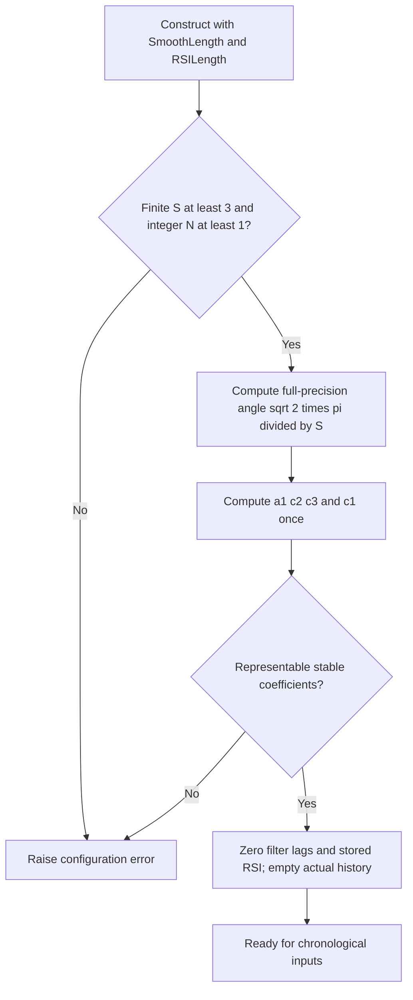
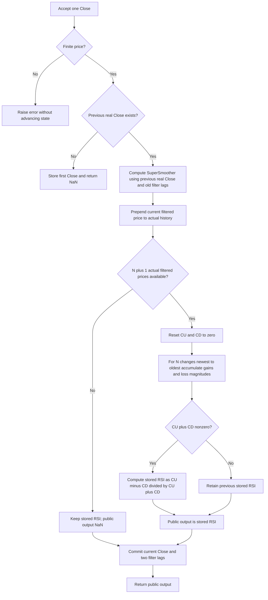

# Ehlers MyRSI — input-smoothed RSI

This research prototype master reference implements the **MyRSI sidebar** in John F. Ehlers' “RocketRSI—A Solid Propellant For Your Rocket Science Trading,” *Technical Analysis of Stocks & Commodities*, volume 36, May 2018, pages 8–12. The executable master is [my-rsi.py](my-rsi.py). `MyRSI.update(close)` accepts one chronological Close and returns a scalar dimensionless oscillator. Python's standard library is sufficient; the indicator performs no file I/O and uses no NumPy or pandas.

The descriptive title **Ehlers MyRSI — input-smoothed RSI** identifies this May 2018 variant. The folder and module remain `my-rsi`, and the class retains the source name `MyRSI`. Later indicators may use the same centered gain/loss ratio on raw prices; their references to MyRSI do not imply this variant's input smoothing.

MyRSI smooths **input prices** with a two-pole SuperSmoother, accumulates gains and positive loss magnitudes over a finite number of filtered-price changes, and divides their signed imbalance by their total. In exact arithmetic the result ranges from $-1$ to $+1$. Its two independent parameters are `smooth_length=8` and `rsi_length=10`.

The article's second indicator, RocketRSI, first replaces Close by momentum and then applies clipping and a Fisher transform. Those extra stages are documented here as theoretical background; this folder's class and expected arrays contain **MyRSI** only. The `MyRSI` name also appears in older book code for a different, roofing-filter-based RSI and in later unsmoothed RSI code. The May 2018 sidebar is the numerical authority for this master.

**Reference data is complete:** the user confirmed all twenty parameter pairs in section 8 on 2026-10-20. Each of the five language fixture files contains the preserved original inputs and twenty verified expected arrays of 252 values each. The 252 original `INPUT_CLOSE` values are embedded in `__main__`. Expected values use 15 significant decimal digits and the parameter-dependent startup NaN prefixes documented below.

## 1. Sources and full-precision policy

The supplied article and relevant local references are:

- [May 2018 article](../../tasc/2018-05-rocket-rsi-a-solid-propellant-for-your-rocket-science-trading/content.md): the full RSI algebra, MyRSI listing, SuperSmoother coefficients, RocketRSI listing, cycle-length argument, and statistical interpretation.
- [May 2018 Traders' Tips](../../tasc/2018-05-rocket-rsi-a-solid-propellant-for-your-rocket-science-trading/tips/tips.md): vendor implementations, including an explicit MetaStock MyRSI formula and separate NinjaTrader MyRSI code.
- [NinjaTrader MyRSI](../../tasc/2018-05-rocket-rsi-a-solid-propellant-for-your-rocket-science-trading/tips/ninja-trader/MyRSI.cs), [MetaStock formulas](../../tasc/2018-05-rocket-rsi-a-solid-propellant-for-your-rocket-science-trading/tips/RRSI.msl), [TradeStation RocketRSI](../../tasc/2018-05-rocket-rsi-a-solid-propellant-for-your-rocket-science-trading/tips/RRSI.els), and [eSignal RocketRSI](../../tasc/2018-05-rocket-rsi-a-solid-propellant-for-your-rocket-science-trading/tips/code/RocketRSI.efs).
- Ehlers, *Cycle Analytics for Traders* (2013), [Chapter 3: Smoothing Filters on Steroids](../../2013-cycle-analytics-for-traders/ch3.md), [Chapter 7: Spectral Dilation](../../2013-cycle-analytics-for-traders/ch7.md), and [Chapter 15: Indicator Transforms](../../2013-cycle-analytics-for-traders/ch15.md). The directly relevant equations and variant distinctions are reproduced below, so conversion agents do not need these chapters.

There is no `mesa/` article in this input folder. Wilder's 1978 book is referenced by the article, but its full chapter is not supplied. The classical RSI formula and Ehlers' complete derivation are reproduced here without inventing additional book text.

The user requested **full-precision constants**. Accordingly the executable uses `math.sqrt(2.0)` for `1.414` and `math.pi` for `3.14159`. It preserves the article's filter recurrence, newest-to-oldest loop, left-associated additions/subtractions, and persistent zero-denominator behavior. All state remains unrounded binary64. A rounded-constant implementation can differ slightly from this master even after startup; forcing bitwise identity with rounded coefficients would conflict with the requested precision policy.

The article leaves chart-platform prehistory implicit. This standalone master has an explicit finite-record contract: wait for two real closes to begin the smoother, initialize its recursive outputs to zero, and wait for a full window of actual filtered changes to publish MyRSI. Matching a commercial platform requires matching this initialization and prehistory as well as the formula; there is no universal initial output common to all supplied tips.

## 2. Principles, physical analogies, and interpretation

### 2.1 Signed displacement divided by distance traveled

Think of filtered price as a particle moving up and down a vertical axis. `CU` accumulates its upward distance, and `CD` accumulates its downward distance as a **positive magnitude**. Their difference measures net displacement; their sum measures total distance traveled. MyRSI is their ratio.

If every change is positive, total distance and displacement are equal and MyRSI is $+1$. If every change is negative, it is $-1$. Equal accumulated gains and losses give zero. A noisy path with small net displacement and large total travel gives a small absolute output. This relates the indicator to directional efficiency, while retaining the sign of movement.

The value does not identify a price level, estimate a return, or express a standard deviation. For example, MyRSI $0.6$ means $80\%$ of the accumulated absolute filtered movement was upward, because the corresponding up-fraction is $(0.6+1)/2=0.8$. It does not mean a $60\%$ probability of a price rise.

### 2.2 Why an input smoother is used

Real-world prices are noisier than a single sinusoid. The article describes unsmoothed MyRSI as too “nervous” and recommends smoothing the input before its nonlinear ratio. A two-pole SuperSmoother attenuates short-period components and passes slower components, with less delay than many ordinary moving averages at comparable smoothing.

The physical analogy is a damped resonator: its conjugate poles retain recent state while allowing high-frequency fluctuations to decay. A two-point average in the feedforward path removes an exactly alternating component at the Nyquist frequency. The damping and rotation share a period parameter.

Smoothing prices first can still produce stretches of entirely upward or downward filtered movement, giving full $+1$ or $-1$ output. Smoothing the already bounded ratio averages away short visits to those extremes. Because the ratio is nonlinear, these two operations do not commute:

$$
\operatorname{MyRSI}(\operatorname{Smooth}(p))
\ne\operatorname{Smooth}(\operatorname{MyRSI}(p))
$$

in general. The article says zero crossings remain the same for equivalent smoothing; that is a useful idealized observation, not a general mathematical identity for arbitrary noisy or changing waveforms. The executable follows input smoothing exactly and does not add output smoothing.

### 2.3 Cycle tuning and the scope of “zero lag”

Ehlers models the oscillatory part of price as a dominant sinusoid and chooses RSI length as half its period: if the dominant cycle is $D$ bars, use $N\approx D/2$. For a twenty-bar cycle the nominal choice is $N=10$.

In the continuous idealization, let filtered price be:

$$
f(t)=B+A\sin(\omega t),\qquad D=2\pi/\omega.
$$

Over a half-period interval, displacement is $2A\sin(\omega t)$ and total absolute travel is $2|A|$. For $A>0$:

$$
\frac{f(t)-f(t-D/2)}{\displaystyle\int_{t-D/2}^{t}|f'(u)|\,du}
=\sin(\omega t).
$$

This explains the article's equal phase and full amplitude on an ideal sinusoid. In discrete data, when an even-period sinusoid satisfies $f_{t-N}-B=-(f_t-B)$, the numerator is exactly $2(f_t-B)$ in real arithmetic. The denominator is the sum of discrete absolute changes, which depends on sampling phase and sampled extrema; exact sine shape need not hold, though signs and zero crossings align in this ideal case and monotone half-waves reach $\pm1$.

The claim concerns the ratio relative to its **input waveform**. The SuperSmoother still adds frequency-dependent delay relative to raw Close. Recursive startup, a mismatched period, several cycles, trend, and noise also change behavior. The class does not estimate the dominant cycle automatically or access future values. With a persistent trend, many windows can remain near $+1$ or $-1$; these limits do not force a reversal.

## 3. Complete article RSI algebra and discrete calculation

### 3.1 Derivation from the conventional RSI scale

The article begins with Wilder's definition:

$$
RSI_{100}=100-\frac{100}{1+RS},
\qquad
RS=\frac{\text{average gain}}{\text{average loss}}.
$$

Remove the scale factor 100 and use equal-length gain/loss sums:

$$
RSI_{01}=1-\frac{1}{1+CU/CD}
=1-\frac{CD}{CU+CD}
=\frac{CU}{CU+CD}.
$$

The corresponding complete Chapter 7 algebra on the conventional scale is:

$$
RSI_{100}
=100-\frac{100}{1+CU/CD}
=100-\frac{100CD}{CU+CD}
=\frac{100(CU+CD)-100CD}{CU+CD}
=\frac{100CU}{CU+CD}.
$$

To obtain a sine-like signed range, dilate by two and translate by minus one:

$$
\operatorname{MyRSI}
=2RSI_{01}-1
=\frac{2CU}{CU+CD}-1
=\frac{CU-CD}{CU+CD}.
$$

Canceling averages is valid when the numerator and denominator are both divided by the same number of observations. Replacing Wilder's **recursive gain/loss averages** with finite-window sums changes the underlying time weighting. This master implements the article's finite window, not standard Wilder RSI with a cosmetic scale change.

### 3.2 Symbols and exact window

| Symbol | Source name | Meaning |
|---|---|---|
| $p_t$ | `Close` | Raw price at zero-based chronological index $t$. |
| $S$ | `SmoothLength` | Real-valued coefficient period of the input smoother. |
| $N$ | `RSILength` | Integer number of filtered one-bar changes. |
| $f_t$ | `Filt` | SuperSmoother output. |
| $d_{t,k}$ | `Filt[count]-Filt[count+1]` | $f_{t-k}-f_{t-k-1}$, for $k=0,\ldots,N-1$. |
| $CU_t$ | `CU` | Sum of positive filtered changes. |
| $CD_t$ | `CD` | Sum of positive magnitudes of negative filtered changes. |
| $y_t$ | `MyRSI` | Signed ratio returned by the class. |

The full real-arithmetic definition is:

$$
CU_t=\sum_{k=0}^{N-1}\max(f_{t-k}-f_{t-k-1},0),
\qquad
CD_t=\sum_{k=0}^{N-1}\max(f_{t-k-1}-f_{t-k},0).
$$

$$
y_t=
\begin{cases}
\dfrac{CU_t-CD_t}{CU_t+CD_t},&CU_t+CD_t\ne0,\\
y_{\mathrm{previous\ stored}},&CU_t+CD_t=0.
\end{cases}
$$

The stored initial value is zero, following `MyRSI(0)`. A full flat window is primed and produces a retained numeric result, not NaN. Exact ties contribute zero to both accumulations. There is no epsilon threshold, gain/loss averaging, denominator floor, or additional clipping.

In real arithmetic:

$$
CU_t-CD_t=\sum_{k=0}^{N-1}(f_{t-k}-f_{t-k-1})=f_t-f_{t-N},
$$

$$
CU_t+CD_t=\sum_{k=0}^{N-1}|f_{t-k}-f_{t-k-1}|,
\qquad
y_t=\frac{f_t-f_{t-N}}{\sum_{k=0}^{N-1}|f_{t-k}-f_{t-k-1}|}
$$

when the denominator is nonzero. This is the displacement/distance analogy in equation form. The triangle inequality explains $|y_t|\le1$ in exact arithmetic. These simplified expressions are for interpretation and independent checks; the executable deliberately uses the printed CU/CD operations to preserve reference rounding.

### 3.3 Literal source operation order

The source sets `CU=0` and `CD=0` on every bar, then loops from newest to oldest:

```python
cu = 0.0
cd = 0.0
for count in range(rsi_length):
    newer = filtered_history[count]
    older = filtered_history[count + 1]
    if newer - older > 0.0:
        cu = (cu + newer) - older
    if newer - older < 0.0:
        cd = (cd + older) - newer
if cu + cd != 0.0:
    myrsi = (cu - cd) / (cu + cd)
```

`CU = CU + Filt[count] - Filt[count+1]` is left-associated. `cu += newer - older` groups the subtraction first and may give different low-order bits. Do not reverse the loop, use compensated summation, substitute a telescoped numerator, maintain rolling totals, or round history if producing this reference. The zero-denominator case retains the private stored value; a public unprimed NaN never replaces it.

## 4. SuperSmoother: source equations, full precision, and theory

### 4.1 Complete article and Chapter 3 equation (3-3)

The MyRSI article listing and the directly relevant book equation both specify:

$$
\begin{aligned}
a_1&=\exp\left(-\frac{1.414\cdot3.14159}{S}\right),\\
b_1&=2a_1\cos_{\mathrm{degrees}}\left(\frac{1.414\cdot180}{S}\right),\\
c_2&=b_1,\\
c_3&=-a_1a_1,\\
c_1&=1-c_2-c_3,\\
f_t&=c_1\frac{p_t+p_{t-1}}2+c_2f_{t-1}+c_3f_{t-2}.
\end{aligned}
$$

EasyLanguage `Cosine` takes degrees; Python `math.cos` takes radians. The source calculates coefficients once at `CurrentBar=1`. This master calculates them once at construction, before any input, yielding the same constant coefficients for the lifetime of an instance.

### 4.2 Full-precision equation actually implemented

Replace the approximations and convert the cosine argument:

$$
\begin{aligned}
\theta&=\frac{\sqrt2\pi}{S},\\
a_1&=e^{-\theta},\\
c_2&=2a_1\cos\theta,\\
c_3&=-a_1^2,\\
c_1&=1-c_2-c_3,\\
f_t&=c_1(p_t+p_{t-1})/2+c_2f_{t-1}+c_3f_{t-2}.
\end{aligned}
$$

The implemented arithmetic is:

```python
angle = math.sqrt(2.0) * math.pi / smooth_length
a1 = math.exp(-angle)
c2 = 2.0 * a1 * math.cos(angle)
c3 = -a1 * a1
c1 = 1.0 - c2 - c3
filtered = c1 * (close + previous_close) / 2.0 + c2 * filt1 + c3 * filt2
```

The negative `c3` is **added as a signed product**. Keep the division by two in this recurrence; `c1` has not already been halved. Read old lags before replacing them. No first-price pass-through, initial three-bar override, period rounding, or EMA substitution exists in the May 2018 listing.

### 4.3 Digital response and analog origin

Chapter 3 motivates SuperSmoother as a low-lag modification of a two-pole Butterworth approximation. An analog Butterworth response is maximally flat near DC. Removing much of the original numerator reduces lag, and adding a two-element average restores a zero at the Nyquist frequency at a nominal half-bar cost.

For this executable recurrence, the transfer function from raw input to filtered price is:

$$
H(z)=\frac{(c_1/2)(1+z^{-1})}{1-c_2z^{-1}-c_3z^{-2}}.
$$

The poles are:

$$
z_{1,2}=a_1e^{\pm i\theta}.
$$

For finite positive $S$, $a_1<1$, so they are inside the unit circle in exact arithmetic. The DC gain is:

$$
H(1)=\frac{c_1}{1-c_2-c_3}=1.
$$

At Nyquist, $z=-1$, the numerator is zero: an exactly alternating input is rejected in the settled response. The two poles give roughly $12$ dB/octave analog-style attenuation past the corner, though the discrete response near Nyquist is governed by the zero and sampling effects. The period $S$ controls smoothing and is the source's practical critical-period setting; it should not be treated as an exactly calibrated cutoff at every short discrete period.

The low-frequency group delay of this digital response is:

$$
\tau(0)=\frac12+\frac{c_2+2c_3}{1-c_2-c_3}.
$$

Delay varies with frequency; recursive filters are not symmetric FIR filters with a single fixed delay. Raising `smooth_length` generally increases smoothing and lag. A useful homogeneous-transient envelope scales with $a_1^k$, with e-folding time:

$$
\tau_{\mathrm{decay}}=\frac1{-\ln a_1}=\frac{S}{\sqrt2\pi}.
$$

Chapter 3 contrasts systemic trading noise with aliasing from sampled data. Nyquist is $0.5$ cycles/bar, corresponding to a two-bar cycle. The author's $6$ dB/octave aliasing-noise discussion motivates using a smoother around ten bars, while the article allows smoothing as short as three. A filter attenuates short-period components; it cannot reconstruct uniquely information already lost through aliasing. Its empirical noise model does not alter the recurrence.

Some neighboring modified Butterworth equations in the supplied Chapter 3 transcription have different angles/signs from equation (3-3). This master specifically uses the complete SuperSmoother equation above, which agrees with the May 2018 executable listing; a different two- or three-pole filter must not be substituted based on its similar name.

## 5. Related book RSI and the article's RocketRSI extension

### 5.1 Older Chapter 7 “MyRSI” is a different cascade

Chapter 7 applies a roofing filter before the RSI and optionally smooths the **ratio output**. Its complete relevant stages, with $h_t$ denoting highpass output, are:

$$
\alpha_H=
\frac{\cos_{\mathrm{degrees}}(0.707\cdot360/48)
      +\sin_{\mathrm{degrees}}(0.707\cdot360/48)-1}
     {\cos_{\mathrm{degrees}}(0.707\cdot360/48)},
$$

$$
h_t=(1-\alpha_H/2)^2(p_t-2p_{t-1}+p_{t-2})
    +2(1-\alpha_H)h_{t-1}-(1-\alpha_H)^2h_{t-2}.
$$

Use SuperSmoother equation (3-3) with period 10 on $h_t$ to obtain $f_t$, sum its gains/losses over the book's `Length`, and define $v_t=CU_t/(CU_t+CD_t)$. The book's final, **uncentered** smoothed RSI is:

$$
\operatorname{BookMyRSI}_t
=c_1\frac{v_t+v_{t-1}}2
 +c_2\operatorname{BookMyRSI}_{t-1}
 +c_3\operatorname{BookMyRSI}_{t-2},
$$

computed only when both denominators are nonzero. This uses a highpass, a fixed-period input smoother, and an output smoother; it is not the May 2018 MyRSI implemented here. A full-precision port of that **different** cascade would replace $0.707$ with $1/\sqrt2$, and the same $\sqrt2,\pi$ replacements in its SuperSmoother.

### 5.2 Complete May 2018 RocketRSI equations

The article attempts to reduce trending-market bias by applying a half-cycle momentum before smoothing. Its actual code uses lag **$N-1$**, not $N$:

$$
M_t=p_t-p_{t-(N-1)}.
$$

Then replace $p$ with $M$ in the SuperSmoother equation:

$$
f_t^{\mathrm{rocket}}
=c_1(M_t+M_{t-1})/2+c_2f_{t-1}^{\mathrm{rocket}}+c_3f_{t-2}^{\mathrm{rocket}}.
$$

Compute $CU$, $CD$, and the same signed MyRSI ratio from this **filtered momentum**, holding the ratio when its denominator is zero. Limit the result:

$$
x_t=\min(0.999,\max(-0.999,y_t)).
$$

Finally apply the Fisher transform:

$$
\operatorname{RocketRSI}_t
=\frac12\ln\left(\frac{1+x_t}{1-x_t}\right)
=\operatorname{atanh}(x_t).
$$

Momentum rejects a constant price level. A constant linear trend becomes a constant momentum after startup, whose filtered changes eventually disappear; this reduces trend contribution in settled conditions. It does not guarantee zero mean on every finite, changing market record. With $N=1$, the source momentum is identically zero, another reason to distinguish the RocketRSI extension from MyRSI's meaningful one-change limit.

### 5.3 Chapter 15 Fisher interpretation and practical limits

Chapter 15 gives the same Fisher equation and explains that it magnifies values near $\pm1$ without introducing a new time filter. Its adaptive-RSI fragment first translates an older $[0,1]$ RSI and amplifies it:

$$
u_t=2(\operatorname{BookRSI}_t-0.5),
\qquad
x_t=\operatorname{clip}(1.5u_t,-0.999,0.999),
\qquad
\operatorname{Fish}_t=\tfrac12\ln[(1+x_t)/(1-x_t)].
$$

That factor 1.5 is specific to the book fragment and is **absent** from May 2018 RocketRSI. The chapter's inverse Fisher and cube display transforms are, for context:

$$
\operatorname{IFish}(u)=\frac{e^{2Ku}-1}{e^{2Ku}+1}=\tanh(Ku),
\qquad
\operatorname{Cube}(u)=u^3.
$$

They compress extremes or small values respectively and are not stages of MyRSI or the article's RocketRSI.

Both the article and book present Fisher output as approximately Gaussian and in standard-deviation units. The transformation is monotone but **does not guarantee Gaussianity or unit variance** for arbitrary bounded inputs. There is no estimated mean, variance, or fitted probability distribution in the listed calculation. The numerical clipping limit is:

$$
\operatorname{atanh}(0.999)
=\tfrac12\ln(1999)\approx3.8002011672502,
$$

so the code comment “limit to +/- 3 standard deviations” is not a literal $\pm3$ bound. Under a genuinely standardized normal model, the one-sided tail past $2$ is about $2.275\%$ and the two-sided tail is about $4.55\%$; neither is a proven reversal probability of this algorithm. Chapter 15's informal quoted percentages also do not match standard normal tail probabilities. These numerical/statistical clarifications preserve the source formula and help interpret its scope.

The May 2018 article suggests negative RocketRSI spikes below $-2$ as long-entry timing and positive spikes above $+2$ as exit/short timing when a dominant cycle exists and settings match it. This is the author's application discussion for the extension. MyRSI has no Fisher scale, so those $\pm2$ thresholds have no role in this master.

## 6. Configuration, startup, and platform differences

### 6.1 Public API

| Setting or property | Default | Valid range / behavior |
|---|---:|---|
| `smooth_length` | 8.0 | Finite real $S\ge3$; fractions accepted without rounding; bool rejected. Computed binary64 coefficients must have representable stable pole and positive feedforward gain. |
| `rsi_length` | 10 | Integer $N\ge1$, bool rejected. Counts changes, not prices; no fixed artificial maximum. Storage/work scale with $N$. |
| `update(close)` | — | One finite real price, returning one MyRSI float. NaN/inf and arithmetic overflow raise `ValueError` without advancing state. |
| `warmup_bars` | 11 | $N+1$; number of initial public NaNs and first numeric zero-based index. |
| `is_primed` | False | True once $N+1$ actual filtered prices are available. A flat valid window is primed. |
| `filtered_value` | NaN | Latest actual SuperSmoother output, available from input index 1. |
| `output` | NaN | Last public MyRSI; reading does not update. |
| `reset()` | — | Discards observations; restores filter lags and private ratio seed to zero; preserves parameters. |

Configuration properties are read-only. Make a new instance for new parameters. There is no automatic bar-frequency inference; one “bar” is one accepted observation. Prices may be negative, since only the caller determines input meaning. Use finalized chronological observations: repeated `update` calls consume repeated bars.

The article recommends `smooth_length` as small as three and sees little benefit in choosing it greater than RSI length. This is guidance, not a mathematical constraint; the class allows $S>N$ and includes confirmed cases that expose the additional lag. Unrealistically huge periods can lose `c1` through binary64 cancellation or round the pole radius to one, and are rejected rather than silently creating a frozen/unstable numerical filter.

### 6.2 Exact finite-record startup

Let $t=0$ be the first supplied Close. Startup is independent of $S$ and depends on $N$:

| Input index | Calculation | Public output |
|---:|---|---|
| 0 | Store $p_0$; no previous real Close exists; do not filter yet. | NaN |
| 1 | First filter: $f_1=c_1(p_1+p_0)/2$ with both recursive lags zero. | NaN |
| 2 | $f_2=c_1(p_2+p_1)/2+c_2f_1+c_3\cdot0$; first actual filtered change exists. | Numeric only if $N=1$ |
| $1\ldots N$ | Build actual filtered history; missing older filter outputs are not observations. | NaN |
| $N+1$ | $f_1,\ldots,f_{N+1}$ provide exactly $N$ filtered changes; compute full CU/CD. | First available MyRSI |
| Later | Retain newest $N+1$ actual filtered prices, recompute one source loop. | Current MyRSI |

The first $N+1$ outputs are NaN; at defaults, indices 0–10 are NaN and index 11 is the first numeric value. On the original fixture it is approximately **0.818033623811184**. The two recursive filter lags are stored separately even at $N=1$, because the smoother still needs two preceding outputs.

There is no fake zero Close, first-price filter seed, partial RSI window, extra `SmoothLength`-bar wait, or discarded smoother transient. Zero recursive **output** prehistory follows the article's `Filt(0)`; it is not treated as actual history in the RSI window. The source MyRSI seed remains zero while output is unavailable. For a nonzero constant price, the zero-initialized filter still has a transient, so early MyRSI need not be zero; an identically zero input is an exactly neutral analytic case.

### 6.3 Relevant source differences

| Source | Difference | Master decision |
|---|---|---|
| May 2018 MyRSI sidebar | Input Close, S=8/N=10, rounded constants, zero recursive variables, no explicit standalone prehistory. | Authoritative recurrence, full constants, explicit startup above. |
| NinjaTrader MyRSI | Skips `CurrentBar<RSILength` before beginning the smoother; zero-filled `Filt` array supplies apparent early RSI history; accesses `Filt[2]` even though the exposed N=1 array has only two elements. | Start smoothing when two real closes exist, wait for actual filtered changes, keep independent smoother lags so N=1 works. Do not copy vendor gating as an extra article rule. |
| MetaStock MyRSI | Equivalent sums of positive/negative changes; returns zero on an exactly flat window, rather than holding the preceding ratio. | Preserve article's persistent `MyRSI` with no else assignment. |
| TradeStation tip | Implements RocketRSI, defaults S=10/N=10 and adds plotted OBOS levels plus a strategy. | Use article MyRSI default S=8/N=10. S=10/N=10 is a confirmed comparison setting, not a default change. |
| eSignal RocketRSI | Already uses full `Math.SQRT2`/`Math.PI`; adds momentum and Fisher; its outer history gate and extra filter-history checks are platform-specific. | Confirms full-precision smoother design; extra gates and Rocket stages do not define standalone MyRSI startup. |
| TradersStudio `RRSI.trs` | Called RocketRSI but smooths Close directly, omitting the article's momentum; has `If CurrentBar - 1 Then` instead of an explicit first-bar equality. | Its ratio supports the MyRSI core, but its transformed output and ambiguous coefficient guard are not this master. |
| AmiBroker `RRSI.afl` | Implements an extension using positive `Ref` momentum offsets, reversed difference signs, and a later compensating shift, plus rounded constants. | Follow the causal article MyRSI code directly; do not transplant shifted extension indexing. |
| Wealth-Lab, NeuroShell, Quantacula, spreadsheet references | External studies/library internals or presentation/backtest examples; many target RocketRSI. | Context only; inaccessible initialization does not override the explicit reference contract. |
| Cycle Analytics Chapter 7 | Roofing filter, uncentered ratio, optional output smoother, also named MyRSI. | Distinct older variant; full relevant equations preserved in section 5.1. |

These differences mean the documentation must accompany the expected values. The master matches the article's algorithm with the user-authorized constants and specified finite-record history; it does not claim to execute proprietary charting platforms or reproduce their different startup paths.

## 7. Streaming flow and conversion guidance

The portable state is one prior raw price, two prior filter outputs, at most $N+1$ actual filtered prices in newest-first order, a stored ratio, an observation counter, and the latest public output. A fixed array/ring buffer can replace the list if it preserves lag indexing and newest-to-oldest arithmetic.





Candidate-state arithmetic is checked for finite results before commit; error paths consume no bar. Public availability is distinct from private numeric state. Do not write NaNs into recursive lags, and do not use old zero lags as real RSI observations.

## 8. Confirmed reference cases and five-language data contract

All twenty pairs below were confirmed by the user and remain below the requested maximum of 64. `S` abbreviates `smooth_length`; `R` abbreviates `rsi_length`. Integral float settings omit `.0` in names; a fractional $8.5$ becomes `S8_5`. Every pair has one generated scalar MyRSI array.

| Python array | SmoothLength | RSILength | What it tests |
|---|---:|---:|---|
| `EXPECTED_S8_R10` | 8 | 10 | Article MyRSI default and nominal twenty-bar cycle. |
| `EXPECTED_S3_R1` | 3 | 1 | Minimum smoothing period and one-change direction limit. |
| `EXPECTED_S3_R2` | 3 | 2 | Minimum smoothing with a two-change RSI window. |
| `EXPECTED_S3_R5` | 3 | 5 | Minimum smoothing with a short five-change window. |
| `EXPECTED_S3_R10` | 3 | 10 | Default RSI window with minimum smoothing lag. |
| `EXPECTED_S5_R10` | 5 | 10 | Default RSI window with intermediate fast smoothing. |
| `EXPECTED_S10_R10` | 10 | 10 | Equal smoothing and RSI periods; TradeStation RocketRSI settings. |
| `EXPECTED_S8_5_R10` | 8.5 | 10 | Fractional smoother period without rounding the coefficient control. |
| `EXPECTED_S20_R10` | 20 | 10 | Smoothing longer than the RSI window and increased lag. |
| `EXPECTED_S8_R5` | 8 | 5 | Default smoothing with a short RSI lookback. |
| `EXPECTED_S8_R8` | 8 | 8 | Matched eight-bar settings and nominal sixteen-bar cycle. |
| `EXPECTED_S8_R14` | 8 | 14 | Default smoothing with Wilder's traditional fourteen-change length. |
| `EXPECTED_S8_R20` | 8 | 20 | Default smoothing with a nominal forty-bar cycle. |
| `EXPECTED_S8_R30` | 8 | 30 | Default smoothing with a long thirty-change RSI window. |
| `EXPECTED_S10_R20` | 10 | 20 | Moderate smoothing relative to a twenty-change RSI window. |
| `EXPECTED_S20_R40` | 20 | 40 | Longer smoothing and a nominal eighty-bar cycle. |
| `EXPECTED_S40_R80` | 40 | 80 | Slow smoothing and an extended RSI window. |
| `EXPECTED_S8_R250` | 8 | 250 | Record boundary: only the final observation is primed. |
| `EXPECTED_S8_R251` | 8 | 251 | Record boundary: every output remains unprimed. |
| `EXPECTED_S252_R10` | 252 | 10 | Full-record smoothing period with a long startup transient. |

The generator calculated all cases from the **252 original Close values**, appended Python arrays, reopened and verified the actual written file, and translated those verified decimal values to Go, TypeScript, Rust, and Zig. All original Close/High/Low/Open arrays remain intact; only Close enters MyRSI.

Each array has 252 entries. Its NaN prefix has length $\min(N+1,252)$ and the remaining values are finite. For defaults there are 11 NaNs and 241 finite values. `R=250` yields 251 NaNs and one final value; `R=251` yields 252 NaNs. Smoother length does not add to the structural prefix.

Before each array, two comments reproduce exactly the table's “What it tests” text and `smooth_length=<S>, rsi_length=<R>`. Numeric output is formatted with **15 significant decimal digits** using `.15g`, not 15 decimal places. Round only after the full stream has been evaluated, never during recursive updates.

| Language/file | Example expected declaration | NaN representation |
|---|---|---|
| Python `test_testdata.py` | `EXPECTED_S8_5_R10 = [...]` | `NaN`, alias of `math.nan` |
| Go `testdata_test.go` | `var expectedS8_5_R10 = []float64{...}` | `math.NaN()` with `import "math"` |
| TypeScript `testdata.ts` | `export const expectedS8_5_R10: number[] = [...]` | `NaN` |
| Rust `testdata.rs` | `pub fn expected_s8_5_r10() -> Vec<f64>` | `f64::NAN` |
| Zig `testdata.zig` | `pub fn expectedS8_5_R10() [252]f64` returning `.{...}` | `nan` from `math.nan(f64)` |

Go package is `myrsi`, the lowercase folder words joined. TypeScript preserves the valid input declaration `export const testInput: number[]`. Rust preserves its `#[cfg(test)] pub mod testdata` input module and appends expected helpers at file scope; use `testdata::test_input()` for inputs. Zig keeps `const math = @import("std").math;` and `const nan = math.nan(f64);` at the top. The user's illustrative `math.Nan()`, `f64:NAN`, and TypeScript function-like const are rendered with the valid language spellings above.

The generator replaces only its own marked `BEGIN/END GENERATED MYRSI EXPECTED DATA` section on reruns, avoiding duplicates. Ordinary execution shows streaming usage without modifying fixtures:

```bash
python3 my-rsi.py
```

`REFERENCE_CASES_CONFIRMED` records the user's confirmation as true. Regenerate all five fixture files with:

```bash
python3 my-rsi.py --generate-reference-data
```

Finite-value conversion comparisons should use a numerical tolerance, for example relative and absolute tolerance $5\cdot10^{-13}$, accounting for 15-digit serialization, transcendental-library differences, and accumulated arithmetic. Compare NaNs using `isnan`. Preserve the source's operation order before widening tolerances to hide an algorithmic mismatch.

## 9. Verification and common conversion errors

The standard-library suite [test_my_rsi.py](test_my_rsi.py) passes all eleven tests. It checks every confirmed pair and generated Python array against an independent absolute-index article translation, including filtered intermediates, structural warmup, output range, the one-change boundary, zero inputs, exact flat-window retention, settled ramps, reset, parameter validation, rejected inputs/overflow, and equality of embedded/original fixtures.

The generator verified Python expected names, lengths, NaN prefixes, post-priming finiteness, and exactly formatted 15-digit values before translation. Completed cross-language checks verified all four translations against the reopened Python file, including exact finite values, every NaN prefix, both comments, and preservation of every original input value. Go, Rust, and Zig compiler harnesses instantiated and checked all twenty expected arrays; TypeScript executed successfully with Node's native TypeScript support. Regeneration was byte-for-byte stable across all five files. Each language contains twenty expected arrays with no duplicates or intermediate smoother arrays.

Frequent mistakes include implementing RocketRSI instead of MyRSI, using raw-price RSI, applying an output smoother, importing the older book's roofing cascade, substituting Wilder averages, using $N$ prices instead of $N+1$, beginning RSI with fabricated zero filter outputs, copying NinjaTrader's delayed smoother start, mishandling $N=1$ filter lags, rounding S, flipping the negative `c3` sign, doubling the feedforward half factor, reversing change signs or traversal, regrouping CU/CD additions, resetting a flat window to zero, or rounding recursive state.

## 10. References and BibTeX

1. Ehlers, John F. “RocketRSI—A Solid Propellant For Your Rocket Science Trading.” *Technical Analysis of Stocks & Commodities*, 36(5), May 2018, pp. 8–12. [Article archive](https://technical.traders.com/archive/article.asp?file=%5CV36%5CC05%5C207EHLE.pdf). Primary MyRSI and RocketRSI source.
2. *Technical Analysis of Stocks & Commodities*. “Traders' Tips: May 2018.” [Online collection](https://www.traders.com/Documentation/FEEDbk_docs/2018/05/TradersTips.html). Includes Doug McCrary's TradeStation tip, William Golson's MetaStock formulas, Eric Lippert's eSignal implementation, NinjaTrader code, and the other vendor material compared above.
3. Ehlers, John F. *Cycle Analytics for Traders: Advanced Technical Trading Concepts*. Wiley, 2013. ISBN 9781118728604. Chapter 3 equation (3-3) supplies SuperSmoother background; Chapter 7 explains half-cycle RSI and a distinct roofing variant; Chapter 15 describes Fisher and related transforms.
4. Wilder, J. Welles. *New Concepts in Technical Trading Systems*. Trend Research, 1978. The article's source for classical RSI and its fourteen-day default; no full original chapter is supplied here.

Transfer-function, displacement/total-variation, sine-phase, group-delay, startup, and statistical clarifications above are derivations of the reproduced equations or standard mathematical identities. They do not require further inaccessible indicator sources.

```bibtex
@article{ehlers2018rocketrsi,
  author = {Ehlers, John F.},
  title = {{RocketRSI}---A Solid Propellant For Your Rocket Science Trading},
  journal = {Technical Analysis of Stocks \& Commodities},
  volume = {36},
  number = {5},
  pages = {8--12},
  year = {2018},
  month = may,
  url = {https://technical.traders.com/archive/article.asp?file=%5CV36%5CC05%5C207EHLE.pdf}
}

@misc{traders_tips_2018_05,
  author = {{Technical Analysis of Stocks \& Commodities}},
  title = {Traders' Tips: May 2018---RocketRSI and MyRSI},
  year = {2018},
  month = may,
  howpublished = {Online vendor implementation collection},
  url = {https://www.traders.com/Documentation/FEEDbk_docs/2018/05/TradersTips.html}
}

@book{ehlers2013cycle,
  author = {Ehlers, John F.},
  title = {Cycle Analytics for Traders: Advanced Technical Trading Concepts},
  publisher = {Wiley},
  year = {2013},
  series = {Wiley Trading},
  isbn = {9781118728604}
}

@book{wilder1978new,
  author = {Wilder, J. Welles},
  title = {New Concepts in Technical Trading Systems},
  publisher = {Trend Research},
  year = {1978}
}
```
