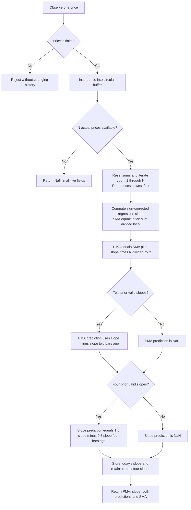

# Projected Moving Average: research prototype master reference

John F. Ehlers' March 2025 Projected Moving Average (PMA) combines a simple moving average with the regression slope of the same price window. It projects the mean by adding slope times half the configured window length. This standard-library-only streaming master returns **PMA, regression slope, PMA prediction, slope prediction, and SMA** in a named tuple. Both prediction streams from the article are included, as requested.

The numeric authority is the article's EasyLanguage function and its two indicator listings, corroborated by the matching TradeStation code. The implementation preserves the **literal `Length / 2` projection**, **backwards regression indexing and slope sign**, **two-bar slope lag in PMA prediction**, and **four-bar slope lag in slope prediction**. A subtle half-bar distinction between the source's intercept description and its executable formula is explained below rather than silently changing the formula. This indicator uses no trigonometric coefficients, so the earlier full-precision pi/sqrt(2) preference introduces no constants here; all arithmetic still uses full binary64 precision internally.

## 1. Sources and scope

- [March 2025 TASC article](../../tasc/2025-03-removing-moving-average-lag/content.md), *Removing Moving Average Lag*, John F. Ehlers, Technical Analysis of Stocks & Commodities, 43(3), pages 8–12.
- [Mesa paper](../../tasc/2025-03-removing-moving-average-lag/mesa/content.md), *Removing Moving Average Lag*. It calls the same construction **Ehlers Average** and names the function `$EhlersAverage`. Its mathematical formulas match the PMA listings. The transcription bibliography lists 2026, while the text establishes no paper publication date; the magazine source is March 2025.
- [March Traders' Tips](../../tasc/2025-03-removing-moving-average-lag/tips/tips.md) and [TradeStation PMA function and both indicators](../../tasc/2025-03-removing-moving-average-lag/tips/TradeStation_PMA.els).
- Comparison implementations: [TradingView](../../tasc/2025-03-removing-moving-average-lag/tips/TradingView_PMA.pine), [RealTest](../../tasc/2025-03-removing-moving-average-lag/tips/RealTest_PMA.rts), [Zorro](../../tasc/2025-03-removing-moving-average-lag/tips/Zorro_PMA.c), [NinjaTrader PMA](../../tasc/2025-03-removing-moving-average-lag/tips/ninja-trader/PMA.cs), [NinjaTrader slope](../../tasc/2025-03-removing-moving-average-lag/tips/ninja-trader/PMASlope.cs), [Python tip](../../tasc/2025-03-removing-moving-average-lag/tips/Python_PMA.py), and its [notebook](../../tasc/2025-03-removing-moving-average-lag/tips/trader_tip_mar_2025_removing_ma_lag.ipynb). NeuroShell and Wealth-Lab examples are in the tips document.

There is no supplied book chapter and the PMA article does not list a book bibliography. No unprovided chapter equations are attributed to a book. The full mathematics in all three PMA listings, the main projection equation, both prediction expressions, and the complete generalized-prediction derivation from the prose are transcribed here. Additional window geometry, FIR weights and response identities are identified as derivations. The unrelated February autocorrelation Python material archived in the tips folder is not part of PMA.

The EasyLanguage `$PMA` function uses reference arguments for PMA, Slope and SMA and returns the status constant 1. The Python class returns their actual values plus both predictions; it does not treat that status constant as the indicator output. The dollar sign is a TradeStation library-sorting convention and is not a mathematical operation.

## 2. Basic principle: a mean at the center of a window

For $N=\text{Length}$ equally spaced closes $C_t,C_{t-1},\ldots,C_{t-N+1}$, the mean is

$$\mu_t=\frac1N\sum_{j=0}^{N-1}C_{t-j}.$$

A mean is the least-squares constant fit to those observations. Describing it as the universally best statistical estimate requires assumptions about the signal and noise; the useful geometric fact here is that its time coordinate is the center of the uniformly sampled window. The oldest and newest sample times are $t-N+1$ and $t$, so the discrete center is $t-(N-1)/2$.

Consequently, a conventional SMA of a linear trend appears delayed by $(N-1)/2$ bars. The article describes this approximately as half the window length. The PMA adds the fitted price change across a half-length projection:

$$\boxed{\mathrm{PMA}_t=\mathrm{SMA}_t+\mathrm{Slope}_t\frac{N}{2}.}$$

This is the complete main equation printed in TASC, and Mesa writes the same formula as `EhlersAverage = Average + Slope*Length / 2`. It is a projection of the mean based on the fitted window slope. It is not an EMA, a price moving average shifted into the future on a chart, a slope added without scaling, or a rolling average of forecasts.

### 2.1 Physical analogy: position, velocity and acceleration

The article uses classical mechanics as an analogy. Price or an indicator value plays the role of position, fitted slope plays the role of velocity, and a change in slope plays the role of acceleration. The article gives

$$x=v\,t,\qquad x=\frac12a\,t^2.$$

These are the constant-velocity displacement and the acceleration contribution, respectively. A full physical motion expression would include initial position and velocity. The analogy motivates extrapolation; no mechanical simulation or physical force is calculated. Time in the indicator is measured in uniformly sampled bars and the slope unit is price per bar.

The two-bar difference of slope measures changing fitted velocity. As discussed below, its discrete transfer factor has a zero at Nyquist, reducing sample-to-sample alternating noise relative to a one-bar difference. Both prediction formulas use current and historical values only; a prediction label does not provide observed future data.

## 3. Complete regression calculation from the article

### 3.1 Source indexing and raw sums

The function loops `count = 1 to Length` inclusively. Its coordinate $i=1$ refers to the newest price; larger $i$ refers to older data. Define $y_i=C_{t-i+1}$ for $i=1,\ldots,N$. The five source accumulators are

$$S_x=\sum_{i=1}^N i,\qquad S_y=\sum_{i=1}^N y_i,$$

$$S_{xx}=\sum_{i=1}^N i^2,\qquad S_{yy}=\sum_{i=1}^N y_i^2,\qquad
S_{xy}=\sum_{i=1}^N i\,y_i.$$

Every sum starts at zero and is accumulated newest-to-oldest, one loop step at a time. $S_{yy}$ is present in the source but does not affect any returned value; it is not used as a variance estimate or additional output.

The complete source result equations are

$$\boxed{m_t=-\frac{N S_{xy}-S_xS_y}{N S_{xx}-S_x^2},}$$

$$\boxed{\mathrm{SMA}_t=\frac{S_y}{N},\qquad
\mathrm{PMA}_t=\mathrm{SMA}_t+m_t\frac{N}{2}.}$$

$m_t$ is `Slope`. The minus sign reverses the regression slope computed on backwards time coordinates. A rising chronological price line must produce positive output slope, although its regression against increasing lag indices has negative slope. Removing that sign or changing the ordering without adjusting the sign reverses the projection.

### 3.2 Covariance interpretation and nonsingular length, derived

With $\bar i=S_x/N$, the fitted backwards slope is

$$\beta_t=\frac{\sum_i(i-\bar i)(y_i-\mu_t)}{\sum_i(i-\bar i)^2},\qquad m_t=-\beta_t.$$

This centered expression explains the regression geometrically. The master preserves the source's raw-sum expression to reproduce its floating-point arithmetic, rather than substituting centered or compensated regression.

The exact integer coordinate identities are

$$S_x=\frac{N(N+1)}2,\qquad
S_{xx}=\frac{N(N+1)(2N+1)}6,$$

$$\boxed{N S_{xx}-S_x^2=\frac{N^2(N^2-1)}{12}.}$$

At $N=1$ the denominator is zero; a one-point slope is not defined. The master therefore requires integer Length at least 2. Fractional Length cannot define an unambiguous inclusive count/window and is rejected. No trigonometric, spectral or square-root constants are used in PMA.

### 3.3 Half-bar distinction from endpoint regression and y-intercept, derived

The article says PMA is the y-intercept of a regression and moves the mean to the right edge. With the **actual source coordinates** $i=1,\ldots,N$, the fitted line is

$$\widehat y(i)=\mu_t-m_t\left(i-\frac{N+1}{2}\right).$$

At the newest sample $i=1$, its fitted endpoint is

$$\widehat y(1)=\mu_t+m_t\frac{N-1}{2}.$$

At coordinate zero, its y-intercept is

$$\widehat y(0)=\mu_t+m_t\frac{N+1}{2}.$$

The literal article PMA instead evaluates the line at $i=1/2$:

$$\boxed{\mathrm{PMA}_t=\widehat y(1/2)=\widehat y(1)+\frac12m_t
=\widehat y(0)-\frac12m_t.}$$

Therefore it is half a bar beyond the latest sample's fitted endpoint and half a bar short of the intercept in the source's backwards coordinate system. The prose's intercept equivalence is a convention/approximation, not exact for its count indexing and `N/2` formula. This master uses **N/2 exactly**. Changing it to `(N-1)/2` produces a current-sample regression endpoint and changes every sloped fixture result.

For a linear price record $C_t=a+bt$, exact arithmetic gives

$$m_t=b,\qquad \mathrm{SMA}_t=C_t-b\frac{N-1}{2},\qquad
\boxed{\mathrm{PMA}_t=C_t+\frac12b.}$$

This is a useful independent test oracle: a rising ramp is not reproduced exactly at today's price by the literal PMA. It is projected ahead by half the per-bar trend. A constant record has zero slope and PMA equal to that constant.

## 4. Both complete prediction definitions

### 4.1 PMA prediction from the first indicator listing

The PMA plot code computes

$$\boxed{P_t=\mathrm{PMA}_t+\frac12(m_t-m_{t-2})N.}$$

This is the `prediction` result field. `Slope[2]` means the fitted slope of the window ending two bars ago, not the slope of two bars within today's price window. The prior regression must actually have been calculated. Both slopes use the same Length.

The article calls this a second-order prediction because it adds a change-of-slope correction. For an exact linear trend, slope is constant, so $P_t=\mathrm{PMA}_t$. For a quadratic price component $ct^2$, the fitted chronological slope changes by $4c$ over two bars; the source correction then equals $2cN$. The formula is a specified discrete extrapolation, not a guarantee that $P_t$ equals a particular future closing price or a fitted quadratic endpoint.

### 4.2 Full generalized prediction derivation copied from the prose

For the general indicator called `Smooth`, TASC and Mesa give

$$\begin{aligned}
\mathrm{Prediction}
&=\mathrm{Smooth}+\mathrm{Velocity}+0.5\,\mathrm{Acceleration}\\
&=\mathrm{Smooth}+\mathrm{Slope}+0.5\,(\mathrm{Previous\ Slope}-\mathrm{Slope})\\
&=\mathrm{Smooth}+0.5\,\mathrm{Slope}+0.5\,\mathrm{Previous\ Slope}\\
&=\mathrm{Smooth}+0.5\,(\mathrm{Smooth}-\mathrm{Smooth}[2])
+0.5\,(\mathrm{Smooth}[2]-\mathrm{Smooth}[4])\\
&=1.5\,\mathrm{Smooth}-0.5\,\mathrm{Smooth}[4].
\end{aligned}$$

`Smooth[4]` is the indicator four bars ago. This is the author's discrete algebra as printed. Its generic `Slope` symbols in the telescoping derivation denote those indicator differences and should not be silently identified with a conventional one-bar derivative or today's fitted price-window slope. The physical analogy motivates the calculation; the final discrete expression is its executable definition.

### 4.3 Slope oscillator prediction from the second listing

The article applies that generalized formula to the regression-slope stream:

$$\boxed{Q_t=1.5m_t-0.5m_{t-4}.}$$

This is `slope_prediction`, distinct from PMA prediction $P_t$. It is in price-per-bar units, like slope, whereas PMA and its prediction are in price units. It is not `1.5*PMA - 0.5*PMA[4]` and not a four-bar difference of raw prices. Both prediction outputs are calculated simultaneously in this reference rather than making the caller choose a chart display mode.

The three source function outputs are PMA, Slope and SMA. The two plotting indicators add PMA prediction and slope prediction. The master combines the complete five numeric series. Constant slope produces $Q_t=m_t$ once its history exists.

### 4.4 Two-bar difference and Nyquist, derived

The PMA correction uses the difference operator $1-z^{-2}$. At Nyquist $z=-1$, that factor is zero; it also vanishes at DC. A one-bar difference $1-z^{-1}$ does not vanish at Nyquist. This explains the article's statement that a two-bar slope difference reduces the highest-frequency chop relative to a one-bar difference.

The generalized prediction operator is $G(z)=1.5-0.5z^{-4}$. It has DC gain 1 but can amplify some intermediate-frequency components; it is not a noise-free derivative or forecast. Applied to a smoothly changing linear indicator $v_t=a+bt$, it gives $G(v)_t=v_t+2b$ in exact arithmetic. Predictions can overshoot the price range and should not be clipped when reproducing the source.

## 5. FIR interpretation and practical lag limits, derived

The regression slope and PMA are fixed finite impulse response (FIR) weighted sums once the window exists. For lag $j=0,\ldots,N-1$,

$$m_t=\sum_{j=0}^{N-1}\frac{6(N-1-2j)}{N(N^2-1)}C_{t-j}.$$

The projected moving average therefore has weights

$$\boxed{\mathrm{PMA}_t=\sum_{j=0}^{N-1}w_j C_{t-j},\qquad
w_j=\frac1N+\frac{3(N-1-2j)}{N^2-1}.}$$

They sum to one, preserving constants, but some old-sample weights are negative. PMA is not a convex average and can lie outside the range of its input prices. For Length 2 the formula simplifies to $1.5C_t-0.5C_{t-1}$.

The weight first moment is $\sum_j j w_j=-1/2$, giving a limiting low-frequency group delay of minus one-half bar. A causal filter can exhibit such phase lead by combining current and past samples with negative weights; it does not possess actual future observations. At finite frequencies its phase and amplitude differ from an ideal shifted signal. Source claims of removing lag refer to projection and the displayed examples, not exact no-delay reconstruction of arbitrary market changes.

Longer windows change the fitted slope, smoothness, and response to reversals. Reducing apparent lag through extrapolation typically increases noise sensitivity and overshoot. The slope removes the constant price level, but a constant trend leaves a nonzero constant slope; it does not eliminate every trend component. The article's description of slope as an oscillator should be interpreted in that sense.

The direct raw covariance formula can suffer cancellation when prices are very large relative to their changes. This master keeps that formula for article parity. A centered or compensated regression may be useful in another variant but changes floating-point results and should have its own fixtures.

## 6. Configuration and streaming contract

| Parameter | Shortcut | Default | Accepted values | Meaning |
|---|---|---:|---|---|
| `length` | `L` | 20 | Integer at least 2 | Count of prices in the SMA and fitted-slope window. |

There is no second prediction horizon parameter. The 2- and 4-bar slope lags are fixed by the source. Length 1 gives a zero regression denominator and is rejected even though some platform UIs allow it. Floats such as `20.0`, fractional lengths, booleans, zero, and negatives are rejected rather than truncated. No artificial upper cap is imposed; memory, available data and finite-precision limits constrain practical use. Reference cases cover Length through 252.

`ProjectedMovingAverage(length=20)` owns a circular price buffer and up to four prior valid slopes. `update(price)` consumes one finite scalar price and returns `PMAResult(pma, slope, prediction, slope_prediction, sma)`. Zero and negative prices are valid. NaN and infinity are rejected before either history changes. `length` is read-only. `reset()` clears all prices, slope history and priming state. The master needs no file or sibling indicator at runtime.

### 6.1 Per-field warmup with unavailable prehistory

The article assumes a chart can read historical closes and previously calculated slopes. No such prehistory exists before the 252 supplied closes. This master computes only full price windows and does not invent prior slopes or fill them with zero.

| Result field | Units | Leading NaNs | First valid zero-based index | Samples needed |
|---|---|---:|---:|---:|
| `pma` | Price | $N-1$ | $N-1$ | $N$ |
| `slope` | Price per bar | $N-1$ | $N-1$ | $N$ |
| `sma` | Price | $N-1$ | $N-1$ | $N$ |
| `prediction` | Price | $N+1$ | $N+1$ | $N+2$ |
| `slope_prediction` | Price per bar | $N+3$ | $N+3$ | $N+4$ |

`warmup_bars` and `is_primed` describe the three core fields. `prediction_warmup_bars` and `is_prediction_primed` describe PMA prediction. `slope_prediction_warmup_bars` and `is_slope_prediction_primed` describe slope prediction. A partly primed result contains valid core values alongside NaNs for unavailable predictions. Returning missing fields does not prevent processing subsequent prices.

For default Length 20, core outputs start at index 19, PMA prediction at index 21, and slope prediction at index 23. For Length 252 on 252 observations, only the final core values are valid; both prediction arrays contain 252 NaNs. Their all-NaN status is intentional and verifies that no slope history is fabricated.

### 6.2 History timing, ring indices and complexity

After inserting a price into a full ring, `next` points to the next slot to overwrite. Source `count=i` reads index `(next-i)%N`, so count 1 reads the newest observation. Python modulo is nonnegative; ports can use `(next+N-i)%N` or explicit decrement-and-wrap to avoid unsigned underflow and negative remainder.

Read historical slopes before inserting today's slope. A stored list with two prior valid slopes makes its second-last element $m_{t-2}$. Four prior valid slopes provide $m_{t-4}$. After returning today's results, only four prior slopes are needed for the next update. Unprimed NaNs are never stored as valid slopes.



The reference recomputes all five sums in source order on each full window. Calculation takes $O(N)$ time per update and $O(N)$ price memory plus $O(1)$ slope history. It is streaming because it consumes each new observation once and keeps bounded window state, not because its work is necessarily constant time. Running moment updates or precomputed FIR weights could reduce work but can alter roundoff and are not used as the master.

## 7. Usage, source examples and limits

```python
indicator = ProjectedMovingAverage(length=20)
for close in INPUT_CLOSE:
    result = indicator.update(close)
    if indicator.is_primed:
        pma, slope = result.pma, result.slope
    if indicator.is_prediction_primed:
        pma_prediction = result.prediction
    if indicator.is_slope_prediction_primed:
        slope_prediction = result.slope_prediction
```

The default first result with all five fields available, at index 23, is

```text
pma              = 86.6370281954888
slope            = -0.465372180451124
prediction       = 85.1021409774436
slope_prediction = -0.605430451127816
sma              = 91.29075
```

The article compares a 30-bar PMA with a 30-bar SMA, then a 200-day PMA with the conventional 200-day SMA. It plots crossings between PMA and its prediction and between slope and slope prediction as candidate timing events. These are examples, not guaranteed buy/sell outcomes or extra boolean outputs. The core default is Length 20, while TradingView and the Python demonstrations also use 30. Mesa's Figure 2 text inconsistently mentions a 300-day Ehlers Average while the caption and TASC describe 200; the confirmed long-term fixture follows TASC's 200-day case.

## 8. Platform implementation differences

| Supplied source | Behavior relevant to conversion | Master policy |
|---|---|---|
| TASC and TradeStation | Backwards count 1–N, negated slope, raw sums, N/2 projection; two separate prediction listings. | Numeric authority; combines all five fields with explicit full-history warmup. |
| Mesa | Calls PMA EhlersAverage and repeats both predictions; same formulas; undated text and transcription metadata discrepancy. | Names the folder/class PMA; formulas unchanged. |
| TradingView | Default 30, direct source loop; returns PMA/SMA/Slope and selects prediction by display mode. | Default 20; both predictions returned simultaneously. |
| Python tip | Uses numpy.polyfit on chronological samples and pandas full-window rolling series; predicts with slope shifts of 2 and 4. | Same intended algebra and full-window history; direct source arithmetic order, standard library only. np.polyfit may differ in last bits. |
| RealTest | Uses built-in Avg and Slope and computes both predictions at Length 20. | Directly implements raw-sum slope and known historical values rather than relying on built-in initialization. |
| Zorro | Direct raw-sum loop, plots PMA and SMA with LookBack 30; does not expose both predictions in its standalone function. | Returns all requested fields and source prediction streams. |
| NinjaTrader | Gates base PMA with zero-based CurrentBar < Length, starting a bar later than the first full N-price window. Its prediction guards use absolute bar counts, so early historical slopes can be platform default values. | Starts core output at N-1 and waits for actually calculated slopes at both historical lags. |
| NeuroShell and Wealth-Lab | Built-in regression or indicator calls and illustrative trading rules. | Context; no assumption that implicit initial states reproduce these fixtures. |

The source's y-intercept language must not be used to replace the literal N/2 formula with a different library endpoint. That geometric distinction changes even a perfectly linear price record and is more than a floating-point tolerance issue.

## 9. Confirmed reference cases and expected arrays

The user confirmed all **12 lengths** before generation. This is below the limit of 64 parameter combinations. Each case creates a new instance and consumes all 252 INPUT_CLOSE values. There are **five scalar arrays per case**, one per result field, hence **60 expected arrays per language**.

| Array stem | Length | What it tests |
|---|---:|---|
| `EXPECTED_L2` | 2 | Minimum nonsingular regression: two prices and distinctly staged prediction warmups. |
| `EXPECTED_L3` | 3 | Short odd window: positive chronological slope from backwards time indices. |
| `EXPECTED_L4` | 4 | Short even window: preserve the literal half-length projection. |
| `EXPECTED_L5` | 5 | Short odd window: two-bar and four-bar historical slope access. |
| `EXPECTED_L8` | 8 | Moderate short window: repeated price-ring and slope-history wraparound. |
| `EXPECTED_L14` | 14 | Fourteen-bar window: intermediate responsiveness and regression smoothing. |
| `EXPECTED_L20` | 20 | Article and TradeStation default: twenty-bar PMA with both prediction streams. |
| `EXPECTED_L30` | 30 | Article chart and Python tip example: thirty-bar projected moving average. |
| `EXPECTED_L60` | 60 | Longer intermediate window: broader regression horizon without recursive state. |
| `EXPECTED_L100` | 100 | One-hundred-bar window: longer warmup and raw covariance accumulation. |
| `EXPECTED_L200` | 200 | Article long-term example: two-hundred-day SMA and PMA comparison. |
| `EXPECTED_L252` | 252 | Full-record window: only the final core values are primed; both predictions remain NaN. |

Each stem has field suffixes `PMA`, `SLOPE`, `PREDICTION`, `SLOPE_PREDICTION`, and `SMA`. For example, `EXPECTED_L20_PREDICTION` is the PMA prediction, and `EXPECTED_L20_SLOPE_PREDICTION` is the distinct slope prediction. Output suffixes do not represent extra parameter combinations. Each array contains 252 values with its own warmup prefix, capped at 252 if that entire output is unavailable on the record.

Before every array, the first comment repeats the exact "What it tests" text from the table and the next line states `length=<value>`. Parameter shortcut L means Length. All five files carry the same descriptions, parameter values, numeric literals and NaN positions.

| Language | Example declaration | NaN spelling |
|---|---|---|
| Python | `EXPECTED_L20_SLOPE_PREDICTION = [...]` | `math.nan` |
| Go | `var expectedL20_SLOPE_PREDICTION = []float64{...}` | `math.NaN()` |
| TypeScript | `export const expectedL20_SLOPE_PREDICTION: number[] = [...];` | `NaN` |
| Rust | `pub fn expected_l20_slope_prediction() -> Vec<f64>` | `f64::NAN` |
| Zig | `pub fn expectedL20_SLOPE_PREDICTION() [252]f64` | `nan` |

Go package name is `projectedmovingaverage`, with `import "math"`. Zig keeps `const math = @import("std").math;` and `const nan = math.nan(f64);` at the top. Rust preserves copied input functions inside their existing `#[cfg(test)] pub mod testdata`, while expected functions are appended at file scope. All copied OHLC input arrays and their original declaration names are retained; the indicator uses only INPUT_CLOSE.

## 10. Reproduction and precision

From this folder:

```bash
python3 projected-moving-average.py
python3 projected-moving-average.py --generate-reference-data
python3 -m unittest discover -p 'test_projected_moving_average.py' -v
```

The `__main__` embeds the exact 252 shared closes, streams them through a default instance and prints a fully primed named result plus the confirmed case list. The generation flag computes all five fields for each case, writes Python arrays first, reloads their serialized values, and verifies every expected name, 252-element length, NaN classification and 15-digit precision. The other four files are rendered from those written Python values with matching comments. Re-running replaces only marked generated sections, preserving inputs and avoiding duplicate arrays.

Use IEEE-754 binary64: Go float64, Rust/Zig f64, and TypeScript number. Preserve the order of raw sums and the source operation order in slope, PMA and both predictions. Do not round state values. Serialization uses `.15g`, meaning **15 significant digits**, not 15 digits after the decimal point. A suitable fixture comparison tolerance for this price record is `rel_tol=5e-13, abs_tol=5e-13`. NaNs must be compared by classification, never equality. Integer loop counters should be converted safely for multiplication if the target language could overflow their integer type at large Length.

Verification independently evaluates expressions extracted from the article and checks analytic constant/ramp results, the half-bar projection distinction, staged field warmups, historic slope lags, causal prefixes, reset, invalid inputs, input integrity, every expected scalar, and each translated comment/literal. Source-expression tests require this repository's source article; the master implementation, fixture files and this complete mathematical document are self-contained for conversion elsewhere. Extraordinarily large finite magnitudes or very large unresolved covariance differences are outside the tested price-scale domain.

Verification completed on 2026-10-16: all **13 Python tests** passed, including independent article-expression comparisons for all five fields across the 12 confirmed lengths, analytic half-bar/ramp checks, historical prediction lags, staged field warmups, and every translated value and comment. Native Go, Rust and Zig validators passed; TypeScript execution through Node checked all 60 arrays against the written Python values, including both all-NaN Length-252 prediction arrays. Each language contains 60 arrays of 252 values. All five fixture files regenerated byte-for-byte identically.

## 11. References and BibTeX

1. Ehlers, John F. (2025). *Removing Moving Average Lag*. Technical Analysis of Stocks & Commodities, 43(3), 8–12, March. [Article](https://technical.traders.com/archive/article.asp?file=\V43\C03\923EHLE.pdf).
2. Ehlers, John F. *Removing Moving Average Lag*. Mesa Software. [Paper](https://www.mesasoftware.com/papers/Removing%20Moving%20Average%20Lag.pdf). The supplied transcription lists 2026; publication date is not established in the paper text.
3. Technical Analysis, Inc. (2025). *Traders' Tips — March 2025: Removing Moving Average Lag*. [Tips](https://www.traders.com/Documentation/FEEDbk_docs/2025/03/TradersTips.html). Includes the platform implementations, Python code and notebook linked in Section 1.

```bibtex
@article{ehlers2025pma,
  author = {Ehlers, John F.}, title = {Removing Moving Average Lag},
  journal = {Technical Analysis of Stocks \& Commodities},
  volume = {43}, number = {3}, pages = {8--12}, year = {2025}, month = mar,
  url = {https://technical.traders.com/archive/article.asp?file=\V43\C03\923EHLE.pdf}
}
@misc{ehlersMesaRemovingMALag,
  author = {Ehlers, John F.}, title = {Removing Moving Average Lag},
  howpublished = {Mesa Software},
  url = {https://www.mesasoftware.com/papers/Removing%20Moving%20Average%20Lag.pdf},
  note = {Publication date not established; supplied transcription bibliography lists 2026}
}
@misc{tradersTips2025mar,
  author = {{Technical Analysis, Inc.}},
  title = {Traders' Tips --- March 2025: Removing Moving Average Lag},
  year = {2025}, month = mar,
  url = {https://www.traders.com/Documentation/FEEDbk_docs/2025/03/TradersTips.html}
}
```
