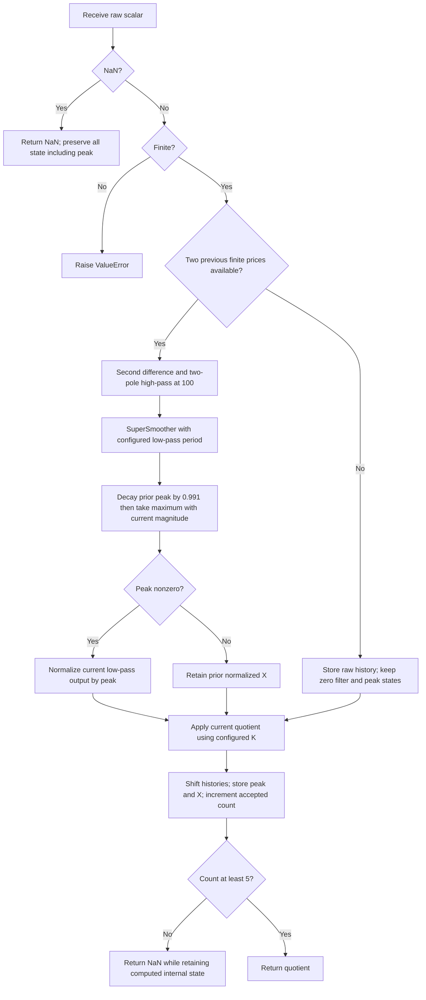

# Quotient Transform: research prototype master reference

`quotient-transform.py` implements John F. Ehlers' August 2014 **Early-Onset Trend Indicator**, class `QuotientTransform`: raw scalar prices → two-pole high-pass at 100 bars → SuperSmoother → peak-envelope normalization → Quotient Transform. Defaults are `lowpass_period=30`, `k=0.85`. `update(sample)` returns one float. The file also supplies the stateless `quotient_transform(normalized_input, k)` for applying the mapping directly to an already normalized oscillator.

These two entry points have different input contracts. Feeding RSI/stochastic into the price-input class would filter it again. For applying just the article's mathematical transform to such an oscillator, translate/normalize its value and use the pure helper.

## Article and book investigation

The supplied 2013 *Cycle Analytics for Traders* does **not** define the Quotient Transform or Early-Onset Trend Indicator. Chapter 15 discusses Fisher, inverse Fisher, and cube transforms. There is consequently no book quotient implementation whose output should be treated as an alternative master.

The 2014 article combines existing book components: equation 3-3's SuperSmoother, chapter 7's two-pole Roofing Filter, and chapter 5's fast-attack/slow-decay AGC. Chapter 14 already normalizes a Roofing signal to obtain a Hilbert transformer's real component. The article uses a fixed **100-bar** high-pass and an adjustable low-pass defaulting to **30**; chapter 7's indicator example uses **80/40**, while chapters 7 and 14 also use **48/10** or **48/20**. The article adds the quotient mapping and computes no Hilbert imaginary component.

The initial investigation and concrete Traders' Tips differences are reproduced later in this document. The article's filtering and peak recurrence, corroborated by TradeStation, are the master authority. Other tips have differing seeds, defaults, display outputs, or arithmetic expressions.

## Principles and physical analogies

A nonlinear transform changes a waveform's amplitude without needing prior samples. Here the quotient stretches one side of a bounded oscillator and compresses the other. Positive K makes it remain positive over a larger part of its original range; negative K gives the mirrored downside bias. This is a different display/threshold interpretation of present data, not a forecast of future samples.

The input must be in [-1,1]. Directly applying the quotient to an unconstrained price could place the denominator near zero. The article therefore starts with a Roofing oscillator and normalizes it.

Roofing puts two electronic-style filters in series. The high-pass blocks slow/DC energy, and the low-pass blocks rapid energy. The analogy comes from inductor/capacitor Butterworth circuit design: stored energy gives recursive memory, a damped rotating pair of poles gives a two-pole low-pass, and the digital two-element input average supplies a zero at Nyquist. The exact digital recurrence below is the implementation authority; independently discretizing an analog circuit would create a different filter.

Market swing amplitudes tend to grow with period, described by Ehlers as spectral dilation, roughly $A(f)\propto1/f$. Doubling period corresponds to about $20\log_{10}2\approx6.02$ dB greater amplitude. One high-pass pole's approximate 6 dB/octave rejection can merely compensate this growth and leave trend components. Two high-pass poles give approximately 12 dB/octave low-frequency rejection. The SuperSmoother suppresses very short periods and contains a zero at the two-bar Nyquist period. It attenuates noise; it does not recover information already lost through aliasing.

AGC resembles an audio receiver's gain control or a peak detector with a fast-charge/slow-discharge envelope. Its gain reference jumps immediately to a new large magnitude, then decays gradually until another peak arrives. Dividing the oscillator by this envelope removes price-unit scale. It is not a rolling maximum window and does not subtract a rolling minimum. Its time-varying gain does modify the waveform; the source's preference for AGC should not be interpreted as proof that this nonlinear normalized system has an unchanged spectrum.

## Quotient mapping: complete mathematics

For normalized oscillator input $X$ and finite bias $K$,

$$Q_K(X)=\frac{X+K}{KX+1},\qquad -1\le X\le1,\qquad -1<K<1.$$

The denominator satisfies $1+KX\ge1-|K|>0$. Thus endpoints ±1 are allowed without a Fisher-style .999 clip. Important values are

$$Q_K(-1)=-1,\qquad Q_K(0)=K,\qquad Q_K(1)=1,\qquad Q_K(-K)=0.$$

These identities explain the bias: with K=0.85 the zero crossing is at X=-0.85, so even many negative normalized input values map to positive output. K=0 gives the original normalized signal exactly. Negative K mirrors this behavior:

$$Q_{-K}(-X)=-Q_K(X).$$

The transform is strictly monotone:

$$\frac{dQ_K}{dX}=\frac{1-K^2}{(1+KX)^2}>0,\qquad
\frac{d^2Q_K}{dX^2}=\frac{-2K(1-K^2)}{(1+KX)^3}.$$

It therefore maps [-1,1] to [-1,1]. For K>0 it compresses the positive side and increases sensitivity toward the negative endpoint. K close to ±1 is valid but can make this endpoint sensitivity large. K=±1 is excluded; at one endpoint it produces 0/0 and the map loses its nondegenerate behavior.

The inverse is

$$Q_K^{-1}(Y)=\frac{Y-K}{1-KY}=Q_{-K}(Y).$$

For strictly interior values it also has the explanatory identity

$$Q_K(X)=\tanh\bigl(\operatorname{atanh}X+\operatorname{atanh}K\bigr).$$

This identifies a fractional linear/Möbius mapping and a shift on a hyperbolic coordinate. It is an explanation, not the code path: the master uses the direct quotient, requiring no log, atanh, or tanh implementation in a port. Those functions are singular at input endpoints, while the direct quotient remains defined.

The article gives oscillator preparation examples:

$$X_{CCI}=\max(-1,\min(1,CCI/200)),\qquad
X_{RSI}=\frac{RSI-50}{50},\qquad X_{Stochastic}=\frac{Stochastic-50}{50}.$$

The latter two require the conventional indicator scale [0,100]. If an oscillator is instead scaled [0,1], use $X=2u-1$. `quotient_transform` checks the normalized domain rather than performing an implicit translation or clip.

## Price-input filtering and AGC: full equations

Let $p_t$ be a raw scalar price. Fix $H=100$ bars and $d=0.991$. Let $L$ be the configurable low-pass period. These fixed H and d values are source settings, not extra configuration parameters.

The two-pole high-pass angle is the exact radian form of the source's `.707*360/100` degrees:

$$\theta=\frac{\sqrt2\pi}{H},\qquad
\alpha=\frac{\cos\theta+\sin\theta-1}{\cos\theta},\qquad
g=1-\frac\alpha2,\qquad q=1-\alpha.$$

The master evaluates alpha using the equivalent, better-conditioned half-angle form, also used in the prepared Roofing Filter:

$$v=\tan(\theta/2),\qquad \alpha=\frac{2v}{1+v}.$$

This avoids subtraction of almost equal numbers. For fixed H=100 there is no singularity; equivalent coefficient evaluations can still differ by a few binary64 ulps. The half-angle evaluation should be retained for matching master arithmetic. The HP recurrence is

$$h_t=g^2(p_t-2p_{t-1}+p_{t-2})+2qh_{t-1}-q^2h_{t-2}.$$

The squared gain $g^2$ is essential. The high-pass transfer function is

$$H_{HP}(z)=\frac{g^2(1-z^{-1})^2}{(1-qz^{-1})^2}.$$

Its double DC zero removes a constant or a sustained linear trend after the initial boundary transient; its repeated pole q lies inside the unit circle in exact arithmetic.

The low-pass is the same SuperSmoother recurrence as book equation 3-3:

$$
\begin{aligned}
\beta&=\frac{\sqrt2\pi}{L},&a&=e^{-\beta},\\
c_2&=2a\cos\beta,&c_3&=-a^2,\\
c_1&=1-c_2-c_3,\\
f_t&=\frac{c_1(h_t+h_{t-1})}{2}+c_2f_{t-1}+c_3f_{t-2}.
\end{aligned}
$$

The transfer function is

$$H_{SS}(z)=\frac{\frac{c_1}{2}(1+z^{-1})}{1-c_2z^{-1}-c_3z^{-2}}.$$

Its poles are $ae^{\pm i\beta}$, and its numerator vanishes at Nyquist $z=-1$. The linear Roofing portion has transfer function $H_{HP}H_{SS}$. The AGC and quotient make the complete indicator nonlinear and state dependent, so this product is not a transfer function for the complete system.

Peak normalization is **decay first, then compare**:

$$P_t=\max(dP_{t-1},|f_t|),\qquad d=0.991.$$

With reset states $P=0$, $X=0$, the exact article conditional is

$$
X_t=\begin{cases}
f_t/P_t,&P_t\ne0,\\
X_{t-1},&P_t=0,
\end{cases}
\qquad Y_t=Q_K(X_t).
$$

Holding X on zero peak follows `If Peak <> 0 Then X = Filt / Peak`; it is not an epsilon substitution. On a constant price series with zero filter histories, $f=P=X=0$ and output is **K**, not zero. No stochastic window, second post-normalization smoother, clipping, percentile conversion, or trading signal is added.

Because $P_t\ge|f_t|$, normalized X remains in [-1,1] in ordinary finite arithmetic. Peak resets hit ±1 at a new maximum magnitude. This can make quotient output equal ±1 repeatedly during startup or large swings; the shared-price default first five visible values are all -1.

Between resets, $P_{t+n}=d^nP_t$. Its half-life is $\ln(0.5)/\ln(0.991)\approx76.67$ bars. This is not a 100-bar rolling lookback: every prior magnitude can contribute an exponentially decayed envelope.

## Book AGC derivation and the decay setting

Chapter 5 uses K for the envelope decay; this document uses d to distinguish it from **quotient K**. Its stated amplitude factor between half-cycle peaks is

$$G(T)=d^{T/2},\qquad R=\frac{d^{24}}{d^5}=d^{19}.$$

Choosing -1.5 dB across the reference 10-to-48-bar cycle range gives

$$-1.5=20\log_{10}R,\qquad R=10^{-1.5/20}=10^{-0.075}\approx0.841395,$$

$$d=R^{1/19}=10^{-1.5/(20\cdot19)}\approx0.990952029793611.$$

The provided book text prints `10^(-0.75)` at an intermediate step, although -1.5/20=-0.075; the displayed 0.841 ratio agrees with the corrected exponent. The chosen algorithm throughout the book and article is **0.991**. Retain it unchanged. Replacing it with 0.990952... would change the envelope and reference output, and the article did not ask to retune its decay for the later 100-bar high-pass.

The source calls $d^{T/2}$ “Gain”; it describes the envelope decay factor across a half cycle. The actual normalization multiplier is 1/P and varies with the waveform and reset times. This source explanation is copied in full below so the symbols and rounding can be audited.

## Configuration and outputs

| Parameter | Shortcut | Default | Valid values | Meaning |
| --- | --- | ---: | --- | --- |
| `lowpass_period` | `LP` | 30.0 | Finite real $L\ge2$ bars | SuperSmoother coefficient setting; fractional periods accepted. |
| `k` | `K` | 0.85 | Finite real $-1<K<1$ | Memoryless quotient bias. |

High-pass H=100 and AGC d=0.991 are fixed. L is not an integer window or an output-warmup length. L=100 and L=252 are allowed coefficient settings for numerical coverage; with L at or above H, the two nominal critical periods do not form a conventional broad passband. Extremely large finite periods can reach floating-point coefficient-resolution limits.

`QuotientTransform.update(price)` returns the single dimensionless quotient Y. The constant zero plot is not a calculated output. To reproduce two article/TradeStation lines, use two objects with common L and different K, or use the static mapping on a separately normalized signal. Example entry/exit pairs are K=0.85 and K=0.4; negative K biases the opposite direction.

`quotient_transform(normalized_input, k)` maps only one already bounded value. The helper and streaming class accept NaN observations as NaN output. Infinite inputs are rejected with `ValueError`. The helper rejects normalized magnitudes outside [-1,1]; the streaming class accepts zero and negative finite prices and applies its own normalization.

## Exact startup, missing samples, and calculation order

At reset, two HP histories, two low-pass histories, peak, normalized X, and accepted-sample count are zero. The first two finite bars store real raw-input history, with HP and low-pass still zero. The first available second difference is on **bar 3**, and all following stages run on that bar immediately. Peak normalization is therefore updated during the hidden startup bars, not first initialized on the first visible bar.

Hide the first four returned outputs with NaN. On bar 5, return the actual quotient and set `is_primed=True`; `warmup_bars=4` for every L and K. This agrees with the raw-input-history and visibility policy of the prepared two-pole Roofing master. It is explicitly chosen for a standalone finite sequence: original platforms rely on preloaded histories, price-valued seeds, or a different first calculation index and do not define one universal NaN prefix.

For the shared closes with defaults, the first usable result is bar 5, value -1. Its early AGC envelope keeps detecting larger negative magnitude and pins X=-1. The near-endpoint K cases exercise the quotient's small denominator at the opposite endpoint; do not “fix” these legitimate endpoint values by clipping X to .999.

A NaN input call returns NaN without changing **any** state: no accepted count increment, raw history shift, filter update, or peak decay. The next finite call follows the preceding finite sample. This treats missing observations as omitted calls, not elapsed calendar bars. Reject infinite inputs before state changes. `reset()` clears every stage. Priming means an output is available; long-period recursive transients and AGC memory may persist.

Read all old states before updating any history. Compute HP, low-pass, decayed/reset peak, normalized X, and quotient in that order. Keep c3 negative and add it in the LP recurrence. Do not pre-round intermediate values. State and work are O(1): two raw prices, two HP outputs, two low-pass outputs, peak, normalized X, and a count.

## Algorithmic calculation flow



## Interpretation and source limits

Since the denominator is positive, $Y_t>0$ if and only if $X_t>-K$. The article's entry line at K=0.85 changes sign at X=-0.85, while its exit line at K=0.4 changes sign at X=-0.4. With a rising X, the former can cross earlier; with falling X, the latter can exit earlier. This is a change of threshold on a filtered normalized signal. It does not remove the Roofing filter's frequency-dependent phase delay.

The memoryless quotient induces zero **additional** sample delay; the complete price-input indicator still has recursive HP/LP dynamics and peak memory. A pointwise monotone mapping preserves the order of sample magnitudes at fixed K, while changing apparent waveform amplitude and the threshold locations. No trade execution, cross-event output, stop, trend guarantee, or forward estimate is implemented. The article's optional StockSpotter Market Mode tool is a separate method, not an omitted stage of this indicator.

## Precision and expected-data contract

All arithmetic uses standard-library scalar binary64 math. Replace printed 1.414, .707, and 3.14159 by sqrt(2), 1/sqrt(2), and pi in coefficients. Angles are radians in Python; EasyLanguage `Cosine` and `Sine` use degrees. The original expressions are reproduced below with their literals intact for auditing.

The master follows the original recurrence and the declared standalone seeds with precise constants. It cannot also match every digit of the literal rounded code. On the shared 252 closes, default precise versus literal-article output differs by as much as `0.000800032130250705`. Independent evaluation of full-precision article expressions agrees with the master to a maximum absolute difference of `2.88324919495153e-13` across the 24 cases; equivalent alpha evaluation and degree conversion account for the few-ulp differences.

Only serialization rounds, to **15 significant decimal digits** using `.15g`. Do not round state between updates. Different languages' math libraries or fused arithmetic can produce small differences; tests should compare finite values with a suitable absolute/relative tolerance, such as $10^{-11}$ for these dimensionless fixtures. NaN prefixes and array lengths must match exactly. No additional rounding, output clipping, or transform approximation is permitted.

The one-folder package uses only Python's standard library. Numeric code and excessive comments are above the fixture-tooling boundary in the master file. `__main__` embeds all 252 closes and verifies their equality to the copied Python input before generation. The generator writes/rereads Python first, verifies every expected array, then copies those saved decimal values to Go, TypeScript, Rust, and Zig. Re-running replaces only marked generated outputs and preserves inputs.

## Confirmed reference parameter combinations

All following **24 cases** were confirmed by the user on 2026-10-20; the limit is 64. Each yields a 252-element array with four leading NaNs. H=100 and d=0.991 are identical across cases.

| Array suffix | Parameter values | What it tests |
| --- | --- | --- |
| `LP30_Km0_999` | `lowpass_period=30, k=-0.999` | Negative K near the lower open boundary: strong downside bias and denominator conditioning. |
| `LP30_Km0_85` | `lowpass_period=30, k=-0.85` | Negative counterpart of the article default: downside trend emphasis. |
| `LP30_Km0_4` | `lowpass_period=30, k=-0.4` | Moderate negative K: downside exit-line counterpart. |
| `LP30_K0` | `lowpass_period=30, k=0` | Identity transform: quotient exactly equals normalized Roofing input. |
| `LP30_K0_4` | `lowpass_period=30, k=0.4` | Article exit setting: earlier zero crossing than the 0.85 trend-hold line. |
| `LP30_K0_8` | `lowpass_period=30, k=0.8` | Article mathematical illustration: normalized zero maps to 0.8. |
| `LP30_K0_85` | `lowpass_period=30, k=0.85` | Article default: thirty-bar smoothing with 0.85 early-onset bias. |
| `LP30_K0_9` | `lowpass_period=30, k=0.9` | Traders Tips example bias: stronger positive trend hold. |
| `LP30_K0_999` | `lowpass_period=30, k=0.999` | Positive K near the upper open boundary: strong upside bias and denominator conditioning. |
| `LP2_K0_85` | `lowpass_period=2, k=0.85` | Minimum supported low-pass period: fast filtering and short-period coefficient behavior with article entry bias. |
| `LP2_K0_4` | `lowpass_period=2, k=0.4` | Minimum supported low-pass period: fast filtering and short-period coefficient behavior with article exit bias. |
| `LP5_K0_85` | `lowpass_period=5, k=0.85` | Short low-pass period: rapid filtered swing response with article entry bias. |
| `LP5_K0_4` | `lowpass_period=5, k=0.4` | Short low-pass period: rapid filtered swing response with article exit bias. |
| `LP10_K0_85` | `lowpass_period=10, k=0.85` | January Roofing low-pass recommendation with the August 100-bar high-pass with article entry bias. |
| `LP10_K0_4` | `lowpass_period=10, k=0.4` | January Roofing low-pass recommendation with the August 100-bar high-pass with article exit bias. |
| `LP20_K0_85` | `lowpass_period=20, k=0.85` | Traders Tips low-pass example: intermediate smoothing with article entry bias. |
| `LP20_K0_4` | `lowpass_period=20, k=0.4` | Traders Tips low-pass example: intermediate smoothing with article exit bias. |
| `LP30_5_K0_85` | `lowpass_period=30.5, k=0.85` | Fractional low-pass period: retain real-valued coefficients with article entry bias. |
| `LP30_5_K0_4` | `lowpass_period=30.5, k=0.4` | Fractional low-pass period: retain real-valued coefficients with article exit bias. |
| `LP60_K0_85` | `lowpass_period=60, k=0.85` | Long low-pass period: greater smoothing and sustained internal memory with article entry bias. |
| `LP60_K0_4` | `lowpass_period=60, k=0.4` | Long low-pass period: greater smoothing and sustained internal memory with article exit bias. |
| `LP100_K0_85` | `lowpass_period=100, k=0.85` | Equal nominal high-pass and low-pass critical periods: algebraic edge setting with article entry bias. |
| `LP100_K0_4` | `lowpass_period=100, k=0.4` | Equal nominal high-pass and low-pass critical periods: algebraic edge setting with article exit bias. |
| `LP252_K0_85` | `lowpass_period=252, k=0.85` | Full-record-length low-pass period: long transient while output availability remains five bars. |

Negative parameter signs use `m` in identifiers and decimal points become underscores: K=-0.85 becomes `Km0_85`; L=30.5 becomes `LP30_5`. Python arrays start `EXPECTED_`, for example `EXPECTED_LP30_K0_85`. Go, TypeScript, and Zig use `expectedLP30_K0_85`; Rust uses `expected_lp30_k0_85`.

| Language | Fixture file | Declaration and NaN syntax |
| --- | --- | --- |
| Python | `test_testdata.py` | List assignment / `math.nan` |
| Go | `testdata_test.go` | `package quotienttransform`; `var expected... = []float64{...}` / `math.NaN()` |
| TypeScript | `testdata.ts` | `export const expected...: number[] = [...]` / `NaN` |
| Rust | `testdata.rs` | `pub fn expected_...() -> Vec<f64> { vec![...] }` / `f64::NAN` |
| Zig | `testdata.zig` | `pub fn expected...() [252]f64 { return .{...}; }` / `nan` |

Every expected declaration has the same two comments: “What it tests” text, followed by parameter names and values. The copied Rust inputs remain in their existing `#[cfg(test)] pub mod testdata`; expected functions are at file scope. Zig retains `const math = @import("std").math;` and `const nan = math.nan(f64);`.

From this folder:

```bash
python3 quotient-transform.py
python3 quotient-transform.py --generate-reference-data
python3 test_quotient_transform.py
```

The tests compare every finite output against expressions extracted from the actual article, check all 24 15-digit arrays and four language translations, verify mapping endpoints/identity/inverse/monotonicity, exercise the decay-first peak reset and zero-peak conditional, and verify NaN skip, reset, input validation, and scale invariance. Synthetic cases supplement market data. The original article block is included in this document so tests can use it when the external source tree is unavailable after copying the folder.

## References and BibTeX

- John F. Ehlers, “The Quotient Transform,” *Technical Analysis of STOCKS & COMMODITIES*, 32(8), August 2014, pp. 26–29. [Local article](../../tasc/2014-08-the-quotient-transform/content.md), [published article](https://technical.traders.com/archive/article.asp?file=\V32\C08\825EHLE.pdf).
- [Traders' Tips, August 2014](https://www.traders.com/Documentation/FEEDbk_docs/2014/08/TradersTips.html), [local collection](../../tasc/2014-08-the-quotient-transform/tips/tips.md). The source-comparison table below identifies the relevant differences in each supplied implementation.
- John F. Ehlers, *Cycle Analytics for Traders: Advanced Technical Trading Concepts*, Wiley, 2013. [Book record](../../2013-cycle-analytics-for-traders/toc.md); [chapter 3](../../2013-cycle-analytics-for-traders/ch3.md), [chapter 5](../../2013-cycle-analytics-for-traders/ch5.md), [chapter 7](../../2013-cycle-analytics-for-traders/ch7.md), [chapter 14](../../2013-cycle-analytics-for-traders/ch14.md), [chapter 15](../../2013-cycle-analytics-for-traders/ch15.md).
- John F. Ehlers, “Predictive And Successful Indicators,” *Technical Analysis of STOCKS & COMMODITIES*, 32(1), January 2014, pp. 16–25, cited by the Quotient article for the filtering background. [Local article](../../tasc/2014-01-predictive-and-successful-indicators/content.md).
- [Source investigation](../../tasc/2014-08-the-quotient-transform/implementation-comparison.md), project audit dated 2026-10-20, reproduced in this document for independent conversion.

```bibtex
@article{ehlers2014quotient,
  author    = {Ehlers, John F.},
  title     = {The Quotient Transform},
  journal   = {Technical Analysis of STOCKS \& COMMODITIES},
  volume    = {32},
  number    = {8},
  pages     = {26--29},
  year      = {2014},
  month     = aug,
  publisher = {Technical Analysis, Inc.},
  url       = {https://technical.traders.com/archive/article.asp?file=\V32\C08\825EHLE.pdf}
}
@misc{traderstips2014august,
  author       = {{Technical Analysis of STOCKS \& COMMODITIES}},
  title        = {Traders' Tips: The Quotient Transform},
  year         = {2014},
  month        = aug,
  howpublished = {Online},
  url          = {https://www.traders.com/Documentation/FEEDbk_docs/2014/08/TradersTips.html}
}
@book{ehlers2013cycle,
  author    = {Ehlers, John F.},
  title     = {Cycle Analytics for Traders: Advanced Technical Trading Concepts},
  publisher = {Wiley},
  year      = {2013},
  series    = {Wiley Trading},
  isbn      = {9781118728604},
  note      = {Chapter 3 equation 3-3, chapter 5 AGC, chapter 7 Roofing,
               chapter 14 normalized Roofing, chapter 15 transform background}
}
@article{ehlers2014predictive,
  author  = {Ehlers, John F.},
  title   = {Predictive And Successful Indicators},
  journal = {Technical Analysis of STOCKS \& COMMODITIES},
  volume  = {32},
  number  = {1},
  pages   = {16--25},
  year    = {2014},
  month   = jan,
  url     = {https://technical.traders.com/archive/article.asp?file=\V32\C01\692EHLE.pdf}
}
```

## Original article: complete relevant description and mathematical implementation

The source text below preserves all algorithmic mathematics, theoretical explanations, examples, and the EasyLanguage block. Its printed constants remain unchanged for audit. Image files are not required for understanding or executing the master; their links are omitted. Use the precise equations and explicit startup above for conversion.

## Early Trend Detection

Here's one way to detect a trend early and know how long to stick with it.

Trading the trend is a favorite technique of technical analysts. Trends are usually detected by some variation of following a moving average. The problem with this approach is that the moving averages invariably introduce lag because they require a relatively large amount of historical data to form a reliable indicator. This article introduces the quotient transform, which nonlinearly manipulates indicators to not only produce an early trend detection but also provides the ability to know how long to stick with the trend.

## Quotient Transform Mathematics

Transforms are handy devices that change indicator waveforms to better interpret the meaning of various indicators. They introduce zero lag into the indicators, which is a good thing. For example, a Fisher transform changes any indicator probability distribution to have a nearly normal probability distribution, with the result that visibility peak turning points are highly amplified. Conversely, the inverse Fisher transform acts as a soft limiter to remove irrelevant squiggles and thereby reduce the tendency for whipsaw trades. Another way to accentuate peak turning points and reduce irrelevant squiggles of a normalized indicator that swings between -1 and +1 is to simply cube the indicator. This collapses the small values of the indicator while leaving the values near +1 and -1 nearly unchanged.

The quotient transform is a simple ratio whose nonlinearity is parametrically controlled by a constant, $K$. The equation for the quotient transform is:

$$\text{Output} = \frac{\text{Input} + K}{K \cdot \text{Input} + 1}$$

where:

$$-1 < K < 1$$

The transfer response for various values of $K$ is shown in Figure 1. The input values are located along the horizontal axis and the output values (results) are located along the vertical axis.

To see how the transform works, assume that $K = 0.8$. Positive values of the input remain at high values at the output, being reduced to only 0.8 when the input value is zero. When the input values are reduced further into the negative range, the output remains positive until the input value reaches -0.8. When the input values are reduced even further, the output values rapidly approach -1. This nonlinear response causes the output to have positive values over most of the range of input values. The transform is reverse symmetrical about the diagonal if the parameter $K$ takes on negative values.

**FIGURE 1: QUOTIENT TRANSFORM TRANSFER RESPONSES.** Here you see the transfer response for various values of K.

## Indicator Requirements

The primary indicator requirement is that the swing of the indicator be limited to fall within the range of -1 to +1. This is easily accomplished with most oscillators using translation and dilation. The commodity channel index (CCI), stochastic, and relative strength index (RSI) are examples.

The CCI oscillator is normalized to the reference levels of -100 and +100, but it can exceed these reference levels. A suggested dilation is to divide the CCI by 200 and then further limit the values so they do not exceed -1 or +1.

The stochastic and RSI indicators are usually computed to plot between zero and 100. For these indicators, translate by subtracting 50 and then dilate by dividing the difference by 50. As a result, the indicators are ready for the quotient transform because they will be constrained to be within the range of -1 and +1.

## Roofing Filter

It is commonly recognized that market data is fractal in nature. That is, the amplitude of the cycle swings is generally in proportion to the cycle period. For example, the swings on a five-minute chart are small compared to the swings on a daily chart. This is called *spectral dilation*. A roofing filter is a superior oscillator because it removes the effects of spectral dilation and effectively removes aliasing noise. The roofing filter got its name as a descriptor of its performance in the frequency domain. It is composed of a two-pole high-pass filter that removes the components with longer wavelengths, thus retaining the higher-frequency components. It also is composed of a SuperSmoother that removes aliasing noise and smoothes by removing the very high-frequency components. As a result, the roofing filter provides a "roof" in the frequency domain that passes only the desired frequency components from the data input to any signal processing that follows it.

The roofing filter is an oscillator, but its output swings are not normalized. Normalization can be done in the same fashion as in a stochastic indicator by dividing by the difference between the highest and lowest values over a selected lookback period. However, I generally prefer to normalize indicators using an *automatic gain control* (AGC) algorithm because this method retains the characteristics of the indicator in the frequency domain without distortion. The AGC algorithm senses the most recent absolute value of peak swings to provide a normalizing value. The normalizing value is slowly decayed with each new data sample until a new peak swing is detected.

Putting all this together, I am providing EasyLanguage code for the normalized roofing filter with a quotient transform in the sidebar "EasyLanguage Code To Compute The Early-Onset Trend Indicator." The early-onset trend indicator can be tuned at the trader's preference by inputting a value for the low-pass period (LPPeriod) and the quotient parameter $K$.

## EasyLanguage Code To Compute The Early-Onset Trend Indicator

```easylanguage
Inputs:
  LPPeriod(30),
  K(.85);

Vars:
  alpha1(0),
  HP(0),
  a1(0),
  b1(0),
  c1(0),
  c2(0),
  c3(0),
  Filt(0),
  Peak(0),
  X(0),
  Quotient(0);

//Highpass filter cyclic components whose periods are shorter than 100 bars
alpha1 = (Cosine(.707*360 / 100) + Sine(.707*360 / 100) - 1) / Cosine(.707*360 / 100);

HP = (1 - alpha1 / 2)*(1 - alpha1 / 2)*(Close - 2*Close[1] + Close[2])
  + 2*(1 - alpha1)*HP[1] - (1 - alpha1)*(1 - alpha1)*HP[2];

//SuperSmoother Filter
a1 = expvalue(-1.414*3.14159 / LPPeriod);
b1 = 2*a1*Cosine(1.414*180 / LPPeriod);
c2 = b1;
c3 = -a1*a1;
c1 = 1 - c2 - c3;
Filt = c1*(HP + HP[1]) / 2 + c2*Filt[1] + c3*Filt[2];

//Fast Attack - Slow Decay Algorithm
Peak = .991*Peak[1];
If AbsValue(Filt) > Peak Then Peak = AbsValue(Filt);

//Normalized Roofing Filter
If Peak <> 0 Then X = Filt / Peak;
Quotient = (X + K) / (K*X + 1);

Plot1(Quotient);
Plot2(0);
```
*—J. Ehlers*

## Early-Onset Trend Detector In Action

Figure 2 shows the early-onset trend detector (using the code to compute the early-onset trend indicator) in the subgraph below the bar chart for the SPDR S&P 500 (SPY). The red indicator line clearly shows the trend onset as it crosses above zero on three occasions. The red trend indicator is to be compared to the normalized roofing filter, shown as the dashed blue line. The roofing filter simply has too many wiggles to be a trend indicator. In and of itself, the roofing filter is better suited to detect short-term market swings.

Of course, the early-onset trend detector works in current market conditions because there is a decided upside bias to the market data. In fact, it is this upside bias that helps the nonlinear transfer response of the quotient transform work. In conditions where the market has a downside bias, negative values of $K$ should be used in the quotient transform to take advantage of the bias in this direction.

**FIGURE 2: EARLY-ONSET TREND DETECTOR.** On this chart of the SPY, you can see that the indicator clearly shows the trends.

Another characteristic of the early-onset trend detector is that it remains above zero, indicating an uptrend, far too long after the uptrend is over. This characteristic can be mitigated by adding an additional indicator and rule set to exit a long trend trade. For example, Figure 3 shows a cyan indicator line where the K input variable is set to be 0.4. A simple trend-trading rule would be to enter a long position trade when the red line crosses above zero and hold that position until the cyan indicator line crosses below zero. This rule gives the benefit of entering the trade on the early-onset indication and exiting that trade on or before the trend has run its course.

**FIGURE 3: APPLYING THE EARLY-ONSET TREND DETECTOR.** Two different quotient transform parameters can be used for early long-position trade entries and exits.

## An Alternative Trend-Analysis Tool

Using the quotient transform is not necessarily the only way to detect the early onset of a trend. I offer the Trade Setup Analyzer at my website, www.StockSpotter.com. A snapshot example of the Trade Setup Analyzer is shown in Figure 4. The Market Mode indicator at the bottom of the chart provides positive trend confirmation by displaying a green color in uptrends, a red color in downtrends, and a yellow color in sideways markets. The Market Mode indicator measures the trend slope over the period of the measured cycle relative to the peak-to-peak amplitude swing of the cycle itself. As shown in Figure 4, the uptrend for Alcoa began early in March 2014 and continued until mid-May, when the trend slope turned neutral. The indicator is colorized for trend identification at a glance. The indicator works symmetrically; when the trend is weakening, an early indication of the onset of the downtrend is indicated by the color change to red.

**FIGURE 4: TRADE SETUP ANALYZER.** The interplay between the Market Mode indicator trend and market cycles provide reliable trend-trading signals.

## Conclusions

The quotient transform can be applied to any oscillator-type indicator to provide an early-onset identification of a trend. The oscillator is subject to the constraint that its swings must be within the limits of -1 and +1. The quotient transform introduces no lag in the calculations. Positive values of the $K$ parameter nonlinearly bias the indicator for uptrends. Correspondingly, negative values of the $K$ parameter nonlinearly bias the indicator for downtrends. Different values of the $K$ parameter can be used for trade entry and exit rules to capture the maximum amount of the trend movement.

## Original book: SuperSmoother equation 3-3 and theory

The preceding equations 3-1/3-2 are retained as source context; unusual factors/signs in those supplied expressions do not enter this master. Equation 3-3 and the article agree.

One of the advantages of recursive filters is that the transition between the pass band and the stop band can be much sharper compared to that of the nonrecursive filters. As a matter of computational simplicity, the critical period of the filter can be established independently from the degree of the filter. On the downside, recursive filters don’t have the same delay at all frequencies. This variable delay across the spectrum leads to dispersion distortion of the output waveform. Most of the dispersion occurs at those frequency components that have been attenuated, so the effect of the distortion is a relatively minor one.

A Butterworth filter is a favorite analog filter because its frequency response is maximally flat, near zero frequency. Years ago, I translated analog Butterworth filters to their digital approximations having like degrees in the numerator and denominator of the transfer response. The transfer response is characterized by a single variable: the critical period. The critical period is that where the output is attenuated by $3$ dB relative to the input data.

The digital Butterworth filter approximations included numerators whose coefficients were $[1,2,1]$ and $[1,3,3,1]$ for two- and three-pole configurations, respectively. However, for applications to trading, I noted that the primary contribution of the numerator terms was to increase the filter lag. So I created modified versions simply by deleting all but the constant term in the numerator of the Butterworth transfer response.

The equations for the two-pole modified Butterworth filter are:

$$\begin{aligned}
a &= e^{-1.414 \cdot 3.14159 / \text{Period}} \\
b &= 2 a \cos(1.414 \cdot 1.25 \cdot 180 / \text{Period}) \\
c_2 &= b \\
c_3 &= -a \cdot a \\
c_1 &= 1 - c_2 - c_3 \\
\text{Output} &= c_1 \cdot \text{Input} - c_2 \cdot \text{Output}[1] - c_3 \cdot \text{Output}[2]
\end{aligned}$$

(3-1)

The equations for the three-pole modified Butterworth filter are:

$$\begin{aligned}
a &= e^{-3.14159 / \text{Period}} \\
b &= 2 a \cos(1.738 \cdot 180 / \text{Period}) \\
c &= a \cdot a \\
d_2 &= b + c \\
d_3 &= -(c + b \cdot c) \\
d_4 &= c \cdot c \\
d_1 &= 1 - d_2 - d_3 - d_4 \\
\text{Output} &= d_1 \cdot \text{Input} - d_2 \cdot \text{Output}[1] - d_3 \cdot \text{Output}[2] - d_4 \cdot \text{Output}[3]
\end{aligned}$$

(3-2)

The frequency responses for two- and three-pole modified Butterworth filters whose critical period was set at a 10-bar cycle are shown in ­Figure 3.8. The three-pole version gives about 6 dB more attenuation at the Nyquist frequency than the two-pole version. That means the output wave amplitude of the three-pole version would be half the wave amplitude at the Nyquist frequency. In some applications, this difference in filtered amplitude could be important.

**Figure 3.8** *Frequency Response of Two- and Three-Pole Modified Butterworth Filters Where Period = 10*

The delay of the two- and three-pole modified Butterworth filters whose critical period was set at a 10-bar cycle is shown in Figure 3.9. The price to be paid for the additional rejection band attenuation is an increase of almost two bars of additional delay near the critical period. In addition, there is greater percentage dispersion distortion across the pass band.

Having obtained good filtering with minimum delay and minimum delay distortion, it is relatively easy to obtain a zero in the transfer response at the Nyquist frequency by adding a two-element moving average in the numerator. The delay cost is only half a bar, and that cost seems worth it. By doing this, a filter I call the SuperSmoother is created. The equations for the SuperSmoother filter are:

$$\begin{aligned}
a &= e^{-1.414 \cdot 3.14159 / \text{Period}} \\
b &= 2 a \cos(1.414 \cdot 180 / \text{Period}) \\
c_2 &= b \\
c_3 &= -a \cdot a \\
c_1 &= 1 - c_2 - c_3 \\
\text{Output} &= c_1 \cdot (\text{Input} + \text{Input}[1]) / 2 + c_2 \cdot \text{Output}[1] + c_3 \cdot \text{Output}[2]
\end{aligned}$$

(3-3)

**Figure 3.9** *Lags of Two- and Three-Pole Modified Butterworth Filters Where Period = 10*

The frequency response of the SuperSmoother filter where the critical period is set to $10$ is shown in Figure 3.10.

**Figure 3.10** *Frequency Response of a SuperSmoother Filter Where Period = 10*

## SuperSmoother Filter Applications

A SuperSmoother filter is used anytime a moving average of any type would otherwise be used, with the result that the SuperSmoother filter output would have substantially less lag for an equivalent amount of smoothing produced by the moving average. For example, a five-bar SMA has a cutoff period of approximately 10 bars and has two bars of lag. A SuperSmoother filter with a cutoff period of 10 bars has a lag a half bar larger than the two-pole modified Butterworth filter shown in Figure 3.9. Therefore, such a SuperSmoother filter has a maximum lag of approximately 1.5 bars and even less lag into the attenuation band of the filter. The differential in lag between moving average and SuperSmoother filter outputs becomes even larger when the cutoff periods are larger.

Market data contain noise, and removal of noise is the reason for using smoothing filters. In fact, market data contain several kinds of noise. I’ll group one kind of noise as systemic, caused by the random events of trades being exercised. A second kind of noise is aliasing noise, caused by the use of sampled data. Aliasing noise is the dominant term in the data for shorter cycle periods.

It is easy to think of market data as being a continuous waveform, but it is not. Using the closing price as representative for that bar constitutes one sample point. It doesn’t matter if you are using an average of the high and low instead of the close, you are still getting one sample per bar. Since sampled data is being used, there are some DSP aspects that must be considered. For example, the shortest analysis period that is possible (without aliasing) $2$ is a two-bar cycle. This is called the Nyquist frequency, $0.5$ cycles per sample. A perfect two-bar sine wave cycle sampled at the peaks becomes a square wave due to sampling. However, sampling at the cycle peaks cannot be guaranteed, and the interference between the sampling frequency and the data frequency creates the aliasing noise. The noise is reduced as the data period is longer. For example, a four-bar cycle means there are four samples per cycle. Because there are more samples, the sampled data are a better replica of the sine wave component. The replica is better yet for an eight-bar data component. The improved fidelity of the sampled data means the aliasing noise is reduced at longer and longer cycle periods. The rate of reduction is $6$ dB per octave. My experience is that the systemic noise rarely is more than $10$ dB below the level of cyclic information, so that we create two conditions for effective smoothing of aliasing noise:

1. It is difficult to use cycle periods shorter that two octaves below the Nyquist frequency. That is, an eight-bar cycle component has a quantization noise level 12 dB below the noise level at the Nyquist frequency. Longer cycle components therefore have a systemic noise level that ­exceeds the aliasing noise level.
2. A smoothing filter should have sufficient selectivity to reduce aliasing noise below the systemic noise level. Since aliasing noise increases at the rate of $6$ dB per octave above a selected filter cutoff frequency and since the SuperSmoother attenuation rate is $12$ dB per octave, the SuperSmoother filter is an effective tool to virtually eliminate aliasing noise in the output signal.

I urge readers to universally adapt the SuperSmoother filter set to a cutoff period of $10$ bars or so on all data to attenuate aliasing noise. The output of the SuperSmoother filter can be used directly as an indicator or as the sampled data fed to any other indicator.

## Original book: complete AGC derivation

A band-pass filter described by Equations 5-1 and 5-2 will accurately ­display the amplitude of the cyclic swings in the input data. Consequently, the amplitude of these swings will vary among stock ticker signals because the ­prices range from penny stocks to well over \$100 per share. A penny stock just cannot have as large a swing as a blue-chip stock because the basis is much smaller. Traders are used to indicators being normalized to a range like $0$ to $100$ so that the indicator scales the same regardless of the price amplitude swings. The purpose of the AGC is to provide a consistent indicator appearance independently from the range of the price swings. The process of the AGC divides the current price by the absolute value of the recent maximum swing so that the normalized waveform has a maximum of $1$ or a minimum of $−1$. I have never seen the AGC concept applied to technical indicators, which is a shame because it can be applied universally.

The specific kind of AGC is called a fast attack−slow decay AGC. The normalizing factor is allowed to decay a small amount before being compared to the next sample of the signal so the normalizing is not done on the largest swing throughout history. If the next sample of the signal is larger than the normalizing factor, then the normalizing factor is immediately assigned the value of the next sample. However, if the next sample of the signal is smaller than the normalizing factor, then the normalizing factor is allowed to decay another small amount and then is compared to the third sample, and so on. The amount of decay is exponential if the normalizing factor is not reset. If the decay factor is $K$ for the first sample, then it is $K * K = K^2$ for the next sample, and is $K * K * K = K^3$ for the third sample, and so on.

Figure 5.9 depicts the AGC action, where the absolute value of the sine wave signal is shown by the solid line. The normalizing factor, shown by the dashed line, decays exponentially with each sample. When the signal exceeds the normalizing factor, the normalizing factor is assigned the new value of the signal so that when the input signal is divided by the normalizing factor the AGC algorithm output normalized the input value to be 1. The process is repeated for each new sample of data. When changes are made in the time domain, there are always implications made in the frequency domain. Considering theoretical sine wave signals, the effective gain of the AGC is the decay factor to the exponent of the half period of the sine wave as

$$\text{Gain} = K^{(\text{Period} / 2)}$$

**Figure 5.9** *The AGC Normalizing Factor Decays Exponentially and Is Rapidly Reset to the Absolute Value of the Cyclic Swing*

About the shortest cycle period useful for trading is a $10$-bar cycle, and cycle periods longer than 48 bars can often be considered trends. Therefore, we are concerned with the gain slope over the range from a 10-bar period to a $48$-bar period. The gain ratio over this range can be expressed as

$$\text{Ratio} = \frac{K^{24}}{K^5} = K^{(24-5)} = K^{19}$$

Since we must accept some gain slope across the cycle periods of interest, an arbitrary but reasonable selection is $1.5$ dB. The numerical value of the ratio is computed as:

$$\begin{aligned}
-1.5 &= 20 \cdot \log_{10}(\text{Ratio}) \\
10^{(-1.5/20)} &= 10^{-0.75} = \text{Ratio} \\
\text{Ratio} &= 0.841
\end{aligned}$$

Knowing the desired gain ratio across the band, we can compute the decay factor as:

$$\begin{aligned}
K^{19} &= 0.841 \\
K &= 0.841^{(1/19)} \\
K &= 0.991
\end{aligned}$$

I will use this value for the AGC decay factor throughout the remainder of the book unless the AGC is used for amplitude compensation as a function of the cycle period.

## Original book: Roofing construction and period differences

The supplied transcription contains the malformed expression `F$ *{0.5}$`, retained as literal text below. It is not used in calculations; the exact high-pass transfer function above defines the response.

A “roofing filter” can be used to limit the frequency content of an input before proceeding to construct an indicator. The roofing filter is composed of a high-pass filter that passes only frequency components whose periods are shorter than $48$ bars, for example. It also is composed of a SuperSmoother filter that passes frequency components whose periods are longer than 10 bars. Thus, the roofing filter is a wide bandwidth band-pass filter that passes only frequency components whose periods fall between 10 bars and 48 bars. This, by itself, is a simple indicator. The EasyLanguage code for this indicator is given in Code Listing 7-1, and the indicator output is displayed in Figure 7.1.

While the roofing filter indicator wiggles in proportion to the wiggles in the price data as you would expect, it is noticeable that the indicator is above zero for extended periods where the market is in an uptrend. In other words, the filter output does not have a zero mean as you would expect if the output consisted only of cyclic components whose periods fall between $10$ bars and $48$ bars.

**Code Listing 7-1. HP-LP Roofing Filter EasyLanguage Code**

```easylanguage
{
  HP-LP Roofing Filter
  © 2013 John F. Ehlers
}
Vars:
  alpha1(0),
  HP(0),
  a1(0),
  b1(0),
  c1(0),
  c2(0),
  c3(0),
  Filt(0);

//Highpass filter cyclic components whose periods are shorter than 48 bars
alpha1 = (Cosine(360 / 48) + Sine (360 / 48) - 1) / Cosine(360 / 48);

HP = (1 - alpha1 / 2)*(Close - Close[1]) + (1 - alpha1)*HP[1];

//Smooth with a Super Smoother Filter from equation 3-3
a1 = expvalue(-1.414*3.14159 / 10);
b1 = 2*a1*Cosine(1.414*180 / 10);
c2 = b1;
c3 = -a1*a1;
c1 = 1 - c2 - c3;
Filt = c1*(HP + HP[1]) / 2 + c2*Filt[1] + c3*Filt[2];

Plot1(Filt);
Plot2(0);
```

**Figure 7.1** *Roofing Filter Display Does Not Have a Zero Mean*

The explanation for the lack of a zero mean is that the input data has a spectral power density proportional to $1/F^ \alpha$, and therefore increases amplitude at the rate of $6 dB$ per octave, more or less. The high-pass filter has a rejection slope that increases attenuation directly proportional to `F$ *{0.5}$`, or rolls off at the rate of $6 dB$ per octave. This response is similar to the frequency response shown in Figure 1.2. As a result, the only effect of the high-pass filter is to basically to equalize the fractal amplitude growth of all longer periods in the data. Therefore, the filter output still contains all of these frequency components. The only way we can reduce the effect of these lower-frequency components is to introduce another high-pass filter, adding an additional $6 dB$ per octave roll-off, so that the net effect of the filter is as originally surmised. I have added `Filt2` to the code in Code ­Listing 7-2, and the effect is shown as the solid line in Figure 7.2. The original roofing filter response is shown with the crosshatched markers. Note that in addition to establishing a nominally zero mean, removal of the longer-cycle components caused by spectral dilation removes lag from the roofing filter output.

Since the roofing filter consists of the serial connection of a one-pole high-pass filter, a SuperSmoother, and another one-pole high-pass filter, it is clear the better formulation of the roofing filter would be the serial connection of a two-pole high-pass filter and the SuperSmoother.

**Code Listing 7-2. EasyLanguage Code for a Zero Mean Roofing Filter**

```easylanguage
{
  Zero Mean Roofing Filter
  © 2013 John F. Ehlers
}
Vars:
  alpha1(0),
  HP(0),
  a1(0),
  b1(0),
  c1(0),
  c2(0),
  c3(0),
  Filt(0),
  Filt2(0);

//Highpass filter cyclic components whose periods are shorter than 48 bars
alpha1 = (Cosine(360 / 48) + Sine (360 / 48) - 1) / Cosine(360 / 48);

HP = (1 - alpha1 / 2)*(Close - Close[1]) + (1 - alpha1)*HP[1];

//Smooth with a Super Smoother Filter from equation 3-3
a1 = expvalue(-1.414*3.14159 / 10);
b1 = 2*a1*Cosine(1.414*180 / 10);
c2 = b1;
c3 = -a1*a1;
c1 = 1 - c2 - c3;
Filt = c1*(HP + HP[1]) / 2 + c2*Filt[1] + c3*Filt[2];
Filt2= (1 - alpha1 / 2)*(Filt - Filt[1]) + (1 - alpha1)*Filt2[1];

Plot1(Filt);
Plot2(Filt2);
Plot6(0);
```

## Roofing Filter as an Indicator

The roofing filter does an excellent job of using only the frequency components between its upper and lower critical periods. All that needs to be done to create an indicator from the roofing filter is to add more generality by allowing the high-pass and low-pass critical periods be supplied as indicator inputs. In the code of Code Listing 7-3, the two high-pass filters have been implemented as a single two-pole high-pass filter.

**Figure 7.2** * Zero Mean Roofing Filter Output Contains Only Desired Frequency Components*

The ideal time to buy is when the cycle is at a trough, and the ideal time to exit a long position or to sell short is when the cycle is at a peak. These conditions are flagged by the filter crossing itself delayed by two bars, and are included as part of the indicator.

**Code Listing 7-3. EasyLanguage Code for a Roofing Filter Indicator**

```easylanguage
{
  Roofing Filter Indicator
  © 2013 John F. Ehlers
}
Inputs:
  LPPeriod(40),
  HPPeriod(80);
Vars:
  alpha1(0),
  HP(0),
  a1(0),
  b1(0),
  c1(0),
  c2(0),
  c3(0),
  Filt(0),
  Filt2(0);

//Highpass filter cyclic components whose periods are shorter than 48 bars
alpha1 = (Cosine(.707*360 / HPPeriod) + Sine (.707*360 / HPPeriod) - 1) / Cosine(.707*360 / HPPeriod);

HP = (1 - alpha1 / 2)*(1 - alpha1 / 2)*(Close - 2*Close[1] + Close[2]) + 2*(1 - alpha1)*HP[1] - (1 - alpha1)*(1 - alpha1)*HP[2];

//Smooth with a Super Smoother Filter from equation 3-3
a1 = expvalue(-1.414*3.14159 / LPPeriod);
b1 = 2*a1*Cosine(1.414*180 / LPPeriod);
c2 = b1;
c3 = -a1*a1;
c1 = 1 - c2 - c3;
Filt = c1*(HP + HP[1]) / 2 + c2*Filt[1] + c3*Filt[2];

Plot1(Filt);
Plot2(Filt[2]);
Plot6(0);
```

An example of the roofing filter indicator is shown in Figure 7.3, where the LP period rather arbitrarily has been set at 40 and the HP period also has been arbitrarily set at 80 bars. A casual glance shows the roofing filter to be an excellent indicator whose signals are not marred by computational lag. The two inputs can be set to get the best response for a particular stock, exchange-traded fund, or future symbol. This indicator gives excellent guidance for discretionary trading, but additional rules would be required to create a good mechanical trading system from it.

If a normalized amplitude indicator is desired, the automatic gain control (AGC) code fragment described in Chapter 5 can be added after the Filt calculation.

**Figure 7.3** *The Roofing Filter Is an Outstanding Technical Indicator*

## Original book: normalized Roofing in the Hilbert transformer

The complete listing is shown to distinguish the real normalized Roofing component from the imaginary-component work, which is not part of Quotient Transform.

```easylanguage
{
  Hilbert Transformer
  © 2013  John F. Ehlers
}
Inputs:
  LPPeriod(20);
  (Continued )

Vars:
  alpha1(0),
  HP(0),
  a1(0),
  b1(0),
  c1(0),
  c2(0),
  c3(0),
  Filt(0),
  QFilt(0),
  Real(0),
  Imag(0),
  IPeak(0),
  QPeak(0);

//Highpass filter cyclic components whose periods are shorter than 48 bars
alpha1 = (Cosine(.707*360 / 48) + Sine (.707*360 / 48) - 1) / Cosine(.707*360 / 48);

HP = (1 - alpha1 / 2)*(1 - alpha1 / 2)*(Close - 2*Close[1] + Close[2]) + 2*(1 - alpha1)*HP[1] - (1 - alpha1)*(1 - alpha1)*HP[2];

//Smooth with a Super Smoother Filter from equation 3-3
a1 = expvalue(-1.414*3.14159 / LPPeriod);
b1 = 2*a1*Cosine(1.414*180 / LPPeriod);
c2 = b1;
c3 = -a1*a1;
c1 = 1 - c2 - c3;
Filt = c1*(HP + HP[1]) / 2 + c2*Filt[1] + c3*Filt[2];

IPeak = .991*IPeak[1];
If Absvalue(Filt) > IPeak Then IPeak = AbsValue(Filt);
Real = Filt / IPeak;

QFilt = (Real - Real[1]);
QPeak = .991*QPeak[1];
If Absvalue(QFilt) > QPeak Then QPeak = AbsValue(QFilt);
Imag = QFilt /QPeak;

Plot1(Real);
Plot2(0);
Plot6(Imag);
```

## Original book: transform context

An indicator transform is a means to shape the indicator to aid interpretation and use of the indicator itself. Other than shaping the display, these transforms have no impact on the indicator. For example, they induce no lag. While relatively trivial to implement, these transforms have a huge impact on the interpretation and use of the indicators. There are primarily three indicators of interest to traders: the Fisher transform, the inverse Fisher transform, and the cube transform. Each has its preferred application, which we describe in this chapter.

Chapter 15's different transform equations, for comparison only, are

$$F(X)=\frac12\ln\frac{1+X}{1-X},\qquad IF(X)=\frac{e^{2KX}-1}{e^{2KX}+1},\qquad C(X)=X^3.$$
None of these replace the quotient mapping in this master.

## Source implementation comparison

| Supplied implementation | Difference from the article | Master decision |
| --- | --- | --- |
| [TradeStation](../../tasc/2014-08-the-quotient-transform/tips/QuotientTransform.els) | Same filtering and AGC; computes two outputs with K1=0.85, K2=0.4, and supplies an example strategy | Use this as corroboration of the article; cover both K values in reference cases. |
| [eSignal](../../tasc/2014-08-the-quotient-transform/tips/QuotientTransform.efs) | Same recurrences; checks platform history availability; returns X=0 on a zero-peak bar instead of retaining the prior X | Keep article's hold-previous-X semantics, explicitly initialized to zero. |
| [AmiBroker](../../tasc/2014-08-the-quotient-transform/tips/QuotientTransform.afl) | Seeds HP, filter, and peak arrays from raw closes for the first two bars; computes recursion from index 2; uses rounded pi; examples 20/0.9 and 20/0.4 | Use precise constants and zero internal HP/filter/peak seeds; do not copy the price-valued HP/peak initialization. |
| [NinjaTrader](../../tasc/2014-08-the-quotient-transform/tips/ninja-trader/QuotientTransform.cs) | Holds HP/filter/peak at zero until zero-based `CurrentBar >= LPPeriod`; four K outputs, defaults ±0.4/±0.9 and LP=20 | Process the first available second difference on bar 3 instead of suppressing LPPeriod bars. One K per configured master instance. |
| [CQG](../../tasc/2014-08-the-quotient-transform/tips/QuotientTransform.cqg) | HP direct input term has one factor `(1-alpha/2)` instead of its square; peak compares to the previous **undecayed** peak before deciding whether to reset; defaults 15/0.95 | Follow the article's squared HP gain and decay-first envelope maximum. |
| [Updata](../../tasc/2014-08-the-quotient-transform/tips/QuotientTransform.updata) | SuperSmoother exponential uses `-1.414*2*pi/LPPeriod`, twice the article exponent, while its cosine still uses pi; loop starts at LPPeriod | Follow article exponent and declare independent startup. |
| [TradersStudio](../../tasc/2014-08-the-quotient-transform/tips/QuotientTransform.trs) | Supplied alpha expression has different parentheses, placing a sine expression inside the cosine | Follow the article high-pass coefficient expression. |
| [Wealth-Lab](../../tasc/2014-08-the-quotient-transform/tips/QuotientTransform.cs) | Strategy wrapper calls an unavailable library implementation; examples default LP=20, K=0.8/0.4 | Useful for interpretation, not an executable numeric oracle in this workspace. |

### TradeStation corroborating indicator code

```easylanguage
_Ehlers_Early Onset Trend (Indicator)

inputs:
	LPPeriod( 30 ), K1( .85 ), K2( .4 ) ;
variables:
	alpha1( 0 ), HP( 0 ), a1( 0 ), b1( 0 ),
	c1( 0 ), c2( 0 ), c3( 0 ), Filt( 0 ), Peak(0),
	X( 0 ), Quotient1( 0 ), Quotient2( 0 ) ;

//Highpass filter cyclic components
//whose periods are shorter than
//100 bars
alpha1 = ( Cosine( .707 * 360 / 100 )
	+ Sine ( .707 * 360 / 100 ) - 1 ) /
	Cosine( .707 * 360 / 100 ) ;


HP = ( 1 - alpha1 / 2 )*( 1 - alpha1 /
	2 )*( Close - 2 * Close[1] + Close[2] )
	+ 2 * ( 1 - alpha1 ) * HP[1]
	- ( 1 - alpha1 ) * ( 1 - alpha1 ) * HP[2] ;

//SuperSmoother Filter
a1 = expvalue( -1.414 * 3.14159 / LPPeriod ) ;
b1 = 2 * a1 * Cosine( 1.414*180 / LPPeriod ) ;
c2 = b1 ;
c3 = -a1 * a1 ;
c1 = 1 - c2 - c3 ;
Filt = c1 * ( HP + HP[1] ) / 2 + c2 * Filt[1]
+ c3 * Filt[2] ;

//Fast Attack - Slow Decay Algorithm
Peak = .991 * Peak[1] ;
If AbsValue( Filt ) > Peak then
Peak = AbsValue( Filt ) ;

//Normalized Roofing Filter
if Peak <> 0 then
	X = Filt / Peak ;

Quotient1 = ( X + K1 ) / ( K1 * X + 1 ) ;
Quotient2 = ( X + K2 ) / ( K2 * X + 1 ) ;


Plot1( Quotient1, "Quotient1" ) ;
Plot2( Quotient2, "Quotient2" ) ;
Plot3( 0, "ZL" ) ;
```
