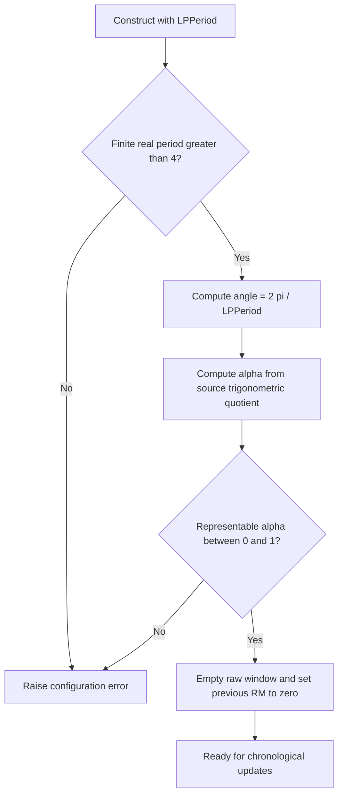
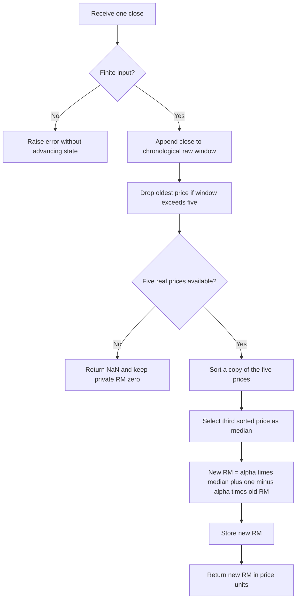

# Recursive Median Filter: research prototype master reference

This folder is the standalone conversion reference for John F. Ehlers' **Recursive Median Filter (RM)** from “Recursive Median Filters,” *Technical Analysis of STOCKS & COMMODITIES*, volume 36, March 2018, pages 8–11. The executable master is [recursive-median-filter.py](recursive-median-filter.py). A `RecursiveMedianFilter` instance accepts one chronological scalar price per `update(close)` and returns one scalar filtered price. The implementation uses only Python's standard library.

The indicator is an **exponential moving average of a trailing five-bar median**. The median removes isolated price spikes; the recursive average smooths the remaining changes. The input is Close in all reference fixtures. No High, Low, Open, timestamps, trading sessions, future observations, or oscillator normalization enters the calculation.

This master preserves the article's coefficient and RM recurrence, using full-precision $\pi$, an explicitly specified finite-record startup, and unrounded binary64 state. It does not introduce a conventional EMA-length formula or a different median window. The article leaves chart-platform history management implicit; therefore exact agreement requires the same five real starting inputs, zero initial RM, and coefficient arithmetic described below. Values are not claimed to reproduce every commercial platform's hidden prehistory or initialization.

**Reference data is complete:** the user confirmed all twelve `LPPeriod` cases in section 8 on 2026-10-20. All five language fixture files now contain the preserved original inputs and twelve verified expected arrays of 252 values each. Expected data uses 15 significant decimal digits, with four startup NaNs and 248 finite RM values per case.

## 1. Supplied sources and scope

The local source material is:

- [Article transcription](../../tasc/2018-03-recursive-median-filters/content.md), including the complete RM and Recursive Median Oscillator (RMO) EasyLanguage listings, both equations relating the EMA coefficient to its period, and the chart discussion.
- [March 2018 Traders' Tips](../../tasc/2018-03-recursive-median-filters/tips/tips.md), with TradeStation, eSignal, thinkorswim, NeuroShell, Wealth-Lab, NinjaTrader, AmiBroker, TradersStudio, Updata, Quantacula, and spreadsheet references.
- The separate [TradeStation listing](../../tasc/2018-03-recursive-median-filters/tips/RMF.els), [eSignal listing](../../tasc/2018-03-recursive-median-filters/tips/code/RecursiveMedianOscillator.efs), [NinjaTrader RM listing](../../tasc/2018-03-recursive-median-filters/tips/ninja-trader/RecursiveMedianFilter.cs), and other code files discussed in section 6.

There is no `mesa/` source or supplied book chapter for this indicator. This document reproduces the complete mathematical description available in the supplied article and relevant executable tips, including the companion oscillator to preserve the theoretical background. The Python implementation and expected fixtures in this folder implement the requested **filter**. RMO is documented as the article's downstream extension and has no output arrays in this folder.

## 2. Principles and physical analogies

### 2.1 Impulsive noise and rank selection

A moving average includes every observation in its sum. For example, the five values $[100,100,1000,100,100]$ average to $280$, even though four observations suggest a level of $100$. Their median is $100$: the isolated spike's *magnitude* has no influence on the selected middle rank.

Let $p_t$ be the latest price. Sort the trailing observations into order statistics:

$$
q_{t,(1)}\le q_{t,(2)}\le q_{t,(3)}\le q_{t,(4)}\le q_{t,(5)},
\qquad
\{q_{t,(i)}\}_{i=1}^{5}=\{p_t,p_{t-1},p_{t-2},p_{t-3},p_{t-4}\}.
$$

The median is:

$$
m_t=q_{t,(3)}=\operatorname{Median}(p_t,p_{t-1},p_{t-2},p_{t-3},p_{t-4}).
$$

One or two extreme observations cannot take over the middle rank if the other three still represent the background level. Three changed observations can move the median, so this filter also preserves sustained steps. At most two outliers can still change which uncontaminated observation is selected; “ignore spikes” describes rank robustness, not guaranteed invariance for every possible window.

The article's image-processing analogy is useful: local medians remove isolated bright or dark pixels while preserving an edge supported by enough neighboring pixels. In prices, an isolated extreme is analogous to a defective pixel, and a persistent price shift is analogous to an edge. A trailing five-sample median responds to an ideal persistent step on its **third changed observation**: two new values are outvoted by three old values; three new values become the majority.

The distinction matters in trading: the filter suppresses short bursts regardless of whether the burst is noise or meaningful information. The algorithm has no way to classify those events semantically.

### 2.2 Nonlinearity, Fourier analysis, and repeated filtering

Median selection is nonlinear: it does not generally obey superposition. For example, median($[0,0,1,1,1]$) and median($[0,1,0,1,1]$) are both $1$, but median of their elementwise sum $[0,1,1,2,2]$ is $1$, rather than $2$. Consequently there is no single linear convolution kernel or universal Fourier transfer function for the complete RM cascade.

The article says a median output is not differentiable and cannot be represented by a Taylor-series curve fit. More precisely, rank switching makes the median nonsmooth at ties or changes of ordering; within a region of fixed ordering, it simply selects one input coordinate. A smooth polynomial approximation does not reproduce the general median operation.

The article calls median filters “idempotent” and describes repeated filtering as rapidly converging to a core waveform apart from computational lag. General median filtering is **not necessarily unchanged after one pass**. Repeated applications may approach a median root under particular filter/boundary conditions, and a causal trailing implementation introduces additional displacement on each pass. For instance, the trailing median at the center of a sufficiently padded sequence $[0,0,0,0,0,1,0,1,0,0,1,1,1,1,1]$ changes on a second pass. This motivates the author's waveform discussion without adding a repeated-pass loop to the implementation.

Here “recursive” means feeding the **preceding EMA result** into the current EMA result. It does not mean recursively replacing observations inside the median window. Every median uses five *raw prices*, once per accepted bar.

### 2.3 Recursive smoothing as a reservoir

The EMA can be pictured as a reservoir whose current level moves partway toward the median input each bar. The coefficient $\alpha$ controls the fraction of the adjustment; $1-\alpha$ retains previous output. A short period produces a large adjustment; a long period retains more memory.

The mathematical recurrence is:

$$
r_t=\alpha m_t+(1-\alpha)r_{t-1}.
$$

On its conventional branch, $0<\alpha<1$, so the new RM lies between the current median and the preceding RM. The article initializes the stored RM at zero. On positive prices, this produces a visible initial ramp from zero, even when the median is already at the market price. Do not replace it with a first-price seed when converting this master.

## 3. Complete source mathematics and coefficient interpretation

### 3.1 Notation and units

| Symbol | Source identifier | Meaning |
|---|---|---|
| $p_t$ | `Price` | Raw scalar price at index $t$; the first supplied sample is $t=0$. |
| $m_t$ | `Median(Price,5)` | Third sorted value of the five latest raw observations. |
| $P$ | `LPPeriod` | Lowpass coefficient's critical-period control, in bars. |
| $\alpha$ | `alpha1` | EMA coefficient used by RM. |
| $r_t$ | `RM` | Recursive Median Filter value. |
| $H$ | `HPPeriod` | Companion oscillator's highpass period control. |
| $\beta$ | `alpha2` | Companion oscillator highpass coefficient. |
| $o_t$ | `RMO` | Recursive Median Oscillator value, outside this executable's output. |

EasyLanguage `X[1]` and `X[2]` mean the preceding one and two bars. EasyLanguage `Cosine` and `Sine` accept **degrees**. Python `math.cos` and `math.sin` accept **radians**. A “bar” is one accepted observation; periods do not refer to calendar days except when the caller supplies daily bars.

### 3.2 Article's complete RM formula

The source pseudocode is:

```text
Output = a * Median(Input, 5) + (1 - a) * Output[1];
```

The article's exact coefficient equation is:

$$
\alpha=
\frac{\cos_{\mathrm{degrees}}(360/P)+\sin_{\mathrm{degrees}}(360/P)-1}
     {\cos_{\mathrm{degrees}}(360/P)}.
$$

The easier-to-remember approximation printed immediately afterwards is:

$$
\alpha\approx\frac{5}{P}.
$$

The approximation is theoretical background only; it is **not used** by this master. At $P=12$, for example, the exact equation gives $\alpha\approx0.422649730810374$, while $5/12\approx0.416666666666667$.

The exact formula in radians, used by the implementation, is:

$$
\theta=\frac{2\pi}{P},
\qquad
\alpha=\frac{\cos\theta+\sin\theta-1}{\cos\theta},
\qquad
r_t=\alpha m_t+(1-\alpha)r_{t-1}.
$$

Compute it once, in this order:

```python
angle = 2.0 * math.pi / lp_period
cosine = math.cos(angle)
alpha = (cosine + math.sin(angle) - 1.0) / cosine
rm = alpha * median_price + (1.0 - alpha) * previous_rm
```

Use full binary64 precision in all intermediates and recursive state. Do not use a rounded $\pi$, rounded $2\pi$, `5 / lp_period`, `2 / (lp_period + 1)`, a rounded coefficient, compensated arithmetic, or a fused multiply-add to produce these reference values. Algebraically equivalent update forms can differ in their final floating-point bits.

### 3.3 Domain and equivalent identities

For interpretation, write the recursive pole as $q=1-\alpha$. On the conventional branch:

$$
q=\frac{1-\sin\theta}{\cos\theta}
  =\frac{\cos\theta}{1+\sin\theta},
\qquad
\alpha=1-\frac{\cos\theta}{1+\sin\theta}.
$$

With $P>4$, $0<\theta<\pi/2$ and $0<q<1$. The median and EMA weights are nonnegative and the recursive state is stable. Fractional $P$ is valid because it controls a coefficient rather than an array index.

At $P=4$, the printed quotient is $0/0$ in exact mathematics, with a removable limit $\alpha\to1$. Between some smaller periods the coefficient can exceed one, become negative, or lie on an aliased/unstable branch. Vendor interfaces permitting a period of one are not mathematical guarantees. This master accepts **finite real $P>4$**, and also checks that the literal binary64 calculation yields a representable $0<\alpha<1$. Extreme periods can fail this final check because subtracting one loses a very small numerator or a boundary rounds to one.

The identities above help explain the behavior but do not replace the printed arithmetic in the executable. No special `P=4` coefficient is silently supplied. Ordinary practical periods, including all confirmed cases from $4.5$ through $500$, are well inside the implemented numerical domain.

### 3.4 Correcting the source's lowpass/highpass wording

The article defines its “critical period” as passing shorter wavelengths and rejecting longer wavelengths. That describes a **highpass** response. RM's EMA instead preserves constants and smooths rapid changes, so the RM stage is **lowpass**. The five-bar median is nonlinear, making a single cutoff for the full cascade even less precise.

The precise linear EMA response, from median $m_t$ to RM $r_t$, is:

$$
G_{\mathrm{LP}}(z)=\frac{\alpha}{1-qz^{-1}},
\qquad
|G_{\mathrm{LP}}(e^{i\omega})|^2
=\frac{\alpha^2}{1+q^2-2q\cos\omega}.
$$

Its DC gain is $\alpha/(1-q)=1$. The published coefficient formula sets a related normalized **one-pole highpass** to $-3$ dB at $\omega=\theta$:

$$
G_{\mathrm{HP,1}}(z)=\frac{1+q}{2}\frac{1-z^{-1}}{1-qz^{-1}},
\qquad
|G_{\mathrm{HP,1}}(e^{i\theta})|^2=\frac12.
$$

The lowpass EMA's own $-3$ dB frequency, when it exists within the discrete Nyquist interval, satisfies:

$$
\cos\omega_{\mathrm{LP,3dB}}
=1-\frac{\alpha^2}{2q}.
$$

Thus `LPPeriod` is exactly the **source's coefficient control**, not universally an exact $-3$ dB cutoff of either the EMA or the nonlinear complete filter. The difference is small at longer periods; at very large $\alpha$, the EMA may never lose $3$ dB before Nyquist. This explanatory correction changes no executable formula.

### 3.5 Lag, memory, and startup

For a strictly monotone input, the trailing median selects $p_{t-2}$, so it contributes exactly two observations of delay. On a sinusoid or a waveform changing rank, that interpretation does not give a universal phase lag.

The linear EMA has impulse weights, measured from its first valid median:

$$
h_k=\alpha q^k,\qquad k\ge0.
$$

Expanding the zero-initialized recursion after $k$ valid medians gives:

$$
r_{4+k-1}=\alpha\sum_{j=0}^{k-1}q^j m_{4+k-1-j},\qquad k\ge1.
$$

For a constant median $m_t=c$:

$$
r_{4+k-1}=c(1-q^k),
\qquad
c-r_{4+k-1}=cq^k.
$$

The mean age of EMA weights, which describes low-frequency delay, is $q/\alpha$ bars. The memory half-life is:

$$
k_{1/2}=\frac{\ln(1/2)}{\ln q}.
$$

For a settled linear ramp, the median's two-bar delay and EMA mean age add to approximately $2+q/\alpha$ bars. This is an analytic special case, not a universal lag claim.

At the default $P=12$, $q\approx0.577350269189626$, EMA mean age is about $1.3660254$ bars and half-life about $1.2618595$ bars. Long-period fixtures deliberately retain a startup transient over much of the 252-sample record. Priming means *availability of the median*, not convergence to a steady state.

## 4. Companion Recursive Median Oscillator: full article mathematics

The article creates RMO by passing RM through a second-order highpass. This removes the constant level and attenuates very long cycles. It is not part of `RecursiveMedianFilter.update`, but the complete equations are retained here for agents without the source article.

The article's printed second coefficient is:

$$
\beta=
\frac{\cos_{\mathrm{degrees}}(0.707\cdot360/H)
      +\sin_{\mathrm{degrees}}(0.707\cdot360/H)-1}
     {\cos_{\mathrm{degrees}}(0.707\cdot360/H)}.
$$

The user-requested full-precision counterpart replaces the printed $0.707$ with $1/\sqrt2$:

$$
\phi=\frac{2\pi}{\sqrt2\,H},
\qquad
\beta=\frac{\cos\phi+\sin\phi-1}{\cos\phi}.
$$

No rounded $0.707$, $1.414$, or $3.14159$ would be used in a full-precision implementation of this companion. RM itself needs only $\pi$, not $\sqrt2$.

The complete oscillator recurrence from the article and TradeStation tip is:

$$
\begin{aligned}
o_t={}&\left(1-\frac\beta2\right)^2(r_t-2r_{t-1}+r_{t-2})\\
&+2(1-\beta)o_{t-1}-(1-\beta)^2o_{t-2}.
\end{aligned}
$$

For checking signs, AmiBroker's coefficient form is equivalent:

$$
\begin{aligned}
b_0&=(1-\beta/2)^2,&b_1&=-2b_0,&b_2&=b_0,\\
a_1&=2(1-\beta),&a_2&=-(1-\beta)^2,\\
o_t&=b_0r_t+b_1r_{t-1}+b_2r_{t-2}+a_1o_{t-1}+a_2o_{t-2}.
\end{aligned}
$$

The linear response from RM to RMO is:

$$
G_{\mathrm{HP,2}}(z)
=\frac{(1-\beta/2)^2(1-z^{-1})^2}
       {[1-(1-\beta)z^{-1}]^2}.
$$

The squared difference $(1-z^{-1})^2$ contributes two zeros at DC. It removes settled constants and linear ramps, while the repeated recursive pole controls memory. At low frequencies it supplies approximately $12$ dB/octave attenuation, sufficient to attenuate an ideal price pink-noise power spectrum proportional to $1/f$. The article describes market data as statistical fractal pink noise; this is its motivation for using a second-order rather than first-order highpass, not a universal statistical guarantee about every input series.

The article says the second-order nature reduces the critical-period scale to about $70\%$ of the EMA scale. The coefficient's $0.707\approx1/\sqrt2$ embodies this approximate correction. At long periods, each first-order highpass section must pass roughly $2^{-1/4}$ in amplitude for their cascade to pass $2^{-1/2}$; the continuous small-angle section-corner ratio is $\sqrt{\sqrt2-1}\approx0.643594$, so the printed $0.707$ should be understood as the author's practical setting rather than an exact cascade cutoff identity. The supplied recurrence remains the authority.

In the article's SPY chart for calendar 2017, RM smoothing uses `LPPeriod=16`, oscillator highpass uses `HPPeriod=40`, and comparison RSI uses length 14 with smoothing period 16. The RSI is displayed on a scale from $-1$ to $+1$ instead of 0 to 100. RMO itself is **not bounded to $[-1,1]$**, standardized, or divided by price; it retains price units. The article reports less lag and faster response to larger moves than its smoothed RSI example. This is a chart-specific observation, not a property guaranteed for all data or settings.

The source listing defaults are `LPPeriod=12`, `HPPeriod=30`, with private `RM=0` and `RMO=0`. A separate oscillator master would also need to specify whether it starts with zero RM lags or waits for three valid RM outputs: the tips differ on this point. This filter's startup does not imply an undocumented oscillator startup.

## 5. Configuration, API, and exact finite-record contract

| Setting | Python API | Default | Valid range or behavior |
|---|---|---:|---|
| Lowpass coefficient period | `lp_period` | 12.0 | Finite real $P>4$, with a computed binary64 $0<\alpha<1$; booleans rejected. |
| Median length | Constant `MEDIAN_LENGTH` | 5 | Fixed; not a configurable parameter. |
| Input | `update(close)` | — | One finite scalar price; NaN and either infinity raise `ValueError` without advancing state. |
| Output | Returned `float` | — | RM in price units; NaN at indices 0–3, finite from index 4 for the reference input. |
| Initial EMA state | Private `_rm` | 0.0 | Reset to source `RM(0)`; not seeded from first input or first median. |
| Availability | `is_primed` | False | True after accepting five prices; thereafter true until reset. |
| Startup length | `warmup_bars` | 4 | Number of initial unavailable public outputs, independent of period. |
| Reset | `reset()` | — | Empties raw window, resets private RM to zero, preserves configuration/coefficient. |

Configuration properties `lp_period` and `alpha` are read-only. Construct a new instance for a new period. Streaming state is per instance; no global input buffer is shared between indicators.

The exact chronology is:

| Input index | One-based observation | Calculation | Public result |
|---:|---:|---|---|
| 0–3 | 1–4 | Store raw inputs only; keep RM exactly zero. | NaN |
| 4 | 5 | Sort the first five real prices; $r_4=\alpha m_4+(1-\alpha)0$. | First available RM |
| 5 | 6 | Drop $p_0$; median of $p_1,\ldots,p_5$; use old $r_4$. | $r_5$ |
| Later | Later | Shift the fixed raw window and apply one recurrence. | Current RM |

With the fixture's first five closes, $m_4=94.375$. At `lp_period=12`, the first available result is approximately $39.8875683452291$. This small initial level is the intended consequence of zero RM initialization.

There is no fabricated zero-price prehistory, expanding median, first-price padding, extra `LPPeriod`-bar waiting period, or discarded valid RM transient. Public NaNs are never inserted into private RM. Rejected nonfinite inputs do not occupy an input index. `update` is for finalized observations; calling it twice for the same bar consumes two observations.

## 6. Source-code differences and compatibility decisions

| Source | Relevant behavior | Decision for this master |
|---|---|---|
| Article RM EasyLanguage | Five-bar median, exact trigonometric coefficient, `RM(0)`. The snippet refers to `Price` without declaring an input. | Authority for the executable filter; use Close supplied by the caller. |
| TradeStation `RMF.els` | Oscillator includes `Price(Close)`, `LPPeriod=12`, `HPPeriod=30`, and the same RM recurrence. | Confirms price selection and zero recursive variables; implicit platform history is replaced by the explicit five-real-input contract. |
| eSignal EFS | `MedPeriod` configurable with default 5; sorts raw prices; previous RM defaults to zero. Its outer study also waits for `HPPeriod+LPPeriod` history and RMO waits for two RM lags. | Confirms median rank and zero RM seed; its extra chart/oscillator gating and adjustable median are not applied to standalone RM. |
| NinjaTrader RM | Uses rounded `6.28319`; skips `CurrentBar<5` where `CurrentBar` is zero-based; uses `GetMedian(Input,5-1)`. Its `CurrentBar==0` first-price branch is unreachable after the guard. | Preserve article's five-sample median and full $2\pi$; first output after five observations rather than copying vendor bar gating. The external median-helper indexing is not reinterpreted as a four-price window. |
| AmiBroker AFL | Uses `PI=3.1415926`, `Median(Close,5)`, platform `AMA`, and `IIR` for RMO. | Preserve the mathematical RM recurrence and full $\pi$; platform `AMA` startup cannot define this reference's finite-record seed. |
| TradersStudio `RMF.trs` | RM sorts five raw prices and uses zero RM. Its printed RMO coefficient places `-1` inside the sine argument. | RM agrees; oscillator typo is documented and not propagated. |
| Updata `RMF.upd` | Uses `0.5*(PHIGH(Close,5)+PLOW(Close,5))` and hardcodes 12 in coefficient calculations despite exposing a period parameter. | If `PHIGH/PLOW` are window extrema, this expression is a midrange, not a median. Follow the article's order statistic and actual configurable `LPPeriod`. |
| Wealth-Lab `RMF.cs` | Strategy wrapper calls `RMF.Series` and `RMO.Series` from an external library; chart uses 16/40/5. | Source for chart parameters only; unavailable library internals cannot establish a different startup. |
| thinkorswim, NeuroShell, Quantacula, spreadsheet | Some supplied text links to platform studies/libraries or downloadable material. | Contextual references; the article and explicit recurrence govern this scalar master. |

The full-precision policy means a rounded-constant vendor implementation can differ numerically even after startup. The standalone RM equation contains no printed rounded $\sqrt2$ constant; the precision substitution relevant here is full $\pi$ in degree-to-radian conversion. Do not change the algorithm in order to force agreement with an erroneous median substitution or undocumented vendor initialization.

## 7. Streaming algorithm and flowcharts

The portable state is five chronological raw prices plus one previous RM. Python uses a short list and sorts a copy. A ring buffer or fixed-array shift is equally valid when it selects the same five prices and the same third rank. Sorting five finite values needs no specialized library, heap, interpolation, or statistical package.





The conceptual article extension is:


No output rounding occurs inside these flows. `.15g` formatting applies only when serializing expected values to text.

## 8. Confirmed reference cases and five-language fixture contract

There is one configurable filter parameter. The twelve confirmed cases cover the article default, chart setting, short and long memory, fractional periods, and a period longer than the record. They stay below the maximum of 64 combinations. The median length is five in every case.

| Python array | LPPeriod | What it tests |
|---|---:|---|
| `EXPECTED_LP4_5` | 4.5 | Near the positive-weight boundary and a fractional period. |
| `EXPECTED_LP5` | 5 | Shortest conventional integer period; median-dominated response. |
| `EXPECTED_LP6` | 6 | Short-period smoothing with modest recursive memory. |
| `EXPECTED_LP8` | 8 | Fast smoothing between the shortest periods and the default. |
| `EXPECTED_LP12` | 12 | Article and TradeStation lowpass default. |
| `EXPECTED_LP16` | 16 | Article chart's smoothing period. |
| `EXPECTED_LP24` | 24 | Twice the default period and increased recursive lag. |
| `EXPECTED_LP30` | 30 | Intermediate long-period smoothing. |
| `EXPECTED_LP40` | 40 | Two-month smoothing scale on daily trading bars. |
| `EXPECTED_LP100` | 100 | Long recursive memory and visible startup transient. |
| `EXPECTED_LP252` | 252 | Period equal to the full input-record length. |
| `EXPECTED_LP500` | 500 | Period longer than the record; availability versus settling. |

`LP` abbreviates `lp_period`; decimal points in names become underscores. For example `4.5` becomes `LP4_5`, and integral float `12.0` becomes `LP12`.

Every confirmed case has one generated array of **252** RM outputs: four NaNs followed by **248** finite results. Generation uses all 252 original `INPUT_CLOSE` values in their original order. All five copied files also retain their original High, Low, and Open inputs for downstream conversion consistency, although RM uses Close only.

The generator first appends Python arrays, reopens the actual Python file, verifies the names, lengths, NaN prefix, finiteness, and 15-significant-digit values, and uses those *verified written values* for the four translations. Every array has two preceding comments: the exact “What it tests” text above, then `lp_period=<value>, median_length=5 (fixed)`.

| File | Example declaration for P=4.5 | NaN spelling |
|---|---|---|
| `test_testdata.py` | `EXPECTED_LP4_5 = [...]` | `NaN`, with `NaN = math.nan` |
| `testdata_test.go` | `var expectedLP4_5 = []float64{...}` | `math.NaN()`, with `import "math"` |
| `testdata.ts` | `export const expectedLP4_5: number[] = [...]` | `NaN` |
| `testdata.rs` | `pub fn expected_lp4_5() -> Vec<f64>` | `f64::NAN` |
| `testdata.zig` | `pub fn expectedLP4_5() [252]f64` with `return .{...};` | `nan`, from `math.nan(f64)` |

Go package is `recursivemedianfilter`, the folder's words joined in lowercase. Rust expected helpers are appended at file scope alongside the preserved `#[cfg(test)] pub mod testdata` input module; input remains accessible as `testdata::test_input()`. Zig retains `const math = @import("std").math;` and `const nan = math.nan(f64);` at the top. TypeScript uses the existing valid `export const testInput: number[]` input declaration. The user examples `f64:NAN` and `export const test_input() number[]` are rendered with the valid language syntax above.

Floating-point values are formatted with **15 significant decimal digits**, not 15 decimal places. The entire stream is calculated at full precision before any formatting, and rounded values are never fed back into private state. Converted implementations should use a finite-value tolerance, for example `rel_tol=5e-14, abs_tol=5e-14`, and compare NaNs by `isnan`, not equality. Different math-library implementations can differ in a few low-order bits.

Repeated generation replaces only the marked `BEGIN/END GENERATED RECURSIVE MEDIAN FILTER EXPECTED DATA` section, preserving inputs and avoiding duplicate arrays. Ordinary execution demonstrates the default without touching fixtures:

```bash
python3 recursive-median-filter.py
```

`REFERENCE_CASES_CONFIRMED` records the user's confirmation as true. Regenerate all five languages with:

```bash
python3 recursive-median-filter.py --generate-reference-data
```

## 9. Validation and conversion review

The focused standard-library suite is [test_recursive_median_filter.py](test_recursive_median_filter.py). All twelve tests pass. It compares all confirmed cases and the generated Python arrays against an independent literal translation of the article's five-price median and EMA recurrence. It also checks the zero seed against the constant-input analytic formula, spike suppression, step delay, rolling chronological window, finite-input rejection, reset behavior, period bounds, and equality of the embedded fixture with the original copied data.

Completed cross-language verification checked all twelve declarations in each file, 252 values per series, exact matching comments, four startup NaNs, exact equality of the remaining decimal values with Python, and preservation of every original input value. Go, Rust, and Zig compiler harnesses instantiated and checked every expected series; TypeScript executed successfully with Node's native TypeScript support. These are data-format and conversion checks, not claims of running proprietary trading platforms.

Common conversion mistakes are selecting a five-bar *midrange*, using a four-value window, sorting the live chronological buffer, treating `LPPeriod` as median length, seeding the EMA with price, advancing recursion before the first full window, using $2/(P+1)$ instead of the published coefficient, converting radians twice, carrying public startup NaNs into private state, or rounding each recursive update.

## 10. References and BibTeX

1. Ehlers, John F. “Recursive Median Filters.” *Technical Analysis of STOCKS & COMMODITIES*, 36(3), March 2018, pp. 8–11. [Article archive](https://technical.traders.com/archive/article.asp?file=%5CV36%5CC03%5C607EHLE.pdf). Primary theory and executable RM/RMO equations.
2. *Technical Analysis of STOCKS & COMMODITIES*. “Traders' Tips: March 2018.” [Online collection](https://www.traders.com/Documentation/FEEDbk_docs/2018/03/TradersTips.html). Includes Doug McCrary's TradeStation tip, Eric Lippert's eSignal EFS, the NinjaTrader listings, Tomasz Janeczko's AmiBroker tip, Richard Denning's TradersStudio code, and other vendor examples. Individual local listings and differences are linked/discussed above; they share this publication source.
3. Ehlers, John F. “The Reverse EMA Indicator.” *Technical Analysis of STOCKS & COMMODITIES*, volume 35, September 2017. Listed as further reading by the supplied article; no chapter or full text supplied here.
4. Ehlers, John F. “The Super Passband Filter.” *Technical Analysis of STOCKS & COMMODITIES*, volume 34, July 2016. Article further reading, not required by RM.
5. Ehlers, John F. “Whiter Is Brighter.” *Technical Analysis of STOCKS & COMMODITIES*, volume 33, January 2015. Article further reading for spectral-noise context.
6. Ehlers, John F. “Fourier Transform For Traders.” *Technical Analysis of STOCKS & COMMODITIES*, volume 25, January 2007. Article further reading for linear frequency-domain context.

The additional EMA identities, cutoff clarification, stability domain, and startup analysis in this document are direct derivations of the reproduced equations. They require no inaccessible additional source. The following BibTeX includes all supplied article references and the Traders' Tips collection; incomplete page metadata for further reading is intentionally not invented.

```bibtex
@article{ehlers_recursive_median_2018,
  author = {Ehlers, John F.},
  title = {Recursive Median Filters},
  journal = {Technical Analysis of STOCKS \& COMMODITIES},
  volume = {36},
  number = {3},
  pages = {8--11},
  year = {2018},
  month = mar,
  url = {https://technical.traders.com/archive/article.asp?file=%5CV36%5CC03%5C607EHLE.pdf}
}

@misc{traders_tips_recursive_median_2018_03,
  author = {{Technical Analysis of STOCKS \& COMMODITIES}},
  title = {Traders' Tips: March 2018 --- Recursive Median Filters},
  year = {2018},
  month = mar,
  howpublished = {Online vendor implementation collection},
  url = {https://www.traders.com/Documentation/FEEDbk_docs/2018/03/TradersTips.html}
}

@article{ehlers_reverse_ema_2017,
  author = {Ehlers, John F.},
  title = {The Reverse EMA Indicator},
  journal = {Technical Analysis of STOCKS \& COMMODITIES},
  volume = {35},
  year = {2017},
  month = sep
}

@article{ehlers_super_passband_2016,
  author = {Ehlers, John F.},
  title = {The Super Passband Filter},
  journal = {Technical Analysis of STOCKS \& COMMODITIES},
  volume = {34},
  year = {2016},
  month = jul
}

@article{ehlers_whiter_is_brighter_2015,
  author = {Ehlers, John F.},
  title = {Whiter Is Brighter},
  journal = {Technical Analysis of STOCKS \& COMMODITIES},
  volume = {33},
  year = {2015},
  month = jan
}

@article{ehlers_fourier_transform_2007,
  author = {Ehlers, John F.},
  title = {Fourier Transform For Traders},
  journal = {Technical Analysis of STOCKS \& COMMODITIES},
  volume = {25},
  year = {2007},
  month = jan
}
```
