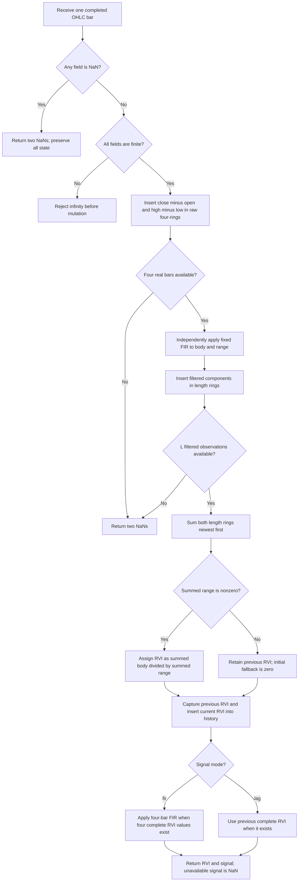

# Relative Vigor Index

This folder contains a self-contained streaming research prototype master of
John F. Ehlers' **Relative Vigor Index (RVI)**. The default follows the January
2002 *Technical Analysis of STOCKS & COMMODITIES* article: `length=10`, with
the four-bar symmetrical FIR signal. The book's Chapter 6 uses the same RVI
calculation but a one-bar delayed trigger, available as `trigger_mode='lag'`.
All mathematical background, source differences, numerical conventions and
startup rules needed for conversion are included here.

The user confirmed all 28 parameter combinations below on 2026-10-26.
All five fixture files contain the copied input data and 56 generated
252-entry expected arrays, covering both outputs for every combination.

## Input: a completed OHLC bar

RVI requires **open, high, low and close**, rather than just a closing-price
series. Its numerator is the candle body, `close - open`, and its denominator
is the same bar's range, `high - low`. A close-only series cannot determine
either quantity. This master uses all 252 requested `INPUT_CLOSE` values with
their matching `INPUT_OPEN`, `INPUT_HIGH` and `INPUT_LOW` arrays already present
in the shared fixture. No OHLC fields are synthesized from adjacent closes.

The example embeds the 252 close prices in `__main__` and reads the other
three fields from the copied local `test_testdata.py`. Each update accepts
one `PriceBar(open, high, low, close)` and returns a named tuple with `value`
and `signal`. There is no external framework or third-party dependency.

## Vigor, buying power and the historical oscillator

The physical analogy is directional vigor or energy: in an up market prices
tend to finish a bar above its open; in a down market they tend to finish
below it. The body measures the net movement during that observation. Dividing
by the full high-to-low excursion measures that movement relative to the
distance the price could travel within the bar. This is a dimensionless ratio,
not squared physical energy, a volume statistic or a close-to-close return.
It does not include overnight gaps in the denominator as true range would.

The basic equation in the article and book is

$$\mathrm{RVI}_{\mathrm{raw}}=
\frac{\mathrm{Close}-\mathrm{Open}}{\mathrm{High}-\mathrm{Low}}.\tag{6.1}$$

The book and article attribute an accumulation/distribution oscillator to
Jim Waters and Larry Williams in 1972. Here A/D means accumulation/distribution,
not advance/decline. They report these definitions of buying power and selling
power, preserved exactly as given:

$$\mathrm{BP}=\mathrm{High}-\mathrm{Open},$$

$$\mathrm{SP}=\mathrm{Close}-\mathrm{Low}.$$

The two quantities were combined into the Daily Raw Figure:

$$\mathrm{DRF}=
\frac{\mathrm{BP}+\mathrm{SP}}
     {2(\mathrm{High}-\mathrm{Low})}.\tag{6.2}$$

When the open equals the low and the close equals the high, DRF reaches 1.
When the open equals the high and the close equals the low, it reaches 0.
The complete expansion provided by both sources is

$$\begin{aligned}
\mathrm{DRF}
&=\frac12\left[
  \frac{\mathrm{High}-\mathrm{Open}+\mathrm{Close}-\mathrm{Low}}
       {\mathrm{High}-\mathrm{Low}}\right]\\[1ex]
&=\frac12\left[
  \frac{\mathrm{High}-\mathrm{Low}+\mathrm{Close}-\mathrm{Open}}
       {\mathrm{High}-\mathrm{Low}}\right]\\[1ex]
&=\frac12\left[1+
  \frac{\mathrm{Close}-\mathrm{Open}}{\mathrm{High}-\mathrm{Low}}\right]
=\frac12(1+\mathrm{RVI}_{\mathrm{raw}}).
\end{aligned}\tag{6.3}$$

Thus raw RVI and DRF differ by an additive and multiplicative constant. The
raw daily quantities can change abruptly and need smoothing. Ehlers smooths
the two components **independently**, before dividing. This is generally not
equivalent to smoothing the already calculated raw daily ratios. Equations
(6.1)–(6.3) use the book's numbering; the article contains the same expressions
without these tags. The raw ratio is background, not a separately returned
output or an intermediate division in the implementation.

## Phase, summation and modern filter theory

The sources treat RVI as an oscillator for the cyclical component of prices.
A sinusoid changes most rapidly at the midpoint of its rising or falling
segment. Open-to-close differences resemble a derivative, which leads a
sinusoidal price component by approximately a quarter cycle. Integrating, or
trailing-summing, over half a cycle supplies approximately a quarter-cycle
delay, helping align the oscillator with the cyclic price component.

For clarity, the calculus relationship is

$$p(t)=A\sin(\omega t),\qquad
\frac{dp}{dt}=A\omega\cos(\omega t)
=A\omega\sin(\omega t+\pi/2).$$

The book describes the derivative as a “negative cosine”; the mathematical
derivative of a positive sine is **positive** cosine. Its intended conclusion
is the quarter-cycle phase advance. For a trailing half-period integral,
where $T=2\pi/\omega$,

$$\int_{t-T/2}^{t} A\sin(\omega s)\,ds
=-\frac{2A}{\omega}\cos(\omega t)
=\frac{2A}{\omega}\sin(\omega t-\pi/2).$$

This supplements the sources' prose with explicit calculus. The derivatives
and integrals motivate the design; the code uses discrete OHLC differences
and finite sums, not continuous-time operations. An intrabar body is also
different from an adjacent-close derivative when there are gaps.

The article suggests a nominal summation length of 10, about half a cycle of
interest, when a Hilbert discriminator or MESA cycle measurement is unavailable.
The book's prose instead suggests 8. A measured dominant-cycle period $P$
would motivate $L\approx P/2$, but this indicator does not itself estimate $P$
or change its period automatically. The book notes that choosing a window
shorter than half a cycle may produce a leading response.

### Why odd and even summation lengths matter

The article defines a normalized frequency $\nu$ whose value 1 is the Nyquist
frequency, one-half the sampling frequency. A period of $P$ bars corresponds to

$$\nu=\frac{2}{P},\qquad P=\frac{2}{\nu},\qquad\omega=\pi\nu.$$

At least two observations are needed per cycle. A finite sum of length $L$
has the frequency response

$$B_L(e^{j\omega})=\sum_{k=0}^{L-1}e^{-j\omega k}
=e^{-j\omega(L-1)/2}
  \frac{\sin(L\omega/2)}{\sin(\omega/2)}.$$

At zero frequency the limit is $L$. A normalized average divides this
response by $L$. Its magnitude in decibels is

$$20\log_{10}\left|B_L(e^{j\omega})/L\right|.$$

These expressions make the frequency plots in the article explicit. Zeros
occur at $\nu=2k/L$ in the nonzero Nyquist range. For $L=10$ the notches occur
at normalized frequencies 0.2, 0.4, 0.6, 0.8 and 1.0: the two-bar component is
eliminated. For $L=9$ the notches are $2/9$, $4/9$, $6/9$ and $8/9$, corresponding
to periods 9, 4.5, 3 and 2.25 bars. In particular, $2/3\approx0.67$ is the
three-bar notch, and $2/2.25\approx0.889$ is another notch described in the
article. At Nyquist an odd-length average has magnitude $1/L$, so length 9
attenuates the two-bar component by about $-19.08$ dB, rather than eliminating
it. An even-length sum does eliminate it.

When cycle measurements choose the period, its parity is not under the
designer's control. Ehlers therefore adds a fixed symmetrical FIR filter
that rejects both two-bar and three-bar components regardless of $L$.

### The four-bar symmetrical FIR

The coefficient vector printed in the article is

$$\mathbf{c}=\frac{[1\quad2\quad2\quad1]}{6}.$$

The complete calculation, also referenced by the book to its Chapter 4
filter, is

$$F[x]_t=\frac{x_t+2x_{t-1}+2x_{t-2}+x_{t-3}}{6}.$$

The divisor is the sum of the coefficients, ensuring unity gain at zero
frequency. Symmetry about the midpoint makes it a linear-phase FIR with
1.5 bars of delay away from its zeros. Its transfer function factors as

$$H(z)=\frac{1+2z^{-1}+2z^{-2}+z^{-3}}{6}
=\frac{(1+z^{-1})(1+z^{-1}+z^{-2})}{6}.$$

The first factor vanishes at the two-bar frequency $\omega=\pi$. The second
vanishes at the three-bar frequency $\omega=2\pi/3$. Equivalently,

$$H(e^{j\omega})=
e^{-3j\omega/2}\frac{\cos(\omega/2)(1+2\cos\omega)}{3}.$$

No recursive filter, Super Smoother, Hilbert transform or coefficient involving
$\sqrt2$ or $\pi$ is computed by the implementation. Constants 1, 2 and 6 are
exact integers; division uses binary64 precision. The mathematical frequency
discussion uses exact $\pi$, not a truncated decimal constant.

## Complete calculation equations

For chronological OHLC observations, define

$$u_t=C_t-O_t,\qquad v_t=H_t-L_t,$$

where $L_t$ denotes the **low price**, while the un-subscripted $L$ denotes
the configured summation length. Independently filter the two sequences:

$$a_t=\frac{u_t+2u_{t-1}+2u_{t-2}+u_{t-3}}{6},$$

$$b_t=\frac{v_t+2v_{t-1}+2v_{t-2}+v_{t-3}}{6}.$$

Independently sum exactly $L$ filtered observations:

$$N_t=\sum_{i=0}^{L-1}a_{t-i},\qquad
D_t=\sum_{i=0}^{L-1}b_{t-i}.$$

Both the article and book EasyLanguage assign the main value conditionally:

$$R_t=\begin{cases}
N_t/D_t,&D_t\ne0,\\
R_{t-1},&D_t=0,
\end{cases}\qquad R_{\mathrm{initial}}=0.$$

The **article signal** is another application of the same four-bar FIR:

$$S_t^{\mathrm{fir}}=
\frac{R_t+2R_{t-1}+2R_{t-2}+R_{t-3}}{6}.$$

The **book trigger** is instead

$$S_t^{\mathrm{lag}}=R_{t-1}.$$

It is not the article's signal with a different length, and the master does
not treat either trigger as an adjustable generic moving average. The two
mode names select precisely these published formulas.

The source implementation sums each component before dividing. Although the
common $1/6$ normalization could be canceled algebraically, the master retains
it before the sums, preserving the source's operation order and rounding.
Similarly, replacing sums by means cancels algebraically in the ratio but
introduces another floating-point operation. It is unnecessary for conversion.

The book says that because both components have the same filter lag, taking
their ratio removes that lag. Filtering both sequences identically aligns
their histories, but division does not generally undo a shared time delay.
The nonlinear ratio need not have one fixed group delay. The phase alignment
argument is a design heuristic for suitable cyclical prices, not a guarantee
of zero lag or exact timing for arbitrary inputs. The linear input stages
alone have delay $1.5+(L-1)/2=(L+2)/2$ bars. The article signal adds 1.5 bars
relative to RVI; the book trigger adds one bar.

### Interpretation and useful invariants

Positive RVI favors closes above opens; negative RVI favors closes below
opens. The signal can supply crossover events. This master returns the two
lines, rather than buy/sell orders, thresholds, a histogram, or a backtest.
The Investor/RT Tips optionally show a histogram $R_t-S_t$, which can be
derived by a caller when both fields are available.

For consistent OHLC bars with $\mathrm{Low}\le\mathrm{Open},\mathrm{Close}
\le\mathrm{High}$, $|u_t|\le v_t$. All filter and summation weights are
nonnegative, so a nonzero denominator gives $|R_t|\le1$. The article signal
is also a convex weighted average of such values, and the book signal copies
a previous one. A flat all-zero-range window retains the previous RVI as
specified above; it is not marked unprimed. The initialization fallback is 0.

Applying the same positive price scale and translation to all OHLC fields
leaves RVI invariant: both body and range scale by the same factor, while a
translation cancels in their differences. Scaling each bar separately need
not preserve the result because it changes the relative weights across bars.
Averaging raw daily body/range ratios weights bars differently and is not
the published calculation.

## Source listings and differences

The essential article listing is reproduced here for direct porting:

```text
Inputs: Length(10);
Vars: Num(0), Denom(0), count(0), RVI(0), RVISig(0);
Value1 = ((Close-Open) + 2*(Close[1]-Open[1])
          + 2*(Close[2]-Open[2]) + (Close[3]-Open[3]))/6;
Value2 = ((High-Low) + 2*(High[1]-Low[1])
          + 2*(High[2]-Low[2]) + (High[3]-Low[3]))/6;
Num = 0;
Denom = 0;
For count = 0 to Length - 1 begin
    Num = Num + Value1[count];
    Denom = Denom + Value2[count];
End;
If Denom <> 0 then RVI = Num / Denom;
RVISig = (RVI + 2*RVI[1] + 2*RVI[2] + RVI[3])/6;
Plot1(RVI, "RVI");
Plot2(RVISig, "Sig");
```

The book Figure 6.2 changes the signal to `Trigger = RVI[1]`, preserving the
rest of the calculation and `Inputs: Length(10)`. The book's prose and Figure
6.3 EFS instead suggest/default to length 8. Neither default is silently
substituted in the master: its default is the article's 10, and the reference
matrix includes 8 and 10 in both trigger modes.

### Trader's Tips equivalence and limitations

The January 2002 Tips contain a genuine RVI implementation, including the
separate TradeStation `RVI.els` and Wealth-Lab `RVI.pas` files.

TradeStation replaces the hardcoded FIR with `TriAverage_gen(Price, 4)` and
the sums with `Summation`. Its generalized triangular average is defined by

$$L_1=\left\lfloor\frac{L_f+1}{2}\right\rfloor,\qquad
L_2=\left\lceil\frac{L_f+1}{2}\right\rceil,$$

$$\mathrm{TriAverage}_{L_f}[x]
=\mathrm{SMA}_{L_2}\!\left[\mathrm{SMA}_{L_1}[x]\right].$$

For the fixed FIR length $L_f=4$, $L_1=2$, $L_2=3$, and convolution gives

$$\frac{[1,1]}2*\frac{[1,1,1]}3=\frac{[1,2,2,1]}6.$$

This is mathematically the article's FIR, subject to rounding and the Tips'
stated minor initialization differences. The TradeStation condition is
`if Den > 0`, whereas the article and book EasyLanguage use `Denom <> 0`.
For ordinary valid OHLC bars the denominator is nonnegative, and the
conditions agree. A malformed negative-range input distinguishes them. The
master follows the article's exact nonzero test and does not add an epsilon.

NeoTicker, SmarTrader and Wave Wi$e explicitly reproduce the article's
component filters and four-bar signal. Wave Wi$e chooses length 5 in its
example. Wealth-Lab calls `RVISeries(10)` and applies `FIRSeries(...,'1,2,2,1')`;
the chart label says `RVI(20)` despite the code using 10. Its breakeven stop,
thresholds and trading loop are strategy examples, not indicator parameters.
Investor/RT describes a built-in RVI and optional difference histogram, but
does not provide an additional numeric recurrence in the locally copied page.

MetaStock offers an input length range 2–20, default 10, and substitutes
0.0001 when its summed range is zero. This is a source-specific zero-range
fallback, not the article's retain-previous rule. Its four-bar filters and
signal otherwise match the article. The master permits length 1 and lengths
above 20 because those are valid for the underlying finite-window algorithm;
the MetaStock dialog range is not a mathematical restriction.

### Book EFS initialization and zero-range behavior

The book Figure 6.3 EFS, credited to Chris D. Kryza on June 19, 2003, keeps
70-slot arrays of components and RVI, initialized to zeros. It shifts them
on `BARSTATE_NEWBAR`, skips `BARSTATE_ALLBARS`, computes the four-bar
components from OHLC history and sums them. Its returned lines are
`[aRVIArray[0], aRVIArray[1]]`. The zero-filled component history can produce
outputs before a complete window of real observations exists.

On each new bar the EFS unshifts zero into `aRVIArray[0]` and assigns it only
if the denominator is nonzero. Thus a new zero-denominator bar returns 0
instead of holding the previous value as the book's EasyLanguage does.
The master uses EasyLanguage's conditional state retention, with absent
history masked by NaN. The EFS's 70-slot storage and intrabar callbacks are
platform details, not parameters or inherent limits of this master.

| Detail | Article | TradeStation Tips | Book EasyLanguage | Book EFS | Master |
| --- | --- | --- | --- | --- | --- |
| Length default | 10 | 10 | 10 | 8 | 10; both covered in fixtures |
| Main components | Four-bar FIR body/range | Double SMA, equivalent FIR | Same as article | Same as article | Explicit article FIR |
| Signal | Four-bar FIR of RVI | Same FIR through double SMA | Previous RVI | Previous RVI | `fir` or `lag` |
| Ratio guard | $D\ne0$ | $D>0$ | $D\ne0$ | $D\ne0$ | $D\ne0$ |
| Zero denominator | Hold previous RVI | Hold previous RVI | Hold previous RVI | Newly inserted zero | Hold previous RVI |
| Incomplete history | Chart host controls | Host; minor differences noted | Chart host controls | Zero-filled stored components | NaN until each output is complete |

## Configuration, startup and numerical contract

| Parameter | API | Default | Valid values | Meaning |
| --- | --- | --- | --- | --- |
| Summation length | `length` / `L` | 10 | Integer $L\ge1$; bool and fractions rejected | Count of filtered body/range observations |
| Published signal | `trigger_mode` / `M` | `'fir'` / 0 | `'fir'` / 0 or `'lag'` / 1 | Article FIR or book one-bar delay |
| Input value | `PriceBar(open, high, low, close)` | Caller supplied | Four finite reals, or a missing bar indicated by any NaN | One completed OHLC observation |

The four-bar FIR coefficients are fixed and are not tunable parameters.
There is no automatic dominant-cycle measurement, price-component selector,
threshold, scaling factor or configurable epsilon. Storage is $O(L)$ and each
accepted bar costs $O(L)$ once the main sum is full. Length has no mathematical
upper bound other than available storage and representable indexing.

The API accepts finite fields without enforcing market-bar geometry. This
preserves the source formula for arbitrary finite numerical inputs, including
negative prices. The positive-range interpretation and bounds require
consistent OHLC bars. A whole bar is skipped if any field is NaN, with both
outputs returning NaN and no stage or counter advancing. If all fields are
non-NaN but any is infinite, `ValueError` occurs before mutation. Delay and
warmup count accepted observations, rather than calls containing missing data.

`reset()` clears all rings and counters and restores persistent RVI to 0.
Configuration is read-only; construct a new indicator to change it.
`is_primed` means the RVI window is full; `is_signal_primed` means the selected
signal has the necessary fully calculated RVI values.

With the first accepted bar numbered 1:

| Output/stage | First available observation | Initial NaN entries |
| --- | --- | --- |
| Body/range four-bar FIR | 4 | 3 |
| Main RVI | $L+3$ | $L+2$ |
| Article FIR signal | $L+6$ | $L+5$ |
| Book delayed signal | $L+4$ | $L+3$ |

The $L$ filtered components span exactly $L+3$ raw bars. Even length 1 needs
four raw bars. For a length-10 article reference, RVI first appears on bar 13
and its signal on bar 16. In book mode the signal first appears on bar 14.
RVI is returned as soon as its own window is full, while signal remains NaN
until its separate requirements are satisfied. A computed zero or a held RVI
value is valid history, not an unavailable sample.

The source listings rely on platform-managed chart history and do not define
a portable priming API. Masking absent history with NaN is the explicit master
convention requested for these reference files; source arithmetic is preserved
where all observations used by the selected output are available.

## Algorithmic flow and state

Maintain two four-slot raw rings for bodies/ranges, two $L$-slot rings for
their filtered values, and a four-slot RVI history ring. Each ring has its
next insertion index and a count capped at its capacity. Persistent `last_value`
starts at zero and changes only when the complete summed range is nonzero.



The diagram groups previous-value capture with history insertion; the code
captures the old value before assigning the new one. In a complete ring the
newest element is `(next - 1) mod capacity`. For languages with signed
remainder rules, use a nonnegative equivalent such as
`(next + capacity - 1 - lag) % capacity`. Both filtered sums traverse lag
0 through $L-1$, newest first, as the published loop does.

Use ordinary binary64 operations, the printed left-to-right FIR expression,
and sequential summation. Avoid rolling totals, compensated summation,
reassociation or fused multiply-add when reproducing the master's last bits.
Removing the common normalization, moving the ratio before smoothing, or
using an ordinary four-bar average changes numerical rounding or the
indicator itself. Input magnitudes must allow the differences and finite
sums to be represented; the supplied market prices satisfy this easily.

## Confirmed reference parameter matrix

The confirmed matrix combines **14 lengths** with **both signal modes**: 28 parameter
combinations, yielding two 252-entry arrays each, or **56 arrays per language**.
It covers article/Tips length 10, book length 8, the nine-bar frequency example,
short odd/even windows, a long window and each finite-record startup boundary.

Each expected array's first comment is exactly its **What it tests** entry.
Its second comment gives `length`, `trigger_mode` and the output field. The
main RVI arrays are deliberately repeated across modes to make each reference
combination self-contained and to verify that signal selection does not alter
the main output.

| Length | Trigger mode | What it tests |
| --- | --- | --- |
| 1 | fir | Article FIR signal. Minimum summation window; the four-bar input FIR remains active. |
| 1 | lag | Book delayed signal. Minimum summation window; the four-bar input FIR remains active. |
| 2 | fir | Article FIR signal. Shortest even summation window and early startup. |
| 2 | lag | Book delayed signal. Shortest even summation window and early startup. |
| 3 | fir | Article FIR signal. Shortest nontrivial odd summation window. |
| 3 | lag | Book delayed signal. Shortest nontrivial odd summation window. |
| 5 | fir | Article FIR signal. Short period used in the Wave Wise example. |
| 5 | lag | Book delayed signal. Short period used in the Wave Wise example. |
| 8 | fir | Article FIR signal. Default suggested by the book prose and EFS. |
| 8 | lag | Book delayed signal. Default suggested by the book prose and EFS. |
| 9 | fir | Article FIR signal. Odd period discussed in the article frequency-response comparison. |
| 9 | lag | Book delayed signal. Odd period discussed in the article frequency-response comparison. |
| 10 | fir | Article FIR signal. Default in the article, TradeStation Tips and book EasyLanguage. |
| 10 | lag | Book delayed signal. Default in the article, TradeStation Tips and book EasyLanguage. |
| 14 | fir | Article FIR signal. Intermediate even window and moderate smoothing. |
| 14 | lag | Book delayed signal. Intermediate even window and moderate smoothing. |
| 20 | fir | Article FIR signal. Longer smoothing; upper length offered by the MetaStock example. |
| 20 | lag | Book delayed signal. Longer smoothing; upper length offered by the MetaStock example. |
| 64 | fir | Article FIR signal. Long window over the shared OHLC record. |
| 64 | lag | Book delayed signal. Long window over the shared OHLC record. |
| 246 | fir | Article FIR signal. Article FIR signal first becomes available on the final input bar. |
| 246 | lag | Book delayed signal. Article FIR signal first becomes available on the final input bar. |
| 248 | fir | Article FIR signal. Book delayed signal first becomes available on the final input bar. |
| 248 | lag | Book delayed signal. Book delayed signal first becomes available on the final input bar. |
| 249 | fir | Article FIR signal. Only one RVI value is available and neither signal is primed. |
| 249 | lag | Book delayed signal. Only one RVI value is available and neither signal is primed. |
| 252 | fir | Article FIR signal. Entire record remains unprimed because three extra raw bars are needed. |
| 252 | lag | Book delayed signal. Entire record remains unprimed because three extra raw bars are needed. |

The user confirmed this full matrix before expected output generation.
`REFERENCE_CASES_CONFIRMED = True` records that confirmation for regeneration.

### Fixture names, precision and regeneration

`L` denotes the length; `M0` means article FIR signal and `M1` means book delayed
signal. `RVI` and `SIG` identify the output, rather than extra parameters.
For example, length 10 in article mode uses these names:

| Language | Main value | Signal |
| --- | --- | --- |
| Python | `EXPECTED_L10_M0_RVI` | `EXPECTED_L10_M0_SIG` |
| Go | `expectedL10_M0_RVI` | `expectedL10_M0_SIG` |
| TypeScript | `expectedL10_M0_RVI` | `expectedL10_M0_SIG` |
| Rust | `expected_l10_m0_rvi()` | `expected_l10_m0_sig()` |
| Zig | `expectedL10_M0_RVI()` | `expectedL10_M0_SIG()` |

The Go package is `relativevigorindex`. Python uses `NaN = math.nan`; Go uses
`math.NaN()` with `import "math"`; TypeScript uses `NaN`; Rust uses `f64::NAN`;
Zig uses `nan` with these declarations retained at the top:

```zig
const math = @import("std").math;
const nan = math.nan(f64);
```

Generated finite values use **15 significant decimal digits**, `.15g`, while
all internal arithmetic remains unrounded binary64. Integer-valued outputs
include `.0` so they are valid f64 literals. There are no floating-point
parameters; if later names include such values, decimal points should be
encoded as underscores. NaNs must be compared by classification, not equality.
For serialized finite references, a tolerance such as absolute $10^{-12}$
plus relative $5\times10^{-14}$ accommodates decimal serialization.

Regenerate the confirmed reference data from this folder:

```bash
python3 relative-vigor-index.py --generate-reference-data
python3 -m unittest discover -s . -p 'test_relative_vigor_index.py'
```

The generator verifies the embedded close array against the copied fixture,
pairs the other three price fields by index, writes Python expected arrays,
reads them back and checks their lengths and serialization accuracy. It then
copies their values and two comments into all four target-language files.
Existing inputs are retained. Marked generated sections permit regeneration
without duplicating arrays. TypeScript uses valid `export const name: number[]`
declarations; Rust helpers return `Vec<f64>` within the copied test module;
Zig functions return `[252]f64` using `return .{...};`.

Length 246 yields the first article signal at bar 252. Length 248 yields the
first book signal at bar 252. Length 249 yields exactly one RVI value and no
signal, and length 252 yields only NaNs. The ordinary OHLC record does not
exercise every missing-data or zero-range case; focused tests cover those
separately rather than inventing additional input arrays.

### Verification completed

All 19 focused Python tests pass. They compare every confirmed combination
with the article/book calculation loops and an independent exact-decimal
rational convolution, verify per-output startup and exceptional inputs, and
check all target-language arrays and their comments against the saved Python
reference data. Each language contains 56 expected arrays of 252 entries.
All four original OHLC input arrays are preserved, and regeneration is
byte-for-byte reproducible in all five fixture files.

Go, TypeScript, Rust and Zig checks evaluated all 56 expected arrays and
verified their lengths and per-output NaN masks. The Zig harness calls every
generated function to exercise lazy function analysis. Go formatting also
passes. Temporary native check harnesses are kept outside the master folder.

## References

1. John F. Ehlers, “Relative Vigor Index (RVI): Something Old, Something New,”
   *Technical Analysis of STOCKS & COMMODITIES*, 20(1), January 2002, pp. 16–20.
   [Article PDF](https://technical.traders.com/archive/article.asp?file=\V20\C01\003RVI.pdf).
   Local transcription: `../../tasc/2002-01-relative-vigor-index/content.md`.
   The included listing credits Copyright 2001 MESA Software.
2. “Traders' Tips: Relative Vigor Index,” January 2002.
   [Page](https://www.traders.com/Documentation/FEEDbk_docs/2002/01/TradersTips/TradersTips.html).
   Local transcription: `../../tasc/2002-01-relative-vigor-index/tips/tips.md`.
   The TradeStation implementation is credited to Ramesh Dhingra and is also
   supplied as `RVI.els`; Wealth-Lab supplies its strategy as `RVI.pas`.
3. John F. Ehlers, *Cybernetic Analysis for Stocks and Futures: Cutting-Edge
   DSP Technology to Improve Your Trading*, John Wiley & Sons, 2004,
   Chapter 6, “Relative Vigor Index,” equations (6.1)–(6.3), Figures 6.1–6.3.
   Local chapter: `../../2004-cybernetic-analysis-for-stocks-and-futures/ch6.md`.
   Figure 6.3 credits Chris D. Kryza, Divergence Software, Inc., June 19, 2003.
4. Jim Waters and Larry Williams, 1972 description of an accumulation/distribution
   oscillator, as attributed by Ehlers in the article and book. The provided
   sources do not identify its original publication title, venue or pages;
   no unsupported bibliographic details are assumed.

No local Mesa subfolder is supplied for this indicator; the article, genuine
Trader's Tips and book are the inspected implementation sources.

### BibTeX

```bibtex
@article{ehlers_rvi_2002,
  author = {John F. Ehlers},
  title = {Relative Vigor Index (RVI): Something Old, Something New},
  journal = {Technical Analysis of STOCKS \& COMMODITIES},
  volume = {20},
  number = {1},
  pages = {16--20},
  year = {2002},
  month = jan,
  url = {https://technical.traders.com/archive/article.asp?file=\V20\C01\003RVI.pdf},
  note = {Included EasyLanguage listing copyright 2001 MESA Software}
}

@misc{traders_tips_rvi_2002,
  author = {{Technical Analysis of STOCKS \& COMMODITIES}},
  title = {Traders' Tips: Relative Vigor Index, January 2002},
  year = {2002},
  month = jan,
  howpublished = {Online},
  url = {https://www.traders.com/Documentation/FEEDbk_docs/2002/01/TradersTips/TradersTips.html}
}

@misc{dhingra_rvi_tradestation_2002,
  author = {Ramesh Dhingra},
  title = {TradeStation Relative Vigor Index and TriAverage\_gen},
  year = {2002},
  month = jan,
  howpublished = {Traders' Tips EasyLanguage code},
  note = {Local tips/RVI.els; double SMA equivalent to fixed four-bar symmetrical FIR},
  url = {https://www.traders.com/Documentation/FEEDbk_docs/2002/01/TradersTips/TradersTips.html}
}

@misc{wealthlab_rvi_strategy_2002,
  author = {{Wealth-Lab}},
  title = {Relative Vigor Index Strategy Example},
  year = {2002},
  month = jan,
  howpublished = {Traders' Tips WealthScript code},
  note = {Local tips/RVI.pas; uses RVISeries(10) and FIRSeries with 1,2,2,1},
  url = {https://www.traders.com/Documentation/FEEDbk_docs/2002/01/TradersTips/TradersTips.html}
}

@incollection{ehlers_cybernetic_rvi_2004,
  author = {John F. Ehlers},
  title = {Relative Vigor Index},
  booktitle = {Cybernetic Analysis for Stocks and Futures: Cutting-Edge DSP Technology to Improve Your Trading},
  publisher = {John Wiley \& Sons},
  year = {2004},
  chapter = {6},
  note = {Equations 6.1--6.3 and Figures 6.1--6.3; EFS listing by Chris D. Kryza}
}

@misc{waters_williams_ad_attributed_1972,
  author = {Jim Waters and Larry Williams},
  title = {Accumulation/Distribution Oscillator Description},
  year = {1972},
  note = {Historical attribution in Ehlers' 2002 RVI article and 2004 Chapter 6; descriptive title only; original publication metadata unavailable}
}
```
