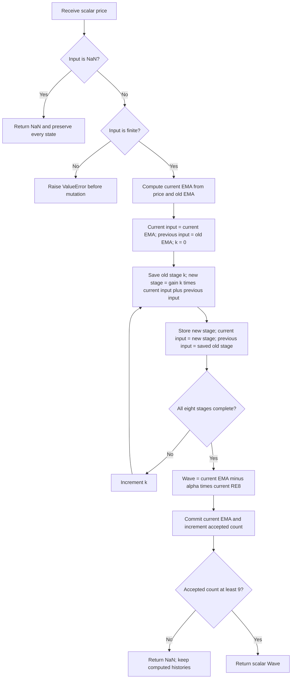

# Reverse EMA: research prototype master reference

[reverse-ema.py](reverse-ema.py) implements the executable September 2017 Reverse EMA indicator by John F. Ehlers. `ReverseEMA(alpha=0.1)` accepts one scalar price in `update(price)` and returns one scalar `Wave`, in the same units as the input. It computes a forward EMA, eight successive two-term stages, and the difference `EMA - alpha*RE8`. The implementation uses only Python's standard library and keeps a fixed amount of state.

**The article's theory and its executable listing describe different delay structures.** The theoretical reverse FIR uses delays 1, 2, 4, ..., 128, totaling 255 bars. The listing and the supplied Traders' Tips use **one bar in every stage**, totaling eight bars. This master follows the executable listing. The powers of the EMA complement are coefficient exponents; they must never be substituted for the one-bar history indices when converting this master.

This document supplies the mathematics, physical interpretation, original article theory and code, relevant book mathematics, investigation findings, configuration, exact startup and missing-data rules, confirmed reference cases, conversion instructions, and BibTeX. The folder can be copied to another repository without requiring access to the original article or book to implement and verify the calculation.

## Sources and investigation outcome

The [2013 book contents](../../2013-cycle-analytics-for-traders/toc.md) and all 17 supplied chapters contain no Reverse EMA indicator or eight-stage reverse-EMA implementation. There is no book version of this indicator to compare directly. [Chapter 1](../../2013-cycle-analytics-for-traders/ch1.md) explains transfer responses, FIR/IIR filters, poles, zeros, and delay. [Chapter 2](../../2013-cycle-analytics-for-traders/ch2.md) gives the same forward EMA and its conventional length mapping. [Chapter 7](../../2013-cycle-analytics-for-traders/ch7.md) discusses spectral dilation and the Roofing filter, which has separately configurable upper and lower band edges and is a different algorithm.

The original [article](../../tasc/2017-09-the-reverse-ema-indicator/content.md) is the numeric authority. The supplied [Traders' Tips](../../tasc/2017-09-the-reverse-ema-indicator/tips/tips.md), particularly TradeStation, corroborate its eight one-bar stages. Platform startup conventions and several port-specific differences are listed below. The [investigation record](../../tasc/2017-09-the-reverse-ema-indicator/implementation-comparison.md) was created before preparing the master; its substantive findings are also reproduced here.

The article attributes the reverse-filter algorithm to Martin Vicanek's *A New Reverse IIR Filtering Algorithm* (2015). No local copy of that paper or `mesa/` folder is supplied. This master examines the equations reproduced in Ehlers' article; it does not claim an independent verification of Vicanek's paper.

## Principles and physical analogies

An EMA is a discrete counterpart of a first-order resistor-capacitor smoothing circuit. A capacitor retains a fading memory of previous inputs: the newest sample contributes alpha and the existing stored value contributes its complement. A single impulse decays geometrically, so the filter is an infinite impulse response (IIR) filter. A smaller alpha gives longer memory, greater high-frequency attenuation, and slower response.

Frequency-dependent EMA delay can distort a waveform made from several cycles: each frequency component is attenuated and delayed differently. Offline filtering in both time directions can remove the forward filter's phase distortion because the reverse response has the conjugate phase. That procedure needs future samples at the right edge of a live chart. The article proposes reversing a finite approximation of the EMA's impulse response and adding a delay so that its calculation becomes causal.

An FIR is a tapped delay line: it combines weighted current and older samples, with no feedback from its own output. Cascading two-term FIR modules multiplies their transfer responses. The theoretical reverse FIR is an efficient binary factorization of 256 geometric weights. The executable code instead cascades eight modules with one-bar taps; the delay line then spans nine EMA values, from lag 0 through lag 8. It remains causal but is a different FIR.

The final subtraction is analogous to a differential amplifier comparing two differently filtered versions of the same signal. It emphasizes their disagreement and suppresses their shared constant component almost completely at the article's default alpha. At small alpha the constant component is not fully suppressed. Its output is a price-unit waveform around the zero reference, with no fixed range, probability interpretation, normalization, or separate trigger line.

The article presents alpha 0.05 for trend response and 0.3 for cycle response, with 0.1 as its default. These are source examples, not guarantees that a fixed alpha identifies a particular market cycle. The code is causal and uses only accepted input samples; neither causality nor a close visual alignment of turning points proves exact zero phase, universal zero lag, or prediction.

## Forward EMA: equations, impulse response, and lag

Let $p_t$ be the current accepted finite input, $e_t$ the forward EMA, and $c=1-\alpha$. A subscript $t-1$ means the preceding accepted finite sample. The article and book equation 2-2 give

$$e_t=\alpha p_t+(1-\alpha)e_{t-1}=\alpha p_t+ce_{t-1}.$$

For zero prehistory and a unit impulse at lag zero,

$$h_E[n]=\alpha c^n,\qquad n\ge0.$$

The article and book use a scaled impulse of amplitude $1/\alpha$, yielding $1,c,c^2,c^3,\ldots$. Its infinite sum is $\alpha/(1-c)=1$, establishing the EMA's steady-state gain on a constant input. For a constant input P starting on bar 1, the zero-seeded EMA is

$$e_t=P(1-c^t),\qquad t=1,2,\ldots.$$

Define $z^{-1}$ as one bar of delay. Rearranging the recurrence gives every intermediate article equation:

$$\mathrm{Output}=\alpha\,\mathrm{Input}+(1-\alpha)\,\mathrm{Output}\,z^{-1},$$

$$\mathrm{Output}\left[1-(1-\alpha)z^{-1}\right]=\alpha\,\mathrm{Input},$$

$$H_E(z)=\frac{\mathrm{Output}}{\mathrm{Input}}=\frac{\alpha}{1-(1-\alpha)z^{-1}}=\frac{\alpha}{1-cz^{-1}}.$$

The only forward EMA pole is at $z=c$. In the configured ordinary EMA domain $0<\alpha\le1$, $0\le c<1$, so it is stable in exact arithmetic. Alpha 1 makes the EMA equal to the current input.

Book chapter 2 derives the lag on a unit-slope ramp by setting price on day d to d and EMA to d-L:

$$\begin{aligned}
d-L&=\alpha d+(1-\alpha)(d-L-1),\\
0&=\alpha(L+1)-1,\\
\alpha&=\frac1{L+1},\qquad L=\frac{1-\alpha}{\alpha}.
\end{aligned}$$

Matching that lag to an N-bar SMA's $(N-1)/2$ yields book equation 2-3:

$$\alpha=\frac1{(N-1)/2+1}=\frac2{N+1},\qquad N=\frac2\alpha-1.$$

Default alpha 0.1 corresponds to conventional EMA length 19. The trend example 0.05 corresponds to length 39; the cycle example 0.3 corresponds to about 5.6667. These mappings concern the forward EMA's static lag, not the full Reverse EMA waveform's lag or a separate length parameter.

For frequency f cycles/bar, $\omega=2\pi f$ radians/bar and $z^{-1}=e^{-i\omega}$. The forward EMA's amplitude and group delay are

$$|H_E(e^{i\omega})|=\frac\alpha{\sqrt{1+c^2-2c\cos\omega}},$$

$$\tau_E(\omega)=-\frac{d\arg H_E(e^{i\omega})}{d\omega}=\frac{c\cos\omega-c^2}{1-2c\cos\omega+c^2}.$$

At zero frequency, this group delay is $c/\alpha=L$. At other frequencies it changes, explaining the article's motivation for phase correction. These frequency formulas help interpret the filter; they are not operations performed in `update`.

## Theoretical reverse FIR: complete derivation and notation correction

After dropping the alpha gain and setting c=1-alpha, the article prints

$$H(Z)=\frac1{1-cZ}.$$

Immediately afterward it expands in **negative** powers of Z. The expression consistent with its preceding causal EMA and subsequent expansion is

$$\frac1{1-cz^{-1}}=1+cz^{-1}+c^2z^{-2}+c^3z^{-3}+c^4z^{-4}+\cdots.$$

The positive-power rational expression would instead expand in positive powers and represent a reverse, noncausal response. The source formula is preserved in the article appendix for audit. The mathematical derivation here uses a consistent causal delay convention.

Truncate the geometric series to N terms, with N=$2^m$ and m stages:

$$F_N(z)=\sum_{n=0}^{N-1}c^nz^{-n}=\frac{1-c^Nz^{-N}}{1-cz^{-1}}.$$

Binary factorization supplies all exponents from 0 through N-1 exactly once:

$$F_{2^m}(z)=\prod_{k=0}^{m-1}\left(1+c^{2^k}z^{-2^k}\right).$$

For the article's eight modules, m=8 and N=256:

$$F_{256}(z)=(1+cz^{-1})(1+c^2z^{-2})(1+c^4z^{-4})\cdots(1+c^{128}z^{-128}).$$

Time reversal of the finite coefficients plus a causal delay of N-1 bars is

$$\begin{aligned}
G_N(z)&=z^{-(N-1)}F_N(z^{-1})\\
&=\sum_{n=0}^{N-1}c^{N-1-n}z^{-n}\\
&=\prod_{k=0}^{m-1}\left(c^{2^k}+z^{-2^k}\right).
\end{aligned}$$

Thus the article's theoretical reversed factors are

$$G_{256}(z)=(c+z^{-1})(c^2+z^{-2})(c^4+z^{-4})\cdots(c^{128}+z^{-128}).$$

The total delay span is $1+2+4+\cdots+128=255$ bars. Reversing the weights changes the coefficients from $1,c,\ldots,c^{255}$ to $c^{255},\ldots,c,1$. Adding a delay establishes causality; it does not remove the added delay.

The omitted normalized forward tail has coefficient sum

$$\sum_{n=N}^{\infty}\alpha c^n=c^N.$$

For bounded input |p|<=M, the normalized truncation's absolute output error is bounded by $M c^N$. Its exact frequency-domain difference from the infinite forward EMA is

$$H_E(z)-\alpha F_N(z)=c^Nz^{-N}H_E(z).$$

On the unit circle, the magnitude of that difference is $c^N|H_E(e^{i\omega})|$. Consequently, the article's assertion that eight modules make errors small depends strongly on alpha. With alpha 0.1, $c^{256}\approx1.9323\times10^{-12}$; with alpha 0.001, it is approximately 0.77404. This geometric truncation error is separate from the listing's additional substitution of one-bar delays.

For an infinite offline forward/backward EMA, $H_E(e^{i\omega})H_E(e^{-i\omega})=|H_E(e^{i\omega})|^2$ has zero phase, but the reverse pass is noncausal. For finite real coefficients,

$$\alpha^2F_N(e^{i\omega})G_N(e^{i\omega})=\alpha^2e^{-i\omega(N-1)}|F_N(e^{i\omega})|^2.$$

The causal reversed finite version has the explicit N-1 delay. Replacing the finite forward branch by the infinite EMA also leaves truncation-related deviations. These facts prevent reading the theoretical construction as an exact zero-delay live EMA.

## Actual executable equations and the theory/code discrepancy

Define $r_{0,t}=e_t$ and $g_k=c^{2^k}$ for k=0,...,7. The code's actual stages are

$$r_{k+1,t}=g_kr_{k,t}+r_{k,t-1},\qquad k=0,1,\ldots,7,$$

$$w_t=e_t-\alpha r_{8,t}.$$

Written out, the complete calculation is

$$\begin{aligned}
r_{1,t}&=ce_t+e_{t-1},\\
r_{2,t}&=c^2r_{1,t}+r_{1,t-1},\\
r_{3,t}&=c^4r_{2,t}+r_{2,t-1},\\
r_{4,t}&=c^8r_{3,t}+r_{3,t-1},\\
r_{5,t}&=c^{16}r_{4,t}+r_{4,t-1},\\
r_{6,t}&=c^{32}r_{5,t}+r_{5,t-1},\\
r_{7,t}&=c^{64}r_{6,t}+r_{6,t-1},\\
r_{8,t}&=c^{128}r_{7,t}+r_{7,t-1},\\
w_t&=e_t-\alpha r_{8,t}.
\end{aligned}$$

The historical term at every stage is the **preceding stage's old output**, not that stage's own old output. This makes the reverse cascade FIR with respect to the forward EMA. Each module adds one lag:

$$G_{code}(z)=\prod_{k=0}^{7}(c^{2^k}+z^{-1})=\sum_{j=0}^{8}b_jz^{-j}.$$

There are nine coefficients and an eight-bar span. The actual complete waveform transfer function is

$$H_{Wave}(z)=\frac\alpha{1-cz^{-1}}\left[1-\alpha G_{code}(z)\right].$$

The waveform still has the forward EMA's IIR memory. The code's coefficient powers and theory's powers agree, but their delays do not:

| Property | Theoretical reverse FIR | Executable reverse stages |
| --- | --- | --- |
| Coefficient exponents | 1, 2, 4, 8, 16, 32, 64, 128 | Same |
| Each stage's delayed input | Lag $2^k$ | Lag 1 |
| FIR degree / maximum EMA lag | 255 | 8 |
| Number of expanded FIR coefficients | 256 | 9 |
| Alpha=1 complete waveform | $p_t-p_{t-255}$ | $p_t-p_{t-8}$ |
| Authority for this master | Background derivation | Original listing and corroborating Tips |

The alpha=1 identity is a decisive regression check. With c=0, every stage becomes a pure one-bar delay, the EMA becomes current price, and

$$w_t=p_t-p_{t-8}.$$

Implementing dyadic delays would silently create another indicator. No alternate theoretical mode, configurable stage count, DC correction, extra smoother, or period conversion is included in this master.

## Constant response, spectral dilation, and phase limitations

The exact arithmetic identity

$$\begin{aligned}
(1-c)\prod_{k=0}^{7}(1+c^{2^k})&=1-c^{256},\\
\alpha G_{code}(1)&=1-c^{256},\\
H_{Wave}(1)&=c^{256}
\end{aligned}$$

shows that a long constant input P produces $w\to P c^{256}$. This DC leakage is the same geometric coefficient-sum deficit that appears in the theoretical finite reverse filter, despite the different delay arrangements. Its presence does not make the two filters equivalent.

| Alpha | Steady-state DC gain $(1-\alpha)^{256}$ | Interpretation |
| ---: | ---: | --- |
| 0.001 | 0.774042818860508 | Substantial price-level response remains. |
| 0.005 | 0.277146035754844 | Constant component remains material. |
| 0.01 | 0.0763149839065938 | Measurable DC leakage. |
| 0.02 | 0.00567381769339658 | Small but visible leakage. |
| 0.05 | 0.00000198263584599904 | Article trend setting has very small DC gain. |
| 0.1 | 0.0000000000019323349832289 | Article default is practically detrended at equilibrium. |
| 1 | 0 | Exact eight-bar difference. |

For small omega, define $S=\sum_{k=0}^{7}(1+g_k)^{-1}$ and $\delta=c^{256}$. Expanding the actual transfer function gives

$$H_{Wave}(e^{i\omega})=\delta+i\omega\left[(1-\delta)S-\frac c\alpha\delta\right]+O(\omega^2).$$

When delta is negligible, the leading frequency-dependent term has the first-difference/derivative behavior motivating the article's approximately 6 dB per octave low-frequency roll-off. At sufficiently low frequency and nonzero delta, its response instead approaches the DC plateau. A claim of a strict DC zero or exact low-frequency slope for every permitted alpha would therefore be incorrect.

Book chapter 7 explains spectral dilation as the relatively larger amplitude of longer market cycles, approximately 6 dB per octave in its discussion. A difference-type high-pass operation can reduce that imbalance. The Roofing filter combines separate high-pass and low-pass controls; Reverse EMA controls all its responses through alpha. Their chart appearances can resemble one another, but their equations and parameter meanings differ.

At Nyquist, the actual code has

$$H_{Wave}(-1)=\frac\alpha{1+c}\left[1-\alpha\prod_{k=0}^{7}(g_k-1)\right],$$

which is generally nonzero. The source's qualitative claims of double high-frequency smoothing and minimal lag should be read alongside this exact transfer response and the delay discrepancy. The executable reverse product is not a conjugate copy of an infinite EMA. It does not establish exact forward/backward zero phase. Digital filtering can attenuate sampled high-frequency content, but it cannot recover information already folded into lower frequencies by aliasing.

## Configuration and streaming interface

| Parameter | Shortcut | Default | Valid values | Meaning |
| --- | --- | ---: | --- | --- |
| `alpha` | `A` | 0.1 | Finite real $0<\alpha\le1$ | New-price weight in the forward EMA and gain in the final subtraction. |

The eight stages and coefficient exponents are fixed. Alpha=0 is excluded as a degenerate frozen EMA; alpha>1 is outside the ordinary nonnegative EMA-weight domain. The article uses `AA` for alpha and `CC` for its complement. Extremely small positive alpha can make `1-alpha` round to 1 in binary64; the confirmed cases are well above that coefficient-resolution limit.

`update(price)` returns a float. Input zero and negative prices are valid. `alpha` is read-only; construct another instance to change it. `reset()` zeros the forward EMA, all eight reverse histories, and the accepted finite-sample count. `warmup_bars` is 8, and `is_primed` becomes true after the ninth accepted finite input.

A NaN input returns NaN and skips every state change, including the sample count. The next finite input follows the previous accepted finite input. An infinite input raises `ValueError` before any state mutation. Missing observations therefore do not advance the filter in calendar time. This is an explicit standalone API policy, not a missing-data rule asserted by the original EasyLanguage.

## Exact startup and safe state update order

Before bar 1, EMA and all eight reverse histories are zero, following the article's `Vars: EMA(0), RE1(0), ..., RE8(0)` declarations. Every recurrence executes on the first finite bar and every subsequent accepted bar. In particular, the first EMA is `alpha*price`, not the first raw price. Every reverse stage also executes on that first bar.

The first eight computed Wave values are kept internally but returned as NaN. The first visible output is accepted finite bar 9, zero-based fixture index 8. This masks the finite eight-bar reverse history's startup while preserving the source's recursive evolution. The article listing itself has no explicit NaN mask; platform prehistory and plot availability can differ. This visibility convention was included in the user's confirmation.

Output availability does not imply convergence of the infinite-memory forward EMA. With default alpha, $c^9\approx0.38742$, so a zero-seeded constant-price EMA on bar 9 still has a substantial transient. With alpha 0.001, even 252 bars leave a long transient. The geometric decay time in bars, for 0<c<1, is $-1/\ln c$; reducing the forward seed residual below epsilon requires at least $\lceil\ln(\epsilon)/\ln c\rceil$ bars. This is explanatory background and does not change the eight-output mask.

For the shared 252 closes and default alpha, the first five visible serialized outputs are `33.471520942954`, `29.915532960641`, `27.1034999892197`, `24.7286724488145`, and `22.7840523497769`. Their large initial values follow the explicit zero seed. Seeding the EMA at price, delaying all calculations until priming, or introducing an arbitrary preloaded record would generate different fixtures.

The port must read the preceding stage's previous-bar value before overwriting it. Use the following fixed order:

1. Validate input; return on NaN and reject infinity before any mutation.
2. Compute current EMA using old EMA: `alpha*price + c*old_ema`.
3. Set `current_input=current_ema`, `previous_input=old_ema`.
4. For each of eight stages, save its old value, compute `gain*current_input + previous_input`, write its new value, then set `current_input=new_stage` and `previous_input=old_stage`.
5. Compute `wave=current_ema-alpha*current_RE8`, commit current EMA, and increment accepted count.
6. Return NaN for accepted counts 1 through 8; return Wave from count 9 onward.

Only one old forward EMA and eight old stage values are needed. The loop performs eight stages per accepted sample: O(1) time and O(1) storage with the fixed stage count.

## Calculation flow



## Precision and conversion contract

No truncated 1.414 or 3.14159 constant occurs in the Reverse EMA listing. Keep the exact coefficient exponents and use full binary64 evaluation of `c=1.0-alpha` and `pow(c, exponent)` for 1, 2, 4, 8, 16, 32, 64, 128. Mathematical frequency expressions use full $\pi$; they are not indicator coefficients.

Preserve the source multiply/add order, including `alpha*price + c*old_ema` and `EMA-alpha*RE8`. Rewriting EMA as `old_ema + alpha*(price-old_ema)`, computing a pre-expanded FIR convolution, or replacing `pow` with repeated squaring is algebraically equivalent but can change floating-point rounding. Ports requiring close agreement should avoid unintended fused multiply-add and retain binary64 intermediate state. All reference values are rounded only at serialization to **15 significant decimal digits**, using Python `.15g`.

Cross-language libm power evaluations can differ in their last bits. Compare NaN positions exactly and finite values with a suitable absolute and relative tolerance, for example $10^{-11}$ for this supplied record. A relative-only test is unsuitable for a near-zero waveform. Reference literals that are whole numbers include `.0`, ensuring Rust and Zig receive valid f64 literals.

## Confirmed reference cases

All 14 cases were confirmed by the user on 2026-10-20. Each contains 252 outputs aligned one-for-one with `INPUT_CLOSE`, with eight leading NaNs and 244 finite values. No Cartesian product or configurable stage count is involved.

| Alpha | Python array | What it tests |
| ---: | --- | --- |
| 0.001 | `EXPECTED_A0_001` | Very small alpha: long EMA transient and substantial theoretical DC residual. |
| 0.005 | `EXPECTED_A0_005` | Small alpha: slow smoothing and nonnegligible finite-factor DC leakage. |
| 0.01 | `EXPECTED_A0_01` | Lower AmiBroker example range: long trend memory and measurable DC residual. |
| 0.02 | `EXPECTED_A0_02` | Slow trend response: coefficient powers remain material through later stages. |
| 0.05 | `EXPECTED_A0_05` | Article trend setting and TradeStation trend-line parameter. |
| 0.075 | `EXPECTED_A0_075` | Intermediate trend/default alpha: decimal coefficient calculation. |
| 0.1 | `EXPECTED_A0_1` | Article default: executable eight one-bar-stage Reverse EMA. |
| 0.15 | `EXPECTED_A0_15` | Intermediate default/cycle response: faster forward EMA smoothing. |
| 0.2 | `EXPECTED_A0_2` | Momentum-oriented intermediate alpha with faster stage response. |
| 0.3 | `EXPECTED_A0_3` | Article cycle setting and TradeStation cycle-line parameter. |
| 0.5 | `EXPECTED_A0_5` | Half-weight EMA: exact dyadic complement and high coefficient exponents. |
| 0.8 | `EXPECTED_A0_8` | Fast EMA: later reverse-stage gains become extremely small. |
| 0.99 | `EXPECTED_A0_99` | Near memoryless boundary: strong eight-bar difference behavior. |
| 1 | `EXPECTED_A1` | Memoryless boundary: output is exactly current input minus input eight bars ago. |

Before each expected array, all five fixture files contain the same two comments: the exact “What it tests” text above and `alpha=<value>`. The names are:

| Language | Default-case name and form | NaN spelling | Fixture |
| --- | --- | --- | --- |
| Python | `EXPECTED_A0_1 = [...]` | `math.nan` | [test_testdata.py](test_testdata.py) |
| Go | `var expectedA0_1 = []float64{...}` | `math.NaN()` | [testdata_test.go](testdata_test.go), package `reverseema` |
| TypeScript | `export const expectedA0_1: number[] = [...]` | `NaN` | [testdata.ts](testdata.ts) |
| Rust | `pub fn expected_a0_1() -> Vec<f64>` | `f64::NAN` | [testdata.rs](testdata.rs) |
| Zig | `pub fn expectedA0_1() [252]f64` | `nan` | [testdata.zig](testdata.zig) |

Zig defines `const math = @import("std").math;` and `const nan = math.nan(f64);` at the top. Go imports `math`. Rust uses the valid `f64::NAN` spelling. Decimal points become underscores in parameter name tokens; alpha 1 is `A1`. TypeScript uses a valid typed exported array declaration. All files preserve the original close, high, low, and open input data; the indicator consumes only close.

## Running, regeneration, and verification

Run these commands from this folder:

```sh
python3 reverse-ema.py
python3 reverse-ema.py --generate-reference-data
python3 -m unittest -v test_reverse_ema.py
```

The ordinary invocation demonstrates streaming on the 252 closes embedded under `__main__`. The generation flag computes every confirmed case, appends the marked expected-data section to Python, parses the written Python arrays back and verifies their length, NaN masks, and 15-digit values, then propagates those saved decimals to Go, TypeScript, Rust, and Zig. Subsequent generation replaces only the marked section, so it is byte-identical on repeated runs rather than accumulating duplicate arrays. It checks the embedded closes against the local `INPUT_CLOSE` before writing.

For programmatic streaming, load the hyphenated master filename explicitly:

```python
import importlib.util
from pathlib import Path

path = Path("reverse-ema.py")
spec = importlib.util.spec_from_file_location("reverse_ema", path)
module = importlib.util.module_from_spec(spec)
spec.loader.exec_module(module)

indicator = module.ReverseEMA(alpha=0.1)
for close in [91.5, 94.815, 94.375, 95.095, 93.78, 94.625,
              92.53, 92.75, 90.315]:
    print(indicator.update(close))  # Eight NaNs, then the first Wave value.
```

[test_reverse_ema.py](test_reverse_ema.py) extracts the original EasyLanguage expressions and evaluates them independently with declared zero histories. It checks every confirmed case with exact equality after applying the same eight-value visibility mask. A separate batch oracle expands the eight FIR factors into a nine-coefficient polynomial and convolves it with the forward EMA. Other tests cover an impulse, steady-state DC leakage, alpha=1's exact eight-bar difference, rejection of dyadic delays, first-bar execution, NaN skipping, reset, invalid settings, sign/scale linearity, embedded input preservation, and every cross-language expected decimal and comment.

For the 14 cases on the supplied record, the maximum absolute difference against the extracted article expressions is **0**. Against independent polynomial/FIR convolution it is approximately **5.6843418860808e-14**, reflecting a different arithmetic order. This comparison verifies the published formulas under the declared startup convention; it is not an assertion that every chart platform's preloaded history yields identical early values.

The test oracle falls back to the exact article listing reproduced below when the external source path is absent. The copied folder therefore remains executable, testable, and able to regenerate its own fixtures independently. The five-language fixtures additionally receive syntax/runtime checks that reference every expected array, verify 252 values, the eight-NaN prefix, and finite endpoints. They are data fixtures for future ports, not five implementations of the indicator.

## Original article mathematics and executable code

The following reproduces the supplied article's mathematical explanation and complete indicator listing. Its positive-power `1/(1-cZ)` and dyadic-delay factors are kept as printed; the consistent notation and the executable delay discrepancy are explained above. Figure 1 is a chart illustration, not a numeric oracle. Author biography and workshop/site boilerplate are omitted; no theoretical equation or algorithm statement is omitted.

## The EMA

An EMA is computed by multiplying the input data by a number (less than 1) and adding to it the complement of that number, multiplying the previously computed value of the EMA. In EasyLanguage code, this is written as:

$$\text{EMA} = \alpha \cdot \text{Price} + (1 - \alpha) \cdot \text{EMA}[1]$$

The two coefficients of this filter sum to unity, so the gain of the filter is 1. That is, if a constant input is applied to the filter, the quiescent filter output will have the same value. If a spike amplitude of $1/\alpha$ (an impulse) is applied to an EMA, its immediate output is a value of 1. In the next sample period there is no input, so the output value is just $(1 - \alpha)$. In the next sample period there is still no input, so the output value is $(1 - \alpha)^2$. The process continues, so the general expression for the EMA response to an impulse at the Nth sample period is $(1 - \alpha)^N$. This is one reason why it is called an *exponential* moving average---the amplitude response falls off as the exponent of the time sample from the impulse event.

With apologies to the mathematical purists, we can frame the EMA equation in terms of Z-transforms, where $Z^{-1}$ signifies one unit of delay. Doing this, the EMA equation becomes:

$$\text{Output} = \alpha \cdot \text{Input} + (1 - \alpha) \cdot \text{Output} \cdot Z^{-1}$$

Rearranging the terms, we get:

$$\text{Output} \cdot (1 - (1 - \alpha) \cdot Z^{-1}) = \alpha \cdot \text{Input}$$

The Z-transform of a filter is the ratio of the output to the input, so algebra further gives us:

$$H(Z) = \frac{\text{Output}}{\text{Input}} = \frac{\alpha}{1 - (1 - \alpha) Z^{-1}}$$

## The Reverse EMA Algorithm

I came across this algorithm in Martin Vicanek's article "A New Reverse IIR Filtering Algorithm." To understand the reverse EMA algorithm, it is best to simplify the Z-transform equation by forgetting about the $\alpha$ gain term and letting $c = (1 - \alpha)$. Doing this, the Z-transform becomes:

$$H(Z) = \frac{1}{1 - cZ}$$

If we carry out the long division of this rational equation for the Z-transform of the EMA, we get the infinitely long series:

$$H(Z) = 1 + cZ^{-1} + c^2 Z^{-2} + c^3 Z^{-3} + c^4 Z^{-4} + \ldots$$

This is an exponential decay of the filter response to an input. In addition, since $c$ has a value less than unity, the coefficients become vanishingly small after a sufficient number of terms. Therefore, we can truncate the infinite series to a finite number of terms with a quantifiable amount of error. If we truncate the series, the Z-transform now becomes the expression for a finite impulse response (FIR) filter. A simple moving average (SMA) is a special case of an FIR filter where all the coefficients are the same.

Having the Z-transform of the filter represented as a FIR, we can further factor the previous equation for an FIR filter as:

$$H(Z) = (1 + cZ^{-1})(1 + c^2 Z^{-2})(1 + c^4 Z^{-4})(1 + c^8 Z^{-8}) \ldots$$

Time reversal of the FIR filter is easy. All that need be done is to reverse the order of the impulse response and add a total delay to make the time-reversed filter causal.

The equation for such a filter is:

$$H(Z) = (c + Z^{-1})(c^2 + Z^{-2})(c^4 + Z^{-4})(c^8 + Z^{-8}) \ldots$$

This filter can be realized by successive filtering where each module filters the preceding module. Errors are sufficiently small for trading by using only eight modules.

## The Reverse EMA Indicator

A practical indicator can be created by subtracting a forward-and-reverse EMA response from a standard EMA. The basic idea is that the forward-and-reverse EMA does not contain the frequency-phase distortions, so subtracting it from a standard EMA highlights those distortions. One perspective is that it is just those distortions that comprise the indicator output.

A typical example of the filter response is shown in Figure 1. The single input parameter to the filter is the typical alpha for an EMA filter. By changing the alpha to be 0.05, the indicator will show more of the *trend* response. By changing the alpha to 0.3, the indicator will show more of the *cycle* response. The reverse EMA indicator output is similar to that of the roofing filter (discussed in my book *Cycle Analytics For Traders*) except that the roofing filter has independent control of the upper and lower band edges.

The EasyLanguage code to compute the reverse EMA indicator is given in the sidebar "EasyLanguage Code For Reverse EMA Indicator."

[Original Figure 1 chart](../../tasc/2017-09-the-reverse-ema-indicator/assets/figure-01.png)
**Figure 1: Example of filter response.** On this daily chart of the SPY, the reverse EMA accurately reflects turning points with little lag.

## The Reality of It

The reverse EMA indicator is causal and can be used for real trading. It is virtually universal. It has a single input parameter that lets it highlight cycle, momentum, and trend components. It has minimum lag. It has high-frequency filtering that reduces the impact of aliased components of the sampled data. It has low-frequency filtering that rolls off at the rate of 6 dB per octave, thereby mitigating the effects of spectral dilation. All around, it is a crisp new indicator that should be in everyone's toolbox.

## EasyLanguage Code for Reverse EMA Indicator

```easylanguage
{
    Reverse EMA Indicator
    (C) 2017              John F. Ehlers
}

Inputs:
    AA(.1);

Vars:
    CC(0),
    EMA(0),
    RE1(0),
    RE2(0),
    RE3(0),
    RE4(0),
    RE5(0),
    RE6(0),
    RE7(0),
    RE8(0),
    Wave(0);

//Classic EMA
CC = 1 - AA;
EMA = AA*Close + CC*EMA[1];

//Compute Reverse EMA
RE1 = CC*EMA + EMA[1];
RE2 = Power(CC, 2)*RE1 + RE1[1];
RE3 = Power(CC, 4)*RE2 + RE2[1];
RE4 = Power(CC, 8)*RE3 + RE3[1];
RE5 = Power(CC, 16)*RE4 + RE4[1];
RE6 = Power(CC, 32)*RE5 + RE5[1];
RE7 = Power(CC, 64)*RE6 + RE6[1];
RE8 = Power(CC, 128)*RE7 + RE7[1];

//Indicator as difference
Wave = EMA - AA*RE8;

Plot1(Wave);
Plot2(0);
```

## Further Reading

- Ehlers, John F. [2015]. "Decyclers," *Technical Analysis of* STOCKS & COMMODITIES, Volume 33: September.
- ______ [2014]. "Predictive And Successful Indicators," *Technical Analysis of* STOCKS & COMMODITIES, Volume 32: January.
- ______ [2016]. "Measuring Market Cycles," *Technical Analysis of* STOCKS & COMMODITIES, Volume 34: September.
- ______ [2014]. "The Quotient Transform," *Technical Analysis of* STOCKS & COMMODITIES, Volume 32: August.
- ______ [2013]. *Cycle Analytics For Traders: Advanced Technical Trading Concepts*, Wiley.
- Vicanek, Martin [2015]. "A New Reverse IIR Filtering Algorithm," http://vicanek.de/articles/ReverseIIR.pdf.

## Book background: transfer-response equations

No book Reverse EMA listing exists. The relevant chapter 1 definitions are reproduced here so a porting agent has the underlying FIR/IIR framework. With $z^{-1}$ representing a one-sample delay, a four-bar SMA has the chapter's equation 1-1:

$$\frac{\mathrm{Output}}{\mathrm{Input}}=\frac14+\frac{z^{-1}}4+\frac{z^{-2}}4+\frac{z^{-3}}4.$$

The general FIR polynomial is equation 1-2:

$$H(z)=b_0+b_1z^{-1}+b_2z^{-2}+\cdots+b_Nz^{-N}.$$

The general recursive/nonrecursive combination is equation 1-3:

$$H(z)=\frac{b_0+b_1z^{-1}+\cdots+b_Nz^{-N}}{a_0+a_1z^{-1}+\cdots+a_Nz^{-N}}.$$

Chapter 1's programming rearrangement, equation 1-4, is

$$\begin{aligned}
a_0\,\mathrm{Output}+\mathrm{Denominator}\,\mathrm{Output}&=\mathrm{Numerator}\,\mathrm{Input},\\
a_0\,\mathrm{Output}&=\mathrm{Numerator}\,\mathrm{Input}-\mathrm{Denominator}\,\mathrm{Output},\\
\mathrm{Output}&=(\mathrm{Numerator}\,\mathrm{Input}-\mathrm{Denominator}\,\mathrm{Output})/a_0.
\end{aligned}$$

Here “Numerator” is the delayed-input polynomial, and “Denominator” excludes the a0 term. Written with explicit samples, it means

$$y_t=\frac{\sum_{j=0}^{N}b_jx_{t-j}-\sum_{j=1}^{N}a_jy_{t-j}}{a_0}.$$

For the EMA, the book sets $b_0=\alpha$, $a_0=1$, and $a_1=-(1-\alpha)$, with all other coefficients zero. Its resulting equation 1-12 is

$$\mathrm{Output}=\alpha\,\mathrm{Input}+(1-\alpha)\,\mathrm{Output}[1].$$

The numerator roots are filter zeros and the denominator roots are filter poles, interpreted with a consistent z convention. The EMA has a pole at c; the reverse cascade has no feedback denominator. Combining them produces the exact Wave transfer response given earlier.

The chapter also explains that a real FIR symmetric about its midpoint has constant delay equal to half its degree. An N-tap symmetric FIR has degree N-1 and delay $(N-1)/2$. This is a property of symmetric coefficients; the code's reversed FIR coefficients are generally asymmetric. Chapter 1 emphasizes that filters compute from historical samples and are not inherently predictive.

## Book background: complete EMA section from chapter 2

The following reproduces the supplied chapter's EMA mathematical discussion, including its impulse, step, ramp, and equivalent-length derivations. References to its figures are retained as source links. Unrelated SMA/WMA/median sections are not required for this indicator and are not reproduced.

The supplied step-response prose prints `(1-alpha)2` without an exponent marker; the intended third-bar term is $\alpha(1-\alpha)^2$, consistent with the impulse sequence and recurrence. The copied mathematical discussion preserves that source transcription; the corrected equations above govern implementation.

## Exponential Moving Averages (EMAs)

An EMA is computed by taking a fraction of the current price added to the complementary fraction of the EMA calculation one bar ago. The first ­fraction is usually called alpha, and can have a value between zero and one. The two fractions must sum to unity, so the second fraction must have the value of one minus alpha. The equation to compute an EMA is:

$$\text{EMA} = \alpha \cdot \text{Price} + (1 - \alpha) \cdot \text{EMA}[1]$$

(2-2)

The EMA becomes a moving average by moving from bar to bar, from left to right, across the price data.

Imagine a case where the input data set has only one sample at an amplitude of $1 / \alpha$. When the EMA is applied to these data, the first output from the filter is unity because there was no previous value for the EMA. On subsequent calculations, the price value is zero, and so the sequence of calculations is:

$$\begin{aligned}
\text{EMA}(0) &= 1 \\
\text{EMA}(1) &= (1 - \alpha) \\
\text{EMA}(2) &= (1 - \alpha)(1 - \alpha) = (1 - \alpha)^2 \\
\text{EMA}(3) &= (1 - \alpha)^2 (1 - \alpha) = (1 - \alpha)^3 \\
&\;\;\vdots \\
\text{EMA}(N) &= (1 - \alpha)^N
\end{aligned}$$

Since the quantity (1 − α) must be less than one, the amplitude decays as the exponent of each succeeding calculation from an impulse input, hence the name exponential moving average. In principle, a part of any data input remains in subsequent calculations, although the contribution becomes vanishingly small. This attribute makes an EMA part of a general class of filters called infinite impulse response (IIR) filters.

It is instructive to examine the EMA response to a step function. A step function has a series of constant values and then jumps to another series of constant values. Assume the price has been zero for a long time and then suddenly jumps up to a value of 1 and maintains that value thereafter. On the first bar, the EMA will have a value of $\alpha$. On the second bar, the value will be $\alpha + \alpha * (1 − \alpha)$. On the third bar, the value will be $\alpha + \alpha * (1 − \alpha) + \alpha * (1 − \alpha)2$, and so on. The EMA will gradually approach the value of $1$. A common error in programming is to insert a value for $\alpha$, such as $.2$, and inserting another number for $(1 − \alpha)$, such as $.9$. The two terms must sum to unity or the recursive algorithm will lead to erratic results or might even cause your computer to crash. You should always check your computer code to ensure that the two terms sum to unity. I am so cautious on this point that I assign the value $\alpha$ as a global variable and write out the EMA equation in terms of $\alpha$. By letting the computer do the work, I know the two terms must sum correctly.

We can assert that the price on day “$d$” is $d$. If we assume the lag of the EMA is “$L$”, then the current value of the EMA is $(d − L)$. Further, the previous EMA would have a value of $(d − L − 1)$, since price is rising one unit per bar. Putting these values into the equation for the EMA, we obtain

$$\begin{aligned}
(d - L) &= \alpha \cdot d + (1 - \alpha)(d - L - 1) \\
&= \alpha \cdot d + (d - L) - 1 - \alpha \cdot d + \alpha (L + 1) \\
0 &= \alpha (L + 1) - 1 \\
\alpha &= 1 / (L + 1)
\end{aligned}$$

This equation shows that we can select an acceptable lag and, from that lag, compute the alpha term of the EMA. For example, if we can accept a three-bar lag resulting from the EMA, we would use $\alpha = 0.25$.

We can also relate an EMA to an SMA on the basis of their equivalent static lags. Recalling that the lag of an SMA is $(N − 1) / 2$ for an $N$-bar SMA, we can substitute this value of lag into the alpha calculation of the EMA as

$$\begin{aligned}
\alpha &= 1 / ((N - 1)/2 + 1) \\
&= 2 / ((N - 1) + 2) \\
&= 2 / (N + 1)
\end{aligned}$$

(2-3)

This is the relationship between an $N$-bar SMA and the alpha of an EMA that is quoted in most technical analysis books. The frequency responses of a five-bar SMA and its EMA equivalent are compared in Figure 2.2. Figure 2.3 shows that the lags of the SMA and EMA are equal only at zero frequency.

Although the lags at static frequencies align, note that the critical period of the EMA is not aligned with that of the SMA. We can obtain a better calculation for the fraction $\alpha$ by examining the transfer response of the EMA.

[Original Figure 2.2: Frequency Response Comparison of a Five-Bar SMA and ­Similar EMA](../../2013-cycle-analytics-for-traders/assets/ch2_fig_2_2.png)

**Figure 2.2** *Frequency Response Comparison of a Five-Bar SMA and Similar EMA*

[Original Figure 2.3: Lag Response of EMA Compared to a Constant Two-Bar Lag of a Five-Bar SMA](../../2013-cycle-analytics-for-traders/assets/ch2_fig_2_3.png)

**Figure 2.3** *Lag Response of EMA Compared to a Constant Two-Bar Lag of a Five-Bar SMA*

## Source implementation differences

| Supplied source | Difference | Master decision |
| --- | --- | --- |
| [TradeStation](../../tasc/2017-09-the-reverse-ema-indicator/tips/REMA.els) | Same one-bar stage code; wrapper uses separate trend/cycle alphas 0.05/0.3 and adds strategy rules. | Corroborating numeric authority; one configured alpha and scalar output per object. |
| [MetaStock](../../tasc/2017-09-the-reverse-ema-indicator/tips/REMA_metastock.txt) | Same one-bar recurrences; EMA seed and historical null handling depend on PREV/Ref. | Declare zero histories and eight hidden outputs. |
| [TradersStudio](../../tasc/2017-09-the-reverse-ema-indicator/tips/REMA.trs) | Same powers and one-bar stages; function packaging differs. | Preserve article arithmetic. |
| [Updata](../../tasc/2017-09-the-reverse-ema-indicator/tips/REMA_updata.txt) | Same recurrence from its first loop date, with zero-declared states and HIST references. | Preserve article recurrence with explicitly declared finite sequence. |
| [AmiBroker](../../tasc/2017-09-the-reverse-ema-indicator/tips/REMA.afl) | Uses AMA for forward EMA and array Ref with null propagation; loop doubles coefficient exponents, still with lag 1. | Implement scalar zero-seeded forward EMA, update all stages, and mask first eight outputs. Do not assume AMA seeds match. |
| [NinjaTrader](../../tasc/2017-09-the-reverse-ema-indicator/tips/ninja-trader/REMA.cs) | First EMA is raw price and it returns before computing any reverse stages on bar 1. Later equations match. Its UI accepts alpha values beyond the ordinary EMA range. | Keep article zero EMA seed, process every stage from bar 1, and validate ordinary alpha domain. |
| [eSignal](../../tasc/2017-09-the-reverse-ema-indicator/tips/code/Reverse_EMA.efs) | Final subtraction uses **hard-coded 0.1**, ignoring Alpha except at the default. Rewrites EMA as `(price-old)*alpha+old`, propagates stage-history nulls, and delays work by `3*(2/alpha-1)` bars. | Use configured alpha in subtraction, article multiply/add order, and explicit zero histories. |
| [Wealth-Lab](../../tasc/2017-09-the-reverse-ema-indicator/tips/REMA.cs) | Wrapper calls unavailable `ReverseEMA.Series`; library internals are not supplied. | Not an executable numeric oracle. |

## References and BibTeX

- John F. Ehlers, “The Reverse EMA Indicator,” *Technical Analysis of STOCKS & COMMODITIES*, volume 35, September 2017, pages 8–12. [Local transcription](../../tasc/2017-09-the-reverse-ema-indicator/content.md), [publisher PDF](https://technical.traders.com/archive/article.asp?file=%5CV35%5CC09%5C504EHLE.pdf).
- *Traders' Tips*, September 2017. [Local collection](../../tasc/2017-09-the-reverse-ema-indicator/tips/tips.md), [publisher](https://www.traders.com/Documentation/FEEDbk_docs/2017/09/TradersTips.html). Individual supplied listings are linked in the comparison table above; the article remains the master numeric authority.
- John F. Ehlers, *Cycle Analytics for Traders: Advanced Technical Trading Concepts*, Wiley, 2013, ISBN 9781118728604. [Contents](../../2013-cycle-analytics-for-traders/toc.md), [chapter 1](../../2013-cycle-analytics-for-traders/ch1.md), [chapter 2](../../2013-cycle-analytics-for-traders/ch2.md), [chapter 7](../../2013-cycle-analytics-for-traders/ch7.md).
- Martin Vicanek, *A New Reverse IIR Filtering Algorithm*, 2015. [Paper cited by the article](https://vicanek.de/articles/ReverseIIR.pdf). The supplied Ehlers excerpt, rather than an independently inspected copy of this paper, is the source used here.
- The article's further reading also cites “Decyclers” (September 2015), “Predictive And Successful Indicators” (January 2014), “Measuring Market Cycles” (September 2016), and “The Quotient Transform” (August 2014). These are contextual references, not substituted algorithms or additional numeric oracles for Reverse EMA.

```bibtex
@article{ehlers_reverse_ema_2017,
  author = {Ehlers, John F.},
  title = {The Reverse EMA Indicator},
  journal = {Technical Analysis of STOCKS \& COMMODITIES},
  volume = {35},
  number = {9},
  pages = {8--12},
  year = {2017},
  month = sep,
  url = {https://technical.traders.com/archive/article.asp?file=%5CV35%5CC09%5C504EHLE.pdf}
}

@misc{traders_tips_2017_09,
  author = {{Technical Analysis of STOCKS \& COMMODITIES}},
  title = {Traders' Tips: The Reverse EMA Indicator},
  year = {2017},
  month = sep,
  howpublished = {Online; supplied platform listings},
  url = {https://www.traders.com/Documentation/FEEDbk_docs/2017/09/TradersTips.html}
}

@book{ehlers2013cycle,
  author = {Ehlers, John F.},
  title = {Cycle Analytics for Traders: Advanced Technical Trading Concepts},
  publisher = {Wiley},
  year = {2013},
  series = {Wiley Trading},
  isbn = {9781118728604},
  note = {Chapters 1, 2, and 7 provide background; no Reverse EMA listing}
}

@misc{vicanek_reverse_iir_2015,
  author = {Vicanek, Martin},
  title = {A New Reverse IIR Filtering Algorithm},
  year = {2015},
  url = {https://vicanek.de/articles/ReverseIIR.pdf},
  note = {Cited by Ehlers; not independently inspected in this preparation}
}

@article{ehlers_decyclers_2015,
  author = {Ehlers, John F.},
  title = {Decyclers},
  journal = {Technical Analysis of STOCKS \& COMMODITIES},
  volume = {33},
  number = {9},
  year = {2015},
  month = sep
}

@article{ehlers_predictive_successful_2014,
  author = {Ehlers, John F.},
  title = {Predictive And Successful Indicators},
  journal = {Technical Analysis of STOCKS \& COMMODITIES},
  volume = {32},
  number = {1},
  year = {2014},
  month = jan
}

@article{ehlers_measuring_market_cycles_2016,
  author = {Ehlers, John F.},
  title = {Measuring Market Cycles},
  journal = {Technical Analysis of STOCKS \& COMMODITIES},
  volume = {34},
  number = {9},
  year = {2016},
  month = sep
}

@article{ehlers_quotient_transform_2014,
  author = {Ehlers, John F.},
  title = {The Quotient Transform},
  journal = {Technical Analysis of STOCKS \& COMMODITIES},
  volume = {32},
  number = {8},
  year = {2014},
  month = aug
}
```
