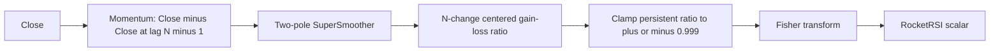
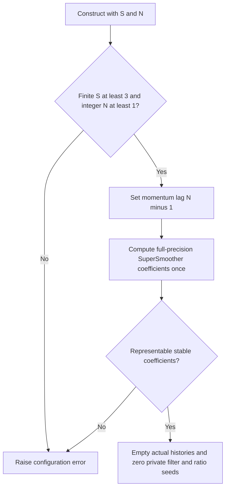
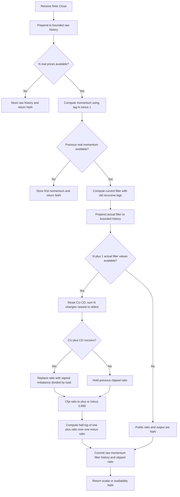

# Ehlers RocketRSI — Fisher transform of RSI on smoothed momentum

This folder is the standalone **research prototype master reference** for the RocketRSI sidebar in John F. Ehlers' “RocketRSI—A Solid Propellant For Your Rocket Science Trading,” *Technical Analysis of Stocks & Commodities*, volume 36, May 2018, pages 8–12. The executable master is [rocket-rsi.py](rocket-rsi.py). `RocketRSI.update(close)` accepts one chronological scalar price and returns one scalar oscillator value. It uses only Python's standard library.

The calculation is **momentum → SuperSmoother → finite-window centered RSI → clipping → Fisher transform**. Its default parameters are `smooth_length=8` and `rsi_length=10`. The article's plotted zero line is a reference level, not an additional output. Intermediate values are available as diagnostics through the `state` property.

The separate [my-rsi reference](../my-rsi/description.md) implements the article's price-based MyRSI sidebar: it smooths Close directly and returns a bounded centered ratio. RocketRSI instead smooths **momentum** and transforms its ratio. These are distinct indicators with distinct expected values. This document includes the complete relevant equations and theory so it can be used without the sibling folder or original sources.

**Reference-data status:** the user confirmed all twenty parameter pairs on **2026-10-20**. All five language fixtures now contain twenty expected arrays with 252 entries each, 15-significant-digit finite values, and the documented warmup NaNs. All original input values are preserved, and all 252 original `INPUT_CLOSE` values are embedded in `__main__`. Cross-language equality and repeatable regeneration have been verified.

## 1. Sources, numerical authority, and precision policy

The sources read for this implementation are:

- [May 2018 article](../../tasc/2018-05-rocket-rsi-a-solid-propellant-for-your-rocket-science-trading/content.md): complete RSI algebra, MyRSI and RocketRSI listings, half-cycle tuning argument, smoothing discussion, and Fisher interpretation.
- [May 2018 Traders' Tips](../../tasc/2018-05-rocket-rsi-a-solid-propellant-for-your-rocket-science-trading/tips/tips.md): TradeStation, MetaStock, eSignal, Wealth-Lab, AmiBroker, NeuroShell, TradersStudio, Quantacula, NinjaTrader, and spreadsheet examples.
- Explicit [TradeStation code](../../tasc/2018-05-rocket-rsi-a-solid-propellant-for-your-rocket-science-trading/tips/RRSI.els), [NinjaTrader RocketRSI](../../tasc/2018-05-rocket-rsi-a-solid-propellant-for-your-rocket-science-trading/tips/ninja-trader/RocketRSI.cs), [eSignal EFS](../../tasc/2018-05-rocket-rsi-a-solid-propellant-for-your-rocket-science-trading/tips/code/RocketRSI.efs), and the vendor listings compared in section 6.
- Ehlers, *Cycle Analytics for Traders* (2013), [Chapter 3](../../2013-cycle-analytics-for-traders/ch3.md) for SuperSmoother equation (3-3), [Chapter 7](../../2013-cycle-analytics-for-traders/ch7.md) for the finite-window RSI/half-cycle argument, and [Chapter 15](../../2013-cycle-analytics-for-traders/ch15.md) for indicator transforms.

No `mesa/` source is present in the input folder. Wilder's 1978 book is referenced in the article but no original book chapter is supplied; the article's complete RSI derivation is reproduced below.

The **May 2018 article RocketRSI listing**, corroborated by TradeStation, defines the numerical algorithm. In particular:

- Momentum uses `Close - Close[RSILength - 1]`, not a lag of `RSILength`.
- The filter has two recursive output lags initialized to zero.
- Gains/losses are recomputed newest to oldest with the literal source addition/subtraction association.
- `MyRSI` persists when `CU+CD==0`, and clipping overwrites that persistent variable.
- Fisher is the literal `0.5 * log((1+x)/(1-x))` expression.

The user requested **full-precision constants**, so the master replaces source `1.414` by `math.sqrt(2.0)` and `3.14159` by `math.pi`. These substitutions apply to coefficients, with radians used consistently. The `0.999` limiter is a deliberate threshold, not an approximation to a mathematical constant; it remains exactly the source setting and is not an extra configurable parameter.

Recursive state and all intermediate calculations retain binary64 precision. Expected output is rounded only during final text emission. Full-precision coefficients and an explicit finite-record startup mean values are authoritative for this documented implementation; they cannot be bit-identical to every rounded-constant vendor implementation with different hidden prehistory.

## 2. Principles and physical analogies

### 2.1 Why price-based RSI can remain biased during a trend

The article's centered MyRSI is the difference of accumulated gains and losses divided by their total. A persistent upward price trend supplies more positive than negative changes, so its output can remain near $+1$; a persistent downward trend can remain near $-1$. Its mean need not be zero over a trending interval.

RocketRSI applies the same ratio to **changes in smoothed momentum**, rather than changes in smoothed price. Imagine a vehicle's position as price: a sustained constant speed changes position continuously but does not change its speed. A finite difference of positions estimates speed over a chosen interval; differences of that momentum then respond more to changes in speed or cyclic movement than to a steady linear position trend.

Momentum is not divided by its lag in the article; it is a displacement over that lag, not a calibrated derivative. The later gain/loss ratio cancels a common positive scale, so the missing division need not affect the ideal normalized ratio. Preserve the source formula in numerical ports.

### 2.2 Displacement versus total travel

Think of the filtered momentum waveform as a particle moving up and down. `CU` is upward distance traveled and `CD` is downward distance traveled, expressed positively. Their difference is net displacement; their sum is total travel. The signed ratio is $+1$ for an entirely rising interval, $-1$ for an entirely falling interval, and zero when upward/downward travel balance.

These movements refer to **filtered momentum**. A positive ratio does not necessarily mean price is rising; it means recent changes in filtered momentum have a positive aggregate imbalance. The Fisher output preserves the sign of this ratio and magnifies it near the limits.

### 2.3 Smoothing and the resonator analogy

The two-pole SuperSmoother behaves like a damped resonator with memory. Its conjugate poles retain recent state and suppress rapid fluctuations. A two-input average in the feedforward path removes an exactly alternating component at the Nyquist frequency. The smoothing period controls damping and rotation together.

The article prefers smoothing **before** the nonlinear RSI. Input smoothing permits intervals of entirely rising/falling filtered movement to retain the ratio's full swing. Smoothing an already bounded ratio instead averages brief extremes inward. The two operations do not commute for general input:

$$
\operatorname{RSI}(\operatorname{Smooth}(M))
\ne\operatorname{Smooth}(\operatorname{RSI}(M)).
$$

The article's statement that equivalent smoothing preserves zero crossings is an idealized observation, not a universal identity for arbitrary noisy data. This master smooths momentum before the ratio and adds no output smoothing.

### 2.4 Fisher as a magnifying glass near the limits

The transform $\operatorname{atanh}(x)$ is approximately $x$ near zero, but its slope grows strongly as $x$ approaches $\pm1$. It turns extended near-extreme ratios into large peaks on the display. As a pointwise monotone map, it supplies no independent observations and no additional time filter. It preserves signs and zero crossings of its input ratio.

Clipping prevents infinite output at $x=\pm1$. Because of clipping, large enough ratios produce saturated plateaus rather than distinct unbounded peaks. The transform is useful for highlighting extremes, while momentum supplies the main behavioral change from the price-based MyRSI.

## 3. Complete mathematical calculation

### 3.1 Symbols and units

| Symbol | Source name | Meaning |
|---|---|---|
| $p_t$ | `Close` | Raw scalar price at chronological index $t$, with the first input at $t=0$. |
| $S$ | `SmoothLength` | Real smoother coefficient period in observations. |
| $N$ | `RSILength` | Integer RSI change count; also determines the momentum lag. |
| $L=N-1$ | `RSILength-1` | Raw momentum lag. |
| $M_t$ | `Mom` | Momentum over $L$ observations. |
| $f_t$ | `Filt` | SuperSmoother output of momentum, in price units. |
| $CU_t,CD_t$ | `CU`, `CD` | Positive gain/loss magnitudes of filtered-momentum changes. |
| $r_t$ | Ratio before clipping | Centered finite-window gain/loss imbalance. |
| $x_t$ | Persistent clipped `MyRSI` | Actual input to Fisher; held when the denominator is zero. |
| $z_t$ | `RocketRSI` | Final dimensionless scalar returned by `update`. |

EasyLanguage `X[k]` means $k$ observations before the current one. `Cosine` takes degrees, while Python `math.cos` takes radians. A “bar” is one accepted observation, not a calendar-time duration inferred by the class.

### 3.2 Full RSI derivation from the article and Chapter 7

Wilder's displayed definition is:

$$
RSI_{100}=100-\frac{100}{1+RS},
\qquad
RS=\frac{\text{average gain}}{\text{average loss}}.
$$

Ehlers removes the irrelevant factor 100 and accumulates equal-length gain/loss sums. The complete article algebra is:

$$
RSI_{01}=1-\frac1{1+CU/CD}
=1-\frac{CD}{CU+CD}
=\frac{CU}{CU+CD}.
$$

Chapter 7 gives the equivalent conventional-scale derivation:

$$
RSI_{100}=100-\frac{100}{1+CU/CD}
=100-\frac{100CD}{CU+CD}
=\frac{100(CU+CD)-100CD}{CU+CD}
=\frac{100CU}{CU+CD}.
$$

Dilate and translate to the range $[-1,1]$:

$$
r=2RSI_{01}-1
=\frac{2CU}{CU+CD}-1
=\frac{CU-CD}{CU+CD}.
$$

Canceling averages is valid when both sides are divided by the same observation count. Substituting finite-window sums for Wilder's recursively averaged gains/losses changes time weighting; this is not standard Wilder RSI with a cosmetic rescaling.

### 3.3 Momentum: preserve the source's off-by-one choice

The actual source code is:

```text
Mom = Close - Close[RSILength - 1];
```

Therefore:

$$
L=N-1,
\qquad
M_t=p_t-p_{t-L}.
$$

Although the article describes momentum over half the dominant cycle, its code uses $N-1$. At default $N=10$, momentum spans **nine intervals between ten prices**. Changing it to ten intervals produces a different indicator. With $N=1$, the lag is zero and momentum is identically zero for every finite price; the primed RocketRSI is then zero. This boundary is supported and explicitly tested.

### 3.4 SuperSmoother as printed in the article and Chapter 3 equation (3-3)

The complete relevant source coefficients and recurrence are:

$$
\begin{aligned}
a_1&=\exp\left(-\frac{1.414\cdot3.14159}{S}\right),\\
b_1&=2a_1\cos_{\mathrm{degrees}}\left(\frac{1.414\cdot180}{S}\right),\\
c_2&=b_1,\\
c_3&=-a_1a_1,\\
c_1&=1-c_2-c_3,\\
f_t&=c_1(M_t+M_{t-1})/2+c_2f_{t-1}+c_3f_{t-2}.
\end{aligned}
$$

Coefficients are computed once. The user-requested full-precision counterpart actually implemented is:

$$
\begin{aligned}
\theta&=\sqrt2\pi/S,\\
a_1&=e^{-\theta},\\
c_2&=2a_1\cos\theta,\\
c_3&=-a_1^2,\\
c_1&=1-c_2-c_3,\\
f_t&=c_1(M_t+M_{t-1})/2+c_2f_{t-1}+c_3f_{t-2}.
\end{aligned}
$$

Preserve this operation order:

```python
angle = math.sqrt(2.0) * math.pi / smooth_length
a1 = math.exp(-angle)
c2 = 2.0 * a1 * math.cos(angle)
c3 = -a1 * a1
c1 = 1.0 - c2 - c3
filtered = c1 * (momentum + previous_momentum) / 2.0 + c2 * filt1 + c3 * filt2
```

The negative `c3` is **added as a signed term**. Do not halve `c1` and then also divide the recurrence by two. Read old lags before replacing them. The article has no first-three-bar pass-through override or EMA substitution.

### 3.5 Finite gain/loss window and persistent clipping

For $k=0,\ldots,N-1$, define:

$$
d_{t,k}=f_{t-k}-f_{t-k-1},
\qquad
CU_t=\sum_{k=0}^{N-1}\max(d_{t,k},0),
\qquad
CD_t=\sum_{k=0}^{N-1}\max(-d_{t,k},0).
$$

The source uses **$N$ changes and $N+1$ filtered values**. Losses are accumulated positively. Reset both sums on each bar and run newest to oldest:

```python
cu = 0.0
cd = 0.0
for count in range(rsi_length):
    newer = history[count]
    older = history[count + 1]
    if newer - older > 0.0:
        cu = (cu + newer) - older
    if newer - older < 0.0:
        cd = (cd + older) - newer
```

Parentheses make the source's **left association** explicit. `cu += newer-older`, telescoping the numerator, reversing traversal, maintaining rolling sums, or using compensated summation can change low-order reference bits. The executable keeps the source arithmetic, not an algebraically improved alternative.

The source ratio has no else assignment and is then clipped in place. Its complete persistent-state rule is:

$$
u_t=
\begin{cases}
(CU_t-CD_t)/(CU_t+CD_t),&CU_t+CD_t\ne0,\\
x_{\mathrm{previous\ stored}},&CU_t+CD_t=0,
\end{cases}
\qquad
x_t=\min(0.999,\max(-0.999,u_t)).
$$

Initial stored $x$ is zero. The stored value is **clipped**, because the article overwrites `MyRSI` when limiting it. A flat window holds that value. It does not return NaN, automatically reset to zero, or recover an unclipped $\pm1$ from a different hidden state.

For interpretation, in real arithmetic:

$$
CU_t-CD_t=f_t-f_{t-N},
\qquad
CU_t+CD_t=\sum_{k=0}^{N-1}|f_{t-k}-f_{t-k-1}|.
$$

The triangle inequality gives a pre-clipping ratio in $[-1,1]$ whenever the denominator is positive. Exact ties contribute zero; no epsilon, volatility floor, or loss sign reversal is applied.

### 3.6 Fisher transform and exact bounds

The final article equation is:

$$
z_t=\frac12\ln\left(\frac{1+x_t}{1-x_t}\right)
=\operatorname{atanh}(x_t).
$$

The master evaluates the literal logarithm of a ratio. `atanh`, `log1p`, or other equivalent evaluations can round differently. Clipping guarantees finite arguments and bounds the output in exact arithmetic by:

$$
|z_t|\le\operatorname{atanh}(0.999)
=\frac12\ln(1999)
\approx3.8002011672502.
$$

The source comment “limit RocketRSI output to +/- 3 standard deviations” is **not** an exact $\pm3$ numerical limit. Near zero:

$$
\operatorname{atanh}(x)=x+\frac{x^3}3+\frac{x^5}5+\cdots,
\qquad
\frac{d}{dx}\operatorname{atanh}(x)=\frac1{1-x^2}.
$$

This explains the magnification near the limits and sign/zero-crossing preservation. The source $\pm2$ plotted interpretation corresponds to ratio magnitude:

$$
|x|>\tanh(2)\approx0.964027580075817.
$$

This is a threshold on the ratio's extremity, not an estimated statistical confidence.

## 4. Cycle tuning, linear preprocessing, and trend behavior

The article and Chapter 7 recommend RSI length around half the dominant cycle, $N\approx D/2$. For a continuously sampled ideal sine $f(t)=B+A\sin(\omega t)$ with $D=2\pi/\omega$, net displacement over a half-cycle is $2A\sin(\omega t)$ and absolute travel is $2|A|$. Thus its centered gain/loss ratio has the input sine's phase and full amplitude in the ideal continuous model.

In discrete data the denominator is the sum of sampled absolute changes. Sampling phase, sampled extrema, multiple components, and an incorrect period can change its shape. The input smoother adds frequency-dependent lag. The article's “zero lag” description does not make RocketRSI a predictor or guarantee zero delay relative to raw prices.

The finite momentum's linear response is:

$$
H_M(z)=1-z^{-L},
\qquad
H_M(e^{i\omega})=2i\,e^{-i\omega L/2}\sin(\omega L/2).
$$

It rejects DC and has magnitude $2|\sin(\omega L/2)|$. For $p_t=B+A\sin(\omega t)$:

$$
M_t=2A\sin(\omega L/2)\cos\bigl(\omega(t-L/2)\bigr).
$$

If $L$ were exactly a half-cycle, it would double the sinusoid while keeping its phase. With the article's actual $L=N-1$ and an ideal even cycle $D=2N$, momentum has a half-observation phase lead at that cycle; the smoother can more than offset that lead. This is a frequency-specific identity, not a universal latency claim.

The smoother's transfer response is:

$$
H_S(z)=\frac{(c_1/2)(1+z^{-1})}{1-c_2z^{-1}-c_3z^{-2}},
$$

with poles $a_1e^{\pm i\theta}$, DC gain one, and a zero at Nyquist $z=-1$. Chapter 3 derives this as a low-lag two-pole Butterworth-style approximation with a two-element average added in the numerator. Its attenuation is roughly $12$ dB/octave past the analog-style corner; the discrete response near Nyquist is governed by the zero and sampling. The source's smoother period is a practical cutoff control, not an exactly calibrated cutoff at every short period.

Its low-frequency group delay and homogeneous decay scale are:

$$
\tau_S(0)=\frac12+\frac{c_2+2c_3}{1-c_2-c_3},
\qquad
\tau_{\mathrm{decay}}=\frac{S}{\sqrt2\pi}.
$$

Chapter 3 discusses systemic trading noise and aliasing from sampling. Nyquist is $0.5$ cycles/bar, corresponding to two-bar cycles; its empirical noise discussion motivates smoothing around ten bars. A smoother attenuates short-period components and does not recover information already lost to undersampling. The May article permits smoother periods as short as three and advises against excessive smoothing relative to RSI length.

The combined **linear** preprocessing is $H_M(z)H_S(z)$. The numerator of a non-flat RSI window has an additional difference $f_t-f_{t-N}$, so the unnormalized signed displacement has linear response:

$$
H_{\mathrm{numerator}}(z)=(1-z^{-N})(1-z^{-L})H_S(z).
$$

This has two DC zeros for $L>0$ and removes settled affine price components from the signed displacement. The ratio and Fisher transform are nonlinear; they do not have a single universal Fourier response.

For a constant price, momentum is exactly zero from its first available sample, the filter remains zero, and the primed output is neutral zero. For a linear price ramp $p_t=b+vt$, momentum becomes the constant $vL$. Its filter still has a zero-seed transient, and eventual flatness leaves a zero denominator. Because the article **holds the last clipped ratio** in that case, a ramp does not force RocketRSI to zero after settling. This subtle persistent-state behavior limits the claim that momentum always establishes a zero mean. Time-varying trends and cycles likewise need not produce zero mean on every finite record.

Adding a constant offset to all prices cancels in momentum, so the ideal complete indicator is invariant to price-level shifts from the beginning. Multiplying prices by a positive constant cancels in the ratio; negating prices negates the ratio and Fisher output, apart from finite rounding. This distinguishes the preprocessing from price-based MyRSI's zero-seeded smoothing transient.

## 5. Fisher background from Chapter 15 and statistical interpretation

Chapter 15 presents the same transform and its intended application to a bounded, approximately zero-mean oscillator. Its older adaptive-RSI example first centers a $[0,1]$ RSI and amplifies it by 1.5:

$$
v_t=2(\operatorname{BookRSI}_t-0.5),
\qquad
x_t=\operatorname{clip}(1.5v_t,-0.999,0.999),
\qquad
\operatorname{Fish}_t=\tfrac12\ln[(1+x_t)/(1-x_t)].
$$

The 1.5 amplification belongs to that older code fragment; it is **absent** from May 2018 RocketRSI. The chapter's inverse Fisher and cube transforms are:

$$
\operatorname{IFish}(u)=\frac{e^{2Ku}-1}{e^{2Ku}+1}=\tanh(Ku),
\qquad
\operatorname{Cube}(u)=u^3.
$$

They illustrate alternate display shaping, not additional RocketRSI stages. Chapter 7 also uses a different older `MyRSI` based on a roofing filter and an optionally smoothed uncentered ratio. This master follows the May 2018 pipeline and does not add that roofing filter or output smoother.

The article says Fisher produces an approximately Gaussian distribution expressed in standard deviations, with extremes beyond $\pm2$ signaling likely cyclic reversals. A monotone transform by itself does **not guarantee a normal distribution, zero mean, or unit variance**. The code estimates none of those statistical quantities. Under an independently established standard normal model the one-sided tail past 2 is approximately $2.275\%$ and the two-sided tail is $4.55\%$; these are not proven probabilities of a price reversal here. The informal normal-tail percentages in Chapter 15 also do not match standard normal tail values.

The article's practical example uses `RSILength=10` for a nominal twenty-bar market cycle. It treats negative RocketRSI spikes below $-2$ as long-entry timing and positive spikes above $+2$ as exit/short timing, subject to a dominant cycle and smoothing lag. Traders' Tips variants test other crossing conventions and holding periods, and Wealth-Lab explicitly questions the stability of the dominant cycle. The master produces the indicator; it adds no strategy, capital sizing, orders, stops, or probability estimator.

## 6. Configuration, exact startup, and source differences

### 6.1 API and ranges

| Setting/property | Default | Meaning and valid behavior |
|---|---:|---|
| `smooth_length` | 8.0 | Finite real $S\ge3$, bool rejected; fractions kept. Computed coefficients must have representable stable pole and positive feedforward gain. |
| `rsi_length` | 10 | Integer $N\ge1$, bool rejected; both RSI changes and momentum lag $N-1$. No artificial fixed maximum; memory/work scale with $N$. |
| `momentum_lag` | 9 | Derived $N-1$, read-only. |
| Clipping | 0.999 | Fixed source threshold; not a configurable parameter. |
| `update(close)` | — | One finite scalar input, returning one Fisher-transformed scalar. Invalid inputs/overflow raise `ValueError` without advancing state. |
| `warmup_bars` | 20 | $2N$, the initial NaN count and first numeric zero-based index. |
| `is_primed` | False | True when $N+1$ actual filtered momentum observations exist, including flat windows. |
| `state` | All NaN | Named tuple of latest public momentum, filter, clipped ratio, final output. Availability differs by stage. |
| `output` | NaN | Latest public RocketRSI scalar without advancing the stream. |
| `reset()` | — | Discards actual histories, zeroes recursive filter lags and clipped ratio seed; preserves parameters. |

Configuration is read-only; construct another instance for different settings. Negative input prices are allowed. The article recommends modest smoothing, often $S\le N$, but this is guidance rather than a hard mathematical constraint. Cases with $S>N$ show additional lag. At enormous periods binary64 can round the pole to one or cancel `c1` away; such settings are rejected rather than silently creating a numerically frozen filter.

### 6.2 Exact finite-record startup

Only real inputs count as observations. At $L=N-1$:

| Zero-based input index | Available stage | Calculation and output |
|---:|---|---|
| $0\ldots N-2$ | Raw history only | Momentum unavailable; public output NaN. Empty interval when $N=1$. |
| $N-1$ | First actual momentum | $M_{N-1}=p_{N-1}-p_0$; store it, but no previous actual momentum exists. Output NaN. |
| $N$ | First actual filter value | $f_N=c_1(M_N+M_{N-1})/2$ with both recursive lags zero. Output NaN. |
| $N+1\ldots2N-1$ | Filter/history building | Recurse each bar; fewer than $N$ actual filter changes exist. Output NaN. |
| $2N$ | First complete RSI window | $f_N,\ldots,f_{2N}$ supply $N$ changes. Compute ratio, clip, Fisher. First numeric output. |
| Later | All stages | Retain newest bounded windows and calculate one source update. |

Therefore the public NaN prefix is **$2N$**, independent of `smooth_length`. Defaults need 21 observations to produce the first result at index 20, approximately **-0.595891604879661** on the fixture. A longer smoother may remain in transient after this structural availability threshold.

Zero recursive **filter outputs** follow `Filt(0)` but are never treated as actual filter observations. There is no zero-price prehistory, fabricated first momentum, partial RSI, first-price seed, delayed whole-RSI gating of the smoother, or extra smoother-length waiting period. Public NaNs never enter private state.

### 6.3 Source variants and compatibility choices

| Source | Relevant differences | Master decision |
|---|---|---|
| Article RocketRSI | S=8/N=10, actual momentum lag N-1, rounded constants, zero recursive variables, persistent clipped ratio. Platform history implicit. | Numerical authority with full-precision constants and real-input startup above. |
| TradeStation `RRSI.els` | Same equations and persistent clipping; defaults S=10/N=10; adds OBOS plots and a strategy. | Article default remains 8/10; 10/10 is a confirmed reference setting; no strategy fields or threshold parameter. |
| eSignal EFS | Already uses full sqrt(2)/pi; waits for previous actual momentum, but adds outer `S+N+1` gating and an extra filtered-history check. Parenthesized change accumulation differs in rounding; its local RSI resets to zero on flat windows. | Supports full constants and actual momentum pairing; preserve article sum association, actual N-change window, and persistent clipped ratio. |
| NinjaTrader RocketRSI | Delays all computation until `CurrentBar>=N`; first filter pairs actual momentum with zero; zero-filled filter array immediately supplies RSI history; N=1 array cannot satisfy `Filt[2]`. | Start real stages when their own inputs exist; keep two independent filter lags and support zero-lag momentum boundary. |
| MetaStock `RRSI.msl` | Core equations match, but the printed RocketRSI flat-denominator fallback is 50 before clipping, yielding a positive extreme. | Preserve article no-else hold with initial clipped ratio zero. |
| TradersStudio `RRSI.trs` | Named RocketRSI but directly smooths Close, omitting momentum; coefficient guard is `If CurrentBar - 1 Then`. | Do not propagate the missing momentum or ambiguous guard. |
| AmiBroker `RRSI.afl` | Positive `Ref` offsets in momentum, reverse difference signs, and later compensating shift; rounded constants. | Follow the direct causal article lags; do not import shifted vendor indexing. |
| Wealth-Lab, NeuroShell, Quantacula, spreadsheet | External studies or strategy/presentation examples; unavailable library internals cannot define a unique startup. | Context and parameter examples only; article equations govern this independent master. |

Source-equation checks are not claims of running a proprietary trading platform. Different initial history, gating, state retention, or constants will produce different initial and sometimes later output.

## 7. Algorithmic flow and portable state

State consists of at most $N$ raw prices, one previous real momentum or an unavailable sentinel, two independent filter lags, at most $N+1$ actual filtered values in newest-first order, and one stored clipped ratio. Diagnostic state is optional during conversion. A fixed array/ring buffer is valid if it preserves source lag indexing and newest-to-oldest accumulation.







Input and arithmetic checks occur before state commit. Nonfinite input/overflow is rejected without consuming a bar. No final-output rounding occurs in the update flow.

## 8. Confirmed reference cases and five-language fixture contract

All twenty cases below were confirmed by the user on 2026-10-20 and generated, below the requested maximum of 64. The pairs largely match the MyRSI reference for useful comparisons; record-boundary RSI lengths differ because RocketRSI needs additional momentum history. `S` abbreviates `smooth_length`; `R` abbreviates `rsi_length`. Clipping remains fixed.

| Python array | SmoothLength | RSILength | What it tests |
|---|---:|---:|---|
| `EXPECTED_S8_R10` | 8 | 10 | Article RocketRSI default and nominal twenty-bar cycle. |
| `EXPECTED_S3_R1` | 3 | 1 | Zero-lag momentum boundary: primed outputs are identically zero. |
| `EXPECTED_S3_R2` | 3 | 2 | One-bar momentum and the shortest nondegenerate RSI window. |
| `EXPECTED_S3_R5` | 3 | 5 | Minimum smoothing with a short momentum and RSI horizon. |
| `EXPECTED_S3_R10` | 3 | 10 | Default RSI horizon with minimum smoothing lag. |
| `EXPECTED_S5_R10` | 5 | 10 | Default RSI horizon with fast intermediate smoothing. |
| `EXPECTED_S10_R10` | 10 | 10 | TradeStation RocketRSI default and matched parameter periods. |
| `EXPECTED_S8_5_R10` | 8.5 | 10 | Fractional smoother period without coefficient-period rounding. |
| `EXPECTED_S20_R10` | 20 | 10 | Smoother longer than the RSI horizon and increased lag. |
| `EXPECTED_S8_R5` | 8 | 5 | Default smoothing with a short momentum and RSI horizon. |
| `EXPECTED_S8_R8` | 8 | 8 | Matched eight-bar settings and nominal sixteen-bar cycle. |
| `EXPECTED_S8_R14` | 8 | 14 | Default smoothing with a fourteen-change RSI window. |
| `EXPECTED_S8_R20` | 8 | 20 | Default smoothing with a nominal forty-bar cycle. |
| `EXPECTED_S8_R30` | 8 | 30 | Default smoothing with a long thirty-change RSI window. |
| `EXPECTED_S10_R20` | 10 | 20 | Moderate smoothing relative to a twenty-change RSI window. |
| `EXPECTED_S20_R40` | 20 | 40 | Longer smoothing and a nominal eighty-bar cycle. |
| `EXPECTED_S40_R80` | 40 | 80 | Slow smoothing and extended momentum and RSI horizons. |
| `EXPECTED_S8_R125` | 8 | 125 | Record boundary: only the final two observations are primed. |
| `EXPECTED_S8_R126` | 8 | 126 | Record boundary: every output remains unprimed. |
| `EXPECTED_S252_R10` | 252 | 10 | Full-record smoothing period with a long recursive transient. |

Every case generates **252 scalar RocketRSI entries** from the original `INPUT_CLOSE`. NaN prefix length is $\min(2N,252)$, with finite values afterwards. Defaults have 20 NaNs and 232 numeric values. R=125 has 250 NaNs and two numeric values; R=126 has 252 NaNs. The first numeric index $2N$ is always even, so this 252-input record cannot yield exactly one primed observation for integer N under this startup policy.

The generator first appends Python arrays, then **reopens and verifies the written Python file**, checking names, lengths, prefixes, finite tails, and 15-digit output. It uses those verified written values for the four language translations. Original Close/High/Low/Open arrays remain intact; RocketRSI consumes only Close.

Each expected array has two preceding comments: the exact table “What it tests” text, then `smooth_length=<S>, rsi_length=<R>`. Floating values use **15 significant decimal digits**, via `.15g`, rather than 15 digits after the decimal point. Round only serialized text, never recursive state.

| File | Example declaration | NaN spelling |
|---|---|---|
| `test_testdata.py` | `EXPECTED_S8_5_R10 = [...]` | `NaN` alias of `math.nan` |
| `testdata_test.go` | `var expectedS8_5_R10 = []float64{...}` | `math.NaN()`, with `import "math"` |
| `testdata.ts` | `export const expectedS8_5_R10: number[] = [...]` | `NaN` |
| `testdata.rs` | `pub fn expected_s8_5_r10() -> Vec<f64>` | `f64::NAN` |
| `testdata.zig` | `pub fn expectedS8_5_R10() [252]f64` returning `.{...}` | `nan`, from `math.nan(f64)` |

Go package becomes `rocketrsi`. TypeScript keeps its valid `export const testInput: number[]` input. Rust retains its original `#[cfg(test)] pub mod testdata` input module and appends expected helpers at file scope; access original inputs via `testdata::test_input()`. Zig preserves `const math = @import("std").math;` and `const nan = math.nan(f64);` at the top. User examples `math.Nan()`, `f64:NAN`, and function-like TypeScript const syntax are rendered using valid language spellings above.

Normal execution demonstrates streaming usage without touching fixture data:

```bash
python3 rocket-rsi.py
```

Confirmation is recorded in `REFERENCE_CASES_CONFIRMED = True`. Regenerate all five language files with:

```bash
python3 rocket-rsi.py --generate-reference-data
```

Reruns replace only the marked `BEGIN/END GENERATED ROCKET RSI EXPECTED DATA` section, preserving inputs and avoiding duplicates. Finite conversion comparisons should use numerical tolerance, for example absolute and relative $5\cdot10^{-13}$, while comparing NaNs through `isnan`. Transcendental libraries and serialized precision can differ in low bits; preserve source arithmetic before widening tolerances to hide an implementation mismatch.

## 9. Verification and conversion pitfalls

The standard-library suite [test_rocket_rsi.py](test_rocket_rsi.py) passes fourteen focused tests. It compares all confirmed cases and their momentum/filter/clipped-ratio intermediates with an independent absolute-index article translation, and compares every written Python expected array with that translation. It also checks exact structural startup, N=1 zero-lag momentum, constant inputs, full-scale clipping/Fisher limits, exact flat-window retention, offset invariance, negation symmetry, rejected nonfinite/overflow inputs, reset, parameter validation, embedded fixture equality, and the confirmation guard. The guard test temporarily clears the in-memory flag so it remains meaningful after confirmation.

Every translated array has been verified against the reopened Python data: twenty unique names, both comment lines, 252 values, exact matching finite decimal values, correct NaN prefixes, finite tails, and preservation of original inputs. Each fixture contains one generated section. Regeneration was checked in a temporary copy and is byte-for-byte stable across all five files.

Go, Rust, and Zig compiler/execution checks passed with every expected helper instantiated, including the entirely unprimed and zero-output cases. The TypeScript file was imported and executed with Node.js 24.15.0 native type stripping; every exported expected array and input array passed length and availability checks. This is a runtime syntax check, not a separate TypeScript compiler type check. Verification harnesses and build caches were kept outside the reference folder. Output arrays are for the scalar RocketRSI only, not diagnostic state fields.

Common conversion errors include using the price-based MyRSI output as input, changing the source momentum lag N-1 to N, dividing momentum by the lag and failing for N=1, treating zero filter seeds as actual RSI data, copying vendor whole-study gating, using N prices instead of N changes, omitting input smoothing, adding an output smoother or older roofing filter, flipping the c3 sign, double-halving gain, changing sum association/traversal, resetting flat-window ratios, retaining an unclipped ratio behind the scenes, replacing Fisher with inverse Fisher, or treating the source's “three sigma” comment as a literal numerical bound.

## 10. References and BibTeX

1. Ehlers, John F. “RocketRSI—A Solid Propellant For Your Rocket Science Trading.” *Technical Analysis of Stocks & Commodities*, 36(5), May 2018, pp. 8–12. [Article archive](https://technical.traders.com/archive/article.asp?file=%5CV36%5CC05%5C207EHLE.pdf). Primary RocketRSI/MyRSI equations and interpretation.
2. *Technical Analysis of Stocks & Commodities*. “Traders' Tips: May 2018.” [Online collection](https://www.traders.com/Documentation/FEEDbk_docs/2018/05/TradersTips.html). Publication source for all vendor listings cited and compared above.
3. Ehlers, John F. *Cycle Analytics for Traders: Advanced Technical Trading Concepts*. Wiley, 2013. ISBN 9781118728604. Chapters 3, 7, and 15 supply the directly relevant filter, RSI, and transform background reproduced here.
4. Wilder, J. Welles. *New Concepts in Technical Trading Systems*. Trend Research, 1978. Source referenced by the article for conventional RSI and the fourteen-day default.

Transfer-function, displacement/travel, startup, phase, and statistical clarifications are direct derivations or standard mathematical identities based on the reproduced equations; they do not require an inaccessible additional indicator source.

```bibtex
@article{ehlers2018rocketrsi,
  author = {Ehlers, John F.},
  title = {{RocketRSI}---A Solid Propellant For Your Rocket Science Trading},
  journal = {Technical Analysis of Stocks \& Commodities},
  volume = {36},
  number = {5},
  pages = {8--12},
  year = {2018},
  month = may,
  url = {https://technical.traders.com/archive/article.asp?file=%5CV36%5CC05%5C207EHLE.pdf}
}

@misc{traders_tips_2018_05,
  author = {{Technical Analysis of Stocks \& Commodities}},
  title = {Traders' Tips: May 2018---RocketRSI and MyRSI},
  year = {2018},
  month = may,
  howpublished = {Online vendor implementation collection},
  url = {https://www.traders.com/Documentation/FEEDbk_docs/2018/05/TradersTips.html}
}

@book{ehlers2013cycle,
  author = {Ehlers, John F.},
  title = {Cycle Analytics for Traders: Advanced Technical Trading Concepts},
  publisher = {Wiley},
  year = {2013},
  series = {Wiley Trading},
  isbn = {9781118728604}
}

@book{wilder1978new,
  author = {Wilder, J. Welles},
  title = {New Concepts in Technical Trading Systems},
  publisher = {Trend Research},
  year = {1978}
}
```
