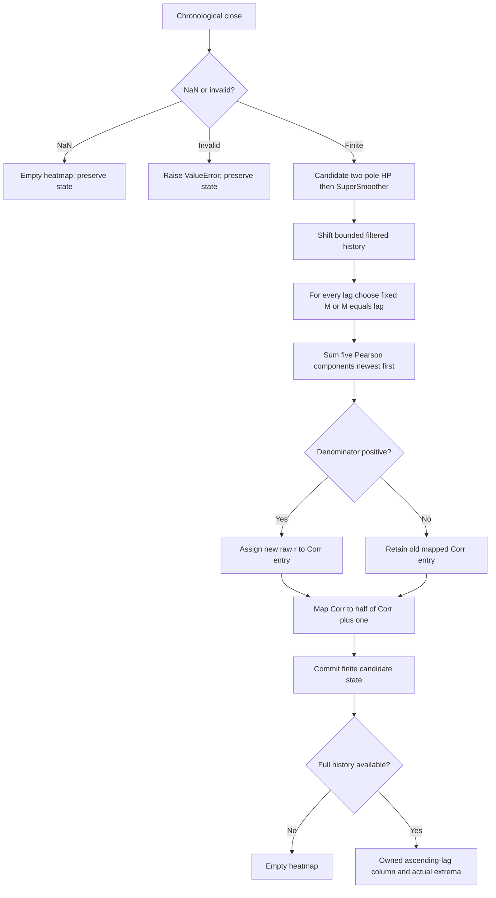

# Roofed Autocorrelation Heatmap: research prototype master reference

Master: [roofed-autocorrelation-heatmap.py](roofed-autocorrelation-heatmap.py), class `RoofedAutocorrelationHeatmap`. Returns one roofed correlation heatmap per accepted close.

## Scope and numerical authority

This is a self-contained **research prototype master reference** for conversion to Python, Go, TypeScript, Rust and Zig. Only the Python standard library is required. The streaming class takes one chronological finalized Close per `update(close, time=None)`. No future samples, full price array, chart-platform state, NumPy, pandas or zpano runtime imports are used. The numerical helper code is above the fixture-tooling comment in the executable. The original 252 `INPUT_CLOSE` observations are embedded in `__main__` and also preserved in the five copied fixture files.

John F. Ehlers, *Cycle Analytics for Traders: Advanced Technical Trading Concepts* (Wiley, 2013), is the algorithm authority. The corresponding zpano implementation informs the API and comparison notes; differences are described rather than silently substituted. Source fragments are reproduced later in this document because a conversion agent may have this folder alone.

Mathematical constants use full binary64 precision: $\pi=\texttt{math.pi}$, $\sqrt2=\texttt{math.sqrt(2.0)}$, and $1/\sqrt2$ replace printed `3.14159`, `1.414`, and `.707`. Degree-based trig functions in EasyLanguage become radians in Python. Decimal design settings such as $0.995$, $0.5$, $0.3$ and the optional cubic display remain as specified; they are not truncated versions of mathematical constants. Unrounded state uses binary64, and only serialized expected data is rounded to **15 significant decimal digits**. Full-precision coefficients necessarily give slightly different values from code that retains the rounded constants. This master preserves the recurrence and operation order rather than promising bitwise identity with those rounded implementations.

## Physical principles and shared Roofing Filter

A high-pass circuit removes slow offsets and long-period variations; a low-pass circuit removes rapid noise. Cascading these two circuits retains a middle band of periods. In market terms the goal is to examine oscillatory movement without a price level or trend dominating the result. The source calls the tendency of longer price swings to have larger amplitudes **spectral dilation**. Its approximate scaling is $A(P)\propto P$, or $A(f)\propto1/f$, corresponding to about $20\log_{10}2=6.02$ dB amplitude growth per doubling of period. This is a motivating empirical model, not a universal law for all market records.

A one-pole high-pass provides approximately 6 dB/octave attenuation toward low frequencies and may mainly equalize that amplitude growth. The book uses two poles to provide additional rejection. A two-pole SuperSmoother then reduces short-period noise. It behaves like a damped resonator, whose retained state decays while rotating in phase; averaging its feedforward input over two adjacent samples creates an exact Nyquist zero. Sampling limits still apply: the Nyquist frequency is $1/2$ cycle per bar. The book commonly selects a shortest useful period near 10 bars.

Let $x_t$ be Close at accepted observation $t$, $H$ the high-pass coefficient period, $L$ the SuperSmoother coefficient period, and $h_t,f_t$ the high-pass and roofed outputs. All periods are measured in bars. Define

$$\theta_H=\frac{2\pi}{\sqrt2H},\qquad
\alpha_H=\frac{\cos\theta_H+\sin\theta_H-1}{\cos\theta_H},\qquad q=1-\alpha_H.$$

The two-pole high-pass is

$$h_t=(1-\alpha_H/2)^2(x_t-2x_{t-1}+x_{t-2})+2q h_{t-1}-q^2h_{t-2}.$$

Its transfer function is

$$H_{HP}(z)=\frac{(1-\alpha_H/2)^2(1-z^{-1})^2}{1-2qz^{-1}+q^2z^{-2}}.$$

Equation 3-3's SuperSmoother coefficients and recurrence are

$$a=e^{-\sqrt2\pi/L},\quad b=2a\cos(\sqrt2\pi/L),\quad
c_2=b,\quad c_3=-a^2,\quad c_1=1-c_2-c_3,$$

$$f_t=\frac{c_1}{2}(h_t+h_{t-1})+c_2f_{t-1}+c_3f_{t-2}.$$

$$H_{SS}(z)=\frac{(c_1/2)(1+z^{-1})}{1-c_2z^{-1}-c_3z^{-2}},\qquad
H_{Roof}(z)=H_{HP}(z)H_{SS}(z).$$

The negative $c_3$ is **added** in the recurrence; the positive $q^2$ term is **subtracted**. Do not change these signs when translating. Fractional cutoff periods change coefficients and are never rounded into rolling-window lengths. `highpass_period` and `smoothing_period` are independent of the displayed axis and of any observation window. A compact or single-bin map therefore keeps the original roof unless explicitly configured otherwise. No mandatory $H>L$ restriction is imposed: unusual bands are permitted within the stability limits, but may attenuate most of the input.

## Streaming, startup and heatmap contract

The returned `Heatmap` has fields closely matching `external/zpano/py/indicators/core/outputs/heatmap.py`:

| Field | Meaning |
| --- | --- |
| `time` | Optional timestamp supplied by the caller; it does not affect arithmetic. |
| `parameter_first`, `parameter_last` | Inclusive first and last displayed lag or period. |
| `parameter_resolution` | 1.0; bins ascend in integer increments. |
| `value_min`, `value_max` | Actual min/max of this outgoing numerical column. |
| `values` | Fresh list of bin values; its storage is never reused by the indicator. |

A public unavailable column has `values=[]` and NaN extrema. Fixture generation expands that empty column to the chosen bin width filled with NaNs. The complete bank is primed together; partial bins are not published. An empty runtime column and a NaN fixture row represent the same unavailable result.

`parameters` is an immutable named tuple. `samples_seen` counts accepted finite observations. `warmup_bars` counts leading unavailable observations and equals the zero-based index of the first full-history output. `is_primed` describes history availability, not convergence of the recursive transient. `state` returns an immutable diagnostic snapshot. `output` retains the last accepted output; `reset()` restores all initial state while keeping configuration.

All price, filter and array prehistory is explicitly zero. The roof evolves from the **first actual close**, and downstream internal calculations also evolve during masked startup. Do not postpone filter, AGC or centroid state until public priming. A positive constant input causes a finite startup transient because the two absent closes are zero. This follows the existing book-periodogram master's finite-record convention and makes the initial condition reproducible. A commercial chart may instead evaluate many earlier prices; matching that platform requires matching its prehistory. Startup NaNs never enter recursive state.

A NaN input is an omitted observation: return an unavailable public result and preserve all state, including the last accepted output and counter. The next finite sample follows the preceding finite sample. Infinity, booleans and invalid parameters raise `ValueError`; candidate arithmetic is checked before commit, so arithmetic overflow also preserves state. All sums visit the most recent sample first. No variance epsilon, stable-centered replacement, compensated summation, min subtraction or hidden price rescaling is introduced; those can change this numerical reference.

## Reference data and conversion workflow

The user confirmed **all 36 combinations across these three folders on 2026-10-22**, twelve per folder. The original four OHLC input arrays are preserved in every language file, although this indicator consumes only `INPUT_CLOSE`. Each expected array contains 252 chronological rows or scalar values. A matrix has one column per displayed bin. Min/max are computed from the values actually displayed, including optional contrast.

Run the demo with `python3 roofed-autocorrelation-heatmap.py`. Run `python3 roofed-autocorrelation-heatmap.py --generate-reference-data` to replace only the marked generated sections of all five fixture files. Run `python3 verify_reference_data.py` to verify every name, two parameter comments, dimension, decimal and NaN mask against the master. Generation reopens Python expected arrays before translating them, so the Python decimal data is the authority for all four other languages. Repeated generation is idempotent and leaves original input arrays intact.

Python names start `EXPECTED_`; Go/TypeScript/Zig use `expected` with uppercase parameter shortcuts; Rust uses `expected_` with lowercase shortcuts. Shortcuts are `L0/L1` for lag bounds, `P0/P1` for period bounds, `A` for averaging length, `W` for DFT window, `HP/LP` for roof cutoffs, `B` for bandwidth, `SDC` for compensation, and `E` for enhancement. Booleans encode as `1/0`; decimal points encode as underscores. Component suffixes identify `HEATMAP`, `MIN`, `MAX` and, for spectra, `DOMINANT_CYCLE`.

Valid language syntax takes precedence over typos in illustrative templates: Go uses `math.NaN()`, Rust uses `f64::NAN`, TypeScript uses `NaN`, and Zig uses `const math = @import("std").math; const nan = math.nan(f64);`. Heatmaps use `number[][]`, `[][]float64`, `Vec<Vec<f64>>`, or `[252][bins]f64`. Scalar arrays use the corresponding one-dimensional types. Go package names strip hyphens/underscores from this folder name. Input fixtures compile before generation; the generator adds Go's math import when expected NaNs are emitted.

Compare NaN placement exactly and finite outputs with both absolute and relative tolerances (for example $10^{-11}$ for this bounded reference record). Libraries' sine, cosine, exponential and square root can differ in their last bits; literal precision does not imply portable bitwise equality. Do not clamp spectrum or Pearson values to conceal a disagreement. Unit tests compare the streaming calculations with a separate direct transcription of the source recurrences and include behavior that a fixture round trip alone cannot prove.

## Indicator mathematics and interpretation

The heatmap asks how similar roofed prices are to a delayed copy, across many lags. Imagine sliding one trace of a vibrating signal past another: alignment over a full cycle gives positive correlation, and half-cycle opposition gives negative correlation. Correlation measures shape over the chosen window, not amplitude or probability of a profitable trade. Adjacent lag bins use strongly overlapping observations.

Chapter 8 writes the long-memory comparison model as

$$\operatorname{Autocorrelation}(\ell)=C\ell^{-\eta},$$

where the source calls the exponent $\alpha$ and gives nominal value one. That expression concerns nonzero lags; it neither defines lag zero nor describes every possible efficient market. For a noiseless sinusoid observed over a full cycle, autocorrelation is $\cos(2\pi\ell/P)$: unity at lag zero and one period, minus unity at half a period. Short fixed averaging windows need not follow this cosine exactly. The source prose calls the lag pattern a sine wave; its phase corresponds mathematically to cosine.

For lag $\ell$, use $M_\ell=A$ if `averaging_length=A>0`, otherwise $M_\ell=\ell$. Set $X_j=f_{t-j}$ and $Y_j=f_{t-\ell-j}$ for $j=0,\ldots,M_\ell-1$. The exact Pearson sums are

$$S_x=\sum_jX_j,\quad S_y=\sum_jY_j,\quad S_{xx}=\sum_jX_j^2,\quad
S_{xy}=\sum_jX_jY_j,\quad S_{yy}=\sum_jY_j^2.$$

$$D_\ell=(M_\ell S_{xx}-S_x^2)(M_\ell S_{yy}-S_y^2),\qquad
r_t(\ell)=\frac{M_\ell S_{xy}-S_xS_y}{\sqrt{D_\ell}}\quad(D_\ell>0).$$

The source displays $C_t(\ell)=(r_t(\ell)+1)/2$, with negative correlation red, zero yellow and positive green. RGB quantization belongs to the renderer. Its stoplight palette is

$$(R,G,B)=\begin{cases}(255,510C,0),&C<1/2,\\(255(2-2C),255,0),&C\ge1/2.\end{cases}$$

### Exact zero-denominator behavior

Listing 8-2 stores the mapped value back into the **same** `Corr[]` array on every bar. It assigns a new raw correlation only if $D_\ell>0$. With no Else, the previous mapped array value survives and is mapped a second time:

$$C_t(\ell)=\begin{cases}(r_t(\ell)+1)/2,&D_\ell>0,\\(C_{t-1}(\ell)+1)/2,&D_\ell\le0.\end{cases}$$

Initially $C_{-1}(\ell)=0$. A sequence of $n$ unsuccessful denominator checks from that initial value gives $1-2^{-n}$ (until binary64 rounds to unity). More generally $C_n=1-(1-C_0)2^{-n}$. A one-sample window has zero variance, so this behavior is exercised deliberately in the confirmed reference grid. Lag zero with lag-dependent averaging has $M=0$ and also follows it. This is a published array-state artifact, not a valid estimate of correlation on constant data. Do not replace it with neutral $1/2$, retain raw $r$ in a separate array, reset it to zero, or force lag zero to unity.

The local listing contains a stray `Filt2=...` assignment in its Vars declaration, duplicate lag-7 plotting and no lag-6 plotting. The stray declaration is nonfunctional transcription debris and is excluded. Numerical output covers **every configured bin**, including lag 6; duplicate chart statements have no numerical significance. The book's averages use both windows backward in time and do not fold either one.

## Configuration and priming

| Parameter | Default | Valid range and role |
| --- | --- | --- |
| `min_lag` | 3 | Integer $\ge0$; first displayed lag. |
| `max_lag` | 48 | Integer $\ge\texttt{min_lag}$; last displayed lag. |
| `averaging_length` | 0 | Integer $\ge0$; zero selects $M=\ell$, positive selects fixed $M$, including degenerate one. |
| `highpass_period` | 48.0 | Finite real $\ge5$; must yield a resolvable stable coefficient. |
| `smoothing_period` | 10.0 | Finite real $\ge2$; must yield resolvable stable coefficients. |

Let $R=\texttt{max_lag}$ and $A=\texttt{averaging_length}$. The actual history requirement is

$$N=\max(1,R+(A\text{ if }A>0\text{ else }R)),\qquad \texttt{warmup_bars}=N-1.$$

Defaults need 96 actual roofed observations; the first public column is on accepted bar 96, index 95. Computing hidden lags $0,1,2$ does not extend that history. A single lag-zero map with $A=3$ needs three observations; lag zero with $A=0$ publishes its mapped seed on bar one. State complexity is $O(N+R)$ and each update visits $\sum_{\ell=0}^{R}M_\ell$ sample pairs. Reducing the first displayed lag changes only output width, not the internal correlation loop or roof.

## Algorithm flow



## Comparison with existing masters and zpano

The existing `autocorrelation-heatmap` master is February 2025's **Ultimate-Smoother price** correlation, with signed output and different preprocessing. It is not this 2013 roofed map. The `auto-correlation-periodogram` master applies Fourier and power processing to raw roofed lag correlations, producing a period spectrum; that is also a different output.

zpano's `auto_correlation_indicator` follows the same main roofing/Pearson idea, but resets local $r=0$ on an invalid denominator and hence emits $1/2$, while this master preserves the source's repeated mapping. zpano retains rounded `.707` and `1.414`, couples HP cutoff to maximum lag, and uses its own priming convention. Those differences preclude direct equality of fixtures. Its heatmap field structure is retained.

## Confirmed reference combinations

| Case | Parameters | What it tests |
| --- | --- | --- |
| 1 | `min_lag=3, max_lag=48, averaging_length=0, highpass_period=48.0, smoothing_period=10.0` | Published defaults: roofed Pearson map with lag-dependent averaging. |
| 2 | `min_lag=3, max_lag=48, averaging_length=2, highpass_period=48.0, smoothing_period=10.0` | Two-sample reversal window and saturated correlations. |
| 3 | `min_lag=3, max_lag=48, averaging_length=3, highpass_period=48.0, smoothing_period=10.0` | Short fixed Pearson window. |
| 4 | `min_lag=3, max_lag=48, averaging_length=20, highpass_period=48.0, smoothing_period=10.0` | Full nominal-cycle averaging window. |
| 5 | `min_lag=3, max_lag=48, averaging_length=100, highpass_period=48.0, smoothing_period=10.0` | Long fixed averaging history. |
| 6 | `min_lag=3, max_lag=48, averaging_length=1, highpass_period=48.0, smoothing_period=10.0` | Published zero-variance rescaling behavior for a degenerate one-sample window. |
| 7 | `min_lag=3, max_lag=48, averaging_length=0, highpass_period=48.0, smoothing_period=10.5` | Fractional SuperSmoother cutoff without rounding. |
| 8 | `min_lag=3, max_lag=48, averaging_length=0, highpass_period=48.0, smoothing_period=20.0` | Slower roof smoothing. |
| 9 | `min_lag=3, max_lag=48, averaging_length=0, highpass_period=80.0, smoothing_period=10.0` | Independent longer high-pass cutoff. |
| 10 | `min_lag=3, max_lag=24, averaging_length=0, highpass_period=24.0, smoothing_period=10.0` | Compact lag-dependent map and shorter roofing band. |
| 11 | `min_lag=12, max_lag=12, averaging_length=12, highpass_period=48.0, smoothing_period=10.0` | Single displayed nonzero lag. |
| 12 | `min_lag=0, max_lag=0, averaging_length=3, highpass_period=48.0, smoothing_period=10.0` | Lag-zero-only map and perfect self-correlation when variance is positive. |

All cases export HEATMAP/MIN/MAX. Expected-data completion and test counts are recorded in the validation note at the end.

## References

- John F. Ehlers, [Cycle Analytics for Traders (2013)](../../2013-cycle-analytics-for-traders/toc.md), especially [Chapter 3](../../2013-cycle-analytics-for-traders/ch3.md), [Chapter 5](../../2013-cycle-analytics-for-traders/ch5.md), [Chapter 7](../../2013-cycle-analytics-for-traders/ch7.md), and [Chapter 8](../../2013-cycle-analytics-for-traders/ch8.md).
- [Existing February 2025 Autocorrelation master](../autocorrelation-heatmap/description.md), supplied only to distinguish preprocessing and output contracts.
- Local zpano comparison: `external/zpano/py/indicators/john_ehlers/auto_correlation_indicator/auto_correlation_indicator.py` and its `params.py`. Shared output structure: `external/zpano/py/indicators/core/outputs/heatmap.py`.

```bibtex
@book{ehlers2013cycle,
  author = {Ehlers, John F.},
  title = {Cycle Analytics for Traders: Advanced Technical Trading Concepts},
  publisher = {Wiley},
  year = {2013},
  series = {Wiley Trading},
  isbn = {9781118728604}
}
@misc{zpanoResearchImplementation,
  author = {{zpano contributors}},
  title = {Python John Ehlers indicators and Heatmap output contract},
  howpublished = {Local repository snapshot, external/zpano/py/indicators},
  note = {Inspected 2026-10-22; API comparison source, not the numerical authority}
}
```

## Source appendix: supplied mathematical description and listing

The following supplied-source material retains printed constants and transcription anomalies for comparison. The equations, source decisions and precision policy above define the working implementation. Image links are replaced by captions so this folder needs no external image assets.

## Autocorrelation

If we correlate a waveform composed of perfectly random numbers by itself, the correlation will be perfect. However, if we lag one of the data streams by just one bar, the correlation will be dramatically reduced. In a long memory process with normally distributed random numbers the autocorrelation follows the power law:

$$Autocorrelation(Lag) = C * Lag^{−\alpha}$$

where $C$ is a constant and $\alpha$ has a nominal value of unity.

One of the underlying principles of technical analysis is that market data do not follow this power law of an efficient market, and we therefore can extract information from the partial correlation of the autocorrelation function.

For example, assume the data being examined is a perfect sine wave whose period is $20$ bars. The autocorrelation with zero lag, averaged over one full period of the sine wave, is unity. That is, the correlation is perfect. Introducing a lag of one bar in the autocorrelation process causes the average correlation to be decreased slightly. Introducing another bar of lag further decreases the average correlation, and so on. That is, until a lag of $10$ bars is reached. In this case, the positive alternation of the sine wave is correlated with the negative alternation of the lagged waveform and the negative alternation of the sine wave is correlated with the positive alternation of the lagged waveform, with the result that perfect anticorrelation has been reached. Continued lag increases causes the average correlation to increase until a lag of 20 bars is reached. When the lag is equal to the period of the sine wave waveform, the correlation is again perfect. In this theoretical example, the correlation values as a function of lag vary exactly as a sine wave.

Market data are considerably messier than purely random numbers or perfect sine waves but contain features of both. However, the characteristics that are uncovered by autocorrelation offer unique trading perspectives. Since the process is relatively complicated, describing how the computer code in Code Listing 8-2 works is the best path toward understanding.

**Code Listing 8-2. EasyLanguage Code for the Autocorrelation Indicator**

```easylanguage
{
  Autocorrelation Indicator
  © 2013   John F. Ehlers
}
Inputs:
  AvgLength(0);

Vars:
  alpha1(0),
  Filt2= (1 - alpha1 / 2)*(Filt - Filt[1]) + (1 - alpha1)*Filt2[1];
  HP(0),
  a1(0),
  b1(0),
  c1(0),
  c2(0),
  c3(0),
  Filt(0),
  M(0),
  N(0),
  X(0),
  Y(0),
  Lag(0),
  count(0),
  Sx(0),
  Sy(0),
  Sxx(0),
  Syy(0),
  Sxy(0),
  Color1(0),
  Color2(0),
  Color3(0);

Arrays:
  Corr[48](0),
  AuroraRaw[48](0),
  Aurora[48](0);

//Highpass filter cyclic components whose periods are shorter than 48 bars
alpha1 = (Cosine(.707*360 / 48) + Sine (.707*360 / 48) - 1) / Cosine(.707*360 / 48);

HP = (1 - alpha1 / 2)*(1 - alpha1 / 2)*(Close - 2*Close[1] + Close[2]) + 2*(1 - alpha1)*HP[1] - (1 - alpha1)* (1 - alpha1)*HP[2];

//Smooth with a Super Smoother Filter from equation 3-3
a1 = expvalue(-1.414*3.14159 / 10);
b1 = 2*a1*Cosine(1.414*180 / 10);
c2 = b1;
c3 = -a1*a1;
c1 = 1 - c2 - c3;
Filt = c1*(HP + HP[1]) / 2 + c2*Filt[1] + c3*Filt[2];

//Pearson correlation for each value of lag
For Lag = 0 to 48 Begin
  //Set the averaging length as M
  M = AvgLength;
  If AvgLength = 0 Then M = Lag;

  //Initialize correlation sums
  Sx = 0;
  Sy = 0;
  Sxx = 0;
  Syy = 0;
  Sxy = 0;

  //Advance samples of both data streams and sum Pearson components
  For count = 0 to M - 1 Begin
    X = Filt[count];
    Y = Filt[Lag + count];
    Sx = Sx + X;
    Sy = Sy + Y;
    Sxx = Sxx + X*X;
    Sxy = Sxy + X*Y;
    Syy = Syy + Y*Y;
  End;

  //Compute correlation for each value of lag
  If (M*Sxx - Sx*Sx)*(M*Syy - Sy*Sy) > 0 Then Corr[Lag] = (M*Sxy - Sx*Sy)/SquareRoot((M*Sxx - Sx*Sx)*(M*Syy - Sy*Sy));

  //Scale each correlation to range between 0 and 1
  Corr[Lag] = .5*(Corr[Lag] + 1);
End;

//Plot as a Heatmap
For Lag = 3 to 48 Begin
  If Corr[Lag] > .5 Then Begin //Varies color from green at
  Corr[Lag] = 1 to yellow
  Color1 = 255*(2 - 2*Corr[Lag]);
  Color2 = 255;
End
Else Begin  //Varies color from yellow to red at Corr[Lag] = 0
  Color1 = 255;
  Color2 = 2*255*Corr[Lag];
End;

Color3 = 0;
If Lag = 3 Then Plot3(3, “S5”, RGB(Color1, Color2, Color3),0,4);
If Lag = 4 Then Plot4(4, “S4”, RGB(Color1, Color2, Color3),0,4);
If Lag = 5 Then Plot5(5, “S5”, RGB(Color1, Color2, Color3),0,4);
If Lag = 7 Then Plot7(7, “S7”, RGB(Color1, Color2, Color3),0,4);
If Lag = 7 Then Plot7(7, “S7”, RGB(Color1, Color2, Color3),0,4);
If Lag = 8 Then Plot8(8, “S8”, RGB(Color1, Color2, Color3),0,4);
If Lag = 9 Then Plot9(9, “S9”, RGB(Color1, Color2, Color3),0,4);
If Lag = 10 Then Plot10(10, “S10”, RGB(Color1, Color2, Color3),0,4);
If Lag = 11 Then Plot11(11, “S11”, RGB(Color1, Color2, Color3),0,4);
If Lag = 12 Then Plot12(12, “S12”, RGB(Color1, Color2, Color3),0,4);
If Lag = 13 Then Plot13(13, “S13”, RGB(Color1, Color2, Color3),0,4);
If Lag = 14 Then Plot14(14, “S14”, RGB(Color1, Color2, Color3),0,4);
If Lag = 15 Then Plot15(15, “S15”, RGB(Color1, Color2, Color3),0,4);
If Lag = 16 Then Plot16(16, “S16”, RGB(Color1, Color2, Color3),0,4);
If Lag = 17 Then Plot17(17, “S17”, RGB(Color1, Color2, Color3),0,4);
If Lag = 18 Then Plot18(18, “S18”, RGB(Color1, Color2, Color3),0,4);
If Lag = 19 Then Plot19(19, “S19”, RGB(Color1, Color2, Color3),0,4);
If Lag = 20 Then Plot20(20, “S20”, RGB(Color1, Color2, Color3),0,4);
If Lag = 21 Then Plot21(21, “S21”, RGB(Color1, Color2, Color3),0,4);
If Lag = 22 Then Plot22(22, “S22”, RGB(Color1, Color2, Color3),0,4);
If Lag = 23 Then Plot23(23, “S23”, RGB(Color1, Color2, Color3),0,4);
If Lag = 24 Then Plot24(24, “S24”, RGB(Color1, Color2, Color3),0,4);
If Lag = 25 Then Plot25(25, “S25”, RGB(Color1, Color2, Color3),0,4);
If Lag = 26 Then Plot26(26, “S26”, RGB(Color1, Color2, Color3),0,4);
If Lag = 27 Then Plot27(27, “S27”, RGB(Color1, Color2, Color3),0,4);
If Lag = 28 Then Plot28(28, “S28”, RGB(Color1, Color2, Color3),0,4);
If Lag = 29 Then Plot29(29, “S29”, RGB(Color1, Color2, Color3),0,4);
If Lag = 30 Then Plot30(30, “S30”, RGB(Color1, Color2, Color3),0,4);
If Lag = 31 Then Plot31(31, “S31”, RGB(Color1, Color2, Color3),0,4);
If Lag = 32 Then Plot32(32, “S32”, RGB(Color1, Color2, Color3),0,4);
If Lag = 33 Then Plot33(33, “S33”, RGB(Color1, Color2, Color3),0,4);
If Lag = 34 Then Plot34(34, “S34”, RGB(Color1, Color2, Color3),0,4);
If Lag = 35 Then Plot35(35, “S35”, RGB(Color1, Color2, Color3),0,4);
If Lag = 36 Then Plot36(36, “S36”, RGB(Color1, Color2, Color3),0,4);
If Lag = 37 Then Plot37(37, “S37”, RGB(Color1, Color2, Color3),0,4);
If Lag = 38 Then Plot38(38, “S38”, RGB(Color1, Color2, Color3),0,4);
If Lag = 39 Then Plot39(39, “S39”, RGB(Color1, Color2, Color3),0,4);
If Lag = 40 Then Plot40(40, “S40”, RGB(Color1, Color2, Color3),0,4);
If Lag = 41 Then Plot41(41, “S41”, RGB(Color1, Color2, Color3),0,4);
If Lag = 42 Then Plot42(42, “S42”, RGB(Color1, Color2, Color3),0,4);
If Lag = 43 Then Plot43(43, “S43”, RGB(Color1, Color2, Color3),0,4);
If Lag = 44 Then Plot44(44, “S44”, RGB(Color1, Color2, Color3),0,4);
If Lag = 45 Then Plot45(45, “S45”, RGB(Color1, Color2, Color3),0,4);
If Lag = 46 Then Plot46(46, “S46”, RGB(Color1, Color2, Color3),0,4);
If Lag = 47 Then Plot47(47, “S47”, RGB(Color1, Color2, Color3),0,4);
If Lag = 48 Then Plot48(48, “S48”, RGB(Color1, Color2, Color3),0,4);
End;
```

The only input into the autocorrelation indicator is the length over which the averaging is to be done. With the default value of zero, the averaging length is equal to each lag. That way, the averaging contains the maximum number of data samples without overlapping the original data stream and the lagged data stream. After declaring the variables and the arrays, undesired long wave cyclic components are removed by a two-pole high-pass filter tuned to $48$ bars. This value was selected because it is more than two months of daily data and is four hours of five-minute intraday bars. It is unlikely that longer waves would have a beneficial impact on cyclic trading. The high-pass filter is followed by the SuperSmoother of Equation 3-3, and whose transfer response is displayed in Figure 3.10. The 10-bar period for this filter was selected for practical trading reasons. Think of it this way: The shortest period possible to use (the Nyquist frequency) has only two samples per period. If you were trading this period and got a high sample, you could enter only on the next bar at the low sample. This would be an easy trade if the cycle period were consistent, but market cycles are not consistent. The situation is not much better at cyclic components an octave slower at four bars per period. There is just not enough time to get the signal and then implement the trade. At another octave slower at eight samples per cycle, one can start to consider rapid trading because there are several bars of follow-through after the signal is obtained. In a perfect world, you would be trading as often as every four bars—one half of the shortest useful cyclic period. Thus, the combination of the high-pass filter and the SuperSmoother form a roofing filter that pass only the desired range of frequency components useful for trading.

Textbook Pearson correlation is accomplished for each of the lag periods from $1$ to $48$, and a correlation value is assigned to each lag period. The variable $Y$ is the base data stream, and the variable $X$ is the data stream delayed by the lag variable for each calculation loop. The values of $X$, $Y$, $X * X$, $X * Y$, and $Y * Y$ are summed over the averaging length before being applied to the correlation equation. The default averaging length is equal to the lag so that the full duration of the lag is correlated and averaged. The correlation resulting from the computations varies from minus 1 to plus 1, and therefore is rescaled to vary between $0$ and $1$ for plotting purposes.

There is a considerable amount of information to be displayed, and so a heat map is used to make sense of it all. The general scheme is that for each horizontal axis time position the vertical displacement is equal to the lag from $3$ to $48$. The correlation value for each lag is converted to a color. Color 1 is red and Color 2 is green. When the correlation has a value of $1$, there is only green. At a correlation value of $0.5$, both red and green have their maximum values, creating yellow by their combination. When the correlation value is zero, then there is only red. In this way a “stoplight” display is created, where green denotes perfect correlation, red denotes perfect anticorrelation, and yellow represents intermediate values.

The autocorrelation indicator applied to approximately one year’s data of Dollar General (symbol DG) is shown in Figure 8.2. Following along the bottom of the indicator subgraph, the autocorrelation indicator turns red at every price reversal, indicating anticorrelation. The indicator is green between the price reversals, indicating good correlation of the data between the price reversals. Rising vertically in the subgraph, the indicator morphs into a more cloudlike display because of the additional smoothing over the longer lag periods. These clouds tend to give mixed messages. For example, the data are anticorrelated for lag periods around 20 bars because of the red “cloud” in that area. However, the data are well correlated for lag periods between 30 and 40 bars over the same period.

Since averaging tends to obscure the meaning of the display in the short term, where the display can be useful for trading, it would be interesting to see the display where the averaging length is only three bars for all values of the lag period. Three bars is the minimum amount of data that can be used for averaging. We do this by changing the input from its default value of $0$ to a value of $3$. The resulting display is shown in Figure 8.3.

*Source figure caption: Figure 8.2: Autocorrelation Indicator Shows Correlation to Itself Over a.*

**Figure 8.2** *Autocorrelation Indicator Shows Correlation to Itself Over a Range of Lag Periods^

*Source figure caption: Figure 8.3: Autocorrelation Indicator with an Averaging Period of Three.*

**Figure 8.3** *Autocorrelation Indicator with an Averaging Period of Three*

Aside from appearing psychedelic, there are two distinct characteristics of the autocorrelation indicator using minimum averaging. First, there is a sharp reversal from red to green and from green to red at the timing of price reversals for all periods of lag. Second, there is a variation of the thickness of the bars and the number of bars over the vertical range of the indicator as a function of time.

The meaning of the indicator becomes clearer when applied to a theoretical sine wave whose period is $20$ bars in Figure 8.4. In this case, the sharp reversals from red to green and vice versa occur exactly three bars after the peaks and valleys of the sine wave. Careful examination of the separation of the lag periods between the bottom of a red bar to the bottom of the next red bar above it (or green bars if you prefer) shows that the separation is exactly $20$ bars. In other words, the separation yields the periodicity of the waveform. Knowing this characteristic, we can extract the spectral information from the autocorrelation function.

*Source figure caption: Figure 8.4: Autocorrelation of a Theoretical 20-Bar Sine Wave.*

**Figure 8.4** *Autocorrelation of a Theoretical 20-Bar Sine Wave*


### Source equation 3-3: SuperSmoother

The equations for the SuperSmoother filter are:

$$\begin{aligned}
a &= e^{-1.414 \cdot 3.14159 / \text{Period}} \\
b &= 2 a \cos(1.414 \cdot 180 / \text{Period}) \\
c_2 &= b \\
c_3 &= -a \cdot a \\
c_1 &= 1 - c_2 - c_3 \\
\text{Output} &= c_1 \cdot (\text{Input} + \text{Input}[1]) / 2 + c_2 \cdot \text{Output}[1] + c_3 \cdot \text{Output}[2]
\end{aligned}$$

(3-3)


### Source Chapter 7: why two high-pass poles are required

The explanation for the lack of a zero mean is that the input data has a spectral power density proportional to $1/F^ \alpha$, and therefore increases amplitude at the rate of $6 dB$ per octave, more or less. The high-pass filter has a rejection slope that increases attenuation directly proportional to F$ *{0.5}$, or rolls off at the rate of $6 dB$ per octave. This response is similar to the frequency response shown in Figure 1.2. As a result, the only effect of the high-pass filter is to basically to equalize the fractal amplitude growth of all longer periods in the data. Therefore, the filter output still contains all of these frequency components. The only way we can reduce the effect of these lower-frequency components is to introduce another high-pass filter, adding an additional $6 dB$ per octave roll-off, so that the net effect of the filter is as originally surmised. I have added `Filt2` to the code in Code ­Listing 7-2, and the effect is shown as the solid line in Figure 7.2. The original roofing filter response is shown with the crosshatched markers. Note that in ad- dition to establishing a nominally zero mean, removal of the longer-cycle components caused by spectral dilation removes lag from the roofing filter output.

Since the roofing filter consists of the serial connection of a one-pole high-pass filter, a SuperSmoother, and another one-pole high-pass filter, it is clear the better formulation of the roofing filter would be the serial connection of a two-pole high-pass filter and the SuperSmoother.

**Code Listing 7-2. EasyLanguage Code for a Zero Mean Roofing Filter**


## Validation and completed fixture status

All twelve confirmed cases are generated and verified. Each of the five language files contains **36 expected arrays** with **116,424 scalar values** including matrix entries. Original OHLC inputs are unchanged. All 252 rows, row widths, names, two comments, 15-significant-digit literals and NaN masks agree across Python, Go, TypeScript, Rust and Zig.

Nine Python behavior tests per folder pass (27 across the three folders). The source-transcription test independently checks every observation of every confirmed case, including internal roof state. Additional checks exercise source startup gates, full-history boundaries, omitted observations, rejected infinity/overflow, reset, owned snapshots, zero/degenerate signals, single bins, sinusoidal response, and display contrast versus the centroid.

Go 1.27.1 and Rust 1.98.1 compiled and executed checks loading every expected array; Zig 0.16.0 compiled and tested every fixture function; Node 24.15.0 loaded all TypeScript arrays with type stripping and checked their shapes. The TypeScript check is a runtime/module parse check, not a tsc static-type check. Both the literal verifier and language checks preserve generated NaN values. Repeated generation was byte-for-byte idempotent in every fixture file.

Run the Python tests with `python3 -m unittest discover -s . -p test_roofed_autocorrelation_heatmap.py` from this folder. Run `python3 verify_reference_data.py` for all five fixture languages. Foreign compiler harnesses were temporary validation tooling; all master code, documentation, inputs and expected data needed for conversion remain in this folder.

