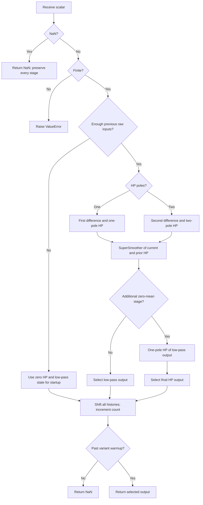

# Roofing Filter: research prototype master

The master file `roofing-filter.py`, class `RoofingFilter`, implements the article's two-pole high-pass followed by a two-pole SuperSmoother, with default shortest/longest periods **10/48**. It also exposes the two earlier variants from book chapter 7. This is a causal scalar band-limiting filter used either directly or to preprocess another indicator.

## Principles, spectral dilation, and physical analogy

A “roof” over the spectrum means retaining a useful middle range: remove slowly varying trends and large long-period swings with a high-pass stage, then reduce short-period noise with a low-pass stage. Think of two electronic circuits in series, one blocking slow/DC energy and the other blocking rapid energy. Their frequency responses multiply.

Market amplitudes grow as the time scale grows. The article calls this spectral dilation and describes approximately $A(f)\propto1/f$: doubling the period can roughly double amplitude, an increase of $20\log_{10}2\approx6.02$ dB per octave. A one-pole differentiating/high-pass response contributes only about 6 dB/octave of rejection toward lower frequencies. That can merely offset the growth of the input and leave substantial slow components in an oscillator. Consequently a long uptrend may keep a one-pole oscillator above zero.

A second high-pass pole gives about 12 dB/octave of low-frequency rejection. Relative to the source's approximately 6 dB/octave input growth, this provides additional rejection of the long-period swings. Removing this leakage can improve nominal centering and apparent turning-point alignment. It does not promise an exactly zero arithmetic mean over every finite window.

The SuperSmoother derives from a modified analog Butterworth response and a two-sample average that nulls the Nyquist frequency. Inductor/capacitor filter design supplies the physical analogy; recursive histories are its digital energy/memory analogue. At a ten-bar critical period the article describes roughly two bars of low-pass delay. Both stages have frequency-dependent phase, so those rounded descriptions are not universal bar-delay identities.

The book builds the concept in three steps: listing 7-1 has one high-pass pole; listing 7-2 adds another one-pole high-pass after smoothing; listing 7-3 collects the high-pass work into a two-pole stage with a changed angle setting. Listing 7-3 uses 40/80 inputs and displays the current result against its two-bar delay. The article uses the same two-pole recurrence at 10/48 and a zero reference line. Those differences are parameters and display choices, not a new core algorithm.

## Full mathematical calculation

Let $L$ be the shortest (low-pass) critical period and $H$ the longest (high-pass) critical period. $L<H$. Short **periods** mean high **frequencies**; the high-pass stage removes long periods, while the low-pass stage removes short periods. These complementary meanings are easy to reverse during conversion.

For one high-pass pole use $\theta=2\pi/H$. For two high-pass poles use $\theta=\sqrt{2}\pi/H$, the exact radian conversion of the printed `.707*360/H`. Define

$$
\alpha=\frac{\cos\theta+\sin\theta-1}{\cos\theta},\qquad
q=1-\alpha,\qquad g=1-\frac\alpha2.
$$

The master evaluates the algebraically equivalent half-angle expression

$$t=\tan\frac\theta2,\qquad \alpha=\frac{2t}{1+t}.$$

This avoids cancellation for small angles and the removable $0/0$ at $\theta=\pi/2$. At one-pole $H=4$, its continuous extension gives $\alpha=1$, $g=1/2$, $q=0$. The direct source expression is mathematically undefined there; a naive binary64 evaluation in the copied code produced the wrong coefficient. Port this half-angle evaluation if exact consistency with the master fixtures is desired. All admitted angles lie between 0 and $\pi$.

**Book listing 7-1**, a single high-pass stage followed by smoothing:

$$h_t=g(x_t-x_{t-1})+qh_{t-1}.$$

**Book listing 7-3 and the article**, a two-pole high-pass followed by smoothing:

$$h_t=g^2(x_t-2x_{t-1}+x_{t-2})+2qh_{t-1}-q^2h_{t-2}.$$

Compute the low-pass coefficients from equation 3-3 with $L$:

$$
\begin{aligned}
\beta&=\frac{\sqrt2\pi}{L},&a&=e^{-\beta},\\
c_2&=2a\cos\beta,&c_3&=-a^2,\\
c_1&=1-c_2-c_3,\\
f_t&=\frac{c_1(h_t+h_{t-1})}{2}+c_2f_{t-1}+c_3f_{t-2}.
\end{aligned}
$$

**Book listing 7-2**, when the first stage has one pole, adds the same one-pole high-pass after $f_t$:

$$r_t=g(f_t-f_{t-1})+qr_{t-1}.$$

The selected output is $f_t$ for plain one-pole and two-pole variants, and $r_t$ for the one-pole-plus-zero-mean variant. Book listing 7-2 also plots intermediate $f_t$; listing 7-3 plots $f_t$ and $f_{t-2}$. This master returns the selected current filter value only; delayed plots and the constant zero reference line are display constructions.

The corresponding high-pass transfer functions are

$$H_{HP1}(z)=\frac{g(1-z^{-1})}{1-qz^{-1}},\qquad
H_{HP2}(z)=\frac{g^2(1-z^{-1})^2}{(1-qz^{-1})^2}.$$

The SuperSmoother transfer function is

$$H_{SS}(z)=\frac{\frac{c_1}{2}(1+z^{-1})}{1-c_2z^{-1}-c_3z^{-2}}.$$

Multiply transfer functions for cascaded stages: $H_{HP2}H_{SS}$ in article mode, $H_{HP1}H_{SS}$ in preliminary one-pole mode, or $H_{HP1}H_{SS}H_{HP1}$ in the book's additional-high-pass mode. The last and first forms have two high-pass poles overall but use different $\theta$ at the same $H$, so their numerical arrays differ. Cascaded zero-state linear filters can be reordered in transfer theory; different standalone initial conditions can make finite-record startup differ.

Each high-pass pole gives a zero at DC, and the SuperSmoother numerator gives a zero at Nyquist. The two-pole high-pass double DC zero rejects a sustained linear ramp after its boundary transient. Its stable pole is repeated at $q$; $|q|<1$ for admitted finite periods in exact arithmetic. Negative $q$ at unusually short periods is mathematically valid but can cause alternating transients. Passing only a nominal band between $L$ and $H$ means gradual attenuation, not a rectangular passband or exact finite-window zero mean.

## Configuration, outputs, and exact startup

| Parameter | Shortcut | Default | Valid values | Meaning |
| --- | --- | ---: | --- | --- |
| `shortest_cycle_period` | `LP` | 10.0 | Finite real $L\ge2$ | SuperSmoother critical period; suppresses shorter periods. |
| `longest_cycle_period` | `HP` | 48.0 | Finite real $H>L$ | High-pass critical period; suppresses longer periods. |
| `highpass_poles` | `PO` | 2 | Integer 1 or 2 | First HP stage's order. |
| `zero_mean` | `ZM` | False | Boolean, True only when `PO=1` | Add a second one-pole high-pass after the low-pass stage. |

The API rejects `PO=2, ZM=True` instead of silently ignoring the flag. Source defaults 10/48 and book example 40/80 are covered separately. Close band edges such as 10/11 are allowed; they are not a recommended well-separated market-analysis band. Thresholds and plotting delays are not configuration parameters of this filter.

`update(sample)` returns one float: current $f_t$ or $r_t$ as selected above. Units are the input's units. No clipping, gain normalization, or stochastic calculation is applied.

At reset, HP and low-pass histories and optional final HP history are zero. Store real raw inputs before differencing them. In one-pole mode, bar 1 stores input and zero internal states; the first first-difference/HP/LP update is bar 2. In two-pole mode, bars 1 and 2 store inputs with zero internal HP/LP states; the first complete second difference is computed on **bar 3**, including its low-pass update. Do not discard bar 3 as the copied zpano Roofing did.

The plain one-pole variant hides the first three returned values and exposes bar 4 (`warmup_bars=3`). Two-pole and additional-zero-mean variants hide the first four and expose bar 5 (`warmup_bars=4`). All actual HP and low-pass updates run during hidden bars after raw input history becomes available. The optional post-smoothing HP also runs then. `is_primed` becomes true on the first visible bar.

For the shared closes at default 10/48, bar 5 is `-3.39837559463450`. This differs intentionally from the copied implementation's bar-4 HP start; its delayed start with precise coefficients would produce `0.298688049645342` on bar 5. The earlier investigation explains why merely masking more outputs cannot reconcile different hidden histories. The source listings do not require discarding the first valid second difference.

State: two raw inputs, two HP values, two low-pass values, one optional zero-mean value, and a count. Work and storage per update are O(1). All formulas consume previous state before any history is shifted.

## Calculation flow



## Precision, source equivalence, and porting contract

All calculations use ordinary Python `float` (IEEE 754 binary64), `math.pi`, and `math.sqrt(2.0)`. Angles passed to `sin`, `cos`, and `tan` are radians. In printed EasyLanguage, trigonometric arguments are degrees: multiply by $\pi/180$ when converting. `x[N]` means the value $N$ bars earlier; it is a historical reference, not a forward array index.

The user explicitly requested full-precision replacements for `1.414`, `.707`, and `3.14159`. Consequently this master reproduces the source **algorithm** with precise constants and the explicit standalone startup described here; it cannot also reproduce every decimal of a platform running the truncated literals. The supplied platforms have differing seeds and input availability. Their historical chart output is not a unique finite-sequence startup oracle. Source recurrences are independently evaluated with the same mathematical constants and declared startup in the accompanying tests.

Do not round coefficients, differences, histories, or intermediate outputs. Serialization alone uses **15 significant decimal digits** (`.15g`), not 15 digits after the decimal point. A port should use a small relative/absolute numerical tolerance for floating-point comparison, for example $10^{-11}$ at ordinary price scales; bit-for-bit equality across different math libraries or fused multiply-add settings is not required. The tests check the complete NaN prefix and every usable output, rather than skipping dozens of bars as the copied legacy tests did.

The indicator accepts one scalar input per `update`. The source examples use the close. It does not choose high/low/median automatically. Zero and negative finite samples are valid. A NaN sample returns NaN and leaves **all** state and priming counters unchanged; the next finite sample follows the preceding finite sample. This treats missing calls as omitted observations, not calendar gaps. Infinite inputs raise `ValueError` before any state is changed. Use `reset()` to clear the entire series state. A primed filter has an available output; its recursive transient need not have settled. Very large periods can approach binary64 coefficient-resolution limits even when they satisfy the finite-period validation.

Each folder is self-contained. Its Python file includes the numeric classes it needs, the embedded 252 closes in `__main__`, and a standard-library-only generator. Numeric code above the fixture-tooling boundary is the code to port; AST parsing, file formatting, and command-line helpers do not belong in an indicator's runtime calculation.

## Confirmed reference data

The user confirmed the following cases on 2026-10-20. There are 34 combinations across all three masters: 10 SuperSmoother, 12 Roofing, and 12 MESA Stochastic; each indicator is below the requested 64-case limit. Each expected array contains 252 positions aligned with the embedded `INPUT_CLOSE`.

| Array suffix | Parameter values | What it tests |
| --- | --- | --- |
| `LP10_HP48_PO2_ZM0` | `shortest_cycle_period=10, longest_cycle_period=48, highpass_poles=2, zero_mean=False` | Article default: two-pole detrending and ten-bar noise suppression. |
| `LP40_HP80_PO2_ZM0` | `shortest_cycle_period=40, longest_cycle_period=80, highpass_poles=2, zero_mean=False` | Book listing 7-3 example: forty/eighty-bar Roofing Filter. |
| `LP2_HP3_PO2_ZM0` | `shortest_cycle_period=2, longest_cycle_period=3, highpass_poles=2, zero_mean=False` | Shortest supported low-pass and short high-pass: coefficient boundary behavior. |
| `LP5_HP24_PO2_ZM0` | `shortest_cycle_period=5, longest_cycle_period=24, highpass_poles=2, zero_mean=False` | Short-cycle passband: rapid reversal response. |
| `LP10_5_HP48_PO2_ZM0` | `shortest_cycle_period=10.5, longest_cycle_period=48, highpass_poles=2, zero_mean=False` | Fractional low-pass period: preserve real coefficient arithmetic. |
| `LP10_HP11_PO2_ZM0` | `shortest_cycle_period=10, longest_cycle_period=11, highpass_poles=2, zero_mean=False` | Closely spaced nominal band edges: attenuation and recursive stability. |
| `LP20_HP80_PO2_ZM0` | `shortest_cycle_period=20, longest_cycle_period=80, highpass_poles=2, zero_mean=False` | Longer passband: stronger smoothing and slower detrending. |
| `LP40_HP252_PO2_ZM0` | `shortest_cycle_period=40, longest_cycle_period=252, highpass_poles=2, zero_mean=False` | Long high-pass memory: startup effects across the full input record. |
| `LP10_HP48_PO1_ZM0` | `shortest_cycle_period=10, longest_cycle_period=48, highpass_poles=1, zero_mean=False` | Book listing 7-1: preliminary one-pole Roofing without zero-mean correction. |
| `LP2_HP4_PO1_ZM0` | `shortest_cycle_period=2, longest_cycle_period=4, highpass_poles=1, zero_mean=False` | One-pole period-four boundary: resolve the source alpha removable singularity. |
| `LP10_HP48_PO1_ZM1` | `shortest_cycle_period=10, longest_cycle_period=48, highpass_poles=1, zero_mean=True` | Book listing 7-2 final output: second one-pole high-pass after smoothing. |
| `LP2_HP4_PO1_ZM1` | `shortest_cycle_period=2, longest_cycle_period=4, highpass_poles=1, zero_mean=True` | Period-four boundary in both one-pole stages with zero-mean correction. |


Run the streaming demonstration and regenerate the confirmed fixtures from this folder:

```bash
python3 roofing-filter.py
python3 roofing-filter.py --generate-reference-data
python3 test_roofing_filter.py
```

The generator first writes and rereads Python expected arrays, verifies 252 values and exact serialized 15-digit precision, then propagates those saved values and identical two-line comments to Go, TypeScript, Rust, and Zig. It replaces only its marked generated section on reruns; copied input arrays remain intact. `__main__` embeds the closes and checks they equal the copied Python input before generation. Synthetic constant, ramp, and boundary tests supplement the market-data fixtures.

| Language | File | Expected declaration / NaN |
| --- | --- | --- |
| Python | `test_testdata.py` | `EXPECTED_` plus suffix; list / `math.nan` |
| Go | `testdata_test.go` | `expected` plus suffix; `[]float64` / `math.NaN()`; package `roofingfilter` |
| TypeScript | `testdata.ts` | `export const expected` plus suffix; `number[]` / `NaN` |
| Rust | `testdata.rs` | `pub fn expected_` plus lowercase suffix; `Vec<f64>` / `f64::NAN` |
| Zig | `testdata.zig` | `pub fn expected` plus suffix; `[252]f64` with `return` / `nan` |

Decimal parameter points are underscores: 10.5 becomes `10_5`; booleans in suffixes are 0/1. Python suffixes follow `EXPECTED_P10`, `EXPECTED_LP10_HP48_PO2_ZM0`, or `EXPECTED_N20_LP10_HP48` as appropriate. Other-language fixture comments reproduce the Python descriptions and parameter names verbatim. The copied Rust inputs stay inside their `#[cfg(test)] pub mod testdata`; expected functions are at file scope. Use both scopes as needed in a port's tests.

The accompanying tests extract original expressions from the supplied sources and compare every output against an independent batch calculation with precise constants and the specified startup. They also check the 15-digit Python values, all four translations including NaNs and comments, invalid parameters, reset behavior, and NaN state preservation. Source expressions are reproduced in this document; if source files are unavailable after copying the folder, the tests fall back to these code blocks.

## References and BibTeX

- John F. Ehlers, *Cycle Analytics for Traders: Advanced Technical Trading Concepts*, Wiley, 2013. [Book record](../../2013-cycle-analytics-for-traders/toc.md), [chapter 3](../../2013-cycle-analytics-for-traders/ch3.md), [chapter 4](../../2013-cycle-analytics-for-traders/ch4.md), [chapter 7](../../2013-cycle-analytics-for-traders/ch7.md), and [chapter 17](../../2013-cycle-analytics-for-traders/ch17.md). Relevant equations and code are reproduced below so a conversion agent does not need these files.
- John F. Ehlers, “Predictive And Successful Indicators,” *Technical Analysis of STOCKS & COMMODITIES* 32(1), January 2014, pp. 16–25. [Local article](../../tasc/2014-01-predictive-and-successful-indicators/content.md), [published PDF](https://technical.traders.com/archive/article.asp?file=\V32\C01\692EHLE.pdf).
- *Traders' Tips*, January 2014. [Local collection](../../tasc/2014-01-predictive-and-successful-indicators/tips/tips.md), [published collection](https://www.traders.com/Documentation/FEEDbk_docs/2014/01/TradersTips.html). TradeStation reproduces the recurrences; eSignal checks history availability; AmiBroker uses different initial array seeds.
- R. W. Hamming, *Digital Filters*, third edition, Prentice Hall, 1997, cited by Ehlers in chapter 3 for the smoothing-filter background.
- The [initial implementation investigation](../../tasc/2014-01-predictive-and-successful-indicators/implementation-comparison.md) compared the copied zpano implementations. It is a project audit, not an additional mathematical authority.

```bibtex
@book{ehlers2013cycle,
  author    = {Ehlers, John F.},
  title     = {Cycle Analytics for Traders: Advanced Technical Trading Concepts},
  publisher = {Wiley},
  year      = {2013},
  series    = {Wiley Trading},
  isbn      = {9781118728604},
  note      = {Chapter 3, equation 3-3; chapter 4, high-pass transfer functions;
               chapter 7, listings 7-1 through 7-4; chapter 17, oscillator timing}
}
@article{ehlers2014predictive,
  author  = {Ehlers, John F.},
  title   = {Predictive And Successful Indicators},
  journal = {Technical Analysis of STOCKS \& COMMODITIES},
  volume  = {32},
  number  = {1},
  pages   = {16--25},
  year    = {2014},
  month   = jan,
  url     = {https://technical.traders.com/archive/article.asp?file=\V32\C01\692EHLE.pdf}
}
@misc{traderstips2014january,
  author       = {{Technical Analysis of STOCKS \& COMMODITIES}},
  title        = {Traders' Tips: Predictive And Successful Indicators},
  year         = {2014},
  month        = jan,
  howpublished = {Online},
  url          = {https://www.traders.com/Documentation/FEEDbk_docs/2014/01/TradersTips.html},
  note         = {TradeStation, eSignal, and AmiBroker implementations supplied locally}
}
@book{hamming1997digital,
  author    = {Hamming, Richard W.},
  title     = {Digital Filters},
  edition   = {3},
  publisher = {Prentice Hall},
  address   = {Upper Saddle River, NJ},
  year      = {1997},
  note      = {Page 49; cited in Ehlers chapter 3}
}
```

## Original Roofing source prose and listings

These source passages and complete code listings retain the published approximate constants. Use the full-precision equations and initialization above for conversion. Original figure links are omitted; the text referring to figures is retained.

### Article: Spectral Dilation

Traders and technical analysts know that market data is fractal; a chart of daily data or weekly data will look basically the same if the scales were removed. In other words, the amplitude of the cyclic swings scale in direct proportion to the cycle period. I call this effect spectral dilation because longer cycle periods have larger swings. The Hurst coefficient is directly related to the degree of dilation. Fibonaccians use the golden spiral to show the dilation factor is 1.618. The exact degree of dilation is not important. That dilation exists is beyond question. So, in round numbers, the spectrum amplitude increases 6 dB per octave of cycle period. This $1/f$ phenomenon seems to be almost universal in physical systems.

Here was my epiphany regarding market data: Like everyone, I knew the market data was fractal. However, I completely disregarded this fact when looking at oscillator-type indicators such as the momentum, stochastic, relative strength index (RSI), moving average convergence/divergence (MACD), or commodity channel index (CCI). In a nutshell, all these indicators are first-order differentiators, that is, they all take just one difference in their calculation. A basic principle of filtering is that a filter has an attenuation rolloff of 6 dB per octave per order of the filter in the attenuation band of the filter. Thus, all of these indicators roll off at the rate of 6 dB per octave. Since the data amplitude swings are increasing at the rate of 6 dB per octave, the best these indicators can do is to flatten the response of the spectrum in the indicator output.

**FIGURE 2: SINGLE POLE HIGHPASS FILTER (OR OSCILLATOR).** The low frequency components are not removed, which results in the output failing to have a zero mean.

Figure 2 shows the practical effect of a first-order high-pass filter when applied to some sample market data. Note that during the period of the long uptrend, the oscillator does not have a zero mean. That is, the wiggles are not centered on zero. The interpretation is that the data has not been fully detrended and that the longer cycle period signals are leaking through the rejection band of the filter.

When I introduce a second-order high-pass filter, the attenuation rate is now 12 dB per octave in the attenuation band. The filter attenuation exceeds the 6 dB per octave dilation in the data, and therefore, effective filtering of the longer cycle components is accomplished. Figure 3 shows the contrast between using a first-order high-pass filter and second-order high-pass filter. The dotted red line is the original first-order response given in Figure 2 and the solid blue line is the second-order response. Note the second-order response provides a nominal zero mean for the oscillator and that much of the lag induced by the "leaking" longer cyclic components is eliminated.

**FIGURE 3: TWO-POLE HIGH-PASS FILTER.** The effects of spectral dilation are removed. This gives the oscillator a zero mean to accurately assess turning points and generally reduces indicator lag.

I call the combination of the SuperSmoother filter and the second-order high-pass filter a roofing filter because it provides a roof over the data spectrum, so the data is preprocessed for use with any indicator that may follow. The roofing filter is not a bad indicator in its own right. The EasyLanguage code for computing the roofing filter can be found in sidebar "EasyLanguage Code To Compute The Roofing Filter." In a sense, the roofing filter is a kind of bandpass filter. The roofing filter differs from a bandpass filter because the rejection response on the high-frequency side is specifically designed to reject aliasing noise, and the second-order rejection response on the low-frequency side is specifically designed to eliminate the effects of spectral dilation.

### Book chapter 7: construction of the three Roofing variants

A “roofing filter” can be used to limit the frequency content of an input before proceeding to construct an indicator. The roofing filter is composed of a high-pass filter that passes only frequency components whose periods are shorter than $48$ bars, for example. It also is composed of a SuperSmoother filter that passes frequency components whose periods are longer than 10 bars. Thus, the roofing filter is a wide bandwidth band-pass filter that passes only frequency components whose periods fall between 10 bars and 48 bars. This, by itself, is a simple indicator. The EasyLanguage code for this indicator is given in Code Listing 7-1, and the indicator output is displayed in Figure 7.1.

While the roofing filter indicator wiggles in proportion to the wiggles in the price data as you would expect, it is noticeable that the indicator is above zero for extended periods where the market is in an uptrend. In other words, the filter output does not have a zero mean as you would expect if the output consisted only of cyclic components whose periods fall between $10$ bars and $48$ bars.

**Code Listing 7-1. HP-LP Roofing Filter EasyLanguage Code**

```easylanguage
{
  HP-LP Roofing Filter
  © 2013 John F. Ehlers
}
Vars:
  alpha1(0),
  HP(0),
  a1(0),
  b1(0),
  c1(0),
  c2(0),
  c3(0),
  Filt(0);

//Highpass filter cyclic components whose periods are shorter than 48 bars
alpha1 = (Cosine(360 / 48) + Sine (360 / 48) - 1) / Cosine(360 / 48);

HP = (1 - alpha1 / 2)*(Close - Close[1]) + (1 - alpha1)*HP[1];

//Smooth with a Super Smoother Filter from equation 3-3
a1 = expvalue(-1.414*3.14159 / 10);
b1 = 2*a1*Cosine(1.414*180 / 10);
c2 = b1;
c3 = -a1*a1;
c1 = 1 - c2 - c3;
Filt = c1*(HP + HP[1]) / 2 + c2*Filt[1] + c3*Filt[2];

Plot1(Filt);
Plot2(0);
```

**Figure 7.1** *Roofing Filter Display Does Not Have a Zero Mean*

The explanation for the lack of a zero mean is that the input data has a spectral power density proportional to $1/F^ \alpha$, and therefore increases amplitude at the rate of $6 dB$ per octave, more or less. The high-pass filter has a rejection slope that increases attenuation directly proportional to F$ *{0.5}$, or rolls off at the rate of $6 dB$ per octave. This response is similar to the frequency response shown in Figure 1.2. As a result, the only effect of the high-pass filter is to basically to equalize the fractal amplitude growth of all longer periods in the data. Therefore, the filter output still contains all of these frequency components. The only way we can reduce the effect of these lower-frequency components is to introduce another high-pass filter, adding an additional $6 dB$ per octave roll-off, so that the net effect of the filter is as originally surmised. I have added `Filt2` to the code in Code ­Listing 7-2, and the effect is shown as the solid line in Figure 7.2. The original roofing filter response is shown with the crosshatched markers. Note that in ad- dition to establishing a nominally zero mean, removal of the longer-cycle components caused by spectral dilation removes lag from the roofing filter output.

Since the roofing filter consists of the serial connection of a one-pole high-pass filter, a SuperSmoother, and another one-pole high-pass filter, it is clear the better formulation of the roofing filter would be the serial connection of a two-pole high-pass filter and the SuperSmoother.

**Code Listing 7-2. EasyLanguage Code for a Zero Mean Roofing Filter**

```easylanguage
{
  Zero Mean Roofing Filter
  © 2013 John F. Ehlers
}
Vars:
  alpha1(0),
  HP(0),
  a1(0),
  b1(0),
  c1(0),
  c2(0),
  c3(0),
  Filt(0),
  Filt2(0);

//Highpass filter cyclic components whose periods are shorter than 48 bars
alpha1 = (Cosine(360 / 48) + Sine (360 / 48) - 1) / Cosine(360 / 48);

HP = (1 - alpha1 / 2)*(Close - Close[1]) + (1 - alpha1)*HP[1];

//Smooth with a Super Smoother Filter from equation 3-3
a1 = expvalue(-1.414*3.14159 / 10);
b1 = 2*a1*Cosine(1.414*180 / 10);
c2 = b1;
c3 = -a1*a1;
c1 = 1 - c2 - c3;
Filt = c1*(HP + HP[1]) / 2 + c2*Filt[1] + c3*Filt[2];
Filt2= (1 - alpha1 / 2)*(Filt - Filt[1]) + (1 - alpha1)*Filt2[1];

Plot1(Filt);
Plot2(Filt2);
Plot6(0);
```

## Roofing Filter as an Indicator

The roofing filter does an excellent job of using only the frequency components between its upper and lower critical periods. All that needs to be done to create an indicator from the roofing filter is to add more generality by allowing the high-pass and low-pass critical periods be supplied as indicator inputs. In the code of Code Listing 7-3, the two high-pass filters have been implemented as a single two-pole high-pass filter.

**Figure 7.2** * Zero Mean Roofing Filter Output Contains Only Desired Frequency Components*

The ideal time to buy is when the cycle is at a trough, and the ideal time to exit a long position or to sell short is when the cycle is at a peak. These conditions are flagged by the filter crossing itself delayed by two bars, and are included as part of the indicator.

**Code Listing 7-3. EasyLanguage Code for a Roofing Filter Indicator**

```easylanguage
{
  Roofing Filter Indicator
  © 2013 John F. Ehlers
}
Inputs:
  LPPeriod(40),
  HPPeriod(80);
Vars:
  alpha1(0),
  HP(0),
  a1(0),
  b1(0),
  c1(0),
  c2(0),
  c3(0),
  Filt(0),
  Filt2(0);

//Highpass filter cyclic components whose periods are shorter than 48 bars
alpha1 = (Cosine(.707*360 / HPPeriod) + Sine (.707*360 / HPPeriod) - 1) / Cosine(.707*360 / HPPeriod);

HP = (1 - alpha1 / 2)*(1 - alpha1 / 2)*(Close - 2*Close[1] + Close[2]) + 2*(1 - alpha1)*HP[1] - (1 - alpha1)*(1 - alpha1)*HP[2];

//Smooth with a Super Smoother Filter from equation 3-3
a1 = expvalue(-1.414*3.14159 / LPPeriod);
b1 = 2*a1*Cosine(1.414*180 / LPPeriod);
c2 = b1;
c3 = -a1*a1;
c1 = 1 - c2 - c3;
Filt = c1*(HP + HP[1]) / 2 + c2*Filt[1] + c3*Filt[2];

Plot1(Filt);
Plot2(Filt[2]);
Plot6(0);
```

An example of the roofing filter indicator is shown in Figure 7.3, where the LP period rather arbitrarily has been set at 40 and the HP period also has been arbitrarily set at 80 bars. A casual glance shows the roofing filter to be an excellent indicator whose signals are not marred by computational lag. The two inputs can be set to get the best response for a particular stock, exchange-traded fund, or future symbol. This indicator gives excellent guidance for discretionary trading, but additional rules would be required to create a good mechanical trading system from it.

If a normalized amplitude indicator is desired, the automatic gain control (AGC) code fragment described in Chapter 5 can be added after the Filt calculation.

**Figure 7.3** *The Roofing Filter Is an Outstanding Technical Indicator*

## EasyLanguage Code To Compute The Roofing Filter

```easylanguage
{
  Roofing filter
  © 2013 John F. Ehlers
}
Vars: alpha1(0), HP(0), a1(0), b1(0), c1(0), c2(0), c3(0), Filt(0);

//Highpass filter cyclic components whose periods are shorter than 48 bars
alpha1 = (Cosine(.707*360 / 48) + Sine(.707*360 / 48) - 1) / Cosine(.707*360 / 48);
HP = (1 - alpha1 / 2)*(1 - alpha1 / 2)*(Close - 2*Close[1] + Close[2])
     + 2*(1 - alpha1)*HP[1] - (1 - alpha1)*(1 - alpha1)*HP[2];

//Smooth with a Super Smoother Filter
a1 = expvalue(-1.414*3.14159 / 10);
b1 = 2*a1*Cosine(1.414*180 / 10);
c2 = b1;
c3 = -a1*a1;
c1 = 1 - c2 - c3;

Filt = c1*(HP + HP[1]) / 2 + c2*Filt[1] + c3*Filt[2];

Plot1(Filt);
Plot2(0);
```

## Original source mathematics and code

The following source material is reproduced without changing its mathematical expressions. The supplied transcription of preceding equations 3-1 and 3-2 also contains unusual signs and a factor 1.25; these are preserved as source text and are not used by this master. Equation 3-3 and the article sidebar agree on the implemented recurrence. Printed coefficient approximations and degree angles remain visible here for audit; the master implementation uses the precise radian equations above. Image links are omitted.

### Book chapter 3: SuperSmoother derivation and applications

One of the advantages of recursive filters is that the transition between the pass band and the stop band can be much sharper compared to that of the nonrecursive filters. As a matter of computational simplicity, the critical period of the filter can be established independently from the degree of the filter. On the downside, recursive filters don’t have the same delay at all frequencies. This variable delay across the spectrum leads to dispersion distortion of the output waveform. Most of the dispersion occurs at those frequency components that have been attenuated, so the effect of the distortion is a relatively minor one.

A Butterworth filter is a favorite analog filter because its frequency response is maximally flat, near zero frequency. Years ago, I translated analog Butterworth filters to their digital approximations having like degrees in the numerator and denominator of the transfer response. The transfer response is characterized by a single variable: the critical period. The critical period is that where the output is attenuated by $3$ dB relative to the input data.

The digital Butterworth filter approximations included numerators whose coefficients were $[1 2 1] and [1 3 3 1]$ for two- and three-pole con- figurations, respectively. However, for applications to trading, I noted that the primary contribution of the numerator terms was to increase the filter lag. So I created modified versions simply by deleting all but the constant term in the numerator of the Butterworth transfer response.

The equations for the two-pole modified Butterworth filter are:

$$\begin{aligned}
a &= e^{-1.414 \cdot 3.14159 / \text{Period}} \\
b &= 2 a \cos(1.414 \cdot 1.25 \cdot 180 / \text{Period}) \\
c_2 &= b \\
c_3 &= -a \cdot a \\
c_1 &= 1 - c_2 - c_3 \\
\text{Output} &= c_1 \cdot \text{Input} - c_2 \cdot \text{Output}[1] - c_3 \cdot \text{Output}[2]
\end{aligned}$$

(3-1)

The equations for the three-pole modified Butterworth filter are:

$$\begin{aligned}
a &= e^{-3.14159 / \text{Period}} \\
b &= 2 a \cos(1.738 \cdot 180 / \text{Period}) \\
c &= a \cdot a \\
d_2 &= b + c \\
d_3 &= -(c + b \cdot c) \\
d_4 &= c \cdot c \\
d_1 &= 1 - d_2 - d_3 - d_4 \\
\text{Output} &= d_1 \cdot \text{Input} - d_2 \cdot \text{Output}[1] - d_3 \cdot \text{Output}[2] - d_4 \cdot \text{Output}[3]
\end{aligned}$$

(3-2)

The frequency responses for two- and three-pole modified Butterworth filters whose critical period was set at a 10-bar cycle are shown in ­Figure 3.8. The three-pole version gives about 6 dB more attenuation at the Nyquist frequency than the two-pole version. That means the output wave amplitude of the three-pole version would be half the wave amplitude at the Nyquist frequency. In some applications, this difference in filtered amplitude could be important.

**Figure 3.8** *Frequency Response of Two- and Three-Pole Modified Butterworth Filters Where Period = 10*

The delay of the two- and three-pole modified Butterworth filters whose critical period was set at a 10-bar cycle is shown in Figure 3.9. The price to be paid for the additional rejection band attenuation is an increase of almost two bars of additional delay near the critical period. In addition, there is greater percentage dispersion distortion across the pass band.

Having obtained good filtering with minimum delay and minimum delay distortion, it is relatively easy to obtain a zero in the transfer response at the Nyquist frequency by adding a two-element moving average in the numerator. The delay cost is only half a bar, and that cost seems worth it. By doing this, a filter I call the SuperSmoother is created. The equations for the SuperSmoother filter are:

$$\begin{aligned}
a &= e^{-1.414 \cdot 3.14159 / \text{Period}} \\
b &= 2 a \cos(1.414 \cdot 180 / \text{Period}) \\
c_2 &= b \\
c_3 &= -a \cdot a \\
c_1 &= 1 - c_2 - c_3 \\
\text{Output} &= c_1 \cdot (\text{Input} + \text{Input}[1]) / 2 + c_2 \cdot \text{Output}[1] + c_3 \cdot \text{Output}[2]
\end{aligned}$$

(3-3)

**Figure 3.9** *Lags of Two- and Three-Pole Modified Butterworth Filters Where Period = 10*

The frequency response of the SuperSmoother filter where the critical period is set to $10$ is shown in Figure 3.10.

**Figure 3.10** *Frequency Response of a SuperSmoother Filter Where Period = 10*

## SuperSmoother Filter Applications

A SuperSmoother filter is used anytime a moving average of any type would otherwise be used, with the result that the SuperSmoother filter output would have substantially less lag for an equivalent amount of smoothing produced by the moving average. For example, a five-bar SMA has a cutoff period of approximately 10 bars and has two bars of lag. A SuperSmoother filter with a cutoff period of 10 bars has a lag a half bar larger than the two-pole modified Butterworth filter shown in Figure 3.9. Therefore, such a SuperSmoother filter has a maximum lag of approximately 1.5 bars and even less lag into the attenuation band of the filter. The differential in lag between moving average and SuperSmoother filter outputs becomes even larger when the cutoff periods are larger.

Market data contain noise, and removal of noise is the reason for using smoothing filters. In fact, market data contain several kinds of noise. I’ll group one kind of noise as systemic, caused by the random events of trades being exercised. A second kind of noise is aliasing noise, caused by the use of sampled data. Aliasing noise is the dominant term in the data for shorter cycle periods.

It is easy to think of market data as being a continuous waveform, but it is not. Using the closing price as representative for that bar constitutes one sample point. It doesn’t matter if you are using an average of the high and low instead of the close, you are still getting one sample per bar. Since sampled data is being used, there are some DSP aspects that must be considered. For example, the shortest analysis period that is possible (without aliasing) $2$ is a two-bar cycle. This is called the Nyquist frequency, $0.5$ cycles per sample. A perfect two-bar sine wave cycle sampled at the peaks becomes a square wave due to sampling. However, sampling at the cycle peaks cannot be guaranteed, and the interference between the sampling frequency and the data frequency creates the aliasing noise. The noise is reduced as the data period is longer. For example, a four-bar cycle means there are four samples per cycle. Because there are more samples, the sampled data are a better replica of the sine wave component. The replica is better yet for an eight-bar data component. The improved fidelity of the sampled data means the aliasing noise is reduced at longer and longer cycle periods. The rate of reduction is $6$ dB per octave. My experience is that the systemic noise rarely is more than $10$ dB below the level of cyclic information, so that we create two conditions for effective smoothing of aliasing noise:

1. It is difficult to use cycle periods shorter that two octaves below the Nyquist frequency. That is, an eight-bar cycle component has a quantization noise level 12 dB below the noise level at the Nyquist frequency. Longer cycle components therefore have a systemic noise level that ­exceeds the aliasing noise level.
2. A smoothing filter should have sufficient selectivity to reduce aliasing noise below the systemic noise level. Since aliasing noise increases at the rate of $6$ dB per octave above a selected filter cutoff frequency and since the SuperSmoother attenuation rate is $12$ dB per octave, the SuperSmoother filter is an effective tool to virtually eliminate aliasing noise in the output signal.

I urge readers to universally adapt the SuperSmoother filter set to a cutoff period of $10$ bars or so on all data to attenuate aliasing noise. The output of the SuperSmoother filter can be used directly as an indicator or as the sampled data fed to any other indicator.

## EasyLanguage Code To Compute The SuperSmoother Filter

```easylanguage
{
  SuperSmoother filter
  © 2013 John F. Ehlers
}
Vars: a1(0), b1(0), c1(0), c2(0), c3(0), Filt(0);

a1 = expvalue(-1.414*3.14159 / 10);
b1 = 2*a1*Cosine(1.414*180 / 10);
c2 = b1;
c3 = -a1*a1;
c1 = 1 - c2 - c3;

Filt = c1*(Close + Close[1]) / 2 + c2*Filt[1] + c3*Filt[2];

Plot1(Filt);
Plot2(0);
```
