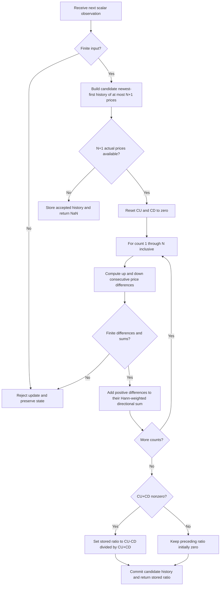

# RSI with Hann windowing (RSIH)

This folder is the **research prototype master reference** for John F. Ehlers'
January 2022 indicator, “(Yet Another) Improved RSI: Enhanced With Hann
Windowing.” `rsi-hann.py` supplies the standard-library streaming calculation;
this document supplies the mathematics, source decisions, initialization,
numerical rules, and fixture specification needed for independent ports to
Python, Go, TypeScript, Rust, and Zig.

The indicator compares Hann-weighted upward and downward **consecutive input
changes**, returning their difference divided by their sum. Its output is a
dimensionless scalar in $[-1,+1]$. Positive values indicate greater weighted
upward movement, negative values greater weighted downward movement, and zero
balanced movement. The Hann weights smooth the directional components before
the ratio is calculated. There is one configuration parameter, `length=14`,
matching `RSILength(14)` in the primary sources.

## Source selection and scope

The authoritative calculation is the matching EasyLanguage listing in the
supplied January 2022 TASC article, Mesa Software paper, and TradeStation tip.
All three accumulate **every count from 1 through RSILength inclusive**, then
conditionally assign the output when $CU+CD\ne0$. This master follows that
listing, including persistence of the preceding output on a fully flat window.

The master explicitly defines startup for a finite input record: do not invent
prehistory, do not pad prices with zero, and return NaN until all requested
price differences exist. Platforms may suppress these bars, have loaded
prehistory, or display their own default plot values. On complete windows,
the master implements the primary source calculation.

All mathematical derivations in the supplied RSI article and Mesa paper are
included below. Relevant filtering theory and formulas from their cited
September 2021 “Windowing” article and Mesa paper are also reproduced and
expanded into discrete equations. Further reading is identified separately;
no Wilder book chapter was supplied, and no unavailable chapter is claimed
to have been reproduced.

## From classic RSI to a centered directional ratio

Let $x_t$ denote the scalar observation at chronological, zero-based index
$t$. “Close” is only the source variable name: any finite scalar time series
can be used, including zero and negative values. Only Close is used from the
copied OHLC fixtures. High, Low, and Open are retained for portability of the
shared input dataset.

Define the one-bar change and its nonnegative directional components:

$$
\Delta_t=x_t-x_{t-1},\qquad
u_t=\max(\Delta_t,0),\qquad
d_t=\max(-\Delta_t,0).
$$

For a rectangular observation window of $N$ changes, “closes up” and
“closes down” are:

$$
CU_t^{\rm rect}=\sum_{k=0}^{N-1}u_{t-k},\qquad
CD_t^{\rm rect}=\sum_{k=0}^{N-1}d_{t-k}.
$$

These are finite impulse response (FIR) sums, equivalent to simple moving
averages apart from a common normalization factor. Flat changes contribute
to neither sum. The article's classic definition is:

$$
RSI_{100}=100-\frac{100}{1+RS},\qquad RS=\frac{CU}{CD}.
$$

Removing the scale factor of 100 and substituting $RS$ gives the complete
algebra shown in both primary papers:

$$
\begin{aligned}
RSI_1
&=1-\frac{1}{1+\frac{CU}{CD}}\\
&=1-\frac{CD}{CU+CD}\\
&=\frac{CU+CD-CD}{CU+CD}\\
&=\frac{CU}{CU+CD}.
\end{aligned}
$$

When there are no closes up, $RSI_1=0$; when there are no closes down,
$RSI_1=1$. This simplified expression also avoids explicitly dividing by
$CD$, allowing a purely rising sequence to return a defined value.

Ehlers prefers an oscillator centered around zero. Dilating by two and
translating by minus one produces the full published derivation:

$$
\begin{aligned}
RSI_{\rm centered}
&=\frac{2\,CU}{CU+CD}-1\\
&=\frac{2\,CU-CU-CD}{CU+CD}\\
&=\frac{CU-CD}{CU+CD}.
\end{aligned}
$$

Thus, for a nonzero denominator and the **same directional sums**,

$$
RSI_{100}=50\left(RSI_{\rm centered}+1\right).
$$

“Centered” means that equal upward and downward movement maps to zero. It
does **not** mean a trending or arbitrary input record must have a zero
statistical mean. A persistent rise can produce $+1$ throughout the record.
The remapping also does not make RSIH identical to a platform's Wilder RSI:
many classic RSI implementations recursively smooth gains and losses using
Wilder's moving average, whereas the article discusses window sums and RSIH
uses the finite Hann window defined next.

## Why Hann windowing improves the component filters

### Window and aperture analogies

A rectangular window gives equal attention to every included sample and
abruptly discards samples just outside its edges. Think of viewing a signal
through a rectangular opening: a spike has its entire weight until it crosses
the edge, then immediately disappears. Those abrupt edges cause frequency
sidelobes, allowing some rapid oscillations to leak through a moving average.

A Hann window tapers attention toward the edges of the observation window,
with the greatest weight near its center. A spike contributes gently when
new, contributes more as it approaches the center, and fades as it leaves.
The same mathematics appears in tapered antenna or optical apertures: a
smoother aperture suppresses sidelobes while broadening the central response.
The “Windowing” paper calls the corresponding bandwidth tradeoff **aperture
efficiency**. The analogy describes the FIR components, not a physical model
of financial prices.

FIR means that the effect of an isolated component impulse lasts for only
the finite observation window. The Hann FIRs have no recursive smoothing
state. RSIH additionally remembers its last ratio solely for the primary
source's zero-denominator rule.

### Rectangular-filter mathematics from “Windowing”

For a normalized $N$-sample rectangular moving average:

$$
F_t^{\rm SMA}=\frac1N\sum_{k=0}^{N-1}v_{t-k},\qquad
H_{\rm SMA}(\omega)=\frac1N\sum_{k=0}^{N-1}e^{-i\omega k}
=e^{-i\omega(N-1)/2}\frac{\sin(N\omega/2)}{N\sin(\omega/2)}.
$$

The exact finite discrete response above expands the papers' familiar
rectangular-window approximation, with $f$ measured in cycles per sample:

$$
X=\pi fN,\qquad H_{\rm envelope}(f)\approx\frac{\sin X}{X},\qquad
0\le f\le\frac12,\qquad P=\frac1f.
$$

Here $P$ is wavelength in bars: $f=0.5$ corresponds to two bars and $f=0.1$
to ten bars. The power-series explanation included in the papers is:

$$
\sin X=X-\frac{X^3}{3!}+\frac{X^5}{5!}-\cdots,\qquad
\lim_{X\to0}\frac{\sin X}{X}=1.
$$

The discrete SMA has zeros at $f=m/N$ where the denominator is nonzero,
corresponding to wavelengths $P=N/m$. The source prose refers to
“wavelengths [that] are multiples of the window length”; the equation shows
that frequencies, rather than wavelengths, are multiples of $1/N$.

At half power, the amplitude is $1/\sqrt2$, approximately $-3$ dB:

$$
20\log_{10}|H|=10\log_{10}|H|^2,\qquad |H|^2=\frac12.
$$

For the eight-tap SMA, the paper gives the half-power frequency near $0.056$,
and suggests $f\approx1/(2N)=0.0625$ or $P\approx2N$ as a rough mnemonic.
Its first sidelobe estimate uses $X\approx1.5\pi$:

$$
|H_{\rm sidelobe}|\approx\frac1{1.5\pi}\approx0.212,
\qquad20\log_{10}(0.212)\approx-13.5\ \mathrm{dB}.
$$

The source also prints $f=1/(1.5N)$ for this sidelobe. That conflicts with
its own $X=\pi fN$ and $X=1.5\pi$: the consistent approximate frequency
is $f\approx1.5/N$. Neither typographic inconsistency affects RSIH code.

### The exact RSIH Hann coefficients

Write $c$ for the source's `count`. It runs from **1 to $N$**, so there
are $N$ taps, applied newest change first:

$$
w_c=1-\cos\left(\frac{2\pi c}{N+1}\right)
=2\sin^2\left(\frac{\pi c}{N+1}\right),\qquad 1\le c\le N.
$$

EasyLanguage writes the same angle in degrees as
$360c/(N+1)$. The master computes that degree expression, converts it with
`math.radians`, and calls `math.cos`. Ports must use floating-point division,
full-precision $\pi$, and radian trigonometric functions after conversion.

This is the **interior of a Hann window with $N+2$ points**: the omitted
points $c=0$ and $c=N+1$ would have zero weight. Every stored tap is positive,
including $c=1$ and $c=N$. Do not use a conventional $N$-point symmetric
Hann with denominator $N-1$, or a periodic Hann with denominator $N$.
The coefficients are symmetric in exact arithmetic:

$$
w_c=w_{N+1-c},\qquad
W=\sum_{c=1}^{N}w_c=N+1,\qquad h_k=\frac{w_{k+1}}{W},\quad0\le k<N.
$$

For example, $N=1$ gives $[2]$, $N=2$ gives $[1.5,1.5]$, and $N=3$
gives $[1,2,1]$. Small floating-point asymmetries in independently computed
cosines are retained by the reference; do not force paired taps to be equal.

The normalized FIR response is:

$$
F_t=\sum_{k=0}^{N-1}h_kv_{t-k},\qquad
H_{\rm Hann}(\omega)=\sum_{k=0}^{N-1}h_ke^{-i\omega k},\qquad
H_{\rm Hann}(0)=1.
$$

Its symmetric coefficients give component-filter group delay $(N-1)/2$
samples. Consecutive price changes themselves are associated with half-bar
midpoints, so the weighted change window is centered $N/2$ bars behind the
current price. The nonlinear final ratio has no single, universal linear
transfer function or group delay. Native smoothing reduces noise without
eliminating causal lag; moving output backward on a chart cannot supply the
missing right-edge observations.

The supplied “Windowing” papers report, for their eight-tap examples:

| Window | Largest sidelobe, approximately | Half-power frequency |
|---|---:|---:|
| Rectangular SMA | $-13.5$ dB | $0.056$ |
| Triangle | $-26$ dB | $0.072$ |
| Sine-pedestal Hamming example | $-25$ dB, most others below $-40$ dB | $0.074$ |
| Hann | $-32$ dB | $0.080$ |

These are illustrative FIR measurements from that paper, not guarantees for
the nonlinear RSIH output. The Hann's broader passband for the same length
means that a longer window is needed for comparable smoothing of low-frequency
variation, while its sidelobes suppress unwanted higher-frequency leakage
more strongly. For the paper's triangle example, aperture efficiency is
$0.056/0.072\approx77.8\%$.

### Supplementary window formulas in the cited background

The “Windowing” article illustrates triangle weights
$[1,2,3,4,4,3,2,1]/20$ for $N=8$. Its inclusive code corresponds to:

$$
a_c=\begin{cases}c,&c\le N/2,\\N+1-c,&c>N/2,\end{cases}
\qquad
F_t^{\rm triangle}=\frac{\sum_{c=1}^{N}a_cv_{t-c+1}}{\sum_{c=1}^{N}a_c}.
$$

The code is most naturally interpreted for even lengths; its printed
piecewise rule should not be silently generalized into a claim about all
odd-length triangle conventions. These weights are background only.

The paper's sine-pedestal Hamming example, with degree pedestal $p=10$,
uses the following custom coefficients rather than the usual textbook
$0.54-0.46\cos$ definition:

$$
b_k=\sin\left(\frac\pi{180}
\left[p+\frac{(180-2p)k}{N-1}\right]\right),\qquad
F_t^{\rm Hamming}=\frac{\sum_{k=0}^{N-1}b_kv_{t-k}}{\sum_{k=0}^{N-1}b_k}.
$$

The background code chooses $v_t=Close_t-Open_t$ and optionally computes:

$$
ROC_t=\frac{N}{6.28}(F_t-F_{t-1}).
$$

Its Hann listing uses $v_{t-c+1}$ with the same $w_c$ as RSIH. Its SMA
listing actually uses $v_{t-c}$, introducing one extra bar of delay relative
to a newest-inclusive SMA. Neither the Close-minus-Open derivative, the
other windows, nor this optional ROC is part of RSIH. The background paper
uses ROC because differences emphasize high-frequency noise and make the
smoothness improvement from Hann weighting particularly visible.

## Complete RSIH calculation

For chronological index $t\ge N$, define the lagged change corresponding
to source `Close[count-1] - Close[count]`:

$$
\delta_{t,c}=x_{t-c+1}-x_{t-c},\qquad1\le c\le N.
$$

The indicator recomputes both weighted directional sums on every bar:

$$
CU_t=\sum_{c=1}^{N}w_c\max(\delta_{t,c},0),\qquad
CD_t=\sum_{c=1}^{N}w_c\max(-\delta_{t,c},0).
$$

Its complete startup and denominator convention is:

$$
R_t=\begin{cases}
\operatorname{NaN},&t<N,\\
\dfrac{CU_t-CD_t}{CU_t+CD_t},&t\ge N\ \text{and}\ CU_t+CD_t\ne0,\\
R_{\rm stored},&t\ge N\ \text{and}\ CU_t+CD_t=0.
\end{cases}
$$

Initialize the stored ratio to zero. An unavailable warmup return does not
change it. Every nonzero-denominator calculation updates it; a zero
denominator leaves it unchanged. If the entire input is flat, the first
available ratio is zero. If prices rise and then remain flat for at least
$N$ differences, the ratio remains $+1$ after the last rising change leaves
the window, matching the primary source's guarded variable assignment.

The identity $u_t-d_t=\Delta_t$, $u_t+d_t=|\Delta_t|$ yields an equivalent
interpretation for nonzero denominators:

$$
R_t=\frac{\sum_{c=1}^{N}w_c\delta_{t,c}}
{\sum_{c=1}^{N}w_c|\delta_{t,c}|}.
$$

This is weighted net movement divided by weighted total path movement, like
a directional balance of two nonnegative counters. With positive weights,
$|CU-CD|\le CU+CD$, so $|R_t|\le1$. All nonzero changes rising gives
$+1$; all falling gives $-1$; equal weighted movement gives zero. If a
different port uses this equivalent signed-sum formula, floating-point
rounding may differ: the master keeps the source's **separate** CU/CD sums.

No common normalization is needed: multiplying every weight by the same
positive constant, including $1/W$ or $1/2$, cancels algebraically in the
ratio. The master nevertheless keeps the original unnormalized weights
to preserve the reference arithmetic. Applying a Hann FIR to an already
calculated RSI is generally a different operation because filtering and
nonlinear division do not commute.

## Configuration, availability, and cycle selection

| Setting or property | Contract |
|---|---|
| `length` / source `RSILength` | Positive integer $N\ge1$; default 14; booleans and nonintegers rejected. |
| Upper length limit | No artificial algorithmic limit; memory and work are $O(N)$. A record of $M$ prices has an available result only if $N\le M-1$. |
| `update(value)` input | One finite scalar observation per chronological completed bar; float-convertible values accepted. |
| Return | One scalar RSIH value; no second computed plot. The source zero line is a display reference. |
| `warmup_bars` | Exactly $N$ returned NaNs, at indexes $0$ through $N-1$. |
| First available output | Index $N$, on accepted observation number $N+1$. |
| `is_primed` | True when $N+1$ actual prices are stored, even for a flat window. |
| `reset()` | Clear history and restore stored ratio zero. |
| Missing or invalid input | NaN, infinity, or arithmetic overflow is rejected; no accepted state changes. |

For the supplied 252 prices, the number of available outputs is
$\max(252-N,0)$. The default has 14 unavailable and 238 available outputs.
Length 251 has one available output; length 252 has none. Availability is
a complete-history condition, not an estimate of recursive convergence.

Ehlers' length rationale considers an ideal sine wave with dominant period
$P$. From its valley to its peak, changes are nonnegative for approximately
$P/2$ bars. The classic rectangular RSI reaches its upper extreme when its
observation window contains no downward changes, motivating a classic length
near $P/2$. The Hann taper needs a longer window for equivalent smoothing;
both primary papers recommend RSIH length **on the order of the dominant
cycle period**, $N\sim P$. Fourteen is a published demonstration default,
not a universal optimum. There is no built-in dominant-cycle estimator or
adaptive parameter in this indicator.

The Wealth-Lab tip describes half the dominant cycle period as a better
RSIH period. That differs from the full-cycle order-of-magnitude advice
in the primary RSIH papers. The master documents the primary-source advice
and leaves length explicitly configurable.

## Streaming flow and implementation mapping



In the code, `_prices[0]` is the current input, `_prices[1]` is one bar
ago, and `_prices[N]` is $N$ bars ago. `_weights[count-1]` is $w_c$.
The constructor precomputes the fixed coefficients. `update` prepares a
candidate history, calculates locally, then commits the accepted update.
The bounded list is deliberately straightforward to translate into a ring
buffer in another language. A ring buffer must visit newest-to-oldest taps
in the original summation order.

### Primary-source calculation listing

The following is the article's calculation, also present in the Mesa paper
and TradeStation tip. It makes the persistent variable initialization and
absence of an `Else` on the denominator guard explicit for future readers.

```easylanguage
Inputs:
  RSILength(14);

Vars:
  count(0),
  CU(0),
  CD(0),
  MyRSI(0);

CU = 0;
CD = 0;
For count = 1 to RSILength Begin
  If Close[count - 1] - Close[count] > 0 Then
    CU = CU + (1 - Cosine(360*count / (RSILength + 1)))*(Close[count - 1] - Close[count]);
  If Close[count] - Close[count - 1] > 0 Then
    CD = CD + (1 - Cosine(360*count / (RSILength + 1)))*(Close[count] - Close[count - 1]);
End;

If CU + CD <> 0 Then MyRSI = (CU - CD) / (CU + CD);

Plot1(MyRSI, "", red, 4, 4);
Plot2(0, "", white, 1, 1);
```

## Differences in the supplied platform code

| Supplied implementation | Relationship to the master |
|---|---|
| Article / Mesa / TradeStation / TradersStudio | Inclusive $1\ldots N$ Hann sums and persistent ratio on a zero denominator; canonical calculation. |
| TradingView Pine v5 | Same inclusive weights for ordinary complete windows; minimum length 2; `nz` maps an undefined ratio to zero, including all-flat windows. Startup also follows Pine's missing-history behavior. |
| eSignal | Inclusive floating-point radian weights; initializes local `ret=0` each calculation, so flat windows return zero. Its displayed startup gate is platform specific. |
| Zorro C | Printed `for(i=1; i<Length; i++)` **omits the final tap**; denominator-zero branch returns zero; `Data` argument is unused while `priceClose` supplies values. |
| NinjaTrader C# | Inclusive loop and index gate; `360 * i / (RSILength + 1)` uses integer operands and therefore truncates degrees before multiplication by `Math.PI/180`. This changes the weights. No explicit persistent scalar is assigned on the zero-denominator branch. |
| Optuma snippet | Applies a Hann FIR to `MYRSI`, which is structurally different from windowing gains/losses before their ratio unless the proprietary function has additional undocumented behavior. |
| Wealth-Lab / thinkorswim / NeuroShell / Excel | Tips include descriptions, plots, or a workbook; no claim that their hidden calculations are bitwise equivalent. The workbook is not the chosen calculation oracle. |

These supplied implementations cannot all produce identical results. The
master intentionally defines its reference using the article's original
listing, rather than inheriting the truncated C loop, integer-degree C#
weights, or a platform-specific zero-denominator replacement.

## Numerical rules for ports

Use IEEE 754 binary64 (`float`, `float64`, `number`, `f64`) throughout. The
reference computes degrees as `360.0 * count / (length + 1)` and radians
using multiplication by $\pi/180$, then `1.0 - cos(radians)`. Mathematically,
`2*pi*count/(length+1)` is equivalent, but a different order can change a
last bit. The same applies to replacing `1-cos(theta)` with
`2*sin(theta/2)**2` or enforcing exact tap symmetry.

CU and CD are sequentially accumulated from newest to oldest with separate
positive-direction tests. Preserve the guarded denominator test against
exact zero. Do not introduce an epsilon, compensated sum, normalization,
different weight definition, recursively smoothed gains, output clamp,
automatic fill, or per-bar rounding into a reference port.

Different languages' cosine implementations can differ at floating-point
roundoff, so compare finite indicator outputs with a tolerance, recommended
$5\times10^{-13}$ absolute plus $5\times10^{-13}$ relative. NaN availability
positions must match exactly and be tested with `isnan`, not equality.
Do not require bitwise identity of independently recomputed trigonometry.
Serialized literals shared between the fixture languages should represent
the same binary64 values after parsing.

Expected finite outputs are formatted with **15 significant decimal digits**
using `.15g`; this means fifteen meaningful digits rather than fifteen
decimal places. Integer-looking floating values receive `.0` so that they
remain valid float literals in Rust and Zig. Internal values are never
rounded and formatted values are never fed back into state.

## Confirmed reference cases

There is one independent source parameter, so twelve length selections
provide broad coverage without an artificial Cartesian product. Each case
produces one array with exactly 252 entries. `L` abbreviates `length`.
All twelve cases were confirmed by the user on 2026-10-19.
The descriptions below are copied verbatim into the two-line comments in
all five fixture files.

| Length | What it tests | Unavailable / available |
|---:|---|---:|
| 14 | Article, Mesa and TradeStation default length. | 14 / 238 |
| 1 | Minimum length; signed one-bar change and flat-bar persistence. | 1 / 251 |
| 2 | Smallest multi-tap window; equal two-tap Hann weights. | 2 / 250 |
| 3 | Short odd-length symmetric Hann window. | 3 / 249 |
| 5 | Fast response to reversals with a short odd-length window. | 5 / 247 |
| 8 | Short even-length window and smoothing of price-change spikes. | 8 / 244 |
| 10 | Intermediate even-length window between fast and default settings. | 10 / 242 |
| 20 | Slower response over a monthly-scale window. | 20 / 232 |
| 30 | Longer cycle-scale window and stronger smoothing. | 30 / 222 |
| 126 | Half-record window with extended history collection. | 126 / 126 |
| 251 | Largest length with one primed value in the 252-price record. | 251 / 1 |
| 252 | Insufficient history; all 252 outputs remain NaN. | 252 / 0 |

Length 1 also exercises the actual flat changes present in the shared input
record, including identical closes at indexes 100 and 101. Separate
analytical tests cover a flat window after a directional trend for longer
lengths. Long lengths 126, 251, and 252 are boundary/availability coverage,
not recommended production trading parameters.

Each of the five fixtures contains all four original input arrays and twelve
expected arrays, totaling 3,024 expected values per language, including NaNs.
The expected arrays use these names and language-specific declarations:

| Language | Default expected name and NaN spelling |
|---|---|
| Python | `EXPECTED_L14 = [...]`; `math.nan` |
| Go | `var expectedL14 = []float64{...}`; `math.NaN()`; package `rsihann`; import `math` |
| TypeScript | `export const expectedL14: number[] = [...]`; `NaN` |
| Rust | `pub fn expected_l14() -> Vec<f64>` inside the copied `testdata` module; `f64::NAN` |
| Zig | `pub fn expectedL14() [252]f64` with `return .{...};`; `nan` |

The TypeScript and Rust examples use valid native syntax, including Rust's
double colon in `f64::NAN`. Zig declares `const math = @import("std").math;`
and `const nan = math.nan(f64);` at the top. Multiple parameters would use
underscore-separated suffixes with decimal dots replaced by underscores;
this indicator only has the integer `L` suffix.

The generator first writes Python arrays with their test-description and
`length=N` comments, reopens that file, and verifies input preservation,
expected names, counts, warmup masks, and fifteen-digit values. Only then
does it translate the verified Python values into the other languages,
copying both comments. Begin/end markers allow deterministic regeneration
without duplicated arrays or overwritten inputs. The Rust outputs remain
inside the same `#[cfg(test)] pub mod testdata` as its input functions.

## Running and verification

From this folder, run the embedded-data demonstration and source checks:

```sh
python3 rsi-hann.py
python3 -m unittest discover -p 'test_rsi_hann.py' -v
```

The default demonstration's first available value, at index 14, is
`0.0373334150878197`; its last value is `0.0203041850403677`.

Regenerate all twelve confirmed cases in all five fixtures with:

```sh
python3 rsi-hann.py --generate-reference-data
```

All **eleven Python checks pass**, including exact binary64 agreement with
the independently evaluated supplied source expressions for every confirmed
length. The tests independently extract and evaluate the supplied EasyLanguage
conditions and accumulation expressions against chronological batch price
history. They do not call the streaming update or share its precomputed
coefficients to obtain the reference. Checks include every confirmed length,
exact history availability, constant trends, flat-window persistence, a
hand-calculated mixed-movement window, positive rescaling, translation,
sign reflection, finite output bounds, reset, causal replay, and preservation
of state after rejected updates.

Generation checks require the expected arrays and verify all language literals
and comments against the parsed Python data, record lengths and NaN positions,
unchanged input declarations, and byte-for-byte repeatability in a temporary
directory. No commercial trading runtime is available,
so validation is against the supplied source expressions and analytical
identities, not a claim of a live TradeStation execution.

Native fixture checks also pass with Go 1.27.1, Rust 1.98.1 (2021 edition),
Zig 0.16.0, and Node 24.15.0 executing the TypeScript fixtures with native
type stripping. Each check loads every input and expected declaration and
compares all **16 arrays / 4,032 values** against the parsed Python fixture:
finite values have identical binary64 bit patterns, and unavailable values
are NaN. These checks validate the fixture syntax and serialized data;
the indicator implementation remains the Python research master.

## References

1. John F. Ehlers, “(Yet Another) Improved RSI: Enhanced With Hann Windowing,”
   *Technical Analysis of Stocks & Commodities* 40(1), January 2022,
   pp. 26–28. [Article](https://technical.traders.com/archive/article.asp?file=%5CV40%5CC01%5C357EHLE.pdf).
   Supplied [article text](../../tasc/2022-01-(yet-another)-improved-rsi/content.md).
2. John F. Ehlers, “(Yet Another) Improved RSI,” Mesa Software paper,
   [RSI.pdf](https://www.mesasoftware.com/papers/RSI.pdf), associated with the
   2022 article. Supplied [Mesa text](../../tasc/2022-01-(yet-another)-improved-rsi/mesa/content.md).
3. *Stocks & Commodities*, “Traders' Tips, January 2022.”
   [Tips page](https://www.traders.com/Documentation/FEEDbk_docs/2022/01/TradersTips.html).
   Supplied [tips text](../../tasc/2022-01-(yet-another)-improved-rsi/tips/tips.md),
   [TradeStation listing](../../tasc/2022-01-(yet-another)-improved-rsi/tips/code/RSIH.els),
   [Pine](../../tasc/2022-01-(yet-another)-improved-rsi/tips/code/RSIH.pine),
   [eSignal](../../tasc/2022-01-(yet-another)-improved-rsi/tips/code/RSIwithHannWindowing.efs),
   [NinjaTrader](../../tasc/2022-01-(yet-another)-improved-rsi/tips/ninja-trader/RSIH.cs),
   [TradersStudio](../../tasc/2022-01-(yet-another)-improved-rsi/tips/code/RSIH.trs),
   [Zorro C](../../tasc/2022-01-(yet-another)-improved-rsi/tips/code/RSIH.c),
   and [Optuma](../../tasc/2022-01-(yet-another)-improved-rsi/tips/code/RSIH.optuma).
4. John F. Ehlers, “Windowing,” *Technical Analysis of Stocks & Commodities*
   39(9), September 2021, pp. 8–14.
   [Article](https://technical.traders.com/archive/article.asp?file=%5CV39%5CC09%5C297EHLE.pdf).
   Supplied [article text](../../tasc/2021-09-windowing/content.md).
5. John F. Ehlers, “Windowing,” Mesa Software paper, 2021.
   [WINDOWING.pdf](https://www.mesasoftware.com/papers/WINDOWING.pdf).
   Supplied [Mesa text](../../tasc/2021-09-windowing/mesa/content.md).
6. John F. Ehlers, “Cycle/Trend Analytics And The MAD Indicator,”
   *Technical Analysis of Stocks & Commodities* 39, October 2021.
   Further reading cited by the RSI article.
7. John F. Ehlers, “The MAD Indicator, Enhanced,”
   *Technical Analysis of Stocks & Commodities* 39, November 2021.
   Further reading cited by the RSI article.
8. John F. Ehlers, “The DMH: An Improved Directional Movement Indicator,”
   *Technical Analysis of Stocks & Commodities* 39, December 2021.
   Further reading cited by the RSI article.
9. J. Welles Wilder Jr., “The Relative Strength Index,”
   *Technical Analysis of Stocks & Commodities* 4, December 1986.
   Historical further reading cited by the RSI article.
10. J. Welles Wilder Jr., *New Concepts In Technical Trading Systems*,
    Trend Research, 1978. Historical RSI source cited by the article.
11. “Window function,” Wikipedia. Background further reading cited by the
    supplied “Windowing” papers; not used as the numerical implementation oracle.
    [Reference](https://en.wikipedia.org/wiki/Window_function).

```bibtex
@article{ehlers2022rsih,
  author = {Ehlers, John F.},
  title = {(Yet Another) Improved {RSI}: Enhanced With Hann Windowing},
  journal = {Technical Analysis of Stocks \& Commodities},
  volume = {40},
  number = {1},
  pages = {26--28},
  year = {2022},
  month = jan,
  url = {https://technical.traders.com/archive/article.asp?file=%5CV40%5CC01%5C357EHLE.pdf}
}

@misc{ehlers2022rsihMesa,
  author = {Ehlers, John F.},
  title = {(Yet Another) Improved {RSI}},
  year = {2022},
  howpublished = {Mesa Software paper},
  url = {https://www.mesasoftware.com/papers/RSI.pdf},
  note = {Year follows the supplied local metadata; matching primary RSIH listing}
}

@misc{tasc2022traderstips01,
  author = {{Technical Analysis of Stocks \& Commodities}},
  title = {Traders' Tips, January 2022},
  year = {2022},
  month = jan,
  url = {https://www.traders.com/Documentation/FEEDbk_docs/2022/01/TradersTips.html},
  note = {TradeStation, TradingView, eSignal, NinjaTrader, TradersStudio,
          Zorro, Optuma, and other platform contributions for Ehlers' RSIH}
}

@article{ehlers2021windowing,
  author = {Ehlers, John F.},
  title = {Windowing},
  journal = {Technical Analysis of Stocks \& Commodities},
  volume = {39},
  number = {9},
  pages = {8--14},
  year = {2021},
  month = sep,
  url = {https://technical.traders.com/archive/article.asp?file=%5CV39%5CC09%5C297EHLE.pdf}
}

@misc{ehlers2021windowingMesa,
  author = {Ehlers, John F.},
  title = {Windowing},
  year = {2021},
  howpublished = {Mesa Software paper},
  url = {https://www.mesasoftware.com/papers/WINDOWING.pdf}
}

@article{ehlers2021mad,
  author = {Ehlers, John F.},
  title = {Cycle/Trend Analytics And The {MAD} Indicator},
  journal = {Technical Analysis of Stocks \& Commodities},
  volume = {39},
  year = {2021},
  month = oct,
  note = {Further reading cited by the supplied RSI article}
}

@article{ehlers2021madEnhanced,
  author = {Ehlers, John F.},
  title = {The {MAD} Indicator, Enhanced},
  journal = {Technical Analysis of Stocks \& Commodities},
  volume = {39},
  year = {2021},
  month = nov,
  note = {Further reading cited by the supplied RSI article}
}

@article{ehlers2021dmh,
  author = {Ehlers, John F.},
  title = {The {DMH}: An Improved Directional Movement Indicator},
  journal = {Technical Analysis of Stocks \& Commodities},
  volume = {39},
  year = {2021},
  month = dec,
  note = {Further reading cited by the supplied RSI article}
}

@article{wilder1986rsi,
  author = {Wilder, J. Welles, Jr.},
  title = {The Relative Strength Index},
  journal = {Technical Analysis of Stocks \& Commodities},
  volume = {4},
  year = {1986},
  month = dec,
  note = {Historical further reading cited by the supplied RSI article}
}

@book{wilder1978newConcepts,
  author = {Wilder, J. Welles, Jr.},
  title = {New Concepts In Technical Trading Systems},
  publisher = {Trend Research},
  year = {1978}
}

@misc{wikipediaWindowFunction,
  author = {{Wikipedia contributors}},
  title = {Window function},
  url = {https://en.wikipedia.org/wiki/Window_function},
  note = {Further reading cited by the supplied Windowing papers}
}
```
