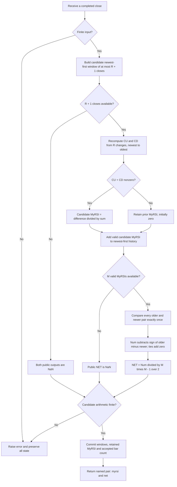

# RSI-NET: MyRSI with Noise Elimination Technology

This folder is the Python research prototype and mathematical master reference for **Noise Elimination Technology: Clarify Your Indicators Using Kendall Correlation**, John F. Ehlers, *Technical Analysis of STOCKS & COMMODITIES*, December 2020, volume 38, pages 16–18. The numerical authority is the December article, its Mesa version, and the matching TradeStation Traders' Tip. The class `RSINet` consumes one close at a time and returns `RSIOutput(myrsi, net)`: the article's original MyRSI and the NET result computed from it. Both are dimensionless and nominally range from −1 to +1.

The folder name and master filename are `rsi-net` and `rsi-net.py`. Go's package name is `rsinet`. Five fixtures supply the identical 252 closes and 40 expected output arrays in Python, Go, TypeScript, Rust and Zig. All twenty parameter pairs below were confirmed by the user on 2026-10-19. This document contains the complete December calculation, mathematical background, startup contract, algorithm, references and BibTeX needed to port the master without access to the original sources.

## What the indicator does

The purpose of NET is to clarify an indicator's prevailing direction through **rank comparisons**, instead of smoothing the indicator's numerical amplitude. Conventional averaging reduces high-frequency fluctuations by combining magnitudes, often delaying turning points. NET instead asks whether later values of an indicator tend to exceed earlier values over a selected window. It gives equal importance to every pair's ordering and discards the size of the difference.

MyRSI, the input to NET here, measures the balance of positive and negative one-bar price changes over a finite window. It is Ehlers' centered, unsmoothed gain/loss ratio. This December implementation uses raw closes; it does not contain Wilder's recursive averaging, the SuperSmoother used in earlier articles, a dominant-cycle estimator, a roofing filter, or a Fisher transform. Both MyRSI and NET are calculated because the article plots them together for comparison.

The two values describe different properties. **MyRSI positive** means recent aggregate gains exceed aggregate losses. **NET positive** means recent MyRSI values tend to rise as time advances. MyRSI can remain positive while NET becomes negative, for example when upward momentum weakens. NET is a direction-of-indicator statistic, not a reconstructed, smoothed version of MyRSI amplitude.

The article compares the two curves on SPY daily data with both lengths 14 and reports clearer visual direction without adding a smoothing filter's lag. That observation does not establish zero response delay for every input. NET still uses a finite historical window; old pair comparisons can outweigh the latest reversal. The transformation is nonlinear, so it has no single linear transfer function or fixed group delay applicable to all signals.

## Basic principles and analogies

For MyRSI, imagine walking along a path. Total uphill distance is CU and total downhill distance is CD. Their difference is net displacement, while their sum is total distance traveled. Dividing displacement by distance gives +1 for entirely uphill movement, −1 for entirely downhill movement, and values near zero when the path repeatedly doubles back. Applied to prices, this describes directional efficiency over the RSI window without depending on the price level or its measurement units.

For NET, imagine every pair of measurements casting a vote: +1 when the later measurement is larger, −1 when it is smaller, and 0 when they tie. NET is the average vote over **all** pairs. A very large rise gets the same vote as a tiny rise. Isolated amplitude disturbances therefore cannot dominate by magnitude alone, although one extreme observation participates in many pairs and can still alter the result.

These are explanatory analogies. The underlying operations are a finite sum of price changes followed by Kendall rank correlation with time. No physical filter, noise-distribution estimate, adaptive threshold or predictive future sample appears in the implementation.

## Notation and source indexing

Let $p_t$ be the current supplied close, where $t=0$ is the first close. Let $R$ denote `rsi_length` / source `RSILength`, and $M$ denote `net_length` / source `NETLength`. Let $r_t$ be MyRSI and $n_t$ be NET.

EasyLanguage `Close[k]` means $p_{t-k}$; `MyRSI[k]` means the MyRSI value $k$ bars ago. The source RSI loop includes `count=0` through `R-1`, which is **R changes and R+1 closes**. The source NET array uses one-based slots:

$$
X_j=r_{t-j+1},\qquad Y_j=-j,\qquad j=1,\ldots,M.
$$

Slot 1 contains current MyRSI. Increasing slot number moves backward in chronological time, so the negative $Y_j$ creates a reference line rising in the actual forward direction of time. The implementation uses newest-first zero-based lists and explicitly documents their mapping to these slots.

## Complete gain/loss and RSI derivation

The December article states that MyRSI is the difference of accumulated closes up and closes down divided by their sum. Define one-bar differences

$$
\Delta p_t=p_t-p_{t-1}.
$$

For a complete RSI window,

$$
CU_t=\sum_{k=0}^{R-1}\max(\Delta p_{t-k},0),\qquad
CD_t=\sum_{k=0}^{R-1}\max(-\Delta p_{t-k},0).
$$

Both sums are nonnegative in exact arithmetic; zero changes contribute to neither. The full MyRSI equation is

$$
r_t=\frac{CU_t-CD_t}{CU_t+CD_t}\quad\text{when }CU_t+CD_t\ne0.
$$

The source assigns no new value when the denominator is zero. Its initialized persistent `MyRSI(0)` therefore gives the complete state rule

$$
r_t=\begin{cases}
\dfrac{CU_t-CD_t}{CU_t+CD_t},&CU_t+CD_t\ne0,\\
r_{t-1},&CU_t+CD_t=0,
\end{cases}
$$

where the retained state is seeded to zero before the first complete RSI window. The public NaN warmup described below is not this internal seed.

The cited May 2018 article, and the relevant RSI sections of *Cycle Analytics for Traders*, chapters 7 and 11, supply the algebra connecting this expression to the traditional scale. Their complete relevant derivation is reproduced here. Start with

$$
RSI_{100}=100-\frac{100}{1+RS},\qquad
RS=\frac{\text{average gain over the interval}}{\text{average loss over the interval}}.
$$

For equal finite windows of gains and losses,

$$
RS=\frac{CU/R}{CD/R}=\frac{CU}{CD}.
$$

The book gives the substitution and common-denominator simplification:

$$
\begin{aligned}
RSI_{100}
&=100-\frac{100}{1+CU/CD}\\
&=100-\frac{100CD}{CU+CD}\\
&=\frac{100(CU+CD)}{CU+CD}-\frac{100CD}{CU+CD}\\
&=\frac{100CU+100CD-100CD}{CU+CD}\\
&=\frac{100CU}{CU+CD}.
\end{aligned}
$$

Removing the factor of 100, the May 2018 article writes

$$
RSI_{01}=1-\frac{1}{1+CU/CD}=\frac{CU}{CU+CD}.
$$

Rescale its interval $[0,1]$ to $[-1,1]$:

$$
\begin{aligned}
MyRSI&=2RSI_{01}-1\\
&=\frac{2CU}{CU+CD}-1\\
&=\frac{2CU-(CU+CD)}{CU+CD}\\
&=\frac{CU-CD}{CU+CD}.
\end{aligned}
$$

Conversely, $RSI_{100}=50(1+MyRSI)$ when the same CU/CD calculation is used. This algebra does not make the finite-window calculation numerically identical to a Wilder RSI that recursively averages gains and losses. The book's chapter 11 prose says “substitute RSI=CU/CD”; its surrounding definition and equations show that the intended substitution is **RS=CU/CD**.

The May article and book recommend considering an RSI summation length near half the dominant cycle period: a pure sinusoid's valley-to-peak half-cycle consists entirely of gains and the next half-cycle of losses. Short windows saturate near ±1 more often; very long windows over oscillatory data tend toward zero. This prototype exposes a fixed integer $R$; it does not infer a dominant cycle from the 252 closes.

Derived from the gain/loss definitions, in exact arithmetic

$$
CU_t-CD_t=\sum_{k=0}^{R-1}\Delta p_{t-k}=p_t-p_{t-R},
$$

$$
CU_t+CD_t=\sum_{k=0}^{R-1}|\Delta p_{t-k}|,
$$

and thus

$$
r_t=\frac{p_t-p_{t-R}}{\sum_{k=0}^{R-1}|\Delta p_{t-k}|}
$$

for a nonzero denominator. This is the displacement/path-distance analogy. It also proves $|r_t|\leq1$ in exact arithmetic. The executable master follows the original CU/CD operations rather than this telescoped formula, because floating-point reassociation changes last digits and can affect subsequent ranks.

## Kendall correlation and its NET specialization

The December article and Mesa paper give the full Kendall correlation equation:

$$
\tau=\frac{2}{m(m-1)}\sum_{i<j}
\operatorname{sgn}(x_i-x_j)\operatorname{sgn}(y_i-y_j),
$$

where

$$
\operatorname{sgn}(u)=\begin{cases}
+1,&u>0,\\
0,&u=0,\\
-1,&u<0.
\end{cases}
$$

Two observations are concordant if their order agrees in both variables and discordant if it disagrees. A tie in either variable contributes zero. With no tie adjustment to the denominator, this is **Kendall tau-a**. The source does not use tau-b, Pearson correlation, Spearman correlation, a rank regression, or sorting with arbitrary tie breaks.

For NET, use MyRSI as $X$ and the increasing chronological time line as $Y$. The source assigns $Y_j=-j$. For its loop pair `count=c`, `K=k`, with $c>k$,

$$
Y_c-Y_k=-c+k<0,\qquad \operatorname{sgn}(Y_c-Y_k)=-1.
$$

Consequently the time sign can be removed from the inner calculation:

$$
Num_t=-\sum_{c=2}^{M}\sum_{k=1}^{c-1}\operatorname{sgn}(X_c-X_k),
$$

$$
Denom=\frac12M(M-1)=\binom{M}{2},
$$

$$
n_t=NET_t=\frac{Num_t}{Denom}.
$$

Equivalently, in chronological pair language let $C_t$ be the count of pairs where later MyRSI is higher, $D_t$ the count where it is lower, and $T_t$ the count where the two MyRSIs tie. Time itself has no ties. Then

$$
C_t+D_t+T_t=\binom{M}{2},\qquad
n_t=\frac{C_t-D_t}{C_t+D_t+T_t}.
$$

This expression makes three conventions essential for a port:

- **Sign:** rising MyRSI gives positive NET. Because history is newest first, the source subtracts the sign of older minus newer.
- **Pairs:** include every pair exactly once. There are $M(M-1)/2$ comparisons, including adjacent pairs and the oldest/newest pair.
- **Ties:** exact equality contributes zero to the numerator but still counts in the denominator. No epsilon or tie correction is applied.

For example, chronological MyRSIs $[-1,+1,+1]$ give two concordant pairs and one tie, hence $NET=2/3$. Tau-b would give a different magnitude. A fully constant MyRSI window yields NET zero, whereas strictly rising or falling windows yield +1 or −1.

At $M=2$, only the latest and previous MyRSI are compared:

$$
n_t=\operatorname{sgn}(r_t-r_{t-1}).
$$

At larger $M$, NET takes discrete rational levels. If $Q=M(M-1)/2$, the numerator is an integer between $-Q$ and $Q$. Ties can make levels differ by $1/Q$. In a tie-free window the numerator has the parity of $Q$, so the spacing is $2/Q$. At the default $M=14$, $Q=91$; at $M=100$, $Q=4950$.

## Interpretation, invariance and limits

NET is unchanged by a strictly increasing pointwise transformation of **its input MyRSI observations**, because their pair order remains unchanged. A strictly decreasing transformation reverses NET's sign. This property does not imply invariance of the composite RSI-NET under arbitrary nonlinear transformations of price: those transformations change the magnitudes of price gains and losses before MyRSI is calculated.

Positive affine changes of price, $p'_t=ap_t+b$ with $a>0$, preserve MyRSI and NET in exact arithmetic. Negating prices negates their MyRSI imbalance and reverses NET's ordering, including flat-window retention under corresponding zero seeds. Very large offsets or extreme magnitudes can cause finite-precision cancellation; exact invariance is a mathematical property, not a bitwise guarantee.

NET does not remove every possible noise component. A spike participates in $M-1$ pairs. Its contribution is limited by pair counts rather than amplitude, but a changed ordering still changes the statistic. The value's sign should be interpreted as predominant ordering over the window, not a probability or a significance test. No statistical p-value is computed, and overlapping samples are not assumed independent.

An especially useful distinction is a rising **price ramp**. Its MyRSI becomes the constant +1 once primed, so NET becomes zero after a complete window of identical +1 values. A descending ramp similarly gives MyRSI −1 and NET zero. NET tracks whether oscillator values rise or fall; it does not independently encode the direction of the underlying price trend.

MyRSI's zero-denominator hold gives it persistent state on a flat price window. Although its ordinary gain/loss calculation uses a finite window, an arbitrarily long flat run can retain an earlier nonzero MyRSI. NET will eventually see a constant retained MyRSI window and become zero. It is therefore inaccurate to claim that the composite always forgets all pre-window history in both output fields.

## Parameters and valid ranges

| Parameter | Source name | Default | Prototype range | Meaning |
| --- | --- | --- | --- | --- |
| `rsi_length` | `RSILength` | 14 | Integer $R\geq1$ | Number of one-bar price changes accumulated; requires $R+1$ closes. |
| `net_length` | `NETLength` | 14 | Integer $2\leq M\leq100$ | Number of valid MyRSI observations ranked against time; uses $M(M-1)/2$ pairs. |

The lengths are independent; they need not match. A small $R$ produces a more reactive, frequently saturated MyRSI. A small $M$ gives coarse NET levels and short ordering memory. A large $M$ gives finer levels and more historical influence, at quadratic computational cost.

NETLength 1 is rejected because its denominator is zero. The source's `X[100]` and `Y[100]` EasyLanguage arrays include indices zero through 100, so source NETLength 100 is allowed. Mathematically NET can use a larger dynamically allocated window, but that is outside the source array range adopted here. RSILength does not use those arrays and has no artificial maximum. A length larger than the record leaves its relevant outputs unprimed.

Booleans and floating-point lengths such as 14.0 are rejected, even though Python booleans are integer subclasses. Inputs must convert to finite binary64 floats. NaN or infinity is rejected without consuming an observation. Negative finite prices are allowed. Overflow in a price difference, source accumulation, numerator or denominator is also rejected before state changes. The fixture magnitudes are ordinary prices.

Parameters are read-only. Construct a new instance to change them; `reset()` restarts the current configuration from empty input history and MyRSI seed zero.

## Streaming startup and exact availability

No unavailable close is synthesized as zero and no partial RSI sum is divided by a full-window denominator. MyRSI is public NaN for indices $0,\ldots,R-1$. At index $R$, there are $R+1$ supplied closes and exactly $R$ changes, so the first valid MyRSI is calculated. A full flat window at that point yields a **valid zero**, following the initialized source state.

Only valid MyRSIs enter the NET history. The first NET result needs $M$ such observations, including the current one:

$$
t_{\mathrm{first\ MyRSI}}=R,\qquad
t_{\mathrm{first\ NET}}=R+M-1.
$$

| Output | NaN prefix length | First numeric zero-based index | Supplied closes required |
| --- | --- | --- | --- |
| `myrsi` | $R$ | $R$ | $R+1$ |
| `net` | $R+M-1$ | $R+M-1$ | $R+M$ |

Default $R=M=14$ gives MyRSI at index 14 and NET at index 27. Between those indices only MyRSI is available. `rsi_warmup_bars` and `net_warmup_bars` describe the separate prefixes; `warmup_bars` equals the latter. `is_primed` is true once both outputs are available, including valid flat/zero outputs. `output` is the latest named tuple without advancing the stream and is `(NaN, NaN)` after construction or reset.

On the 252-close record, $R=251$ gives one MyRSI at index 251 and no NET for any valid $M$. With $R=252$, neither output can be calculated. With $R=152,M=100$, the first NET is exactly index 251, the final observation. These are availability boundaries, not numerical errors.

Chart platforms may provide prior price and indicator history before their first visible or calculated bar. Exact comparisons to a chart require matching that prehistory and first calculation alignment. The December code has no explicit standalone warmup/NaN policy; this master supplies one consistently across five languages. It matches the source's calculation and state rule on numeric observations under the stated startup contract.

## Floating-point order and rank sensitivity

The literal CU update is `CU = CU + Close[count] - Close[count+1]`. Its evaluation is $(CU+p_{t-k})-p_{t-k-1}$, from newest change to oldest. The CD update similarly evaluates $(CD+p_{t-k-1})-p_{t-k}$. These are algebraically the same as adding a precomputed change, but binary64 rounding can differ. The master preserves the **printed left association**, not `CU += difference`.

It recomputes both totals each bar rather than using a rolling sum, compensated sum, vector reduction or telescoped numerator. Every MyRSI is stored at full binary64 precision. NET compares those full-precision stored values with exact sign; it does not first round them to the 15-digit fixture format.

This matters because tiny MyRSI differences can change a discrete NET count. Approximate equality with an epsilon, comparing rounded fixtures to reconstruct NET, or changing sum order can treat near-ties differently. NET fixture values should be compared with numeric tolerance for export rounding, but the indicator's pair sign operation must remain exact with respect to its actual computed values.

No normalization, clipping, smoother, or trading signal is added. Integer pair counting is exact for all supported $M$. The final division by the binary64 denominator produces the public NET float.

## Algorithm flow and state



Persistent state consists of a bounded newest-first price list of at most $R+1$ values, a bounded newest-first list of at most $M$ **valid** MyRSIs, one retained MyRSI scalar, the accepted bar count and latest output pair. There are no recursive averaging states. `Y` is omitted because all its pair signs are known; this is exactly the simplification the article describes.

Storage is $O(R+M)$. Primed work per update is $O(R+M^2)$: $R$ gain/loss comparisons and $M(M-1)/2$ rank comparisons. Lists grow during warmup; requesting an RSI longer than the available stream does not immediately allocate that entire length. A port may use bounded arrays or ring buffers while preserving newest-to-oldest lag and arithmetic ordering.

## Complete December source calculation

This is the complete indicator logic from the article, with whitespace normalized. The plotting zero line is a reference line, not a third output.

```text
Inputs: RSILength(14), NETLength(14);
Vars: CU(0), CD(0), count(0), MyRSI(0);

CU = 0;
CD = 0;
For count = 0 to RSILength - 1 Begin
    If Close[count] - Close[count + 1] > 0 Then
        CU = CU + Close[count] - Close[count + 1];
    If Close[count] - Close[count + 1] < 0 Then
        CD = CD + Close[count + 1] - Close[count];
End;
If CU + CD <> 0 Then MyRSI = (CU - CD) / (CU + CD);

Vars: Num(0), Denom(0), K(0), NET(0);
Arrays: X[100](0), Y[100](0);
For count = 1 to NETLength Begin
    X[count] = MyRSI[count - 1];
    Y[count] = -count;
End;
Num = 0;
For count = 2 to NETLength Begin
    For K = 1 to count - 1 Begin
        Num = Num - Sign(X[count] - X[K]);
    End;
End;
Denom = .5*NETLength*(NETLength - 1);
NET = Num / Denom;
Plot1(MyRSI);
Plot4(0);
Plot2(NET);
```

## Related 2018 calculation: background rather than RSI-NET stages

The December paper cites the May 2018 MyRSI derivation. That earlier implementation optionally smooths the input. For completeness, its remaining mathematical stages are recorded here so a converter can distinguish them from the December master. They are **not stages or parameters of this RSI-NET implementation**.

With its `SmoothLength=S`, the 2018 SuperSmoother coefficient expressions are

$$
a_1=\exp\left(-\frac{1.414\cdot3.14159}{S}\right),\quad
b_1=2a_1\cos_{\mathrm{degrees}}\left(\frac{1.414\cdot180}{S}\right),
$$

$$
c_2=b_1,\qquad c_3=-a_1^2,\qquad c_1=1-c_2-c_3.
$$

That article's MyRSI example computes

$$
F_t=c_1\frac{p_t+p_{t-1}}2+c_2F_{t-1}+c_3F_{t-2}
$$

and applies the same CU/CD difference-of-sum ratio to $F$ rather than raw closes. It uses printed constants 1.414 and 3.14159 and defaults `SmoothLength=8`, `RSILength=10`.

The 2018 RocketRSI variant instead creates momentum

$$
Mom_t=p_t-p_{t-(R-1)},
$$

smooths it as

$$
F_t=c_1\frac{Mom_t+Mom_{t-1}}2+c_2F_{t-1}+c_3F_{t-2},
$$

and computes its gain/loss ratio, clips it to $\widetilde r_t\in[-0.999,0.999]$, then applies

$$
RocketRSI_t=\frac12\ln\left(\frac{1+\widetilde r_t}{1-\widetilde r_t}\right).
$$

The earlier article discusses Gaussian-like distributions and reversal levels at ±2 for that Fisher-transformed signal. This transform is not a proof of calibrated probabilities or standard deviations for arbitrary price data. No such interpretation or Fisher output applies to the December NET result. The book's related RSI sections also use roofing/adaptive/smoothing stages in their separate indicators; the RSI algebra reproduced above is the relevant shared background, not an instruction to insert those additional filters here.

## Supplied implementation differences

| Source | Relevant details | Master decision |
| --- | --- | --- |
| December TASC / Mesa / TradeStation `NET.els` | Exactly $R$ changes, CU/CD recomputed newest first, no zero-denominator else assignment, all $M(M-1)/2$ pairs. | Numeric authority; preserve these formulas, arithmetic order and retained MyRSI. |
| TradersStudio `NET.trs` | Matches gain/loss and pair loop ranges; guards zero NET denominator. | Supports authority; reject NETLength 1 instead of extending the undefined formula. |
| eSignal `NET.efs` | Includes all changes/pairs, but explicitly sets MyRSI to zero on a flat window and returns zero for missing NET history. | Retain source MyRSI on flat windows; use NaN for unavailable outputs. |
| Zorro `NET.c` | Same zero-based NET pair count; gain/loss helper uses `Period+1`; flat MyRSI returns zero. | Pair formulation is equivalent; use direct source sums and source flat-window hold. |
| NinjaTrader `NETMyRSI.cs` | RSI loop uses `count < RSILength - 1`, omitting a change. X fill uses `count < NETLength`, omitting the oldest slot. Outer NET loop also excludes NETLength, and inner `K < count-1` omits adjacent pairs while denominator still counts all pairs. | Preserve article loop bounds; do not reproduce this port's omitted terms or its startup gate. |
| Wealth-Lab `NET.cs` | Calls library NET/MyRSI; adds an EMA signal and Bollinger Bands for an example strategy. | No hidden numeric implementation authority; no strategy overlays are requested for this master. |
| thinkorswim / Optuma | Supplied descriptions point to shared/proprietary tools rather than complete numeric code. | No alternate numerical authority inferred. |
| Excel | Shows article replication and an experiment applying NET to close price. | Useful interpretation; this task specifically computes NET of MyRSI. |

## Confirmed reference parameter combinations

There are **20 combinations**, fewer than the requested maximum of 64. Each pair produces two separate 252-value arrays, `MYRSI` and `NET`, for **40 arrays per language**. Cases sharing $R$ intentionally repeat the MyRSI output to verify that changing NETLength cannot change the raw RSI computation.

| # | RSI length R | NET length N | What it tests |
| --- | --- | --- | --- |
| 1 | 14 | 14 | Article, Mesa and TradeStation defaults. |
| 2 | 1 | 2 | Minimum RSI and NET windows; direction changes and exact ties. |
| 3 | 2 | 2 | Two price changes and the minimum pairwise NET comparison. |
| 4 | 3 | 3 | Small windows with three Kendall pairs and coarse NET levels. |
| 5 | 5 | 5 | Short matched windows for fast oscillator movements. |
| 6 | 7 | 7 | One-week-scale matched windows and intermediate NET granularity. |
| 7 | 10 | 10 | Ten-change RSI associated with a nominal twenty-bar cycle. |
| 8 | 20 | 20 | Longer matched windows with more pairwise direction evidence. |
| 9 | 30 | 30 | Slow matched windows and extended composite warmup. |
| 10 | 14 | 2 | Default RSI with NET determined only by the latest direction. |
| 11 | 14 | 5 | Default RSI with short nonlinear direction memory. |
| 12 | 14 | 30 | Default RSI with a longer rank-correlation horizon. |
| 13 | 14 | 100 | Maximum source NET array index and 4950 pair comparisons. |
| 14 | 1 | 14 | Sign-only RSI input creates many exact ties in the default NET window. |
| 15 | 5 | 14 | Fast RSI with the default NET horizon. |
| 16 | 30 | 14 | Slow RSI with the default NET horizon. |
| 17 | 100 | 100 | Long matched windows with the first NET output at index 199. |
| 18 | 251 | 2 | Record-edge RSI yields one final MyRSI and an entirely unprimed NET. |
| 19 | 252 | 14 | More RSI changes than the record supplies; both outputs stay NaN. |
| 20 | 152 | 100 | Composite record boundary: the first NET output is the final observation. |

Array suffixes use `R{rsi_length}_N{net_length}`, followed by the output token. Defaults are `EXPECTED_R14_N14_MYRSI` and `EXPECTED_R14_N14_NET`. R and N are parameter shortcuts; the output token distinguishes the two arrays and is not a third parameter. Both parameters are integers, so no decimal-point replacement is needed.

Every array's first preceding comment is the exact **What it tests** text above. Its second comment gives `rsi_length=..., net_length=...`. Both outputs for the same pair receive those two comments. The portable forms are:

| Language | Default NET name/declaration | NaN spelling |
| --- | --- | --- |
| Python | `EXPECTED_R14_N14_NET = [...]` | `math.nan` |
| Go | `var expectedR14_N14_NET = []float64{...}` | `math.NaN()` |
| TypeScript | `export const expectedR14_N14_NET: number[] = [...]` | `NaN` |
| Rust | `pub fn expected_r14_n14_net() -> Vec<f64>` | `f64::NAN` |
| Zig | `pub fn expectedR14_N14_NET() [252]f64` | `nan` |

Go imports `math` when expected values are appended. Zig's header contains `const math = @import("std").math;` and `const nan = math.nan(f64);`. Rust functions remain inside the copied `#[cfg(test)] pub mod testdata`, alongside the input functions. These use valid native language syntax, including Go `math.NaN()` and Rust `f64::NAN`.

## Usage and expected-data generation

From this directory:

```sh
python3 rsi-net.py
python3 -m unittest -v test_rsi_net.py
```

The no-argument demonstration embeds the exact 252 shared `INPUT_CLOSE` values, streams them through `RSINet(14,14)`, prints the first complete pair and final pair with 15 significant digits, and demonstrates reset. Minimal library usage is:

```python
indicator = RSINet(rsi_length=14, net_length=14)
result = indicator.update(close)
raw_myrsi = result.myrsi
rank_direction = result.net
```

Regenerate the confirmed reference outputs:

```sh
python3 rsi-net.py --generate-reference-data
```

The generator verifies the embedded closes against the copied Python input fixture. It writes Python expected arrays first, reopens the actual written file through AST parsing, and verifies the complete expected-name set, every 252-value length, both field-specific NaN prefixes (including all-NaN record-edge cases), finite numeric values and 15-digit serialization. Only then does it export the other four files from those **written Python values**, preserving each array's comments and parameter values.

Only marked expected-data blocks are replaced on reruns, so inputs are retained and duplicate arrays are avoided. All computation and NET comparisons use unrounded binary64; export alone uses **15 significant decimal digits**, via `.15g`. Integral output literals receive `.0` where needed for Rust `f64`. NaNs must be tested by classification, not equality.

A mixed absolute/relative comparison tolerance such as $10^{-12}+10^{-12}|\text{expected}|$ covers export rounding for these fixtures. This tolerance is for comparing output data, **not for replacing exact ties inside NET**. Changing MyRSI arithmetic order or using a platform sum that differs in near-ties can change a discrete NET count; ports should follow the master's scalar operation order.

## Verification

`test_rsi_net.py` independently extracts the supplied article's numerical expressions and evaluates its one-based loop semantics. It compares every output over all confirmed parameter pairs, separately counts chronological concordant/discordant/tied pairs, and checks constants, ramps, monotonic MyRSI, flat-window state retention, near-ties without epsilon, literal gain/loss operation order, staged warmups, record boundaries, causality, reset, input integrity and rejection without state changes.

Generated-fixture checks inspect every expected value and every translated array name, comment and floating literal. Missing expected data is a test failure. Source-expression tests require the original repository article, but the class, this mathematical document and the fixture files are self-contained for conversion elsewhere.

Verification completed on 2026-10-19: **all 14 Python tests passed with no skips**, including exact source-expression comparisons for all 20 confirmed parameter pairs and every expected array in all five languages. Native Go, Rust and Zig validators loaded all 40 arrays, checked their lengths and NaN prefixes, and matched numeric checksums against the written Python values. TypeScript execution through Node matched every value and NaN directly. The record-edge cases, including entirely unavailable outputs and the final-bar-only NET, passed. All five fixture files regenerated **byte-for-byte identically**. The default demonstration ran successfully over all 252 closes, and all original input arrays and embedded closes were verified unchanged.

## References and BibTeX

Direct numerical sources are [the December 2020 TASC article](../../tasc/2020-12-noise-elimination-technology/content.md), [the Mesa paper](../../tasc/2020-12-noise-elimination-technology/mesa/content.md), and [December Traders' Tips](../../tasc/2020-12-noise-elimination-technology/tips/tips.md), including [the standalone TradeStation listing](../../tasc/2020-12-noise-elimination-technology/tips/NET.els). Implementation comparisons use the supplied [eSignal code](../../tasc/2020-12-noise-elimination-technology/tips/NET.efs), [NinjaTrader code](../../tasc/2020-12-noise-elimination-technology/tips/ninja-trader/NETMyRSI.cs), and [Zorro code](../../tasc/2020-12-noise-elimination-technology/tips/NET.c).

The earlier MyRSI derivation comes from [RocketRSI, May 2018](../../tasc/2018-05-rocket-rsi-a-solid-propellant-for-your-rocket-science-trading/content.md). Related book mathematics comes from [Cycle Analytics, chapter 7, RSI discussion](../../2013-cycle-analytics-for-traders/ch7.md) and [chapter 11, Adaptive RSI derivation](../../2013-cycle-analytics-for-traders/ch11.md). This document reproduces their complete relevant RSI algebra and distinguishes the earlier filter/Fisher stages from December RSI-NET. The referenced Wilder book is background cited by those sources; no Wilder averaging stage is implemented. The parent [Python fixture](../test_testdata.py) is the source of the embedded input closes.

```bibtex
@article{ehlers_noise_elimination_2020,
  author = {Ehlers, John F.},
  title = {Noise Elimination Technology: Clarify Your Indicators Using Kendall Correlation},
  journal = {Technical Analysis of STOCKS \& COMMODITIES},
  volume = {38},
  number = {12},
  pages = {16--18},
  month = dec,
  year = {2020},
  url = {https://technical.traders.com/archive/article.asp?file=\V38\C12\154EHLE.pdf}
}

@misc{ehlers_mesa_noise_elimination_2020,
  author = {Ehlers, John F.},
  title = {NET -- Noise Elimination Technology},
  howpublished = {MESA Software paper},
  year = {2020},
  url = {https://www.mesasoftware.com/papers/Noise%20Elimination%20Technology.pdf}
}

@misc{traders_tips_2020_12,
  author = {{Technical Analysis of STOCKS \& COMMODITIES}},
  title = {Traders' Tips: Noise Elimination Technology},
  month = dec,
  year = {2020},
  url = {https://www.traders.com/Documentation/FEEDbk_docs/2020/12/TradersTips.html},
  note = {TradeStation: Chris Imhof; NinjaTrader: Brandon Haulk; Zorro: Petra Volkova;
          TradersStudio: Richard Denning; Excel: Ron McAllister; eSignal: Eric Lippert}
}

@article{ehlers_rocket_rsi_2018,
  author = {Ehlers, John F.},
  title = {RocketRSI -- A Solid Propellant for Your Rocket Science Trading},
  journal = {Technical Analysis of STOCKS \& COMMODITIES},
  volume = {36},
  number = {5},
  pages = {8--12},
  month = may,
  year = {2018},
  url = {https://technical.traders.com/archive/article.asp?file=\V36\C05\207EHLE.pdf}
}

@book{ehlers_cycle_analytics_2013,
  author = {Ehlers, John F.},
  title = {Cycle Analytics for Traders: Advanced Technical Trading Concepts},
  publisher = {Wiley},
  series = {Wiley Trading},
  year = {2013},
  isbn = {9781118728604},
  note = {Relevant RSI derivations in chapters 7 and 11}
}

@book{wilder_new_concepts_1978,
  author = {Wilder, J. Welles},
  title = {New Concepts in Technical Trading Systems},
  publisher = {Trend Research},
  year = {1978},
  note = {Original RSI background cited by Ehlers; no recursive Wilder averaging in RSI-NET}
}
```
