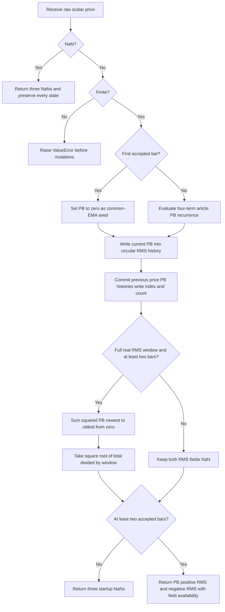

# Super Passband Filter: research prototype master reference

`super-passband-filter.py` implements John F. Ehlers' July 2016 Super Passband Filter. Class `SuperPassbandFilter(period1=40, period2=60, rms_window=50)` consumes one scalar raw price per `update(price)` and returns `PassbandOutput(passband, rms, negative_rms)`. The passband is the difference of two EMAs, evaluated with the article's single second-order recurrence. RMS levels describe the recent squared amplitude of that passband.

The numeric authority is the original article, corroborated by TradeStation and other supplied Tips. This document contains the full article theory and code, relevant book mathematics, physical analogies, source differences, configuration, calculation flow, startup rules, conversion instructions, and BibTeX. A copied folder can be implemented and verified without access to the source tree.

## Article and book investigation

The 2013 *Cycle Analytics for Traders* contents and all 17 supplied chapters contain no Super Passband Filter listing or its `5/Period` two-EMA-difference recurrence. There is therefore no book implementation of this indicator to compare directly.

Chapter 2 provides EMA equations and the usual smoothing-length mapping. Chapter 5 provides resonant band-pass filters and describes selectivity, phase, and ringing. Its filter has a two-bar input difference and a zero at Nyquist; its full indicator also has high-pass preprocessing and peak AGC. These are different calculations from the Super Passband, whose poles are two real EMA poles and whose only numerator zero is at DC. Chapter 12's Even Better Sinewave supplies a useful RMS contrast: it divides a three-bar average by the square root of three-bar mean square, whereas Super Passband returns its raw waveform and thresholds without normalization.

The article's EMA coefficient factor **5** is a heuristic setting, not a shortened mathematical constant. No printed 1.414 or 3.14159 occurs in its indicator code. Retain `5.0/period` exactly; do not replace 5 by $2\pi$, use `2/(period+1)`, or insert a SuperSmoother. Full pi is used in the theoretical frequency relationships below, not in the PB coefficients.

## Principles and physical analogies

A low-pass filter smooths by reducing rapid variation, while a high-pass filter reduces very slow variation. A passband filter emphasizes a middle range. Here the author builds it by subtracting two parallel low-pass outputs: a faster EMA and a slower EMA. Both eventually agree on a constant price, so their difference cancels DC. During a change, their different responses produce the oscillator.

The electronic analogy is two first-order RC smoothing circuits with different time constants, feeding a differential amplifier. A capacitor retains fading memory of its input; the EMA is its discrete recursive counterpart. The subtraction happens on the current computed values and requires no additional bar of history, but each smoothing branch still has memory and phase response. DC cancellation should not be interpreted as cancellation of every frequency-dependent delay.

The mechanism is also the MACD line with an unconventional parameter mapping and with RMS thresholds instead of a signal-line EMA. “Critical periods” are the author's coefficient-selection controls; they are not conventional EMA lengths. The RMS thresholds adapt to the output's recent amplitude, making a separate unity-gain normalization unnecessary.

The book describes a different resonant band-pass filter using a quality factor Q. Its physical analogy is a bell or resonant circuit: high Q stores energy and rings longer, while lower Q has a broader band and reacts more quickly. This selectivity-versus-response principle remains useful context, but Q is not a Super Passband parameter and its real-pole response is not the same resonant filter.

## EMA equations and complete derivation of the passband

Let $p_t$ be the raw input price. Let $P_1,P_2$ be the configured periods. Define

$$a_1=\frac5{P_1},\qquad a_2=\frac5{P_2},\qquad q_1=1-a_1,\qquad q_2=1-a_2.$$

The two conceptual EMA branches satisfy the article and book equation 2-2:

$$e_{1,t}=a_1p_t+q_1e_{1,t-1},\qquad e_{2,t}=a_2p_t+q_2e_{2,t-1},\qquad b_t=e_{1,t}-e_{2,t}.$$

For a generic EMA with gain a and pole q=1-a, the transfer function is

$$H_{EMA}(z)=\frac{a}{1-qz^{-1}}.$$

Subtract the **complex transfer responses**, not their magnitudes:

$$
\begin{aligned}
H_{PB}(z)&=\frac{a_1}{1-q_1z^{-1}}-\frac{a_2}{1-q_2z^{-1}}\\
&=\frac{(a_1-a_2)+(a_2q_1-a_1q_2)z^{-1}}{1-(q_1+q_2)z^{-1}+q_1q_2z^{-2}}\\
&=\frac{(a_1-a_2)(1-z^{-1})}{(1-q_1z^{-1})(1-q_2z^{-1})}.
\end{aligned}
$$

The last simplification uses $a_2q_1-a_1q_2=a_2-a_1$ in exact arithmetic. Cross-multiplication yields the article's actual implementation:

$$b_t=(a_1-a_2)p_t+(a_2q_1-a_1q_2)p_{t-1}+(q_1+q_2)b_{t-1}-q_1q_2b_{t-2}.$$

There are four terms: current price, previous price, previous PB, and second previous PB. The master preserves this expression and order. Floating-point evaluation of $a_2q_1-a_1q_2$ need not equal the negated first coefficient at its final bit, so do not silently replace the two price terms with `(a1-a2)*(price-previous_price)` or compute two independent EMA histories when matching the master decimals. Both alternatives are algebraically equivalent and useful independent validation methods.

The poles are q1 and q2. They are real, unlike the generally complex conjugate poles of the book's resonant band-pass. For unequal periods there is one numerator zero at $z=1$, so DC gain is zero. At Nyquist $z=-1$,

$$H_{PB}(-1)=\frac{a_1}{2-a_1}-\frac{a_2}{2-a_2}=\frac{2(a_1-a_2)}{(2-a_1)(2-a_2)}.$$

This is generally **nonzero**. Super Passband attenuates high frequencies in ordinary settings but does not have a Nyquist notch. A SuperSmoother, Roofing filter, or the book's resonant band-pass would change this response.

For $\omega=2\pi f$ radians/bar, its exact sinusoidal gain is

$$|H_{PB}(e^{i\omega})|^2=\frac{2(a_1-a_2)^2(1-\cos\omega)}{(1+q_1^2-2q_1\cos\omega)(1+q_2^2-2q_2\cos\omega)}.$$

When both poles are positive and the maximum lies below Nyquist, the gain peaks where

$$1-\cos\omega_{peak}=\frac{a_1a_2}{2\sqrt{q_1q_2}}.$$

This is a derived property rather than an additional algorithm step. Periods with negative poles have unusual responses and should not be interpreted with the ordinary smooth passband picture. Equal periods make every transfer term cancel and produce zero PB; reversed periods multiply PB by -1 while preserving squared amplitude and RMS.

## Period mapping, phase, and initialization implications

Book equation 2-3 uses $a=2/(N+1)$ for matching the static lag of an N-bar SMA to an EMA. Equating this with the article's $a=5/P$ gives

$$N=\frac{2P}{5}-1.$$

Default P1=40 and P2=60 therefore correspond to conventional EMA lengths **15 and 23**, not 40 and 60. These are coefficient equivalences, and fractional N values remain mathematically valid. The book's static unit-ramp lag is

$$L=\frac{1-a}{a}=\frac1a-1,\qquad a=\frac1{L+1}.$$

For a price ramp with slope s, the two-EMA difference tends to

$$b_t\longrightarrow s(L_2-L_1)=s\frac{P_2-P_1}{5}.$$

Thus DC cancellation does not imply every trend is fully eliminated. A continuing linear ramp is passed as a constant slope-dependent PB. A finite mean can be nonzero during transient or trending data, despite the article's “guaranteed zero mean” phrasing.

The heuristic P is not exactly an EMA's digital half-power period. For positive q and a half-power point below Nyquist, the EMA cutoff satisfies

$$\cos\omega_c=1-\frac{a^2}{2q},\qquad T_c=\frac{2\pi}{\omega_c}.$$

No cutoff calculation is needed in `update`. The setting is used exactly as the article specifies. The filter generally has frequency-dependent phase; close alignment of price turns and PB turns in an example chart is not a proof of zero delay at every frequency.

## RMS levels: complete calculation and interpretation

Let W be the positive integer RMS window, default 50. Include the **current PB** and W-1 older PB values:

$$M_t=\frac1W\sum_{j=0}^{W-1}b_{t-j}^2,\qquad R_t=\sqrt{M_t},\qquad R^-_t=-R_t.$$

The master returns raw $b_t$, positive $R_t$, and negative $R^-_t$. The zero line is a constant plot reference. It does not divide PB by RMS or add a trigger smoother, oscillator scaling, threshold multiplier, or statistical signal.

The original code resets its sum to zero every bar and traverses PB lags **0 to W-1**, newest to oldest. The master uses a circular history buffer and recomputes the scalar sum in that same order. Keep the multiplication `value*value`, successive ordinary additions, and `sqrt(total/W)`. A rolling running sum, compensated addition, `math.fsum`, or reverse traversal can change final decimal rounding. W controls both the number of samples **and the divisor**.

Mean square M is proportional to signal power. RMS R has amplitude/price units and is the square root of that power measure. The article's standard-deviation analogy is exact only for a zero-mean window: with $\bar b=W^{-1}\sum b$, population variance obeys

$$\sigma_b^2=\frac1W\sum(b-\bar b)^2=M-\bar b^2.$$

For a pure sine wave with peak amplitude A over complete cycles, $R=A/\sqrt2$. For a constant b, RMS is |b| and standard deviation is zero. Do not subtract a window mean, use sample variance W-1, or apply a standard-deviation implementation in place of the RMS formula. A threshold crossing alone does not establish a probability of mean reversion.

The article chooses W=50 as a convenient approximate cycle-length window and explicitly permits another sufficiently long value. Very short windows and record-length windows below are numerical coverage cases; they are not additional trading recommendations. W=1 makes RMS approximately |PB| subject to square/square-root rounding. W larger than the available record leaves both threshold fields unprimed while PB remains usable.

## Configuration and interface

| Parameter | Shortcut | Default | Valid values | Meaning |
| --- | --- | ---: | --- | --- |
| `period1` | `P1` | 40.0 | Finite real $P_1>2.5$ | First EMA's heuristic critical-period setting. Usually shorter. |
| `period2` | `P2` | 60.0 | Finite real $P_2>2.5$ | Second EMA setting. Usually longer. |
| `rms_window` | `W` | 50 | Positive Python integer, excluding bool | Number of actual PB values and RMS divisor. |

The exact stability condition is $|q|=|1-5/P|<1$, equivalent to P>2.5 for positive finite P. At P=2.5, q=-1 is not strictly stable; below it the pole magnitude exceeds one. Reject these settings even though some Tips user interfaces allow periods down to 1.

Ordinary convex EMA behavior needs $0<a\le1$, or P>=5. At P=5 its EMA uses current price directly; for 2.5<P<5 the pole is negative and transients alternate. These values are accepted for algebraic coverage and clearly identified in the test table. The usual filtering interpretation and recommendations use P>=5. Reversed and equal periods are accepted rather than silently reordered. Fractional periods set real coefficients and are not rounded to integer windows. Extremely large finite periods can reach binary64 coefficient-resolution limits.

`update(price)` returns a `PassbandOutput` named tuple with fields `passband`, `rms`, `negative_rms`. Each field uses NaN until it is available. PB priming and full-output priming are separate: `is_passband_primed` becomes true on bar 2; `is_primed` means the RMS fields are available too. `passband_warmup_bars=1`; `rms_warmup_bars=warmup_bars=max(1,W-1)`.

Properties `period1`, `period2`, and `rms_window` are read-only. Create a new configured object to change coefficients or window length. `reset()` clears all history. Finite zero and negative raw prices are valid. Infinity raises `ValueError` before mutations. A NaN sample returns all-NaN fields and skips all state updates.

## Exact finite-sequence startup and missing data

The article leaves initialization and platform preloaded history implicit. This master declares a finite-sequence startup consistent with the conceptual two-EMA difference: use the first actual price as the common EMA level. Set $b_1=0$ and the older PB state to zero; store the first price. This avoids injecting an artificial first-price-versus-zero step.

Bar 1's zero PB is stored in RMS history, but the returned PB seed is masked by NaN. Start the normal printed recurrence on bar 2. There is no need to wait for P1 or P2 bars, and no price-valued PB seed is used. The first calculation satisfies, in exact arithmetic,

$$b_2=(a_1-a_2)(p_2-p_1).$$

Use the full four-term expression in code rather than this algebraic simplification. The first shared-price default PB result is bar 2, `0.138125` at 15-digit serialization.

RMS is visible only after a full W-bar history of actual accepted bars is present, including the initial zero PB. It is also masked on bar 1 even when W=1. The first RMS bar is $\max(2,W)$. For W=50, PB has one leading NaN and the two RMS fields each have 49. Default first RMS is bar 50, approximately `0.630309035583353`; its negative level is the negation. For W=252 only the final RMS position is visible. For W=300 both RMS arrays are entirely NaN over this 252-bar input.

Platforms can show different startup values because they preload price/PB histories or start at a different bar. For example, the supplied NinjaTrader seeds its first two PB values with raw prices; that is a different large transient. This master chooses the conceptual equal-EMA initialization and preserves the article recurrence afterward. Constant input can leave tiny finite residues due to the separately evaluated price coefficients, so algebraic zero is tested with floating tolerance where appropriate.

A NaN call is an omitted observation. Do not shift the previous price, either PB history, the circular RMS buffer, its write index, or the accepted-sample count. The next finite price follows the previous accepted price. Missing observations do not age the window by calendar time. Reject infinite input before modifying any state. After reset all availability rules restart.

Compute PB using old price/PB histories, write current PB into the RMS ring, commit price and PB histories, increment the count, then sum a complete window if available. Startup values are maintained internally even when the returned fields are hidden. Availability does not promise that IIR startup transients have settled.

## Calculation flow



The recurrence has O(1) scalar work. The RMS calculation intentionally has O(W) work per primed bar and O(W) storage to preserve the source summation order. The circular buffer implements the source's lag array without language-specific dependencies.

## Source interpretation and practical limits

The source describes crossing upward through -RMS as an entry idea and crossing downward through +RMS as a short-entry idea. It discusses exits at the opposite RMS level and slope reversals. These are interpretation and example strategy rules; the master outputs only the three numeric series. It computes no position, trade, crossover event, probability, alert, or slope trigger.

Cancellation removes the exact DC response, while the remaining two recursive branches still have phase response. The article's qualitative “no lag” claim and a chart's nearby price/PB turns do not make the filter predictive at every frequency. Its illustrated subtraction should be interpreted as subtracting phase-bearing complex responses; subtracting only magnitude curves generally gives a different response.

Passband gain is not normalized to 1. Because the RMS thresholds are measured on the same waveform, changing amplitude scale changes PB and both thresholds together. Reversing periods reverses PB exactly under the master's paired coefficient arithmetic and keeps the RMS levels unchanged. Equal periods give identically zero output after priming. This differs from a normalized oscillator bounded by ±1.

## Precision, source agreement, and fixture contract

Use standard-library scalar binary64 arithmetic. No rounded pi or sqrt(2) is needed in the numeric algorithm. Retain factor 5, the article four-term recurrence, ordinary multiplications/additions, and the newest-to-oldest RMS loop. Do not pre-round recursive state or introduce an alternative pole formula. Independent tests extract the printed article recurrence and separately compute two EMAs with equal initial levels, allowing floating-point tolerance for the algebraically equivalent form. Across the 20 confirmed cases on the shared prices, all three master fields agree exactly with the extracted article calculation using the declared seeds and windows. The independent two-EMA difference agrees with PB to a maximum absolute difference of `2.99316127438942e-13`.

Serialize expected floating values with **15 significant decimal digits**, `.15g`. Write an explicit decimal suffix for integral literals, e.g. `0.0`, so f64 fixture code is valid in Rust and Zig. Ported calculations can have small differences due to operation fusion and math-library square roots; a reasonable absolute/relative tolerance for these fixtures is $10^{-11}$. NaN masks and array lengths must match exactly.

All 252 INPUT_CLOSE values are embedded in `__main__`. Generation verifies equality with the copied Python closes, computes 20 cases, and produces three 252-value expected arrays per case. It writes and rereads the Python arrays first to check their lengths, NaNs, and decimal precision. Go, TypeScript, Rust, and Zig then receive those saved Python decimal values. No port independently calculates expected data. Original close/high/low/open inputs are preserved.

Generated-section markers support repeat generation without appending duplicate arrays or altering the input fixtures. Numeric code is above the fixture-tooling boundary; parsing and file formatting below that boundary are optional conversion utilities. Only Python's standard library is used.

From this folder:

```bash
python3 super-passband-filter.py
python3 test_super_passband_filter.py
python3 super-passband-filter.py --generate-reference-data
```

## Confirmed reference parameter combinations

All **20 cases** below were confirmed by the user on 2026-10-20, within the 64-case limit. Each has outputs PB, RMS, and NEG_RMS, making **60 arrays of 252 values per language**. Every series has its own priming mask as described above.

| Parameter suffix | Parameter values | What it tests |
| --- | --- | --- |
| `P12_6_P210_W50` | `period1=2.6, period2=10, rms_window=50` | Stable setting near the lower period boundary: negative-pole transient behavior. |
| `P13_P24_W50` | `period1=3, period2=4, rms_window=50` | Two stable negative EMA poles: unusual short-period response. |
| `P14_P23_W50` | `period1=4, period2=3, rms_window=50` | Reversed negative-pole pair: passband sign reverses while RMS is unchanged. |
| `P15_P210_W50` | `period1=5, period2=10, rms_window=50` | Memoryless fast EMA boundary: alpha1 equals one. |
| `P110_P220_W50` | `period1=10, period2=20, rms_window=50` | Short critical periods: faster response and weaker high-frequency smoothing. |
| `P120_P240_W50` | `period1=20, period2=40, rms_window=50` | Intermediate pair with a two-to-one period ratio. |
| `P140_P260_W50` | `period1=40, period2=60, rms_window=50` | Article default: forty/sixty periods and fifty-bar RMS thresholds. |
| `P160_P240_W50` | `period1=60, period2=40, rms_window=50` | Reversed article periods: exact sign symmetry and unchanged RMS. |
| `P140_P240_W50` | `period1=40, period2=40, rms_window=50` | Equal periods: passband and both primed RMS levels collapse to zero. |
| `P140_P241_W50` | `period1=40, period2=41, rms_window=50` | Nearly equal periods: small difference output and coefficient cancellation. |
| `P140_5_P260_5_W50` | `period1=40.5, period2=60.5, rms_window=50` | Fractional critical periods: preserve real-valued coefficients. |
| `P180_P2120_W50` | `period1=80, period2=120, rms_window=50` | Longer period pair: slower recursive response. |
| `P1150_P2200_W50` | `period1=150, period2=200, rms_window=50` | Long-term pair: long transient and slowly varying passband. |
| `P1200_P2252_W50` | `period1=200, period2=252, rms_window=50` | Periods approaching the full input-record length: extended memory. |
| `P140_P260_W1` | `period1=40, period2=60, rms_window=1` | One-bar RMS: threshold equals absolute current passband from bar two. |
| `P140_P260_W2` | `period1=40, period2=60, rms_window=2` | Two-bar RMS: first complete window includes the initial zero passband seed. |
| `P140_P260_W10` | `period1=40, period2=60, rms_window=10` | Short RMS window: threshold follows recent squared amplitude rapidly. |
| `P140_P260_W100` | `period1=40, period2=60, rms_window=100` | Long RMS window: later threshold priming and longer amplitude memory. |
| `P140_P260_W252` | `period1=40, period2=60, rms_window=252` | Full-record RMS window: only the last threshold value is primed. |
| `P140_P260_W300` | `period1=40, period2=60, rms_window=300` | RMS window exceeds the record: PB is available but both threshold arrays stay NaN. |

Parameter shortcuts are P1, P2, W; decimal points become underscores. Output suffixes are PB, RMS, and NEG_RMS. For example, Python `EXPECTED_P140_P260_W50_PB` is the default passband, `EXPECTED_P140_P260_W50_RMS` the positive RMS, and `EXPECTED_P140_P260_W50_NEG_RMS` the negative RMS. Fractional periods use tokens such as `P140_5`.

| Language | File | Example name/declaration | NaN |
| --- | --- | --- | --- |
| Python | `test_testdata.py` | `EXPECTED_P140_P260_W50_PB = [...]` | `math.nan` |
| Go | `testdata_test.go` | `package superpassbandfilter`; `var expectedP140_P260_W50_PB = []float64{...}` | `math.NaN()` |
| TypeScript | `testdata.ts` | `export const expectedP140_P260_W50_PB: number[] = [...]` | `NaN` |
| Rust | `testdata.rs` | `pub fn expected_p140_p260_w50_pb() -> Vec<f64> { vec![...] }` | `f64::NAN` |
| Zig | `testdata.zig` | `pub fn expectedP140_P260_W50_PB() [252]f64 { return .{...}; }` | `nan` |

Each output declaration has the same two comments: the case's “What it tests” text, followed by parameter names and values. The output suffix identifies the particular field. Copied Rust inputs remain inside the original `#[cfg(test)] pub mod testdata`; expected functions are at file scope. Go imports `math`; Zig keeps `const math = @import("std").math;` and `const nan = math.nan(f64);`.

## References and BibTeX

- John F. Ehlers, “The Super Passband Filter,” *Technical Analysis of STOCKS & COMMODITIES*, 34(7), July 2016, pp. 11–13. [Local article](../../tasc/2016-07-the-super-passband-filter/content.md), [published article](https://technical.traders.com/archive/article.asp?file=%5CV34%5CC07%5C242EHLE.pdf).
- [Traders' Tips, July 2016](https://www.traders.com/Documentation/FEEDbk_docs/2016/07/TradersTips.html), [local collection](../../tasc/2016-07-the-super-passband-filter/tips/tips.md). Relevant supplied implementations are compared below.
- John F. Ehlers, *Cycle Analytics for Traders: Advanced Technical Trading Concepts*, Wiley, 2013. [Contents](../../2013-cycle-analytics-for-traders/toc.md), [chapter 2](../../2013-cycle-analytics-for-traders/ch2.md), [chapter 5](../../2013-cycle-analytics-for-traders/ch5.md), [chapter 12](../../2013-cycle-analytics-for-traders/ch12.md).
- [Source investigation](../../tasc/2016-07-the-super-passband-filter/implementation-comparison.md), project audit dated 2026-10-20, reproduced below.
- The article's further reading cites Ehlers' “Aliasing” (January 2016) and “Decyclers” (September 2015). These are background references, not numeric oracle implementations used here.

```bibtex
@article{ehlers2016superpassband,
  author  = {Ehlers, John F.},
  title   = {The Super Passband Filter},
  journal = {Technical Analysis of STOCKS \& COMMODITIES},
  volume  = {34},
  number  = {7},
  pages   = {11--13},
  year    = {2016},
  month   = jul,
  url     = {https://technical.traders.com/archive/article.asp?file=%5CV34%5CC07%5C242EHLE.pdf}
}
@misc{traderstips2016july,
  author       = {{Technical Analysis of STOCKS \& COMMODITIES}},
  title        = {Traders' Tips: The Super Passband Filter},
  year         = {2016},
  month        = jul,
  howpublished = {Online},
  url          = {https://www.traders.com/Documentation/FEEDbk_docs/2016/07/TradersTips.html}
}
@book{ehlers2013cycle,
  author    = {Ehlers, John F.},
  title     = {Cycle Analytics for Traders: Advanced Technical Trading Concepts},
  publisher = {Wiley},
  year      = {2013},
  series    = {Wiley Trading},
  isbn      = {9781118728604},
  note      = {Chapter 2 EMA background, chapter 5 distinct band-pass, chapter 12 RMS contrast}
}
@article{ehlers2016aliasing,
  author  = {Ehlers, John F.},
  title   = {Aliasing},
  journal = {Technical Analysis of STOCKS \& COMMODITIES},
  volume  = {34},
  year    = {2016},
  month   = jan,
  note    = {Further reading cited by the Super Passband article}
}
@article{ehlers2015decyclers,
  author  = {Ehlers, John F.},
  title   = {Decyclers},
  journal = {Technical Analysis of STOCKS \& COMMODITIES},
  volume  = {33},
  year    = {2015},
  month   = sep,
  note    = {Further reading cited by the Super Passband article}
}
```

## Original article: complete theory and implementation

The original text below preserves the entire relevant theoretical explanation and EasyLanguage listing. Image links are omitted, but captions remain. Source claims about zero lag, zero mean, and probability are qualified by the exact transfer/RMS relationships above. Use the master's explicit finite-sequence initialization for porting.

*Are low and high frequencies getting in your way? Here's a filter that will reject both of these extremes so you can focus on what really matters.*

It's a well-known fact: The real enemy of technical traders is the lag from their indicators and trading strategies. Sure, it is relatively simple to create a fancy filter that will give you a precise answer to your trading decisions. But fancy filters require more data than simple filters do, which will cause a delay in the calculations. What use would that be to a trader?

It is far better to get a reasonable answer with no lag, which is precisely what my super passband filter does. Because it passes a band of frequencies through a filter from the data spectrum, it rejects the very low frequencies and therefore displays as an oscillator. It rejects the very high frequencies to eliminate the distracting wiggles that often occur in indicators. I will show you how to use the super passband filter with maximum effectiveness to supplement your discretionary trading, and I'll give you sufficient detail so you can also implement the rules as part of an algorithmic trading strategy.

## The Filter Concept

Perhaps the simplest technical indicator is the exponential moving average (EMA). The EMA takes a fraction of the current price and adds the complement of the fraction to the value of the EMA one bar ago. In EasyLanguage notation, using $\alpha$ to denote the fraction, the equation is:

$$\text{EMA} = \alpha \cdot \text{Price} + (1 - \alpha) \cdot \text{EMA}[1]$$

I always write the EMA equation this way to ensure the coefficients add up to unity, thus avoiding a potential bug or rounding error in the program. The EMA is a low-pass, or smoothing, filter. It provides the smoothing by rejecting the high-frequency components that are present in the price data spectrum. The EMA frequency transfer response can be visualized as in Figure 1. The low-frequency components are passed unattenuated while the frequency components above the critical frequency are increasingly attenuated.

**Figure 1: Exponential Moving Average (EMA) Transfer Response**

The super passband filter is formed by using two EMA filters. One has a critical frequency that is set to a lower frequency than the first. Then, the second EMA filter is subtracted from the first. Since both EMAs pass the very low frequencies with no attenuation, the subtraction eliminates the lowest frequencies by cancellation. This is important, because the very low frequencies are eliminated without the use of filtering, which means there is no induced lag.

Figure 2 illustrates the concept of the super passband filter. The original EMA is shown by the red line. The second EMA, having a lower critical frequency, is shown by the blue line. The resultant super passband filter response is shown by the dashed black line. The response of the blue line is subtracted from the response of the red line. At the very low frequencies, the values of the red and blue lines are the same, so the value of the super passband filter is zero by cancellation. Slightly above the critical frequency of the blue line, you'll see its value decrease, so less cancellation occurs. The response of the super passband filter increases until the value of the blue line is essentially zero. Then, its response is flat through the passband until the critical frequency of the red line EMA is reached. The high-frequency attenuation of the super passband filter is determined by the attenuation of the red line EMA.

**Figure 2: Super Passband Filter**

The usefulness of the super passband filter can be enhanced by also computing some trigger points, which can increase the efficiency of your entries and exits. I do this by computing the root mean square (RMS) value of the cyclic output of the super passband filter. In working with cycles, the RMS value describes the power in the waveform. The RMS value is the conceptual equivalent of the first standard deviation in a more generalized waveform. When the waveform exceeds the RMS value, there is a higher probability that the waveform will turn and revert toward the mean. Therefore, I will use the computed RMS value as convenient trigger levels for trading.

The EasyLanguage code for computing the super passband filter can be found in the sidebar "EasyLanguage Code For Super Passband Filter." The two inputs to the super passband filter are the critical periods of the two EMA filters. Cycle periods are the reciprocal of frequency, and so the shorter period is given first. Don't worry if you get the two inputs reversed. The result will be that the output waveform will be upside down, which is easily identified. The critical periods are used to compute the EMA coefficients, a relationship I obtained heuristically (that is, by computational trial and error).

I have written the equation for the passband (PB) variable in closed form by taking the difference of the two EMA Z-transform responses. It could have as easily been done by computing each EMA and then taking the difference, as described conceptually.

There are only two pieces of input information: the current closing price and the closing price one bar ago. The equation is completed using the computed value of PB one bar ago and two bars ago. The super passband filter will not have unity gain at the center of the passband, but the absolute value of the filter amplitude is irrelevant because the trigger points are referenced to the RMS value of the PB waveform.

I compute the RMS value of the PB waveform by summing its square over the last 50 bars and taking the square root of the averaged sum. There is nothing magic in the number 50, and you can substitute a different value if you choose, but it should be sufficiently long to use approximately one cycle's worth of data in the calculation.

## The Super Passband Filter in Action

I have applied the super passband filter to approximately one year's worth of SPY daily data (Figure 3). The filter response is shown as the red line in the first subgraph. The two yellow lines display the +RMS and −RMS values, and the blue line is the zero reference. The super passband filter output has a guaranteed zero mean because the low-frequency components are removed by cancellation. The near-zero lag of the filter can be verified by comparing a notch in the prices, say, near the beginning of October 2015 or the third week of January 2016, to the lowest spots in the filter response.

Since going beyond the RMS levels and then starting to return to the mean is significant, the red line crossing over the −RMS line is a good trade entry signal. You can also sell short when the yellow line crosses under the +RMS line for the same reason. The basic idea is to hold the trade until the red line crosses the other RMS line. There are many cases where the slope of the red line is not consistent when traversing from one RMS line to the other. In this case, a slope reversal is a good time to exit the trade, even if it's a loss. Then, when the slope of the red line resumes its original trajectory, you can reenter the trade even though the red line has not crossed over (or under) the yellow line.


## Less Is Clearer

That's all there is to it. I am sure you will find the super passband filter response will accurately reflect the pattern of the prices, making your trade opportunities clearer. You will find that the smaller you make the critical periods of the two EMAs, the more raggedy the filter response becomes. This is the straightforward result of using less smoothing in your EMAs.

## EasyLanguage Code for Super Passband Filter

```easylanguage
//Super Passband Filter
// (c) 2016 John F. Ehlers

Inputs:
    Period1(40),
    Period2(60);

Vars:
    a1(0),
    a2(0),
    PB(0),
    count(0),
    RMS(0);

a1 = 5 / Period1;
a2 = 5 / Period2;

PB = (a1 - a2)*Close + (a2*(1 - a1) - a1*(1 - a2))*Close[1] +
     ((1 - a1) + (1 - a2))*PB[1] - (1 - a1)*(1 - a2)*PB[2];

RMS = 0;
For count = 0 to 49 Begin
    RMS = RMS + PB[count]*PB[count];
End;
RMS = SquareRoot(RMS / 50);

Plot1(PB);
Plot2(0);
Plot3(RMS);
Plot7(-RMS);
```

## Further Reading

- Ehlers, John F. [2013]. *Cycle Analytics For Traders*, John Wiley & Sons.
- Ehlers, John F. [2016]. "Aliasing," Technical Analysis of STOCKS & COMMODITIES, Volume 34: January.
- Ehlers, John F. [2015]. "Decyclers," Technical Analysis of STOCKS & COMMODITIES, Volume 33: September.

## Original book: complete relevant EMA description

An EMA is computed by taking a fraction of the current price added to the complementary fraction of the EMA calculation one bar ago. The first ­fraction is usually called alpha, and can have a value between zero and one. The two fractions must sum to unity, so the second fraction must have the value of one minus alpha. The equation to compute an EMA is:

$$\text{EMA} = \alpha \cdot \text{Price} + (1 - \alpha) \cdot \text{EMA}[1]$$

(2-2)

The EMA becomes a moving average by moving from bar to bar, from left to right, across the price data.

Imagine a case where the input data set has only one sample at an amplitude of $1 / \alpha$. When the EMA is applied to these data, the first output from the filter is unity because there was no previous value for the EMA. On subsequent calculations, the price value is zero, and so the sequence of calculations is:

$$\begin{aligned}
\text{EMA}(0) &= 1 \\
\text{EMA}(1) &= (1 - \alpha) \\
\text{EMA}(2) &= (1 - \alpha)(1 - \alpha) = (1 - \alpha)^2 \\
\text{EMA}(3) &= (1 - \alpha)^2 (1 - \alpha) = (1 - \alpha)^3 \\
&\;\;\vdots \\
\text{EMA}(N) &= (1 - \alpha)^N
\end{aligned}$$

Since the quantity (1 − α) must be less than one, the amplitude decays as the exponent of each succeeding calculation from an impulse input, hence the name exponential moving average. In principle, a part of any data input remains in subsequent calculations, although the contribution becomes vanishingly small. This attribute makes an EMA part of a general class of filters called infinite impulse response (IIR) filters.

It is instructive to examine the EMA response to a step function. A step function has a series of constant values and then jumps to another series of constant values. Assume the price has been zero for a long time and then suddenly jumps up to a value of 1 and maintains that value thereafter. On the first bar, the EMA will have a value of $\alpha$. On the second bar, the value will be $\alpha + \alpha * (1 − \alpha)$. On the third bar, the value will be $\alpha + \alpha * (1 − \alpha) + \alpha * (1 − \alpha)2$, and so on. The EMA will gradually approach the value of $1$. A common error in programming is to insert a value for $\alpha$, such as $.2$, and inserting another number for $(1 − \alpha)$, such as $.9$. The two terms must sum to unity or the recursive algorithm will lead to erratic results or might even cause your computer to crash. You should always check your computer code to ensure that the two terms sum to unity. I am so cautious on this point that I assign the value $\alpha$ as a global variable and write out the EMA equation in terms of $\alpha$. By letting the computer do the work, I know the two terms must sum correctly.

We can assert that the price on day “$d$” is $d$. If we assume the lag of the EMA is “$L$”, then the current value of the EMA is $(d − L)$. Further, the previous EMA would have a value of $(d − L − 1)$, since price is rising one unit per bar. Putting these values into the equation for the EMA, we obtain

$$\begin{aligned}
(d - L) &= \alpha \cdot d + (1 - \alpha)(d - L - 1) \\
&= \alpha \cdot d + (d - L) - 1 - \alpha \cdot d + \alpha (L + 1) \\
0 &= \alpha (L + 1) - 1 \\
\alpha &= 1 / (L + 1)
\end{aligned}$$

This equation shows that we can select an acceptable lag and, from that lag, compute the alpha term of the EMA. For example, if we can accept a three-bar lag resulting from the EMA, we would use $\alpha = 0.25$.

We can also relate an EMA to an SMA on the basis of their equivalent static lags. Recalling that the lag of an SMA is $(N − 1) / 2$ for an $N$-bar SMA, we can substitute this value of lag into the alpha calculation of the EMA as

$$\begin{aligned}
\alpha &= 1 / ((N - 1)/2 + 1) \\
&= 2 / ((N - 1) + 2) \\
&= 2 / (N + 1)
\end{aligned}$$

(2-3)

This is the relationship between an $N$-bar SMA and the alpha of an EMA that is quoted in most technical analysis books. The frequency responses of a five-bar SMA and its EMA equivalent are compared in Figure 2.2. Figure 2.3 shows that the lags of the SMA and EMA are equal only at zero frequency.

Although the lags at static frequencies align, note that the critical period of the EMA is not aligned with that of the SMA. We can obtain a better calculation for the fraction $\alpha$ by examining the transfer response of the EMA.

## Original book: distinct resonant band-pass theory

This is book background, not the master algorithm. The supplied first equation labeled 5-1 and its symbol definitions are internally inconsistent with the later two-pole expression and equation 5-2. They are retained for audit; the code listing below supplies the actual coefficient calculation. The Super Passband equations above do not use them.

Perhaps the least appreciated and most underutilized filter in ­technical analysis is the band-pass filter. The band-pass filter simultaneously ­diminishes the amplitude at low frequencies, qualifying it as a detrender, and diminishes the amplitude at high frequencies, qualifying it as a data ­smoother. It passes only those frequency components from input to output in which the trader is interested. The filtering produced by a band-pass filter is superior because the rejection in the stop bands is related to its bandwidth. The degree of rejection of undesired frequency components is called selectivity. The band-stop filter is the dual of the band-pass filter. It rejects a band of frequency components as a notch at the output and passes all other frequency components virtually unattenuated. Since the bandwidth of the deep rejection in the notch is relatively narrow and since the spectrum of market cycles is relatively broad due to systemic noise, the band-stop filter has little application in trading.

## Band-Pass Filter

A band-pass filter can be generated by cascading a low-pass filter and a ­high-pass filter. However, this approach results in really poor filtering ­unless a large number of data samples are used to increase the degree of the ­polynomials. However, digital signal processing (DSP) enables us to map the entire $0$ to $0.5$ cycles per bar range of a simple high-pass filter into the lower half-bandwidth of the pass band and to also map the entire $0$ to $0.5$ cycles per bar range of an exponential moving average (EMA) low-pass filter into the upper half-bandwidth of the pass band. When we do this, the transfer response of a simple pass-band filter is described by Equation 5-1. The band-pass filter was also described in Table 1.1.

$$H(z) = \frac{1 - \sigma z^{-1}}{(1 - \gamma z^{-1})(1 - \gamma z^{-2})}$$
(5-1)

Where

$$\gamma = \cos(360 / \text{Period})$$

and

$$\delta = \text{bandwidth as a fraction of Period}$$

$$\lambda = \cos(360 / \text{Period})$$

$$H(z) = \frac{0.5(1 - \sigma)(1 - z^{-2})}{1 - \lambda(1 + \sigma)z^{-1} + \sigma z^{-2}}$$

Since the degree of the polynomial in the denominator of the transfer response is two, this is a two-pole band-pass filter. In programming language, where the delay of N bars is denoted by “$[N]$”, the equation for a two-pole band-pass filter becomes

$$\text{Output} = 0.5 (1 - \sigma)(\text{Input} - \text{Input}[2]) + \lambda (1 + \sigma) \cdot \text{Output}[1] - \sigma \cdot \text{Output}[2]$$

(5-2)

The frequency response of a two-pole band-pass filter centered at a $10$-bar cycle period, and having a pass band that is $30$ percent of the center frequency at the half power points ($−3$ dB) is shown in Figure 5.1. Note that this filter has zeros in the transfer response both at zero frequency and at the Nyquist frequency. The relatively sharp roll-off in the reject bands occurs because the computational frequencies of the filter have been scaled to the half-bandwidth of the filter.

Another example of the frequency response of a band-pass filter is shown in Figure 5.2, where the input data is a chirped frequency sine wave whose period is continuously swept from a 10-bar cycle period to a $60$-bar cycle period. The theoretical closing prices swing $+/− 5$ from a central value of $60$. In this case, the band-pass filter is tuned to a $20$-bar cycle period. In Figure 5.2, it is clear that signals whose periods are both less than and greater than a $20$-bar cycle are attenuated.

Readers can easily make their own chirped frequency sine wave data source in Excel. Make the first column be a counter from $1$ to $1,000$. The equation for a phase rate of change per sample so the cycle period varies from $10$ to $60$ as a counter varies from $100$ to $1,000$ is approximately $Phase = 0.1 − 0.000075 * Counter$. Therefore, in cell B1 type “= 60 + 5 * Sin(6.28318 * (0.1 − 0.000075 * a1))” and then copy cell B1 into cells B2 through B1000. Column B can be the opening price. You can make the data look a little more realistic by making column C the high price as one greater than price in column B, making column D as the low price be one lower than the price in column B, and letting column E be the closing price and have the same value of the price in column B. For those platforms sensitive to dates in price data, export a real data file having about five years of data in CSV format to capture the dates. Then, copy columns B, C, D, and E into the clipboard and then Edit  .  .  . Paste Special  .  .  .  Values into the Open, High, Low, and Close columns, overwriting the values in those columns with the chirped sine wave values. Finally, save the data file so you can import it into your trading platform.


**Figure 5.1** *Frequency Response of a Two-Pole Band-Pass Filter Tuned to a 10-Bar Cycle Period and Having 30 Percent Bandwith*


**Figure 5.2** *Frequency Response of a Band-Pass Filter Tuned to a 20-Bar Cycle Period*

One of the amazing characteristics of a band-pass filter is that if the center period of the filter is tuned to a static sine wave whose period is the same as the center period of the filter, then there is absolutely no lag in the output. Figure 5.3 shows the output of a 20-bar band-pass filter having a $30$ percent bandwidth compared to the $20$-bar input data. However, if the band-pass filter is tuned to its previous half-power period of $17$ bars per cycle, the $20$-bar data cycle is longer than the tuned frequency of the filter. As a result, the output response has a $65$-degree lag, as shown in Figure 5.4. However, if the band-pass filter is tuned to its other previous half-power period of $23$ bars per cycle, the $20$-bar data cycle is shorter than the tuned frequency of the filter. As a result, the output response has a $65$-degree lead, as shown in Figure 5.5. The phase shift across the bandwidth of the band-pass filter is unavoidable. The phase shift is doubled each time the number of poles is doubled in the transfer response. Therefore, it is important to use the simplest filter possible in trading to minimize phase shift distortion.


**Figure 5.3** *A Band-Pass Filter Precisely Tuned Has No Lag*


**Figure 5.4** *65-Degree Lag Results from the Band-Pass Filter’s Being Tuned 15 Percent Too Long*


**Figure 5.5** *65-Degree Lead Results from the Band-Pass Filter’s Being Tuned 15 Percent Too Short*

## Band-Pass Filter Q

The quality factor, or Q, of a band-pass filter is one of its important ­characteristics. There are several interrelated definitions of $Q$. Perhaps the simplest is based on selectivity of the filter as the ratio of its center ­frequency to its percentage bandwidth at the half-power points. In our example of a $30$ percent bandwidth filter, the $Q$ would be $3.33$. Stated another way, $Q = 20 / (23 − 17) = 20 / 6 = 3.33$.

However, $Q$ can also be defined in terms of energy quantities. From the relationships in resonant electronic circuits the definition becomes

$$Q = 2\pi \cdot \frac{\text{Energy Stored}}{\text{Energy Dissipated per Cycle}}$$

(5-3)

For example, a band-pass filter having a $Q = 3.33$ would have the energy stored in the filter but only about half the energy dissipated per cycle. Such a filter would have its ringing quickly quenched. Such a filter would also quickly adapt to new and different cycle components at its input. However, a high-Q filter would ring out a long time in response to an impulse input. A bell is an example of such a high-Q filter. High-Q filters have high selectivity in the frequency domain, but their ringing obscures the cyclic information in the data input. Therefore, the Q of band-pass filters used in trading should be as low as possible and still obtain the desired filtering.

Figure 5.6 shows the input data as three complete cycles of a sine wave having a $20$-bar cycle period. The subgraph shows the output response of a band-pass filter tuned to a $20$-bar period and having a $Q = 3.33$. The output swing exceeds the half-power amplitude within one full cycle period after the data are applied to the input. Further, the output swing is damped below the half-power amplitude within a half cycle after the data input is removed. However, a relatively high-Q filter will be slow to rise in response to new data and will continue to ring after the data is removed, as shown in ­Figure 5.7.


**Figure 5.6** *Transient Response of a Band-Pass Filter Having a Q = 3.33*


**Figure 5.7** *Transient Response of a Band-Pass Filter Having a Q = 10*

Band-pass filters can be more responsive in the time domain by having a lower $Q$ (wider percentage bandwidth). For example, Figure 5.8 shows the response of a band-pass filter having a $Q = 2$. This filter quickly responds to new data and just as quickly has the output fall off after the input data are removed.

Using a band-pass filter having a $30$ percent pass band is a relatively good compromise between selectivity and transient responsiveness for most trading applications.


**Figure 5.8** *Transient Response of a Band-Pass Filter Having a Q = 2*

## Original book: different Band-Pass Indicator code

The high-pass prefilter, resonant BP, peak AGC, and leading trigger below are all absent from Super Passband. This listing makes the implementation distinction concrete; do not port these extra stages into this master.

```easylanguage
{
  BandPass Filter
  © 2013 John F. Ehlers
}
Inputs:
  Period(20),
  Bandwidth(.3);
Vars:
  alpha2(0),
  HP(0),
  gamma1(0),
  alpha1(0),
  beta1(0),
  BP(0),
  Peak(0),
  Signal(0),
  Trigger(0);

alpha2 = (Cosine(.25*Bandwidth*360 / Period) + Sine(.25*Bandwidth*360 / Period) - 1) / Cosine(.25*Bandwidth*360 / Period);

HP = (1 + alpha2 / 2)*(Close - Close[1]) + (1- alpha2)*HP[1];
beta1 = Cosine(360 / Period);
gamma1 = 1 / Cosine(360*Bandwidth / Period);
alpha1 = gamma1 - SquareRoot(gamma1*gamma1 - 1);
BP = .5*(1 - alpha1)*(HP - HP[2]) + beta1*(1 + alpha1)*BP[1] - alpha1*BP[2];

If Currentbar = 1 or CurrentBar = 2 Then BP = 0;

Peak = .991*Peak[1];
If AbsValue(BP) > Peak Then Peak = AbsValue(BP);
If Peak <> 0 Then Signal = BP / Peak;

Plot1(Signal);
Plot2(0);

alpha2 = (Cosine(1.5*Bandwidth*360 / Period) + Sine(1.5*Bandwidth*360 / Period) - 1) / Cosine(1.5*Bandwidth*360 / Period);

Trigger = (1 + alpha2 / 2)*(Signal - Signal[1]) + (1- alpha2)*Trigger[1];

Plot6(Trigger);
```

## Original book: three-bar RMS normalization contrast

After the data is passed through the modified roofing filter the three-bar average of the wave amplitude and the power are computed. Power is proportional to the square of the wave amplitude. The Even Better Sinewave is then computed by normalizing the averaged wave amplitude to the square root of the averaged power, causing the indicator to swing between $−1$ and $+1$.

The relevant mathematical lines of that different indicator are

```easylanguage
//3 Bar average of Wave amplitude and power
Wave = (Filt + Filt[1] + Filt[2]) / 3;
Pwr = (Filt*Filt + Filt[1]*Filt[1] + Filt[2]*Filt[2]) / 3;

//Normalize the Average Wave to Square Root of the Average Power
Wave = Wave / SquareRoot(Pwr);
```

Super Passband uses a W-bar RMS of PB as a threshold and does not normalize PB by that RMS.

## Original source investigation and Tips comparison

### Book search and comparison

The supplied [2013 book](../../2013-cycle-analytics-for-traders/toc.md), including all 17 chapters, contains no Super Passband Filter listing or the `5/Period` two-EMA recurrence. Relevant background is present, but it is not another implementation of this indicator:

- [Chapter 2](../../2013-cycle-analytics-for-traders/ch2.md), equations 2-2 and 2-3: EMA recurrence and static-lag matching `alpha=2/(N+1)`. The article's heuristic `alpha=5/P` corresponds to conventional EMA length `N=2P/5-1`, not `N=P`.
- [Chapter 5](../../2013-cycle-analytics-for-traders/ch5.md): resonant two-pole band-pass, parameterized by center period and bandwidth, with input difference `Input-Input[2]` and zeros at both DC and Nyquist. Super Passband instead uses two real EMA poles, one DC zero, and no exact Nyquist zero. The book additionally uses a high-pass and peak AGC in its indicator listing; neither belongs in Super Passband.
- [Chapter 12](../../2013-cycle-analytics-for-traders/ch12.md): three-bar amplitude and power normalization illustrates RMS, but normalizes a different filtered waveform. Super Passband returns the raw PB and RMS threshold levels instead of dividing PB by RMS.

### Article authority

The [article](../../tasc/2016-07-the-super-passband-filter/content.md), [TradeStation](../../tasc/2016-07-the-super-passband-filter/tips/SPB.els), [TradersStudio](../../tasc/2016-07-the-super-passband-filter/tips/SPB.trs), and [MetaStock](../../tasc/2016-07-the-super-passband-filter/tips/SPB.txt) agree on

$$a_1=5/P_1,\quad a_2=5/P_2,\quad q_1=1-a_1,\quad q_2=1-a_2,$$

$$PB_t=(a_1-a_2)p_t+(a_2q_1-a_1q_2)p_{t-1}+(q_1+q_2)PB_{t-1}-q_1q_2PB_{t-2},$$

$$R_t=\sqrt{\frac1W\sum_{j=0}^{W-1}PB_{t-j}^2},\qquad W=50\text{ by default}.$$

The default periods are 40 and 60. The article explicitly permits another sufficiently long RMS window. Outputs are PB, +RMS, and -RMS; the plotted zero is a constant reference. The factor **5 is a heuristic setting**, not truncated pi or another exact mathematical constant. No approximate 1.414 or 3.14159 appears in the indicator code.

### Standalone startup and parameter domain

The article does not specify finite-sequence seeds or a NaN prefix. Use the first actual price as the common starting level of the two conceptual EMAs; their difference is zero. Set PB histories to zero and store that first price. Evaluate the printed recurrence from bar 2, avoiding artificial differences against a zero price before the record.

Keep the first bar's internal PB=0 in the RMS history. Expose PB from bar 2. Expose RMS only once W actual accepted bars, including the initial zero PB, are available, and no sooner than bar 2. For default W=50, PB has one leading NaN and each RMS field has 49. W=1 exposes all fields from bar 2. These conventions are part of the master API, not universal platform behavior.

Use finite real P1 and P2 strictly greater than 2.5: this is the exact stability condition `|1-5/P|<1`. Ordinary convex EMA gains additionally require P>=5. Values between 2.5 and 5 are stable but give alternating negative poles and are documented as unusual. Reject 2.5 and smaller rather than generating unstable fixtures. Equal periods produce zero; reversed periods invert PB and leave RMS unchanged. RMS window must be a positive integer. Missing NaN calls skip all states and the accepted-sample count; infinity is rejected.

### Supplied Tips differences

| Source | Difference | Master decision |
| --- | --- | --- |
| [TradeStation](../../tasc/2016-07-the-super-passband-filter/tips/SPB.els) | Same PB recurrence and 50-bar RMS; additional example strategy. | Primary corroboration; retain current-to-oldest RMS loop. |
| [MetaStock](../../tasc/2016-07-the-super-passband-filter/tips/SPB.txt) | Same formulas; PREV and moving-sum startup depend on platform history. | Declare finite-sequence initialization and availability explicitly. |
| [TradersStudio](../../tasc/2016-07-the-super-passband-filter/tips/SPB.trs) | Same formulas, supplied as separate PB and RMS functions; strategy adds unrelated rules. | Return PB and both RMS levels together, without strategy behavior. |
| [AmiBroker](../../tasc/2016-07-the-super-passband-filter/tips/SPB.afl) | Computes two AMAs/EMAs separately and subtracts; notes MACD equivalence. | Use the article's closed recurrence, which is algebraically equivalent but can differ in floating-point rounding. |
| [eSignal](../../tasc/2016-07-the-super-passband-filter/tips/code/SuperPassband.efs) | Same recurrence and adjustable RMS window; waits for long EMA period, relies on internal history, and sums RMS from JavaScript null (coerced to zero). | Expose PB once the real previous price is available and RMS once its declared window is full. |
| [NinjaTrader](../../tasc/2016-07-the-super-passband-filter/tips/ninja-trader/SuperPassBandFilter.cs) | Sets first **two PB values to raw prices**, causing a large price-level transient; sums RMS oldest to newest. Count is configurable but its divisor stays hard-coded 50. | Seed PB to zero; newest-to-oldest sum; configurable window is also the divisor. |
| [Updata](../../tasc/2016-07-the-super-passband-filter/tips/SPB_updata.txt) | Starts its loop at max(P1,P2), delaying all computation; supplied continuation marker is platform-specific. | Start recursion on bar 2 and state the master availability rules. |
| [NeuroShell](../../tasc/2016-07-the-super-passband-filter/tips/SPB_neuroshell_trader.txt) | Subtracts exponential averages labeled lengths 16 and 24. Its exact built-in smoothing convention is not supplied. | Derive coefficient-equivalent conventional lengths as 15 and 23 for alpha=2/(N+1); do not assume the snippet's 16/24 reproduces coefficients exactly. |
| [Wealth-Lab](../../tasc/2016-07-the-super-passband-filter/tips/SPB.cs) | Calls unavailable library implementations, with hard-coded 40/60 despite configurable strategy periods. | Not an executable numeric oracle for arbitrary parameters. |

The spreadsheet is an additional platform artifact; no mesa source folder is supplied. TradeStation and the original article provide complete numeric equations without requiring the spreadsheet.

### Theory qualifications

DC cancellation is exact in the algebraic transfer function, but it does not guarantee the mean of every finite output window is zero or remove phase delay at every frequency. The EMAs have phase response and stored history. The article's subtraction of illustrated response curves should be understood as subtraction of **complex** responses, not just magnitudes. Super Passband attenuates high frequencies but has nonzero Nyquist gain for unequal periods.

RMS is square root of mean squared amplitude. Mean square, rather than RMS itself, is proportional to power. RMS equals population standard deviation only when the window mean is zero; no probability of reversal follows from RMS alone. The master preserves the source thresholds without adding a mean subtraction, statistical probability, AGC, or normalization.

Proceed with a new standalone reference for this article. All 20 reference cases were subsequently confirmed by the user on 2026-10-20.
