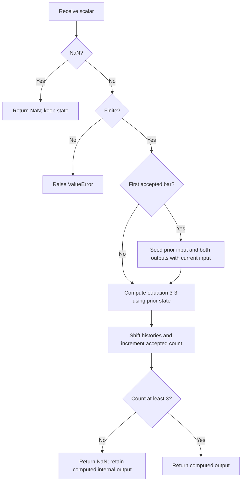

# SuperSmoother: research prototype master

This is John F. Ehlers' **two-pole SuperSmoother**, book equation 3-3 and the first filter in “Predictive And Successful Indicators” (January 2014). The master file is `super-smoother.py`, class `SuperSmoother`. It is a causal, scalar, streaming low-pass filter with default critical period 10 bars. It is not the three-pole modified Butterworth filter described earlier in the book.

## Principles and physical analogy

A smoothing filter should remove short-period fluctuations while introducing as little delay as practicable. The article begins with an electronic filter built from inductors and capacitors. In an analog circuit, stored magnetic and electric energy produces a second-order response; the maximally flat Butterworth response is a useful starting point. A normalized analog two-pole low-pass has

$$H_a(s)=\frac{\omega_c^2}{s^2+\sqrt2\,\omega_cs+\omega_c^2},\qquad \omega_c=2\pi/L,$$

with poles $s=-\omega_c/\sqrt2\pm i\omega_c/\sqrt2$. Mapping one-bar pole evolution into discrete time gives the exponentially damped rotating poles used below. This analog expression and pole interpretation explain the design; the exact recurrence, not a separately discretized analog circuit, is the implementation authority.

The book explains that the digital Butterworth numerator adds delay. Ehlers first removes its delayed numerator terms, then adds a two-sample moving average to introduce a zero at Nyquist for a cost of half a bar. The result retains a recursive denominator with a sharper transition than a comparable short nonrecursive moving average.

Daily closes are sampled values, not a continuous waveform. Nyquist is 0.5 cycles per bar, a two-bar period; one and two octaves below are four- and eight-bar periods. Ehlers describes short-period aliasing noise and recommends about 10 bars as a useful low-pass critical period. This filter attenuates short periods; it cannot reconstruct information already lost by sampling. The source's 12 dB/octave two-pole attenuation is an approximate filter-design description, with an additional exact Nyquist zero from the input average.

For comparison, a symmetric $N$-element nonrecursive filter has lag $(N-1)/2$. Increasing an SMA's length adds lag and does not uniformly eliminate its stopband lobes. Recursive filtering uses feedback to obtain strong smoothing with a short state vector, while accepting frequency-dependent delay and possible transient overshoot.

## Full mathematical calculation

Let $x_t$ be the current scalar, $y_t$ the output, and $L$ the critical cycle period in bars. With angles in radians, equation 3-3 becomes

$$
\begin{aligned}
\beta &= \frac{\sqrt{2}\pi}{L},\\
a &= e^{-\beta},\\
c_2 &= 2a\cos\beta,\\
c_3 &= -a^2,\\
c_1 &= 1-c_2-c_3,\\
y_t &= \frac{c_1(x_t+x_{t-1})}{2}+c_2y_{t-1}+c_3y_{t-2}.
\end{aligned}
$$

The two poles are $a e^{\pm i\beta}$, inside the unit circle because $0<a<1$ for positive finite $L$. The transfer function of this recurrence is

$$H_{SS}(z)=\frac{\frac{c_1}{2}(1+z^{-1})}{1-c_2z^{-1}-c_3z^{-2}}.$$

At DC, $z=1$, numerator and denominator are both $c_1$, so the gain is 1: constant inputs are preserved once the declared initial state is included. At Nyquist, $z=-1$, the numerator is zero, suppressing an alternating two-bar component after its initial transient. This is the purpose of the two-element input average. It adds half a bar of linear-phase delay to the modified recursive Butterworth denominator.

For a sinusoid of angular frequency $\omega=2\pi/T$, evaluate $H_{SS}(e^{i\omega})$. The gain is its magnitude; the phase is its argument. Group delay is $-d\arg H/d\omega$, so recursive-filter delay depends on frequency. The low-frequency group delay of this actual recurrence is

$$\tau_{SS}(0)=\frac12+\frac{c_2+2c_3}{c_1}.$$

At $L=10$, this recurrence gives a low-frequency group delay of about 1.825 bars. This derived expression is useful when comparing lag claims, but is not an extra calculation performed by `update`. The book and article give approximate lag descriptions; $L$ is a digital approximation's coefficient-setting critical period, not a guarantee of an exactly $-3$ dB discrete response at every small integer $L$.

## Configuration and exact startup

| Parameter | Shortcut | Default | Valid values | Meaning |
| --- | --- | ---: | --- | --- |
| `period` | `P` | 10.0 | Finite real $L\ge2$ | Coefficient-setting critical period, measured in bars; fractional values are accepted. |

There is no separate smoothing/window parameter. A period below about eight is a useful numerical boundary exercise but does not follow the source's practical short-cycle noise recommendation.

The first finite sample $x_0$ sets $x_{-1}=y_{-1}=y_{-2}=x_0$. Evaluate the recurrence on **every** finite bar, including this first bar. Store those internal values without decimal rounding. The returned outputs for $t=0,1$ are NaN; at $t=2$ and later return the actual recurrence output. Thus `warmup_bars=2` and the first valid bar is bar 3, independent of `period`. `is_primed` becomes true on that third accepted update. This preserves the copied zpano SuperSmoother's seed and output-availability policy.

The article/book equation does not mandate these seeds. AmiBroker's tip seeds its first two output array values from the first two raw values instead; the original EasyLanguage relies on platform histories. These conventions share the recurrence but differ in early outputs. With the shared closes, the master default first visible result is `92.7696354780799`.

Persistent state is one prior input, two prior internal outputs, and an accepted-update counter. It is O(1) storage and O(1) work per update. Compute all terms from old history before shifting the output histories.

## Calculation flow



## Precision, source equivalence, and porting contract

All calculations use ordinary Python `float` (IEEE 754 binary64), `math.pi`, and `math.sqrt(2.0)`. Angles passed to `sin`, `cos`, and `tan` are radians. In printed EasyLanguage, trigonometric arguments are degrees: multiply by $\pi/180$ when converting. `x[N]` means the value $N$ bars earlier; it is a historical reference, not a forward array index.

The user explicitly requested full-precision replacements for `1.414`, `.707`, and `3.14159`. Consequently this master reproduces the source **algorithm** with precise constants and the explicit standalone startup described here; it cannot also reproduce every decimal of a platform running the truncated literals. The supplied platforms have differing seeds and input availability. Their historical chart output is not a unique finite-sequence startup oracle. Source recurrences are independently evaluated with the same mathematical constants and declared startup in the accompanying tests.

Do not round coefficients, differences, histories, or intermediate outputs. Serialization alone uses **15 significant decimal digits** (`.15g`), not 15 digits after the decimal point. A port should use a small relative/absolute numerical tolerance for floating-point comparison, for example $10^{-11}$ at ordinary price scales; bit-for-bit equality across different math libraries or fused multiply-add settings is not required. The tests check the complete NaN prefix and every usable output, rather than skipping dozens of bars as the copied legacy tests did.

The indicator accepts one scalar input per `update`. The source examples use the close. It does not choose high/low/median automatically. Zero and negative finite samples are valid. A NaN sample returns NaN and leaves **all** state and priming counters unchanged; the next finite sample follows the preceding finite sample. This treats missing calls as omitted observations, not calendar gaps. Infinite inputs raise `ValueError` before any state is changed. Use `reset()` to clear the entire series state. A primed filter has an available output; its recursive transient need not have settled. Very large periods can approach binary64 coefficient-resolution limits even when they satisfy the finite-period validation.

Each folder is self-contained. Its Python file includes the numeric classes it needs, the embedded 252 closes in `__main__`, and a standard-library-only generator. Numeric code above the fixture-tooling boundary is the code to port; AST parsing, file formatting, and command-line helpers do not belong in an indicator's runtime calculation.

## Confirmed reference data

The user confirmed the following cases on 2026-10-20. There are 34 combinations across all three masters: 10 SuperSmoother, 12 Roofing, and 12 MESA Stochastic; each indicator is below the requested 64-case limit. Each expected array contains 252 positions aligned with the embedded `INPUT_CLOSE`.

| Array suffix | Parameter values | What it tests |
| --- | --- | --- |
| `P2` | `period=2` | Nyquist-period lower boundary: valid coefficients and two hidden startup outputs. |
| `P3` | `period=3` | Very short period: fast damping and reversal response. |
| `P5` | `period=5` | Short-period smoothing: rapid response to price changes. |
| `P8` | `period=8` | Two octaves below Nyquist: short-cycle noise suppression. |
| `P10` | `period=10` | Article example and book recommendation: ten-bar SuperSmoother. |
| `P10_5` | `period=10.5` | Fractional period: preserve real-valued coefficients without integer truncation. |
| `P20` | `period=20` | Monthly-scale smoothing: stronger noise reduction and longer lag. |
| `P40` | `period=40` | Book Roofing low-pass example: longer smoothing memory. |
| `P80` | `period=80` | Long-period smoothing: sustained recursive memory. |
| `P252` | `period=252` | Full-record-length period: long transient with unchanged priming count. |


Run the streaming demonstration and regenerate the confirmed fixtures from this folder:

```bash
python3 super-smoother.py
python3 super-smoother.py --generate-reference-data
python3 test_super_smoother.py
```

The generator first writes and rereads Python expected arrays, verifies 252 values and exact serialized 15-digit precision, then propagates those saved values and identical two-line comments to Go, TypeScript, Rust, and Zig. It replaces only its marked generated section on reruns; copied input arrays remain intact. `__main__` embeds the closes and checks they equal the copied Python input before generation. Synthetic constant, ramp, and boundary tests supplement the market-data fixtures.

| Language | File | Expected declaration / NaN |
| --- | --- | --- |
| Python | `test_testdata.py` | `EXPECTED_` plus suffix; list / `math.nan` |
| Go | `testdata_test.go` | `expected` plus suffix; `[]float64` / `math.NaN()`; package `supersmoother` |
| TypeScript | `testdata.ts` | `export const expected` plus suffix; `number[]` / `NaN` |
| Rust | `testdata.rs` | `pub fn expected_` plus lowercase suffix; `Vec<f64>` / `f64::NAN` |
| Zig | `testdata.zig` | `pub fn expected` plus suffix; `[252]f64` with `return` / `nan` |

Decimal parameter points are underscores: 10.5 becomes `10_5`; booleans in suffixes are 0/1. Python suffixes follow `EXPECTED_P10`, `EXPECTED_LP10_HP48_PO2_ZM0`, or `EXPECTED_N20_LP10_HP48` as appropriate. Other-language fixture comments reproduce the Python descriptions and parameter names verbatim. The copied Rust inputs stay inside their `#[cfg(test)] pub mod testdata`; expected functions are at file scope. Use both scopes as needed in a port's tests.

The accompanying tests extract original expressions from the supplied sources and compare every output against an independent batch calculation with precise constants and the specified startup. They also check the 15-digit Python values, all four translations including NaNs and comments, invalid parameters, reset behavior, and NaN state preservation. Source expressions are reproduced in this document; if source files are unavailable after copying the folder, the tests fall back to these code blocks.

## References and BibTeX

- John F. Ehlers, *Cycle Analytics for Traders: Advanced Technical Trading Concepts*, Wiley, 2013. [Book record](../../2013-cycle-analytics-for-traders/toc.md), [chapter 3](../../2013-cycle-analytics-for-traders/ch3.md), [chapter 4](../../2013-cycle-analytics-for-traders/ch4.md), [chapter 7](../../2013-cycle-analytics-for-traders/ch7.md), and [chapter 17](../../2013-cycle-analytics-for-traders/ch17.md). Relevant equations and code are reproduced below so a conversion agent does not need these files.
- John F. Ehlers, “Predictive And Successful Indicators,” *Technical Analysis of STOCKS & COMMODITIES* 32(1), January 2014, pp. 16–25. [Local article](../../tasc/2014-01-predictive-and-successful-indicators/content.md), [published PDF](https://technical.traders.com/archive/article.asp?file=\V32\C01\692EHLE.pdf).
- *Traders' Tips*, January 2014. [Local collection](../../tasc/2014-01-predictive-and-successful-indicators/tips/tips.md), [published collection](https://www.traders.com/Documentation/FEEDbk_docs/2014/01/TradersTips.html). TradeStation reproduces the recurrences; eSignal checks history availability; AmiBroker uses different initial array seeds.
- R. W. Hamming, *Digital Filters*, third edition, Prentice Hall, 1997, cited by Ehlers in chapter 3 for the smoothing-filter background.
- The [initial implementation investigation](../../tasc/2014-01-predictive-and-successful-indicators/implementation-comparison.md) compared the copied zpano implementations. It is a project audit, not an additional mathematical authority.

```bibtex
@book{ehlers2013cycle,
  author    = {Ehlers, John F.},
  title     = {Cycle Analytics for Traders: Advanced Technical Trading Concepts},
  publisher = {Wiley},
  year      = {2013},
  series    = {Wiley Trading},
  isbn      = {9781118728604},
  note      = {Chapter 3, equation 3-3; chapter 4, high-pass transfer functions;
               chapter 7, listings 7-1 through 7-4; chapter 17, oscillator timing}
}
@article{ehlers2014predictive,
  author  = {Ehlers, John F.},
  title   = {Predictive And Successful Indicators},
  journal = {Technical Analysis of STOCKS \& COMMODITIES},
  volume  = {32},
  number  = {1},
  pages   = {16--25},
  year    = {2014},
  month   = jan,
  url     = {https://technical.traders.com/archive/article.asp?file=\V32\C01\692EHLE.pdf}
}
@misc{traderstips2014january,
  author       = {{Technical Analysis of STOCKS \& COMMODITIES}},
  title        = {Traders' Tips: Predictive And Successful Indicators},
  year         = {2014},
  month        = jan,
  howpublished = {Online},
  url          = {https://www.traders.com/Documentation/FEEDbk_docs/2014/01/TradersTips.html},
  note         = {TradeStation, eSignal, and AmiBroker implementations supplied locally}
}
@book{hamming1997digital,
  author    = {Hamming, Richard W.},
  title     = {Digital Filters},
  edition   = {3},
  publisher = {Prentice Hall},
  address   = {Upper Saddle River, NJ},
  year      = {1997},
  note      = {Page 49; cited in Ehlers chapter 3}
}
```

## Original source mathematics and code

The following source material is reproduced without changing its mathematical expressions. The supplied transcription of preceding equations 3-1 and 3-2 also contains unusual signs and a factor 1.25; these are preserved as source text and are not used by this master. Equation 3-3 and the article sidebar agree on the implemented recurrence. Printed coefficient approximations and degree angles remain visible here for audit; the master implementation uses the precise radian equations above. Image links are omitted.

### Book chapter 3: SuperSmoother derivation and applications

One of the advantages of recursive filters is that the transition between the pass band and the stop band can be much sharper compared to that of the nonrecursive filters. As a matter of computational simplicity, the critical period of the filter can be established independently from the degree of the filter. On the downside, recursive filters don’t have the same delay at all frequencies. This variable delay across the spectrum leads to dispersion distortion of the output waveform. Most of the dispersion occurs at those frequency components that have been attenuated, so the effect of the distortion is a relatively minor one.

A Butterworth filter is a favorite analog filter because its frequency response is maximally flat, near zero frequency. Years ago, I translated analog Butterworth filters to their digital approximations having like degrees in the numerator and denominator of the transfer response. The transfer response is characterized by a single variable: the critical period. The critical period is that where the output is attenuated by $3$ dB relative to the input data.

The digital Butterworth filter approximations included numerators whose coefficients were $[1 2 1] and [1 3 3 1]$ for two- and three-pole con- figurations, respectively. However, for applications to trading, I noted that the primary contribution of the numerator terms was to increase the filter lag. So I created modified versions simply by deleting all but the constant term in the numerator of the Butterworth transfer response.

The equations for the two-pole modified Butterworth filter are:

$$\begin{aligned}
a &= e^{-1.414 \cdot 3.14159 / \text{Period}} \\
b &= 2 a \cos(1.414 \cdot 1.25 \cdot 180 / \text{Period}) \\
c_2 &= b \\
c_3 &= -a \cdot a \\
c_1 &= 1 - c_2 - c_3 \\
\text{Output} &= c_1 \cdot \text{Input} - c_2 \cdot \text{Output}[1] - c_3 \cdot \text{Output}[2]
\end{aligned}$$

(3-1)

The equations for the three-pole modified Butterworth filter are:

$$\begin{aligned}
a &= e^{-3.14159 / \text{Period}} \\
b &= 2 a \cos(1.738 \cdot 180 / \text{Period}) \\
c &= a \cdot a \\
d_2 &= b + c \\
d_3 &= -(c + b \cdot c) \\
d_4 &= c \cdot c \\
d_1 &= 1 - d_2 - d_3 - d_4 \\
\text{Output} &= d_1 \cdot \text{Input} - d_2 \cdot \text{Output}[1] - d_3 \cdot \text{Output}[2] - d_4 \cdot \text{Output}[3]
\end{aligned}$$

(3-2)

The frequency responses for two- and three-pole modified Butterworth filters whose critical period was set at a 10-bar cycle are shown in ­Figure 3.8. The three-pole version gives about 6 dB more attenuation at the Nyquist frequency than the two-pole version. That means the output wave amplitude of the three-pole version would be half the wave amplitude at the Nyquist frequency. In some applications, this difference in filtered amplitude could be important.

**Figure 3.8** *Frequency Response of Two- and Three-Pole Modified Butterworth Filters Where Period = 10*

The delay of the two- and three-pole modified Butterworth filters whose critical period was set at a 10-bar cycle is shown in Figure 3.9. The price to be paid for the additional rejection band attenuation is an increase of almost two bars of additional delay near the critical period. In addition, there is greater percentage dispersion distortion across the pass band.

Having obtained good filtering with minimum delay and minimum delay distortion, it is relatively easy to obtain a zero in the transfer response at the Nyquist frequency by adding a two-element moving average in the numerator. The delay cost is only half a bar, and that cost seems worth it. By doing this, a filter I call the SuperSmoother is created. The equations for the SuperSmoother filter are:

$$\begin{aligned}
a &= e^{-1.414 \cdot 3.14159 / \text{Period}} \\
b &= 2 a \cos(1.414 \cdot 180 / \text{Period}) \\
c_2 &= b \\
c_3 &= -a \cdot a \\
c_1 &= 1 - c_2 - c_3 \\
\text{Output} &= c_1 \cdot (\text{Input} + \text{Input}[1]) / 2 + c_2 \cdot \text{Output}[1] + c_3 \cdot \text{Output}[2]
\end{aligned}$$

(3-3)

**Figure 3.9** *Lags of Two- and Three-Pole Modified Butterworth Filters Where Period = 10*

The frequency response of the SuperSmoother filter where the critical period is set to $10$ is shown in Figure 3.10.

**Figure 3.10** *Frequency Response of a SuperSmoother Filter Where Period = 10*

## SuperSmoother Filter Applications

A SuperSmoother filter is used anytime a moving average of any type would otherwise be used, with the result that the SuperSmoother filter output would have substantially less lag for an equivalent amount of smoothing produced by the moving average. For example, a five-bar SMA has a cutoff period of approximately 10 bars and has two bars of lag. A SuperSmoother filter with a cutoff period of 10 bars has a lag a half bar larger than the two-pole modified Butterworth filter shown in Figure 3.9. Therefore, such a SuperSmoother filter has a maximum lag of approximately 1.5 bars and even less lag into the attenuation band of the filter. The differential in lag between moving average and SuperSmoother filter outputs becomes even larger when the cutoff periods are larger.

Market data contain noise, and removal of noise is the reason for using smoothing filters. In fact, market data contain several kinds of noise. I’ll group one kind of noise as systemic, caused by the random events of trades being exercised. A second kind of noise is aliasing noise, caused by the use of sampled data. Aliasing noise is the dominant term in the data for shorter cycle periods.

It is easy to think of market data as being a continuous waveform, but it is not. Using the closing price as representative for that bar constitutes one sample point. It doesn’t matter if you are using an average of the high and low instead of the close, you are still getting one sample per bar. Since sampled data is being used, there are some DSP aspects that must be considered. For example, the shortest analysis period that is possible (without aliasing) $2$ is a two-bar cycle. This is called the Nyquist frequency, $0.5$ cycles per sample. A perfect two-bar sine wave cycle sampled at the peaks becomes a square wave due to sampling. However, sampling at the cycle peaks cannot be guaranteed, and the interference between the sampling frequency and the data frequency creates the aliasing noise. The noise is reduced as the data period is longer. For example, a four-bar cycle means there are four samples per cycle. Because there are more samples, the sampled data are a better replica of the sine wave component. The replica is better yet for an eight-bar data component. The improved fidelity of the sampled data means the aliasing noise is reduced at longer and longer cycle periods. The rate of reduction is $6$ dB per octave. My experience is that the systemic noise rarely is more than $10$ dB below the level of cyclic information, so that we create two conditions for effective smoothing of aliasing noise:

1. It is difficult to use cycle periods shorter that two octaves below the Nyquist frequency. That is, an eight-bar cycle component has a quantization noise level 12 dB below the noise level at the Nyquist frequency. Longer cycle components therefore have a systemic noise level that ­exceeds the aliasing noise level.
2. A smoothing filter should have sufficient selectivity to reduce aliasing noise below the systemic noise level. Since aliasing noise increases at the rate of $6$ dB per octave above a selected filter cutoff frequency and since the SuperSmoother attenuation rate is $12$ dB per octave, the SuperSmoother filter is an effective tool to virtually eliminate aliasing noise in the output signal.

I urge readers to universally adapt the SuperSmoother filter set to a cutoff period of $10$ bars or so on all data to attenuate aliasing noise. The output of the SuperSmoother filter can be used directly as an indicator or as the sampled data fed to any other indicator.

## EasyLanguage Code To Compute The SuperSmoother Filter

```easylanguage
{
  SuperSmoother filter
  © 2013 John F. Ehlers
}
Vars: a1(0), b1(0), c1(0), c2(0), c3(0), Filt(0);

a1 = expvalue(-1.414*3.14159 / 10);
b1 = 2*a1*Cosine(1.414*180 / 10);
c2 = b1;
c3 = -a1*a1;
c1 = 1 - c2 - c3;

Filt = c1*(Close + Close[1]) / 2 + c2*Filt[1] + c3*Filt[2];

Plot1(Filt);
Plot2(0);
```

### Article: Noise

Market data is noisy. The systemic noise arises from hundreds, if not thousands, of traders placing trades nearly simultaneously that each trader, for a variety of reasons, thinks will result in profits. In addition, market data is sampled data rather than continuous data; that is, there is only one data point on the close of each day when using daily data. Even if you average in the high & low prices, there still is only one sample per day. Of course, you can change the sample rate using intraday data, but you are still using sampled data. The result of using sampled data is that there is substantial aliasing noise several octaves below the Nyquist frequency. If you prefer, you can think of this other kind of noise as autocorrelation noise. For daily data, the period of the Nyquist frequency is a two-bar cycle. One octave lower is a four-bar cycle, and one more octave lower is an eight-bar cycle. Aliasing noise swamps the signal for these shorter cycle periods, and the only thing that can be done is to not even try to use cycle periods where the aliasing noise swamps the signal amplitude.

Aliasing noise is also larger than the signal amplitude at even longer cycle periods, but the frequency separation enables filters to reduce or nearly remove the effects of aliasing noise. Simple moving averages (SMA) or exponential moving averages (EMA) are often used to smooth the data in an attempt to reduce aliasing noise. The problem with using an SMA or EMA is that they are not efficient filters. The only way to get more smoothing is to increase the length of the moving average, which introduces more lag into the filter.

I have developed a stunning new filter that sharply attenuates aliasing noise while minimizing filtering lag. I call this new filter the SuperSmoother. Once you know about this filter, you will never need to use an EMA or SMA again. I started the design of the SuperSmoother using real inductors and capacitors as if it were in an electronic circuit. I then converted this analog filter into a digital filter. After this conversion, I saw that I could alter the transfer response to minimize filter lag. Figure 1 shows the filtering response of the SuperSmoother compared to the response of an EMA when the critical period of both was set to be a 10-bar period. The EMA only has 13 decibels (dB) of rejection at the Nyquist frequency, whereas the SuperSmoother virtually eliminates aliasing noise.

**FIGURE 1: EXPONENTIAL MOVING AVERAGE VS. SUPERSMOOTHER.** An EMA has only modest noise attenuation while a SuperSmoother virtually eliminates aliasing noise.

The EasyLanguage code to compute the SuperSmoother filter is given in sidebar "EasyLanguage Code To Compute The SuperSmoother Filter." If you are converting this code to another programming language, please note that the trigonometric function angles are in degrees, whereas they are in radians in most other programming languages. Note also that the suffix notation [N] means the value N bars ago in the recursive calculations. I have set the critical period to be a 10-bar period in the code example to eliminate aliasing noise. However, the critical period can be a generalized input variable. This makes the SuperSmoother an outstanding generic smoothing filter.
