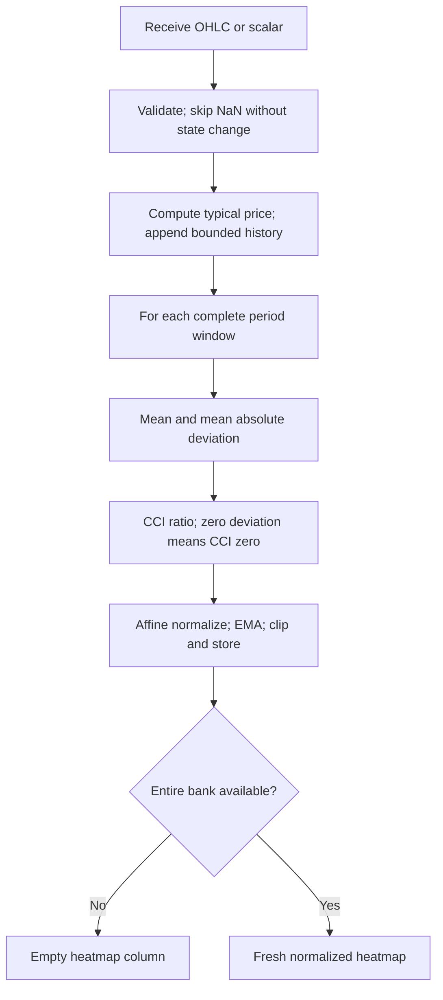

# Swami Commodity Channel Index: research prototype master

Master: `swami-commodity-channel-index.py`, class `SwamiCommodityChannelIndex`. One accepted chronological update returns a heatmap column. This is the authoritative standalone conversion contract for this folder.

## What a SwamiChart measures

A SwamiChart is a bank of related indicators evaluated at many observation or cycle periods. Its horizontal axis is time and its vertical axis is the period parameter. One streaming update produces one vertical column. Shorter periods usually react earlier but respond to smaller fluctuations; longer periods reveal persistence with more lag. Reading the shorter-period response in the context of longer-period responses is the central idea in the March article and Chapter 16. It makes parameter sensitivity visible instead of choosing one allegedly optimal period.

This resembles a measuring instrument with several selectable time constants, all read simultaneously. For a filter bank it also resembles a collection of resonators tuned to different frequencies. It is not automatically an estimate of spectral power: the vertical parameter means lookback or cycle period as defined below, and the values are normalized indicator responses. Adjacent rows use highly overlapping data and are not independent observations. A colored pattern does not by itself supply a statistical test, calibrated probability, trading rule, or proof of predictive value.

Let $v_t(P)$ be the numerical response at bar $t$ and period $P$. For integer periods $P_0,\ldots,P_1$, the column is

$$\mathbf v_t=[v_t(P_0),v_t(P_0+1),\ldots,v_t(P_1)].$$

Except for Convolution's signed representation, the conventional stoplight palette maps $v\in[0,1]$ to RGB channels:

$$
(R,G,B)=
\begin{cases}
(255,510v,0),&v<1/2,\\
(510(1-v),255,0),&v\ge1/2.
\end{cases}
$$

Thus 0 is red, 0.5 yellow, and 1 green. The numerical master returns values rather than RGB integers. Platform rounding of channel values and interpolation between rows belongs to rendering. The original Swing Wave uses blue/orange and Convolution uses signed red/green intensity; see their specific equations below. Palette changes alone do not warrant new indicator folders.

## Streaming and heatmap contract

The Python file in this folder is self-contained and uses the standard library only. Copying this folder is sufficient; there are no runtime imports from other prepared masters or zpano. Numerical helpers above the fixture-tooling separator are the parts to port. Lists implement bounded newest-first histories; a port may use circular buffers but must preserve the logical order of all sums and comparisons.

`Heatmap` is a named tuple compatible with the requested fields in `external/zpano/py/indicators/core/outputs/heatmap.py`:

| Field | Meaning |
| --- | --- |
| `time` | Optional caller timestamp; does not affect the calculation. |
| `parameter_first`, `parameter_last` | Inclusive first and last displayed periods. |
| `parameter_resolution` | 1.0; row $i$ is $P_0+i$. |
| `value_min`, `value_max` | Actual minimum and maximum of this column, not fixed palette endpoints. |
| `values` | Fresh list of $P_1-P_0+1$ values, independently owned. |

Until the entire selected bank is available, return an empty values list with NaN min/max. During reference export only, expand that empty column to the full row width filled with NaNs. A map is wholly available or wholly unavailable; this avoids differently primed rows within the same public column. `warmup_bars` counts the leading unavailable finite-input observations. `is_primed` reports complete-bank availability, not convergence of recursive transients.

A NaN input means an omitted observation: return an empty public column and preserve every history, retained value, and accepted-bar count. The next finite input follows the preceding finite input, regardless of timestamps. Infinity and invalid OHLC order raise `ValueError` before any normal update. Finite negative or zero prices are accepted. As in the source listings, arithmetic assumes finite, ordinary-magnitude financial samples; extreme finite magnitudes can overflow intermediate arithmetic and are outside the reference-data domain. `reset()` restores all histories, seeds and counters. A missing input must never be saved as NaN recursive state.

## Precision and source fidelity

Use IEEE 754 binary64, full-precision $\pi$ and $\sqrt2$, and radian trigonometric functions. Convert an EasyLanguage degree argument $a$ to $a\pi/180$. Replace printed `1.414` with $\sqrt2$, `.707` with $1/\sqrt2$ where applicable, and `3.14159` or `6.28` with $\pi$ or $2\pi$. This is the requested precision convention, so fixtures cannot also match every decimal of a platform running the rounded printed constants.

Explicit EMA weights `.33/.67`, `.5/.5`, `.2/.8`, CCI's `.015`, and Convolution's contrast factor 3 remain the source constants. In particular, `.33` is not silently replaced by $1/3$. Do not round intermediates. Export alone uses **15 significant digits**, Python `.15g`, rather than 15 digits after the decimal point. Go, Rust, Zig and other math libraries may differ in their last bits; compare finite fixture values with a suitable relative/absolute tolerance such as $10^{-11}$, while matching NaN positions exactly.

Chart platforms choose historical availability, MaxBarsBack, seeds, and invocation timing differently. This master defines a standalone startup explicitly below: actual raw differences, zero recursive seeds, and actual complete finite windows. It preserves the source recurrence and the documented degenerate branches, rather than claiming a unique cross-platform first-bar oracle. Independent tests evaluate the selected source formulas over the same standalone history convention, including startup. The documented corrections or extensions are part of the conversion contract.

## Reference-data workflow

All five shared input files are copied into this folder: `test_testdata.py`, `testdata_test.go`, `testdata.ts`, `testdata.rs`, and `testdata.zig`. The master `__main__` embeds the exact 252 shared close/high/low values and demonstrates the default. Run `python3 swami-commodity-channel-index.py` for that demonstration. The user confirmed all 56 Swami combinations on 2026-10-21, including the eight combinations in this folder. The source flag `REFERENCE_CASES_CONFIRMED` records that authorization and is true. All five language fixtures now contain 24 generated expected arrays for the eight cases.

To regenerate the confirmed data, run `python3 swami-commodity-channel-index.py --generate-reference-data`. The generator appends a marked expected-data section to Python, reopens and verifies every rounded value, NaN and dimension, then translates those verified Python literals to the other four languages. Regeneration replaces only that marked section and preserves all inputs. Run `python3 verify_reference_data.py` to check the resulting values, names, comments, shapes and NaN masks in all five languages. [validation.md](validation.md) records completed checks and [reference_manifest.json](reference_manifest.json) records the full fixture inventory. Each array contains 252 time positions; heatmaps and per-period diagnostics have a second dimension equal to the bin count. Every array has two comments: the exact What it tests description below, then parameter values and input convention.

Names are `EXPECTED_<parameter tokens>_<component>`. Period bounds use `P0`, `P1`; variants use `V2012` and `V2013`; `LP/HP` are filter periods; `RA/OA/A` are EMA weights; `C` is RSI contrast; `D/F/PA` are bandwidth, fraction and peak-average length. Decimal points become underscores. For example `EXPECTED_V2013_P05_P148_LP10_5_HEATMAP` identifies the fractional roofed case. Unspecified parameters take the documented defaults; the comments list every explicitly varied parameter and the source input convention.

Python uses `NaN = math.nan`, Go `math.NaN()`, TypeScript `NaN`, Rust `f64::NAN`, and Zig `nan` with `const math = @import("std").math; const nan = math.nan(f64);`. Go packages use the folder name with hyphens/underscores removed. Go/TypeScript/Zig expected names begin `expected` with uppercase shortcuts; Rust functions begin `expected_` with lowercase tokens. TypeScript exports valid typed constants; Rust returns vectors; Zig returns `[252]f64` or `[252][bins]f64`. These are compilable versions of the intended language formats.

## Selected source and CCI principles

`SwamiCommodityChannelIndex` follows the March TradeStation `_SwamiChart_CCI`, including its EMA and final clipping. Donald Lambert's CCI compares price to a recent average, scaled by the average absolute distance from that average. Its analogy is a displacement sensor with a ruler that expands or contracts with recent variability. Unlike a z-score, its denominator is mean absolute deviation, not standard deviation. Unlike RSI or stochastic, CCI is unbounded.

Chapter 16 suggests simply adding 100 and dividing by 200 to get a 0..1 value. That affine map alone does not bound CCI. The actual March code supplies the missing smoothing and clamp, and this master uses that implementation. Website prose alternately describes red as overbought and green as upper-channel; the executable code is unambiguous: positive CCI moves the palette toward green.

## Complete mathematical calculation

Use typical price, matching the TradeStation `CCI(P)` built-in:

$$x_t=(h_t+l_t+c_t)/3.$$

For each $P$ and a complete $P$-bar window,

$$\mu_t(P)=\frac1P\sum_{j=0}^{P-1}x_{t-j},\quad m_t(P)=\frac1P\sum_{j=0}^{P-1}|x_{t-j}-\mu_t(P)|,$$

$$\operatorname{CCI}_t(P)=\begin{cases}\dfrac{x_t-\mu_t(P)}{.015\,m_t(P)},&m_t(P)\ne0,\\0,&m_t(P)=0.\end{cases}$$

The `.015` is CCI's defining scale coefficient, not a truncated mathematical constant. Flat-window CCI is defined as zero as a conventional extension of the built-in's degenerate branch. No epsilon is used. Convert to the source target and EMA:

$$s_t(P)=\frac{\operatorname{CCI}_t(P)/100+1}{2},$$
$$\widetilde v_t(P)=a\,s_t(P)+b\,v_{t-1}(P),\qquad v_t(P)=\min(1,\max(0,\widetilde v_t(P))).$$

At the source default $a=.33$, use its separately printed $b=.67$; at configurable nondefault weights use $b=1-a$. Seeds are zero. **Normalize, then smooth, then clip and store**. Clipping $s_t$ before smoothing gives different output on extreme CCI values and is incorrect. Finite-window summation proceeds from current toward oldest each bar; do not substitute a rolling mean or deviations around different means.

## Configuration, inputs and startup

| Parameter | Default | Valid range |
| --- | --- | --- |
| `min_period` | 12 | Integer $\ge2$. |
| `max_period` | 48 | Integer $\ge P_0$. |
| `alpha` | .33 | Finite real $(0,1]$, output EMA weight. |

`update(close, high, low, time=None)` computes typical price. Both high and low must be supplied together, with valid OHLC order. `update(value)` instead uses the caller's scalar directly; this is useful for other price sources and is not silently claimed to be the OHLC source default. **Reference cases use shared high/low/close arrays.** A flat input starts with a .5 target, but the zero-seeded EMA need not immediately return .5.

Each bin starts when its own full $P$-bar window exists; its EMA starts at zero on that first available window. The complete bank first appears on bar $P_1$, with `warmup_bars=P1-1`. All histories have bounded storage $O(P_1)$ plus $O(P_1-P_0+1)$ output states. Work is $O(\sum P)$ because the mean and its absolute deviations are scanned each time, making the source mathematics straightforward to port.

## Calculation flow



## Confirmed reference combinations (2026-10-21)

| Case | Parameters | What it tests |
| --- | --- | --- |
| 1 | `min_period=12, max_period=48, alpha=0.33` | TradeStation CCI default using OHLC typical price. |
| 2 | `min_period=2, max_period=48, alpha=0.33` | Shorter periods expose unbounded CCI normalization before clipping. |
| 3 | `min_period=12, max_period=24, alpha=0.33` | Compact CCI map with identical source smoothing. |
| 4 | `min_period=48, max_period=48, alpha=0.33` | Single long CCI bin. |
| 5 | `min_period=12, max_period=48, alpha=0.1` | Slower CCI color-state smoothing. |
| 6 | `min_period=12, max_period=48, alpha=0.5` | Faster CCI color-state smoothing. |
| 7 | `min_period=12, max_period=48, alpha=1.0` | No CCI EMA memory; normalize then saturate directly. |
| 8 | `min_period=12, max_period=252, alpha=0.33` | Full-record CCI window: only the last bar is public. |

Unlisted parameters retain the configuration-table defaults. Each case exports `HEATMAP`, `MIN` and `MAX`.

## References and BibTeX

These references supply the theory, formulas, source comparisons and archived presentation notes above. All numerical steps needed for conversion are included in this document; the following links are provenance rather than runtime dependencies.

- Ehlers and Way, March 2012, [Introducing SwamiCharts](../../tasc/2012-03-introducing-swami-charts/content.md), and [March TradeStation code](../../tasc/2012-03-introducing-swami-charts/tips/SwamiCharts.els).
- Ehlers and Way, April 2012, [Setting Strategies With SwamiCharts](../../tasc/2012-04-setting-strategies-with-swami-charts/content.md), and [April Trader's Tips](../../tasc/2012-04-setting-strategies-with-swami-charts/tips/tips.md).
- Ehlers and Way, October 2012, [SwamiCharts Convolution](../../tasc/2012-10-swami-charts-convolution/content.md).
- Ehlers, 2013, *Cycle Analytics for Traders*: [Chapter 3](../../2013-cycle-analytics-for-traders/ch3.md) (SuperSmoother), [Chapter 5](../../2013-cycle-analytics-for-traders/ch5.md) (band-pass), [Chapter 7](../../2013-cycle-analytics-for-traders/ch7.md) (spectral dilation), [Chapter 13](../../2013-cycle-analytics-for-traders/ch13.md) (Convolution listing 13-1), and [Chapter 16](../../2013-cycle-analytics-for-traders/ch16.md) (Swami RSI/Stochastic listings 16-1/16-2).
- [Archived SwamiCCI page](../../../../external/swami/SwamiCCI.mht), a description/screenshot source with no numerical implementation.
- [NinjaTrader BPF](../../tasc/2012-04-setting-strategies-with-swami-charts/tips/ninja-trader/BPF.cs) and [SwamiWave](../../tasc/2012-04-setting-strategies-with-swami-charts/tips/ninja-trader/SwamiWave.cs), for the selected Swing Wave variant.

```bibtex
@article{ehlers_way_2012_swami_intro,
  author = {Ehlers, John F. and Way, Ric},
  title = {Introducing SwamiCharts},
  journal = {Technical Analysis of STOCKS \& COMMODITIES},
  volume = {30}, number = {3}, pages = {15--22}, year = {2012}, month = mar
}
@article{ehlers_way_2012_swami_strategies,
  author = {Ehlers, John F. and Way, Ric},
  title = {Setting Strategies With SwamiCharts},
  journal = {Technical Analysis of STOCKS \& COMMODITIES},
  volume = {30}, number = {4}, year = {2012}, month = apr
}
@article{ehlers_way_2012_swami_convolution,
  author = {Ehlers, John F. and Way, Ric},
  title = {SwamiCharts Convolution},
  journal = {Technical Analysis of STOCKS \& COMMODITIES},
  volume = {30}, number = {10}, pages = {10--13}, year = {2012}, month = oct
}
@book{ehlers2013cycle,
  author = {Ehlers, John F.},
  title = {Cycle Analytics for Traders: Advanced Technical Trading Concepts},
  publisher = {Wiley}, year = {2013}, isbn = {9781118728604}
}
@misc{traders_tips_2012_march,
  author = {{Technical Analysis of STOCKS \& COMMODITIES}},
  title = {Traders' Tips: March 2012}, year = {2012}, month = mar,
  url = {https://www.traders.com/Documentation/FEEDbk_docs/2012/03/TradersTips.html},
  note = {Includes TradeStation listings by Chris Imhof and differing vendor implementations}
}
@misc{traders_tips_2012_april,
  author = {{Technical Analysis of STOCKS \& COMMODITIES}},
  title = {Traders' Tips: April 2012}, year = {2012}, month = apr,
  url = {https://www.traders.com/Documentation/FEEDbk_docs/2012/04/TradersTips.html},
  note = {Includes NinjaTrader SwamiWave/BPF and OmniTrader SwamiMM/OptimizedMarketMode by Jeremy Williams}
}
@misc{swami_archived_product,
  author = {{Securities Analytics, Inc.}},
  title = {SwamiCharts Archived Product Pages},
  howpublished = {Repository-local MHT snapshots in external/swami},
  note = {Descriptions and screenshots; snapshot footer copyright 1998--2011 does not establish the capture date}
}
```
